# 015：康奈尔大学《智能系统的机器学习｜CS4780 Machine Learning for Intelligent Systems 2017》中英字幕 p15 -15-Machine Learning Lecture 15 ＂(Linear) Support Vector Machines continued＂ -Co -BV1Lo6gBxEKE_p15-

I。All right， welcome。Welcome， everybody。Please close your laptops。 Thank you。Okay。

 so we talked about。Support vector machines。And。The idea behind super machines on a high level is quite straightforward。

I's the mic on in the back。 Can you hear me。Mi克， okay。So we have once again， two classes。

Positive and negative points。And we started out with the questions of what we have now algorithm to find as a hyperplane between those。

 That's the perception on。But the perception this gives us a hypona。

And it would' be nice if you could actually find a particular hyperplane。

 a dearly one that's well suited for classification， right So and in some sense。

 it comes with the realization that some hyperplanes may be better than others。

 You could have a really bad hyperplane， for example， this one here， right。

 would actually classify this correctly， But if any test point， you know， We here。

 it would actually classify that as a cross， which seems intuitively the wrong thing to do。😊。

And so the idea behind vector machines is。That a hyperplane is good if it maximizes the margin。 So。

 or the best hyperplane is the one that actually maximizes the margin。

 where margin is defined as the distance to the closest point。Now。You know， of course。

 it has to be a hyper planee that separates the two dataset sets。 It has to be in between these two。

 And then actually turns out that the one that maximizes the margin always has equi distance to the closest point from one class and to the closest point of the other class。

 That must be the case。 Otherwise， you could move it closer。😊。

And that doesn't really seem like it's in the middle。 But yeah， So that that's the idea。

 So the question was， how do we find this hyperplan that has maximum margin。

 maximum distance to both sides。And what we did is we defined the definition of margin。

And then we just said， let's maximize this subject to the constraint that every point is on the right side of this pipeline plane。

 So if this year is W， D here must be on on the positive side， these must be on the negative side。

 So this was an opt constrained optimization problem。 And that was kind of。😊，Ugly。

 so we had to do a little bit of massaging。 And ultimately。

 we ended up with the following optimization problem， which is equivalent。😊，In the final solution。

 W trends， we minimize。The square of W， subject to the constraints。It's been such that。嗯。F eye。Y。

 I W transpose X， I plus B is greater equal one。And that is the SVM。Optimization problem。

 So the constraint here says every single data point has to be。

At least a margin of one away from the hypotheamme must be on the right side。

s because that's positive。 M must be at least one away。😊。

And what W does here tries to make W as small as possible。

 So you have to be careful one here is actually really just one unit， right。

 It doesn't mean anything because you can divide W and B by constant So by actually minimizing W。

 what you get is basically the smallest W。 That means such that these are actually this is actually the。

 So ultimately what it does， you know， basically triesify the hyper plane that pushes them away as as much as possible everywhere。

😊，So and， and we had this little exercise where we basically looked at the two different formulations。

 and we could show that they are the same in the optimal。

 right So before we actually had a bunch of constraints。 But we showed that actually， you know。

 at the optimal solution， that's equivalent to these constraints here。

 So we can't just enforce these constraints here。 Just do。😊，I， I guess， in some sense。

 the way this is like。Last basically， we have a set of。

 of all possible solutions that satisfy the constraints。 And here we have the optimal。

 And what we showed is that actually' another set of of solutions has the same optimal。

 So that's basically the smaller set is the set of of constraints。😊，嗯。If you remember what we。

Did last time。 Those were the two basic different formulations。Okay， anyway。

 so this is the SVM optimization problem。 And some people ask me afterwards， like， wait a second。

 what if such a hyperplane doesn't exist， So what if， for example。

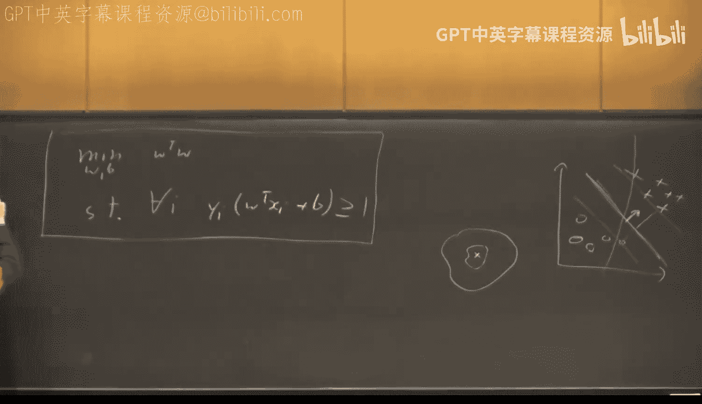

But you know there， you know， for example， we had one circle here or something like this， right。

 The perception would loop forever。 What would happen in this case， Actually。

 if you optimize this if you stick this in a quadratic programming solver。

 what you would get is actually output infeas。 There's no feasible set。

 There's no single point that actually satisfies the solution。😊，So an natural question is， well。

 in this case， right， is it really the right thing to say， well， I'm throw my hands up and say。

 I give up， or should I maybe still output something that's reasonable that separates most of the points。

And。That's， of course， something people thought about。 And actually。

 this was published very soon after the original SVM formulation came the formulation with slack variables。

 And so the idea is basically the following。😊，You say。Imagine I can't possibly solve this problem。

 right， This， for example， here， we have some points like you know， here， there's no。

 no hyperplane that satisfies this point from each other。What do I want in that case？And。

The formulation that Corrina Cortez came up with was she said， well， in this case。

 I still want these to be satisfied as much as possible。

But I allow for some violation of these constraints。And how do you do this， You basically say， okay。

 what I'm doing is I add a little bit of slack here。They call thissi。嗯。And。嗯。

Thissi must all be greater equals 0。What来。So thisci here basically says this is something that I'm subtracting from one。

Right， and then I can always make this disati， right， Like whatever this value on the left is。

 I can always subtract enough on the right， such that this constraint is satisfied。

 Does that make sense。Raise the hand if that makes sense。Okay。

 so so one more time is they have this constraint。 I can't satisfy。

 This' see on the left hand side is just not greater equal 1。 right。 So what I do is I say， well。

 I just subtract something from the right until it's satisfied。😊，And。

What I want to do is I want to subtract as little as possible。 So what I'm saying。

 addition to minimizing W squared， I'm also minimizing the amount that I'm。That I'm adding。

And that's the formulation。So this is called SVM， the soft constraints。

So it basically means you should satisfy all these constraints。 But if not， well。

 then you just have to pay for it， right， So you basically have to， you know。

Have assign some nonzero value to Psi。That costs you here in the objective。

 So you will get a lower objective value。 right， So whenever it's possible。

 the optimization will try to find a hyper planee where everything。 where all these size are 0。

 But if it's not possible， you know， for example， in this case， it says， well， this guy， for example。

 just has some non negative s， There's nothing I can do about it。 as nonze sine。

 there's nothing I can do about it。Any questions？第二。like， why would you ever use the weight？Oh。

 why would you ever use the made on one。 good question。 So， well， because these are， in some sense。

 totally different units， right， And so sometimes you may really， really care。

 So let let me show you the following example。 right， So if I allow， if I allow this amount of slack。

 right， here's something that could happen， right， Imagine I have some points。

 doesn't look quite as drastic like this。 But it looks like。😊，You know， something like， I was。

0 circle here， right， What the optimization problem may say is， well， this is only one of many， many。

 many points that say have many， many， many points， right。

 And I can actually get a max much larger margin。 overall。

 if I place the hyper plane here and just sacrifice this one sucker， right。😊。

And so if you allow this or not， it depends on how large you see it。So if you crank up。

 you see a lot。 Let's say you make it like， you know， get it close to， you know， infinity。

 then it would never do this， right， because this one point， you know， the cost would be so large。

 it wouldn't be worth it。 But if you relax this， then actually， you know， eventually basically。

 in the extreme case， if this is 0。Then you're actually saying， what doesn't matter at all， right？

 And then it just， you know， sets all the size the negative to the value here。 So that actually。

 you know， it doesn't care at all about getting points anymore。 And if you make it small。

 then it would say， well， you know， let's to sacrifice some points just if we get the maximum margin。

And that is important if you suspect that your data may have mislabeled data points。 So for。

 if you think some of my data points are pretty noisy， right。

 and I'm not even sure about it in biology， often that's the case。 and applied sciences。

 where you say， well， you know， say I classify certain， you know， whatever， proteins to something。

 And you know， it's just not an exact time。 only 80% of my labels are correct。

 then you would actually put aside a small C here because you just actually say， well。

 I have to allow them slack what I really want is the general trend。 Does that make sense。😊。

Good question。 Good question。 Any other questions。Yeah。Yeah， is a good rule of how to set C。

 And the answer。嗯。Yes， and no。 So so C is what we call a hyperpara。 It's basically。

 it's not a parameter that the machine learning algorithm learns。

 It's a parameter that we are setting as the user。 And that's kind of your intuition about the data get put in here。

😊，哎。Often what people do in practice is they take a training their set， They take a holdout set。

 So a validation set。 They train on do multiple values of C on the training set。

 and they look at the error on the validation set。😊。

And they pick the value of C that has the lowest error on the validation set。

 and then they retrain on the union of the two sets。And typically， that works in two steps。

 The first thing is actually， you try to get the order of magnitude， right。

 So what you do is you try like 10 to the -4，10 to the -3， you know， all the way to maybe 100。

And you look at which one is best。 Then you explore around that order of magnitude。

 Let's say  point1 is good。 Then you maybe try  point2。3。4。5 when， you know， maybe 0。09 and so on。

 right， So that that's called a telescopic search。 So you first look at， you know， just the the。😊。

O of magnitude。 And then you zoom in and look again in that order of magnitude。Very good question。

 yeah。Any other questions？Allright。Okay， so now we have the optimization problem with these with these size。

 that's still a linear problem。 We still only have linear constraints。

 and let' see it still remains a linear problem。 So we can just stick that in in a quadratics programming solver。

😊，You can actually also do something else。😡，And。

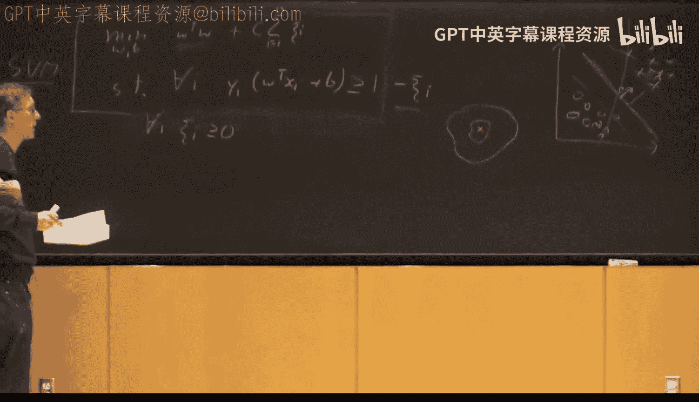

What we can do is you can basically say， well， given this。

 But I know that the size will always be as small as as possible， right， because I'm。

 I'm penalizing them。😊，So I can actually solve this。For my forci。

 So what I can do is I can basically rewrite the loss function。😊，As the following。Well。

 let me actually first divide this。 And so basically， what I can say is， well， in some sense。

 I know what X is， right， So Xsi equals is either。😊，Is either 0。If。Y， I W transpose X， I plus B。

It's greater equal 1。if the constraint is naturally satisfied。

 the optimization problem will always put a zero on because it has to pay for it。And， otherwise。

It's less than one。 Then we can also solve for it because then we can just say， well， in this case。

 Psi equals。1 minus Y， I W transpo X I plus B。嗯。Okay， any。Questions。诶啊。I so basically was saying。

 well， what does the optimization problem do with Sha。

 Well if this constraint is naturally satisfiedable it set it to 0。

 So if the constraint is satisfied， it sets it to 0， it it's not satisfied。Then actually。

 basically has to make up for the margin。 Right， basically says this point is not one away。

 So what it has to do is has to make up for this margin。 That's， that's what Xi is。 right。

 So that's basically what tries assigned to。 And that's except we can just solve for that directly。

 Right， So Xi must be the following value。It would never set it any larger because then it would pay for。

 pay extra。Raisezy hand if that makes sense。Okay， good。So。If we know this。

 then we can actually just stick the size。Wai damn， I never know。Into the objective。

So what is our objective， Our objective is minimize over W and B。And then we have。

W transpose W plus C times the size。 Oh， sorry。C times the sum of oak size。

 but we know exactly whatsi is。 and that is， it's the max。😊，offff。1 minus Y， I。

W transport X I plus B。Comま zero。Yeah。哎。We are not。 We are not anymore。 He's given up on that。It it。

哦，在。So that's correct。 That's correct。 But we are， you're paying for it， right， So in the。

 in the objective function on the very top right， you actually have。

 you're summing over all the values ofsi， and you're trying to minimize that function。😊。

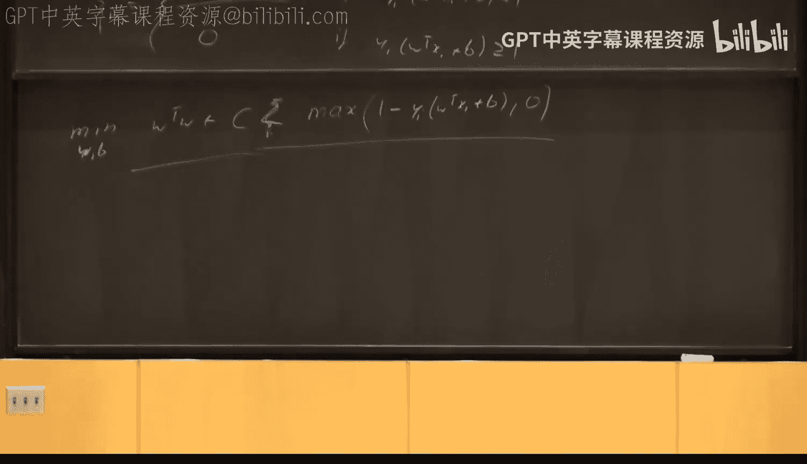

So whenever possible， that we try to make size as small as possible， right。

 So what you're describing would exactly happen when you have the scenario that， you know， over here。

 one cycle， one circle is up you know， with the crosses and the basically just sacrifices that one。😊。

Right，So if you have an outlier that's mislabeled， for example。It's good question。 Okay。

 so let me just make this clear。 So thissi I is 1- my either this expression on or 0。😊，And。

If you think about it。That turns out to be exactly the max。Of1 minus Y I， this is the prediction。

With 0。嗯。Do you want to spend， maybe I give you one one minute union your neighbor。

 please discuss why this year is correct。Yeah。Okay。The thing to do with。Okay。Okay。Yeah。Okay。Okay。

Yeah。还不。Okay。Okay。Yeah。や。All right， any questions？Yeah。

What is your the right side of your max function is larger than zero， but less than。

Like if the negative sign chunk is less than one， great zero。We have a very small。因为人家。Even他。只个8子。

It's the right clification。Yes， that's right。 That's right。 So what he's saying is， what if。

 what if this term here is。It's a。What of this term here is not quite equal1。 So it's not 0。

 but it's greater equal 0。So then in some sense， actually， this here means we classifying correctly。

 that this is greater than0。 That means we are classifying the point correctly。😊。

But if it's not greater than one， then we are still paying for it。😡，And so what setting is that。

 That's the setting， right， where you basically have。嗯。These are my points。This is the hyperplane。

 Here's my margin。And I have one outlier that's here。😡，And it's basically too close。

It should be outside the margin of one， but it's not。 So I'm paying for that one。

 That's basically what it is。Okay， any questions about this， is this clear？Raise your hand。

 that's crystal clear。Okay， good。Alright， so this is actually， this is very， very nice now。

Because what does that mean。This year is actually just a last function。

And this here is what we call a regularizer。And。If we just have a last function of RW。

 we can just do gradientd in descent。 right So we don't actually have to go to the math department and get the Q piece solve。

 We can just actually look at this， this optimization problem。😊，This a。

It's almost differentably everywhere。It turnsns out if you square it， then it becomes differentiable。

So you can do that。 Some people do this。And。Now， we can just use gradienting technically correct subgrading descent。

 and just optimize this。 And it's just like logistic regressionggress。Any questions about this？哎。

Allright。Unfortunately， I don't have my laptop here today。 I have some some technical。Difficulties。

 but the。I can show you。Can just look at the print， the figure that's on the print out。All right。

 so this is those on your sheets。What I'm showing you here， I hope you can see this。

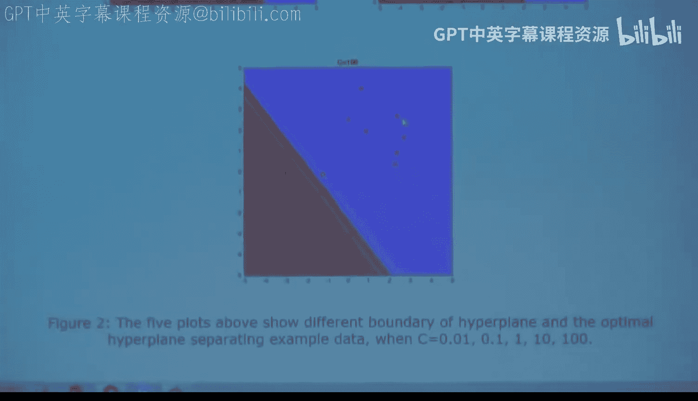

This here is a data set of， you know， binary data set of crosses and， and circles。And the first。

 the one thing you notice is like the data is kind of。Especially designs。

 such are basically the crosses all here。 the circuits are here in one little circle is kind of this outlier。

 right lies here。And so if we， so this is linearly sparable。 And if we set our C to be large。

 we set C to 100， then what it does， it really penalizes any slack。

 So we'll try to find a non solution with zero slack。 And that's exactly what it finds。

 So what you see is here。 this black line is the hyperplane。😊。

And the white line is basically exactly the margin of one。 Okay， and it draws the margin。 Basically。

 it scales the hyperplane exactly and positions it exactly such that the closest crosses here lie on the the on the margin of one and the closest circle lies on the margin of  one。

😊。

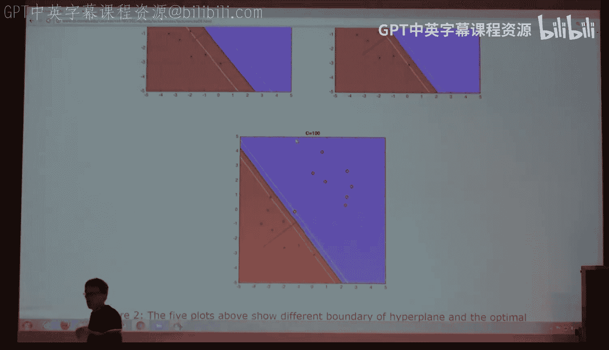

And。嗯。Now， one thing you can do is you can actually solve this again and reduce your C， right。

 So if you' basically now， maybe you you're starting to suspect that your data set maybe is a little noisy。

 right， and maybe that point actually should be across， right， Who knows。

 It seems a little suspicious that that one point。😊，And so if you now lower your value for C。

 what happens is you can see that now we you to 10， that's still。Basically， the same thing。

 You can see the white line is actually a little bit outside of it。

 So this circle is now inside the margin。If a lower to one， what does it do。

 now it's allowed to give assign sign a little bit of slack， right？ I'm basically， I I'm。

 I'm giving it in some sense， a slack budget。 That's how you can see this。

 And what it does it assigns the slack to this point here and to these points here。

 right So it moves the hyperplane more in the middle。 And you see this guy here。

 It still classified correctly， but it's really， really close to the hyperplane， right。

 So that occurs some cost， but it's willing to take it because it doesn't have to pay that much for it anymore。

 right， So C is basically how much about how much we multiply the slack variables。😊。

Does it make sense， Ras handed this make sense to you。 Okay， awesome。Now， we can go even further。

 we can say， okay， well now， you know， you know， we're going， you know， this is a sale， right。

 This is like， you know， Sla variables become really， really cheap。 So it can allow a lot of slack。

 And what's happening is you see here， it actually puts this hyperplane snack in the middle， right。

 So on average here， very little slack。 But you， it doesn't care about these three points and these couple points here。

 Okay， So what it does it actually is more concerned about having a large margin， right。

 and less about getting every single point correctly。😊。

And then if you do this even further at this point， actually， it assigns a really large margin。

 You see W is tiny now。 This here is my little W， right。So the margin is very， very large。 And。

 in fact， every single point lies inside the margin， right， So in some sense。

 the point of the margin。You know， it's no longer， you know， some。

 the point of the margin is that it separates to， to classes。 So in this case。

 I would say the slack variables， you know， it's too cheap， right， It kind of over。

 over does it a little bit。Allright， so that's basically the effect。 So as a practitioner。

 you have to find US data scientists。Your job is to find the right seat。Any questions about this。

 this specialization， Yeah。So the wide lines is exactly the line of every point that lies there has exactly a margin of one。

 There's basically a distance of one from the from the hyperplane。 right， So W。

 Y W trans x plus B is one in that case。😊，嗯。So， and that's what we want， right， So that's basically。

 we want all the points to be outside of here。 right So so in some sense。

The idea really is that you want this solution here。

 but you're allowing it to basically mess it up a little bit if that's too strict。So you know。

 probably， you know， if you were actually concerned about this data set this year。

 I would guess gives you the best test error， right。

 because probably this year is an outlineer this one circle。

 And probably most of your circles lie here。 Most of your crosses lie here。

 So having the the line here in the middle is probably， you know。

 is probably going to generalize the best， right， The danger here is with this solution is that it's actually quite likely that another cross could end up somewhere here。

 And you will misclassify those， right during test time。😊，That's the idea。Any more questions？

All right。嗯。

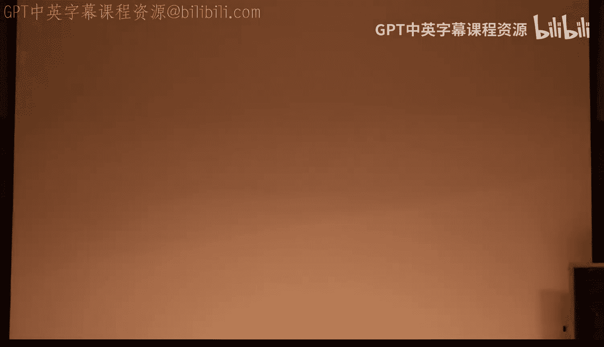

Okay， so then we are moving。诶。This here in something is the perfect segue。哎。So if you look at this。

This is exactly the setting。That we looked at when we talked about 80%。 We basically said。

 but if you just have a function。This here is my function that I'm minimizing。

 There's a function with respect to W。哎。And I'm trying to find its minimum。

 While we use gradientding descent or second order methods， etc。And。It may be surprising that this。

 this SVM that we started out with something very， very。You know， with intuition。

 we want to find the maximum margin hyperplane， then the。You know。

 derived this quadratic program formulation。 And it turns out we can even write that as an loss function。

 right So in exactly this form that we can use with gradient descent。😊。

Similar to logistic aggression。And as it turns out。

 a lot of machine learning can be written in exactly that format。 So very， very often。

 we can just write it。Ultimately， what it boils down to is even if you come up with a probabilistic intuition or with some。

 you know， for example， here like this a geometric intuition。

 you end up with some function that youre trying to minimize。 And typically。

 this function has two terms。😊，One that we call the loss and the other one that we call the regularizerizer。

And。嗯。The properties of these two are that the last function typically involves X， Y and W。

And what the last function measures is how many mistakes you are making。

So this function here is large。 If you make many mistakes on your misclassifications。

 on your training data。Whereas the regular riser does not involve the data， typically。

And does not involve the labels。 just involves the parameters you're fitting。 Just involves W。

And what the regular userr tries to do is tries to penalize overly complicated。EAners。

Right in an SVM that translate exactly into finding the maximum margin hyperplane。

But if you take a step back， actually turns out that this is exactly what you discover in many machine learning algorithms。

And the idea is， based the following， you have a balance between。

 do I want to get every single point right on my high training data。

Or do I want to get a simple solution。Right， and。There's a principle called the Ocoms razor principle。

 There's actually a specific term in learning theory。 But ultimately。

 if I just you know paraphrase it， the idea is， you know what typically the simplest answers tend to be tend to generalize the best So you can come up with really really complicated answers that work on your training data。

 but often then actually， you know， you're doing something that doesn't work anymore in the general case。

 So what we would like to do is try to find that an answer that explains our training data and is as simple as possible。

 And in this case， simplicity is measured by the norm， the squared norm of our W vector。😊。

Turns out that translates into having a large margin。And if you think of it from the SBM perspective。

But you can also just think of it in terms of just plain， you know， small norm is。

I is a simpler answer。Okay， and any questions about this？

So this means that what we typically do with a baby typically divide this is we try to minimize some W。

WR parameters。嗯。Mimise some loss function of W。Plus， some regularvis of W。And this year in London。

 And actually， sorry let me just write this make this more clear。

 The last function alsoz goes over my data point。😊，1 to N last function over。

 And how do I write I would H W of x。开埋 wifi。So what's HW。 HW is the predictrick predictor。

 given my W， I have this following classifier for every single x and my loss function basically measures。

😊，How close am I to the true label， right， I sum over all my data points。Often。

 we have a one over in here。And here you have the regularizer of W regularizer measures the complexity of your。

 of your solution， saying like， did you find a really。

 really complex solution or did you find a simple solution， And usually。

 this is large if you find a very complex solution。😊，Lada trades off between the two。

This here here we have a C， but one thing we can do is we can just write lambda equals 1 over C。

 and we get a lambda here。😡，And one here， right， And then it's exactly this format。

 This here is my R of W。And this here is my last function， L。And we saw exactly the same thing。

 And we did logistic aggress where we also actually had the loss function。

 which was basically this log loss and the regular item。 And we did map as map estimation。

 Then we actually got once again， W transpose W as the regular itemiz。😊，Any questions？哎。All right。

 a lot of theory of machine learning。嗯。YouNow， it's built up on top of this framework。

 which we call empirical risk minimization。So the idea is， well， really。

 what I would like to minimize is this loss over my， you know， over my test data。 I can't do this。

 So what I do is I minimize this loss over my training data。 I will be overfitting。

 So I'm adding this regular to favor simple solutions。😊，嗯。And we will see many。

 many examples as the course continues now of exactly this framework。

So one thing I would like to do today is give you a little overview of a few loss functions that are quite popular in machine learning that fall exactly into this paradigm。

 And then maybe next lecture， you will move on to the regular rises。😊，Okay， so。Okay。

 this here is our framework。 we basically want to minimize the loss。😊，And the OZ regularizer。

 for now， we just care about the loss。 And the first loss that's quite popular is actually one that we just looked at。

 and that's the hinge loss。😊，So we call this hinge loss。And the hingela is basically just maxs。

And thats exactly what the SBM does。1 minus H W of x。Times Y， I comma 0。To the power of P。

So this is exactly the last function that we had earlier。

And here we when H W of x was does W transpose x plus B。That's my H of X。

So I'm writing explicitly andm writing this as H of W because it doesn't have to be a linear classifier。

 actually， So later on this class， you will have nonlinear classifiers where the decision function is more complicated。

 but we can actually use exactly the same framework。

 So I'm just doing making a little more general in this case。😊，So if VFP goes one。

 that's called the SVN。If p equals 2， and it's the squared loss。SBM。And。

The reason people sometimes use the square Ps 2 is because then it's differentiable。

 So some solves only work with differentiable losses and。Oh actually turns out， actually。

 you could actually find a close form solution in that case， actually。Because it's para。Okay。

 now loss that we've already seen is the log loss。

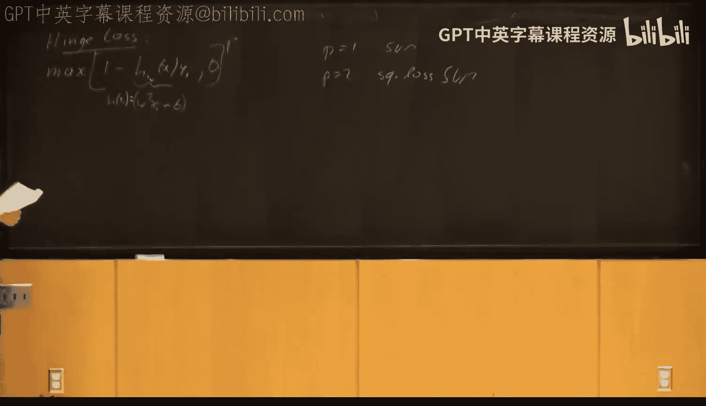

And that's as follows， the loss is log。Of one plus e to the minus y a。Yeah， Y， I， H W X I。

And this year is the last step we saw in logistic aggression。嗯。

And so the nice thing really is you can actually， once you have understand these loss functions and the properties and the regular eyes and so on。

 you can really mix and match and kind of for a particular problem， you know。😊，Assmble your。

 the last the， the machine learning algorithm that's best suited for you。😊，So nice thing about the。

Lo loss is that it's pretty， you know， behaves pretty well in terms of outliers。

 actually similar to the logistic to the hinge loss。

 But that one thing that that's very sweet here is that actually。

 you get these well calibrated probabilities。 So if you actually use， say。

 P of y given x equals1 over1 plus E to the minus y H W of x。😊。

Then these are actually well calibrated probabilities。

 which is very nice There a confidence estimate of how how sure are you that a certain class classified as1 or -1。

😊，哎。All right， let me show you two more。😊，Maybe I draw here。So what is the exponential loss。

So exponential is just E to the minus H W of x times y。Which is exactly what's inside the log here。

So this is the exponential loss。We will visit this。

 this very is a big part of the algorithm called Atda boost。

 which is one of the most popular machine learning algorithms。😊，And。It has some very nice properties。

 So the exponential loss if。😊，It's kind of a little bit of， you know。

Like if you make any any tiniest mistakes， right， like any point gets misclassified。

 theres E to the erasing this expentiating this。 So this is kind of the the loss that loses its nerves。

 right， Like if anything was wrong a little bit。 it just freaks out at you， right。

 and it will it will move the entire decision boundary， right， just to get one little outlier， right。

 right， because the loss of getting one point wrong is so tremendously large， right， you get。

 if this year is positive。 So you know， these two don't mention science。

 This just blows up so ridiculously quickly， right。

 that it makes sure that no single point gets misclassified。😊，If you don't have noisy data。

 then that's a good thing to do。 And can， in terms of otherda boost， you will see。

 it will give us very good guarantees that， for example， the algorithm converges very quickly。嗯。

Or it you know， actually gives you zero training error very quickly。 The downside is。

 if you have noisy data， just， you know， it blows up in your face， typically。

The final loss function is one that we've already seen， that's a 0，1 loss。

And as the you or know this one， is delta of H W of X I does not equal Y I。 And that's just 1 or0。

 So the delta function is just a one or 0。 That's the function that space just defines the training error in practice。

 you cannot approximate it。 but you cannot minimize it。But。

It's still important because that's typically how we measure the training era。Okay。

 what I want you to do is you have a little feel below you。 I hope on your notes。

 I want you and your neighbor spend a couple minutes and try to sketch each one of these functions just to get some intuitions what they look like。

 And I would like you to sketch it in terms of。😊，Z。

 which I think on the sheet I called X equals H W of X I times y。So。If you。

 so what's the last in terms of Z。So if Z becomes large， C becomes small， if Z is 0。

 how would you draw each one of these last functions。 So please put in the hinge loss， Lo loss。

 exponential loss and 0，1 loss。跟续。你好。Okay。It's just how。Yeah。诶家嚟。不爱。哎。

Yeah。Yeah。Who was ready with all of them？Raise your hand。Oh， come on， guys。

Okay I give you a few more minutes。にが。Once you're done。

 please think about the two questions below which functions are strict upper bound on the 01 loss。

Actually ignore the strict or just upper balances your one loss。

What can you say about the log loss and the hinge loss as Z becomes to minus infinity。不能。

YeahSo attack。こら気らつい。No。Okay。What。喂喂。Yeah。Right。Allright。

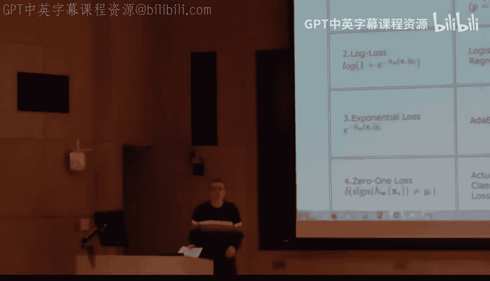

Okay。So， maybe。Okay I'm going to describe。 Let me start with a 0，1 loss。 What does that look like。

Yeah， one everywhere is negative and then0 everywhere。 That's correct。How about the hingela？Yeah。

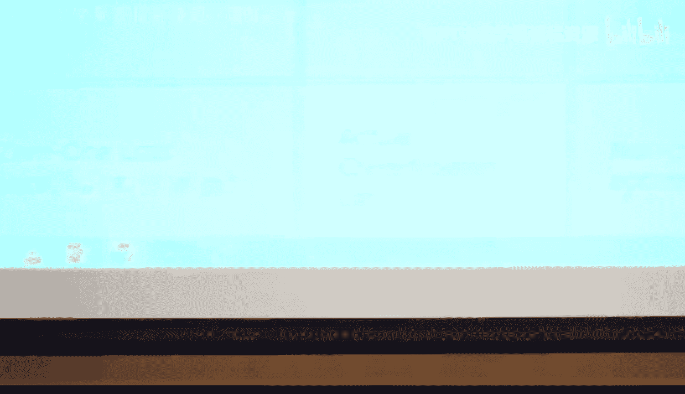

That's right。 Exly right。 And you know， let me just show all of them。 So this is the answer。😊，So 0。

1 loss here， whenever， whenever y times H of W is is positive， that means I get it correct。

 and the loss is 0。😊，The moment it gets negative， it has a loss of one， right。

 And this has a point of discontinuity here。The hinge loss is the red line。

 The red line has zero loss when it's correct and greater equal 1， right that's very important。😊。

And so the moment you get too close to 0， I there's a basically a danger of misclassifying it。

 This is the margin， right， So what's happening here is when you， when you're really far out。

 it doesn't care about you， right， You're correct。 You don't know contributing to the loss。

But the moment you're getting too close to the hyperplane。

 this year is when you're right on the hyperplane。 when you're too close to the hyperplane。

 the loss goes up， goes up， goes up， goes up， right， And the moment you cross the hyperplane。

 you know， it keeps going up linearly。 So this is exactly what pushes it out。

 If you think about like you know， what's gonna happen。

 the points get pushed up until they they reach exactly the distance of one。

 which is exactly the white line that I drew early in the pictures。 Okay。

 so it tries to push everything out from there。😊，嗯。Then you have the exponential loss。

 What does the exponential loss do， the exponential loss is really， really aggressive， right。

 So if you get it wrong， like the hinge loss is like if you get it wrong。

 Well that's's that's that's bad right， And you have large loss。

 But if you could instead improve another point and move it down here or you have one point up there that you move to the right。

 It doesn't really make any difference， So the exponential loss， you can see how it freaks out。

 right， this point here-2， right， is it somewhere up here， right。

 So if you can improve this point just a little bit。 move a little bit to the right。

 move a little bit towards the hyperplane。😊，The law is going to drop tremendously， right。

 So what we try to do everything possible to get this one point right。 That's really far away。

 So the exponential loss will always focus on the point that's kind of most misclassified。

 right and adjust this hyper lane accordingly。😊，Whereas the hingela kind of points focus on the close points。

 right， and kind of moves them out here。For the， for the exponential loss。

 these points don't matter very much because they are so insignificant compared to， by the way。

 you't have to look at the absolute loss。 You have to look about look at if I move a point to the right。

 How much does the loss go down。 That's really the important part， right。

So here I can move the loss down a lot if I go a little bit to the right。

 because it drops drastically， Where I move here to the right。

 the exponential loss doesn't go down very much at all。😊，And then the log loss。😊。

There's this black line here。 that's kind of， you know， that's the most chill， in some sense， it。

But that's the same thing that one thing about the log loss is not an upper bound of the 01 loss。

 So if you， one thing is with all these other loss functions， you compute the loss。

 the hinge loss and the logistic loss。 And if you know that the loss divided by n， let's say is 02。

 right， then you know you can't have more than 20% points mis classifiedified， right。

 because it's an upper bound of your 01 loss。😊，The logistic answer is that's， that's not the case。

 right。Sometimes it's very nice。 So， but but in all the cases， So for example， you know。

 Hindus laws exponential laws， if you， you know， if you drive it down to close to 0， then， you know。

 you must have every single a single point。😊，And correctly classified。

Last election was what happens with the logistic loss or log loss and the hinge loss as Z becomes very negative。

 One thing you can see here， these two easily become parallel lines。😊，So。Also。

 the hinge laws is more aggressive here。' at some point， actually， for points that are really。

 really misclassified， the penalty is just linear。 So actually。

 they are both very well behaved when it comes to outliers。😊。

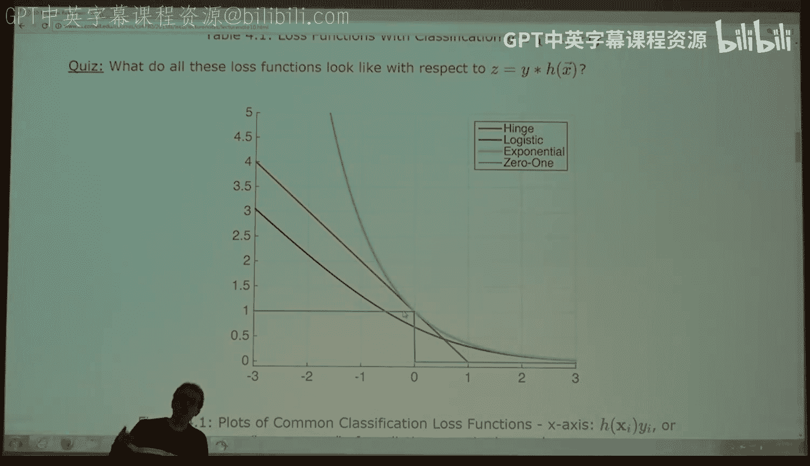

Alright， and we will continue this on Monday。

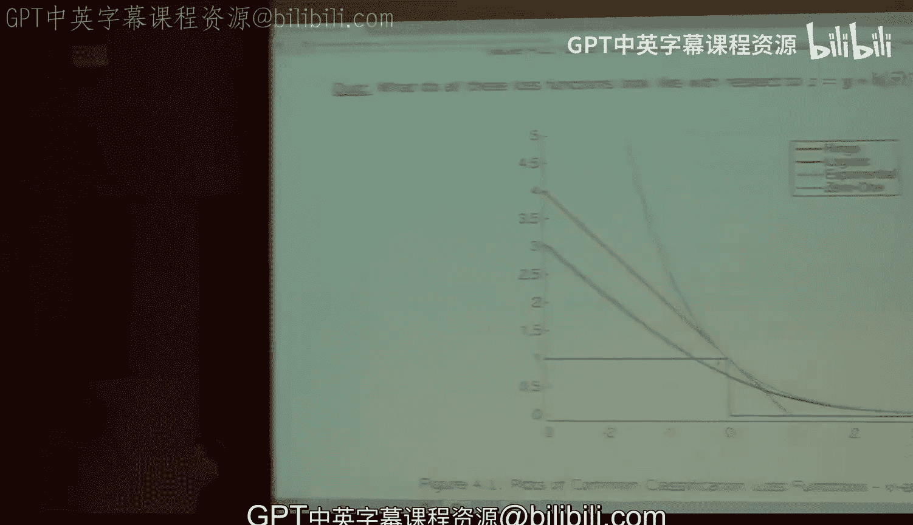