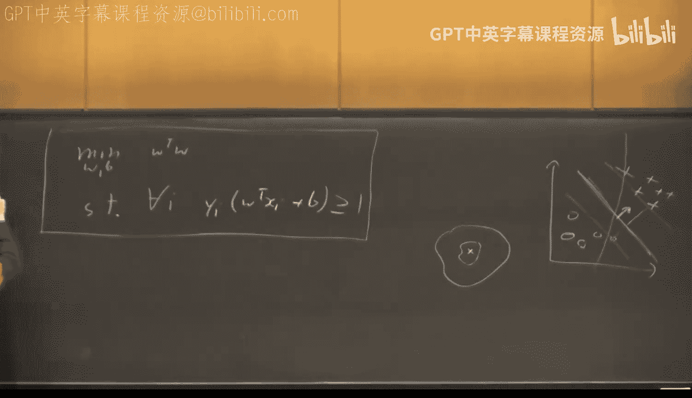
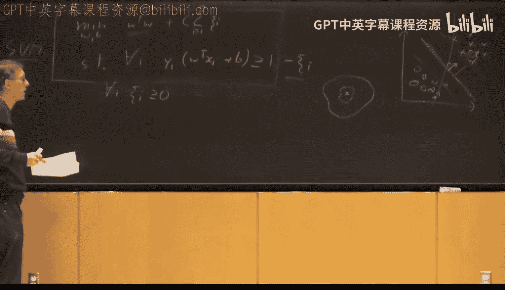
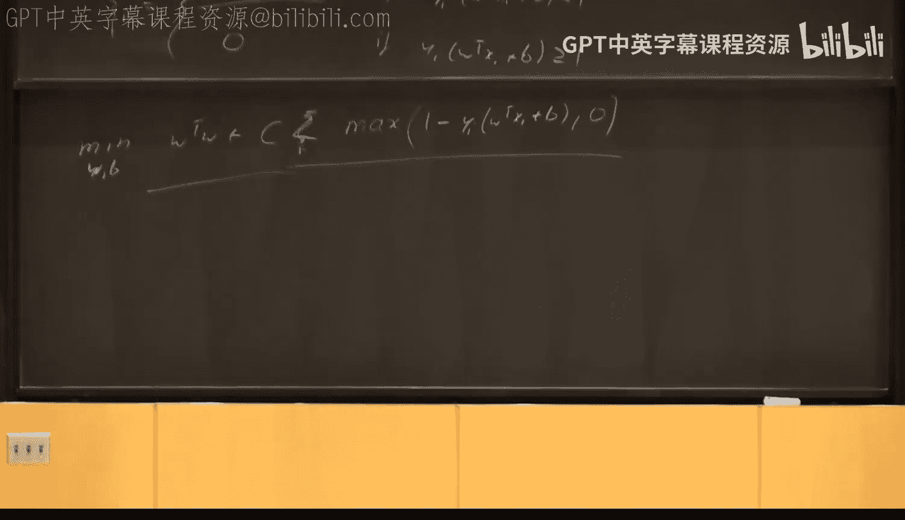
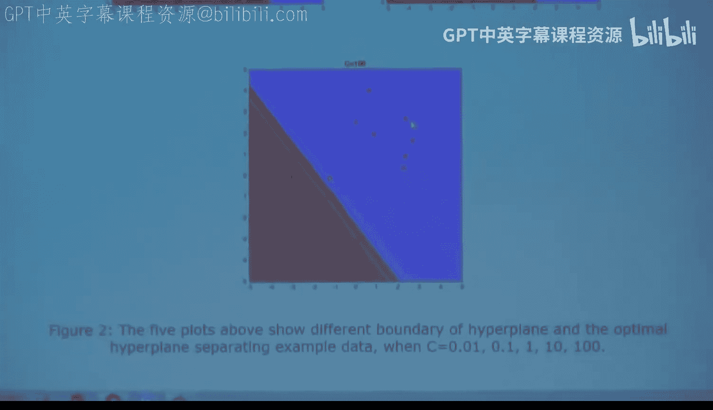
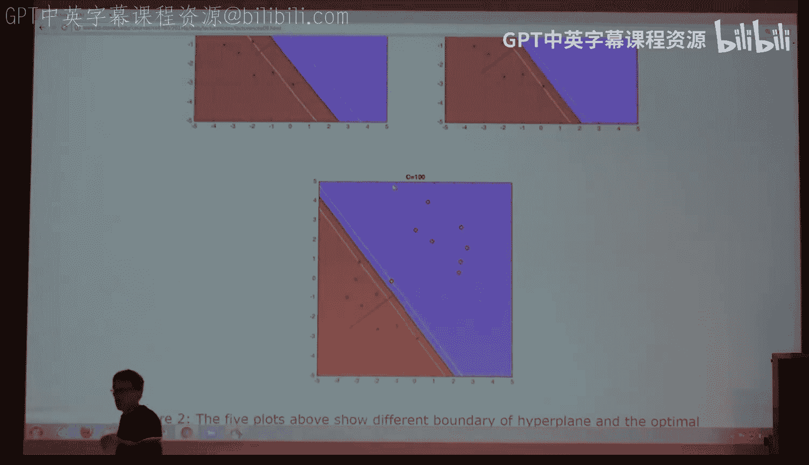
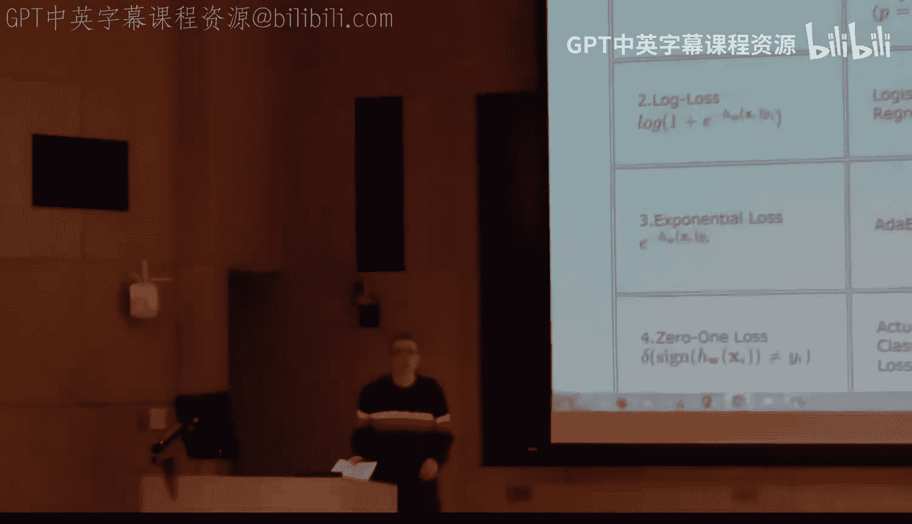
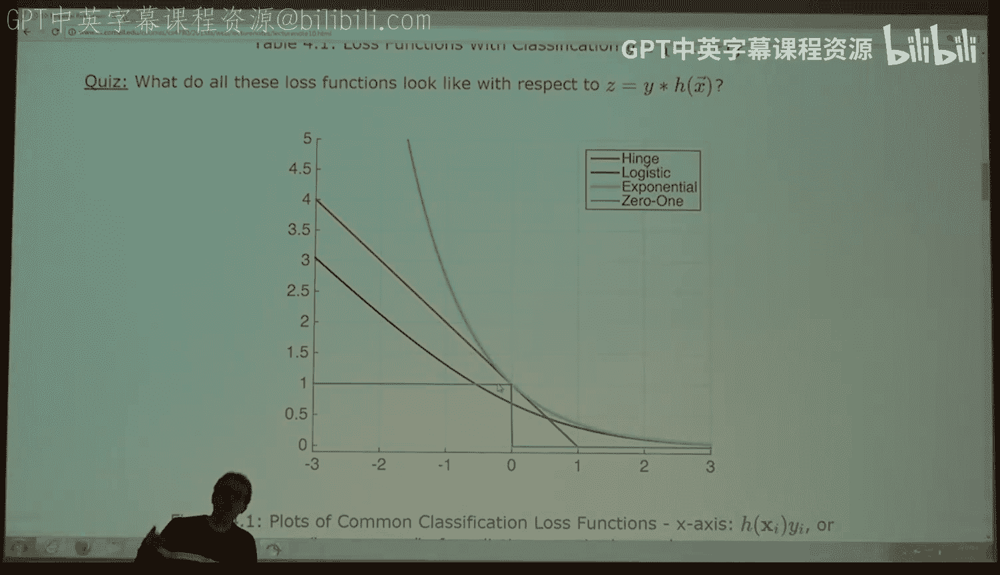
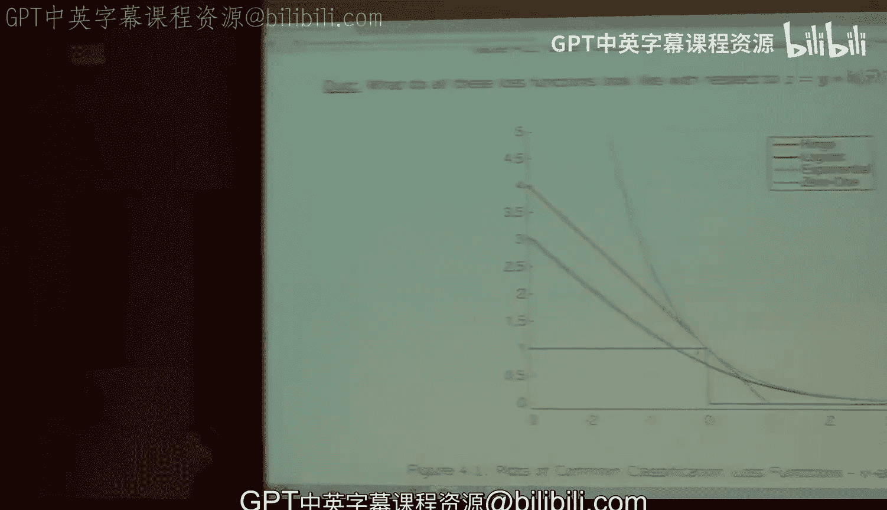

# 机器学习：015：支持向量机（续）与损失函数概述


在本节课中，我们将继续学习支持向量机（SVM），特别是如何处理线性不可分的数据。我们将引入松弛变量的概念，并探讨如何将SVM的优化问题转化为一个带有正则项的损失函数最小化问题。最后，我们将概述几种常见的机器学习损失函数，并比较它们的特性。



## 支持向量机与最大间隔

上一节我们介绍了支持向量机（SVM）的核心思想是寻找一个具有**最大间隔**的超平面来分隔两类数据。间隔被定义为超平面到最近数据点的距离。

对于一个能正确分类所有训练数据的超平面，我们希望最大化这个间隔。数学上，这可以表述为以下优化问题：在满足所有数据点都被正确分类且距离超平面至少为1的约束下，最小化权重向量 **W** 的范数平方。

其公式化的约束优化问题如下：
```
最小化: (1/2) * ||W||^2
约束条件: y_i * (W^T * x_i + b) >= 1, 对于所有 i
```
其中，`y_i` 是数据点 `x_i` 的标签（+1或-1），`b` 是偏置项。

## 处理线性不可分数据：松弛变量



然而，现实中的数据往往是线性不可分的。如果严格遵循上述约束，优化问题可能无解。为了解决这个问题，我们引入了**松弛变量**。



其核心思想是：我们允许某些数据点违反“间隔至少为1”的约束，但需要为此付出代价。我们为每个数据点 `i` 引入一个非负的松弛变量 `ξ_i`。新的优化问题变为：
```
最小化: (1/2) * ||W||^2 + C * Σ ξ_i
约束条件: y_i * (W^T * x_i + b) >= 1 - ξ_i, 对于所有 i
          ξ_i >= 0, 对于所有 i
```
这里的参数 **C** 是一个超参数，它控制着我们对分类错误的容忍度。
*   **C 值很大**：意味着我们非常不希望出现分类错误（即 `ξ_i` 很大），优化会倾向于选择一个间隔较小但能正确分类更多点的超平面（接近硬间隔SVM）。
*   **C 值很小**：意味着我们允许较多的分类错误，优化会倾向于选择一个间隔更大但可能误分类一些点的超平面。

参数C的选择没有固定规则，通常需要通过交叉验证等技术，在验证集上测试不同C值的效果来确定。



## 转化为损失函数形式



我们可以进一步将带有松弛变量的SVM优化问题改写为一个更通用的形式。观察约束条件，在最优解中，松弛变量 `ξ_i` 实际上等于 `max(0, 1 - y_i * (W^T * x_i + b))`。将其代入目标函数，我们得到：
```
最小化: Σ max(0, 1 - y_i * f(x_i)) + λ * ||W||^2
```
其中 `f(x_i) = W^T * x_i + b` 是我们的预测函数，`λ = 1/C`。

这个形式非常具有启发性，它揭示了许多机器学习算法的通用框架：
```
最小化: 损失函数(预测, 真实标签) + 正则化项(模型参数)
```
*   **损失函数**：衡量模型在训练数据上的预测错误程度。在上式中是 `Σ max(0, 1 - y_i * f(x_i))`，这被称为**合页损失**。
*   **正则化项**：惩罚模型复杂度，防止过拟合，鼓励更简单、泛化能力更强的模型。在上式中是 `λ * ||W||^2`，即L2正则化。


## 常见损失函数比较

以下是一些在机器学习中常用的损失函数（设 `z = y_i * f(x_i)`，`z` 越大表示分类越正确）：

1.  **0-1损失**：
    ```
    L_{0-1} = I(z < 0)  # I是指示函数，当条件为真时值为1，否则为0
    ```
    *   最直观，直接计算错误分类的数目。
    *   非凸、不连续，难以直接优化。

2.  **合页损失**：
    ```
    L_{hinge} = max(0, 1 - z)
    ```
    *   SVM使用的损失函数。
    *   当 `z >= 1` 时损失为0，鼓励“间隔”内的点也被正确分类。
    *   是0-1损失的一个凸上界，对异常值相对鲁棒。

3.  **逻辑损失（对数损失）**：
    ```
    L_{log} = log(1 + exp(-z))
    ```
    *   逻辑回归使用的损失函数。
    *   处处光滑可导。
    *   能给出样本属于某类的概率估计。
    *   不是0-1损失的上界。


4.  **指数损失**：
    ```
    L_{exp} = exp(-z)
    ```
    *   AdaBoost算法使用的损失函数。
    *   对误分类样本惩罚极其严厉，会迫使模型重点关注最难分类的样本。
    *   对噪声数据非常敏感。

为了直观理解，我们可以画出这些损失函数随 `z` 变化的曲线：
*   **0-1损失**：在 `z=0` 处有一个从0到1的跳跃。
*   **合页损失**：在 `z=1` 处有一个“拐角”，之后线性上升。
*   **逻辑损失**：一条平滑下降的曲线，从 `z` 很负时的近似线性，过渡到 `z` 很大时的接近0。
*   **指数损失**：一条下降速度极快的曲线，`z` 为负时值非常大。




合页损失和指数损失都是0-1损失的凸上界。当 `z` 趋向负无穷（即严重误分类）时，合页损失线性增长，而逻辑损失近似线性增长，这使得它们对异常值都不像指数损失那样敏感。


## 总结

本节课中我们一起学习了：
1.  **线性不可分SVM**：通过引入**松弛变量**和超参数 **C**，使SVM能够处理有噪声或线性不可分的数据集。
2.  **优化视角转换**：将SVM的约束优化问题转化为**损失函数+正则化项**的最小化问题，这揭示了机器学习中**经验风险最小化**的通用框架。
3.  **损失函数概览**：我们介绍并比较了**0-1损失**、**合页损失**、**逻辑损失**和**指数损失**。理解不同损失函数的性质（如是否为0-1损失的上界、对异常值的敏感性、是否光滑等）对于为特定任务选择合适的模型至关重要。





这种“损失函数+正则化”的框架是理解许多现代机器学习算法的基础，在后续课程中我们会不断遇到它的各种变体。