# 016：康奈尔大学《智能系统的机器学习｜CS4780 Machine Learning for Intelligent Systems 2017》中英字幕 p16 -16-Machine Learning Lecture 16 ＂Empirical Risk Minimization＂ -Cornell CS4780 SP -BV1Lo6gBxEKE_p16-

Every， please put your laptops away。 Thank you。😊，哎。One little thing， though。

 the exam is in one weekend one day。I hope you are feeling ready。嗯。Please don't start too late。

 as I said before。Number one， sorry is themic。Can you hear me。In the back， mygon。

 can you use thumbs up， no。嗯。1，2， better。 Okay， so it exams next Tuesday。😊，Please start early。

 Some people ask what's going to be on the exam。 The answer is everything。

Everything that we have covered。We are posting， or I think it's already posted exams from previous years on Piazza under resources。

 If you click on resources on the top。You can see them there。

We separated the months with with and without solutions。 So basically， first。

 try to do it yourself without solutions and then look at the solutions。Please， please。

 please start start early with a study。 You know， one one common failure mode in this class that people do very well on the projects。

😊。

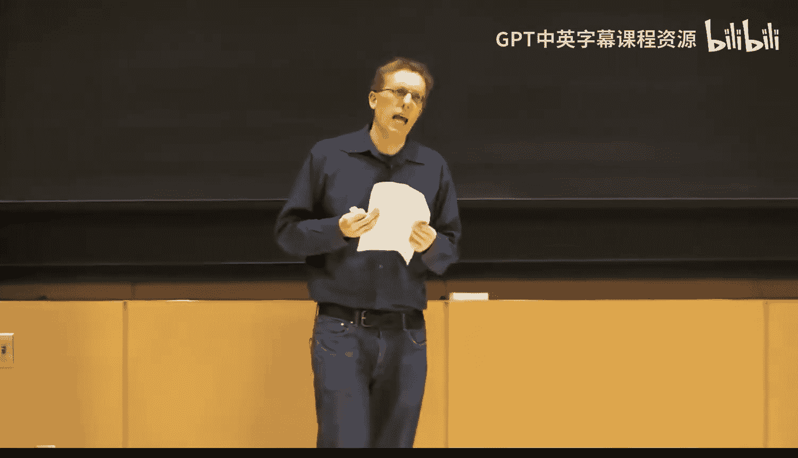

But then actually， don't take the exam seriously enough。 The exams is 50% of you great。

 So please keep that in mind， right。嗯。So， and I do this purposely because I machine learning really is kind of half theory。

 and half it is， you know， practical chops， right， so。

You can also have people who know all the theory， but can't actually get anything working。

 So I I really want to kind of have this course cover both of these two sides of machine learning。

In order to do well， you have to do well in both of them。 Any questions。About logistic。

Okay， good。 Last thing that the project， the last the next project will really be released today。😊。

I've been promising it for several lectures。 We， we went into some bug that actually sometimes appeared when we tested it。

 So we always have some T As pretend they students。😊，And it turned out， you know。

 we actually had to communicate with Vcarium， and they actually had to change something in the back end to make sure it didn't happen anymore。

So delayed things a little bit。 But ultimately， you will get the same amount of time。

 You will get two weeks starting the moment it gets released。😊。

嗯。It's not。 It's basically E R M。 So the idea is you have to implement a bunch of these last functions。

 So hinge loss， logistic loss and so on。 It doesn't take very long。

 So it's a good preparation for the exam。 But you can also finish it afterwards。 if you feel like。

 you know， you'd rather study。You know， the lectures。

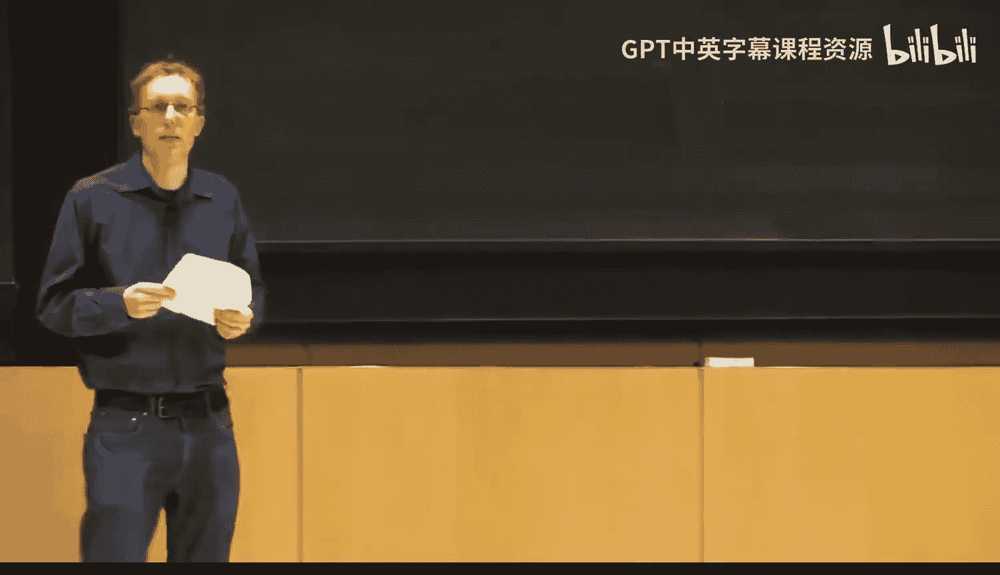

Okay。So last lecture， we went over empirical risk minimization。 And so the idea。

 basically is that in machine learning very often， we can write the learning algorithm as saying what we are trying to do is we try to find some parameters。

 we call these W。 That doesn't have to be W。😊。

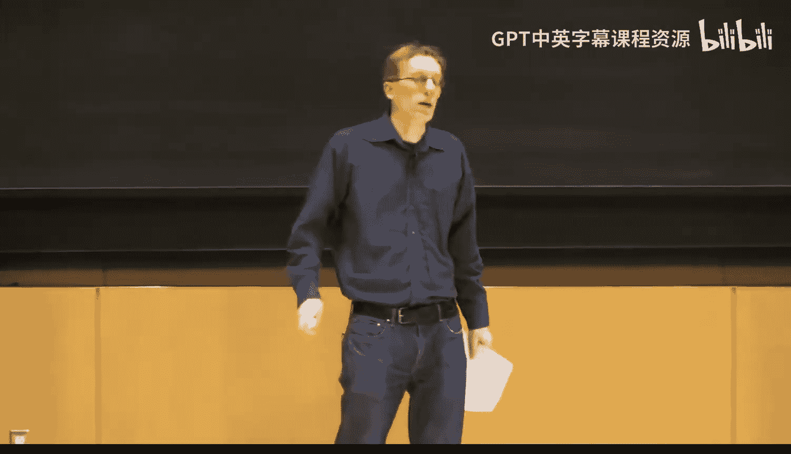

These are basically our weights。And what we are minimizing essentially。

 is some loss that goes over the data set。哎。You know， I think I wrote it as HW of X I， common on Y I。

Plus， some regular rights。And so here， HW of X I is basically the prediction of data point X I。

 This is the true label。 And we have some loss that basically says。

 how much do I have to pay for getting a point wrong or even right， but not right enough， right。

 So basically maybe not confidently enough。And the regular riser here is the second term。That。

Palizes really complicated solutions。 So turns out if you're in a high dimensional space。

 then typically， even with linear classifiers， you can typically always find a solution that makes not no single mistake anymore。

 but it tends to be overly complicated。 right， So basically， you learn some rules that。😊，Just。

 you know， rely on the noise in your data， which doesn't mean anything。

 So by making trying to come up with simpler solutions， you effectively obtain better generalization。

All right。 And the last time we talked about the hinge loss， the hinge loss。

 which was most of what we saw in SMs。Then the logistic loss and the 0。

1 loss and the exponential loss。 So these are kind of typical famous classification loss functions。

Today， I want to move on to regression。😊，And say， regression basically says beyond the certain regime。

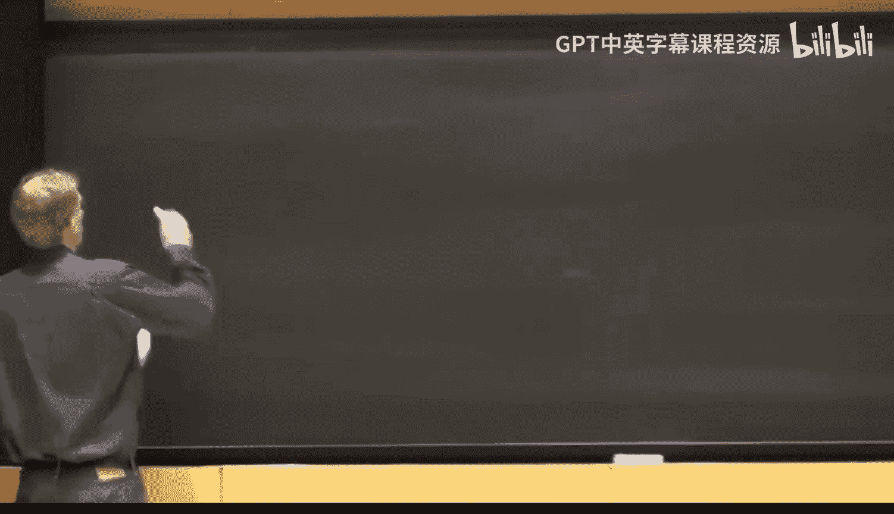

Well， why？It can be a real nu。 so， for example， you're predicting a person's height or you're predicting the value of a house based on its features。

 etctera， or you， you know， predicting the temperature， right based on previous temperatures。

 Its like， you know。

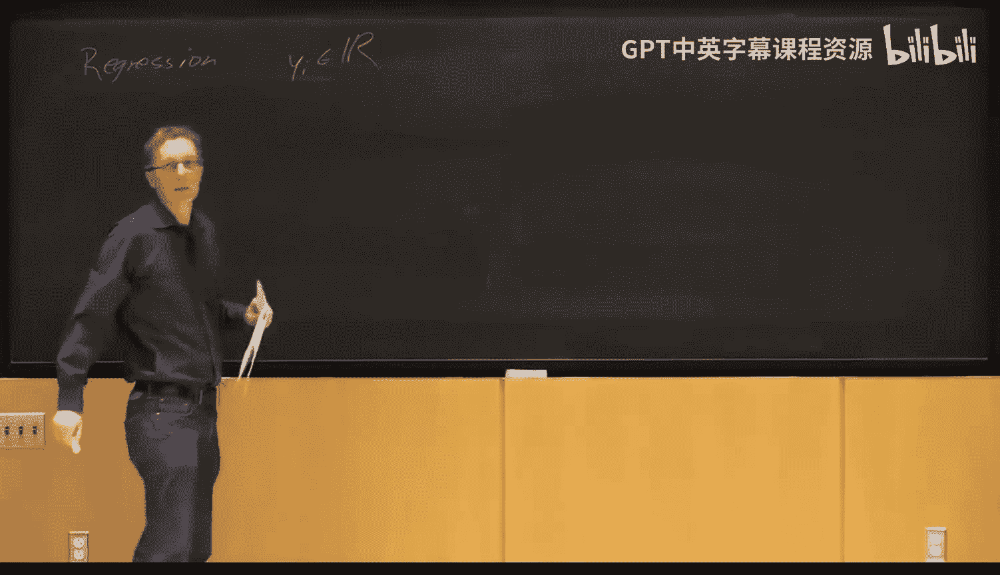

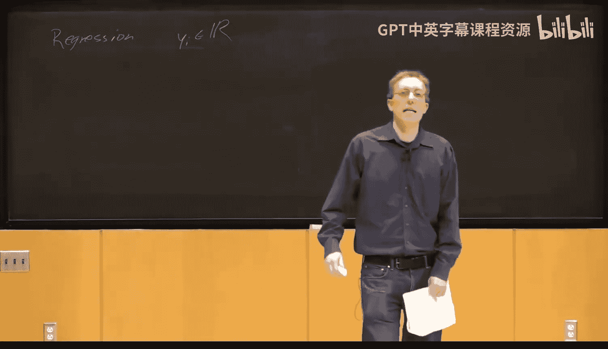

呃。那材料啊。嗯。And。😡，So， again， we have many common loss functions。

 I just will go through them and maybe make a few comments on them。

 And the important thing is that all of these basically fit into the same framework。

 So if you understand how to optimize one of them， you probably know how to optimize all of them。

So the first one is one that we've already seen many times。That's a squared loss。

And we've seen that an ordinary least squares， and in rich regression。And the loss is very simple。

 The loss is the following， its you penalize H w of x。I minus y I。Square。

And so that's our last function。嗯。And。So， you know， in some sense。

 nice thing about squared is is always positive。 So if you're off。

 if you're either below or above Y I， you're trying to predict that say a price of a house， right。

 if you are too high or too low， it doesn't matter， right， get the same penalty。

 the other property of the last function is that because it's squared is if you're more off that gives you a much larger penalty。

 right So if you're off by one，1 squared is just one， if you're off by 10，10 squared is 100， right。

 So this couldratic relation。😊，Forces this loss to focus more on outlier。 So if something is really。

 basically， make sure that nothing is really wrong。And if you would just say， okay， well。

 I'm just trying to say， you know。I am。We know， we take all the people in this class， for example。

 and look at their height。And I would try to predict what's， you know， what's the。

The height P that minimizes the square loss across everybody Does anyone know what I would get。

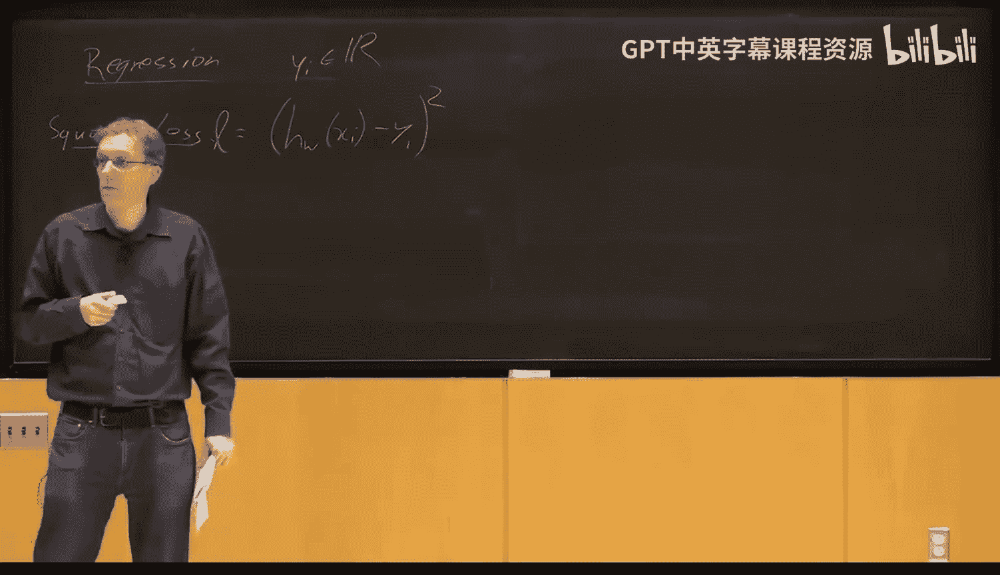

Whatll be the answer。I'm trying to find some value that would， on average， minimize like here。

 my H W of X I is just one number， right， ignores the X， right， So ignores the W。

 It's just one number。just outputting one constant。And I'm trying to fit that constant。

What would it be， Any ideas。It's the average。 That's exactly right。 So what the square loss does。

 it tries to fit the average。 right， That's basically what it' aiming for。

 If you actually can fit exactly the average。Then that's actually， you know。

 that's the optimal solution in terms of the square us。can't do better than the averages。

So estimates， estimates me。And so， you know， for example， if you do income prediction， right。

That would be one example， but the average may not be well suited， right。

 So because this income is not distributed based on the power law distribution。 So there's a very。

 very few people who own as much as everybody else。And so if， you know， for example。

 if you take the average income in the United States。

 let's say Bill Gates makes a good investment and you know， increases his。His， his income by 10%。

 right， suddenly would look like everybody's income end up by quite a bit on average。

 but it is not very meaningful， because only one guy made more money。 So， but on the other hand。

 you know， in some other settings， the mean may be totally appropriate， right。

 if you don't actually have such， just crazy outliers。

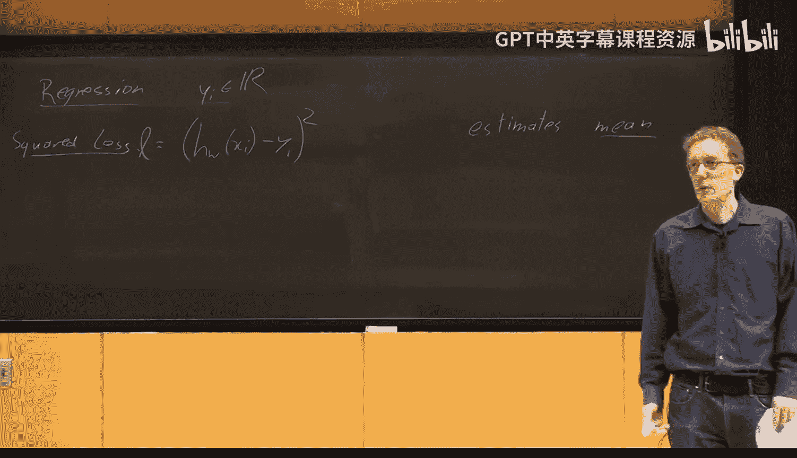

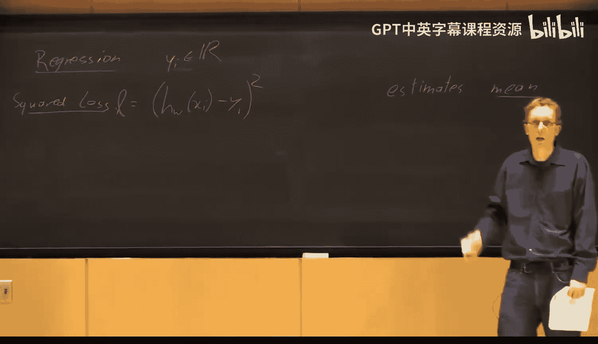

嗯。EThe nice thing about the square loss is that this is fully differentiable everywhere。😊。

So it's very， very easy to fit with gradient descent。And， of course， you， you know。

 the Hasian and this becomes， just one step。Being on yourctor。

 And if you just minimize this with a linear classifier， then this just becomes ordinarily squared。

 This is exactly what we had before。😊，Any questions about the square loss。嗯。Alright。

 so the next one is the absolute loss。And here， the loss is， it's almost the same。

But it's the absolute。

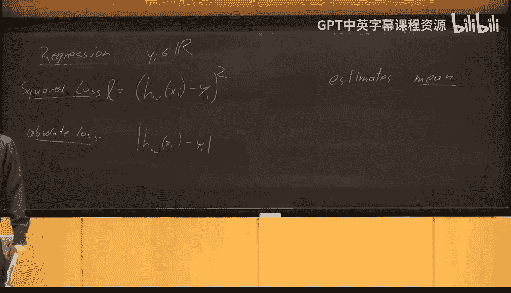

Yeah。Any idea without looking at the notes， what it estimates。This does not estimate the average。

 What does it estimate。What is the minimum error in absolute terms。I would try to predict the。

Some quantity here that estimates the height of everybody in here。 And I want to minimize the。

Suchly on absolute terms， I'm， I'm off by as little as possible。It's not the average。

 what could it be？没点来是没点。And so， for example， in the income example。

 that would make a lot more sense。 right， So now Bill Gates gets a lot more richer wouldn't。

 wouldn't change the median at all， yeah。No， no， no， no， no， Oh sorry。 Yeah。

 So if you compute the average here， it doesn't give you 0。

 It's just as good as you can do with a constant。Right，You can't do any better。That's。

 that's all right。You can do a lot better if you do something different than a constant。

 if you actually try to predict something for the X， you know， take the X into account。

 But here's one more thing， right， for every single X， let me just expand on this for every single X。

 you have some distribution of， what's the probability of Y given X I， right。😊，And so basically。

 what you're trying to predict is actually the mean label given X。Right。

 that's basically what you try to predict of this distribution， What's the average。

 That's what the square us is trying to predict。 Okay， it's conditioned on your feature vector。

And here， given your Xi， you're trying to predict the median label。 This is down here。

Does that make sense。Okay， good。 So， for example， let's say I try to predict height in this class。

 right， If I would just take a constant to try say， what's the， you know， what's the best， you know。

 one number， What's the height of my students in this room， right。

 here this would be the average height， This would be the immediate median height。😊。

But I could do better if I take any features in the account， Right， So， for example。

 one obvious feature would be gender， right， we all know that height is highly， you know。

 gender certainly affects height， right， So then actually， you know。

 what I would get is for all the guys here would get the average height for a guy and all the girls。

 I would get the average height for a girl。 Okay， that would be the best prediction。

 If I only have one binary feature， yeah。😊，How does it go from呃。Okay， they not， yeah。

it's quite simple， actually。 So what you do is you put in some constant here。And you minimize this。

 you just take the derivative and set it to 0。 What you will find is actually the answer is exactly the mean。

 the mean。This one is a little not quite as trivial。Any more questions。All right。Okay， so this one。

 this one is often better because what the the advantage of the absolute loss is that if you have something that's really off。

 right， So let's say I'm trying to predict house prices。😊，And one house is， you know。

 I here Itca where most houses are not that expensive， right， But some guy actually you know。

 built a nice， beautiful mansion at the lake， right， And that actually costs $10 million。 right？

 So what the square loss would do if I'm off here by just 1 million， right。😊，Well， that's a lot。

 right， a million squared。 is this just， you know， gigantic， right。

 So it would spend all its energy trying to get that one mansion correct and would be happy to sacrifice all the other houses in Ithaca for this。

 right， So that's the problem with these， you know， this squaring after loss。

 whereas the absolute loss wouldn't actually， you know。

 wouldn't consider the this mansion any different。😊。

The problem with the absolute loss is that this is not defable at 0。

 And you're trying to get this to 0。 So right at the point where you're trying to get it to。

 it's not differentable。 And that makes it a lot harder to optimize。And there's a beautiful。😊。

Kind of。Best of both worlds。 And that's called the Huberths。

And so Hubo was one of my favorite losses。😊，It does the following。

 You either pick this or you pick this。 You pick this see when you're very， very close to 0。

 because that's where it's differentiable。 But if you're far away from 0。

 that's where this year becomes problematic because you're squing the differences。 So you actually。

 let's say you， you know， you have very large losses。 Then you actually switch to this one。

 and you can basically construct a continuous function that way。 the following way， you say。😊。

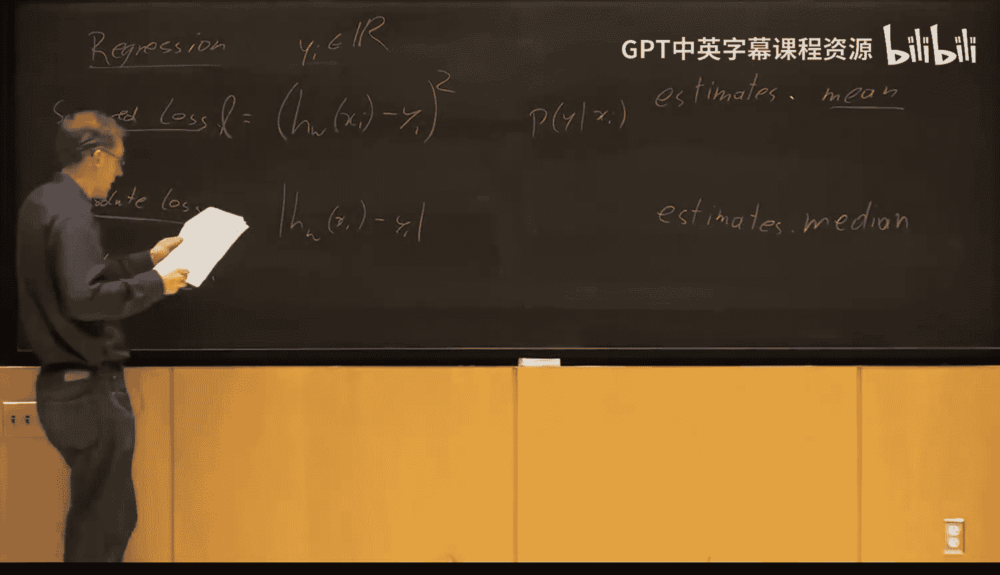

I hope you can so I hope you can see this。1 half h of X I minus Y， I squared。If。

The absolute value is less than some Delta。And otherwise。We have Delta times。Minus Dlta over 2。So。

Otherwise。So what does this do， This year says。If the loss is， the absolute loss is less than Dlta。

 then square it。Which makes it basically the same as thequidatictic glass。So around 0。

 you make it quadratic。 But then at some point， basically， you just continue linear。

So for large losses， you just get the penalty of an absolute loss。

 right So if someone is a millionaire or something。

 you're not actually squaring that in addition to the original large loss。So that's。

 that's very outlier friendly。嗯。And that's typically the best of both worlds。For surprisingly。

 many people don't know it。 Many people just use this loss or this loss。And most of the time。

I would say the Huberaz actually is， is the preferred choice。嗯。

And Google is just one way of doing this。There's another one that's very， very similar。

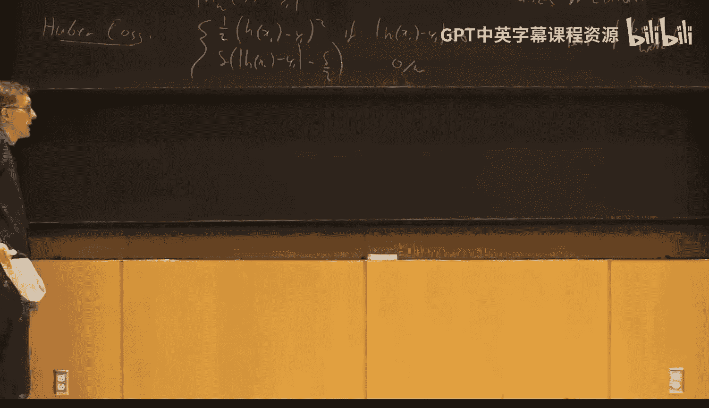

And that's called the log cost loss。

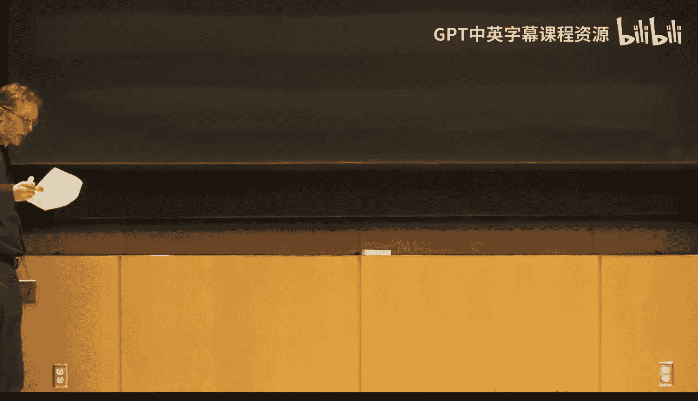

And。Just for those people who are not familiar with it， the cache function is the following。

E of x plus e to the minus x over 2。Maybe think about this for a second。

 What happens with this function when it gets very， very large and what happens when it gets very。

 very small， very negative。Yeah。Yeah。Okay， yeah。 So the question is， when， what。

 what should you pick， what should your Delta be， And so that's the one downr of the Google be you have this choice to make。

😊，Data equals 2。 Here we go。I mean， it it。It doesn't matter all that much。Right。

 because in some sense。哎。

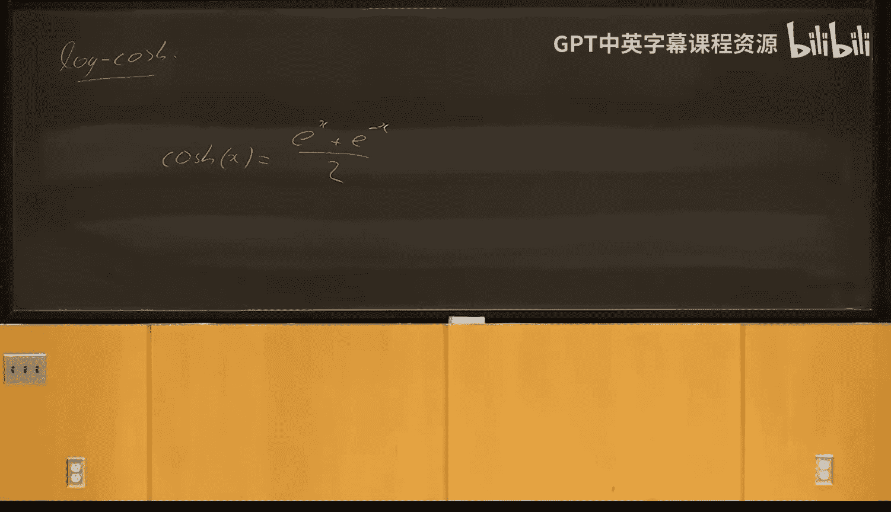

I mean， but by picking thetgia， you basically say how much of the square loss do you want。

 How much of the absolute loss do you want， right？ So if you think theres really drastic outliers that make the al small。

 right， if you think there will we won't be that many， make it larger。😊，第二。呃。

How do you count with this expression。So you basically just connect these two functions。

 that that exactly like you basically have a quadratic function。 And then you say。😊。

Up to a certain point， then you basically solve what's the first derivative。

 And that's exactly how you continue it。I make you draw it in two seconds， not likely in one minute。

嗯。Okay， so this has the cost function。And if we think about this。

 this is actually a pretty symmetric function。 right， So X becomes very positive。

 E of the X takes over。 It's just E to the x。😊。

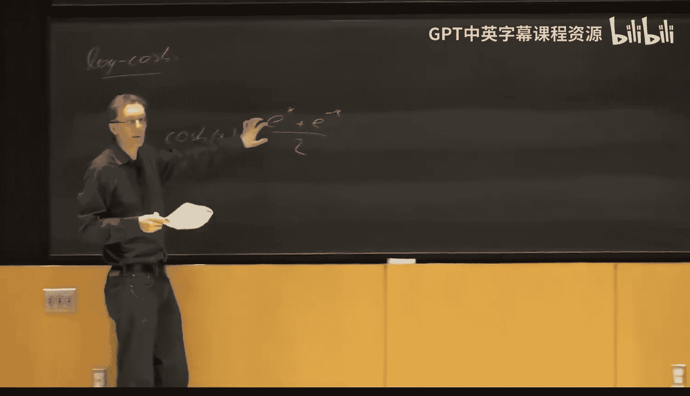

Right， if x is very negative。Right， then this here goes to zero。 It doesn't matter。 but if。

This here just goes e to E to the x， right？ So this this negative。

 the negative sign can loudness becomes， again， E to the x。

 So it's basically kind of E to the x in both directions。Okay， does that make sense。

Raise your hand if you have an intuition， what that function looks like。 Okay， good， right。

 So this basically， you just take E to the X， but instead of actually。😊。

that's kind of put E to the X looks like， right， You just say， well， let's gonna make this this way。

 right。And the nice thing about。 So what we can now do is the log cache actually just says。

 we take the log。😊，Ofp the cost。啊。Of x of a of x。喂哎。I嗯。

I'm gonna have a quiz in a minute that you have to think about what this function looks like。

So the nice thing about this is this is D Hubala。 The nice thing is it's differentiable everywhere。😊。

The Huber loss actually divided at the point where this equals Delta。 It's not differentiable。

 But thats， that's okay because that's a point where you don't really care about very much。

The downside of this is that you have to compute these functions， which is a little slow。

 If you have to do millions of times， you know， computers are not very good at computing E and and expiation and logs。

 etcter。Okay， so。Why don't me just do a quick exercise。 So please， you know， on your， on your sheet。

Right below this table， you actually see a little， little graph。 So why don't you discetly draw all。

😊，4 of those functions。 And you manage to join the Huber last with Dlta equals 1， and Dlta equals 5。

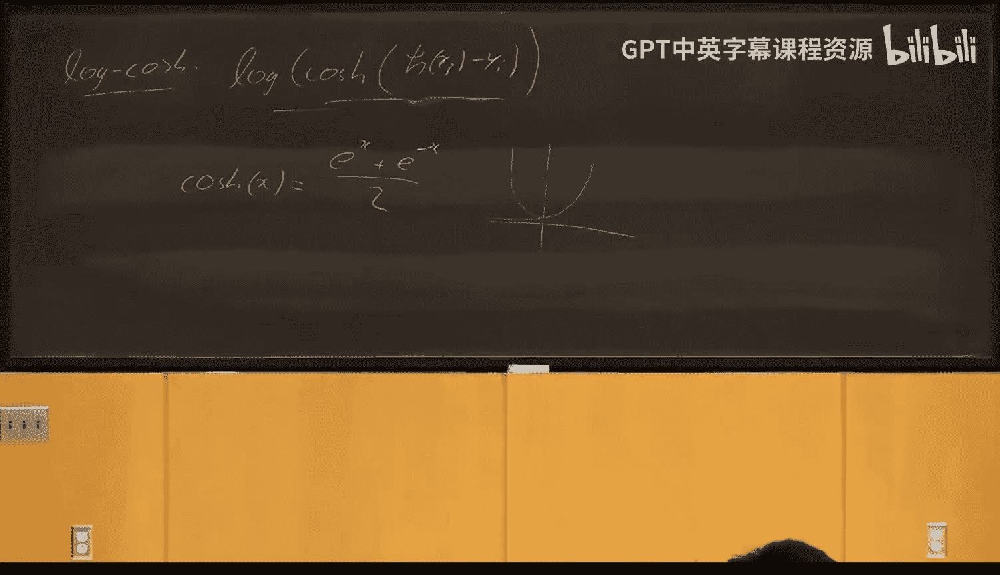

So， two hubber lossessses。The law caused the absolute and the square loss。Sorry。

 it the first Dlta in the second part of the Hober loss。 I that the Delta wrong。Oh， no， no。

 it's actually a constant Dlta Al point。 Yeah， yeah。Oh sorry。

 someone just asked a really good question。Here I use Delta。 That is not a function。

 It's not the deelta function。 It's just a constant Dlta。 Delta just means a small number。Yeah。

 thanks for clarifying this。あ得。Yeah。Very。这个。我的同个。对。你没见。

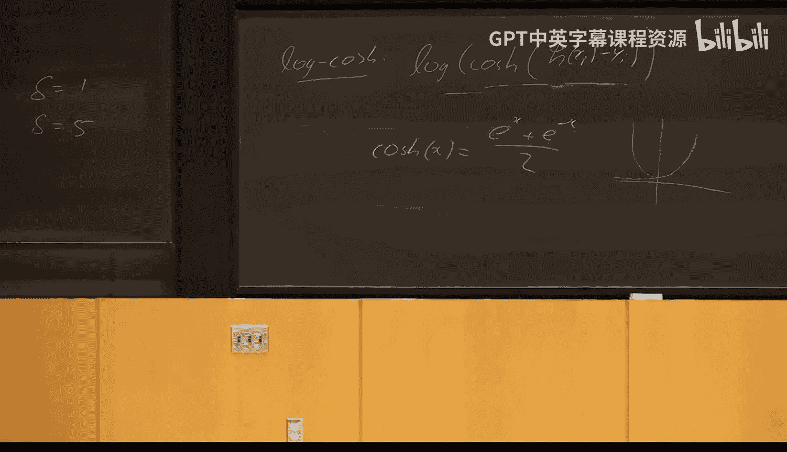

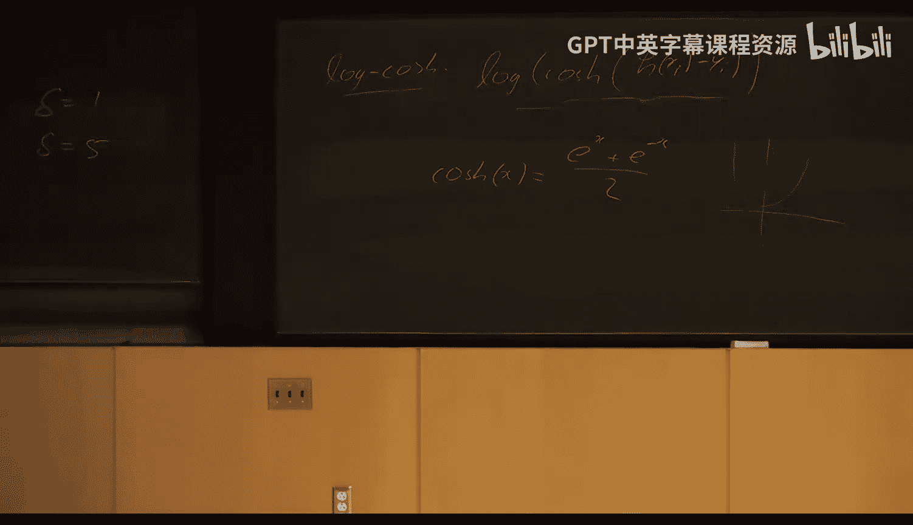

Yeah。Yeah。Yeah。つ。Yeah。ButYeah。Alright， Who thinks he or she has all of them。No。

Who thinks he or she will have all of them soon。Alright， so maybe let's get started。Okay， good。

I can draw them here。Okay， who knows what function this is， This is easy。 This is the easiest one。

Its great us。 Allright， good。ENext one。Oh yeah， here we go。好了， this one。Absolute， right， exactly。

Its harder。It takes a long time to compute that function。Greatai。Oh， okay， damn it。

 So which one is green， Which one is is blue。Yeah。EGreen is， is， is rubberber。EWhat's the Delta。

1 or 5。1， yeah， yeah。 That's right。 And blue。Ha。😊，So blue is， I believe also Huo does。 Yeah。

 and the lock cache is actually， sorry the actually Oh， sorry， the green was actually lock cache。😊。

And red and pink are Hu。There's basically almost no difference between Lahar Shier and。And Hober。

 right， They're very， very similar function。 That's why it's hard to tell them apart。

 if not impossible。嗯。So here you can basically see。 So once again。

 right the way you have to look at these last functions is you have to look into。

 if I have a point that somewhere here， right， I can basically spend energy。

 I can adapt my parameters to moving closer to loss to 0， right。😊。

And the gain that I'm getting is how much the function goes down。 right。

 So here for the absolute loss。The black line， if I'm here 3， right at some point that's off by -3。

 if I correct it by one point， you know， the improvement is the same as if I have a point here and move move it one to the right。

 Okay， so there's no incentive of looking at the points that are really off and improving those。

 like improving anything helps the same way。Wheres a quadratic loss， if I'm off， you know， here。

 right this point here， if I move one block to the right， I get a huge improvement， right。

 Whereas if I'm here， I only get a small improvement。 Does that make sense。 How much you go down。

 So that that's what you have to think about， So moving along these lines。

 So what the loss function we always do is we'll take at the points that look at the points that are really far out and try to move them in。

 because then it can drop the loss a lot on average。😊，嗯。Okay， good。

 Any questions about these last functions。Yeah。So seem somewhat arbitrary。

 It is somewhat arbitrary this。😊，This， in some sense。

 is the choice you have to make as a data scientist。Right， that is kind of left to you。

Which one is the best loss and。Certainly something， you know， weighing into how noisy is your data。

 etc cea， right， is a big factor in this case。But， yes， you know it's。

People have written books about each one of these as functions， though， it's， you know。

 the theory is very well understood。 but in practice， it's still kind of。

It mostly comes down to hard noisier data。 I guess。 I remember when I used to work in industry。

 we had actually， you know， we had fierce discussions about which last function is the right one。

 Like， you know， we almost got into actually real arguments， yeah， yeah。呃。Yeah， it's not faster。

So nowadays， that's maybe not so much of an problem anymore。

 But computing log cache actually is computationally pretty expensive。

If you just think in terms of cycles， computing cycles， right Scing is really easy。

 It's just one multiplyier， right， Yeah， it's not shift It's a shift， yeah。So it's super， super。

 super fast。 It takes one cycle，1 few nanoseconds。 whereas taking the exponiation and the log is much。

 much more expensive。第二。Is there any way you can post these two images？啊那。呃。Yeah， yeah， yeah。

 They are already on the website， yeah。Any more questions。Sorry it's not a shift。 It's。

 you have the modification。 I was wrong。 Yeah， Okay， good Dev us more next。

 The author not here today， But he been be bugging me to。😊，Show you this one。

Demo that I promised you last time。 So this is actually， I。

Don't want to pretend that I had a demo and then actually not show it。嗯。So this is actually， I never。

 I owe you a demo on rich regression。 So it's just as， as。As relevant now as it was back then。

 because it's basically just the square lot。 right， So here's basically。😊，Richard guessson。

 let's say， you know， it's basically just a minimizer square loss and an L2 regular riseor。So here's。

 you know， the data set， let's say I'm just drawing some data points。 You know， la， la la， la la。

 You know， it helps when you make that sound。😊，And how you。

I fit this data set with a classic requester。And here's。

 here's the line that minimizes the squared loss， right， So basically， what it does on average。

 basically， it tries to be off very little。 And this is for very small Ladas。

 So I do very little regularization。😊，If I increase my regularization。Then the。

 you can see here what happens。I'm。Oh my gosh， this is slow。now I'm increasing my regularization。

 What happens if basically flattens this out， right。

 And the basically says simpler solutions are parallel to the horizontal axis。

 So in the extreme case， I do a lot of regularization that it just ignores the data and just gives me a straight line。

 So that's basically what this what this does。 What the effect of this regularization is。😊。

I can also show， maybe I draw one example， just do it one more time with， with some outliers。 let's。

 you know， do this。And let's， let's make some point here， right。And if I now fit this。

 you see that actually， it moves this whole line， right， a lot over towards this point here。 Okay。

 so it really is really bad estimate for these points here。😊。

RightAnd that's only because of this one point， where maybe the measurement， right。

 It's like typical in biology or something， you measure something。 right And right that moment。

 a big Mac truck drives past your lap， right， and everything shakes。

 And so this is kind of the one point where the Mac track kind of you know distorted your results。

 right， And so the square la basically fall for it， right。

 and basically moves like all of these guys now get worse predictions just because of this one outlier。

 Okay， yeah。😊，啊，So我诉讼。开问题。That have about that using like。いや。don话。Review for dimension。

Iman is Al Ktner。啊，最后。好好好。呃。Well the the problem is it doesn't really work， right。

 because the prediction is actually the overall prediction across the entire old dimensions。

It's not actually clear how to do that， right。嗯。Yeah， it doesn't really work。嗯。

I mean it's a good question。 You， you， you're right。

 You may have some some dimensions are very noisy and others or not， right。

The rights probably the best way is just to use the log harsh La are the K last。Yeah。

Any more questions？Okay。Okay， let's move on to regularization。So what's regularization？

Regularization facing this additional term。 So we're trying to minimize the error。And。

But what we've already seen this， that actually when we did in logistic agion， we did map inference。

Or in O， we did map inference， right。Then what we got is the second term。 But in our case， actually。

 R of W was always。W transpose W， right， In fact， we saw three classifiers where we had this regular rise。

 Does anyone remember the third one， one is rich regression。

 The second one is logistic regression with map and estimation。 What's the third one。😊，Nobody。啊。放完。

SVM， thank you。 Thank you。 Oh my gosh。 Yes， SVN。 right。 So in the SVN。

 the last actually became that regular rise of this basically the hinge loss plus the L2 regular rise。

😊，Someone asked me a really good question at the end of last lecture and said， so with the SVM。

 right， and I'm paraphrasing the question， But it was a great question。 So like initially。

 we started out saying we have this data set， right， where we have these crosses。😊。

You have to positive for the negative points。 then we would like to find the hyperplane that has maximum margin。

But the end， when we look at the final optimization problem。You know， it， it just minimized。

 you know， it minimized W transpose W subject to the constraint that Y， I， W transpose X， I plus B。

It's greater equal 1， right？ So why does that maximize the margin。 Somehow， you know。

 the intuition was very clear at the beginning。 And he said， like， you know。

 every single step made sense。 But then at the end， we arrived at this thing。

 and that doesn't seem to maximize the margin anymore， so， you know， for example， if I know。

 it would take this hyper plane here， right。That also seems like a good， good classify classifier。

 according to this， this optimization problem。And let me just make that connection because I I think it it's a very good point。

 right， turns out， no， no， no， this is actually a subopmal solution in this case。 And so why is this。

Because this constraint here basically says that the inner product with W must be at least one for every single data point。

 That means this here is basically I can basically draw a line on each side where I say。

 this is a line。All the points to the right of this happen't in a product of at least one， Okay。

 or a negative one in this case。 Okay， does that those lines make sense， Ra hand and that make sense。

Okay， awesome。 So this is my W， right， And now here comes to point。What does the last function say。

 The last function here says minimize the square of W。

 So what I want to do is take this error and make it shrink it。

RightAnd what happens then if I have an inner product， right， this here。

 this here is basically the line with the inner product， W trans x plus B， it gives exactly1。

 Now I take my W when I shrink it。 I make it shorter， What does that mean for this line， right。

 It means that the line moves outwards。 right， It has to。

 because now the points X have to be further away right， to get the same inner product。

 because I multiply with a smaller number， right， So if w get smaller， X has to be larger。

 right to get the same inner product。😊，So if I I shrink W。

 and that's exactly what this objective is trying to do， it says， give me the smallest possible W。

 right， So I'm doing this。 What happens？ This this margin goes， you know， moves outwards。

But in this case， if I have this hyperplane， the， the margin can't move outwards anymore， right。

 because this x already lies here and this， this O lies here。 Okay， so I have no more wiggle room。

 I'm up against the corner。so I can't shrink my W anymore。 Okay， whereas on the other hand。

 if I would now rotate the whole hyperplane。Right， and I'm here。 then next you have more wgle room。

 You know， actually get， They can actually push them out even further。 I don't actually。In this case。

 actually， the maximum margin I play would probably。Looked like this。Be somewhere along here， right。

I actually have this and this this line， right， So if I'm actually exactly in the middle。

 then I can move these out as far as possible。 And what that means is I actually get the smallest possible W squared。

 Okay does that make sense。 So theres actually exactly the same thing， right。

 it's just a different way of looking at。 So with this constraint I basically saying， you know。

 try to， to， you know， move these lines where the inner product is one as far away as possible。

 that's what this optimization problem says。 but don't go any further， You know。

 like a moment you hit any data points， you have to stop， And that means you。

 you will arrive at the maximum margin solution。😊，一。Yeah。好。Yeah， so essentially， this is basically。

 that's right。 So if you now put this in this， this is basically hinge la， right。

 And so then you actually have the last function here plus rank。 Yeah， that's right。

 So in the soft constraint。😊，为什。Okay， good。 Any questions。Okay， so I said the regular on the SM。

 it's pretty clear about the regular does。 right， The regular basically says。

 don't just find me any hyperplane， Find me the hyperplane that gives me maximum margin。

 So in general， a regular rise can be viewed as saying， I want to have a simple solution。

 So this is ocean， also a notion of simplicity， saying the simplest solution。

 actually is the one that's right。 Smack in the middle。 typically。

 it's a little more general than that。 And let me actually， before we get into this。

 let me just tell you a little bit little trick of optimization theory。😊。

So we have the following problem。 let me write it here。 Can people read this in the back。

 Can you give me a thumbs up。Okay， good。 So this year is the optimization problem we're trying to solve。

Now， for those people who've done。Optimization theory。😊，And you may know that actually。

 this year is basically something。 you know it's called the Lagrangian formulation。

 of optimization problem that actually has constraints。

 So what I really mean is you can rewrite this guy as something that looks slightly different。

 You can see that's the same thing as saying the following and minimizing over a W the same function。

😊，L of H W of X I comma Y I， right， I minimizing the loss subject to your constraint。Such that。

R of W。It's less equal than B。And so for every Lada， they exist to B。

 such that those two are equivalent。 for every B that exists to Lada， that those two are equivalent。

 right， So it's not obvious what that is。 But but you just trust me， it exists， okay。😊。

Does that make sense， So why is this the case， Because if my Lada is large enough。

 I will arrive at some solution for R of w。 Okay， so if my Lada is large enough。

 it will basically try to minimize this loss。 But it will also try to minimize R of w。

 which is also some function， right， The larger Lada is the more I'm trying to make this party small。

 If Lada is small， then I don't care about this。 then I mostly want to make this part small。

 So Lada basically says how much do a way of these two functions。 Now。

 if I solve this for a given lambda。😊，Then basically， you know， I get some value for R of W。

And I can make that value exactly my B， right， now if I run this optimization problem。

 I get exactly the same answer。 Okay， does that make sense。The other way around is not as obvious。

 So once you have a B， you have to try out a bunch of lenderers， But it turns out they always exists。

Any questions about this。Who believes me？ Raise your hand。Okay， good。 Z gullible。 No。

 it's actually true。 It's true。 alright。😊，So let's just view it as this。 right， So then actually。

 what is our regularized， our regularized is a constraint， right。And so。

What's the regularizer we've been looking at so far， That's the L2 regularizer。So， R of W。

Equals W transpose W。And if we look from this perspective。

Right now this actually has a very neat interpretation。

It means that W squared must be less equal than some B for some B that you specify。

So what does that mean？It means youre somewhere in the space of Ws， right， So this is my W 1。

 This is my first entry of W。 This is my second dimension of W。

 Let's say my W is just two dimensional。 Okay， then I can draw it， right。😊。

So any point here is basically a solution。 That's A W。 Okay， Does that make sense。

 That's the fourth coordinate of W。 That's the second coordinate of W。 Okay， raise your hand that。

 that makes sense。Okay。No。Here's what we're saying。

We have some function over W that we are trying to minimize。 So that's some function。You know。

 in the space， let's say it looks like this， right。And here's the minimum。 Okay。

 so this is kind of a valley， right that you're looking into。And we try to find a W， you know。

 when we do gradient descent， we start with some W when we walk down here until we hit the minimum。

Okay， that's just minimizing the loss。 This year is my last part。What the。What is this here。

 This says this W A R of W， W transpose W is less equal than B。 What does that mean。

 That means the sum of squares， right， W 1 squared plus W 2 squared is less equal than B。

What does that mean？呃。It's a circle。 That's exactly right， right。We have some circle here。

A raius B squared， I guess， right。And my W must lie inside this。 It's actually not a sphere。

 right a Hysphere。 have some ball， right， And I'm saying， minimize this function here on the right。

 right， minimize this loss function。😊，But the solution must still lie inside the spa。

 That's what my constraint is telling me。 That's what the regularizer is doing， okay。

And so what about is equation gradient descent trying to do， right。

 It's trying to get to this point here， but it's not allowed to， right。

 You're saying you have to lie inside the ball。 So what is it gonna do。

 It will find the closest point that basically to the minimum， It will end up here。Okay。

 does that make sense。And as you increase your B， at some point， it doesn't matter anymore。

 right if your is really， really large。Then。Then you will just end up here。 So if your bees。

 that basically means your Lada is so small that the organization has no effect anymore。 right。

 that's the equivalent of you。 But if your Lada is large enough。

 then actually it will not find the optimal solution。

 It will find the optimal solution under the constraint that you are inside this ball。Okay， that's。

 that's the idea behind regular L2 regularization。Any questions about this？呵呵。嗯。对。So the B。

 that's right。 So for every lambda that exists the B， if every B that exists to Lada， are equivalent。

Yeah。第二。That's exactly right。 So in practice， what you do is the question is， how do you find Lada。

 you just search for different values of Lada on the holdout set and you see which one does best。

 right， And so the problem is that basically， if you minimize just on the train data set， right。

 you get get a you always get lower error if you decrease your La， right， the Lada will hurt。

 the regularization hurts your training performance。😊，But it may increase your testing performance。

 and we will get into this very， very soon。 Actually， after E R M is' done。

 we will talk about the bias variance decomposition。

 and then we will get into exactly the straightoff， right， you know。

 between regularization and actually minimizing more regularization， less regularization， et cea。😊。

Any more questions， yeah。That's exactly right。 right， It's a small， small number means larger B。

 right。In basically 0 Lada means infinite B。 That basically means this is no longer an active constraint。

 It can be anything you want。Exly， man。Any more questions。Okay， so。I guess we are out of time。

 I will continue on this next week。