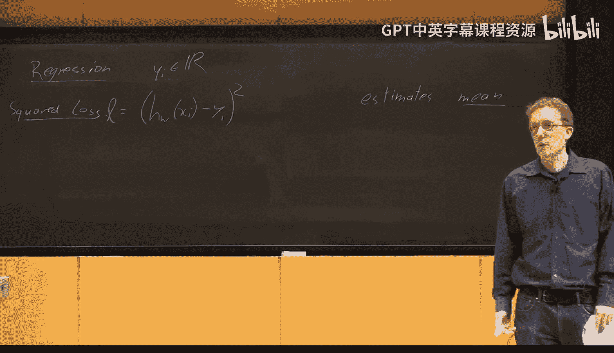
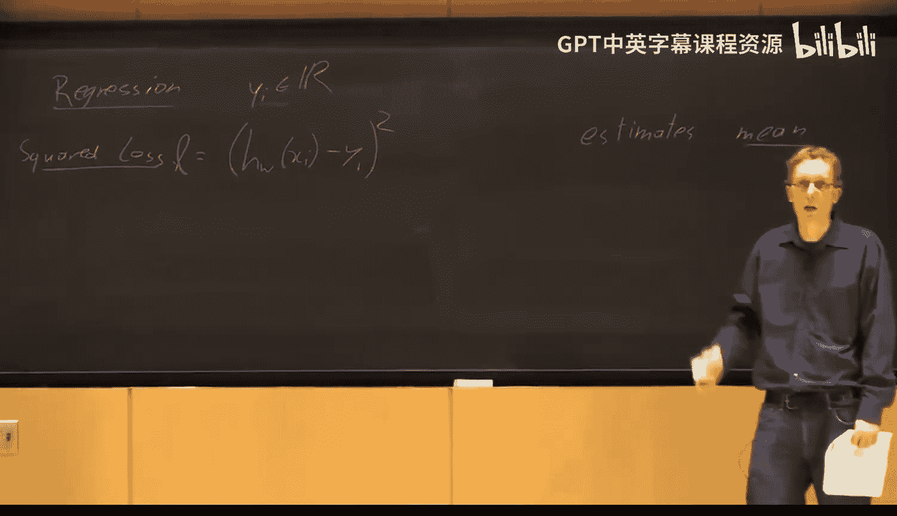
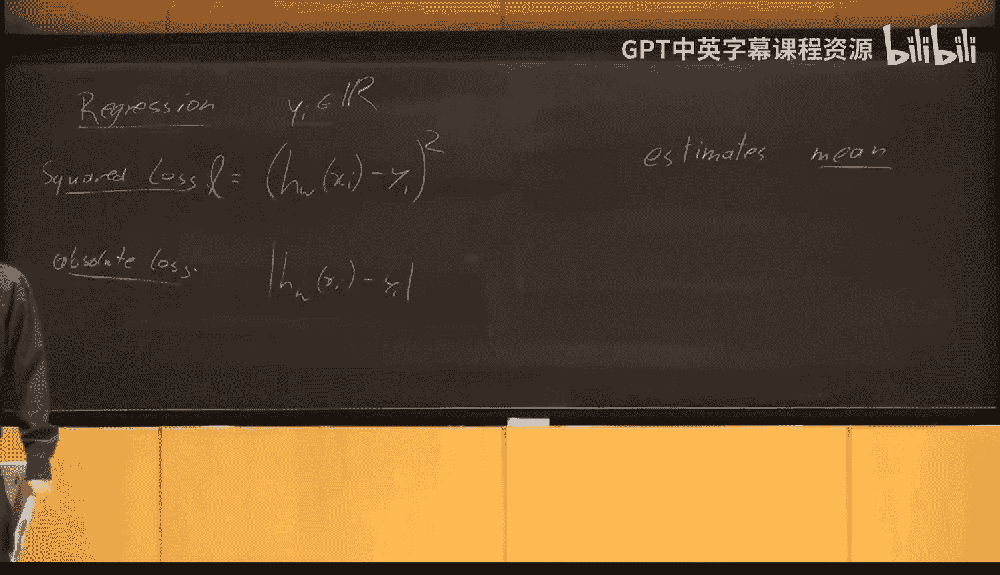
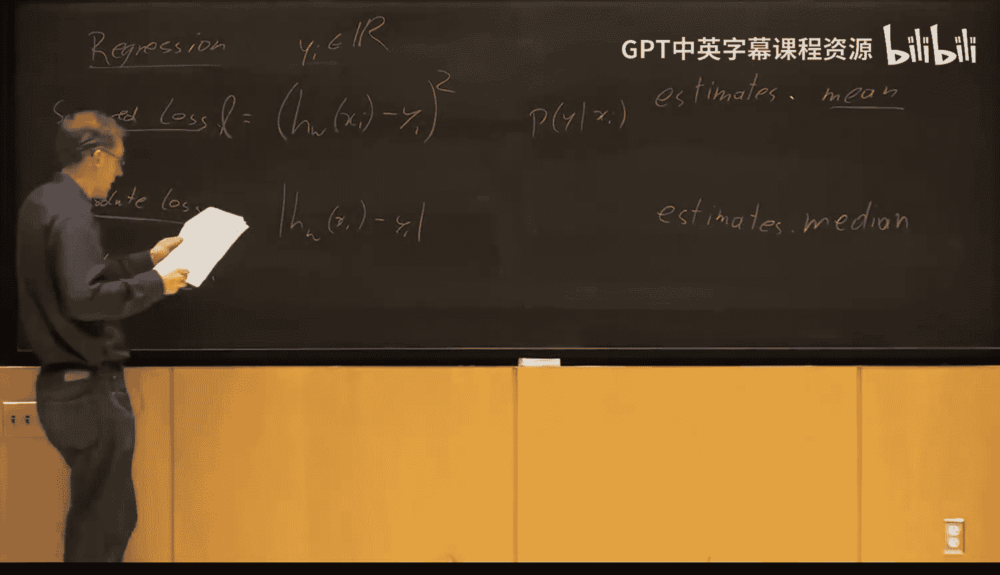
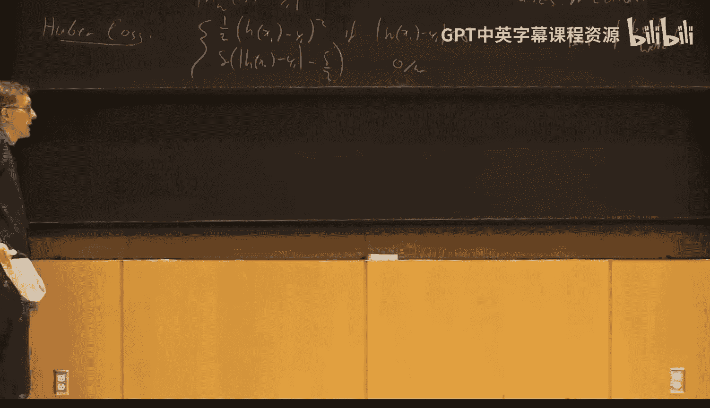
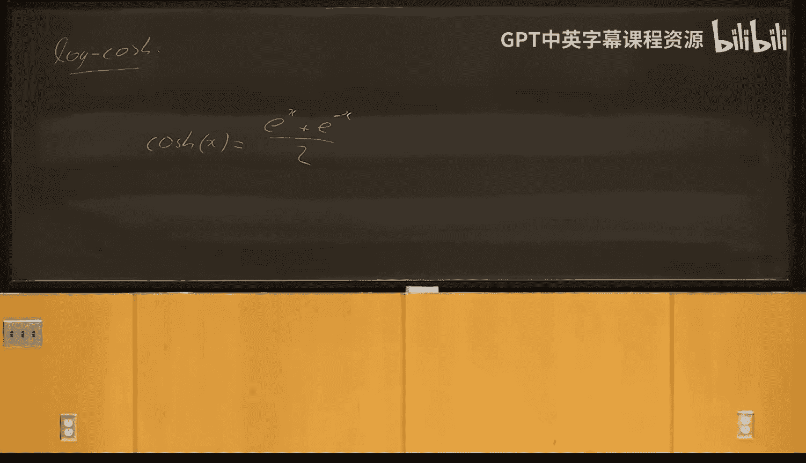
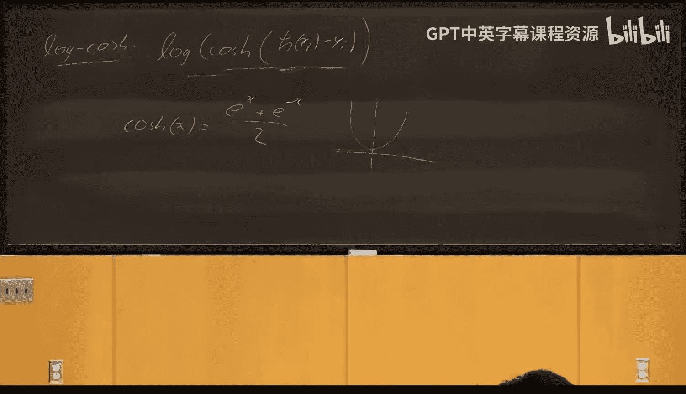
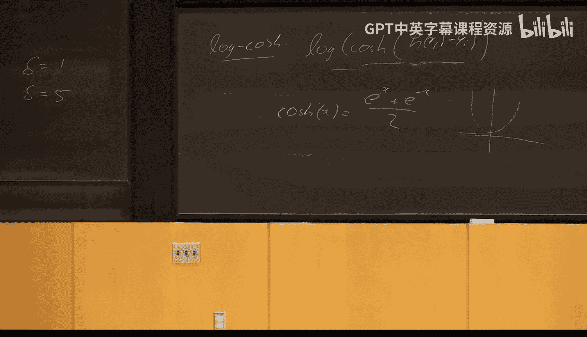
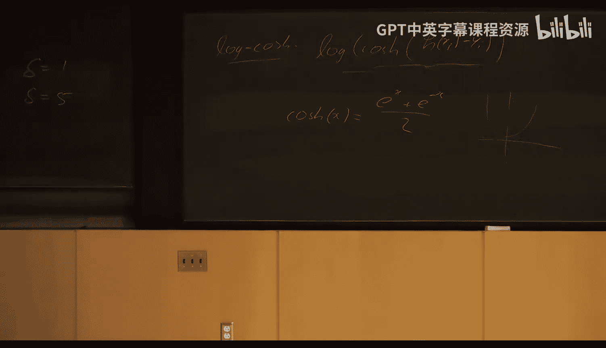

# 机器学习：016：经验风险最小化


在本节课中，我们将要学习经验风险最小化（ERM）框架，这是机器学习算法的核心范式。我们将回顾其基本形式，并深入探讨回归问题中常用的几种损失函数，最后解释正则化的作用及其几何直观理解。


## 回顾：经验风险最小化框架


上一节我们介绍了经验风险最小化的基本思想。本节中，我们来看看其标准数学形式。

在机器学习中，我们通常将学习算法表述为寻找一组参数（通常称为权重 **W**）的过程。我们的目标是**最小化**一个由两部分组成的函数：


**公式：**
```
min_W [ Σ_i L( h_W(x_i), y_i ) + λ * R(W) ]
```

在这个公式中：
*   `h_W(x_i)` 是模型对数据点 `x_i` 的预测。
*   `y_i` 是真实标签。
*   `L` 是**损失函数**，用于衡量预测值与真实值之间的差异。
*   `R(W)` 是**正则化项**，用于惩罚过于复杂的模型，防止过拟合。
*   `λ` 是一个超参数，用于控制正则化的强度。


我们之前讨论了几种经典的分类损失函数，包括合页损失（Hinge Loss）、逻辑损失（Logistic Loss）、0-1损失和指数损失。

## 回归问题中的损失函数







今天，我们将重点转向**回归**问题。在回归中，我们的目标是预测一个连续值，例如预测房价、温度或人的身高。

与分类问题类似，回归也有多种常用的损失函数。理解这些函数有助于我们根据数据特性做出合适的选择。以下是几种常见的回归损失函数：

### 平方损失

平方损失是我们最熟悉的损失函数之一，在普通最小二乘法和岭回归中都有应用。

**公式：**
```
L( h_W(x_i), y_i ) = ( h_W(x_i) - y_i )^2
```



平方损失的性质：
*   它总是非负的。
*   它对预测值过高或过低的惩罚是对称的。
*   由于是平方项，它对**异常值（Outliers）** 非常敏感。误差越大，惩罚呈二次方增长，这会使模型极力去拟合那些异常点。
*   如果模型忽略特征 `x`，仅输出一个常数来最小化平方损失，那么这个最优常数就是所有标签 `y_i` 的**平均值（Mean）**。
*   平方损失处处可微，易于使用梯度下降等优化方法。



### 绝对损失




绝对损失是另一种直观的损失函数。


**公式：**
```
L( h_W(x_i), y_i ) = | h_W(x_i) - y_i |
```

绝对损失的性质：
*   它对误差的惩罚是线性的，因此对异常值不如平方损失敏感。
*   如果模型忽略特征 `x`，仅输出一个常数来最小化绝对损失，那么这个最优常数是标签 `y_i` 的**中位数（Median）**。
*   它在误差为0处不可微，这给优化带来了一些困难。



### Huber损失





Huber损失结合了平方损失和绝对损失的优点，是两者的一种折中方案。

**公式：**
```
L_δ(a) = {
    0.5 * a^2,                if |a| ≤ δ
    δ * |a| - 0.5 * δ^2,      if |a| > δ
}
```
其中 `a = h_W(x_i) - y_i`。

Huber损失的性质：
*   当误差 `a` 较小时（`|a| ≤ δ`），它表现为平方损失，具有良好的可微性。
*   当误差 `a` 较大时（`|a| > δ`），它表现为绝对损失，对异常值不敏感。
*   超参数 `δ` 决定了从“二次”区域切换到“线性”区域的阈值。`δ` 越小，模型对异常值越鲁棒；`δ` 越大，模型越接近平方损失的行为。
*   它在 `|a| = δ` 处不可微，但通常不影响优化。

### Log-Cosh损失

Log-Cosh损失是另一种光滑且对异常值相对鲁棒的损失函数。

**公式：**
```
L( h_W(x_i), y_i ) = log( cosh( h_W(x_i) - y_i ) )
```
其中 `cosh(x) = (e^x + e^{-x}) / 2`。

Log-Cosh损失的性质：
*   它处处二次可微，优化性质良好。
*   对于小误差，其行为近似于平方损失；对于大误差，其行为近似于绝对损失。
*   计算 `cosh` 和 `log` 函数的开销比平方或绝对损失要大。

## 损失函数对比与选择

为了直观理解不同损失函数的行为，我们可以绘制它们的图像。以下是关键点：

*   **平方损失**：曲线为抛物线，对小误差惩罚小，对大误差惩罚急剧增大。
*   **绝对损失**：曲线为V字形折线，惩罚与误差成线性关系。
*   **Huber损失**：在原点附近是抛物线，在远处过渡为两条直线。
*   **Log-Cosh损失**：是一条光滑曲线，形状与Huber损失非常相似。

选择哪种损失函数取决于具体问题和数据特性：
*   如果数据中几乎没有异常值，且希望得到均值预测，**平方损失**是标准选择。
*   如果数据中包含显著异常值，且希望得到中位数预测或更鲁棒的模型，**绝对损失**、**Huber损失**或**Log-Cosh损失**更合适。
*   **Huber损失**通常是一个很好的折中选择，因为它兼具可微性和鲁棒性。

## 正则化的几何解释

现在，让我们回到经验风险最小化公式中的正则化项 `R(W)`。我们最常用的是L2正则化，即 `R(W) = W^T W`。

从优化理论的角度看，带正则化的最小化问题等价于一个带约束的最小化问题：

**等价形式：**
```
min_W Σ_i L( h_W(x_i), y_i )
s.t. R(W) ≤ B
```

对于每一个正则化强度 `λ`，都存在一个对应的约束边界 `B`，使得两个问题的解是等价的。

以L2正则化 `R(W) = ||W||^2` 为例，约束 `||W||^2 ≤ B` 意味着参数向量 **W** 必须位于一个**高维球体（或圆）** 内部。

**几何直观：**
1.  想象损失函数 `Σ_i L(...)` 在参数空间 `W` 中形成了一个“山谷”，谷底是无正则化时的最优解。
2.  L2正则化约束 `||W||^2 ≤ B` 定义了一个以原点为中心、半径为 `sqrt(B)` 的球。
3.  我们的优化目标是找到这个球**内部**使得损失函数最小的点。
4.  这个点通常位于球边界与损失函数等高线相切的位置。
5.  当 `B` 很大（即 `λ` 很小）时，球很大，约束可能不起作用，解接近原始最优解。
6.  当 `B` 很小（即 `λ` 很大）时，球很小，解会被“拉向”原点，从而得到参数值更小、更简单的模型。

这种“约束球”的图像清晰地说明了正则化如何通过限制参数的大小来**偏好更简单、更平滑的模型**，从而有助于提高模型的泛化能力，防止过拟合。

## 总结

本节课中我们一起学习了经验风险最小化框架在回归问题中的应用。我们详细介绍了平方损失、绝对损失、Huber损失和Log-Cosh损失等回归损失函数，分析了它们各自的特性和适用场景。最后，我们从约束优化的角度深入探讨了L2正则化的几何意义，理解了它如何通过将参数限制在一个球体内来促使模型选择更简单的解，这是控制模型复杂度和提高泛化性能的关键机制。