# 机器学习：017：正则化与复习 🎯

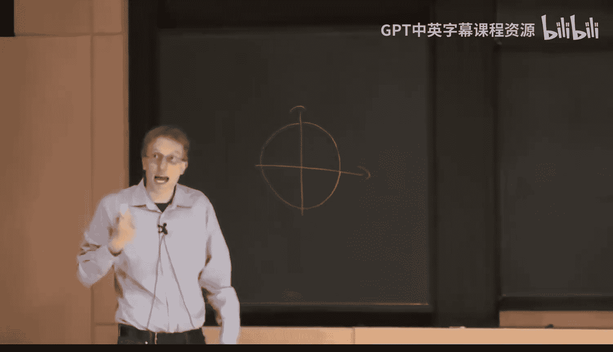

在本节课中，我们将学习正则化的核心概念，特别是L1和L2正则化的原理、区别与应用。我们还将通过一个简短的问答环节，回顾课程前半部分的关键知识点。

---

## 正则化回顾 📝

上一节我们介绍了正则化的基本思想，即通过向损失函数中添加一个惩罚项来限制模型复杂度，从而避免过拟合。本节中，我们将深入探讨两种最流行的正则化方法：L2正则化和L1正则化。

### L2正则化（岭回归）

L2正则化在损失函数中添加了权重向量 **w** 的L2范数平方项，其公式如下：

**损失函数 = 原始损失 + λ * ||w||₂²**

其中，λ 是控制正则化强度的超参数。

从几何角度看，L2正则化相当于在参数空间中施加了一个**球体**约束。它要求最优解必须位于一个以原点为中心、半径为某个值的球体内。这迫使所有权重值向零收缩，从而得到一个更“平滑”、更简单的解，通常能提高模型的泛化能力。

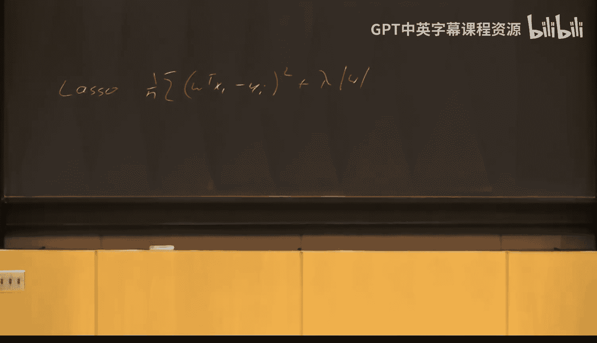

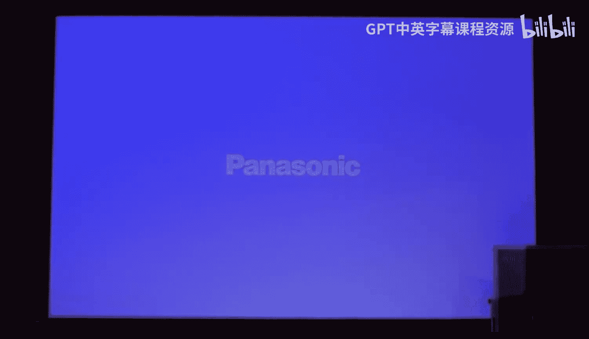

### L1正则化（套索回归）

L1正则化则添加了权重向量 **w** 的L1范数项，其公式如下：

**损失函数 = 原始损失 + λ * ||w||₁**

从几何角度看，L1正则化的约束区域是一个**菱形**（在高维空间中是超立方体），它有尖锐的“角”。

以下是L1正则化的关键特性：

*   **稀疏性**：由于约束区域的尖角特性，最优解往往会落在这些角上，导致许多特征的权重**精确为零**。这实现了特征选择，生成了一个稀疏的模型。
*   **可解释性**：在科学领域（如生物信息学），知道哪些特征的权重为零至关重要，因为这有助于理解模型做出预测的依据。
*   **非严格凸性**：L1正则化不是严格凸的。如果存在两个完全相同的特征，优化问题可能有多个等价的最优解（例如，所有权重分配给特征A，或全部给特征B，或各分配一半）。这可能导致结果的不确定性。

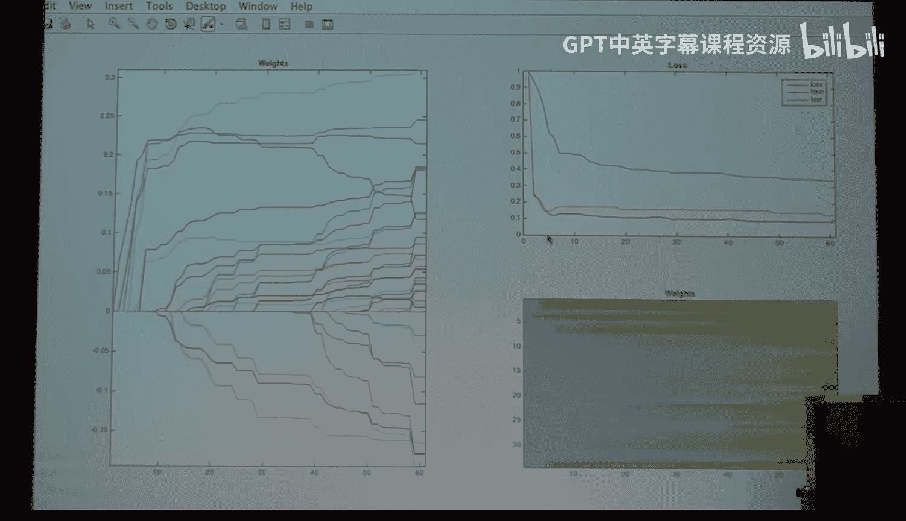

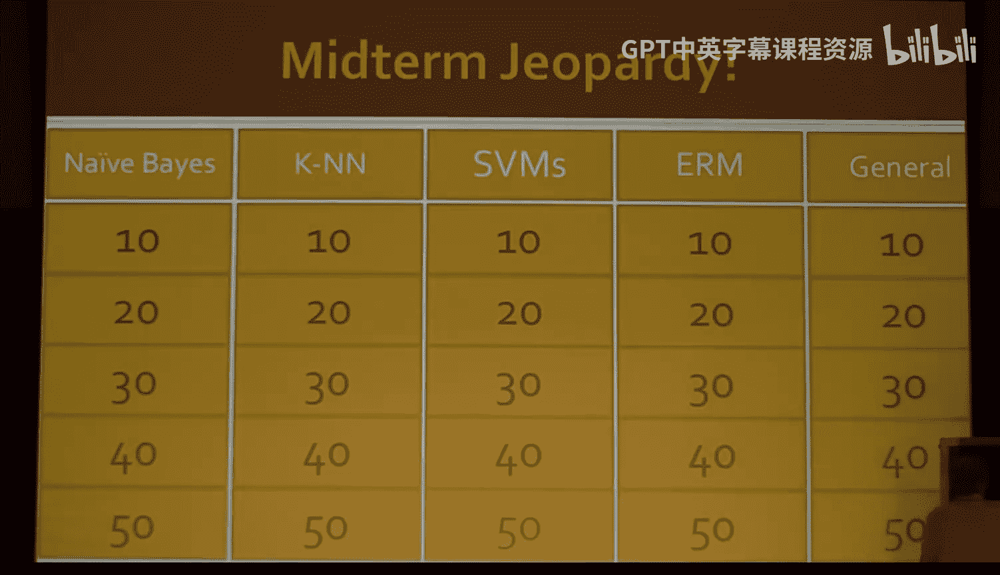

### 弹性网络

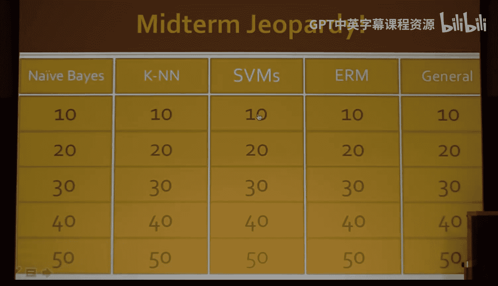

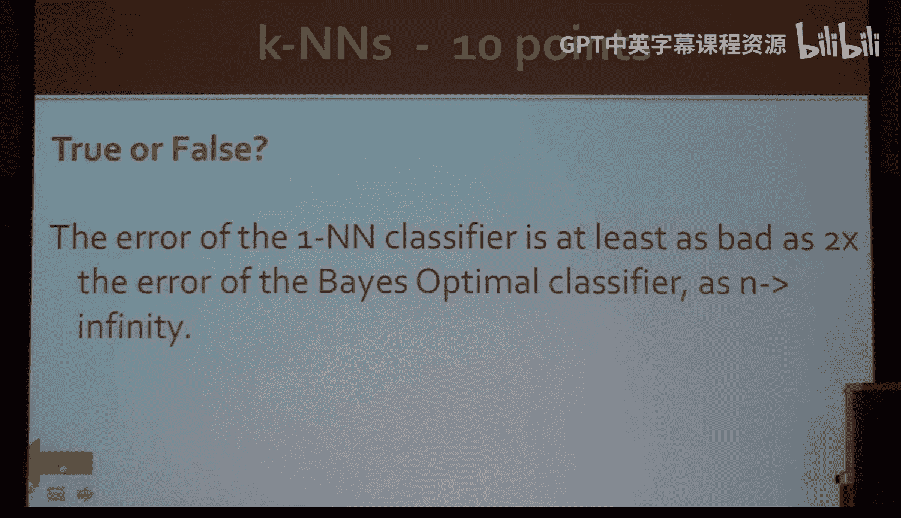

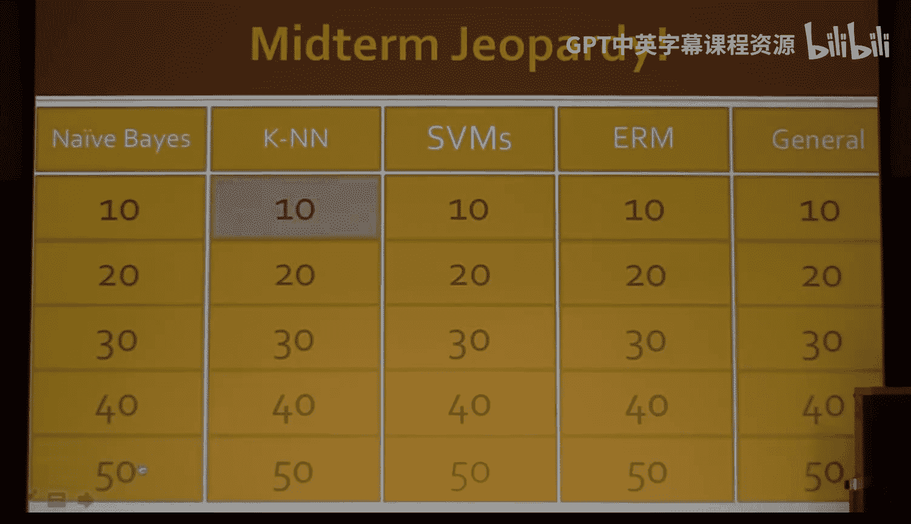

为了结合L2和L1正则化的优点，人们提出了**弹性网络**。它在损失函数中同时加入L1和L2惩罚项：

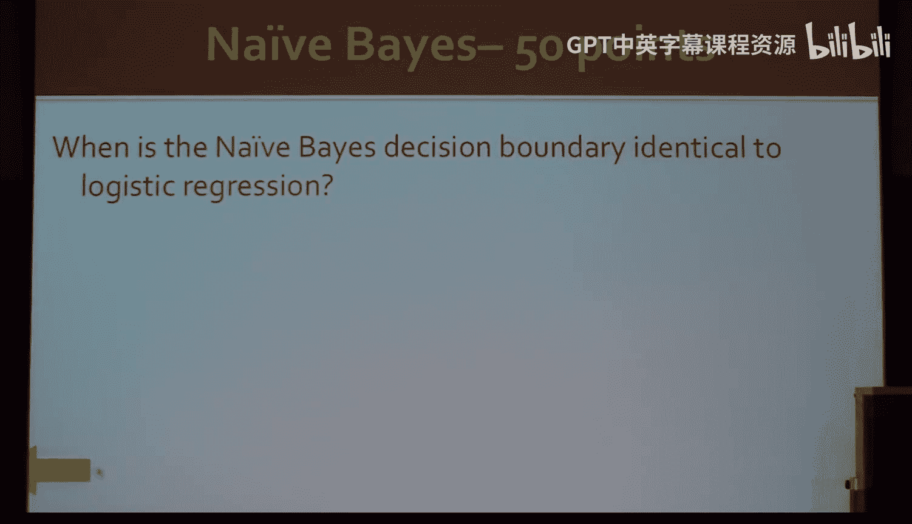

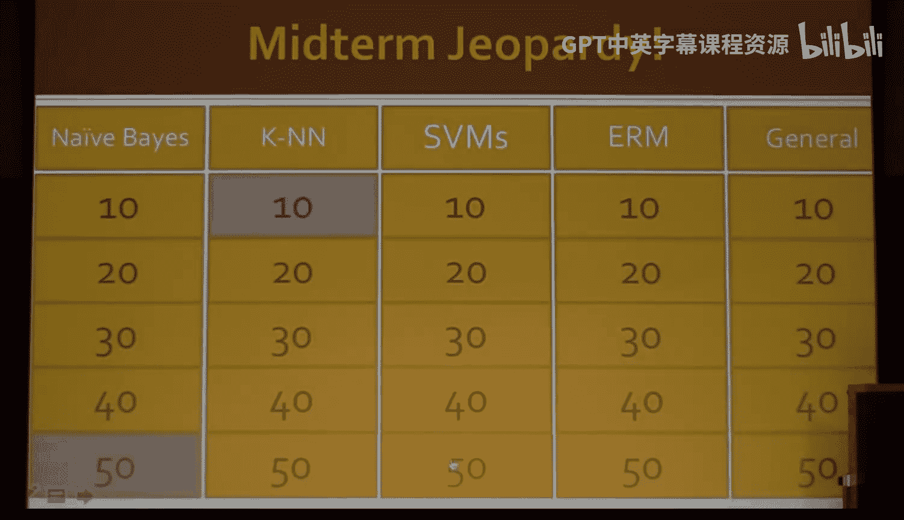

**损失函数 = 原始损失 + λ₁ * ||w||₁ + λ₂ * ||w||₂²**

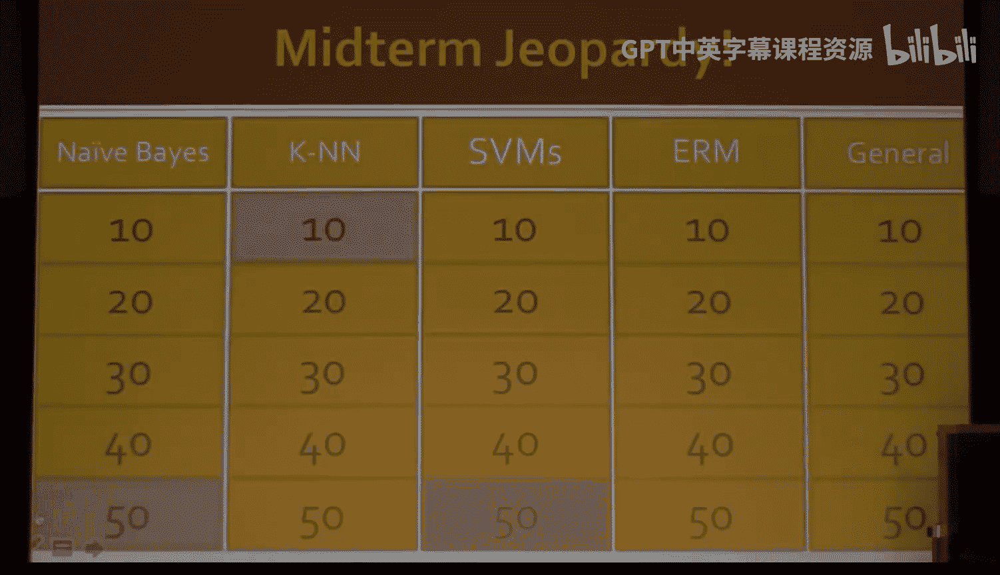

其中，λ₂ 通常设置得非常小。弹性网络既鼓励稀疏性（来自L1），又因为L2项的存在而保持了严格凸性，从而确保了唯一解，并提高了模型在特征高度相关时的稳定性。

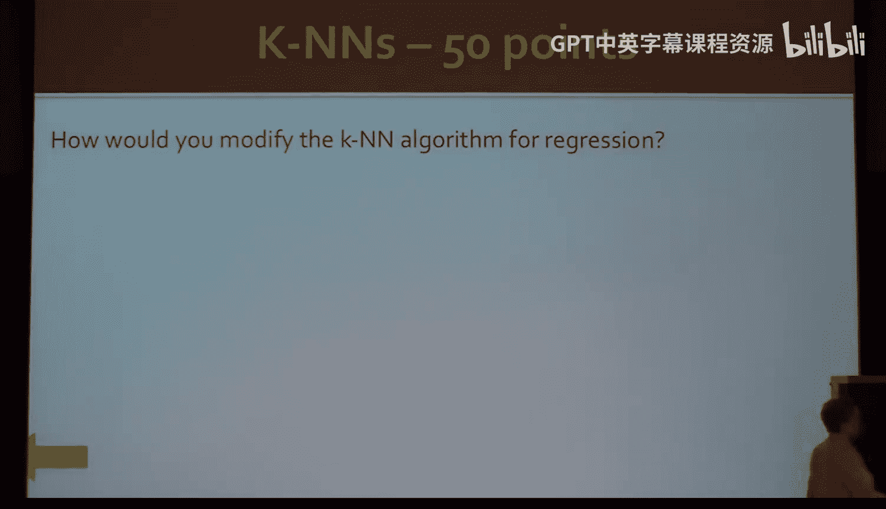

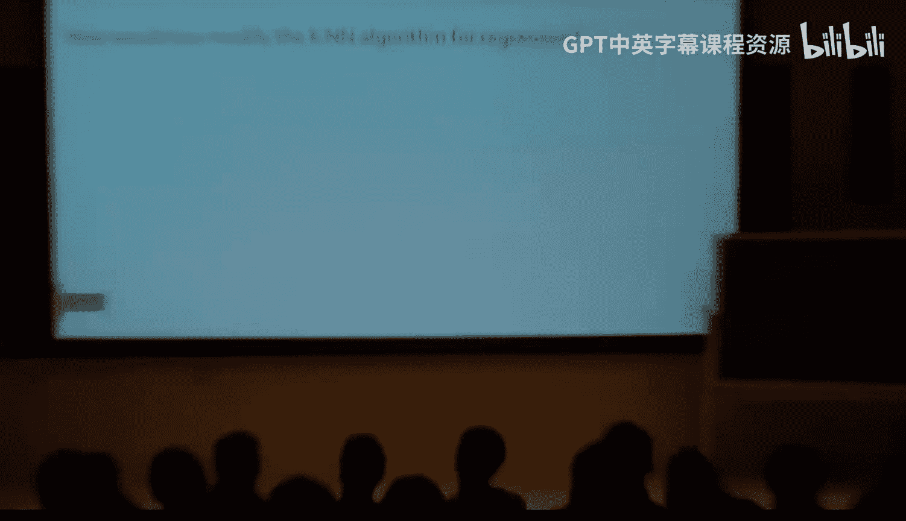

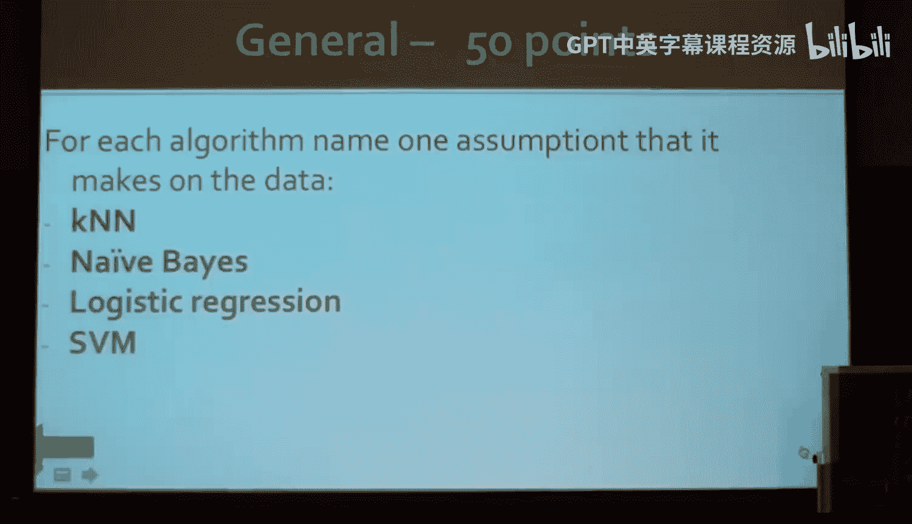

### 正则化的实践演示

通过一个生物学数据集的Lasso（L1正则化 + 平方损失）路径图演示，我们可以看到：
*   当正则化强度λ很大时，所有权重为零。
*   随着λ减小，最重要的特征权重首先变为非零。
*   测试误差会先下降后上升，存在一个最优的λ值（对应特定数量的非零特征），此时模型泛化能力最佳。这有助于研究者识别出真正有预测力的关键特征。

---

## 课程知识点复习问答 🧠

为了帮助大家准备期中考试，我们进行了一个简短的问答环节，回顾了前半课程的核心概念。

以下是涉及的部分问题与核心答案：

*   **K近邻的误差界**：随着样本数N趋于无穷，K近邻分类器的误差最多是最优贝叶斯分类器误差的两倍。
*   **朴素贝叶斯与逻辑回归的决策边界**：当数据特征在给定类别下服从高斯分布且方差相同时，两者的决策边界是相同的。
*   **SVM中偏置项的处理**：在SVM中，不能简单地将偏置项b作为常数1特征并入权重向量w，因为SVM的目标是最大化间隔，这仅涉及最小化 **||w||²**，而不应最小化b²。将b吸收进w会无意中惩罚b，偏离了SVM的原始目标。
*   **K近邻用于回归**：可以通过计算K个最近邻标签的（加权）平均值来进行回归预测。权重可以根据距离的倒数或指数衰减函数来设置。
*   **各算法的数据假设**：
    *   K近邻：相近的点具有相似的标签。
    *   朴素贝叶斯：特征在给定类别下条件独立。
    *   逻辑回归：数据（或特征的某种函数）适合于用Sigmoid函数建模（例如，属于指数族分布）。
    *   SVM：数据近似线性可分，且最大化间隔能带来更好的泛化。
*   **损失函数与决策边界**：通过观察决策边界形状，可以判断使用的是强正则化的平方合页损失、标准合页损失还是指数损失。
*   **SVM间隔公式**：间隔之所以等于 **1 / ||w||**，是因为在推导SVM优化问题时，我们通过缩放权重和偏置，将函数间隔固定为1，从而简化了问题。
*   **牛顿法的限制**：除了收敛性问题，无法使用牛顿法的情况还包括：1）损失函数不是二阶可微的；2）数据集维度太高，计算或存储海森矩阵（Hessian）不可行；3）海森矩阵不可逆。
*   **拉普拉斯平滑**：在具有C个类别、每个特征有K个类别的分类朴素贝叶斯中，使用加1平滑（拉普拉斯平滑）的MAP估计，等价于为每个（类别，特征值）组合添加了1个“幻觉”样本，总计添加了 **C × K** 个样本。
*   **算法选择场景**：
    *   文本分类（高维、稀疏）：线性SVM通常表现更好。
    *   患者生命体征预测（低维、非线性）：K近邻可能更优。
    *   手写数字识别（像素空间）：K近邻通常能捕捉非线性关系，可能优于线性SVM。
*   **K近邻的计算复杂度**：对于有N个训练样本、D维的数据集，如果K=N（即使用所有邻居），则预测时只需返回训练集中的多数类，时间复杂度并非O(ND)，而是O(1)的查表操作。该问题强调了K值对计算的影响。

---

## 总结 📚

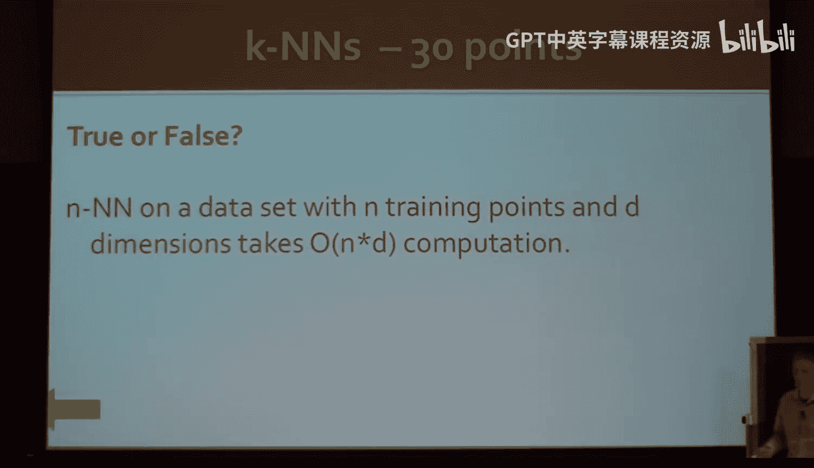

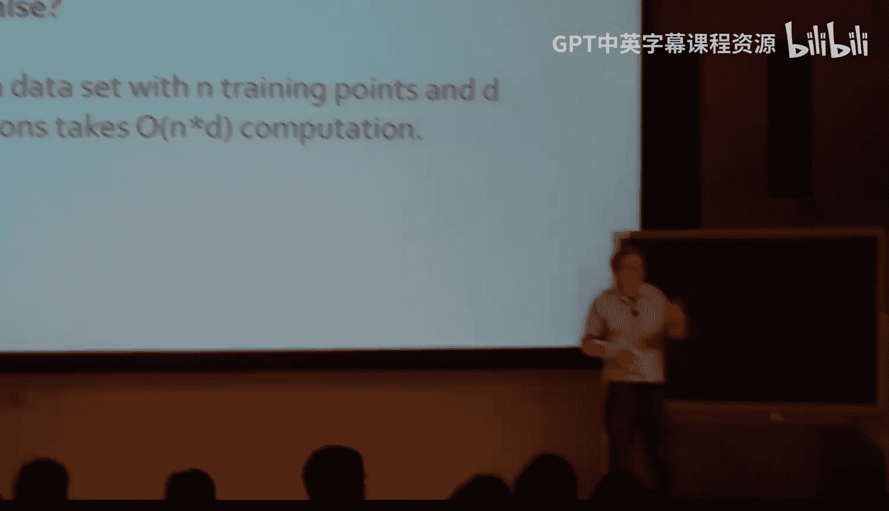

本节课中我们一起深入学习了正则化技术。我们明确了L2正则化通过权重收缩来获得平滑解，而L1正则化则能产生稀疏解，有助于特征选择和模型解释。弹性网络结合了二者的优点。通过实际演示，我们看到了正则化如何帮助控制模型复杂度并提升泛化性能。在随后的复习环节，我们回顾了K近邻、朴素贝叶斯、逻辑回归、支持向量机等核心算法的原理、假设与应用场景，为理解和应用这些机器学习基础模型巩固了基础。