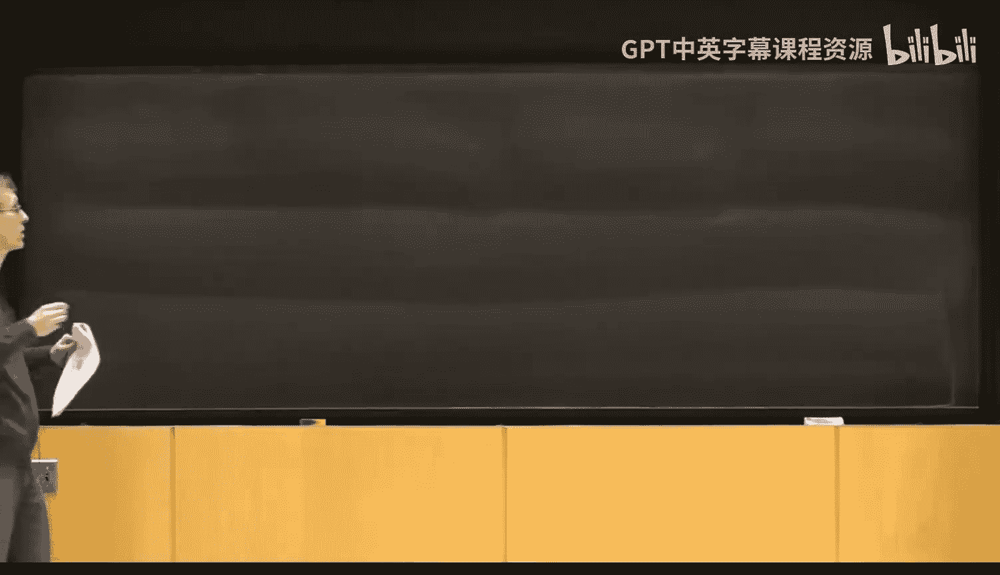

# 018：康奈尔大学《智能系统的机器学习｜CS4780 Machine Learning for Intelligent Systems 2017》中英字幕 p18 -18-Machine Learning Lecture 18 ＂Review Lecture II＂ -Cornell CS4780 SP17.zh_en -BV1Lo6gBxEKE_p18-

Hello， everybody。So my initial plan was to go over the last year's midterm today。

But then Ts were were like， well， students are gonna do this anyway。😊，So typically。

 we don't like this but。Teachers do this。So I asked them what they would think is most useful。

 And they said， why don't you just go by every single lecture for a couple minutes。

And kind of say what the important points are。That's not a good idea。You want to。

But the produce' happening。The thing is， I posted the solutions to the Jeopardy exam。So。

One good question is we could go through the whole class forwards or backwards in time。

And the idea being is if we run out of time at the end。

 we either is the last lectures or the earliest lectures。嗯。Any preference， Let's have a vote。

 Who wants to go through it in。 So the advantage of going in chronological order is that it's easier to kind of say how things build on。

 You know， there's actually， I mean， there was a reason I ordered it that way。On the other hand。

 if we run out time， we wouldn't miss the last couple lectures， which may be more development。

我们 most。There maybe most uncertainty about it because we haven't that homework。 So that was yeah。

On the other hand， the others， that the reverse。 So， let's have a little vote。

 So who wants to go through it in chronological order， Raise your hand。

And who wants to go in an inverse order。It's a tie。完了。😊，嗯。That is tricky， okay。

First time in my life that he actually had a tie。 Now I don't know what to do。

The only thing we can do is take a representative from each group and has to do wrong papers。😊。

What's the question。I think。Yeah。Material。We wait。The earlier。Okay， good。 Okay。

 So here's suggestion we go through chronological order， but we， we try to be really fast。

 So how many minutes do we have in 45 minutes， How many lectures do we have。😊，10， right？Okay。

 so you have 4。5 minutes。 author you and my time mat。 So you can， you know。Every time。

After4 point after 4。5 minutes， he can tell you 4 minutes and 30 seconds。Maybe me to move on。

 I try to go to the first one a little faster。 So this way maybe we can save up some time。O。

 please every single topic， feel free to ask me questions。说的呃。At the beginning。

 we talked about the general machine learning setup。 And sorry， I don't have big chalk today。

 Actually， I apologize。 I know somehow someone stole a big chalk。 So I have to buy some new ones。

Yeah， okay。And the idea。 So， so this whole class about supervised learning。And in the beginning。

 basically， we just talked about the general framework。

 A few important things is the data set that we draw right you have X I， Y， y1， And so on not to X。

 M。Y N， right， They are drawn from Z distribution P。And this distribution they done II D。

Right so each they're all independent from each other， and they're drawn from the same distribution。

嗯。And。The typical goal is to predict y given X。 right。 And so in order to evaluate。

How well we are doing and to train algorithms， We split the data D into typically 3， three data sets。

We have the training data set。We have the validation data set， and we have the test set。系。And so。

The idea is basically， you take your trained data set and on your train data set。

 you train your algorithm。And then on the validation they I set。

 you can estimate what the error is and the validation they I said， because you didn't touch it。

 That's an estimate of the true error， right， So ultimately。

 what you care about is the the expected error。 What's the probability that if I would take a new point from the institution distribution P。

 What's the probability that I get it right， right， or。Another way， put another way。

 What's the expected error I would get if I draw a point from the distribution P。

And so you can't measure this because you don't have access to distribution P。 but you have。

 you know， more data than you need。 right， So you take your data said D， you reduce it。

 You only train on some of it。 And then these remaining points theyre basically drawn from this distribution P。

 right， So we can just use them to evaluate how about your algorithm does。

And so on the validation side， you now compute the error。

Can anyone tell me if I we need validation and test。第二。

So foundation is that you make sure you don't have a fit of。 that's true to the of the trained data。

 But why， why do you even need split off one more data set。第。That's right。 So typically。

 you evaluate your algorithm on a validation data set。 then you realize dying， right。

 the error is too high。 right， So what do you do， time different algorithm。

 Let's say you have the perception now you get an SM or something。 then you train again。

 you evaluate。 And then you see oh， that doesn't work， right， Maybe my C was not large enough， right。

 Let me increase C。 So you run it again， test it here， right and you tweak your hyperparameter。

 until you're satisfied， right， But now youve look at this data set so many times that there is no longer actually an unbiased estimator of your true test error。

 So that's why you you split up another data set a little bit of a test data that you really only touch once。

 right that's the idea。 So once youre confident here， this kind of a sanity check， right。😊。

So you let's say， you know， you need an error of 1%， right， That's what your boss told you。

 The first time you run， you get error of 2%。 And that's pretty good， but you have to go get lower。

 So now you tweak your parameters， you get error of 1。5%， right， You tweak your parameters again。

 change the algorithm add some features to something else， right， Now you get， you know，1。1%， right。

 you keep doing until you get 。8%。 That's pretty good。 Then you test it on test I said， and you get 。

9%。 That's probably what the true error is。 Does that make sense。😊，Okay， so。You know。

 please keep in mind that the validation error basically， you know， these， these two are basically。

 you know， meant to be estimate of the true expected error。 And the test error。

 If your data set is really， really large。 is actually， you know。

 approaches exactly the test the true expected error that you're trying to minimize。

 which is also called the generalization error。 The generalization error is the expected error for new data from this distribution。

😊，Okay， so that's， that's kind of just a setup。 And just make sure you。

 you we truly understand how this it done and why this is done。嗯。Okay。

 any more questions about this general setup， Then I move on to Canament， yeah。是0。

T error on the exam will be referring error on Training error is always the error on this data set。

 after you train。 Okay， after you train， right， So basically， and typically。

 that's much lower than your testing error。So we know， for example， SVM。

 right if data is linearly separable， it will always find a hyper planee that know has zero error。

 but that actually may not be in general， the case。Okay， any more questions。Okay， good。

 So then we went to Kener's neighbors。 right， So Kenier's neighbors is one specific algorithm and。

Actually， let me just just talk about the different types of algorithm that we learned。

 So we have this distribution P over x and Y。And。So ultimately， we want to give an an x。

 we wouldd like to make a prediction over Y， right， So that's exactly this distribution。

 P of y given x。😊，RightSo that is， if you have this distribution， then it's easy。

 Can anyone tell me what you do when you have this distribution， What classifier do you use。Yeah。

Here's a base optimal classifier， right， so that that would be the optimal choice to do once you have P of Y given X。

So， you know， one way to do machine learning is try to estimate this probability distribution。

And then，You know， then， but the base optimal classifier does it just picks them， you know。

 the most likely y for a given X。Another option is to learn a function F of x， right。

 which actually approximates exactly this。 So as actually， this is arg max。😊，Y P of y given x， right？

 So basically saying in this case， I don't learn a distribution。

 Maybe it's too much work to actually learn a really distribution over the label。 Really。

 all I care about is just the one label that's most likely。

 So a lot of algorithms also just gonna function that as given x。 Tell me which label is。

 is the most likely label。 So if you have this， of course， you can ever always get this function。

 But for example， Can years neighbors doesn't actually give you a distribution。

 It just gives you a function。 You can make modifications to get a distribution。

 But typically it's just this。😊，This cause themulative learning。There's also generative learning。

In general of learning， instead， you learn P of X given y， and then P of y。Right。

 and that's ultimately the same thing。 If you have that。

 then you can just use basees rule and flip it around。诶一。So they this， right。 They theyre disc。

 that's absolutely discminative， absolutely。Yeah， mean you never learned what's given the label。

 what's probability next， right。You never learn that at all。

 The scri of learning does not mean that you're not doing probabilities， right。

 You can learn a function that actually givess you probability of Y given X。

 you can change SVM actually very easily into an algorithm that returns the P of Y given x。

 The scriminator says you take an input X in。 And all you learn is the probability of y， right so。😊。

Thinking about the following， right， a discriminative algorithm。

 given all measurements about a human will tell you is that human， male or female， right。

 ajoative algorithm would tell you， given the gender， generate a human， right。

 What what what are the feature representations of a human， right？ Well SVM doesn't do that at all。

 right， Does that make sense。Yeah。No， perception does this， right。So this hyperplan。

 if you on this side is positive。 the other it negative。But there's no notion of what's far given by。

 what's a certain act。Yeah。Since people seem to confused to me that you think you go through the algorithm that we've learned apart。

Sure， sure。 Why don't we do the following， Why don't we say。Dcriminative。Deerative。

And then we also say parametric， non parametric。Okay。So。

Let me just quickly talk about prametric versus nonparmetric。 What's prametric versus non parametric。

嗯。An algorithm is parametric。 if you have a finite number of parameters that you are learning。

 that you are fitting from your data。So the number of parameters is the same。

 no matter how much data you have。Canone tell me an example of a permetric algorithm？Yeah。

 perceptionceptron， right， So you easy have the number every dimension of W and B。

 Those are your parameters， right， And then you take your data and you learn these parameters。

A nonparmetric algorithm is something but there's no fixed number of parameters that you're learning。

The model size， how much you're storing grows with the number of data you have， typically。

 Can tell me an example of a non para algorithm。Kenous neighbors， right。 So Canous neighbors。

 you just store the whole data set。 And so， you know。

 the amount of storage that you need grows linearly， actually， with the data set， right。

 That's not the case for SVM perception。 right But you。

 you know upfront how big your model is that's it。 right， If you get more data。

 you're just gonna learn a finer model。😊，Sure， O， let's just go through them。 Canier neighbors。

 Where does it sit。然。あ。That， so can your neighbors to you。 right， What's next on perceptionceptron。

Someone else， not author。Prametric is， right， perception。SVM。Nth base。I'm sure someone said it。

 general and parametric， right， nice place。Did I have them all。Oh， logisticistic good question。 Yeah。

 where's that。same thing， logistic。And， of course， like， you know， Laso。And elastic net。

And so so all these linear， all these E M algorithms fit in here。いや。啊，对呢。Yes是。然后。Yeah， yeah， yeah。

 yeah。 Now you're getting fancy。 Yes， you could do that。 That's right。

 So what he's saying is you could actually take the to knife base， Keep the data around， right。

 and then actually do non parametric kernel density estimation or something。

 density estimation to estimate the probability。 Sure， you can do this。

 But but everybody else just forget what I just said。😊，Yes， okay， good。嗯。Okay。

 you have to move on to the next vector。 Okay， good so。Well， this was kind of in between。

 This kind of across different lectures， so。诶。Then we cover Canius neighbors。

 The Can' neighbors a really， really simple algorithm。 We just classify everything， you know。

 by a majority vote of its of its nearest neighbors。

 The key is that Canius neighbors relies heavily on the quality of the metric， right， so。😊。

One thing you have to remember is what's the assumption of Kenyas neighbor。

 similar points of similar labels。 The metric has to reflect this assumption， right。

 If you have a bad metric， such that actually the， you know。

That measure similarity in some way that's actually not compatible with the label。 It breaks， right。

Or it's not， you know， correlated with the label。And。Then we went to the。

 So the second one thing you， of course， have to know is how the proof works with， you know。

 why does Ken years neighbor， why does one year neighbor。You know。

 why is the error upbounded by twice the the base optimal error。

 It's relatively simple two step argument。 And then there's the curve of dimensionality。

 the basic states actually， you know， in very high dimensional spaces。

The notion of similarity is somewhat， you know， or can be badly defined。 It can be ill defined。

 There are data points。 You know， it typically happens that， you know。

 everything is really far away from everything。 And there is no notion of similarity anymore。

 or and put another way。 You wouldn't need exponential amount of data to obtain and local local similarity。

 then， of course， the question is， why does it still work on on images and and digits。

 And the answer is because the data is actually not exally， intrinsically high dimensional。

 It just lies in a high dimensional space。 You have a question， yeah。😊，买我。在。はめ。Right。

Chy answers of Kenya's name still works is intrinsically low dimensional。You， you can test it。

 So if you basically look at。The nearest， the one thing you do is if for every single data point。

 you look at the key nearest neighbors or the for some data points。

 you look at the key nearest neighbors。And you， basically。

So there's a bunch of different steps you can do。 You could just do local PC A。

 I don't know if you've seen PCA before。 So to actually estimate locally。

 does design a low dimensional space。 globally it doesn't， right So I mean。

 if you do PC and you realize globally lies on all dimensional space。

 you just have a bad representation。 But it could be that locally， it's low dimensional。

 there's also something called the doubling dimension。

 The basically says like as I keep doubling a radius around my point。

 like how many more data points do I see in this。 So I have a data point， I say。

 well within a radius So R， how many points do I have inside this， now if I double R。

 how many more points do I have But if the data is two dimensional right。

 then it's gonna be four times as many points。 if it's three dimension is gonna be eight times as many points So you can actually compute the local dimensionality exactly it's doubling。

 It's called the doubling dimension。😊，Okay， any more questions， yeah。

A parametric algorithm is generally fast and non parametric algorithms。 Yes， absolutely， yeah。

 that's。You know， there's always exceptions because some fancy stuff。 But， yes， typically。

 that's the case。嗯。Yeah。打。We have more thats going the data。违章这个。Sure。

 but the number of parameters that you're learning does not grow。

If I make your data set 10 times larger， the final model that you're storing is not any bigger。Right。

 for every dimension or you know， basically just have some。

 some description of that the parameters of that distribution for that dimension。So name。

 same number of parameters。そ安。K N， if I give you more data， you store more data。

So the the model is the data， right， So you actually have to store more， you know。

 you need more storage。け。That's right。 That's right。 It's exactly right。Okay， good。

 perception algorithm。 So the important thing is， assumption of the perception algorithm is that。

Data is linearly sparable。 if it's not such an algorithm tank， right。

 So you have to understand what happens when it's not linearly re sparable。 It loops forever。

Right you have to understand the update。 What， what does it do， right。

 It looks at one data point at a time。 And then if it's positive， it just adds it， you know。

 if it's misclassified， if it's correctly classified， doesn't do anything。 if it's misclassified。

 if it's positive， it adds it， if it's negative， it's obed， really simple。 right。

 It keeps looping over it， The beautiful thing is it converges in a finite number of steps。

 you have to know how to prove this， and what the bound is。😊，The second， you know。

 little nugget in perception is there has this bias term。 How can you be a rid of the bias term。

 We just add one additional dimension and just absorb B in the vector， right。

Why is it scale im variant？ We talked about this as well， right？

 So you can just rescale the data set。 And that was a little trick to make the proof simpler。

 Doesn't change anything about the。Convergence， any more questions about perception。 Otherwise。

 then move on。That seems pretty easy。 Okay， yeah， sorry。我应该。Yes， that's what it should be。啊。

Does the typo。他这个。Yeah， that's the y， Why the Y as either plus 1 or -1。 So yeah。Okay。Okay。

 so then we talked about So after the perceptome， we went into you back into this setting。

 you basically said， well。And。You know， one way to do machine learning is actually just to estimate this distribution。

 P of x comm Y， right， So once we had that distribution。

 we could just use the base optimal classifier。 And so the first thing we did we just talked about。

 how do you even estimate， you know， distributions from data， right， so。😊。

And so what we talked about is maximum likelihood estimation ML L E， and we talked about Mac。 right。

 So these are the two ways we in this class estimate distribution from data。

 And so the way typically typically works is we assume this distribution P has some specific takes on some specific forms。

 So it could be a binomial or multinoial， et cetera distribution。 And then that has some parameters。

 And then we fit these parameters。 right， so。😊，It basically adjust the， you know。

 the parameters of the distribution judge that actually it fits what we observed in our data。

And what does maximum likelihood estimation do， it basically says， what's the， you know。

 maximize the probability of the data given the parameters， right。

 So these data here are parameters of the distribution。 And we say。

 I want to make my parameters such that you know， the data that I observe becomes as likely as possible。

😊，Someone posted the questions like， what's the difference between probability and likelihood。

And so the way it's used in this class is that likelihood inter probability is really the same thing。

It's just the can' say what's the probability of a data set， right If you have a train data。

 you can't say what's the probability of the data doesn't make any sense， right。

 because data already exists， right， doesn't have any probability。 It's like asking。

 what's probability of me。 I don't know， right I'm here。 So So what you say is it's the likelihood。

 right something that already happens。 right， So in hindsight。

 kind of how likely is it that I've seen that thing that I'm actually seeing。

 So we distinguish between this by saying either probability of something that hasn't occurred yet and likelihood of an event that has occurred which is retrospectively analyzed。

😊，The likelihood of that happening。Okay， so。MLE just maximizes data it maximizes this given theta and map。

Go the other around this， Emily。And map。Says what's the probability。

 maximizeimize the probability of theta given the data。Right， so this is what the map maximizes。

And so there's a crucial step here。 It's very subtle。 But in this case， actually， Theta got got。

Promoote it from just a， you know， set of parameters to actually a random barrel。So， we use a。

The view Bay rule to make this P of D given theta times the poverty of theta divided by the normalization。

Yeah。This year， the P of D given theta is the same as here。 That's why when you do map with M L E。

 you almost go through the same steps， right most of the time， because you're maximizing this。

 So youre maximizing this， right， So when you take the logs， that's always the same part。

 plus some stuff on the right， right when you do map， right， And that plus some stuff。

 almost always turns out to be a regular。 right， because it doesn't actually involve the data it only involves the parameters。

 right， So you basically get the norm or something over the parameters， right。

 that's basically where these regularizers come from。😊，That's one way derive them。

 Any questions about map versus Emily。嗯。Then very briefly， we also side。

 well what's the true Bayesian way of doing this。 And we didn't really get into the specifics。

 But you should't know roughly what it is。 And that's， you know， in some sense。

 you're basically saying for a given y， you know， four a given X， what's y。You know。

 what's probability of y And the the way this is， can you read this still is too small。 thumbs up。

 Okay， good。 So basically， what we're doing here is we say， okay， well， we assume we have some model。

 but we don't know what that model is。 We integrated all possible models。 We say。

 what's the probability of Y given X and a certain model。 And then we say。

 what's the probability of this model given our data。 right， And so this is a test point here。

 This is my test point， Test point。😊，Testport， test point。

And then we integrate out all possible So this year， So basically， think about this integral。 right。

 So you basically say， given my data， theres some probability that I end up with a certain parameter set。

😊，What map does， it just says， what's the most likely one， right。

 What were saying here is there's many different choices。 and we sum them all up。

 And each one of these models gives us a different prediction。

 and we average them out and weigh every one of them by the by the likelihood of that actually that happening。

😊，So in some sense， you basically say， yeah either computer is integral and say you kind of want to have a weighted average of all models or a map。

 you just say， I just take the most likely model and return that answer。So this is kind of the。

 the pragmatic Bayesian approach。Ideally， you know， what you want to do as a patient is this。

 But you you typically can't solve This integral is very， very hard。

 So what you do is you just do this math， right。😊，The way it's often done in practice is you just evaluate this。

 you know， for maybe a couple thousand values of thes， and then you average those。

It's a sampling approach。Okay， good。 Any more questions about ML map。Beij was a secrettist。

 and he can move on。嗯。Alright， naive base。So now that we know how to estimate probabilities。

 the idea was， well can't we just now estimate P of x given y of P of y given x， right？ What is this。

Can we just estimate this from the data， So that was the idea， right， awesome， Let's just do this。

 And then you're done。 right， You can all go home。 The problem is this doesn't work。

 Can anyone tell me why this doesn't work。 What would you need for this to work。😊，You go to S。 Yeah。

 every you would， Yeah， that's right。 You would need， you know， basically an infinite amount of data。

 an exponential amount of data to， to estimate， right， so。😊，So basically。

 what you would do is you would look through your database to all the x that match exactly this axis and see how often did I observe this particular Y。

 right， he's right。 to every single test point I must have seen during training already。

 Ily multiple times， such as I can actually estimate what's the probability for a given label， right。

 that's completely infeasible。😊，So we can't do this。 So what does naive Bay say say， well。

 we just flip this around。 and we say this is P of X given given y， P of y。Divided by a normalizer。

And。This doesn't change anything。 doesnn't make it easier。 but this is， you know。

 now we estimate this thing we can estimate that's really easy。

 We just count how many times to we see each class。 That's easy， right， This thing here。

 I say how many E span amount， how many not spending those to be C。 This thing here is also hard。

 but we can make the simplifying assumption that this here factors。

 So P of x given y actually equals， you know， inter conditionditionally independent。

 So we can say this is， you know， product of all alpha P of X alpha given y。😊，对by。

Doesn't have to be exactly。 This actually can also just be a function， to be honest。

 It just doesn't have to be well defined probability。So actually， in the multinoial distribution。

 these are actually， if you're very， very careful， you realize they don't actually normalize。

 So it's just functions。 but it doesn't really matter。

 Like if you just say these are conditionally independent。 That's exactly。

 Everybody understands what you mean。 That's correct。😊，Any questions about naive B， yeah。

It's like valid data， even though or valid predictions。

 even though it's not right for many data sets。Which is not why generally。就是你大不了。3。Is any， Yeah。

 okay， so the question is。You know， I mentioned multiple times in lecture that this is typically not true。

 right。And that's correct。 So why does it still work in practice。 And the the assumption is well。

 basically it's not true， but it's all's not totally off， right， So if your distribution is okay。

 right， then or it may not matter all that much。 right， for emails， for example。

 the word order doesn't really matter， right， So that's maybe why it's most wrong， right。

 it ultimately turns out you can easily detect if something is spam like even if the email was written backwards in any particular order。

I think that's the best I can can give you， basically， that basis is over strict assumption。Yeah。

Good yeah。What。Oh， well， so there's two things。 right， So the first assumption you're making is this。

 The second assumption now is what are these factors， right， And typically。

 we say these are now independent probabilities for each different dimension。😊。

So each dimension now is basically can estimate that individually。

 And now we make the second assumption。 we are saying， well， what is that distribution， right。

 Before example， say that's my remote anomial Gaussian or something。 Typ。

 that's where it really breaks down， right， So if you assume a Gaussian distribution。

 but they're not Gausian distributed， right then horrible things would happen， right。

 And this is exactly someone actually posted that question on Piazza。 right。

 If you have data points like this。And呃。So let's say we have one more cross here， right。

 What does knifeive base do， right？ So naive base now looks at each dimension individually。

So this two dimensional thing that doesn't matter for A piece。

 Just look at the first dimensions to protect everything down here。Right。

 so these are all the points basically projected down。

So I just collapse just project them onto this this X axis。 And then I， I fit， you know。

 let's say I'm shipping Gaussian solution。 I fit a Gaussian around the circles。

 I fit around the gaut around X， right。😊，And that comes the crucial part。I'm not， you know。

 once I have these Gaussian fitted， I don't look at the data ever again。

 I just use the data to estimate the parameters of my， my distributions。So now I'm， you know。

 I do this on the the other side as well。 So you actually have my， my， you know， actually。

 I've got these distributions here， right。And what it will do is we' will actually find a hyper planee to basically separate this these two distributions。

 which you know， will look something like this。 if you put them back together。

 and it will find a hyperlink here， right， So despite it as linearly separable actually not separate this point correctly。

 because once I estimated the distribution， that guy was such an outlier， basically， you know。

 based on these distribution， the best hyper planee is still here。

 And so that's typically where things fall apart， right So if your data actually is not Gaussian distributed or。

 not morenominal or something， that's a bad estimate。

 then you will get very different distribution than your data。

 and then actually your classifier will just do the wrong thing。

 right And a good test could be if you actually take these distributions and you sample points from it。

😊，Do you get stuff that looks like your data， if your assumption is right。

 then you will get exactly that looks exactly like your data。 if you now get points。 So you know。

 in this case， you would get points here here， but you would never get that point， right。

 That's really， really unlikely。 right， So that starts's kind of where things fall apart。 right。

 So apparently， in your data， you actually have a little bit of。😊，Probablyably mass year， as well。

Someone asked， when does logistic aggression and and knife bay get the same result， right。

 And that's basically logistic aggression。 And that's the next lecture now says， okay。

 instead of actually estimating this， be， the， you know。😊，Estimate this， right。But use the same。

 same form for this that we actually get from naive base。

 which is this is one over one plus E to the minus y W transpose x。 So this is my W in。😊。

W and theta are the same thing， right？So logisticistic aggression fits the。Withs。Nive base。

Separate as regression separates the data。 data points。

 na base separates the distributions which it fit on the data。 That's the crucial difference。

Those two give the same result If your data distribution actually fits your data。

 because that is the same thing， right If the data is actually drawn from these two distributions。

 then doesn't matter if I'm separating the distributions。

 or if I'm separating data points drawn from this distribution， that's the same thing。

 as long as n goes larger， becomes large enough， right So asymptically， is n becomes very large。

 If the data assumption holds， that means I face assumption holds and my modeling assumption for distribution hold。

 those two algorithms are identical。😊，oftenten they are not。 And therefore， you know。

 logistic aggression actually， you know， tends to work， tends to work a little better。 Yeah，9。Yes。

 yes， good question。 So is there ever case when knife base is better than logistic aggression。

 The answer is yes。 And typically， it's when you have very little amount of data。😊。

They have very middle little amount of data。 then actually。

Logistic question can easily overfit to the few data points you have， right。

 But so you basically have some distribution here。But you only have very few points drawn from it。

 right， So it's really not clear what this distribution looks like。

So what knife face does is if you actually buy by。Giving the distribution a very specific form by saying it as Gaussian。

 for example， right， or by saying it's multinoial or something like this。 right。

 You are introducing additional structure into the problem。And if you're right about this。

 then you're helping the learning algorithm converge converge better。

 give better decision boundaries。Right，So if you have very little data。

 that additional knowledge will help you， and you will get a better classifier。

 If you have a lot of data， it will hurt you right， because if you have a lot of data， now。

 what you're doing is you're saying this has to be a Gaussian form。

 But if youve sampled a million data points from this。

 there's no point why do you have to restrict it to be a perfect Gausian， right。

 You could just let the data speak for itself， So that's the advantage of the of the logistic regressionggress。

 So typically， when you have a lot of data logistic regressiong does better。

 If you have very little data，😊，it's typically advice to use naivespace。Yeah。电视的机。答应费。And。

 then they can be。Because this， this is no longer how you。 Thiss no longer a9 piece month， Yeah。

 yeah。How would you ever use logistical regressionggress， I the question is。

 why would you ever use logistical regression over SVM。

 One thing that's really nice about logistic regression is gives you well defined probabilities。

 whereas SVM doesn't。😊，As the end just gives you a prediction， right。

 which way on the hyper paine you lie on。Some people like combine both。

 So SVMs sometimes give you slightly better prediction performance than logistic regression。

 And so what people do is they take the output of S VMs。 It is one， one feature， right。

 like thiss the prediction of the SVM。😊，Not where you lie on。

 but the W transpo x plus B from the SVM。That's one dimension for every feature， every data point。

 And they stick that into a logistic regressionggress classifier。And train one more time。That。

 then you can also get well， well defined probabilities for S BMs。 And that's actually。

 that's that idea is actually called Platts gaming。 So was invented by John Platt。

 and it's become very famous， actually。😊，So's a famous algorithm。 Yeah， good point。So尾都没其他问题。

It like the night。So I it again。Yeah， Moomial。 also， that's right。 although。かから。

It makes assumption that's actually from exponential family，So cogenomial or Gaussian， right。

 And by using knife base， you actually make that specific。 So you're putting in more information。

 which helps you if there's very little data， if you're right。😊，That's basically what is。

But that's why also why logistic regression is more flexible if you see a lot of data， yeah。

Why does it give value probabilities， Because that's what you're estimating。

 right you're estimating P of y of X W。So you're busy， you know， youre maximizing the， the。

 the likelihood nu of your data。So SVM， there's no probability at all， right at the end。

 you just either on the right side， the positive side or in the negative side。

 There's no probability at all。 So the downside of SVM is it's hard to read certainties from this。

 right， just tells you this is class one-1。 but you can't really tell if it's really sure about this。

 it's not really sure about this。 So if you have selfding car。 It tells you this is a pedestrian。

 right， you don't know how sure it is about this， right it is not a pedestrian， right。

 or maybe it's 49% Sure it's， you know， you know，51% sure it's not a pedestrian right you may still want to stand on the brakes not to run that person over。

 right So that that's why these probabilities are important for decision making。 Yeah。😊，You can。

 But actually， that's not part of the optimization problem。

 There's nothing in the optimization problem that tells you that points are really far away。

 I because it's scale free。 If you have two different SBM， say， right， and you compare them。

 it makes no sense to compare them， basically， right because it's the scale is just conveniently sets such the optimization problem becomes easy。

 not that it's interpretable。😊，Yeah， any other questions。All right， okay， good。

If got this is a question yeah。や。for yeah， So， so it very surprisingly well in all kind of data。

Right，So if it's just， you know， it basically finds a linear decision boundary。 right。

 So if you just look it in the E RM form format， it's just another way of of defining a loss function。

😊，对了。Okay， so one thing we logistic aggression， basically， we minimize this directly。

 And then we realized one thing， right we realized that we define this。

 we actually we put on the ML E。 we get a function that we want to minimize。

 but there was no close form。 So this was gonna be took a little detour for a couple lectures。

 basically say， if you get a function。 How do you minimize that function， right So in this case。

 you know， there's a few things I told you about this function。 A， it's differentiable。

 It is continuous and it's conduct。 So that's nice。 So that means we can do local hill climbing。

 right， So the function looks something like this。 Some salad ball shaped thing。

 It doesn't have to be symmetric。 and。😊，So if you want to find the minimum。

 that's the maximum likelihood estimate photologistic aggression。 And so。😊。

We talked about a few little algorithms， how to optimize this。 So you start with some point。

 T you say w is all 0， but it doesn't matter。 It can be anything you want。 And then basically。

 what we do is we say， well， we have the form of this function。

 We just don't know where its minimum is。 So what we do is we do a tail expenseanse。a tail expansion。

 either becomes linear。 if it's linear， then it's really easy to figure out which way to go to go to reduce it。

And as long as your step size is small， you can actually， this approximation is not bad。

 So you take a small step。 And then you get up here。

 And now you again estimate with the linear function。 you take another step。 And now again。

 you estimate it right， And you basically every single time you just take the gradient and go in that direction。

 That's gradient descent。😊，Newton's method goes a little bit little more aggressive。 What it does。

 It fits up。Pbo this says the quadratic。 So basically takes a second order。 Taylor expansion。

 Finds the minimum of this dump to it。 And it does this repeatedly。

The downside of Newton methododist。 So the upside of Newton methododist converges very quickly。

 fewew steps in your converge， maybe 10 steps。😊，The downside of Newton's method is that。

There's no guarantee that you convertverge it， right， because these steps can be pretty large。

And so that's the problem with with the gradienting descent。

 you can force your greatest steps to be really， really tiny。With Newton's method。

 the nice thing is these steps are very fast。 That's the good steps are really large。

 So in a few steps， you at the minimum， but it can also be that youre actually unlucky， right。

 And the you know， the para you're fitting look something like this。 And the minimum is over here。

 And then know， at this point， your functions really really large。 And so now you're diverging very。

 very quickly。 the second downside of Newton's method is that you have to compute the hessian。

 which is a D by D matrix。 and can take up a lot of memory and can be very。

 very hard to compute expensive to compute。 And then you also have to invert it。

 So inverting a D by D matrix is order D cube。 So that can be very slow。 yeah。😊，think that。有增家。

And if it is， go back and。いてな。AndSo I explain it moment more time。这军。

When you have to like when you find the。对。you find下 you basically。对。

So you can test this and you can un go back and go back to gradient descent。

 That's what people typically do。 So they do a first order detail expansion， or gradient descent。

Until they get bored， then they do Newton's method。And if they， if that works out， it's great。

 And if they diverge， then they just undo this。And go back to where they started Newton's methods。

 You know， they've saved that back every and just keep doing green descent。

's try this again a couple of times。Thats occasionally just do a step And am I ready to do Newton's method。

 Yes， great， right， No， al right。 Never mind。😊，Let's made a few more steps。Make sense。Okay， so yeah。

So when it conversionverges， it can be way faster。Way， way， way， way faster。

So if your data is not very high dimensional。 the question。

 that that could be a typical exam question。 When do you want to use one and when you when do you want to use the other。

 right， So if your data is not too high dimensional， right， it's a 15 dimensional data。

 Well 15 by 15 matrix is nothing takes， you know， a couple of milliseconds to computer inver， right。

 No problem at all， right， And now you've done a few steps， right。But you may have many。

 many data points。 So computing the gradient every single time。

 ats see you have 100 million data points， right， but the only 15 dimensional Comp the gradient takes a long time。

 right， Comp comparison， Comp the Hesian， right， I mean， you know， it takes the same amount of time。

 you go over the data， But inverting the Hastian is nothing， right。

 And so if you just do 10 steps of Hasian inversion。

 that's nothing compared to taking maybe you know， 5000 gradient steps， right。

 You have to go over your data 5000 times。So。Okay， then we also to talk about autoiggrad。

 So don't forget autograd。So one thing about gradient descent is that you have to have the step size and。

One thing the autograd does is basically， that's a different step size for every single dimension。

 And it sets it automatically。 It's very neat that way。 I guess you all did it for your homework。

 So I guess you know it pretty well at this point， yeah。😊，啊，对没是。Other cases， Yeah， of course。

 if these is very， very large， you know， I'm sorry。If D is larger than n or something， right。

 So then actually get some invert No non invertebtable matrix。Yeah， that can also be the case。

 Thats right。So fashionian， that's not a reason not to use Haian and not not to use Uton's method。

One thing you can do， we can approximate Newton's method by just computing diagonal。Of the Hasian。

And that's easy to invert， right。And that's very easy to compute。 doesnn't take much memory。

 that's a very common trick。But that then similar than autograph。

 where you actually basically have a different step size for every single image。All right。

 then we did linear regression。😊，So linear regression， in some sense。

 continues everything we've done。 You have data。And we try to find a line that that best explains the data。

We just said the noise here is Gaussian。 So then at the moment we have， this Gausian noise。

 we can actually use our framework M E or map。 And what we get is just a square loss。 if you use M E。

 or we we get square loss with L2 regular eyes。 I we do is maps。 So it's very simple。

 And then in some sense， then All right。 So now did run out of time。 The last couple of things。 So。😊。

呃。SVM， any questions about SVMs。So， SVMs。As we say， how do you。

 you want to find the maximum margin hyper plane。And one thing we showed us that basically， you know。

 if we do a little bit of math and it turns out the margin here becomes exactly one over W。😊。

Over the norm of W？So what we can do is we can just maximize the norm of W。嗯。

So I minimize the norm of W。 This maybe maximize this term here。 And we maximize the margin。 right。

 So the S V N then says， maximize。😊，The norm of W， and then subject to the constraint at all the points are on the right side of Hy planee and exactly one up。

 So make sure you know how to derive this constraint。 right， It's just a few lines of deiovation。

 yeah。でますか？关。Yeah， stock constraints。 That's the one so have。And。Yeah， so no， because。

 because then actually some points move in here， right。

 And so you basically say these are basically absorbed by the slack。

So you baby saying the margin minus the slack is one。right， so this year。

 basically would then have some value here on thesi I， which you assign， right。

So basically saying now we have a soft margin。 The margin basically is the distance to the point。

 you know， minus the amount of slack that I allow this point to actually get inside the margin。

That's the definition。 Does that make sense。嗯。Okay， good。 And then the yeah。Inさなた。

Why can we not absorb the B into the W vector Very simple because we have the constraint here of Y I W transpos X I plus B greater equal 1。

 right， So here we could just absorb the B into W， right， It wouldn't make any difference， right。

 We just have one more dimension。 one more dimension here。 here。 It would be a problem。Right。

Because what are you doing here， What is this， This year is they actually maximize the squared。

 This year is the sum over all。W alpha squared， right， If you now absorb the B in there。

 you're changing just the definition here。 But then you're also adding a term B squared here。

Which is a different optimization problem。は自て。如他原告。Yeah， so here， okay， good， good。 You got me。So。

 so typically， when you use the logistic regression。Use it on very high dimensional data。Of。

 you don't even need a be。So you just drop it。 People just drop it。嗯。Yeah。

 that that's basically the short version of it。But an SVM。

 the nice thing about SVM is a very nice definition of finding the maximum margin hybrid plane。

 That's， that's what they are， you know。😊，Trying to do。 And that。

 that's what this doesn't do anymore。 But you're right。 But eistic aggression， the。

 the kosher way of doing it is also not to， not to do this。ButWhen when you use regularization。

 by the moment you do regularization， you have to be careful that you don't regularize。

It be yeah in homework。はいあ。是长。This was， to save paper。Okay， I may have been a mistake Yeah。

 So typically， there's a B in it， yeah。Okay。呃。So we stop。 I guess we have four minutes over right。

 Okay， good luck， everybody。 eat fruit and look through the notes and look through the past exams。😊。

