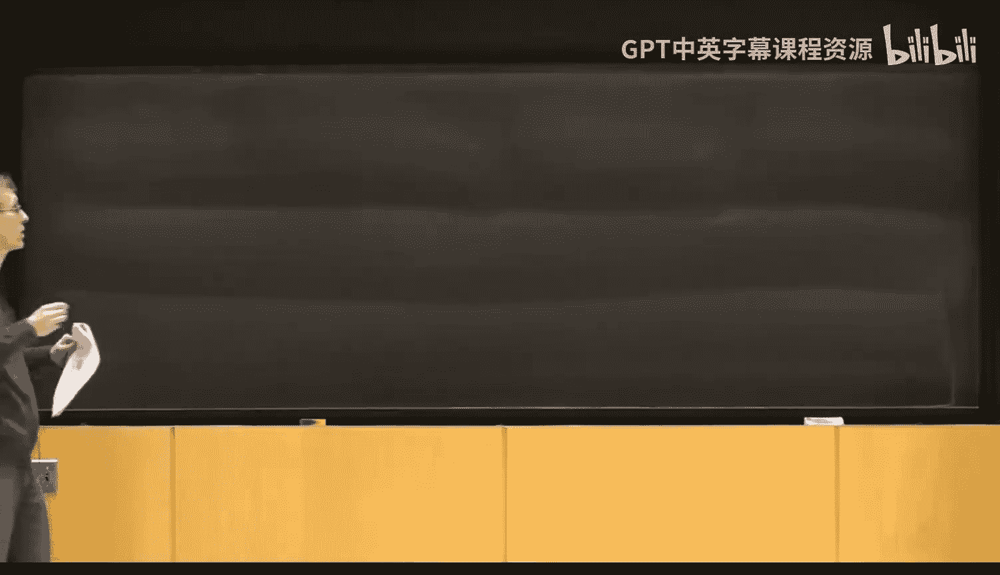

# 机器学习：018：复习讲座 II 🎓

在本节课中，我们将回顾课程前半部分的核心概念，涵盖从机器学习基础框架到具体算法的关键知识点。我们将确保每一句话的含义都被准确传达，并以清晰、直白的方式组织成教程。

## 概述 📋

本节课我们将回顾监督学习的基本框架、几种核心算法（如K近邻、感知机、朴素贝叶斯、逻辑回归、线性回归和支持向量机）及其背后的原理，包括参数估计、优化方法和模型评估。

---

## 机器学习的一般框架 🏗️

在课程开始时，我们讨论了监督学习的一般设置。其核心思想是：我们有一个从某个分布 **P** 中独立同分布（i.i.d.）抽取的数据集 **D**，包含样本 **(X₁, Y₁), ..., (Xₙ, Yₙ)**。典型目标是给定 **X** 预测 **Y**。

为了评估和训练算法，我们通常将数据集 **D** 分为三部分：
*   **训练集**：用于训练算法。
*   **验证集**：用于估计模型在未见数据上的误差，以调整超参数。
*   **测试集**：仅在最终评估时使用一次，以提供对真实泛化误差的无偏估计。

验证集和测试集都是对真实期望误差（即**泛化误差**）的估计。当数据集足够大时，测试误差会接近真实的泛化误差。

**训练误差**是模型在训练集上的误差，通常远低于测试误差。例如，对于线性可分数据，SVM总能找到一个训练误差为0的超平面，但这并不意味着其泛化性能最佳。

---

## 算法分类：判别式 vs. 生成式，参数化 vs. 非参数化 📊

上一节我们介绍了评估框架，本节中我们来看看如何对学习算法本身进行分类。机器学习算法可以从不同角度分类。

**判别式模型**直接对条件概率 **P(Y|X)** 或决策函数 **f(X)** 进行建模。其目标是找到给定输入 **X** 时最可能的输出 **Y**。公式表示为：
```
f(X) = argmax_Y P(Y|X)
```
**生成式模型**则对联合概率 **P(X, Y)** 建模，通常通过估计似然 **P(X|Y)** 和先验 **P(Y)**，再利用贝叶斯规则得到 **P(Y|X)**。公式为：
```
P(Y|X) ∝ P(X|Y) * P(Y)
```
判别式模型（如感知机、SVM）直接学习输入到输出的映射；生成式模型（如朴素贝叶斯）则学习数据是如何生成的。

另一种分类方式是**参数化**与**非参数化**：
*   **参数化算法**学习固定数量的参数，模型大小不随数据量增长。例如：感知机、逻辑回归、线性回归。
*   **非参数化算法**的模型复杂度或存储需求随数据量增长。例如：K近邻（需要存储全部训练数据）。

以下是主要算法的分类总结：
*   **K近邻**：判别式，非参数化。
*   **感知机**：判别式，参数化。
*   **支持向量机 (SVM)**：判别式，参数化。
*   **朴素贝叶斯**：生成式，参数化。
*   **逻辑回归**：判别式，参数化。
*   **线性回归**：判别式，参数化。

通常，参数化算法更快，而非参数化算法更灵活但需要更多存储和计算资源。

---

## K近邻算法 👥

了解了算法分类后，我们来看第一个具体算法。K近邻是一种简单直观的非参数算法。它对一个新点进行分类时，基于其**K个最近邻**的标签进行多数投票。

K近邻的核心假设是：**相似的点具有相似的标签**。因此，**距离度量**的质量至关重要。如果度量不能反映标签的相似性，算法性能会下降。

关于K近邻的理论保证需要了解：在特定条件下，其误差上界是贝叶斯最优误差的两倍。此外，还存在**维数灾难**问题：在高维空间中，所有点都可能彼此远离，使得“最近邻”的概念变得模糊，需要指数级的数据量才能保持局部相似性。然而，在实际图像等数据上它仍能工作，因为数据本质上是**低维流形**嵌入在高维空间中，而非均匀充满高维空间。

---

## 感知机算法 ⚙️

从基于实例的K近邻转向参数化模型，我们来看感知机。感知机是一种简单的线性分类算法，其重要前提是假设数据是**线性可分**的。

感知机的更新规则很直观：一次查看一个数据点。如果分类正确，则不做任何操作；如果分类错误，则更新权重向量 **W**。对于正类误分类样本，将其特征向量加到 **W** 上；对于负类误分类样本，则从 **W** 中减去。公式化表示为，若 `y_i * (W·X_i + b) <= 0`，则更新 `W = W + y_i * X_i`。

感知机算法会在有限步内收敛（如果数据线性可分），并且可以证明其收敛步数的上界。两个实用技巧是：1) 通过添加一个值恒为1的维度，将偏置项 **b** 吸收进权重向量 **W**；2) 算法具有尺度不变性，可以缩放数据集以简化证明。



---

## 参数估计：最大似然估计与最大后验估计 📈

在学习了具体的分类算法后，我们回到概率建模的基础。许多生成式模型需要从数据中估计概率分布。两种核心方法是**最大似然估计** 和**最大后验估计**。

**MLE** 寻找能使观测数据 **D** 出现概率最大的参数 **θ**。即最大化**似然函数** `P(D|θ)`。**似然**描述已发生事件的可能性，而**概率**描述未发生事件的可能性。

**MAP** 则寻找在给定数据下最可能的参数。即最大化后验概率 `P(θ|D)`。通过贝叶斯规则，`P(θ|D) ∝ P(D|θ) * P(θ)`。与MLE相比，MAP多了一项关于参数先验 `P(θ)` 的项，这通常等价于在目标函数中增加了**正则化项**。

理想的贝叶斯方法不是选一个最可能的参数，而是对所有可能的参数模型进行加权平均积分：`P(Y|X, D) = ∫ P(Y|X, θ) P(θ|D) dθ`。但这通常难以计算，因此MAP是一种实用的近似。

---

## 朴素贝叶斯算法 🎭

掌握了参数估计方法，我们就可以构建具体的生成式分类器。朴素贝叶斯的目标是估计 `P(Y|X)`。直接估计 `P(Y|X)` 需要大量数据，因为需要为每个具体的 **X** 组合观察足够多的样本。

因此，朴素贝叶斯转而利用贝叶斯规则：`P(Y|X) ∝ P(X|Y) * P(Y)`。先验 `P(Y)` 很容易从类频率估计。关键步骤是对似然 `P(X|Y)` 做出**条件独立性**的朴素假设，即假设在给定类别 **Y** 时，特征 **X** 的各个维度是独立的：
```
P(X|Y) = ∏_j P(X_j | Y)
```
这样，我们只需为每个特征维度单独估计一个简单的分布（如高斯分布、多项分布）。

尽管条件独立性假设在现实中很少完全成立，但朴素贝叶斯在实践中往往表现良好，尤其是在数据量较少时。这是因为引入分布形式假设（如高斯）相当于加入了先验知识，有助于防止过拟合。当数据量很大时，逻辑回归这类更灵活的判别式模型可能表现更好。

---

## 逻辑回归与优化方法 🔄

从生成式模型回到判别式模型，逻辑回归直接对条件概率 `P(Y|X)` 进行建模，其形式为：
```
P(Y=1|X, W) = 1 / (1 + exp(-W·X))
```
这通过最大化数据的对数似然（即最小化负对数似然损失）来拟合参数 **W**。

逻辑回归的损失函数是连续、可微且凸的，但没有闭合解，因此需要迭代优化。以下是两种主要方法：

**梯度下降**：使用损失函数的一阶泰勒展开（梯度）。沿负梯度方向以小步长迭代更新参数。简单稳定，但收敛可能较慢。
```
W_new = W_old - η * ∇L(W_old)
```

**牛顿法**：使用损失函数的二阶泰勒展开（包含海森矩阵）。通过求解二次近似的最小值来更新参数，步长更大。收敛速度更快（所需迭代次数少），但计算海森矩阵及其逆矩阵开销大（O(D³)），且在大步长下可能发散。

选择取决于数据维度 **D** 和样本量 **N**。对于低维数据，牛顿法可能更高效；对于高维数据，梯度下降或仅使用海森矩阵对角线的近似牛顿法更可行。**自适应梯度**方法（如AdaGrad）则为每个参数维度自动设置不同的学习率。

逻辑回归相比SVM的一个优势是它直接输出具有良好校准意义的概率 `P(Y|X)`，这对于需要不确定性度量的决策场景很重要。SVM则专注于寻找最大间隔分类面，其原始输出是符号函数，不直接提供概率。

---

## 线性回归与支持向量机 📉

最后，我们回顾两种重要的线性模型。**线性回归**用于预测连续值。假设噪声服从高斯分布，通过MLE推导出的目标函数是**平方损失**；若使用MAP并假设参数先验为高斯分布，则得到带**L2正则化**的平方损失。

**支持向量机** 的目标是找到具有**最大间隔**的分离超平面。可以证明，间隔大小与权重向量的范数 `||W||` 成反比。因此，SVM的优化问题是：
```
最小化 (1/2)||W||²
约束条件：y_i (W·X_i + b) >= 1, 对于所有 i
```
这被称为**硬间隔**SVM。为了处理线性不可分数据，引入**松弛变量** ξ_i，得到**软间隔**SVM：
```
最小化 (1/2)||W||² + C * Σ ξ_i
约束条件：y_i (W·X_i + b) >= 1 - ξ_i, 且 ξ_i >= 0
```
其中，**C** 是控制间隔大小与分类错误惩罚之间权衡的超参数。

---

## 总结 🎯

本节课我们一起回顾了机器学习的基础框架和多种核心算法。我们从监督学习的一般设置出发，了解了模型评估中训练集、验证集和测试集的作用。然后，我们学习了算法的不同分类方式（判别式/生成式、参数化/非参数化）。接着，我们深入探讨了K近邻、感知机、朴素贝叶斯、逻辑回归、线性回归和支持向量机等具体算法的原理、假设、优化方法及其优缺点。最后，我们简要回顾了逻辑回归和SVM中使用的优化技术（梯度下降、牛顿法）。理解这些基础概念和联系，对于掌握机器学习至关重要。