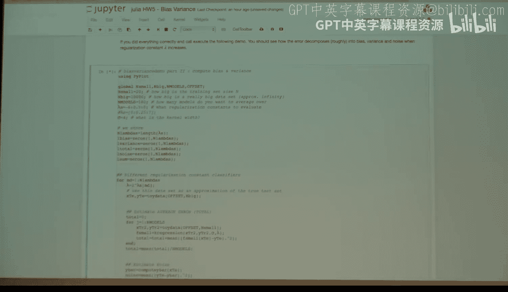
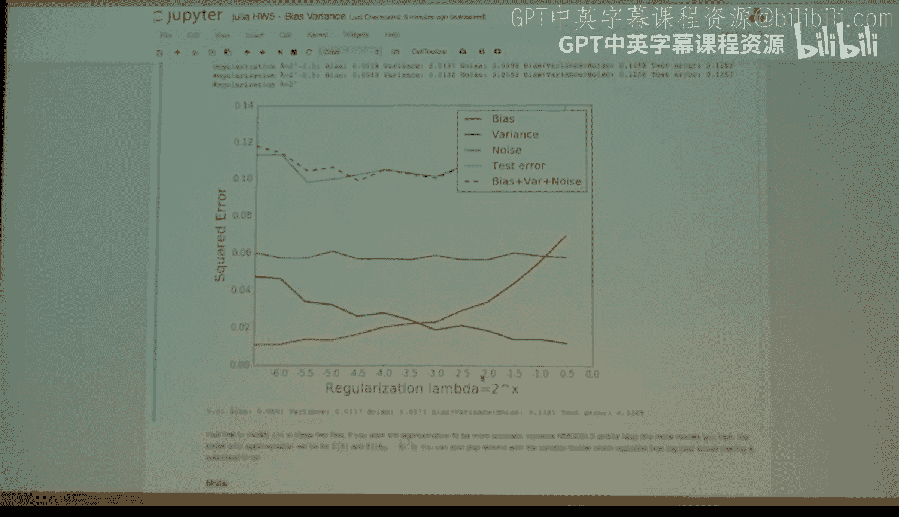

# 机器学习：020：模型选择、正则化与过拟合 🎯

在本节课中，我们将要学习机器学习中一个核心概念：偏差-方差权衡。我们将深入探讨模型选择、正则化以及过拟合问题，并学习如何通过交叉验证等技术来找到模型的最佳配置。

## 偏差-方差分解回顾 📊

上一节我们介绍了偏差-方差分解，这是机器学习和数据科学中最重要的主题之一。本节中，我们来看看这个分解的具体含义。

我们考察算法A的期望测试误差，其中我们积分掉所有可能的训练数据D，并观察一个测试点(x, y)。其公式如下：

**E_D, x, y [ (h_D(x) - y)^2 ]**

这个平方误差项可以分解为三个可解释的部分：

1.  **方差**：衡量不同训练集训练出的分类器之间的差异程度。公式为 **E_x [ Var_D( h_D(x) ) ]**。
2.  **噪声**：衡量数据本身的固有不确定性。即使分类器完美预测了平均标签，仍然存在的误差。公式为 **E_x, y [ (y - E[y|x])^2 ]**。
3.  **偏差**：衡量平均分类器的预测与真实平均标签之间的差距。它反映了模型假设与数据真实情况的不匹配。公式为 **E_x [ (E_D[ h_D(x) ] - E[y|x])^2 ]**。

这三个二次项的和恰好等于总的期望平方误差。理解每一项有助于我们在实践中改进机器学习模型。

## 偏差-方差权衡的实践演示 🎮

为了直观理解偏差-方差权衡，我们来看一个具体的演示。以下是演示的关键设置：

*   我们从已知的分布P中生成数据，这让我们可以精确计算偏差、方差和噪声。
*   我们使用一个带有核技巧的线性分类器，并通过改变正则化强度λ来观察效果。

以下是随着正则化强度λ变化，各项误差的变化趋势：

*   **训练误差**：随着λ增大（正则化增强），训练误差单调上升。
*   **测试误差**：呈现一个U形曲线。
    *   当λ很小时，模型**过拟合**，测试误差高，主要由高方差导致。
    *   当λ很大时，模型**欠拟合**，测试误差也高，主要由高偏差导致。
    *   存在一个“最佳点”，使得测试误差最小，此时偏差和方差达到平衡。
*   **噪声**：通常与λ无关，是数据分布固有的常数项。

作为数据科学家，我们的目标就是通过调整模型（如改变λ）来找到这个最佳平衡点。

## 模型选择与交叉验证 🔍

既然我们知道了存在过拟合和欠拟合的风险，那么如何为模型选择最佳的超参数（如λ）呢？最常用的方法是交叉验证。

### 网格搜索

最简单的方法是网格搜索。以下是其基本步骤：

1.  将数据集划分为**训练集**和**验证集**。
2.  预设一组待尝试的超参数值（例如，λ = [0.001, 0.01, 0.1, 1, 10]）。
3.  对于每一个λ值，用训练集训练模型，并在验证集上计算误差。
4.  选择在验证集上误差最小的那个λ值。

为了提高效率，通常先进行粗粒度的对数尺度搜索（如10的幂次），定位大致范围后再在该范围内进行细粒度搜索。

### K折交叉验证

简单的单次划分验证集存在风险：可能会因为验证集本身的随机性而“过拟合”验证集。更稳健的方法是K折交叉验证。

以下是K折交叉验证的步骤：

1.  将训练数据随机均匀分成K份（或“折”）。
2.  进行K次循环。在第i次循环中：
    *   将第i份数据作为**验证集**。
    *   将剩余的K-1份数据合并作为**训练集**。
    *   用该训练集训练模型，并在该验证集上计算误差。
3.  对于每个超参数设置，我们得到K个验证误差，取其平均值作为该设置的性能估计。同时，我们还可以计算误差的标准差，以评估性能的稳定性。

K值越大（如留一法交叉验证，即K等于样本数），估计越准确，但计算成本也越高。通常根据数据量大小和计算资源在5到10之间选择K值。

> **重要提示**：测试集应仅在最终模型评估时使用一次，以报告无偏的性能估计。在模型选择和调参过程中，只使用训练集和验证集。

## 正则化与早停法 ⏱️

控制过拟合的另一个重要技术是**早停法**。它应用于优化过程（如梯度下降）中。

在标准训练中，我们持续优化直到损失函数收敛。而早停法则是在训练完全收敛之前就停止迭代。这相当于在参数空间中找到的解决方案的范数较小。

早停法与L2正则化有深刻的联系：
*   **L2正则化**：在损失函数中增加权重范数的惩罚项，相当于在参数空间限制了一个“球”，优化器不能超出这个球的范围。
*   **早停法**：从初始点（通常是接近零向量的点）开始梯度下降。早期迭代产生的参数范数很小。随着迭代增加，参数范数增长。提前停止迭代，相当于隐式地限制了一个参数范数的上限。

因此，更多的训练迭代相当于更弱的正则化。早停法的误差曲线与正则化类似：随着迭代次数增加，训练误差持续下降，而测试误差先下降后上升，同样存在一个最佳停止点。

## 总结 📝

本节课中我们一起学习了机器学习模型的核心权衡——偏差-方差分解。我们了解到总误差可以分解为偏差、方差和噪声三部分，而模型复杂度的选择（通过正则化强度λ或训练迭代次数体现）直接影响偏差和方差的平衡。

*   **过拟合**对应高方差、低训练误差、高测试误差。
*   **欠拟合**对应高偏差、高训练误差、高测试误差。

为了找到最佳模型，我们介绍了**网格搜索**和**K折交叉验证**来稳健地选择超参数。此外，我们还探讨了**早停法**作为一种隐式的正则化技术，及其与显式正则化的内在联系。掌握这些概念和方法，是构建泛化性能良好模型的关键。