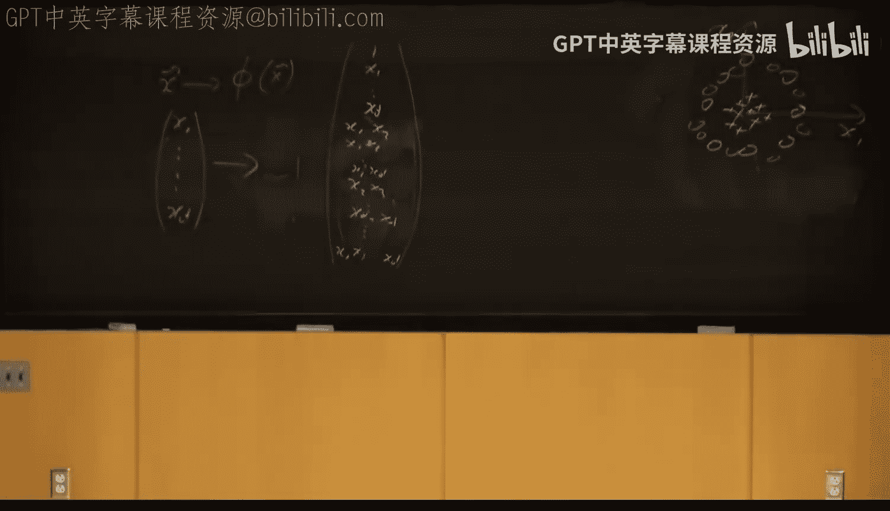

# 机器学习：021：模型选择与核方法

在本节课中，我们将要学习如何诊断和解决机器学习模型中的偏差与方差问题，并介绍一种通过特征变换来提升模型表达能力的重要技术——核方法。

## 考试情况回顾

上一节我们介绍了偏差-方差分解，本节我们来看看如何应用它来调试模型。但在开始之前，先简要回顾一下期中考试的情况。

考试总分为90分，整体情况良好。虽然没有人获得满分，但有两位同学获得了88分的高分。分数分布非常平滑。

上图是按分数排序的学生成绩分布，每个条形代表一名学生。得分在60到88分之间的同学表现不错。得分低于50分的同学需要引起注意，因为期末考试占总成绩的50%，如果期末成绩没有显著提升，最终成绩可能会不理想。如果你决定继续学习本课程，请务必参加答疑时间，我们一起分析问题所在。

考试答案已发布在课程网站上。由于助教们加班加点批改，部分晚交的试卷可能尚未完成评分，但大家可以通过参考答案预估自己的成绩。

关于作业截止日期，课程网站上Homework 4的截止日期有误，它实际上是在春假前一天截止。我们会在Piazza上发布更正通知。

总体而言，大家对第一道题的掌握非常好，中位数得分是满分。出乎意料的是，朴素贝叶斯部分对很多同学来说反而是最难的。

## 偏差-方差权衡回顾

两个讲座之前，我们展示了如何将误差（以最小化平方损失为例，但结论具有一般性）分解为三个可解释的部分。

**误差 = 方差 + 偏差² + 噪声**

我们观察了不同情况下的误差曲线。上一次我们看了早停法，其曲线大致如下所示。

随着优化迭代次数的增加，训练误差不断下降。测试误差先下降，到达一个“最佳点”后再次上升。在迭代次数较少时，测试误差过高，这是因为模型欠拟合，尚未充分学习数据。在迭代次数过多时，测试误差上升，这是因为模型过拟合，过度记忆训练数据而丧失了泛化能力。

在实践中，调整正则化强度参数 **λ** 和调整优化迭代次数 **n** 的效果非常相似。但早停法（调整 **n**）有一个显著优势：它通常更快。这是为什么呢？

想象你在优化一个权重向量 **w**。早停法从 **0** 开始，沿着优化路径前进，但在到达全局最优点之前就停止。L2正则化则是限制 **w** 必须在一个半径为 **R** 的球内（由 **λ** 控制）。为了找到最佳的正则化强度，我们需要进行交叉验证。

以下是交叉验证的步骤：
1.  将训练集分成K份。
2.  对于每个候选的 **λ** 值，用K-1份数据训练模型，用剩下的1份数据验证。
3.  重复K次，计算平均验证误差。
4.  选择验证误差最小的 **λ** 值。

这个方法的问题在于，对于每个 **λ**，你都需要重新训练模型直到收敛，这非常耗时。而早停法只需要训练模型一次：在训练过程中，每隔几次迭代就记录一次模型在验证集上的误差。训练结束后，回顾所有记录，选择验证误差最低时对应的模型参数即可。因此，对于像神经网络这样训练成本高的模型，早停法是更高效的选择。

需要注意的是，早停法并非适用于所有优化算法，例如对于直接调用二次规划求解器的SVM，就没有“迭代次数”的概念。

## 机器学习调试实战

现在，让我们扮演数据科学家的角色。假设你的老板交给你一个任务：训练一个垃圾邮件分类系统，并要求测试错误率低于 **ε**（例如1%）。你训练了模型，但错误率高于 **ε**，这时你该怎么办？

这就是机器学习调试。关键是要找出总误差中哪一部分过高。总误差由方差、偏差平方和噪声相加而成。如果知道哪一部分最大，就能对症下药，高效地降低总误差。

那么，如何诊断呢？这里有一个简单实用的技巧。

你需要绘制一张图。横轴是使用的训练数据量（从数据集中随机抽取的子集大小），纵轴是误差。

首先，绘制训练误差曲线。当训练数据极少（例如只有1个样本）时，任何像样的算法都能完美拟合，训练误差为 **0**。随着训练数据增加，问题变难，训练误差会逐渐上升并趋于平稳。

接着，绘制测试（或验证）误差曲线。当训练数据极少时，测试误差会非常高。随着数据增加，测试误差会下降。重要的是，测试误差永远不会低于训练误差，训练误差是测试误差的下界。

根据图像，我们可以区分两种需要调试的情况：

### 情况一：高偏差

**特征：**
*   训练误差高于目标误差 **ε**。
*   测试误差仅略高于训练误差（两者差距小）。

**含义：**
模型过于简单，无法捕捉数据中的基本模式。即使在训练数据上表现也很差。

**解决方案：**
*   **增加模型复杂度**：例如，使用核方法（即将介绍）。
*   **添加更多特征**：提供更多信息给模型。
*   **使用集成方法**：如Boosting（后续课程介绍）。

**重要提示：** 在高偏差情况下，**增加更多训练数据通常没有帮助**。因为训练误差本身已经高于 **ε**，且只会随着数据增加而上升，测试误差无法突破这个下限。

### 情况二：高方差

**特征：**
*   训练误差低于目标误差 **ε**。
*   测试误差远高于训练误差（两者差距大）。

**含义：**
模型过于复杂，对训练数据中的噪声也进行了学习，导致泛化能力差。

**解决方案：**
*   **增加训练数据**：这是最有效的方法之一，可以缩小训练误差和测试误差之间的差距。
*   **降低模型复杂度**：例如，使用更简单的模型。
*   **增加正则化强度**：增大 **λ**。
*   **使用集成方法**：如Bagging（后续课程介绍）。

调试过程可能是一个权衡过程。当你解决了高偏差问题后，可能会引入高方差问题，反之亦然。需要反复调整，直到训练误差和测试误差都低于目标误差 **ε**。

如果噪声本身已经大于 **ε**，那么可能需要检查数据质量、进行数据清洗或添加更能解释问题的特征。

## 特征变换与核方法引入

现在，我们来看一个具体的例子，学习如何通过特征变换来解决高偏差问题。

假设我们有一个二维数据集，分布如下图所示。圆圈（O）分布在一个圆形区域内，叉号（X）分布在原点右侧的一个小高斯分布中。

你的任务是分类。如果你使用线性分类器（如线性SVM），决策边界可能是一条直线，效果很差（错误率接近50%）。这显然是一个高偏差问题：线性模型太简单，无法刻画圆形的决策边界。

我们不想放弃高效的线性模型框架。一个古老的技巧是进行**特征变换**：将原始特征 **x** 映射到一个更高维的空间 **φ(x)**，使得在新空间中数据是线性可分的。

例如，对于这个二维数据，我们可以添加一个新特征：点到原点的距离（即 **x₁² + x₂²**）。这样，数据就从二维 **(x₁, x₂)** 变成了三维 **(x₁, x₂, 距离)**。在新空间中，一个平面就能完美地将两类数据分开。将这个平面决策边界映射回原始二维空间，就得到了我们想要的圆形边界。

在实际问题中，我们很难像这个例子一样直观地知道该添加什么特征。一个大胆的想法是：添加所有可能的多项式组合特征。

假设原始特征为 **x₁ 到 x_D**。我们可以构造如下变换：
1.  添加偏置项 **1**。
2.  保留所有原始特征 **x₁ ... x_D**。
3.  添加所有二阶特征组合：**x₁x₂, x₁x₃, ..., x_{D-1}x_D**。
4.  添加所有三阶特征组合，依此类推，直到 **D** 阶组合 **x₁x₂...x_D**。

这样，我们就得到了一个极其高维的特征空间。这个空间的维度是多少呢？对于每个原始特征，在新的多项式特征中，它可以选择“出现”或“不出现”（在0次到多次之间）。这实际上有 **2^D** 种可能（考虑所有子集的特征乘积，虽然有些组合如 **x₁²** 是重复的，但数量级相似）。当 **D** 很大时，这个维度是灾难性的，直接计算 **φ(x)** 并存储变得不可能。

这就引出了下一节的核心——**核技巧**。核技巧允许我们在不显式计算高维特征 **φ(x)** 的情况下，直接在高维空间中计算样本间的相似度（点积），从而高效地训练线性模型。我们将在下节课详细探讨。

## 总结

本节课我们一起学习了：
1.  **模型调试**：通过绘制训练/测试误差随数据量变化的曲线，可以诊断模型处于高偏差还是高方差状态。
2.  **解决方案**：
    *   **高偏差**：增加模型复杂度、添加特征、使用更强大的模型（如核方法、Boosting）。
    *   **高方差**：增加训练数据、降低模型复杂度、加强正则化、使用Bagging。
3.  **特征变换**：通过将数据映射到更高维空间，可以使原本线性不可分的数据变得线性可分，从而利用高效的线性模型。
4.  **核方法引入**：为了应对显式特征变换带来的维度灾难，我们引入了核技巧的概念，它将在下一节课详细展开。

掌握这些调试技巧和核心思想，对于在实际工作中有效应用机器学习模型至关重要。