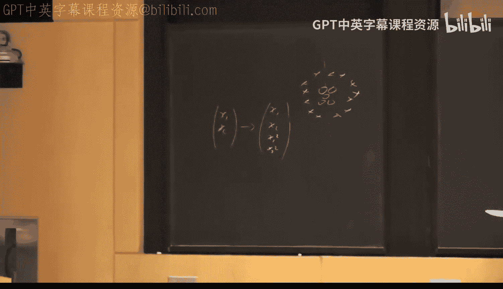
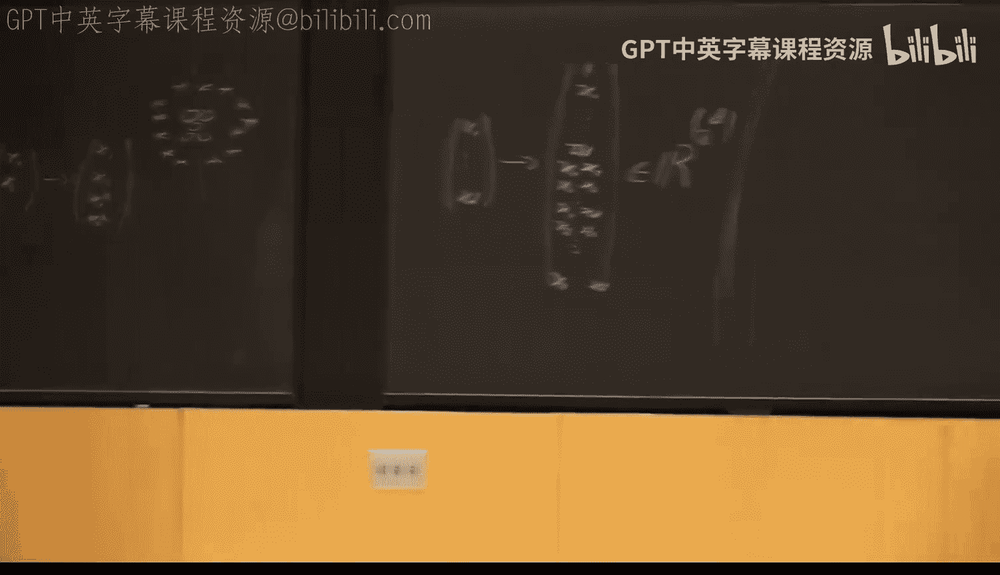
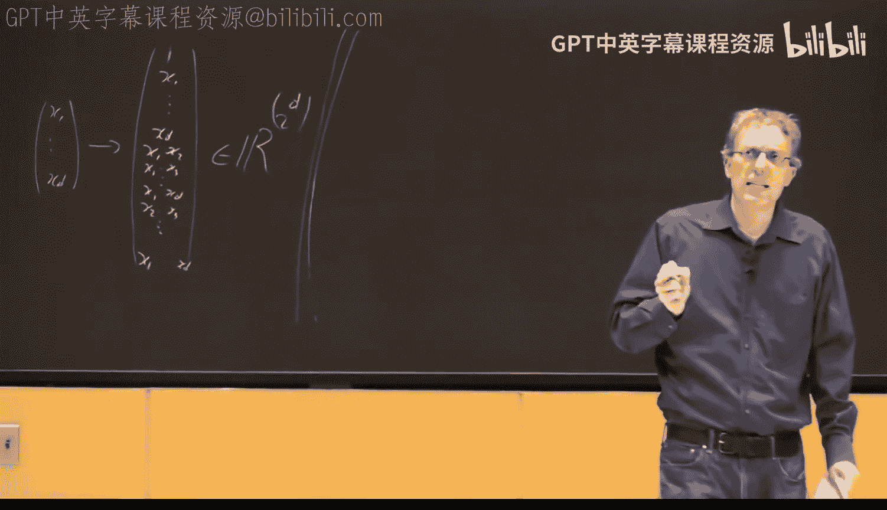
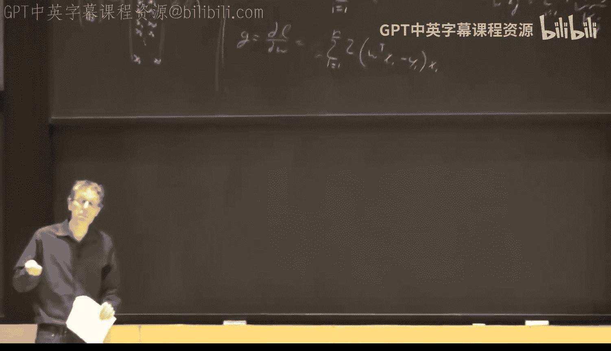
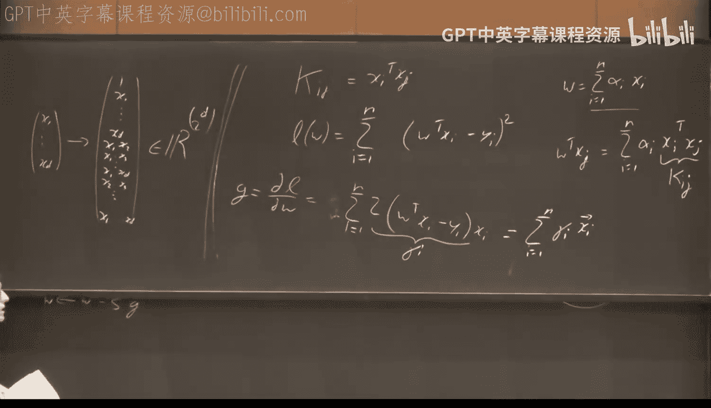
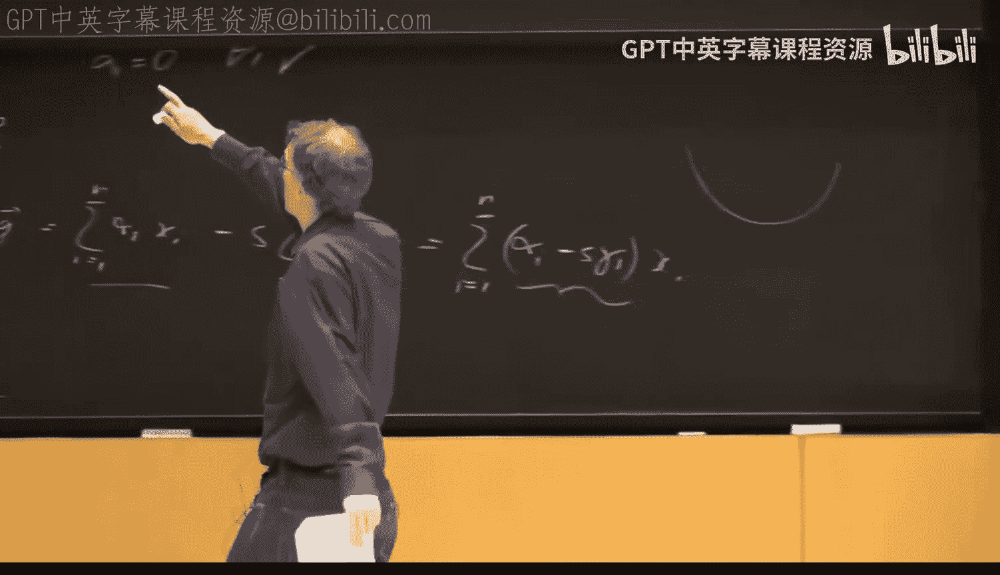
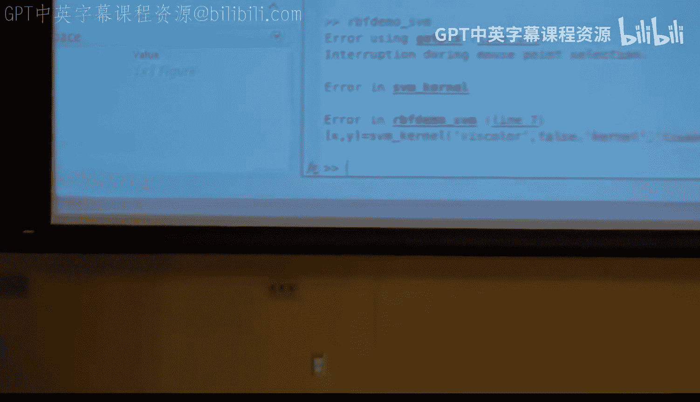
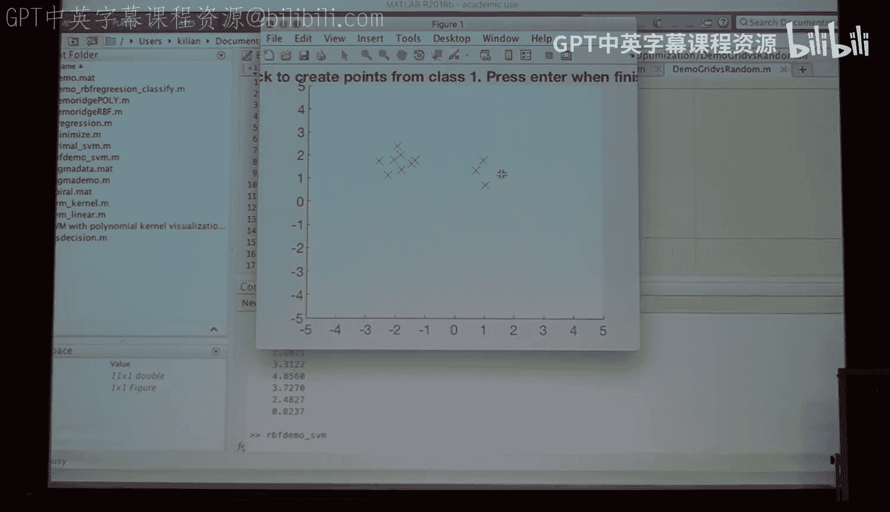

# 机器学习：第22讲：更多关于核函数的内容

在本节课中，我们将学习如何利用核函数这一强大工具，来克服机器学习模型中的高偏差问题。我们将看到，通过将数据映射到极高维甚至无限维的空间，线性分类器可以学习极其复杂的非线性决策边界，而计算开销却可以保持可控。

上一节我们介绍了如何通过诊断训练误差和测试误差之间的差距来识别高偏差或高方差问题。本节中，我们来看看如何具体解决高偏差问题。

## 解决高偏差：增加特征

高偏差问题的核心是模型过于简单，无法捕捉数据中的复杂模式。一个直观的解决方案是增加特征，以增强模型的表达能力。

例如，对于一个二维数据集，其中正例呈环形分布，负例分布在周围，线性分类器无法将其分开。但如果我们添加特征，例如 `x1^2` 和 `x2^2`，数据在新的三维空间中就变得线性可分了。

以下是增加特征的一种系统化方法：考虑所有特征之间的可能交互项。

*   **常数项**：1
*   **一次项**：`x1, x2, ..., xd`
*   **二次项（两两交互）**：`x1*x2, x1*x3, ..., xd-1*xd`
*   **三次项**：`x1*x2*x3, ...`
*   **依此类推，直到 d 次项**：`x1*x2*...*xd`

这种方法虽然能有效降低偏差，但会带来一个严重问题：特征维度爆炸。对于 `d` 个原始特征，这种扩展会产生 `2^d` 个新特征。对于 `d=1000` 这样的常见情况，`2^1000` 是一个天文数字，无法实际计算和存储。

## 第一个技巧：用内积表示分类器

为了处理这种高维表示，我们需要第一个技巧。我们发现，对于许多线性模型（如使用平方损失的线性回归），最优权重向量 `w` 可以表示为训练数据点的线性组合。

**公式**：`w = Σ(α_i * x_i)`，其中 `i` 从 1 到 `n`（训练样本数），`α_i` 是标量系数。

这个结论可以通过梯度下降法的归纳证明得到：从 `w=0` 开始，每次梯度更新 `w := w - η * ∇L(w)` 都只是给 `w` 加上训练样本 `x_i` 的倍数，因此 `w` 始终保持在训练样本张成的子空间中。

这个表示法的巨大优势在于，我们不再需要直接存储和计算高维向量 `w`，而只需存储 `n` 个标量 `α_i`。这使得处理超高维特征空间成为可能，因为存储开销仅与数据量 `n` 有关，而与特征维度 `d` 无关。

在训练和预测时，我们只需要计算 `w` 与某个向量 `z` 的内积，而这个内积可以完全用 `α_i` 和样本间的内积来表示。

**公式**：`w^T * z = Σ(α_i * (x_i^T * z))`

因此，整个算法可以只通过数据点之间的内积 `x_i^T * x_j` 来运行。

## 第二个技巧：核函数技巧

虽然我们只需要内积，但计算 `2^d` 维空间中的内积 `φ(x_i)^T * φ(x_j)` 本身仍然非常昂贵。这就是第二个魔法技巧——核函数技巧——发挥作用的地方。

对于前面提到的包含所有交互项的特征映射 `φ(x)`，其内积有一个极其简洁的计算公式：

**公式**：`φ(x)^T * φ(z) = (1 + x^T * z)^d`

左边是 `2^d` 维空间中的内积，计算量巨大。右边只是一个原始特征空间中的内积 `x^T * z` 加上 1，再取 `d` 次方，计算仅需 `O(d)` 时间。我们通过核函数 `K(x, z) = (1 + x^T * z)^d` 来隐式地定义了高维空间中的内积。

这意味着，我们可以在极高维的特征空间中训练线性分类器，获得强大的非线性能力，而实际计算成本却只与原始维度 `d` 相关。我们永远不需要显式地写出或计算 `φ(x)`。

## 常用的核函数

核函数 `K(x, z)` 必须是对称且正定的（即对于任意一组点，由 `K(x_i, x_j)` 构成的矩阵是半正定的）。以下是一些常见的核函数：

*   **线性核**：`K(x, z) = x^T * z`。这对应于原始特征空间，即没有进行特征映射。
*   **多项式核**：`K(x, z) = (γ * x^T * z + r)^d`。其中 `d` 是多项式次数，`γ` 和 `r` 是参数。它对应于有限维的特征空间。
*   **径向基函数核**：`K(x, z) = exp(-γ * ||x - z||^2)`。这是最著名、最常用的核函数之一。它对应于一个无限维的特征空间，具有通用逼近性，理论上可以使任何数据集（在没有重复且标签不同的样本的情况下）变得线性可分。参数 `γ` 控制了高斯分布的宽度。

核函数的强大之处在于，它允许我们为各种结构化数据（如文本、图、序列）定义相似性度量（即核函数），从而在这些数据上应用线性模型，而无需显式地将其转化为向量。

## 总结

本节课中我们一起学习了核方法的核心思想。为了克服模型的高偏差，我们希望通过增加特征（如特征交互）来提升模型复杂度，但这会导致维度灾难。通过两个关键技巧：
1.  将分类器权重 `w` 表示为训练样本的线性组合，使存储与特征维度无关。
2.  利用核函数 `K(x, z)` 隐式计算高维空间中的内积，使计算成本大幅降低。

我们得以在极高维甚至无限维的空间中高效地训练线性模型，从而使其具备强大的非线性分类能力。最常用的径向基函数核因其通用逼近性质而备受青睐。核方法将机器学习模型的适用性扩展到了各种非向量型数据上。