# 023：康奈尔大学《智能系统的机器学习｜CS4780 Machine Learning for Intelligent Systems 2017》中英字幕 p23 -23-Machine Learning Lecture 23 ＂Kernels Continued Continued＂ -Cornell CS4780 SP -BV1Lo6gBxEKE_p23-

对。Welcome。Thanks for coming here， despite。Being the last day before spring break and Dragon Day。

In fact， the reason I got delayed is because I got stuck behind a gigantic dragon。

哎。And。

Alright， please put your laptops away。 Close your laptops。Okay。

 so we talked yesterday about Wednesday， about kernelization。And the idea is。

 we have these linear classifiers that we understand really well。

And we like them a lot because they have these con optimizationization problems。 And we， you know。

 just initialize our loss， you know， with some weight back then。

 we just de gradientd in decent It's super easy。 And outcome solution is very， very fast。

 So everything about them is nice， except one problem。😊。

They have really high bias。 right So linear classifiers suffer from high bias。And oh， with Microsoft。

Right， now that's on。1ant to test better。 Okay， good。 So linear classifier is suffer of a high bias。

😊。

And the question is， how can we fix this and so the first idea we had was well what we do is when we have high bias one option is just to add more features。

 So one thing we could do is we could just take the existing features and add combinations of these features to artificially inflate our dimensionality and that works really well。

😊，The downside of this is that it increases your dimensionality of your vector and it becomes very slow。

But then I showed you one thing is that we can actually write this vector W。

At least for the square loss， we can write it as。Apha I X I。

So we can write the vector w as a linear combination of these x's。And the beauty of this is that。

 or if we actually in this， let's say we had try to do this transformation fire fax。

 then we would have these fire effectsax。😊，And the beauty of it is that we actually never have to compute this vector W U。

 instead， we just have to store these n values alpha。

So the beauty is that now our vector W is independent of the dimensionality of our feature space so we can project our data to an extremely high feature space。

 and we can still learn it because we just have to keep the track of n alphas。

 no matter what the dimensionality is。😊，So that's the first thing。

 The second thing is then we realized that if we do a square loss and it's true for other losses as well。

 In fact， for all the losses that we talked about， is that。

The inputs are only accessed in terms of inner products。

So we only ever compute phi of X I transpose phi of X J。

 That's the only way we access these Xs and X Js。And so the beautiful thing is that we don't actually ever have to take data and map it into a high dimensional space。

😊。

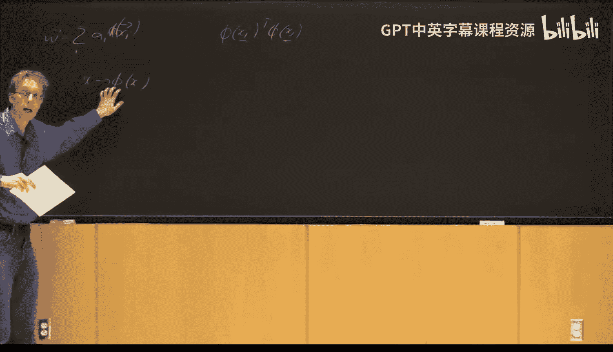

Instead， it's sufficient to define in a product function。

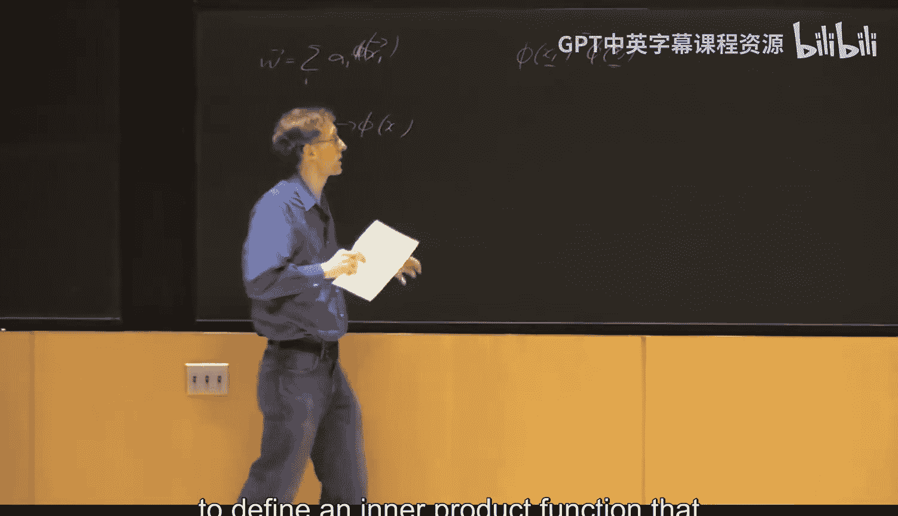

That compute us this in a product term。

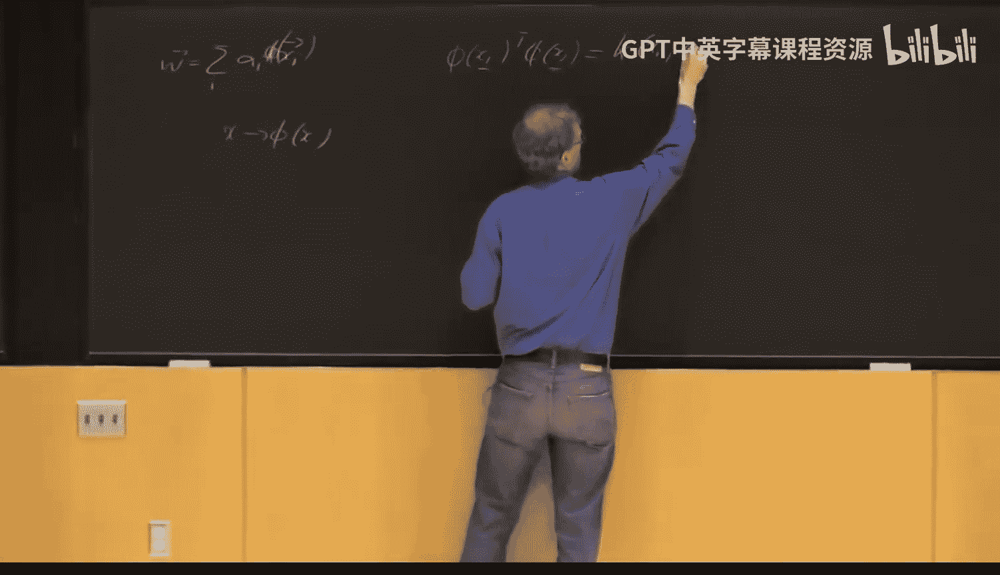

And that's all we need to do。 And very often， this is much， much， much easier。

 exponentially easier and faster than actually mapping the data in a high dimensional space and then computing in a product。

 So if you have， like in many cases， you can compute this in a product extremely efficiently。😊。

And that's what we call our kernel function。 That's what we call it K。

Any questions about last lecture？第二。Have to be done negative everywhere。呃。No。

So a simplest one is simple counter example。The linear kernel， X and Z is just x transpose C。

Well this can clearly be negative。So what are limitations have， It has to be positive semi deffinite。

 So if you take end data points。A computer matrix， K。Such that K， I J equals。呃，K of X I。Xj。

This matrix has to be positive indefinite。 That's the constraint。

So you can have negative in a product。Any more questions？So in some sense。

 but the inner product measures larger means they are more similar。

And lower means their lesson right， So that's typically。0ero means orthothgonal。Okay， good。

 So what I actually this is a a great question you just asked。

 because this is exactly where I want to go today。 I want to teach you how to construct new currents。

😊，And basically， that's， that's kind of demystify these kernels a little bit。

So told the last time we have the linear kernel， there this one。😡，This is a pretty famous one。

 This is basically， if you just use that linear kernel。

 then you get exactly the same result as if you would use a linear classifier。 you not didn't。

 didn't change anything。😊，You may still sometimes use a kernel function。 Can anyone tell me why。

 Why would it be efficient， You know， Why would it be a good idea to。You know。

 run your algorithm in the kernelized fashion。And then what setting is this advantageous， yeah。

That's right。 That's exactly right。 If D is larger than N， right。

 So if computing these inner products is very， very costly because we have， you know， in this case。

 five just the identity。 But vectors are really， really high dimensional。

 but I don't have many of them。 So I could just precompute this kernel matrix K。

 and then actually just run everything in the space。 So you have this， for example， with DNA data。

 So DNA data， you know， typically you don't have all that much because you know。

 let's its data point corresponds to a human where you actually know。

 had to sequence the entire DNA that's very expensive or used to be very expensive。

 So your n is small， but your D is ridiculously high。 right So in those cases。

 it makes sense just once pay for basically computing all the pairwise in products and then do all the learning in the inner product space。

😊，And in the kernelized version。So the second kernel that we had is the RBF kernel。 That's the。

 the cool kernel。 That's what I refer to as the Brad pitt of the kernels。 right。

 So that's here of X comema Z。 I don't know if Brad Pit is still cool these days。

 but I guess it used to be cool。😊，嗯。X minus is z squared over sigma squared。And so。

The intuition here is that basically we put a Gaussian around every single data point。

 and we say points are similar as they are close by and they。

 if they are far away and we don't know anything， right， So this goes to0 very， very quickly。

 right So if they are far away， then they're basically orthogonal。

 right actually snapping your data into them hypersphere。

 Its a positive quadrant of an infinite dimensional sphere。 That's what you're doing。😊。

And the polynomial kernel。完毕。The polynomial kernel is this one。

Where we have one plus x transpose Z to the power of P， with is the degree or D， whatever。

 This is the degree of my polynomial。嗯。So these are the most common kernels。

 but you can construct your own。 And what I want to show you today is some rules basically that actually constructing your own kernels is quite simple and。

It's to some degree of superpower。 If you know how to do this， right。

 So if you actually have some specific data， let's say you go into you know。

 any kind of chemistry or biology， I don't know what your PhD will be or， you know， whatever。

 like what your application will be and。It helps， you know。

 if you can actually take some weird data and be able to construct a kernel that can make learning very efficient without you actually having to squeeze it into a vector form。

😊，So the first amazing have in I wrote on eight rules for you for you know how to make kernels。

 there's more。 But those are the most common ones。And the first one is。

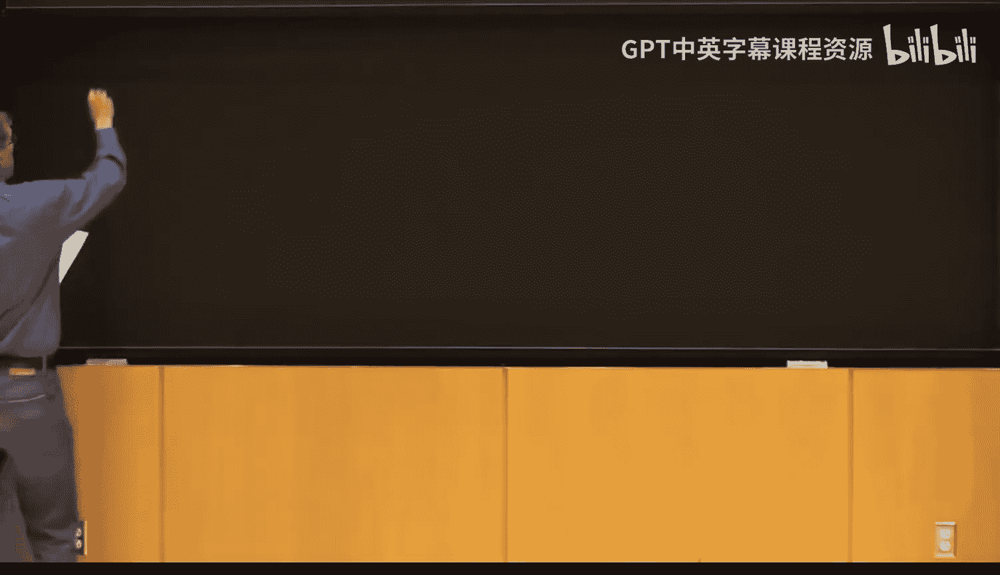

That the linear kernel is a kernel， right， And that's very easy to prove if it positive them a definite matrix because it's an inner product matrix。

 So that's， that's。

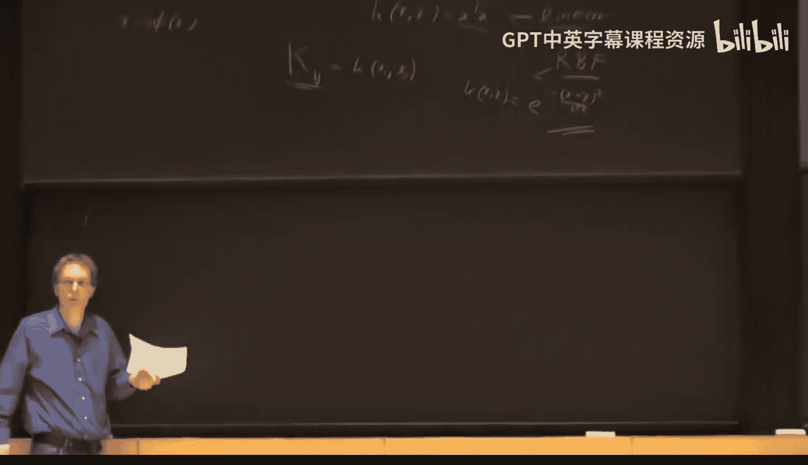

You know， you could just do that on， on a rainy day like today， here have X comm a Z。X transpo C。

 that is a well defined kernel。 That's my first rule。So。And， you know。

 that's what we've been doing the whole time。 Thats in， all I'm saying。

 this is a value fund in a product。 Well Da， right， That's how， you know， that's what in a product。

 that's in a product you learned in high school， right。😊，The second one is more interesting。

 The second one says， if I have a。A kernel function。K1 of x。

And I multiplly by any constant that's non negative。 As sorry， that's actually that's positive。

And if if well， it can be 0， but then you get a trivial。 It's a trivial case。

 So if it's not negative。 this is still a well defined kernel。Okay。

 so you're basically just rescaling all my inner， you know， my inner products by some positive value。

😊，Still gives me well defined in a product。 Well， that's， that's， you know， that should be very。

 that's actually， you know， from the definition of in a product that just follows right away。

Please ask questions anytime。You know， if anything is unclear。There will be a bunch of quizzes today。

 by the way。 So make sure you sit now close to someone you like。

 that you can work with them together。😊，All right。Don't move away too obviously。

 So So the second one is， if you have two kernel functions。 If you add them up。

 you still get a kernel。 So it's closed under addition。😊，So we have two kernel functions。 K1， K do。

 if I just add them up， I still get a kernel。 If if I take any one of them and multiply them by constant。

 that's positive。 I still get a kernel。 Okay， these are the operations。 And so basically。

 what we will do later on is we say， okay， let's construct new kernels。

 And what you do is you start with something that you know as a kernel。

 And then you basically transform it into the function that you'd like。😊，嗯。Forest。

 and this is a little more interesting。 So if you have a function。

 let me just make sure I define this correctly here。😊，I didn't define it。

So G has to be a polynomial function。So V have a function， K of x。If I define my kernel as。

G of K1 of x commma Z。And I， I forgot to write down about G S。

 and I believe it has to be a polynomial function of even degree。coefficient。 sorry， okay。

 that's right。 That's right。 Okay， G polynomial。With positive coefficient。 Okay， that's obvious yeah。

So you can basically take， you know， squares，  cubebit， etc cetera。

 right stick it to any kind of company polynomial。 It stays a kernel。 stays a valid in the product。😊。

numberumber5 is， I can， Im just gonna skip this now。I can just take two inner product functions。

 and multiply them。It still stays a kernel。6 is an interesting one。 Now。

 it's getting a little interesting。Success， if I have a kernel function。And I。

And I multiply left and right， right by any， any function。 So I have F of x on the left。

And F of Z on the right， that still a。So I basically can transform my my。

 my features as long as do the same transformation for X and Z in magical kernel。 And that's。😊。

So a kernel。Eth7， if I exponentiate my colonel。That's still a colonel。And finally，8。

If I take a positive indefinite matrices， I actually asked， you know。

 I'm looking at the survey right now。 Like I ask people， what's the worst part about the course。

 And one person wrote positive and indefinite matrices so。😊，That's't know， this is not me。So。

If you take any positive in the of the matrix and multi， you know， right and left from X to Z。

 that's also a current。AndSo if that's the identity then you fall back onto this guy。Okay， good。

Any questions about these rules。いや。How did we construct carbonta？That's the quiz。

 that's exactly what I want you to do right now。So pick your favorite neighbor。

 I' give you four minutes， try to prove that the RBF kernel is a well defined crown。8这份。这个。

So X minus is me， that's the biggest。So。ぱい。By。I don't know get。哎。Yeah。て second。可以实。That还 me。Yeah。

Yeah。Okay。问题不改。What the second one。这点。

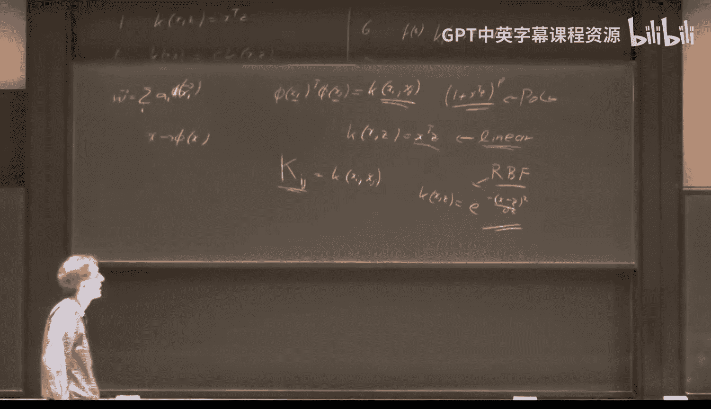

Yeah。Prescent。pointin is like。我我。Yes， it's basically。

RightK of x comm Z equals E to the minus X minus Z transpose x minus Z。That's the。

 that's the RVF kind。对。也死的。A。Okay， who thinks he or she has figured it out。 Raise your hand。

Some people， a little bit。come person。Yeah， give you one more minute。see。YeahNo。Sorry。So yeah。

 sigma is is real。 It's not It can't be an imaginary。 Let just remind。嗯。All right。

I think you were the first one。Thank you。Every be quiet， please， everybody， yeah。

That's exactly right。Let me just， you know， explain one more time for those people。

We thought this was a little faster。 So basically you start with X transpo C is the linear kernel。

 That's's rule number one。 That's a well kernel。😊，And you say， I multiply this by two sigma squared。

2 of a sigma squared。 That's rule number  two。 that says if you multiply with a positive constant。

 it's still a kernel。😊，Then I use rule number 7， where I say I can exponentiate it。

That's now we have exactly the middle part。And now can use rule number。Which one is it？

I don't see you right now。Of 6， rule number 6， A data I can multiply this with F of x on the left。

And F of Z on the right for any function F from X and F of Z。 And so I define them as U。

 And then I get exactly this term on the left。 So R BF kernel in a， you know。

 four step process very simple is exactly well defined kernel。 Yes， thank you very much。 It's very。

 very nice， yeah。😊，Theect。Sorry。But you know， the function always has to be。Of two function。

 That's okay K of x comma Z is defined as。X trans， that's a well defined kernel。

 If you make this X trans X， it's not a well defined kernel right that's。

 that's a different function。To don't。Yeah， any more questions。Yeah。It has to stay it has to say。 Oh。

 part if you set it to 0， then everything becomes one。

And then you have a function that maps everything to one。 Is that positivedeinites。

 the all one matrix。哎。Remember if you add an polynomia that just raises the inner product to zero。

 then it just bit becomes one。😡，So any of a kernel bit is a kernel matrix that's all once。

 I'm not sure that's positive definite。Is it maybe this？Not sure。So we we can。

 we have to look into this。 Yeah。Its I mean， it， in some sense。

 only looks at extreme Exs that the silly case， it's also a useless case。Yeah二。我路。Oh。

 I would assume it's finite。 I'm not， I'm not sure。 I'm not sure， to be honest， that's yeah。

 I don't know。Certainly holds what it's finite。I'm not sure about anything。Yeah， last question。 Yeah。

 4 function rule function of x。 Yeah， Could you map any x to like the negative identity matrix and then Z to the identity matrix。

 And then you would get that negative K1 would also be a kernel。😊，W， wait， wait sorry。

So you f of x goes to， but there just the problem is like F of x。You can swap X and Z， right。Okay。

 let take this after the class， I'm sure it doesn't work。😊，Okay。Let me do one more little。

 just one more example。 And so please don't look at the next part of the notes。

 I forgot to remove from the notes。 I put the solution up。

 And so I will add in the proof for this when I put it online。 So another kernel。

 I want to show you thats often used as a set kernels。

 Let's say if you have your data is not vectors。 data is sets you may have that in biology or in language。

 actually， you have bag of words or something right， And so you have set one and set 2。

 These are not vectors。 And now I define a kernel as the following and say my kernel between two different sets。

 set one set2 is E to the。😊，Cinality of the intersection。

 basically how many points do these have in common and then exponentiate this。

 And that's my kernel function。 And maybe spend a minute。

 You and your neighbor discuss why is that a well defined kernel。 So once again， these are now sets。

 right， and I'm。😊，Saying， how many elements do they have in common and expentiate that。

 And that is a abouting kernel。So please discuss it with your neighbor without。

 don't look at the answers in the next page。你说的。在这。好。Okay。Okay。Thats。My name is。嗯嗯。Okay， any guesses？

Any guesses how to prove that this is a well defined kernel for those who didn't look at the answer。

So， it's a simple trick。You basically say there's one more assumption， actually。

 that I didn't make clear as in case that trip， you， I apologize。These sets must be from finite。

 from a finite universe。And。So。If you want to， you know look at the intersection。

 one thing you could do is you could theoretically say， well。

 I take each set and I write as a gigantic vector。But every dimension correspond to one possible element that that actually that that。

That that has so。You basically say， well， S I maps to。To X I， where X I is a long binary vector。

 And for every single dimension， it just says the one， if I have that element in there and0。

 if I don't have it in it。And。Then this here is identical to saying this is E to the X I transpose X J。

Right。And now you just have the first rule and the exponentialonation rule。

So the important thing is this may not be computable。 This may be totally infeasible。

 Just the fact that it's possible in principle makes it proves that this year is a well defined kernel。

 right， So it may be easy to look up that actually。

 you know what the intersection between two sets is。 Yeah， question。第到边你。that may be right。

 It's just for this thing here。not， so。If you have an infinite dimensional vector。

 you have two infinite dimensional vectors， you have to show that this actually。

 this inner product is finite。So then you kind of get into weird exceptions。第二。

So bag of words essentially， you could view it as something like this。 Yeah， so， I mean。

 bag of words are basically these， I mean， there you could actually represent these vectors because they' are typically very sparse。

Okay， good。 So in some sense， I just want to give you a flavor of how to do these proofs and。😊。

Typically， always sneak one onto the exam at the end。 But it's also it's， you know， it's not just。

It's really a good thing to know， because if you can actually。

 if you can write a welldefined kernel function， there's a massive machinery in machine learning that just takes as input a kernel function。

 right， So if you can come up with a kernel function， there's， you know。

 that's basically the key to a whole world of of algorithms that you could apply to your data sets。

 So keep that in mind and please remember how to do this。😊。

And but you have to be able to show that it's a well definedfin kernel function。

 otherwise horrible things happen。

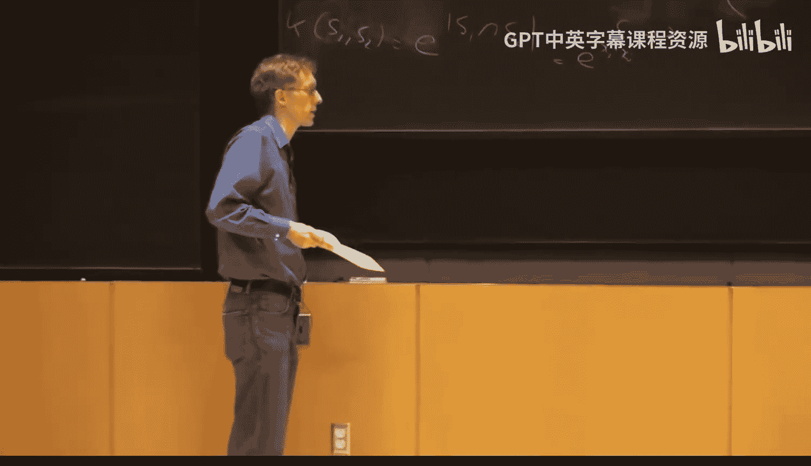

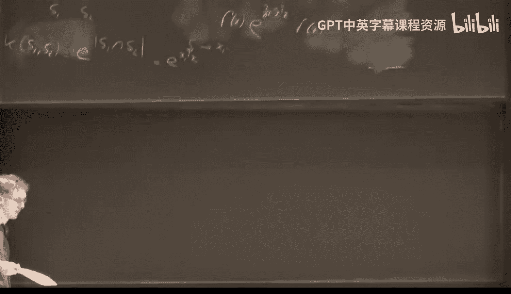

Okay， any more questions？And by horrible things， I mean， the loss will become negative。

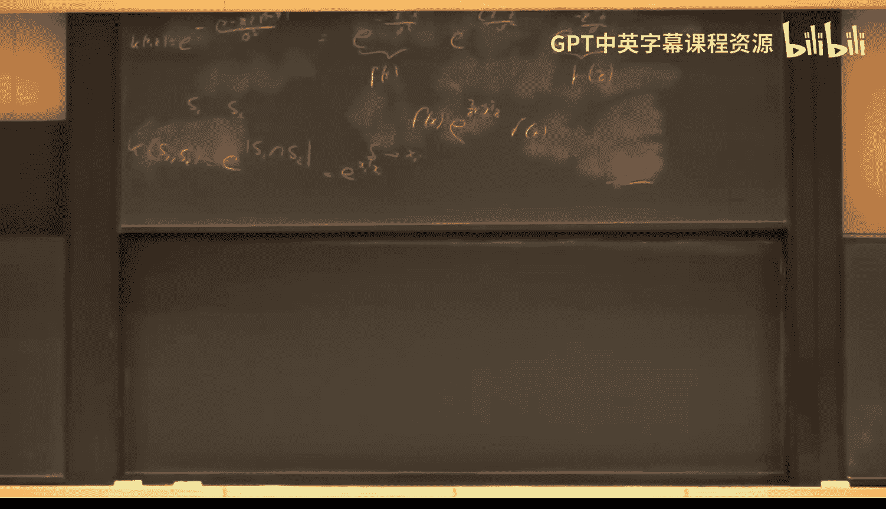

So that's as horrible as it gets。Okay， good。What I want to do in the remaining time is show how to take algorithms and kernelize them。

 So， yes， last。 Oh sorry。 Yeah， question。😊，就这一。Your Colel good。Well。

 larger value should mean two points are similar。 So you as a data expert。

 can basically that's something you could verify。Right。

 so data points that are very dissimilar should have small inner product。

Data points that are similar to the large。All right。

 so here's the you know we call these kernel machines in order to take a machine learning algorithm and turn it into a kernel machine or kernelize it。

😡，We need to follow a two step process。 The first step is we take this algorithm。

 and we have to prove that。You know， data is only accessed in terms of in the product。

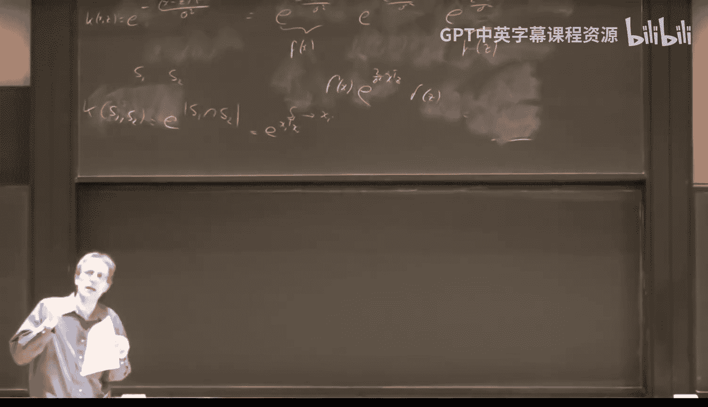

And that also during testing time， all you ever need is in a product。 That's the first thing。

 That's what we did last time。嗯。That's actually all you need to do。 Like if you look at old papers。

 people try to prove all these representative theorems and so on people。 ultimately， oh。

 that is not necessary。 there's a very pragmatic test to show that everything is accessed in terms of inner products。

And then define a kernel function and just substitute that in terms with the product。

 So the first thing is， you take your algorithm， you rewrite it in terms of inner product。

 And then you look， whenever that's in a product， you just swap in the kernel functions。

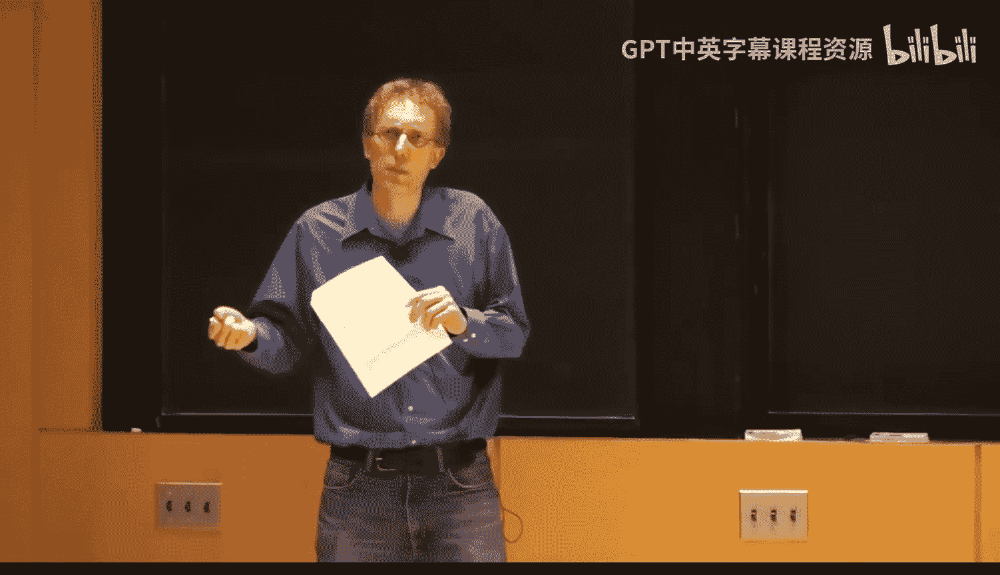

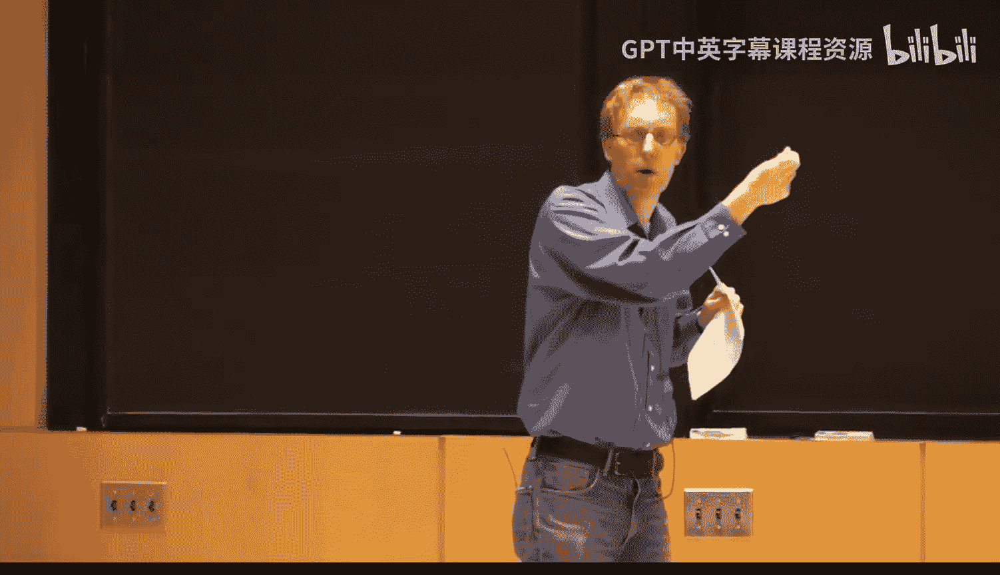

The kernel function。 And that's all you need to do。

So唉。Let's do。 have another quiz number one。 Here's quiz number one， B。

And maybe spend a few minutes and try to kernelize the nearest neighbor algorithm。

So the nearest neighbor algorithm you the L two distance。

So we try to find the nearest neighbor with the L2 distance。And then assign that label。

 Can you kernelize it。 So please use your neighbor， discuss it。Ill give you three minutes。

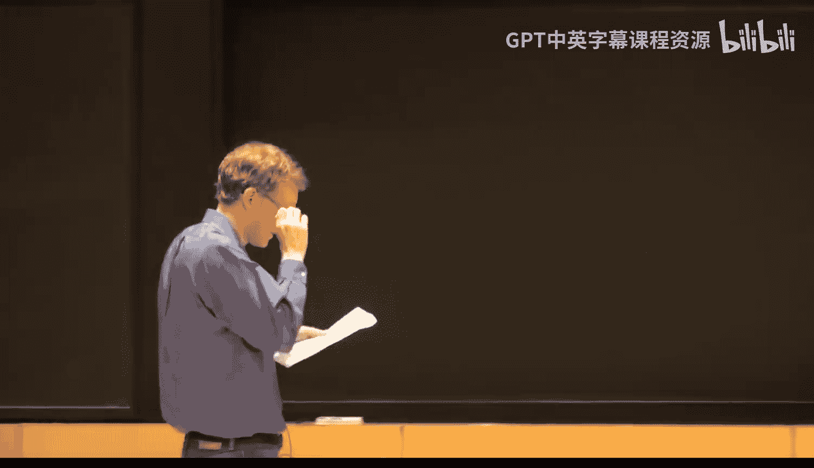

Oh， do you need the rules？ No， you don't need the rules。So yeah， there was on the notes， okay。便理が。

Yeah。系个你咧。Yeah。

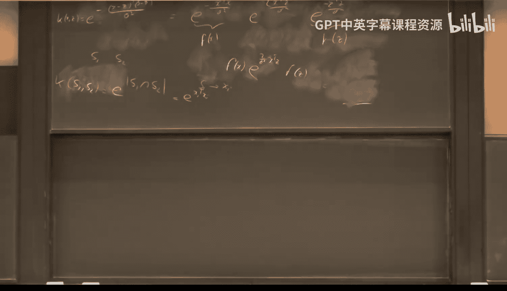

All right， so who figured it out？All right。Everybody， please be quiet。

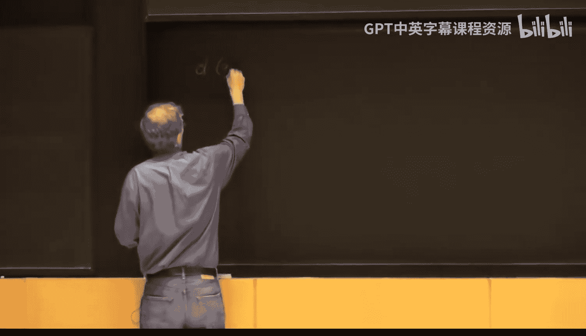

Yeah。Actually， you can use any kernel。 You can use any kernel。 right。

 So the important part is you just say for all we need for the nearest neighbor classifier is to find the nearest points according to the Euclidean distance。

😊，You you think this this is this here， you take a square root of this， actually， right， But。

 so let me just try this。 This here is the Euklideian distance。😊。

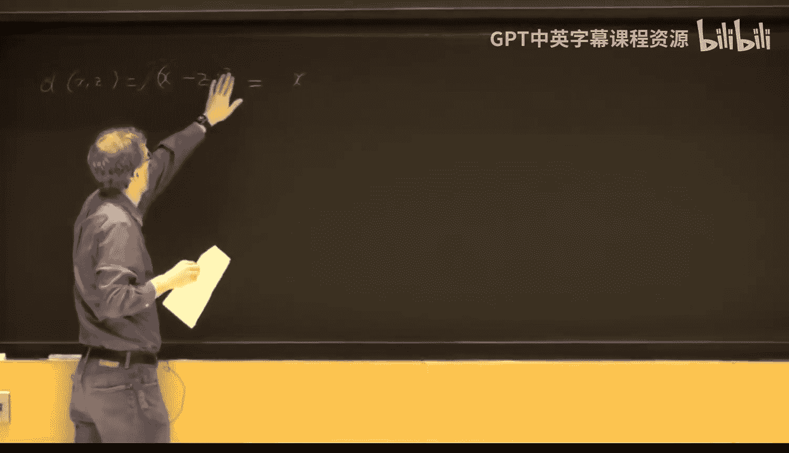

But whatever is close is based on the Euclidean distance is also closed based on the squared Euclidean distance。

 right， So I can just take this on both sides and square them。 That doesn't change anything。

 right So if I taking the squared Euclidean distance。

 I still find exactly the same year as neighbors。😊，And if I use the squared ding distance。

 this year becomes x transpose x-2 x transpose z plus z transpose Z， right， in hallelujah。

 right in a product， In a product， in a product， right。

 So the entire algorithm accesses our data only through in a product。

 So what we can do is we just stick in the kernel functions here。 And we say this is K of x comma X。

😊，-2 k of x comm a Z plus K of z comm a Z。And you can use any kernel you want。

 right Any defined kernel works with this。 There is now kernel nearest neighbors。 right。

 Nobody ever uses kernel nearest neighbors。 It's not a very good algorithm。

 And I can explain to you later on why it doesn't make any sense， but it's。You know。

 it's just a very simple example how to colonize。But there's other algorithms where the reason actually doesn't make much sense is because it's already a nonlinear algorithm。

 So bias is not a problem of Ken of nearest neighbor， right， It's not a high bias algorithm。

 So kernelizing reduces bias。 We don't have a bias problem here。

 Can neighbor suffers from a variance problem。 But linear classifiers。

 they suffer from a bias problem， yes。😊，That doesn't matter。

We're not constructing a kernel function When we kernelize an algorithm。

 All you need to show is that every single access to a data point is in an inner a product。

 That's what you need to do， right。The， the other， these rules were only to construct your own kernel function。

 right， So now you can stick in your own K， your favorite K function， yeah。😊，Yeah。连带关。まあ最かるだい。

That's right。被上边。No yeah， the good So our BF kernel， you would have this， right， So the closest。

 the largest it gets is one。 So you would have one one here， right。

 And so here it depends how close they are。 They are far away。 Then this becomes small， etctera。Okay。

 good。 Let me go with another algorithm。 So the kernel regression and kernel regression is actually a very useful algorithm。

 and it's very， very handy。 And the beautiful thing is it's one line of Julia。

 It's also one line of Python problem。😊，诶。The嗯。Okay， so the the idea is， the following。

 we just have to square off， So we minimize。W chunk with X minus Yi squared。😡，1 over n。

 let's just stop the one over n just to make it simple。

This's the last we're trying to minimize Last lecture we already showed that access data only in terms of inner product。

 If we make the following substitution， W equals I equals one to n Al I， X I。

 And we showed you that that's totally valid， we can do this， right， So if you write our W this way。

 Then everything just becomes terms of inner products。😊，Today。

 I just want to derive this from the closed form solutions。

 So if you remember when we talked about ordinary least squares。

 we said that actually has a closed form solution。 So this is actually a quadratic problem。

 It's a parabola。 and the parabola has a nice function。

 We can just compute the minimum divide right away。 essentially we take one mutantton step。

 and the closed form solution for ordinary least squares is W equals X X transpose inverse。😊，X， Y。

 where x is the matrix。Defined as all the， you know， we basically have all the。

Iputs kind of stacked in a row is like basically the way your projects work。W。Oh you're wise here。

 I think transpose， yeah。Okay， so the beauty of of which of which regression and ordinary release squares is that you can compute it with one line of code。

 That's just this line。 You other， you just take your input。 you just， you know。

 compute the covariance matrix。 You take the inverse multiplied by your data and by the label and bam。

 This is UW。😊，Now， we would like to kernelize this。

 The problem is that this W have the RBF kernel will be infinite the dimensional， right。

 So something seems to be wrong。 We can't do this， right， But the good thing is。Well， we。

 we know it's gonna work。Because we showed it last time。

 But one thing we can do is we can basically substitute for W this term here。

 Right So we take this definition of W。If you write this in matrix notation。

 this means you take every x， every column here and multiply by， you know， one alpha bound， right。

 So basically， what this means is w equals x times some vector alpha。 right。

 So that's exactly the same thing as this。 Allright。

 So if you take this vector alpha and multiply every single column here and sum it up， right。

 So that's these two are equivalent。😊，So， and that's our W。

 So what we can do is we can just plug that in。 You can just say x times alpha。

Equals this thing on the right， right。This has to be correct。And now we want to solve for alpha。

 And hopefully， what we will get is the expression that only correspondent in a product that can sneak we can sneak in our kernel function。

😊，So currently not everything in terms of inner product， but you can do a cute little trick。

 And that's we multiply both sides by x transpose x inverse times x transpose。So。We multi this。

 X transpose x inverse times x transpose。And why are we doing this。

 Because now this year basically dissolves， right。These two evaporate。

 And we have to do the C on the right side， too。 Now this gets a little ugly。So once x side。

 this becomes x transpose x inverse times x transpose。 And now we have here， X， X transpose inverse。

Oh my gosh， X， Y。And so now I already， you know， told you this year， these two basic disappear。

 If I do this trick。And here on the right inside side， what I get。 I get this terms here。X transpose。

 Xx transpose inverse x。Let's just look at this。X transpose， X， X transpose inverse X。

 I claims that's the identity。呃， must be。Why is this well。It's quite simple。

 I can just multiply with x on both sides。 if I multiply with x here。And with here。

 then these here disappear。 and I get x equals x。Okay。So this here must be the identity。

So this year disappears。 This year all disappears。嗯。And the only thing that's left is alpha equals。X。

Transpose X。Inverse times bar。And。别的。Why are we done， What's x transpose x。

That's the inner product matrix of x。So that's exactly a kernel。 right。

 That's basically every single entry of that matrix。 That's the matrix K， where K I J is。😊，K。

 I J equals x。X， I transport X， J。That's exactly this。 So basically。

 what we get is alpha equals the in inverse kernel times y。And that's all there is to it。

So then in Matlab， if you want to solve this in MatTlab， and Julia here's the code， y equals K x y。

 I believe。So that's how you solve this。 So it's literally one line of code。

 And the beautiful thing is now， if you do prediction right， you just have your alphas。

 you just multily your original data with it。 And it's a super， super efficient algorithm。

 It's extremely powerful。😊，Any questions。Yeah。A good。Someone got me。So。

When I multiply with all these terms here， I made some assumption that actually this year is in this year is actually invertable。

 that actually in a product maybe is is invertible。 And that's exactly right。😊。

And when it's not crazy， what you do is you add a little bit of a ridge。

So what you do is you say the following。Alpha equals k plus sigma times identity。Inverse， That's why。

And that's exactly kernelized， which request。That's acceptable。Very nice point， yeah。

That was just to save ink。Yes， sorry。 Yeah， I know that should be in verse。 Okay。

 thank you very much。嗯。Actually， these notes are actually written by students who transcribe lectures。

 It's very nice of them。But sometimes there are little types of exzo that I didn't catch。Allright。

 good。 So let me just walk you through this one more time。Well， I know。

Who wants to see it one more time， raiseise your hand。O，So。😊，Basically， we have。

The close front solution for this。For this I erased all my equations here。

The close from solution for this equation here is w equals x transpose x times x y。

 that's exactly this term on the left。Instead of w ors x times alpha。

And then I multiply both sides from the left with x trans with x minus-1 times x。

 And I'm just doing this。 Such that a lot of terms disappear because they're all inverses of each other。

And so the only thing I'm left with is X。X x transpose， sorry x transpose x this this term here。

 and this here actually is my kernel matrix。😊，So all I get is alpha is the kernel matrix times y。

Let me see I two more minutes。What do you do， Do you still want to do S VMs or wants to do SVM at the beginning of after the spring break。

 Raise your hand if you want to do it now。

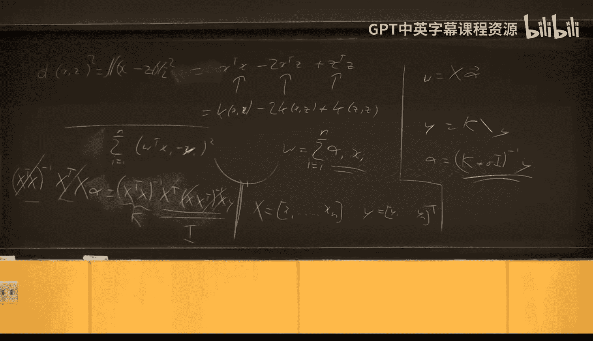

After spring break。It's a tie。All right， let's do that spring break。哎。

