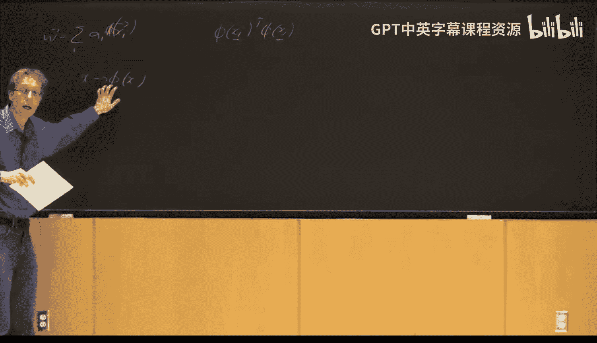
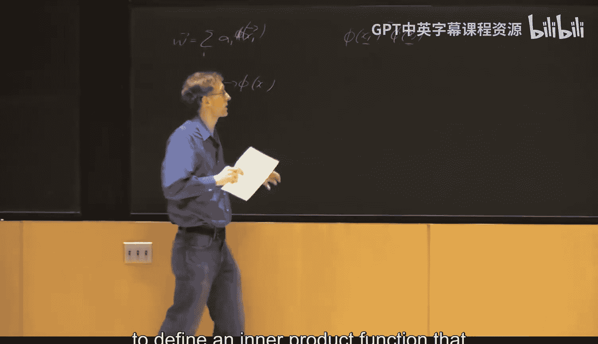
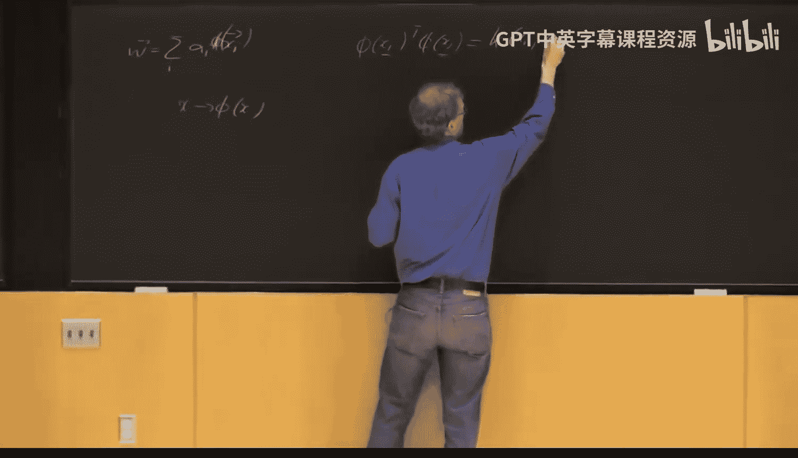
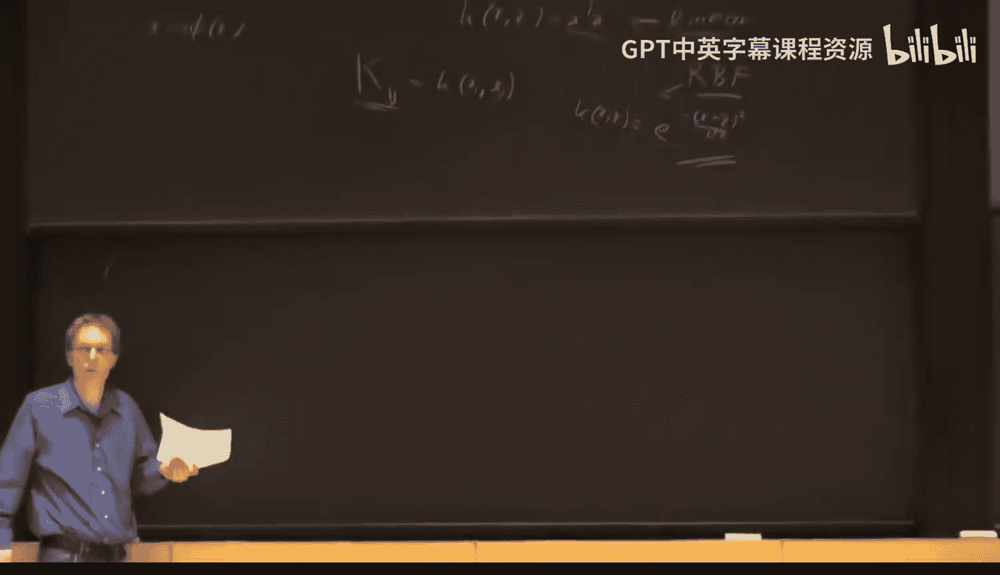
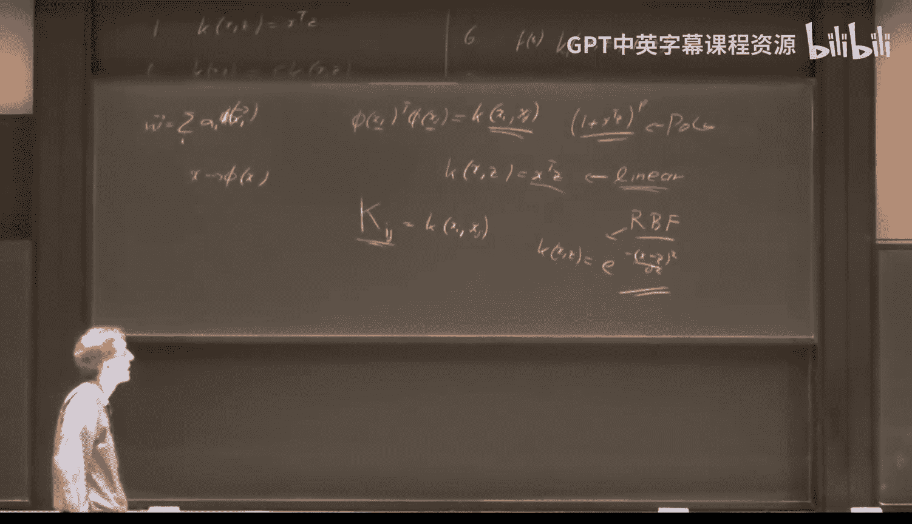
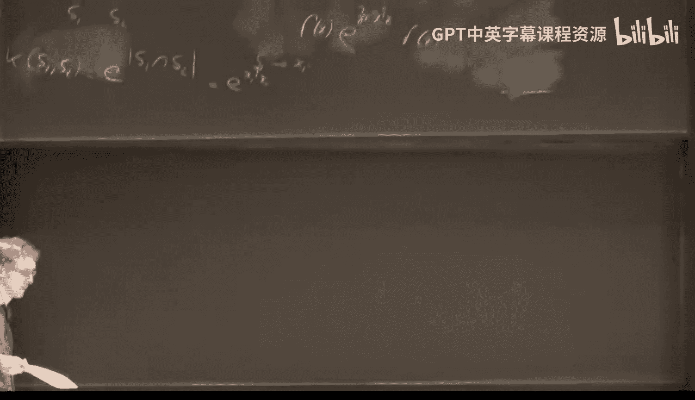
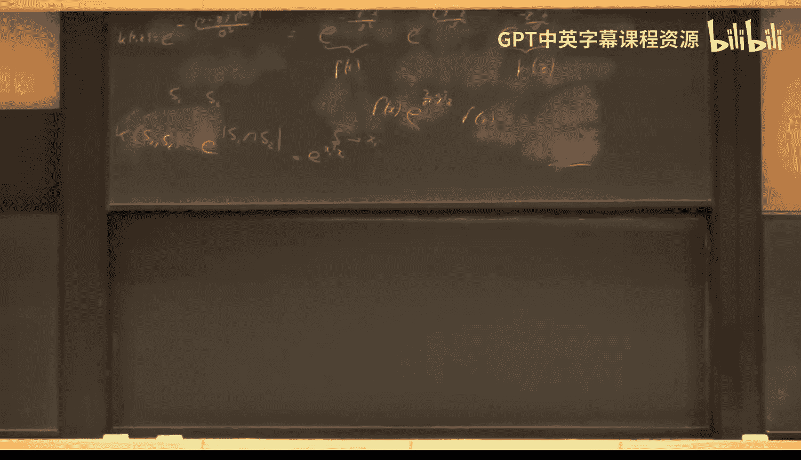
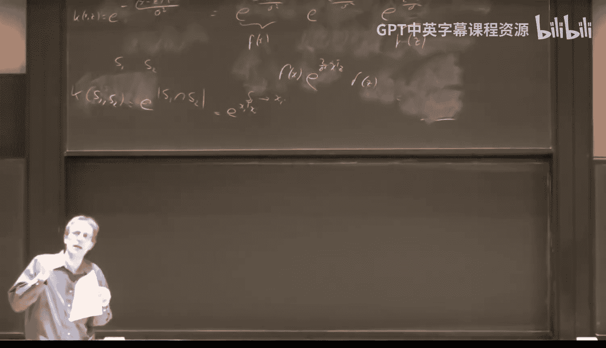
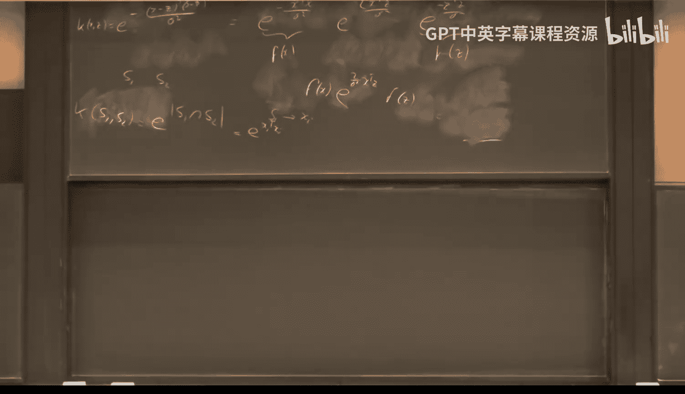
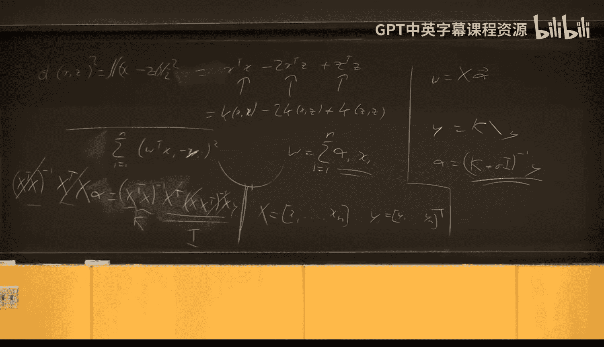

# 机器学习：023：核方法进阶

在本节课中，我们将继续深入学习核方法。上一节我们介绍了核方法的基本思想，即通过核函数将数据隐式映射到高维空间，从而让线性分类器能够学习复杂的非线性决策边界。本节中，我们将探讨如何构造新的核函数，以及如何将现有的机器学习算法“核化”。

## 核函数构造规则

上一节我们介绍了线性核、RBF核和多项式核。但核函数远不止这些。如果你能根据特定数据构造合适的核函数，就能在不显式计算高维特征向量的情况下，高效地进行学习。以下是构造核函数的一些基本规则。

以下是八条核心的核函数构造规则：

1.  **线性核是核函数**：最基本的核函数是线性核 `K(x, z) = x^T z`。这直接对应原始特征空间的内积。
2.  **常数缩放**：如果 `K1(x, z)` 是一个核函数，`c` 是一个非负常数，那么 `c * K1(x, z)` 也是一个核函数。
3.  **加法封闭性**：如果 `K1(x, z)` 和 `K2(x, z)` 都是核函数，那么 `K1(x, z) + K2(x, z)` 也是一个核函数。
4.  **多项式变换**：如果 `K1(x, z)` 是一个核函数，`g(·)` 是一个具有非负系数的多项式函数，那么 `g(K1(x, z))` 也是一个核函数。
5.  **乘法封闭性**：如果 `K1(x, z)` 和 `K2(x, z)` 都是核函数，那么 `K1(x, z) * K2(x, z)` 也是一个核函数。
6.  **函数变换**：如果 `K1(x, z)` 是一个核函数，`f(·)` 是任意一个从输入空间到实数的函数，那么 `f(x) * K1(x, z) * f(z)` 也是一个核函数。
7.  **指数变换**：如果 `K1(x, z)` 是一个核函数，那么 `exp(K1(x, z))` 也是一个核函数。
8.  **矩阵变换**：如果 `A` 是一个半正定矩阵，那么 `K(x, z) = x^T A z` 也是一个核函数。当 `A` 是单位矩阵时，就回到了线性核。

利用这些规则，我们可以从简单的核（如线性核）出发，组合出复杂的新核。

## 实例：证明RBF核是有效核函数

让我们运用上述规则来证明径向基函数（RBF）核是一个有效的核函数。RBF核的定义为：
`K(x, z) = exp(-||x - z||^2 / (2σ^2))`

证明步骤如下：
1.  从线性核开始：`K1(x, z) = x^T z` （规则1）。
2.  进行缩放：`K2(x, z) = (1/(σ^2)) * (x^T z)` （规则2）。
3.  利用恒等式 `||x - z||^2 = x^T x - 2x^T z + z^T z`，我们可以将RBF核的指数部分重写为：`exp(-(x^T x)/(2σ^2) + (x^T z)/(σ^2) - (z^T z)/(2σ^2))`。
4.  这可以看作是 `exp(K2(x, z))` 乘以两个函数项。具体地，令 `f(x) = exp(-(x^T x)/(2σ^2))`，那么 `K(x, z) = f(x) * exp((x^T z)/(σ^2)) * f(z)`。
5.  根据规则7，`exp((x^T z)/(σ^2))` 是核函数（因为它是 `exp(K2(x, z))`）。
6.  根据规则6，用函数 `f(x)` 和 `f(z)` 分别乘以前后，结果 `f(x) * exp((x^T z)/(σ^2)) * f(z)` 仍然是核函数。
7.  这个表达式正好等于 `exp(-||x - z||^2 / (2σ^2))`，因此RBF核是有效的。

## 实例：集合核

核函数不仅限于数值向量。假设我们的数据是集合（例如，文本中的词袋模型）。我们可以定义一个集合核：
`K(S1, S2) = exp(|S1 ∩ S2|)`
其中 `|S1 ∩ S2|` 是两个集合交集中元素的数量。

如何证明这是一个有效的核？我们可以将每个集合 `S` 表示为一个很长的二进制向量 `φ(S)`。向量的每个维度对应全集中的一个可能元素。如果该元素在集合 `S` 中，则对应位置为1，否则为0。这样，两个集合的交集大小就等于它们对应向量 `φ(S1)` 和 `φ(S2)` 的内积：`|S1 ∩ S2| = φ(S1)^T φ(S2)`。
于是，集合核 `K(S1, S2) = exp(φ(S1)^T φ(S2))`。根据规则1（线性核是核）和规则7（指数变换保持核性质），可知该集合核是有效的。尽管 `φ(S)` 可能维度极高甚至无限，但核技巧允许我们仅通过计算交集大小来高效地使用这个核。

## 算法的核化

将一个算法“核化”意味着将其改写，使其所有数据访问都仅通过内积进行，然后用核函数替换这些内积。这是一个两步过程：
1.  重写算法，确保所有数据操作都表示为数据点之间的内积形式。
2.  将内积 `x_i^T x_j` 替换为核函数 `K(x_i, x_j)`。

### 核化最近邻算法

让我们尝试核化最近邻算法。标准最近邻使用欧氏距离寻找最近点：
`distance(x, z) = ||x - z||`
由于平方操作不改变距离排序，我们可以使用平方欧氏距离：
`distance_sq(x, z) = ||x - z||^2 = x^T x - 2 x^T z + z^T z`
这个表达式完全由内积 `x^T x`， `x^T z` 和 `z^T z` 组成。因此，我们可以直接进行核替换：
`distance_sq_kernel(x, z) = K(x, x) - 2K(x, z) + K(z, z)`
现在，我们可以使用任何有效的核函数 `K` 来计算“距离”，并找到核空间中的最近邻。这就是核化最近邻算法。不过需要注意的是，最近邻算法本身已经是非线性的，核化对其性能提升可能不如对线性分类器那样显著。

### 核化岭回归

岭回归（带L2正则的线性回归）的闭式解为：
`w = (X^T X + λI)^{-1} X^T y`
我们希望将权重 `w` 表示为训练样本的线性组合：`w = X α`。将其代入上式：
`X α = (X^T X + λI)^{-1} X^T y`
为了解出 `α`，我们在等式两边左乘 `X^T`，并利用一些矩阵恒等式进行推导（详细过程见课堂板书），最终可以得到：
`α = (K + λI)^{-1} y`
其中 `K` 是核矩阵，其元素 `K_{ij} = K(x_i, x_j)`。这就是核化岭回归的解。在预测时，对于新点 `x_{new}`，预测值为：
`y_pred = Σ_{i=1}^{n} α_i K(x_i, x_{new})`
在代码中，这可以非常简洁地实现，例如在Python中，求解 `α` 的核心代码近乎一行：`alpha = np.linalg.inv(K + lambda * I) @ y`。

## 总结

本节课中我们一起深入探讨了核方法。我们首先学习了构造新核函数的八条基本规则，这些规则使我们能够像搭积木一样从简单核创建复杂核。接着，我们运用这些规则证明了RBF核和集合核的有效性。最后，我们掌握了将算法核化的通用方法，并将其应用于最近邻算法和岭回归，得到了对应的核化版本。核方法的强大之处在于，它允许我们在不显式处理高维甚至无限维特征空间的情况下，利用其表达能力和线性模型的优化便利性。