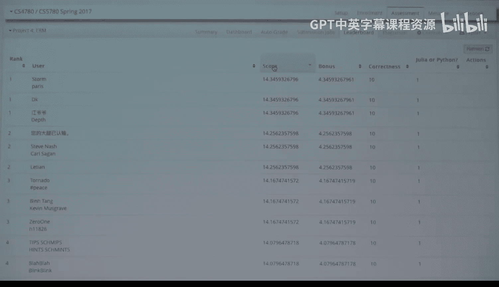
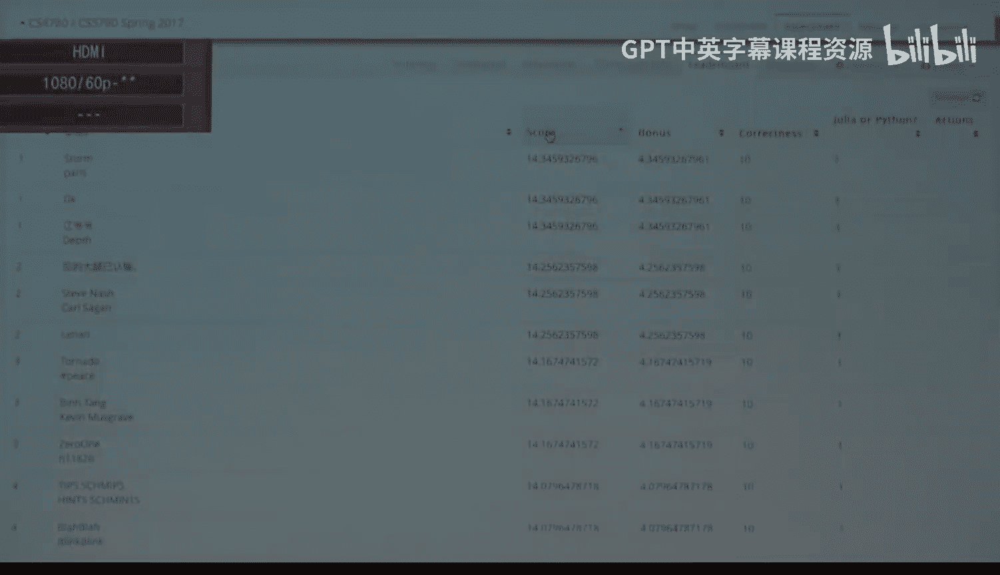
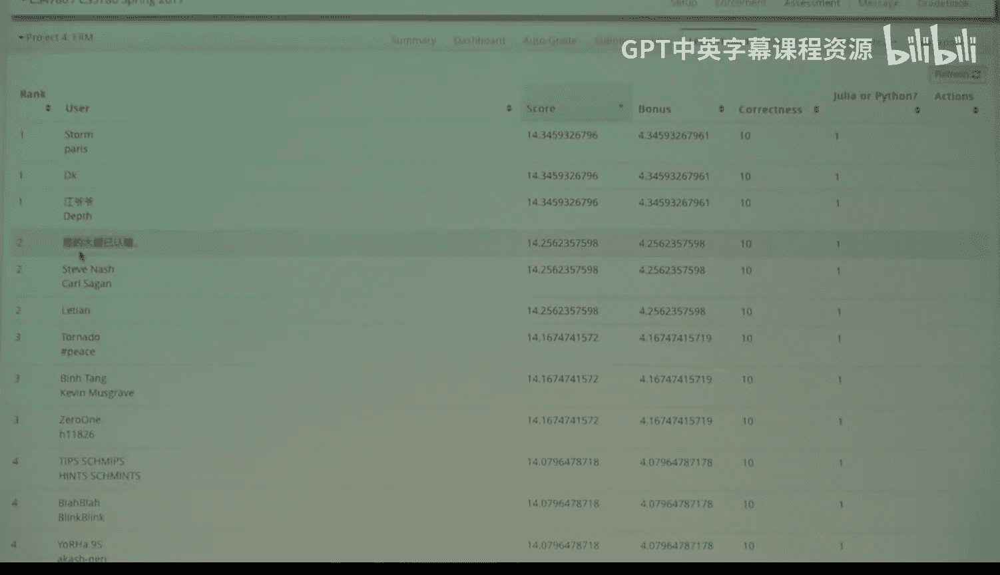
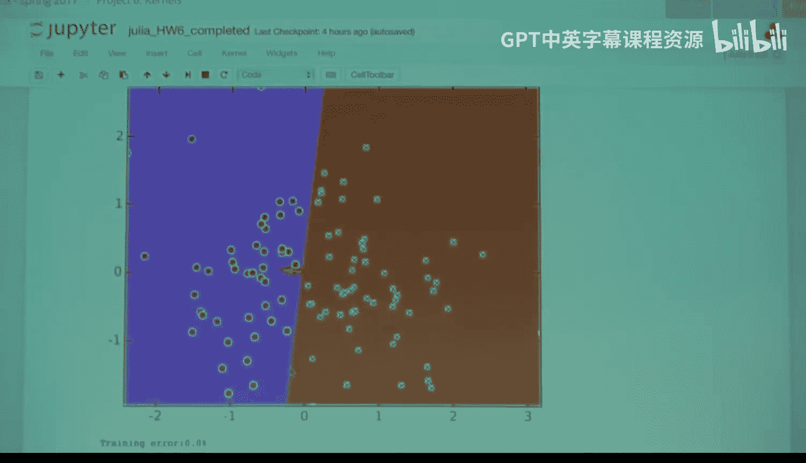
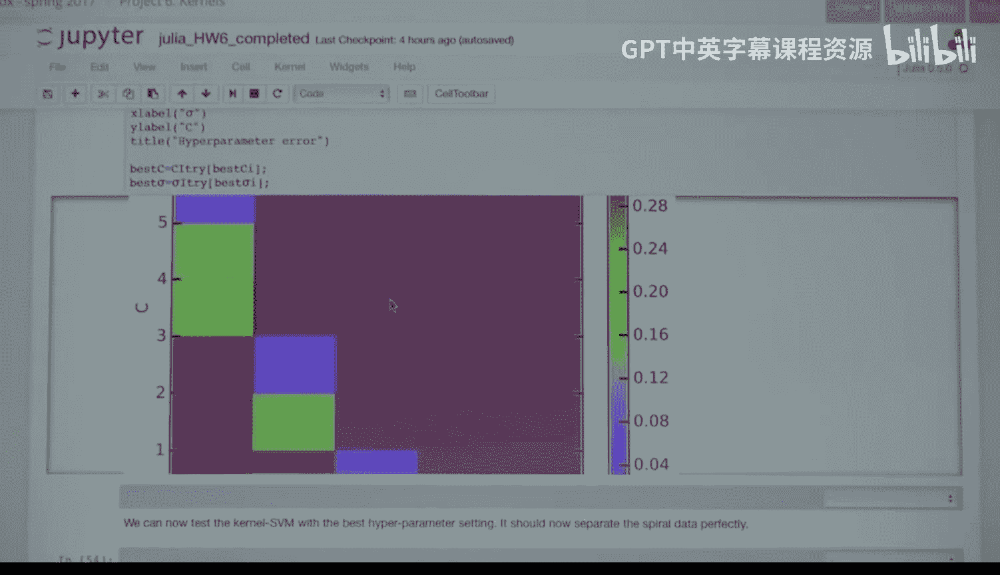

# 机器学习：024：核支持向量机

在本节课中，我们将要学习核支持向量机。我们将回顾核方法的基本概念，并深入探讨如何将支持向量机这一强大的线性分类器通过核技巧扩展到非线性领域。课程将从回顾核函数的定义和性质开始，然后详细讲解如何将线性回归核化，最后重点介绍支持向量机的核化过程及其对偶形式。

## 课程反馈与项目回顾

上一节我们介绍了核函数的基本规则。在本节开始前，我们先回顾一下课程反馈和之前的项目。

根据课程调查，大部分反馈是积极的。关于在线平台的问题已反馈给相关团队并得到改进。多数学生认为课程工作量适中，并希望涵盖深度学习内容，这部分内容后续会安排。

关于垃圾邮件分类项目，领先团队分享了他们的方法。

以下是提高分类性能的几种有效技术：

*   **停用词移除**：移除如“the”、“a”等常见但对分类无意义的词汇。
*   **二元语法**：不仅考虑单个词，还考虑连续的两个词作为特征。
*   **向量归一化**：将特征向量除以文档总词数，使特征与文档长度无关，这对于新闻分类等任务尤其有用。
*   **自定义特征加权**：为某些对区分垃圾邮件特别有效的词汇或符号分配更高的权重。

这些方法也是实际垃圾邮件过滤器中的常用技术。此外，垃圾邮件发送者常使用模板生成看似不同的邮件，因此使用**跳跃语法**（允许两个关键词之间存在任意间隔词）来捕捉这种模式也很有效。

## 核方法回顾

在春假之前，我们讨论了核方法。我们主要探讨了两个主题：如何定义有效的核矩阵，以及如何对一个算法进行核化。

### 核函数的作用

核化源于我们对线性分类器的偏爱。线性分类器的形式为：

`h(x) = w^T x + b`

这类分类器算法高效，但偏差很高，只能学习线性决策边界。根据偏差-方差权衡，如果数据本身不是线性可分的，即使有无限数据，线性分类器也无法正确分类。

为了降低偏差，一个方法是将数据 **x** 映射到一个高维特征空间 **φ(x)**。在高维空间中，数据更可能变得线性可分。但问题是，**w** 的维度也变得极高。

我们发现，许多算法实际上只通过内积形式访问数据。因此，如果我们能巧妙地选择映射 **φ(x)**，就可以定义一个**核函数** **K(x, z)**，它能够高效地计算高维空间中的内积：

`K(x, z) = φ(x)^T φ(z)`

例如，多项式核可以映射到指数级的高维空间，但计算依然很快。径向基函数核则对应于一个无限维的映射。

### 有效核函数的条件

并非任意函数都能作为核函数。一个函数 **K** 是有效核函数的充要条件是：对于任意一组向量，由其构成的**核矩阵** **K**（其中 `K_ij = K(x_i, x_j)`）必须是**半正定**的。

我们介绍了一些规则，可以从简单的核函数（如线性核 `K(x, z) = x^T z`）出发，通过一系列操作（如相加、相乘、指数运算）构造出新的、有效的核函数。例如，我们可以从线性核出发，通过应用这些规则证明指数核是有效的。

### 算法的核化步骤

一旦有了核函数，对算法进行核化通常包含两个步骤：
1.  证明算法在训练和测试阶段都只通过内积形式访问数据。
2.  将这些内积替换为核函数 **K(x, z)**。

## 核化线性回归

上一讲我们以线性回归为例演示了核化过程。让我们快速回顾一下。

线性回归最小化以下损失函数：

`L(w) = Σ_i (w^T x_i - y_i)^2`

可以写成矩阵形式：`min_w || X^T w - y ||^2`。

为了核化，我们利用最优解 **w** 可以表示为训练数据的线性组合这一性质：`w = X α`。将其代入损失函数，得到：

`L(α) = || X^T X α - y ||^2`

其中 `X^T X` 就是**核矩阵** **K**，因为 `(X^T X)_ij = x_i^T x_j = K(x_i, x_j)`。因此问题转化为：

`min_α || K α - y ||^2`

这是一个关于 **α** 的优化问题。通过求导并设为零，我们可以得到闭式解：

`α = K^{-1} y`

### 测试阶段的应用

在测试时，对于新点 **z**，预测值为：

`h(z) = w^T φ(z) = (X α)^T φ(z) = α^T (X^T φ(z)) = Σ_i α_i K(x_i, z)`

这里，`K(x_i, z)` 构成了一个核向量 **k_***。因此，核化回归的最终分类器是一个基于 **α** 和核函数的线性组合。

### 参数化 vs. 非参数化

核回归是参数化还是非参数化算法？这取决于视角。从学习高维权重 **w** 的角度看，它是参数化的（参数数量由特征空间维度决定）。但从学习系数 **α** 的角度看，参数数量随训练数据量 **n** 增长，因此它是非参数化的。通常，当使用像RBF核这样的无限维核时，我们将其视为非参数化算法。

## 核支持向量机

现在，我们来看最著名的核化算法——支持向量机。正是SVM的成功推动了核方法长达十年的研究热潮。

### SVM的对偶形式

线性SVM的原始优化问题是：

`min_{w,b} (1/2) ||w||^2 + C Σ_i ξ_i`
`s.t. y_i (w^T x_i + b) ≥ 1 - ξ_i, ξ_i ≥ 0`

这是一个凸二次规划问题。在优化理论中，每个凸优化问题都有一个对应的**对偶问题**。推导SVM的对偶问题后，我们得到以下形式：

`max_α Σ_i α_i - (1/2) Σ_{i,j} α_i α_j y_i y_j K(x_i, x_j)`
`s.t. 0 ≤ α_i ≤ C, Σ_i α_i y_i = 0`

这个形式的美妙之处在于，数据点仅以内积 `x_i^T x_j` 的形式出现。这直接启发了核技巧：我们可以将内积替换为核函数 `K(x_i, x_j)`，从而在隐式的高维空间中求解SVM。

求解对偶问题后，最优权重 **w** 可以表示为：

`w = Σ_i α_i y_i x_i`

最终的决策函数为：

`h(z) = sign( Σ_i α_i y_i K(x_i, z) + b )`

其中偏置 **b** 可以通过支持向量（即 `α_i > 0` 对应的点）所满足的边界条件 `y_i (w^T x_i + b) = 1` 求解得出。

在对偶问题中，大部分 `α_i` 为0，只有少数位于分类边界附近的数据点对应的 `α_i` 非零，这些点就是**支持向量**，这也是算法名称的由来。

## 课程项目预告

接下来的项目将要求你们实现SVM的原始问题和对偶问题。

1.  **实现原始问题**：将线性SVM的原始形式表述为二次规划问题，并用求解器求解。在线性可分数据上测试。
2.  **处理非线性数据**：当数据非线性可分时，原始线性SVM会失败。
3.  **实现核化对偶问题**：我们将提供对偶形式。你需要使用核矩阵（如RBF核）来定义目标函数和约束，并再次用二次规划求解器求解。使用线性核在可分数据上调试，确保结果与原始问题一致。
4.  **应用与调优**：在复杂的非线性数据（如螺旋数据）上应用核SVM。最后，通过交叉验证网格搜索来优化SVM的超参数（如正则化参数 **C** 和核参数 **γ**），找到使误差最小的配置。

## 总结

本节课我们一起学习了核支持向量机。我们首先回顾了核方法的原理和算法核化的步骤，并通过线性回归的例子加深理解。然后，我们重点探讨了支持向量机如何通过对偶形式自然地引入核函数，从而能够高效地处理非线性分类问题。核SVM的稀疏性（仅依赖支持向量）是其一大优势。最后，我们预告了相关的实践项目，这将帮助大家巩固对核SVM实现和调优的理解。