# 机器学习：025：核化算法与高斯过程入门

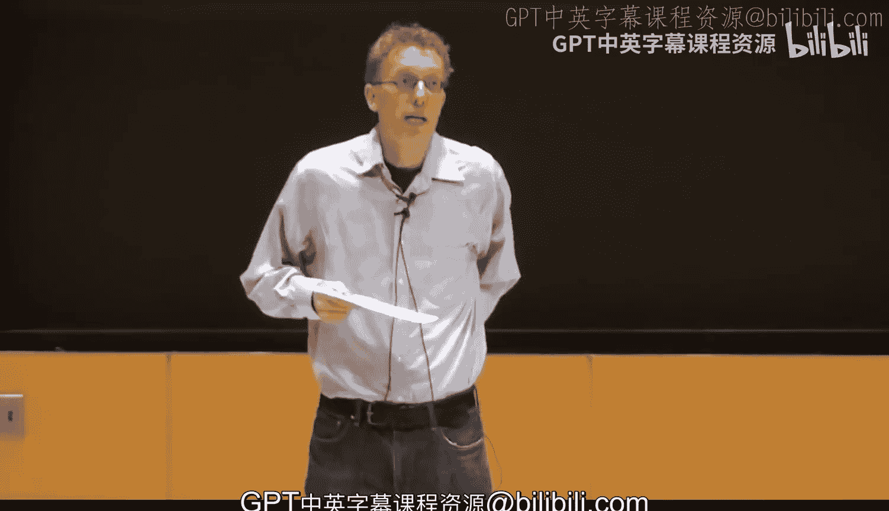

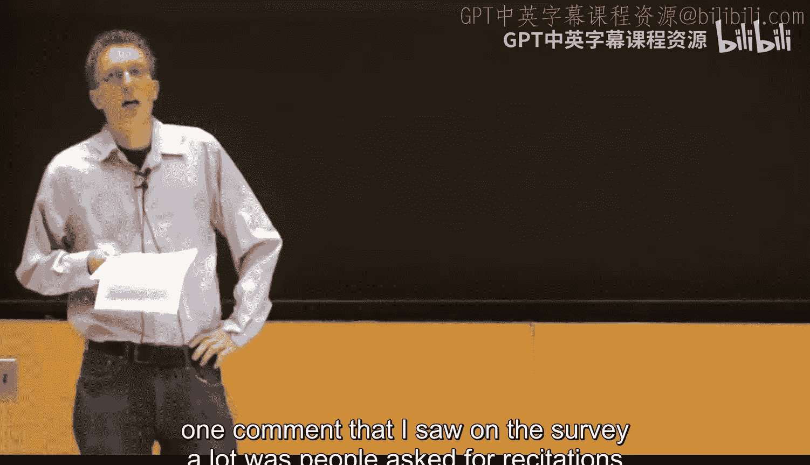

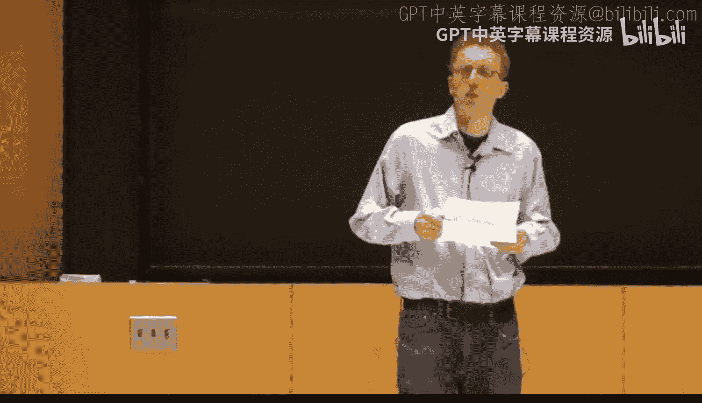

在本节课中，我们将学习核化算法的核心思想，特别是支持向量机（SVM）与最近邻算法的联系，并初步介绍高斯过程的基本概念及其与高斯分布的紧密关系。

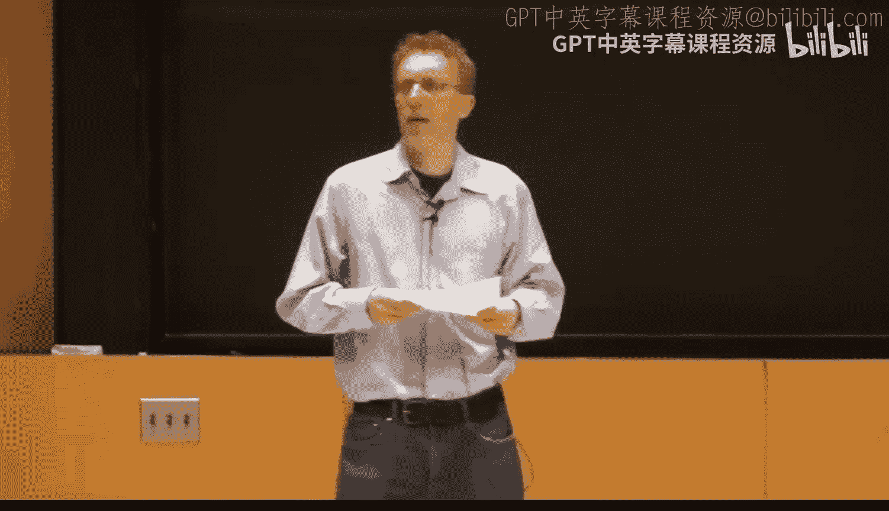

---

## 课程安排与竞赛通知

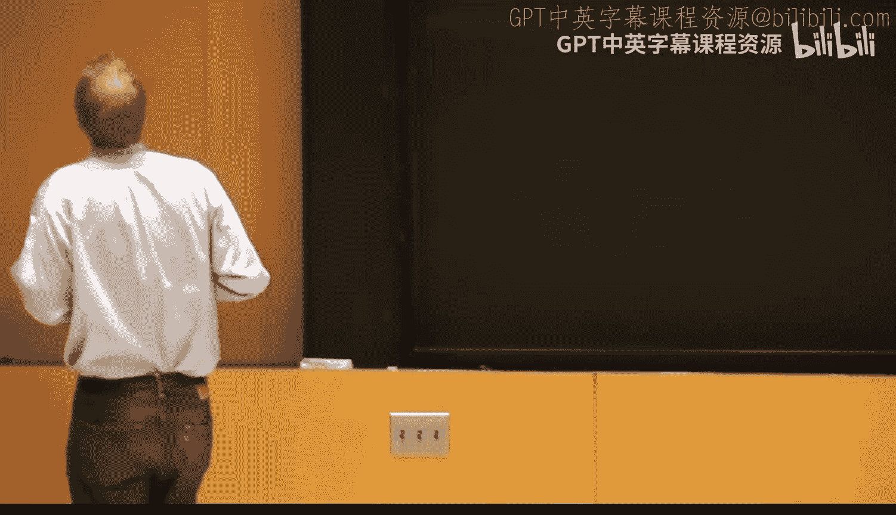

在上一节中，我们深入探讨了核方法。本节我们将继续这一主题，并引入高斯过程。

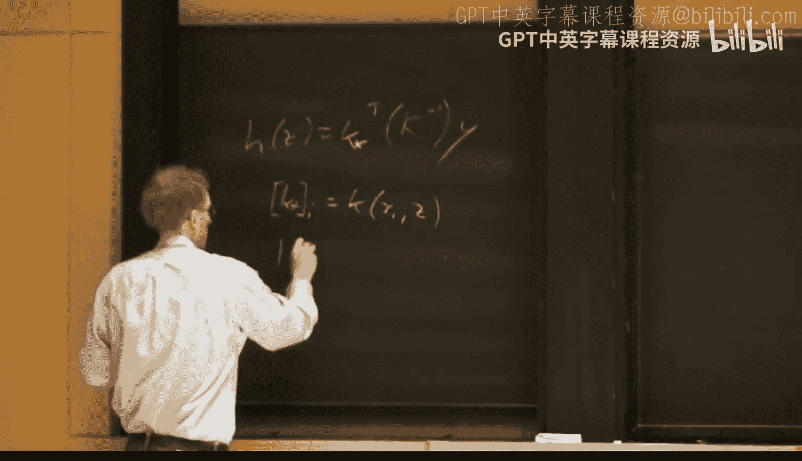

首先，有两项课程安排通知。

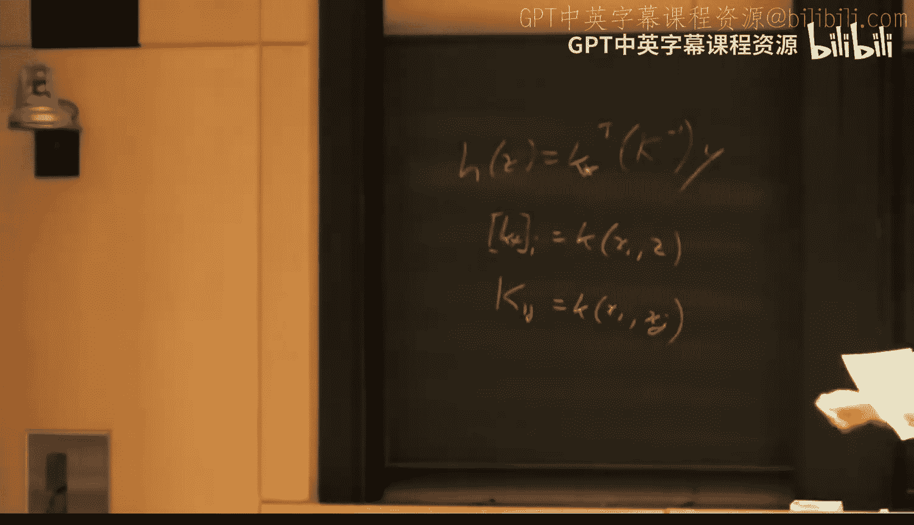

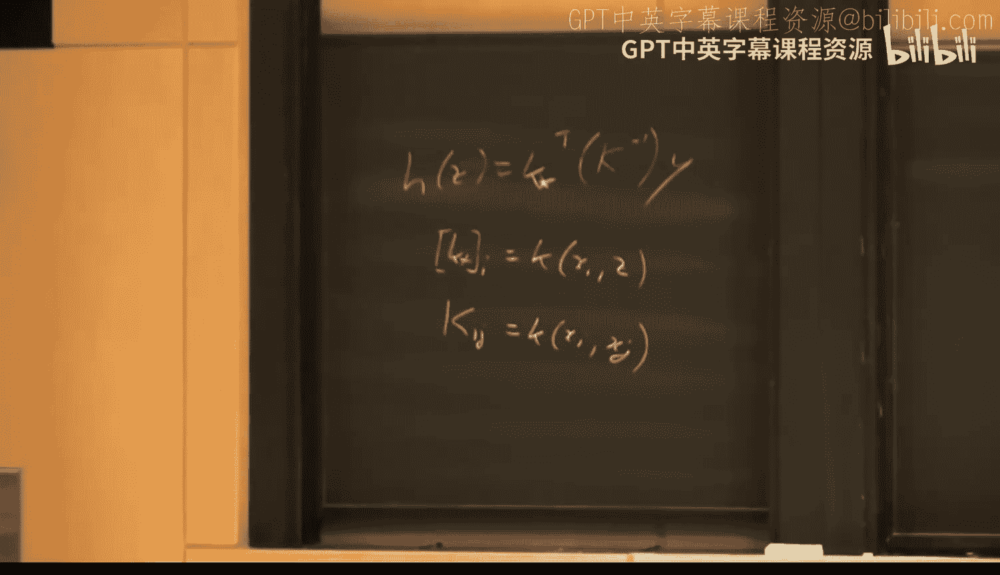

以下是具体安排：

*   我们将安排助教开展复习课，计划每周或每两周一次。首次复习课将讲解核方法，后续课程涵盖高斯过程、提升方法和深度学习。
*   我们将举办一次机器学习竞赛。我会提供一个带标签的训练数据集，你们需要提交对无标签测试集的预测结果。此次竞赛可作为额外加分机会，模拟真实场景下的机器学习应用。竞赛预计在本周末或下周初发布，截止日期可能在课程最后一天。任务类型暂未确定，但很可能是分类问题。

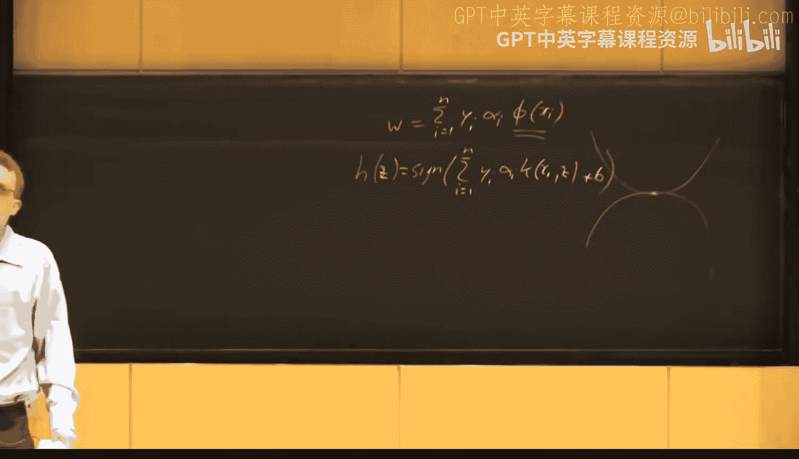

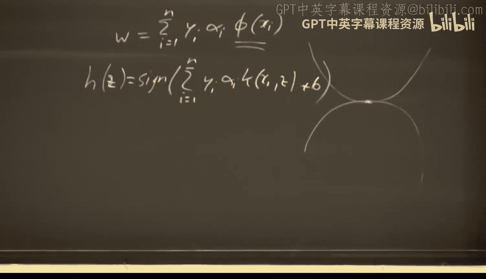

---

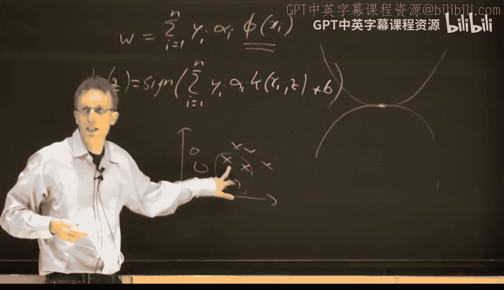

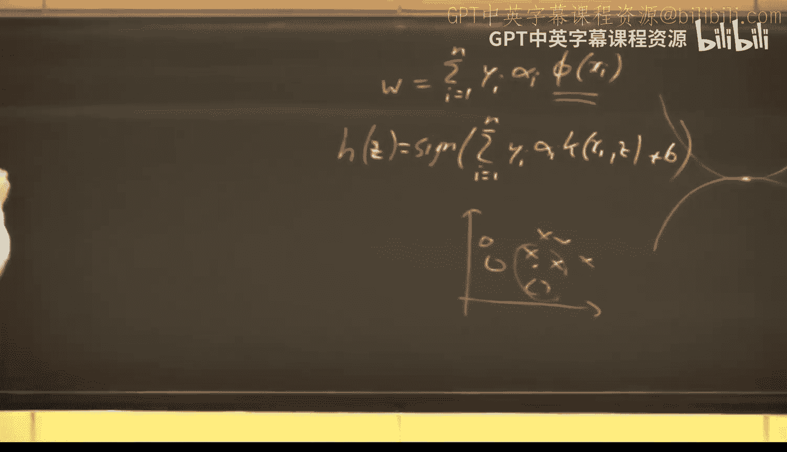

## 核化算法回顾

上一节我们介绍了核方法。我们首先讨论了核回归。

核回归的预测公式为：

\[
h(z) = \mathbf{k}_*^T (K + \lambda I)^{-1} \mathbf{y}
\]

其中，\(\mathbf{k}_*\) 是测试点 \(z\) 与所有训练点 \(x_i\) 的核向量，\(K\) 是训练点之间的核矩阵，其元素为 \(K_{ij} = k(x_i, x_j)\)。

接着，我们讨论了核支持向量机（SVM）。核SVM通过利用优化理论中的对偶问题实现核化。

对于一个凸最小化问题，必然存在一个对偶最大化问题，两者在解处等价。对偶问题仅通过数据点的内积访问数据。因此，求解对偶问题后，只需将内积矩阵替换为核矩阵即可实现核化，这是一种非常优雅的方法。

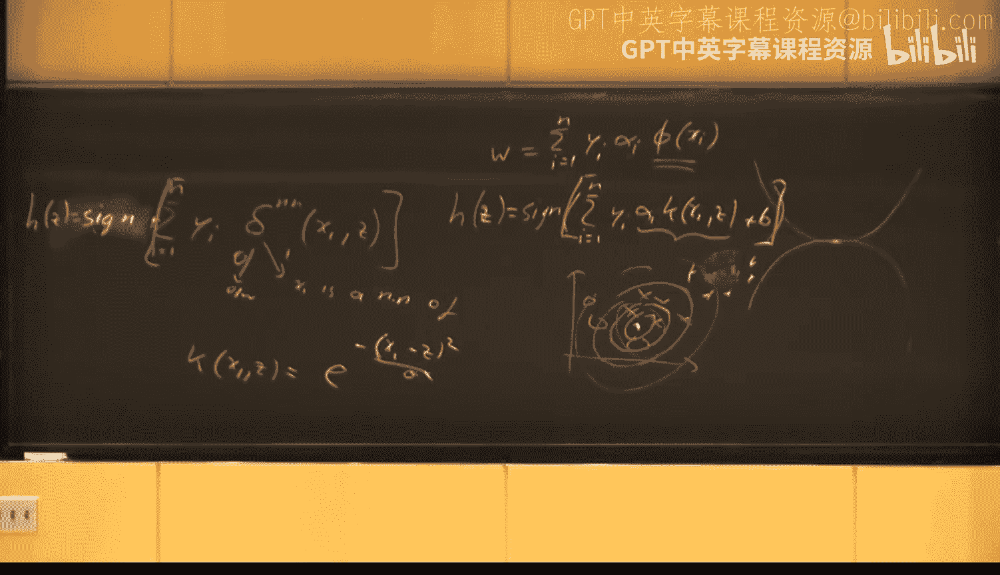

对偶SVM的权重向量最终形式为：

\[
\mathbf{w} = \sum_i \alpha_i y_i \phi(\mathbf{x}_i)
\]

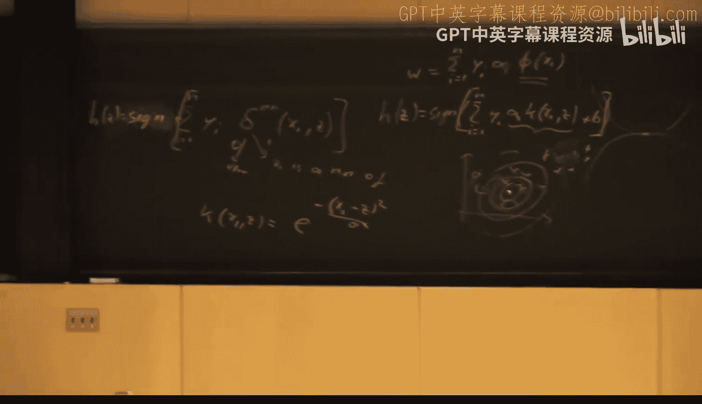

其中 \(\phi\) 是将数据映射到高维空间的函数，我们无需显式计算。对于任意测试点 \(z\) 的分类决策函数为：

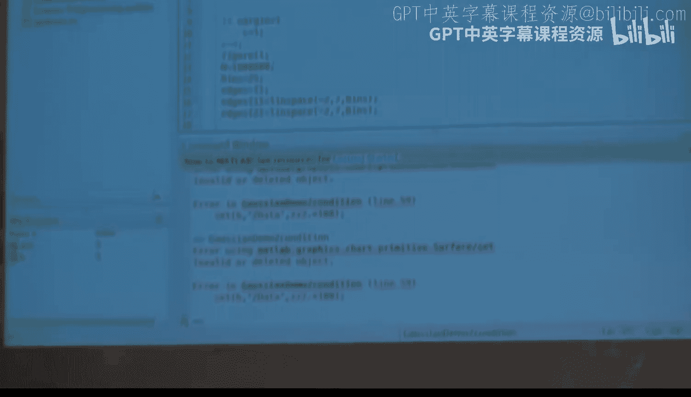

\[
h(z) = \text{sign}\left( \sum_i \alpha_i y_i k(\mathbf{x}_i, \mathbf{z}) + b \right)
\]

---

## 核SVM与最近邻算法的联系

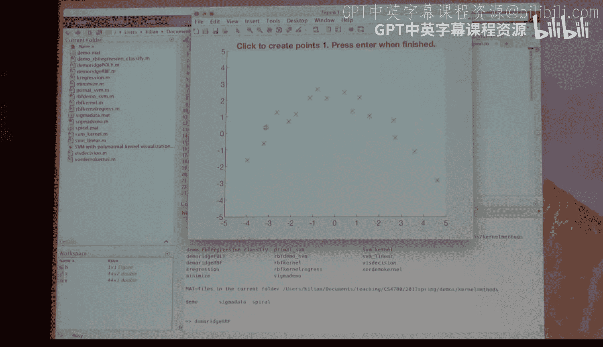

现在，让我们仔细审视核SVM的决策函数。本课程开始时，我们介绍了最简单的机器学习算法——k最近邻算法。

k最近邻算法的决策函数可以写成：

\[
h(\mathbf{z}) = \text{sign}\left( \sum_i y_i \cdot \delta(\mathbf{x}_i \text{ 是 } \mathbf{z} \text{ 的最近邻}) \right)
\]

其中 \(\delta\) 是指示函数，当 \(x_i\) 是 \(z\) 的k个最近邻之一时取值为1，否则为0。

将此公式与核SVM的决策函数 \(h(z) = \text{sign}\left( \sum_i \alpha_i y_i k(\mathbf{x}_i, \mathbf{z}) + b \right)\) 进行比较，会发现它们非常相似。

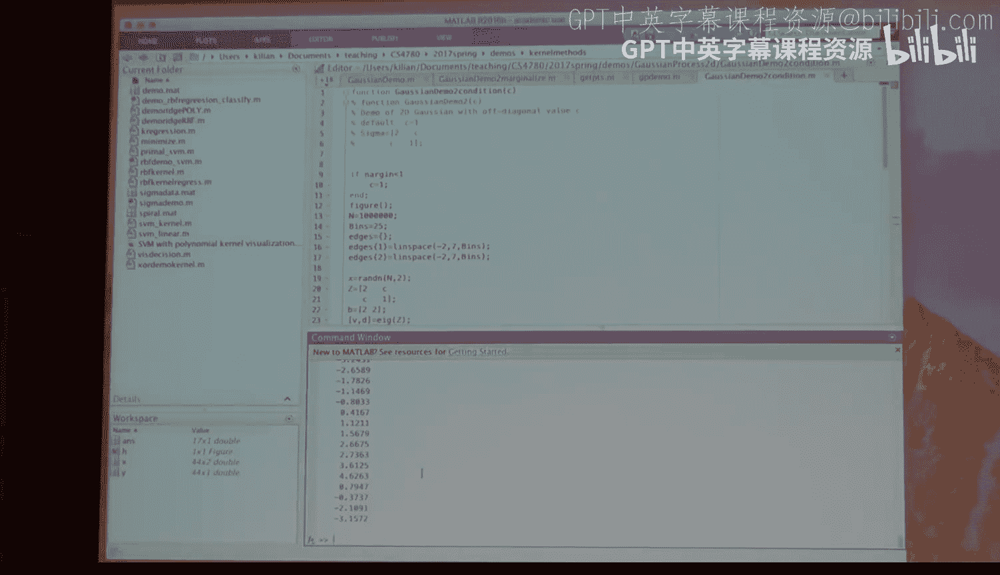

以高斯（RBF）核为例：\(k(\mathbf{x}_i, \mathbf{z}) = \exp(-\|\mathbf{x}_i - \mathbf{z}\|^2 / \sigma^2)\)。当测试点 \(z\) 与某个训练点 \(x_i\) 距离很远时，核函数值趋近于0；距离很近时，核函数值较大。这与最近邻算法中只考虑邻近点的思想一致，但核SVM使用的是软阈值（通过高斯衰减），而非最近邻的硬阈值截断。

系数 \(\alpha_i\) 的作用是什么？在对偶问题中，\(\alpha_i\) 总是非负的，且许多 \(\alpha_i\) 为0。这意味着SVM会为数据点分配权重，并直接移除那些 \(\alpha_i=0\) 的点（即非支持向量），因为它们不影响分类决策。

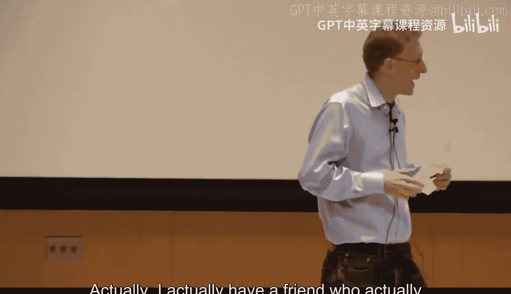

因此，核SVM（特别是使用RBF核时）可以看作是一种智能化的最近邻算法，它主要做两件事：
1.  通过设置 \(\alpha_i=0\) 来精简训练数据集，移除对决策边界没有贡献的“明显”样本。
2.  对测试点进行预测时，根据高斯核函数对邻近点进行软加权平均，在数据密集区域考虑更多邻居，在稀疏区域考虑更少邻居。

---

## 引入高斯过程

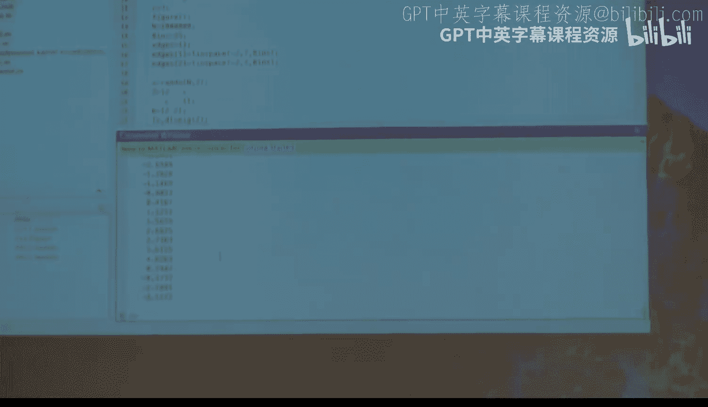

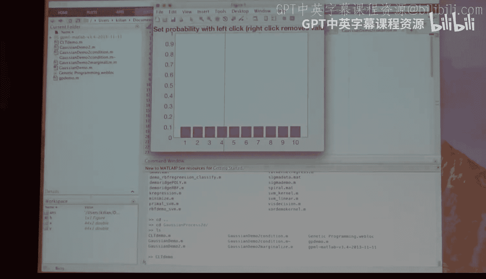

我们尚未结束对核算法的讨论。接下来要介绍的算法是高斯过程。

在我看来，高斯过程是回归任务中与SVM（分类任务中的强者）地位相当的算法。SVM在分类上表现优异，但在回归上有些笨拙；反之，高斯过程非常擅长回归，但其分类版本则不那么好用。它们的能力是互补的。

要理解高斯过程，我们需要先思考高斯分布。

---

## 高斯分布的重要性

高斯分布是一种非常美妙的分布。高斯过程之所以强大，正是因为它建立在高斯分布的基础上，而高斯分布具有许多优良特性。

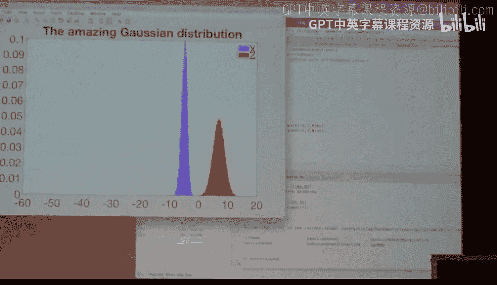

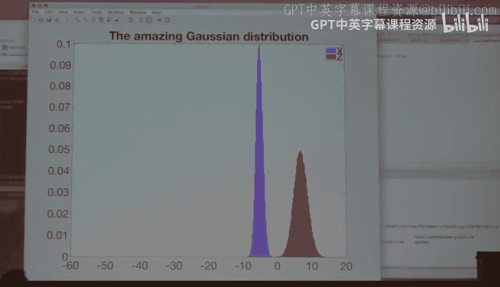

首先，自然界中许多事物都近似服从高斯分布，例如人的身高（在区分性别后）或智商（理论上）。这是因为中心极限定理。

中心极限定理指出：如果一个分布具有有限方差，那么从该分布中多次采样并计算平均值，这些平均值的分布将趋近于高斯分布。

这意味着，任何由大量独立因素平均作用形成的随机变量，其分布往往接近高斯。例如，身高受基因、营养等多种因素共同影响。

高斯分布还是分布的“黑洞”：一旦涉及高斯分布，结果往往仍是高斯分布。以下是高斯分布对几种运算的封闭性：

以下是高斯分布保持封闭性的运算：

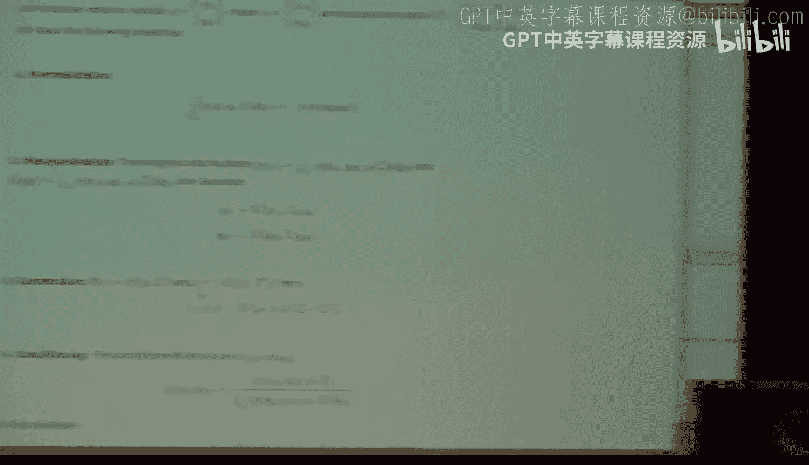

*   **求和**：两个高斯随机变量之和仍是高斯分布，新分布的均值是原均值之和，方差是原方差之和。
*   **边缘化**：从一个高维联合高斯分布中，对某些变量积分（即忽略它们），得到的边缘分布仍是高斯分布。
*   **条件化**：已知一个高维联合高斯分布中部分变量的值，则其余变量的条件分布仍是高斯分布。

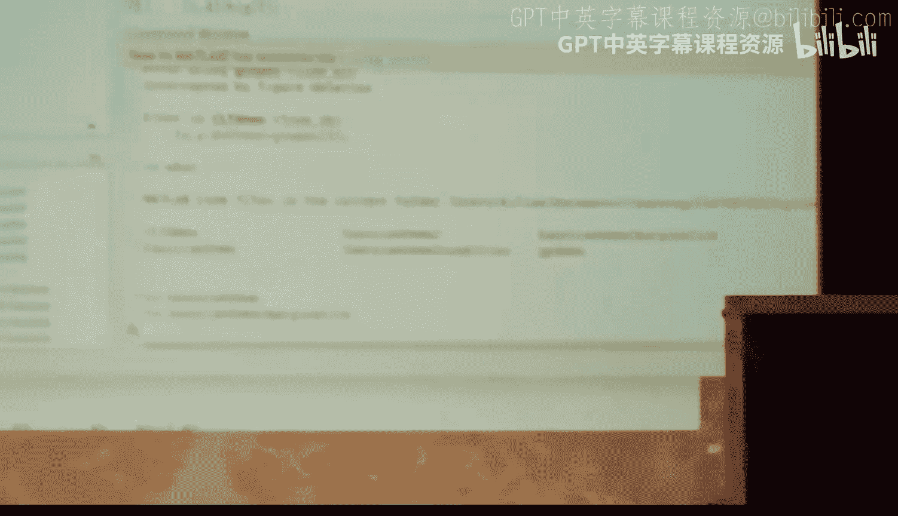

这些性质，尤其是条件化，将是高斯过程的核心。

---

## 高斯分布运算示例

考虑两个相关的随机变量，例如我房子的价格（\(x_2\)）和我邻居房子的价格（\(x_1\)）。它们可能服从一个联合高斯分布，两者正相关。

如果我对邻居房价这个变量进行**边缘化**（即不考虑邻居的具体售价，只关心我的房价），那么我的房价的分布仍然是一个高斯分布。

如果我对邻居房价进行**条件化**（即已知邻居房子以某个特定价格售出），那么我的房价的条件分布也是一个高斯分布，并且其均值会随着已知的邻居房价变化而变化。相关性越强，已知信息对我房价估计的影响就越大。

如果两个变量不相关（例如我的房价和比尔·盖茨的房价），那么已知比尔·盖茨的房价，我的房价的条件分布不会改变，均值保持不变。

这种相关性是通过协方差矩阵来编码的。对角元素表示各个变量自身的方差，非对角元素表示变量之间的协方差，决定了它们相互影响的程度。

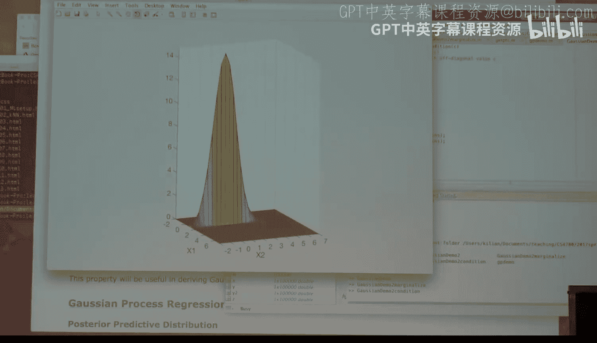

---

## 总结

本节课中，我们一起学习了：
1.  核SVM在本质上是一种软加权最近邻算法，它通过核函数实现软邻域选择，并通过支持向量精简数据集。
2.  引入了高斯过程作为强大的回归工具，并铺垫了其理论基础——高斯分布。
3.  回顾了高斯分布的中心极限定理成因及其关键性质：对求和、边缘化、条件化等运算保持封闭性。这些性质是理解高斯过程如何工作的基石。

下节课我们将正式深入高斯过程，看看如何利用这些性质构建一个强大的非参数回归模型。