# 026：康奈尔大学《智能系统的机器学习｜CS4780 Machine Learning for Intelligent Systems 2017》中英字幕 p26 -26-Machine Learning Lecture 26 ＂Gaussian Processes＂ -Cornell CS4780 SP17.zh_en -BV1Lo6gBxEKE_p26-

Hello， everybody。

Yeah。Oh my mymic， mymic's going。So。Okay， good。 Okay。

 So last time we talked about the we ended with the Gaussian distribution。

I told you a few properties of the Gaussian distribution。

 and the beautiful thing about the Gaussian distribution is A， it appears many times in the world。😊。

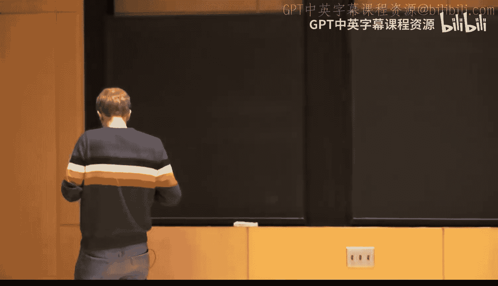

So using the Gaussian distribution is often a good assumption。

 and that's by the central limit theorem。😊，But there's other other great properties about the Gaussian process but the Gaussian distribution。

 The Gaussian distribution is the black hole of distributions。

 right So if you have once the Gausian distributed， you kind stay Gaussian distributed。

 taking a Gausian distribution and adding it up with another Gaussian distribution。😊。

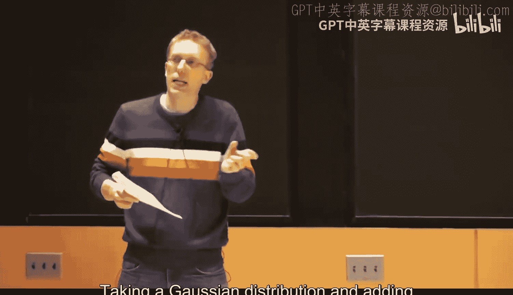

Gives you a Gausian distribution。 right， multiplying to Gausian distributions give you a Gaussian distribution。

 marginalnalizing gives you Gausian distribution。 Normalizing， of course。

 gives you a Gaussian distribution。And most importantly。

 conditioning gives you a Gaussian distribution you。😡。

P of A comm a B。And P off A， given B is Gaussian。P of A is Gaussian， which is the integral of P of。

And， of course， you know， P A plus B， et cetera。 all go。So， today。We will use this。

 right user is a superpower and keep it in the back of your mind。

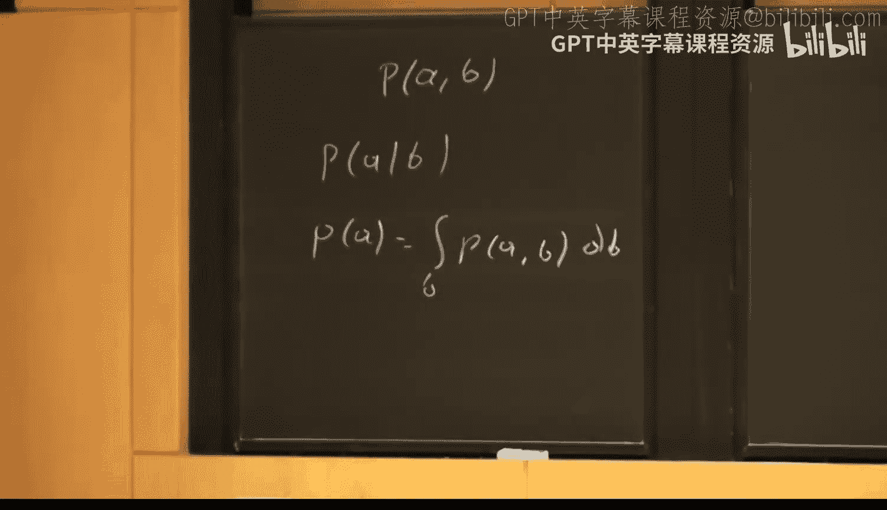

So what I want to do today is go back to linear regression。 So remember a while ago。

 we talked about linear regression。A linear question。We had the following model， right。

 It basically assumed we have data。

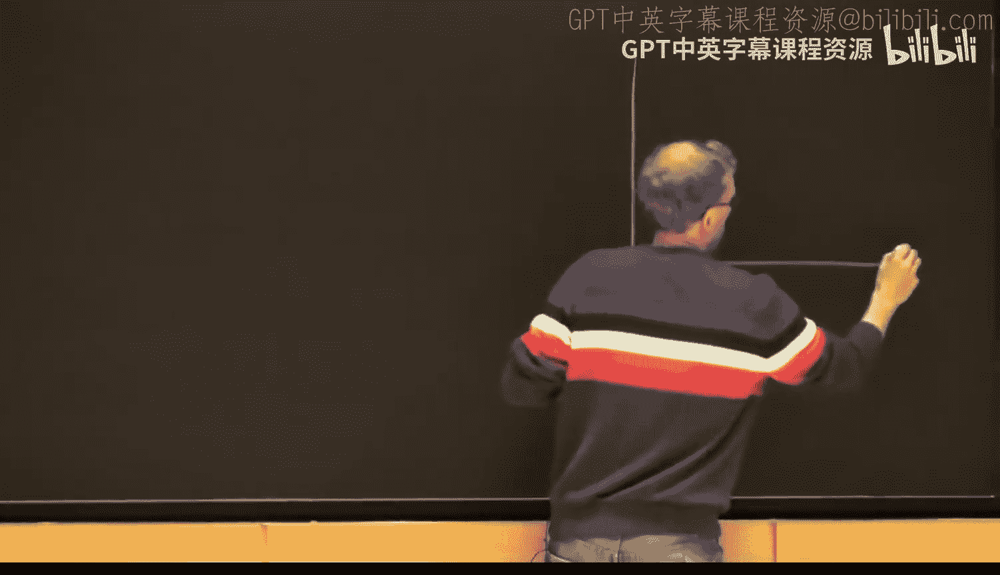

And so we made this assumption that the data we wanted to regression。 there's no classification。

 yet but we assume this data somewhat lies on a line。And。This line is parameterized with W。

 You have some function， W。F of x equals w transpose X。 That was the idea。 That's， that's the model。

And we're trying to find this W。Of course， the data is not going to lie exactly online online， right？

 So we assume there is some noise。 And this here is our Epsilon。 and Epsilon is Gaussian distributed。

So what does that mean， Well， this means that this actually is a Gaussian distribution。

With mean W transpose x and the noise is basically the variance is， you know， epson squared。 Oh。

 yeah。嗯。Okay， do people remember this？Raise the hand if you remember this。Awesome。Okay， good。

 and then we had two different approaches。To learning this parameter。ダビ。And so by the way。

 what I will talk about today， I already mentioned it last time is Gaussian process regression。

The way it's typically explained， right there's some very beautiful side of Gaussian process regression。

 And that's basically that it's a prior over infinite dimensional functions。😊。

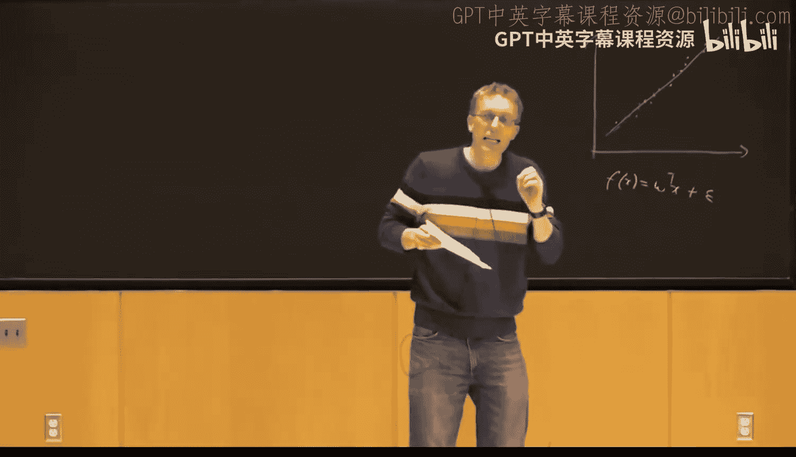

And it's so beautiful that anyone who describes it goes off for pages and pages about infinite dimensional functions and priors in that space。

 etc， which makes it really hard to understand。😊。

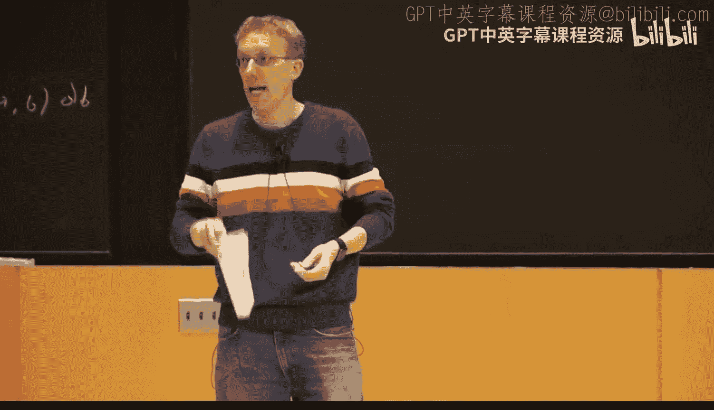

And so I'm trying to cut all that stuff out。I haven't found anywhere else an explanation of Gaussian processes where they don't they manage to resist。

 right the temptation to talk about how beautiful it is to have prior over infinite dimensional functions。

😊。

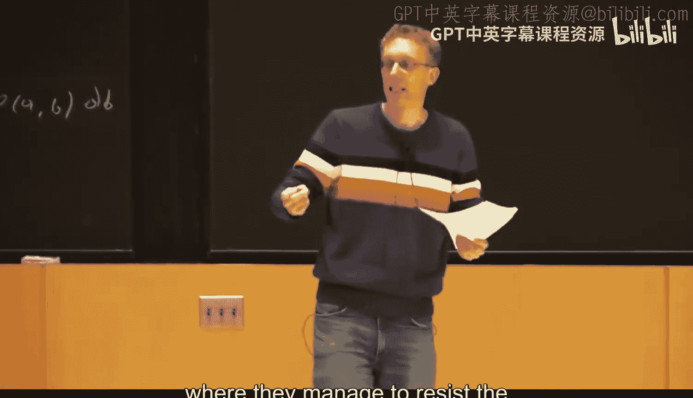

So make sure you， you pay good attention today because it's really， really hard。

 if you read the secondary reading， will always go into that direction just because， I mean。

 it is very beautiful， but it， it's hard if you haven't heard it for the if you haven't heard it before。

😊。

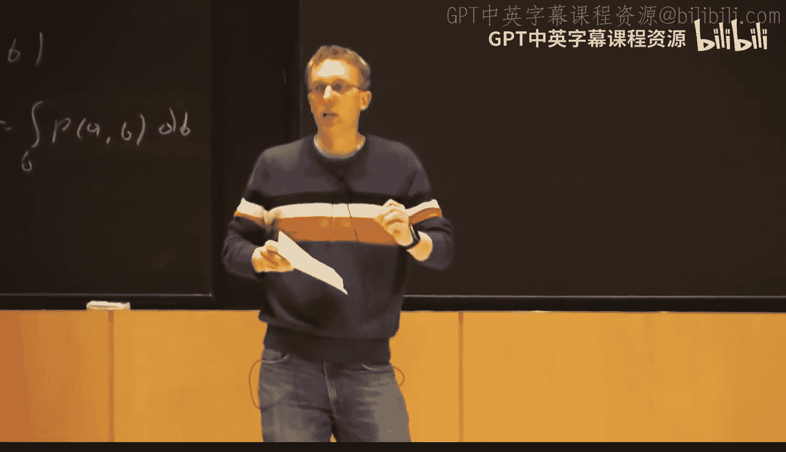

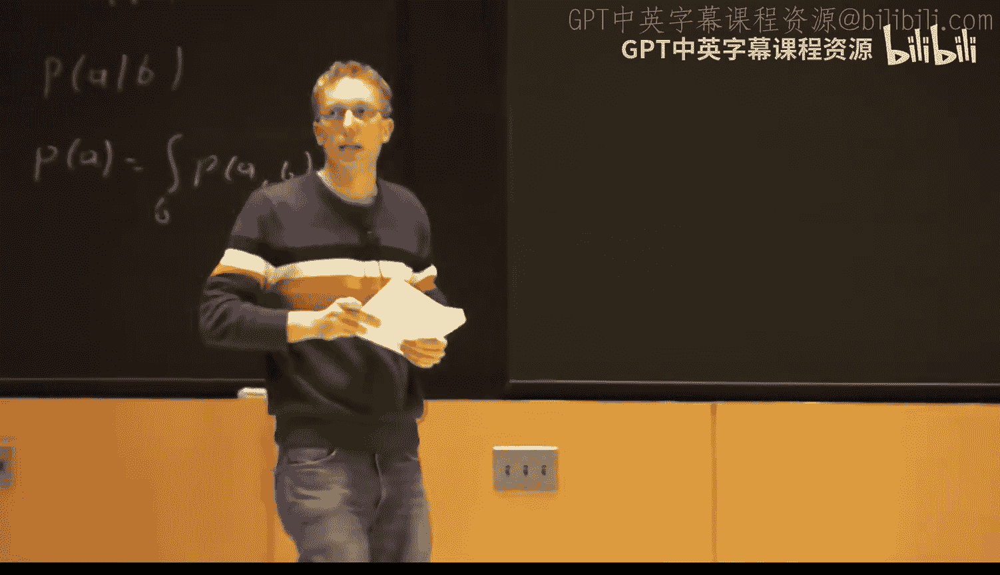

Okay， so we talked about two different approaches to learn W。😡。

And the first one was maximum likelihood estimation。 Does anyone remember what。

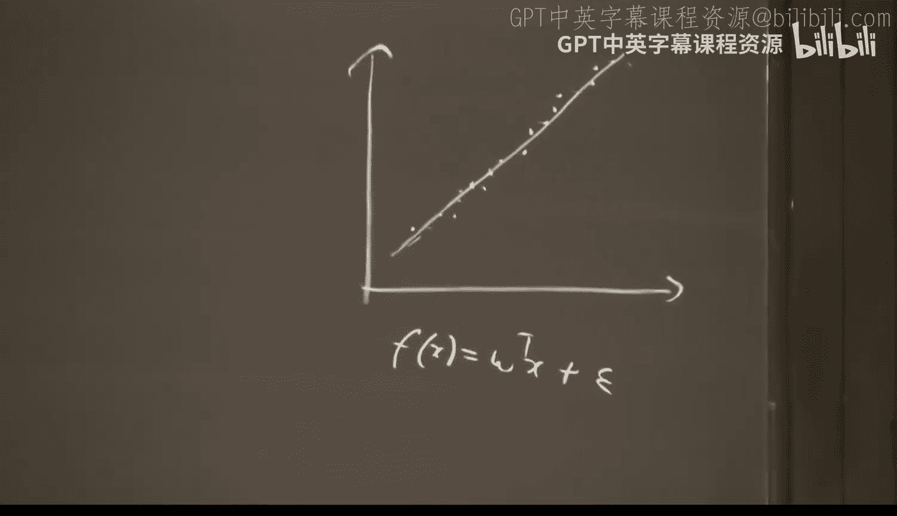

What term we minimized。Or maximized。

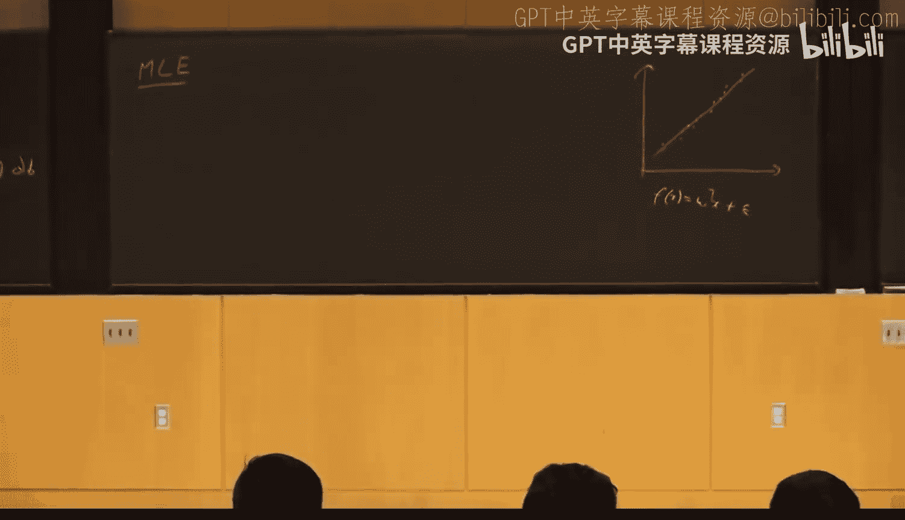

Okay come on， guys。 I know it's beautiful by that。所以。あまさ。Yeah。

 so what what does maximum likelihood about， It's always the same thing。

 What about you're trying to maximize。So we have some， okay， let me。

 let me give you some terminology。 We have some data。X1， Y1。X， N， N。

And what are we trying to maximize with ML E。That's right。 The probability of the data。

Given the parameter， right， this should technically be a semi column because we have frequent here。

 but。You know。And so basically， what does that mean that basically is the following thing is sum of all our data。

 take the product of all our data， P of Y， I， given X I and the parameter W。basically。

 what we are saying here is if we choose that parameter W。

 how likely is it that each particular Xi gives rise to the label Y。哎。

And that's the probability of the data because it's already sampled。 We call it likelihood。

 So we take the product over every single point， right and say。

 what's the probability that we if if if the data really follows the slope。

 what is the probability that at this value， we get exactly this value right So if you had something that。

 you know， let's say we have the following W here， Well then you would say at this point here。

 this x value， what is the probability that we get this， this y here， What is very unlikely， right。

 So by maximizing it the basic shifting this this lineup。Okay， then we had map。

Does anyone remember what we did here？ What What are you maximizing here。I know it'ss been of while。

What are we maximize last year。Yeah。That's right。 We turn things around。

 You say the probability of W， given the data。Okay。

 so here we say which W makes our data most likely explains our data the best。 And here we say。

 given that we have our data， what is the most likely set of parameters。

And so the way you do this is you actually use base formula。This way， a base rule。

 So you basically say， well， that actually equals the same thing as here。

The likelihood times actually a prior or this tend of normalization。So。If you use visual。

 then basically what this means is you have to put in this prior。And this， again。

We choose to be Gausian。Now。One quick question， are we。B， P of Y given X。

 Can anyone tell me what this distribution is， Well， I guess I just said it。X I W， right？ Well。

 that actually is a Gaussian distribution。 That's John from some Gaussian distribution。Defined here。

 W transpos X and sum， some noise I here Sigma squared I。 This is the variance。Okay， that's。

 that's because for every single x， you have a little distribution， which comes， you know。

 which is basically our noise model。 So for every single point here， you basically say， well。

 that's the point by value you're predicting。 but there could be some Gaussian noise。 So it's。

 it's somewhere around here。 So ultimately， what we are saying is our labels y are drawn from a Gaussian distribution where the mean is just w of transpose X。

 So the mean can shifts up here。😊，Okay， good。 So this here is the Gausian distribution。

Can anyone tell me what this distribution is， This is the distribution over。

 this is the distribution over one single point。 This is the distribution over the whole data set。

What is that distribution。I give you 30 seconds， discuss it with your neighbor。

 Try to figure it out it's a distribution you've heard of。いるでも。Yeah。是。Yeah。

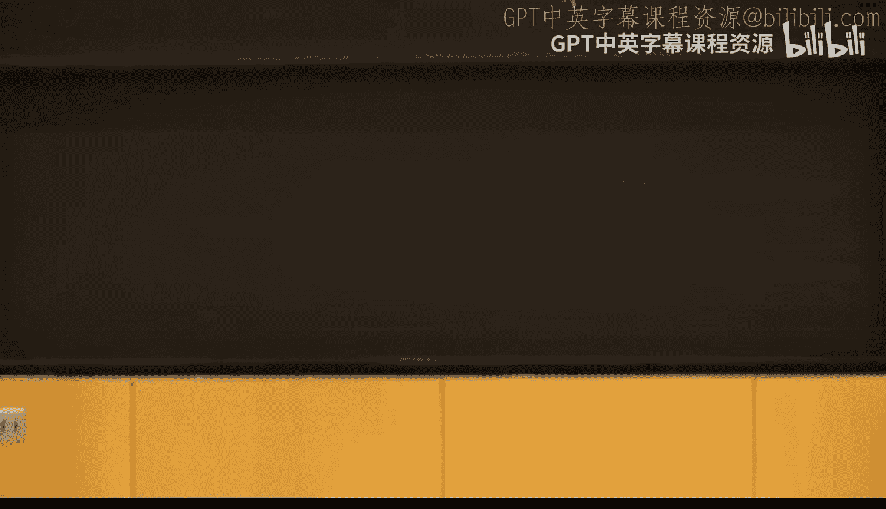

いれ。对。All right， can anyone tell me？B的。Can anyone tell me anyone is brave。

It's a product of many Gaussians。 So actually， it's just the Gaussian distribution， right。

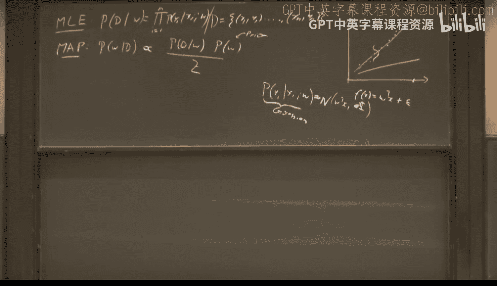

It's a weird Gausian。 and we'll to get to this a little bit later on the lecture。So。

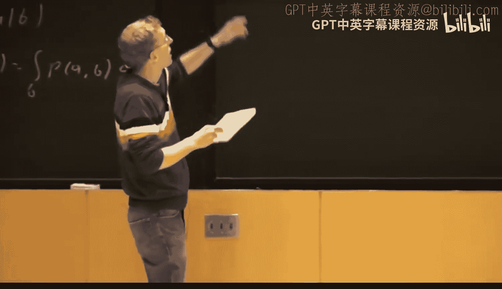

Let's just go back to Emily and Matt，So what are we doing here， right？

 And I mentioned there' a little bit a couple lectures back。 So we have our data D。

 which is drawn from this distribution that we don't know。

And then we take this data and we fit this line， right， We fit our model W。

And then why are we doing this， right， The only reason we are doing this is to make predictions later on。

 So for test point X， you would like to predict。You know what wire。 So in some sense。

 the flow is the following， right， We give， we given our。Our data from that data we learn a W。

 and then from that W， we can now compute y equals w transpose x by for some particular test point x。

😡，Now， this is so nice。But it turns out， actually， we can do something far more beautiful than that。

😊，And that's if we kind of put on our our Bayesian hats today。

And so what Bayesians say is the following。 They say， well， actually， wait a second， right。

 You're only using this W to make predictions， right。At the end of the day。

 once you've made your predictions， no one cares about what W you use as long is correct。

So why don't we， instead of trying to model the probability of W？😡。

And then make predictions for that。 Why don't we， from the start。

 model the prediction of a test point。So here's what we do。 We say we have a test point X。

 and we would like to know， what is the label of that text point。 X。 We don't know it。

So whatever we want to do， we want to model P of y given x。😡，And we have something else。

 we have our data。对。O。😊，Does that make sense？So that's ultimately what we want。 right。

 The beautiful thing about this is this makes no assumption about the model， right， You didn't。

 You didn't。😊，EYou didn't have to commit to any model here， right， And just saying。

 given that this is my test point， X。You know， what's the probability of my what's the distribution of my labor mind。

And。Let's go through this and think， okay， well we make this this assumption here that， you know。

 this is Ly。 So if we had any W， right， then we could just say， you know，So we have this fault。

 this term here， right， for a certain W， we can make predictions。So how do we get here。

 Well the trick is very simple， we just basically marginalize out the models。

 let me just show you this。 So basically， what we do is we basically say， well。

 in order to make predictions， we have to have a model。 and that's the following W X and W。😊，哎。

And then we know what the probability of W is。 That's actually， you know， that's this term here。

And then they can。Integrate out all possible valuess。So this year is the same thing。

Does this make sense， There's basically the probability of。In some sense。

 this is the probability of this。 I could just write this here as P of Y given X comma D and W。

 And then I integrate out my W。Right， so clearly， that's the same thing， right。

 You can always probably， you can always add another variable and then marginalize it out。

 It doesn't It doesn't mean anything， right， It's like adding one and then subtracting one， right。

But if we do this， then we can say， wait a second。 the moment I have W， Y doesn't actually depend on。

 on D anymore。 Y does depends on W， right， but W depends on D。嗯。Any questions at this point？第二。

Actually， yeah， I may have always simplified this a little bit。 you know。Let me呃。

I have to be a little careful that。 I don't make it too simple。

 I just try to make this lecture really simple。😊，And maybe not in general case。 Yeah， sorry， yeah。

Any questions about this equation？Raisezy hand if this step is clear。 Go from here to here。Okay。

 good。 Any more questions， no。Alright， so this is what we want to do， right， basically。

 given an x point X， we predict the label Y。😊，And we have a train data。 And now I can could show you。

 well， we can just decompose this and say， well， you know， if we had a model W。

 with prediction is very simple， this's just the Gaussian distribution。 And we have this thing here。

 this is W given D。😊，Okay， so this here is space。 This is the term that we already had up here in map。

 And this here is the term that we basically have here。 That's the final model。😊。

So now comes the beautiful thing。So， this here。

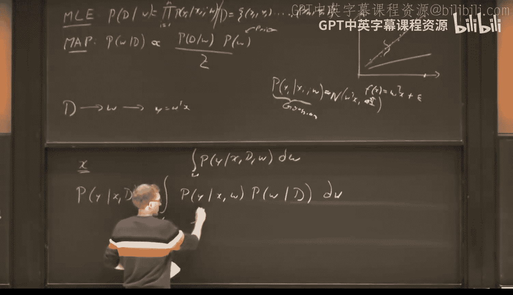

Is a Gaussian dis。What is this， P ofW given D？啊这 is PF。P of D given W times P of W。

Always a normalization factor。 And this is just using base rule。 right。

 I can take this and use base rule。 flip it around。Now， what is this。What distribution？

The answer will always be Gausian。 the whole lecture。 So why is this distribution。😊，It's a Gaussian。

 right。And what is this distribution？It's个。And now we take this whole thing， right。

 We take a product of Gaussians。 What is this。It's Gasian。 good， good。 And nowll we normalizing。

What is it？It's a Gasian。 good。 Now we multily with another Gasian。 What did you get。

How we marginalize our W， What do we get。A Gaussian， this year's a Gaussian。And that is amazing。

It's amazing because that actually worked， right？It actually worked that we took every possible model in the universe。

 right。😊，And average， every possible result that you could possibly have， right。

And we still get a distribution that we understand。 and we can solve right， Usually。

 see busy and say they say， know， ideally， we don't care about the model， right， don't， you know。

 integrate out the model。 We don't need a model。 Make it disappear， right， It never works。Here。

 it actually works because everything is Gaussian。哎。So you can actually make predictions。

Without ever learning the model， there is no model。 We marginalized out the set of parameters。

 You never had to find a single set of parameters。 So essentially。

 let me just just explain to you what what we are doing here。はい。We have our data set here。

 and we basically say。You know， I will never。 I can make predictions。For a certain X point。

 what the y is without ever committing to a single line you know。

 on which the data is supposed to lie。 What I'm instead doing is I take every possible line that exists。

 And for every possible line， I get a different answer。But these lines here are much。

 much less likely than these lines。Right， so。My， my result will be heavily influenced by these lines that are actually fit the data and hardly at all by these lines that make no sense。

 right because they are here is the P of W given D will be so small that they won't matter。

 But the question，able， is this the right fit or is this the right fit。In this case。

 basically what I'm saying is like， well， maybe both of them have a point。

 And what I'm essentially doing is I'm averaging the results。And。

The nice thing about this is that what you get。😡，Is ultimately a Gaussian distribution。

 So it solves another problem。 It solves a problem that you usually have in regression。

 One second is that when when you get a prediction。

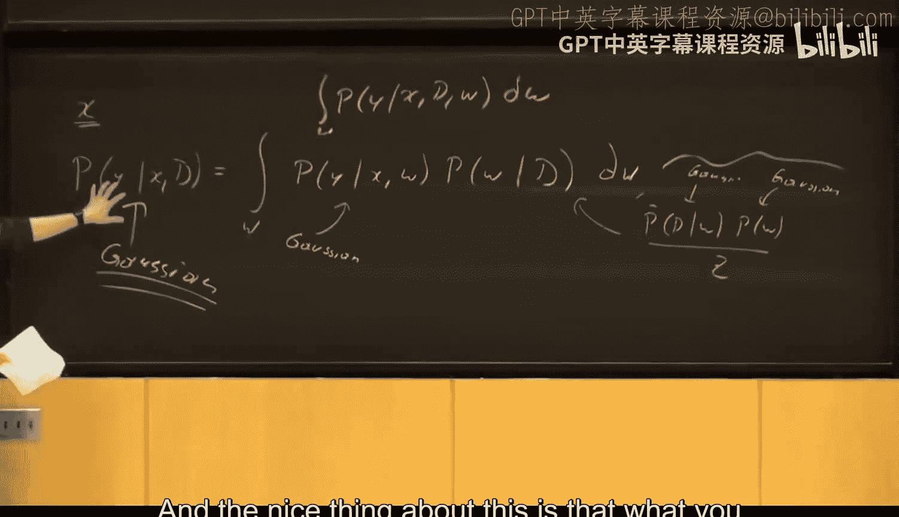

You don't know how sure you are about that prediction。 right， So let's say， you know。

 we go to hospital and the classifier tells you， you know。You know， sorry。

 you have a terminal illness， right， and you will die， you know， in a year， right。😔。

What you would like to know is that， you know， how confident are you about that prediction， right？

 I this， you know， Are you 1% confident or 99% confident， right？

 So this actually gives you a full on distribution of your of your label。 So predicts your label。

 like， you know， basically， it gives you a full distribution。

 and you can estimate exactly an interval and saying， well， with certain probability。

 you basically line here， yeah。😊，诶，still没听 the。这了。That's right。

 I'm still making the model assumption that data lies online。Still。For five more minutes。

Because he can colonize。And then it kind put everything together。

And then it doesn't have to line a line。But a very good point， Yes， exactly。Okay， good。 Any。

 any other questions about this， yeah。You are going。By PFW。Yeah， the trick is that we。

 that we choose this to be Gaussian。 So that the this， is the trick。Because this is Gaussian。

 this is Gaussian the。 So this is in some sense， the choice we have to make it。Yeah。Okay， good。

 So the question was， what have you had a different prior on W， right？Then everything falls apart。

So you better make this gaus， right？Yes， good point。Any other questions？ That's why， you know。

 people love Gaussian Pris because。It's actually called the conjuggate prior。

 The conjuggate prior is always the prior that basically。

 well it gives the posteri the same distribution that's likely， yeah。Any other questions？Okay， good。

 So we could now do this。Right。We could not solve this， but actually， wait a second， right。

We know that the answer is。It's a Gaussian。哎。So if the answer to Gaussian。

Then we don't have to do any of this stuff。哎。Because we know exactly what a Gaussian looks like。

Here's what a garian looks like。The Gaussian， we just say P of y。

Kive an x and Rdita is drawn from some distribution。😡，Some mean。And some covariance， me。Right。

 this is sigma， Sigma is here for the covariance matrix。So what we can just still is， we can just。

Just fit these these parameters， right。And try to， you know， in some sense， we are setting， you know。

 to try to estimate， come up with these parameters and then actually we get a distribution。So。

 and that's exactly what the Gaussian process is。So in Ga's process regression。

 we basically make the assumption。Which is not totally crazy， right。

 because you just realized we arrived at that assumption， making totally reasonable steps。

That your data is all Gaussian distributed。Now， let me just explain what I mean by this because it's a little bit confusing。

Right。So here's actually， here's actually the true distribution that the assumption that we are making。

 We assume that。All data。So we have y1， Y N and my test points。Given all my x， X 1 to X， N。

That's made I said D。And my test point。A drawn from some Gaussian distribution。Thats actually。

 I don't want to reuse the immune signaligma。 So this is my my gosh distribution。嗯。你even识。Okay。

So that's the assumption I just make upfront。 And if I make that assumption。

 I get to exactly the same result。 So you may as well just make that assumption。And then， you know。

 get that much， much quicker。That's much， much easier。 don't have any integrals， anything。So。

 here is the。Let me just explain what that means。So let's assume you have two training points。

 or you have one training point，1 test point， okay。

What does it mean that they are drawn from a Gausian。

But it's important that you understand this part now。

 because that' that's what always trips everybody up。What I mean is that。

That's say one training point， one test point。 So at this C X1， this is my training point。 This C X。

 my test point。FF呢？If I say that Gaussian is stimulateulate。I'm sorry， actually， that's not X。

This is fine， sorry。Why one。Why， right， if I see the Gaussian distributed it。

 that means some Gaussian distribution。The basically tells me if I know the label of the training point。

It informs me about the label of the test。O， this is exactly what we did last time。

 we saw these distribution。 In this case， we say they're highly correlated。

 So if my training point is large， then my test point is also large。😊，this is likely to be large。嗯。

And now， when you actually tell me the training value， then what I'm， you know， basically， I can。嗯。

You know， I can basically this this reduces to just a one dimensional Gausian distribution。

 and that's the distribution over the test point。Okay， and that's exactly this thing。

 that basically says。Given my training data。My test point just becomes a Gaussian distribution。

Any questions？Let me go of an example。 So example would be， for example， a。Well， let me go over the。

 the old one with the housing， right， So let's say， I want to sell my house。Now。

 I want to estimate the high price of my house。My training point。

 my one training point that I have is my neighbor's house。And my neighbor just sold his house for。

 you know， a certain amount of money。 I know my house is very， very similar。

 So what I'm doing is I'm modeling this with a Gausian distribution。 I basically say， here。

 I have a distribution that's highly correlated。And if my neighbor sells this house for a large price。

 then I'm probably， you know， my house is probably worth a lot too。

If my neighbor ends up not getting a lot of money for his house。

 then I will probably not get a lot of money for my house， too， because we have very similar houses。

哎。This。

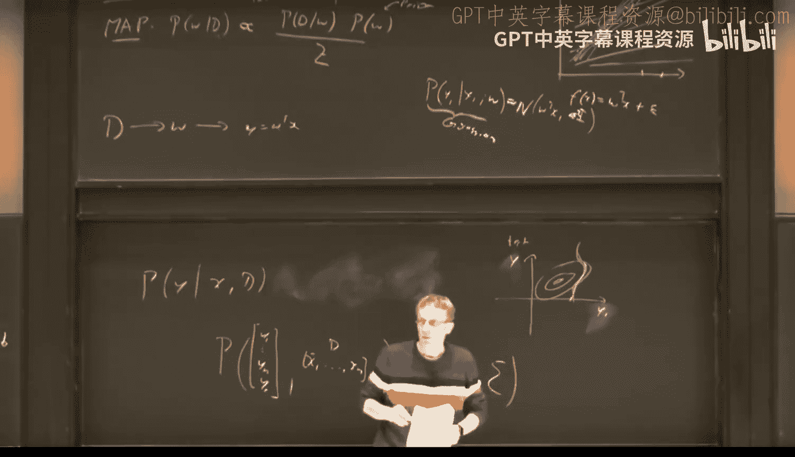

Now， that's one question， right， Where do I put in that our neighbor actually my neighbor actually has a similar house than me。

 And that's exactly what we stick into this， this value here。 So this is the the covariance matrix。

 the covariance matrix basically in this case， is a two dimensional matrix。😊，Where。The die。

 the diagonal entry C is a variance of the different values。 So this is basically， you know。

 Sigma 1 squared。Sigma 2 squared。 This basically tells me the variance of my own house。

How uncertain this basically says how， you know， how uncertain am I in this direction in this direction。

 But these often the aagonal terms。 They are the interesting ones。

 They tell me if this is large and positive。😊，If this， for example， let's say， you know。

3 or something。 And also three。 That means that my neighbor is highly correlated with me。

That means that my， the Gaussian looks like this。If this here is zero。

Then the Gaussian would look like this。 So it was like， I guess I like this something， right。

Where basically， no matter for what value my my neighbor buys this house， sells's house。

 the Gaussian here looks always the same。 So my point， my my house price is not affected。

By my neighborss。Okay， and so the trick is basically。

 if you just assume that your data is Sc distributed。The mean is not very interesting。

 You can always compute the the mean of your data， right， So you can just。Say the mean is 0。

 and just add the mean later on。 That's not very interesting。What's interesting is the sigma。 right。

 So all you need to specify is the covariance of your covariance of your data。

 So basically saying if I have a test point。😊，Which training points are highly correlated。

To my test point。哎。嗯。And what do you want？You want those training points that are very similar to your test point。

To be correlated， to basically have large values here in these of diagonals。

And those that are very different。To be 0。So let's say have， have two training points。

Let's say this is my house， you know， my house， my neighbor's house and you know。

 Donald Trump's house in Florida， right。And so。Actually。

 why don't you fill in that covariance matrix？Union neighbor just stood it around for a minute。

And try to figure out what does that look like， The first one is me， Kiian。Kon's neighbor。当了场。

I was like， what is it called president of the United States。唉はい。And by the way。

 I don't have a huge mansion with 50 in our bedrooms。呃呢。Okay。咩。系。Yeah。来月。Okay， Annie's suggestions。

And by the way， the variance， you obviously， you have， you know， it's just about the scale。

 which numbers are large， which numbers are small， right。嗯。So any suggestions for the diagonal。

What would be the diagonal entries？Yeah。Just。I'm not not sure。Oh， I see。 I see。 So this is yeah。

 Okay。 So basically， you know， these are basically some just So the important thing is basically。

 let's say my house is a variance of one， right， My neighbor's house a variance of one。

 Donald Trump's house probably is a much larger variance。

 right because he sell house this house with 50 million or maybe 40 million right， right。

 There could be lot more variance， Let's give this a right Who knows， right， So。😊。

That's in some sense， you're basically saying， well， how uncertain， you know。

 are you about each individual。Each individual training point， right。

Now comes the interesting part is the off diagonal， right， Well。

 can you tell me about the off diagonal terms。And one more time off Igonal Trumps basically tell me how correlated they are。

 right， So how much the value of one in some sense tells you about the other。

So what would you put in here？Anything with Don0， That's right， right， That's right。

Right so basically， you know， me and my neighbor Right， houses are very。

 very different than Donald Trumps right， that Donald Trump sell this house for $50 million。

 You know， that does not affect my。My house price， right？ So we are basically uncorrelated， right。

 like the fact that he sells this house for a lot of money will very little money that makes no difference。

😊，And my neighbor and I， right， Well we are high pretty correlated。 So maybe we have a 。

9 here or something， right， So maybe you know。😊，So。Okay， any questions about this。

Raise hand if that makes sense。O， awesome。So here comes the last magic trick for this lecture。

 And then I promise there're gonna be a demo at the end， so。😊，So what is this basically doing， right。

 Basically， you know， once we have the sigma， right。We p this into a Gaussian distribution。

The mean is just the average house price in America。 Who cares。 This is easy， right。

 This It is not interesting。 It's just you just get this from your training data。And bam。

 what do you have， You have a gausous distribution from which you can sample， you know， anything。

 right？You can then just。You look at the conditional。And for any training point base。

 if for any test point， get a distribution over over its name。

 So all you need to do to make predictions is specify this covariance matrix。

And what properties does this covariance matrix have to satisfy？ That's the question。

Any ideas without looking at the notes。Yeah。Positive semi infiniteite， exactly。

And how where did we hear this before， I know one place in the survey。

 someone said that was process and defite matrices are the worst part about this course。

They keep creeping up。Where have you seen positives of the definite matrices before。Colonels。

 that's right。This year is a colonel。来。This matrix here is a kernel。

It's a little bit more restrictive than a kernel。Because， typically。Well， like， I mean。

 usually any kind of function actually works。Typically， we try to avoid negative values。

The reason you want to avoid negative。 I mean， sometimes it's fair to have negative values is okay。

But that would basically means inverse inverse correlated， right saying like you， you know。

 neighbor sell something for a large price that reduces your， your house price in some settings。

 that's actually， that's， that's fine。 actually， often we just use non negative cards。😊。

So here comes the beautiful thing。 right， We need a kma function。😊，Great， what else do we need？😡。

We need a function such that similar points have large values。 right， That's what we want。

 right So here theres all these are these here， right。

 So me and my neighbor have very similar houses。 So we want value here to be large right because we call it and points that are very different。

Should have small lattice。 right， Again， that's exactly what the kernel functions doing。

 If I just remind you of， for example， the RBF kernel， think about the RVF kernel。嗯。

好 let me let me buy一道题。So the RBF Common says chaos。

X comm Z equals E to the minus x minus C squared over sigma squared。 Okay。

 so let's say we have two houses here。 The different dimensions are maybe the features of the houses。

 right， So maybe， you know， you have how many， how many bedrooms do you have， right？

 How many bathrooms do you have。😊，I know。 what was the previous sales price or something like this。

 right？ Well， if you know， take me and my neighbor， people have very， very similar houses。

 Theres a very small distance。 So each each of the mine is something very， very small。 is， you know。

 around1， right， So it's pretty large。 right That's exactly what we got。 We got 。9。

 That's what we want。 Now we take。😊，Donald Trump and me， right。 Donald Trump number of bedrooms。

 I have four bedrooms。 he has 50， right，2 for， I know，1 for him， one for his wife。

I don't know what the other 4 he ate for。He。But。Why not？呵。And I don't want to ask， actually。Right。

 so that that's a much， much larger distance。 right for this year， this distance here is very。

 very large。 right You square it。 right， sum a massive value。😊。

But each of the mind of something massive is going to be very， very small。

 So we're gonna capture exactly this。 right， these points have nothing in common。

 They're very far away。And so once again， what we are doing here is actually something like nearest neighbors。

 we basically in the space of houses， right and I'm here， you know。

 my neighbors here and Donald Trump is somewhere over there right and we basically put these Gaussians around and say if things are close together。

 then they are correlated， right then they influence each others you know each other's labels。

 and if they are far away， then they， you know the label of one does not really affect the label of the other。

 it doesn't tell me anything about。😊，And that's actually all we need to do， so。I no more clearboard。

 all right。You're basically done。If you understand this。

 you want of the few people who understand Gaussian process regression。

So let me just go through the steps。So in Gaussian process regression。 what you're basically doing。

 you're making this assumption the P of， you know， Y given X and your data is s jo from some distribution。

 And for now， we just say always 0 mean because you can always add the mean at the end。

 It's not very interesting。啊，不。嗯。And then some some function sigma， which is really。

 sigma is just a come。Right， Mc IJ。Equals k of X， I comma X J。So it's kind of a funky thing。 Right。

 So what you do with your with your feature vector， you basically compute a kernel matrix out of it。

And you stick it into a Gaussian distribution。😡，And that's all you need to do。

And if I now want to know， what's the。Prediction of a test point。I need to know。

 this is my test point。 Oh yeah， sorry， this is now。 So what do I do with it， you know， I'm actually。

 oh， sorry。It's not like。 So this is this X one。Ex then。Y one。Y N。

 And if I now want to know what's the prediction of one particular test point。

That's not conditioned on the labels of all the training points。😡，At my test point here。And。

This is basically， this year whole thing is basically my data。And what I get is actually something。

 you know， very simple。 I basically get。 this is again， a distribution。 This is not a conditional。

 So basically what I'm doing here， I have。来明白都说。As the probability of y1 to Y and Y trust points。

Given X1。X M。And the X test point。Is Gaussin just disputeed。There's basically this this。

N plus one dimensional space。Now， I condition on the first end because these are the training labels that I have。

 So I assume my data from a huge， gigantic Gaussian distribution。And now what I'm doing， basically。

 I'm saying， well， for most of these， actually， I know what the value is， right。

 I know my neighbors theel House， right， This is now a training point。

 So now I'm conditioning on the data that I， for which I know the labels and want to know what's the value of the test point。

😊，And so that is now alsoz a Gaussian。With a very specific mean and variance and the mean is the following。

K star。Transpose k inverse times y。And the variance is。K， star star。嗯。K inverse times k K star。

And let me remind you of， what case stars。Yeah， K， the covariance matrix is the following。嗯。K。K。

 star。Kase star transpose。T stars。So。You a look at my covariance matrix。

These are basically the entries of the training points。To this is my test point。

So this here is basically my house。 The last column here is my house。

This year is my neighbor's house。 and this year is Donald Trump's house。 basically right。

 so my training data is basically this block up here。 I just call K。

And my test point is the what I have star。 In K star star is basically the variance of my。

 of the test point。Does that make sense？嗯。Sorry， one more time。 Okay， good。

 So let me specify this this， this compliance matrix。 That's over all my data。

 my training data and my test data。😊，So I just sort them。

 So when my train data comes first and then comes my test data。

And I call the the column that's training data with training data K or the sub matrix that's kidney data times training data。

 Okay， that's basically Luke how that that was exactly how correlated is Donald Trump's house with my neighbor's house。

And then， here's my test data。I'm the test data。 So how the first one is basically how correlated am I with my neighbor's house。

 Second one is how correlated am I with my Donald Trump's house。

 The third one is how correlated am I with my own house。

 right the variance of my So that's the K star is basically the correlation with the training data。

 K star star is my own variant。😊，Any questions？第二。Yes， exactly， right。

 this year is just colon regression。はい。So it turns out if we do this。

They get exactly the same thing as kernel regression。Now， I know what you're thinking。

 What the bleep， right， We just went a whole lecture through this。

 and we just arrived a Colel regression。But there's something beautiful that we got in addition to this。

😊，You got Colel regressiongress。And we got variances。Right。

So we actually got not just the point prediction， not just saying， oh。

 the price of your value is the price of your house is $350000。 It tells you， no， no no。

 the price of your house is an expectation $350000， right。

 but there's a good chance that you sell it about $400000， right。😊，And these distribution。

Are worth a lot Because if you actually， if you want to integrate your predictions。

 let's say you have a self-driving car or something， right， you want to know， you say， you know。

 you make a prediction and say， oh， this is not a pedestrian in front of me， right， you want to know。

 well， wait wait a second。 How certain are you about this， right？ And if you say， well。

 it's not a pedestrian。 Im90% sure it's a pedestrian，10% Well， yeah， maybe this， right。

 You may still want to stand on the brakes， right。So these， these。

 these uncertainties are actually super， super important。

 and this is why I love Gaussian processes so much。A， because it's the most elegant algorithm。

 you just compute the kernel matrix。 And then just this year is the prediction。

 and this year is the variance。 right， How many lines of Julia is this 1，1 line of Julia。😊。

It's two lines of Python。Yeah。Any more questions？Yeah。

 I can tell you a little demo of the algorithm in action。呃。Okay， any more questions。

 Someone had a question。 Yeah， this is。But isn't our prediction basically still the same although we now have a。

Bs。So he's saying， well， ist our prediction the same？But we just got a distribution around-。

 wouldn't you still just go with the same prediction， right？😡，王。So if you just need a prediction。

 then we just waste， I just wasted your time， right。But actually。

 if you want to do something with prediction with that prediction， if you want， for example。

 want to integrate it， right。Then actually distributions are really， really， really important。😡。

Let me give you a simple example， right， obvious example is， for example， speech recognition， right。

 So speech recognition， you know， the system like Siri， right， Here's from the microphone。

 what you're saying， right。And let's say， you know， you could have said multiple things。

 Why you say ice， right。Well， did you mean eyes or did you mean eyes， right？ Well。

 I have somewhat of an accent So no one knows， right， but。

If you would just predict the most likely one， right。

 then you would just always take the most likely word that you just heard。 But it could be way off。

 But if I give you a distribution， then I you would actually see it could be ice。

 or it could also be eyes， right， I is a little less likely because the way I speak， right。

 But it's not， you know， it's plausible。The beautiful thing is now you can actually take the previous person's account and say。

 wait， wait a second。 I just said， I look you in the， right， It's pretty unlikely I say ice cream。

 right。😊，So。If you basically have two different probability distributions。

 you can now integrate them。 And if they're both Gaussian， you get a Gaussian， right。

 and then you actually can predict the most， most plausible word。 right， And that's exactly。

 by the way， how speech recognition systems work。 So the actually audio， you know。

 the recognition of the audio is actually pretty un inaccurate。😊。

But what one of the big breakthroughs in the last couple of years was that basically， you know。

 Google and those companies could scrape the web and just got， you know。

 millions and billions of lines of text。 And what they could estimate very。

 very accurately is which words are likely to fall after other words。😊，And if you integrate that。

 that into the speech recognition system， you basically say， well， you could have said， you know。

 one of these five words。 but only one of them is actually likely given what he or she said before。

 And in fact， actually， the way these things work is also， given what the person said afterwards。

 So these recognition systems are always a little bit behind， right。

 they kind of also look into the future， you know， look back， right and say。

 given that it just said cream， it probably meant ice， right， instead of ice， etctera。 yeah。😊，这个。

知 know。No， no， kernel is just a well defined covariance function。 Everything works out。

And you can define any kernel function you want。😡，Let me give you a little example whether this really。

 really cool。 So here's a common。嗯。Is this the right one。Yes， oh no。 that's the wrong one。 Sorry。

 wrong demo。嗯。啊，GP代码。Okay， good， so here's a common case where this is used。😡，All right。

So here's a scenario that comes up a lot。 You'd be surprised， actually， Last time I taught this。

 a faculty from from the med school actually SAT in in the class。 and he saw this。

 and he ran out afterwards and started a startup。😊，And actually， he that's what he does now。

 Like he says he's no longer faculty。So。Here's an example of a problem that's actually quite common。

 So imagine I want to minimize a function。But this function is really expensive。

Right so you can't just evaluate it everywhere。 Like every time you， you know you can query me。

 you can ask me， what's the value at x， And I give you the value value， but it costs you 100 bucks。

Right，Or it costs you five days。 right， A typical example could be a chemist， right， trying to。

 to set up some， some experiment， right and doesn't know how much the or two or how much do you want to put in that or material science。

 You want to make a new material。 And you would like to maximize the conductivity or something。

 right， But every time you make a new material， It takes you five days or 10 days， right。

 And it costs a lot of money。😊，And you want to find the best material。So。

That's called a minimization problem， right？And， you know， before we had gradient descendants so on。

 But there's no gradient， right， What's the gradient of a material， right， like。

ItDoesn't really exist， right， So here's what we do。 It basically。The user。

 we basically use Gaussian processes。 And we assume the data has drawn from a Gausian distribution。

 And so this year， my data has now any X， you have X values and y values。Right。

And so there are some function that I'm trying to minimize。 I don't know what that function is。

And so the only thing I'm doing I using an RBF kernel。 I say the function is somewhat smooth。

 If I know the value at a certain -2， that's probably predictive of -2。1 or something。我什么。

So here's what I'm doing。 Now I'll give you a single training point。 What you see here。

 The red line is my prediction of what the function looks like， right， So right now， this is just。

straighttraight lines I don't know anything， right。So now here comes the game。 I give you one value。

 right， I tell you， oh， I run an experiment and it cost me 10000 bucks， right， But here I know it。

 -1， This here is the function value， okay。And now what I can do is I can refit my Gaussian process and say。

 what's， given that I have that one value， what is the Gaussian distribution。

And this is what it looks like。Right， and so let me just understand you。 Where's the， you know。

 Where's the Gaussian distribution here， right？ The Gausian distribution is kind of coming out of this。

 right， at any given X slice， you have a Gaussian distribution， and it's centered。

 The mean is the red line。And this here is one standard deviation up。

 and this year is one standard deviation down。 So kind of。

 you have to kind of think of this as a 3D thing， right， It kind of goes。E goes this way。

 Does that make sense。 And so for any test point now， I， this is my test point。

 I get a Gausian distribution right， that tells me what the mean value is and how uncertain I am about。

Okay， does that make sense？Risezy hand at that finger makes sense。Okay， awesome。

 And here comes the beauty， right， The beauty is。😊，The uncertainty is very small around here， right。

 because I observe the value， but it's really large here。

 So let's say I'm now trying to find the minimum。 I want to find the material that minimizes certain property。

 right。But I could search here because， you know， I want to find out new， run new experiments。

 I know here the function is pretty low， right， but I'm also not very， very。

 I'm also very certain about the value。😊，Here， right the function。

 my predicted function is pretty large， but I'm very uncertain。 So it could be that actually。

 if I run the experiment here， the value is actually， you know， lower， right。😊，So basically。

 what I could do is I could actually trade this off and I say， you know， here I know what I get。

 right， The value is around -3。But over here， you know， it's probably around 0， but I don't know。

 I'm really uncertain。 So maybe I I try this out， right let's say。

 I try this out and I get a pretty large value。 right， So this is what my function looks like now。

I to try try another value here。And so on。 And so in searching for the minimum。 I basically now know。

 okay， here not very certain， right， I know this value here is a lot worse than here。

 So there's no point trying here anymore， right， But here is a lot of uncertainty。

 So maybe I should try -4 or something right， So you try -4 and you get this value， right， So now。

 you know， oh， maybe the minimum is somewhere here。 Okay， does that make sense。

 So you basically keep searching and keep searching。😊，By the way。

 this is exactly the technique they used to find the Malaysian airliner that got lost in the ocean。

 right They basically， you know， they had submarines。

 They had to go down and try to find it's anything like here and they go。

 okay now now you're pretty certain it's not here， right，'s's search somewhere else。

 And they just basically use Gausian processes， right。😊，诶。Okay， we are over time already。

 I apologize。I will show you another demo at the beginning of next lecture。

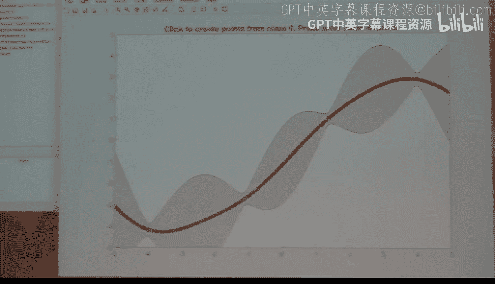