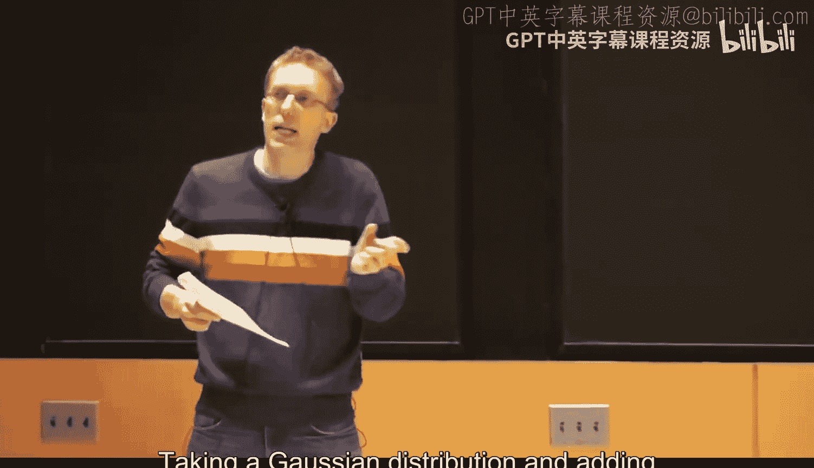
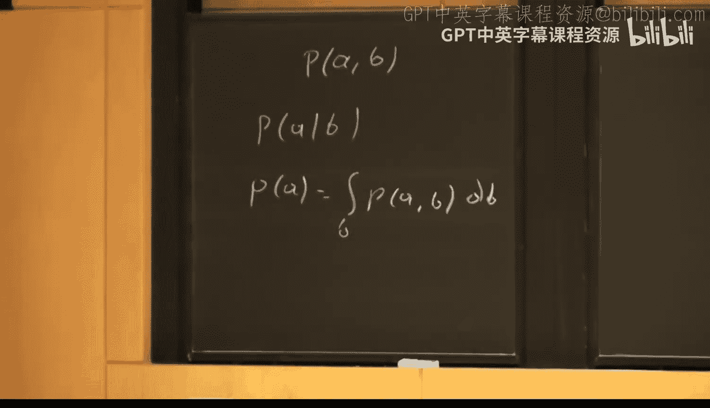
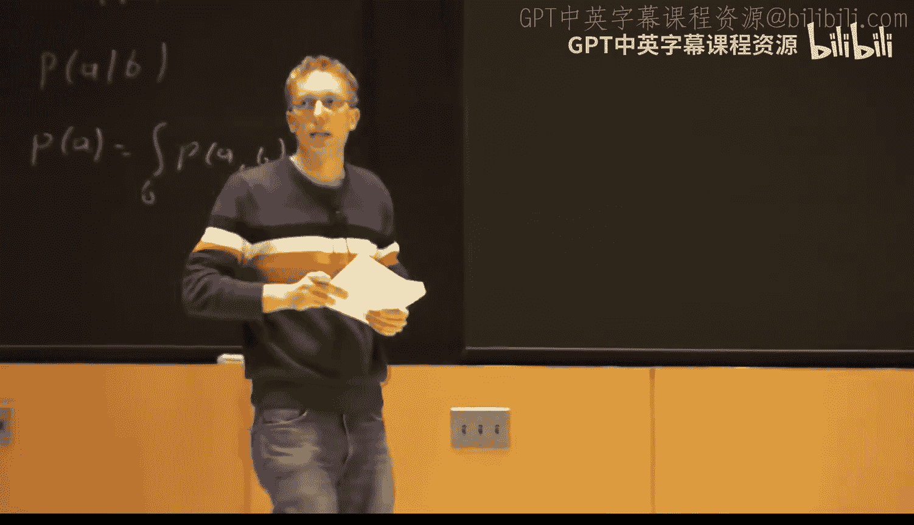
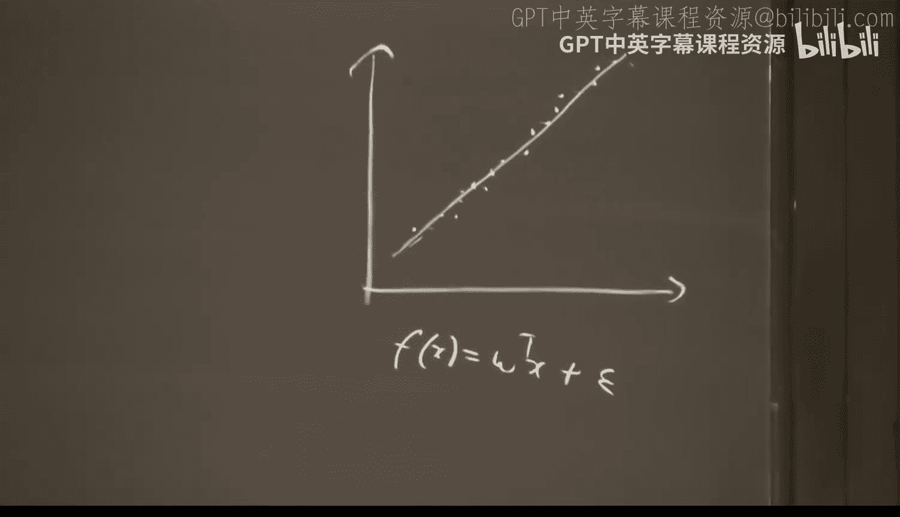
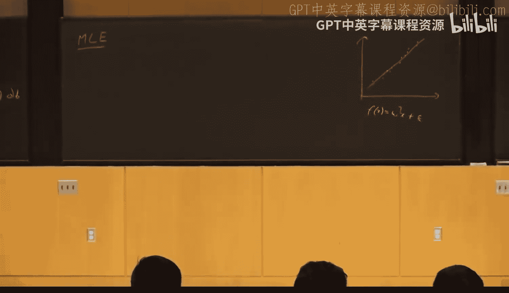
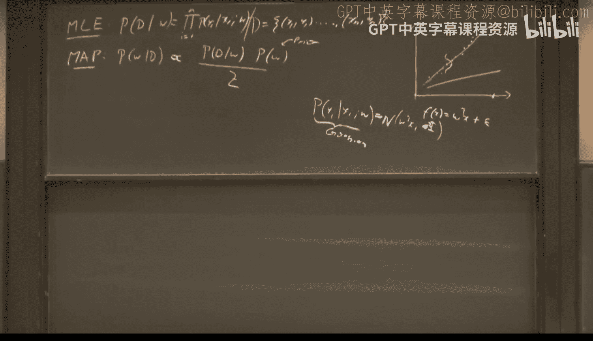
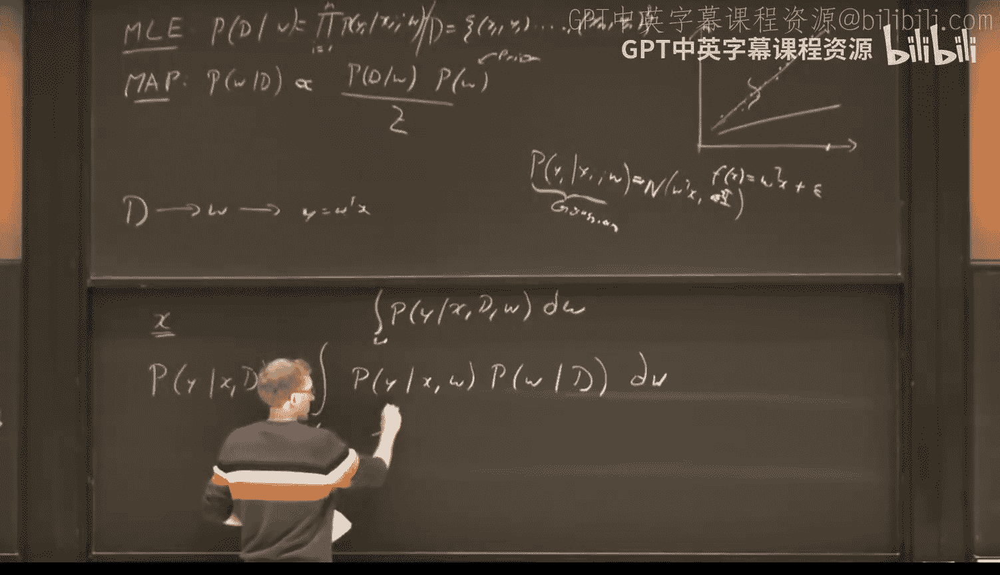
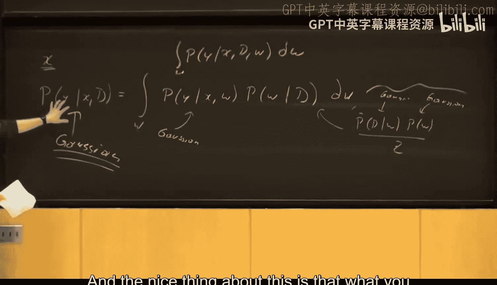
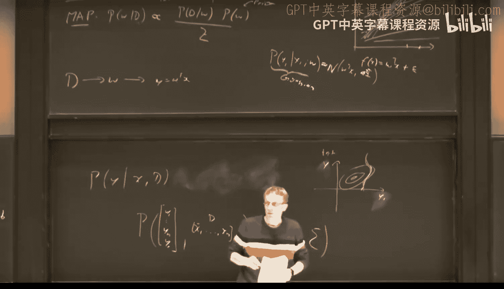
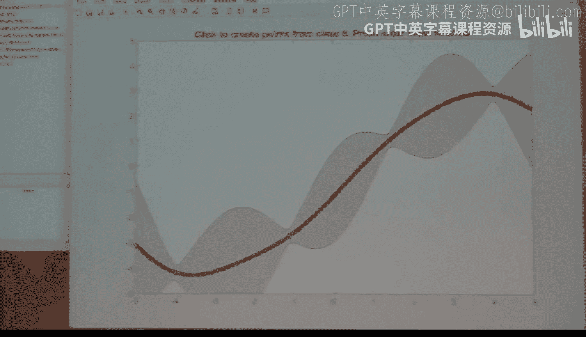

# 机器学习：026：高斯过程 🧠

在本节课中，我们将学习高斯过程回归。这是一种强大的贝叶斯非参数方法，用于回归任务。我们将从回顾线性回归开始，逐步推导出高斯过程的核心思想，并理解其如何直接对预测分布进行建模，而无需显式地学习模型参数。

---

上一节我们介绍了线性回归及其参数学习方法。本节中，我们来看看如何从贝叶斯视角重新思考回归问题，并最终引出高斯过程。

在标准线性回归中，我们假设数据由带噪声的线性函数生成：
`y = w^T x + ε`，其中 `ε ~ N(0, σ²)`。
我们的目标是学习参数 `w`。

我们曾讨论过两种学习 `w` 的方法：
*   **最大似然估计**：寻找使数据似然 `P(D|w)` 最大化的 `w`。
*   **最大后验估计**：寻找使后验概率 `P(w|D) ∝ P(D|w)P(w)` 最大化的 `w`，其中 `P(w)` 是参数的先验分布（通常也设为高斯分布）。

然而，最终我们关心的并不是参数 `w` 本身，而是对于新的测试点 `x*` 的预测 `y*`。贝叶斯方法提出，与其先估计一个单一的 `w`，不如直接对预测分布 `P(y* | x*, D)` 进行建模。这可以通过对所有可能的模型 `w` 进行积分（边缘化）来实现：
`P(y* | x*, D) = ∫ P(y* | x*, w) P(w | D) dw`。

高斯分布有一个美妙的性质：它是分布的“黑洞”。以下是高斯分布的一些关键性质：
*   两个高斯分布的和是高斯分布。
*   两个高斯分布的乘积是高斯分布（归一化后）。
*   对高斯分布进行边缘化得到高斯分布。
*   对高斯分布进行条件化得到高斯分布。

在线性回归的设定中，如果似然 `P(y|x, w)` 和先验 `P(w)` 都是高斯的，那么后验 `P(w|D)` 也是高斯的。进而，预测分布 `P(y* | x*, D)`（一个高斯似然与一个高斯后验的乘积再边缘化）也将是高斯分布。这意味着，我们可以绕过对具体参数 `w` 的估计，直接得到一个关于预测 `y*` 的高斯分布。

---

基于上述推导，我们可以做出一个更直接的建模假设：所有观测数据（训练标签和测试标签）在给定其输入时，**联合服从一个多元高斯分布**。这就是高斯过程回归的核心假设。

我们假设：
`P([y₁, ..., y_N, y*] | [x₁, ..., x_N, x*]) ~ N(μ, Σ)`
为简化，我们通常假设均值 `μ` 为零（数据可以预先去均值处理）。关键在于协方差矩阵 `Σ`。

协方差矩阵 `Σ` 定义了不同数据点之间的相关性。其元素 `Σ_ij` 由核函数 `k(x_i, x_j)` 计算得到：
`Σ_ij = k(x_i, x_j)`。
核函数衡量了两个输入点 `x_i` 和 `x_j` 的相似性。相似的点应具有较高的协方差（相关性），不相似的点协方差较低。

以下是核函数的一个经典例子：
*   **径向基函数核**：`k(x, z) = exp(-||x - z||² / (2l²))`，其中 `l` 是长度尺度参数。当 `x` 和 `z` 很接近时，核函数值接近1；当它们相距很远时，值接近0。

这个协方差矩阵必须是一个半正定矩阵，而这正是核函数所满足的性质。

---

现在，我们有了训练数据 `D = {(x_i, y_i)}` 和一个测试点 `x*`。根据我们的联合高斯假设，所有数据的联合分布是：
`[y; y*] ~ N(0, [K, k_*; k_*^T, k_**])`
其中：
*   `K` 是 `N×N` 的矩阵，`K_ij = k(x_i, x_j)`，表示训练点之间的协方差。
*   `k_*` 是 `N×1` 的向量，`k_*i = k(x_i, x*)`，表示测试点与各训练点之间的协方差。
*   `k_**` 是标量，`k_** = k(x*, x*)`，表示测试点自身的方差。

我们已知训练标签 `y` 的值。我们想知道在给定这些观测的条件下，测试标签 `y*` 的分布，即 `P(y* | x*, D)`。利用多元高斯分布的条件化公式，我们可以得到：
`y* | x*, D ~ N(μ*, σ*²)`
其中：
*   预测均值：`μ* = k_*^T K^{-1} y`
*   预测方差：`σ*² = k_** - k_*^T K^{-1} k_*`

预测均值 `μ*` 的形式与核岭回归的预测器完全相同。然而，高斯过程不仅给出了点估计 `μ*`，还给出了该估计的不确定性度量 `σ*²`。方差在训练数据密集的区域较小，在数据稀疏或外推的区域较大。

---

为了直观理解高斯过程的应用，考虑一个实际的优化场景：贝叶斯优化。

假设我们想要最小化一个评估代价非常高昂的未知函数 `f(x)`（例如，寻找最佳化学反应配方，每次实验都耗时费钱）。我们可以使用高斯过程来对 `f(x)` 进行建模。
1.  首先，随机或在少数几个点评估函数，获得初始数据。
2.  用高斯过程拟合这些数据。此时，GP 给出了一个对 `f(x)` 的估计（均值函数）以及每个点的不确定性（置信区间）。
3.  利用一个**采集函数**（如“期望提升”）来决定下一个评估点。采集函数会平衡**探索**（在不确定性高的区域采样，以了解更多函数信息）和**利用**（在预测值低的区域采样，以找到最小值）。
4.  在新的点进行评估，将结果加入数据集，并更新高斯过程模型。
5.  重复步骤3和4，直到达到预算或找到满意的解。

这种方法被广泛应用于超参数调优、实验设计和机器人学等领域。一个著名的历史案例是在搜索失踪的马航 MH370 客机残骸时，团队就使用了类似高斯过程的方法来指导海底搜索区域。

---

本节课中我们一起学习了高斯过程回归。我们从线性回归的贝叶斯视角出发，通过边缘化模型参数，推导出直接对预测分布建模的思想。核心在于假设所有数据的标签联合服从一个多元高斯分布，其协方差由核函数定义。高斯过程回归的最终预测结果是一个高斯分布，既提供了预测均值（与核回归一致），也提供了预测方差，量化了预测的不确定性。这种不确定性估计使得高斯过程在需要决策信心的场景（如贝叶斯优化）中极具价值。