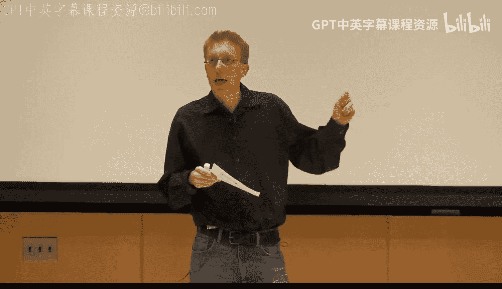
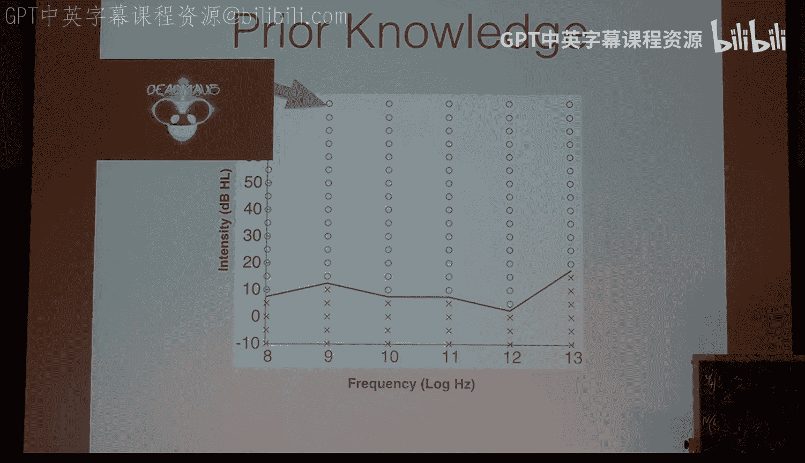
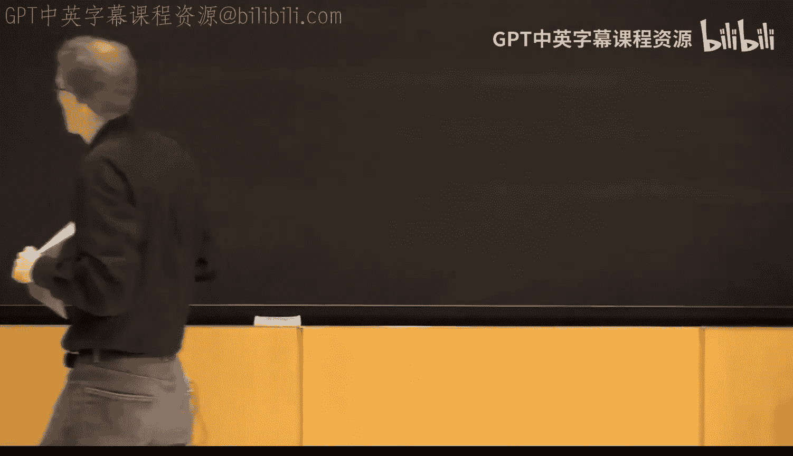
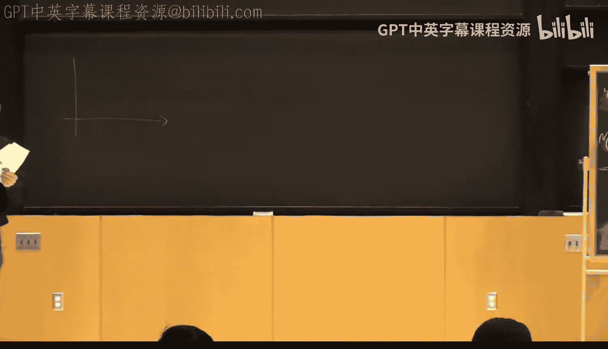

# 机器学习：027：高斯过程 II 与 KD-树、球树

在本节课中，我们将完成对高斯过程的学习，并通过一个演示来直观理解其应用。随后，我们将转向一个完全不同的主题——用于加速最近邻搜索的数据结构，特别是KD-树和球树。

## 高斯过程回顾

上一节我们介绍了高斯过程的基本概念。让我们再快速回顾一下其核心思想。

我们从线性模型开始，其中 **y = wᵀx + b**，并加入高斯噪声。学习权重 **w** 有两种经典方法：最大似然估计和最大后验估计。它们都为我们提供了一个具体的模型 **w**，然后用于预测。

我们引入了另一种“完全贝叶斯”或“真实贝叶斯”方法。其核心思想是：我们不固定一个模型 **w**，而是考虑所有可能的模型。对于测试点 **x***，其预测分布 **p(y* | x*, D)** 是所有可能模型预测的加权平均，权重由训练数据 **D** 下得到该模型的概率决定。由于所有分布都是高斯的，这个积分的结果也是一个高斯分布。

既然结果总是一个高斯分布，我们可以直接假设整个数据集（包括训练点和测试点）的标签联合服从一个高维高斯分布。这被称为高斯过程。我们通常假设其均值为0（可以通过减去标签均值实现），关键在于其协方差函数（或核函数）**K**。

协方差矩阵 **K** 的对角线元素 **σᵢᵢ** 表示每个数据点自身标签的方差。非对角线元素 **σᵢⱼ** 则表示点 **i** 和点 **j** 标签之间的相关性。这正是我们嵌入算法假设的地方。例如，如果我们假设“相似的点有相似的标签”，可以使用径向基函数核：**σᵢⱼ = exp(-||xᵢ - xⱼ||² / σ²)**。如果我们假设线性关系，则可以使用线性核：**σᵢⱼ = xᵢᵀxⱼ**。

在给定训练数据标签 **y** 和协方差矩阵 **K** 后，测试点 **y*** 的条件分布仍然是高斯的，其均值和方差有闭式解：
*   均值：**μ* = k*ᵀ K⁻¹ y**
*   方差：**σ*² = k** - k*ᵀ K⁻¹ k***

其中，**k*** 是测试点与所有训练点之间的协方差向量，**k**** 是测试点自身的协方差。

高斯过程的优势在于，它不仅提供预测值，还提供了预测的不确定性估计，这对于回归问题尤其有价值。

## 高斯过程应用演示：贝叶斯优化

高斯过程一个非常流行的应用是贝叶斯优化，用于寻找未知且评估成本高昂的函数的最小值。一个典型的例子是机器学习模型的超参数调优。

假设我们有一个支持向量机，需要优化核宽度 **σ** 和正则化参数 **λ**。评估一组超参数意味着用这组参数训练模型并在验证集上计算误差，这非常耗时。

以下是两种方法的对比：
1.  **网格搜索**：尝试所有可能的 **σ** 和 **λ** 组合。
2.  **贝叶斯优化（基于高斯过程）**：
    *   首先随机尝试几组超参数，得到对应的验证误差。
    *   用这些数据拟合一个高斯过程回归模型，该模型可以预测任意超参数组合下的验证误差及其不确定性。
    *   基于一个权衡准则（如“期望提升”），选择下一个最有希望评估的超参数组合（可能是预测误差低的地方，或不确定性高的地方）。
    *   评估该点，更新高斯过程模型，重复此过程。

演示表明，贝叶斯优化通常能比网格搜索更快地找到优秀的超参数组合，因为它智能地利用了已有信息来指导搜索，避免了在效果很差的区域进行大量无用尝试。

另一个有趣的应用是“主动学习”，在获取数据标签成本高昂时（如医学测试），高斯过程可以帮助决定下一个最值得标注的数据点，从而高效地学习决策边界。

**警告**：高斯过程非常强大，但其预测能力有时会带来不受欢迎的结果。例如，美国北卡罗来纳州曾立法，在预测海平面上升时，禁止使用非线性模型（如高斯过程），只允许使用线性外推，这被广泛认为是对科学建模的政治干预。

## 转向最近邻算法与加速需求

高斯过程在使用RBF核时，其行为类似于一个加权的最近邻算法。现在，我们将花一些时间讨论最近邻算法本身及其加速方法。

最近邻算法的一个主要缺点是速度慢。对于一个测试点，为了找到其最近邻，我们需要计算它与数据集中**所有**点的距离，然后找出最小值。这在大数据集上是不可行的。

一个直观的加速想法是：如果我们能预先将数据空间划分成区域，那么对于测试点，我们只需在它所在的区域及其附近区域搜索，而可以忽略那些明显很远的区域。KD-树和球树正是基于这种思想的数据结构。

## KD-树：原理与构建

KD-树是一种用于组织k维空间中点的二叉树数据结构。其核心思想是递归地使用轴对齐的超平面分割空间。

以下是构建KD-树的基本步骤：
1.  选择分割维度：通常选择数据方差最大的维度，或者轮流选择各个维度。
2.  确定分割点：在该维度上，选择中位数作为分割点。这样可以保证树是平衡的。
3.  分割数据：将数据点根据其在该维度上的值，小于中位数的分到左子树，大于等于的分到右子树。
4.  递归：对左右子树重复步骤1-3，直到子区域内的点数量少于某个阈值，或达到最大深度。

构建完成后，每个叶节点对应空间中的一个“盒子”，里面包含一些数据点。

## KD-树：最近邻搜索

使用KD-树进行最近邻搜索比线性扫描高效得多。过程如下：
1.  **下行**：从根节点开始，根据测试点在当前分割维度上的值，决定向左或向右子树移动，直到到达一个叶节点。
2.  **局部搜索**：在该叶节点包含的点中，找到距离测试点最近的点，作为“当前最近邻”及其距离 **d_current**。
3.  **回溯与剪枝**：
    *   从叶节点回溯到父节点。
    *   检查父节点代表的另一个分支（即未被访问的子树）是否可能包含更近的点。判断依据是：测试点到该分支所在区域边界（即分割超平面）的**垂直距离**是否小于 **d_current**。
    *   如果**垂直距离 >= d_current**，则意味着该分支整个区域内的所有点都至少比当前最近邻远，因此可以安全地“剪枝”掉，无需搜索。
    *   如果**垂直距离 < d_current**，则必须进入该分支进行搜索（即对该子树递归执行步骤1-3）。
4.  **继续回溯**：继续向上回溯，重复步骤3，直到回溯至根节点。

**为什么可以这样剪枝？**
利用勾股定理可以严格证明。考虑测试点 **x_t**、当前最近邻 **x_nn**、以及分割超平面。设测试点到超平面的垂直距离为 **a**，到当前最近邻的距离为 **d_current**。对于超平面另一侧的任意点 **x_other**，其到测试点的距离 **d_other** 满足：**d_other ≥ a**。因此，如果 **a ≥ d_current**，则必然有 **d_other ≥ d_current**，所以 **x_other** 不可能是更近的邻居。

## 总结

本节课中我们一起学习了：
1.  **高斯过程的核心思想**：通过假设数据标签的联合高斯分布，并利用协方差矩阵编码点之间的相似性假设，直接进行贝叶斯推断，得到带有不确定性估计的预测。
2.  **高斯过程的应用**：重点介绍了贝叶斯优化，它利用高斯过程高效地寻找昂贵函数的最优解，在超参数调优等领域非常有效。
3.  **最近邻算法的加速需求**：线性扫描的最近邻搜索复杂度高，需要借助空间数据结构来加速。
4.  **KD-树的工作原理**：
    *   **构建**：递归地使用轴对齐超平面（按维度中位数）分割空间，形成平衡二叉树。
    *   **搜索**：通过“下行-局部搜索-回溯剪枝”的策略，避免搜索整个数据集，将平均搜索复杂度从 **O(N)** 降低到接近 **O(log N)**。

下一讲，我们将继续探讨另一种加速最近邻搜索的数据结构——球树，并比较它们的优缺点。