# 028：康奈尔大学《智能系统的机器学习｜CS4780 Machine Learning for Intelligent Systems 2017》中英字幕 p28 -28-Machine Learning Lecture 28 ＂Ball Trees _ Decision Trees＂ -Cornell CS4780 SP -BV1Lo6gBxEKE_p28-

Welcome， everybody。One quick thing。 I have a few more notes from last lecture。那。W that okay。

 terrific。view of you。Oh， sorry。Here go， pleases past them behind you。嗯。Okay。

 quickly thing about logistics。Projects underway， things seem to be going well。

EThe latest homework is out。That's the homework on trees。

And the next project is coming out on Monday。嗯。One thing that's really， really important。

 I said this before， but I want to reemphasize it。

The project covers something that we do not cover in class。

So you have to derive it in the homework。So the current homework 7， I believe， that just came out。

The question on the regression trees， that is something you basically deriving an algorithm that you have to implement in the project。

 So please do it in the right order。 right， If you start the project too late and you know。

 haven't done the homework yet， that's a problem。 If we try to kind of make the homework ahead of the project to kind of force you to do it in the right order。

 But don't leave it until the last minute。 Also when you do the project and something doesn't make sense it's probably because you haven't done the homework yet。

😊，Okay， so yesterday well， last lecture， we talked about Katie trees。😊。

And KD trees are a just to remind you a data structure to speed up nearest neighbor search。

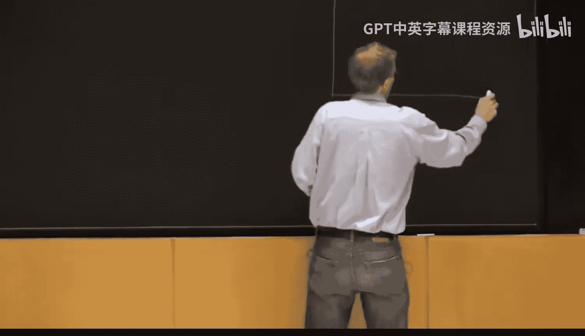

And the idea is quite simple。 The idea is that imagine we have a data set like this。

And we would like to find the nearest neighbor in this data set。You build a tree by， you know。

 repeatedly splitting the data in half。In some dimension。

 So a good heuristic is to take the data set， take the dimension that has an maximum spread。

 So in this case， one thing you can do is can split the data half here along this axis。

 Let's say there's a few more points here。😊，嗯。And。Essentially， what you're doing by doing this。

 you're building a tree。 So initially you have one node that contains the entire data set。

 and then you split it in half。😊，So you have the right upt and the left upree。

And then you recursively call the function again。 And you stop the moment you only have some number M points left。

So in this case， for example， we could split again in half year and approximately in half year。

 right。So。This here is basically， let's be clear。 this f here。It's one。 This box here is 2。

 This is one， and this is 2。And then he split again into two。Subrese， for this here is 2，1。

 this year is 2，2。And so， this is。1，1，1，2。1，1，1，2。2，1。T。And you stop the moment。The。

number of points in your that you still have is smaller than some threshold。

 That goes down very very quickly because you keep having it， right。 So you only need lock2。

Des of these trees are never all that deep。Okay， so how do you now do nearest's neighbor search。

 Let me just walk through the algorithm。 So the algorithm to construct this should be clear。 right。

 I take my data set， I find some dimension with a lot of spread。

 I just compute the median in the dimension。 say everything that's larger than the median goes down the right sub treee。

 Everything that's smaller than the median goes down the left sub tree。

 And then I call the function again on those two subsets。😊，And they give me new sps。

This is just a recursive。Computation this is0。 Okay， so how do you now do。That's。

 you have a test point。 How do you find the nearest neighbor， Ass you have a test point that's here。

That' point here。 Okay， so this year is my test point。 I would like to find the nearest neighbor。

The first thing I do is I descend the tree。 So I look at the top node。That's this split here。

Am I left or right of that split turns out I'm left。 So I go on this now。Now。

 this node looks at this split， says am my buffer below this threshold and below。

 So I end up in box 2。2。😊，Oh， sorry。 So here we go。 I end up in this box，2。2。O。

So that is where my test point is。哎。Now， I find the nearest neighbor in that set。

 What's the nearest neighbor in the set。 It's this point here。

So I compute the distance to all these guys。 This guy's my nearest neighbor。

 I conclude is my nearest neighbor。 And now here's the crucial thing。 I store this distance。

 and I draw a circle around it。 I draw a circle around it。😊，Here's my circle。 And I say。

 I know one thing， right， I know now。 I don't know what my nearest neighbor is yet because I haven't looked at all the data points。

But I know it's within that radius。So this point， this， I've now exhaustly looked at。

I haven't looked at these guys yet。 So I have to make sure that there's no point closer in these sets in these leaves。

So here's what I do。Once Ive， Ive basically found this nearest neighbor， I go one up。

So going one up is， again， this split。 So I'm back at this split。And now I basically say。

 is this wall so far away that I can rule it out。Essentially， what I'm saying is， does the circle。

Interssect this wall。O。😊，And if it doesn't， then I know that the nearest neighbor can't be in here because I know my nearest neighbor has to be in this little ball。

 And that's， you know， that's on this side of this wall。 So I can rule out the entire， this entire f。

 which is equivalent to ruling out this entire subtuy。Okay， good。 So this is。

 I have to rule them all out。 or I have to， you have to kind of tick off every one of these leaves that I'm done。

 So now I go one up。That corresponds to this split here。And again， I say。

 does the splitting line intersect with my ball， right？And it does。 So I can't rule it out。

So here's an intersection， right， So I can't rule out that there's no point behind kind of hiding behind the wall。

 right， I don't see it。So I have to descends into this tree。So I go down here。And now。

 I'm at this node。When I look at this note， what does that correspond to that corresponds to this list。

And again， I'm looking into and saying， well， there's two sides of this wall， right。

The upper one does that。Does that is that within the radius？And turns out it's not。 So I can rule it。

 rule it out。That's 1。1。This one here。Well， actually， sorry。 let me， let me let me just。

 this was a little bit too fast。 That's not how you do in practice。

 So what you really do is the following。Now， you descends this street。 So you go to the right。

 You look at this， this， but you have to go down here because you can't pull it out。

 Then you go all the way to the bottom。So you say on this split。

 which where do I lie a lie below the split。Right， so this kind of imagine this thiswa is all the way here。

So I'm here。 I have to go down the left tree。 I go down to this thing。 Now， I say。

 which way do you have to go。 to go here， do I have to go here。

 I have to go down here because I'm below this this wall。 So I'm on on lower side。

K of think about this， this box here。So now I go in here。

 and now I have to find the nearest neighbor here。I do a search， and I find this my nearest neighbor。

 So now I update my ball。 This is my new ball。😊，So I look at this guy。

 and I do look for find the nearest neighbor。 here。 I also found the nearest neighbor。Now。

 I descends back up。 So this is done。 This guy's the one you haven't looked at it。 I go one up。

This is this wall here。This wall here does not touch this new ball so I can rule it out。

I ruled it out。 And at this point， I've now checked off every single leaf， and I'm done。

Any questions about this algorithm。For those computer be a scientists in you， this is just DFS。

 There's nothing else in that。 Yeah， with pruning。により。Okay， good。 So good question。

 So what if the question is， what if I have to find Canier' neighbors， What do I do， right？

 And actually， nothing changes。The only difference is that basically， in this case， I would。

 you know， initially。I was in this。Here， right， my first church was in this box here。

I'd say I find the two nearest neighbors。 This is my first nearest neighbor。

 This is my second nearest neighbor。 What I do is I draw a circle around the second nearest neighbor。

😊，so I can prune everything。 if you know that it's further away than the current best case in your neighbor。

 you know there can't be anything closer。 right， So that's essentially what it is。 Yeah。

 worst case scenario。 I this still just near neighbors。Very good question。 Yes。

 in the worst case scenario， you have to go through and search every。 You can't rule out anything。😊。

And then you have to search every single point。 And in fact， it's slower， right。

 because your os have to descend the tree and complete the distance。

 Can anyone tell me when you reach that worst case scenario。Yeah。

 is it when your point is on every single boundary pretty much。 So that's one option。 You know。

 if I put it right here or something， right， sneaky little fella， right。

 Then I have to kind of search for a lot of stuff。😊。

That seems unlikely when is there some kind of scenario where you will always get the worst case。

 yeah。谁。第 고ぜ。O K cosine。 Yeah， So if you well， K cosine is trivial， right。

 So you just return the entire data， right， So you don't have to run the algorithm。Yeah。

 but you're right， if K gets large， then these balls get larger and you can prune less。

 That's definitely true， yeah。The role lecture is very close。全と。人民是可给被告。六？

I think you're getting in the right direction。 You saying when the points are close to the boundary。

 when are points always close to the boundary。没答。And when does it happen。

 When is it that all the points are really far away from each other。When D is very high， exactly。

 right。 So in the high dimensional space， right， this is no longer freak accident。

 It actually always happens， right Every point is like this， right， You're always。

 like in two dimensions it's great， right， because these two boxes only kind of touch each other here。

 But high dimensional space。 every box touches every other box。

 And every point is at the boundary of the boxes。 So you actually， you know。

 it will be extremely unlikely to be the interior of a box。 You never have that， actually。😊。

So Katy trees don't work at all in high dimensional spaces。 They're completely useless。Right。

 they really work in very low dimension spaces，2 or three dimensional space。第二。Maybe lower than 10。

 yeah。So I said again。Oh， I see， I see good。 So he's raising good point。 He said， like。

 wait a second， right you told us back them and。I I'm paraphrasing what you say You told us back then did the occurs of dimensionality。

 right， that's really only an issue when it's uniformly distributed。

 But if it actually has some intrinsic structure， right。

 if it lies on a Romanmanian manifold or something， right， it's curled up in the space。

 then that's not a big deal， right。😊，Well actually， it is。If the data lies in some。

Low dimensional manifold on some low dimensional manifold。 This is my surface， right。

 I like this kind of a。This is a two dimensional surface that's embedded in a100 dimensional space。

 right。But， this is low dimensional。K nearest neighbors still works because， you know。

 because nearest neighbors are actually truly close because theyre confined to this low dimensional space。

Right， so the problem across the dimensionality is that nearest neighbors are just not close anymore。

 They're not closer than other points。 That's the problem。 right， If you in a high dimensional space。

 your， your， your nearest neighbor is almost the same distance as the point that's furthest away from your entire data set。

 right， So the nearest neighbor algorithm loses its meaning。 Points are no longer similar。

If they are confined to a low dimensional structure。

 then you actually have locality and Caner's neighbor's works。But kd trees do not work anymore。

And the reason is because you have these axis aligned splits。

 And this can be curl up in some very high dimensional space and touches every single dimension。😊。

And so that's say， you know， you know， million dimensional space。

 You actually have to cut in all these million dimensions and you get really bizarre trees that basically only cut off one point at a time。

嗯。What's the spiritual is not。 The meeting that that won't help you much。 So the。

 the meeting is not the problem。 The access aligned is the problem， yeah。

Do you find what the manifold was and they cut along its new axis potentially。

That would be great if you figure it out， submit it as your PhD thesis and people granted to you。

 It's a very hard problem。 So learning these manifolds。

 So as I spent actually a whole decade trying to do this， actually。

 So'll be curious to hear your thoughts on it。 If you have some good ideas。

 we can publish it together。😊，哎。But yeah， so it it's very， very hard because these， these manifolds。

 you know， basically， there's many， many possibilities of freedom how they can be curl up in this high dimensional space and。

😊，Yeah， this is very challenging。Okay， good。 sorry， one last question。 got two last questions， yeah。

Ding。plane。So you could project into a low dimensional space。 Very good idea。 right。

 So you could just take this very high dimensional data。 So I just take two random directions。

 project everything onto the random these two dimensions， right。

 And then I search in this two dimensional space。 Now， it's really， really fast。

 The problem is when you project， right。😊，Everything moves closer， right？

 So you know if something is close in the original space。

 they will still be close after the projection because they can't move away。

 right So think about this room that your heads be the data points。

 Let's say I'm projecting onto some of them。 you know， the wall here。 right。

 You will still have two neighboring people will still be neighboring on that wall。

 But what you will also get is people that here in the front row will be very close to the people in the back row。

 right， So you can't trust your nearest neighbors anymore。 if you have a nearest neighbor。

 you know that， you know， you know， in the original space。

 nearest neighbors will still be close in the projected space。

 But if you find the nearest neighbor in the projected space。

 they could be really far away along some dimension that you project it out。

 And that would actually happen in the real case。 Yes， last question。😊。

We claim that A A works on these examples。那这个看还是。point that enough on the。on。Well， that's right。

 That's right。Actually， you can have holes。 That's fine。

 right If you have a whole here and you have no points in here that that's okay， right。

 the important thing is because you're constrained to this low dimensional space。

 your data will be dense。 Basically， right in a high dimensional space。

 data is never dense because there's so many degrees of freedom。 You know。

 the number of points you need increases exponentially。 But here。

 the number of points that you need to have a dense sampling only increases with the dimensionality of this low dimensional manifold。

 And thats that's something you can handle。😊，okay， but very very last question， yeah。Oh， I see。

 I see yeah。Yeah， yeah。 It's a good question。 The question is， why don't we just， you know， say。

 well this point can kind of be in both boxes。 right， That's essentially what you're saying。

 You have some spill over。 People have explored this actually， it's called spill trees。😊。

They are slightly better and have slightly better guarantees， but ultimately。

 does not change the asympttic behavior。 Like still in the worst case。

 you still have to search everything。嗯嗯。Okay， good。 So Kd trees are great for low dimensional space。

 they are particularly， you know， there's an area of computer science where theyre extremely popular that's computer graphics because computer graphics。

 basically， what you do is you have some polygons， etc ce。 You have some， you know。

 whatever is a little Disney figure that you're trying to animate and， or actually。

 also the other thing is computer games And everything is in the three dimensional space。

 And you always want to know how， you know， you know， which points are close to other points。

 So they use Kd trees a lot。 in high dimensional spaces， they are less。😊，Useful。

 but we will make them useful in a few minutes。 So don't write them off quite yet。

 Let me just quickly tell you about a fix that you can use in these manifold setting。

 And that's called ball trees。😊，So if your data actually is like this。

 say basically lies on a low dimensional manifold。Then there's actually a data structure that is much。

 much more effective than Kaie trees。And that's called ball trees。

 And ball trees are essentially the same thing。 The only thing that they are relaxing is the constraint that you only split along axes。

😊，So Katty trees only splitit around aes。 that makes it very， very fast。

 It's very fast to compute the distance to an axis。 That's just。

 you just take two numbers and take their absolute difference， right， That's one cycle， right。

 That in the order of nanoseconds。 That's super， super， super， super fast。😊。

So if you're in a low dimensional space， that's great。

 If you're in a slightly higher dimensional space or you have some intrinsically low dimensional space but are embedded in a high dimensional space。

 that's terrible idea。😊，So what you do is instead you take your data set and you don't build boxes。

 You build big balls。Here's what you do。 You have your data set。And。

What you do is you find a direction in the space that has a lot of spread。

 It doesn't have to be access aligned。And the the details on in the in the handout。

 I would just conceptually describe it to you。So you want to find a direction that has a lot of spread in this in this in this potentially very high dimensional space。

 right， So what do you do ass a very good heuristic。

 So one thing is you could use principal component analysis or something for those who know this。

 take the leading eigenvector of the covariance matrix， etctera。😊，That's all overkill。

 You want to have something that's really fast。 So here's a trick。

So you want to find a direction where， you know， there's a lot of spreads。 So here's what you do。

 You pick a random point。 Let's say this one doesn't matter。

Then you find a point that's furthest away。Well， that's this one， right。

And then you find the point that's furthest away from that one。呃，这道是吧。And now we connect these two。

And that will almost with a very high probability， give you a direction with a lot of spread。

 There's an approximation of PC A， essentially， out of principal component。

And so it just needs two distance searches with respect to one point。

 That's a vectorized operation very fast。 right， So one more time you pick a point at random。

 you find the point that's furthest away。 And now you find the point that's furthest away from that one。

 And what you tend to get， you can always think get two points that are really far away from each other。

 And then now you have a direction。😊，And so now， in some sense。

 you want to split along that direction。 And here's what you do。

 You project everything onto that direction。That's simple， right， some。

 sum vector to W is this difference。 So you just compute W transpose X for every single point。

 It gives you the value where you are in this direction。And then you splitit again by the median。

And now comes the trick。So you have all these points on the left and all the points on the right。

Okay， raise the hand。 you' still with me。Okay， and now here's what you do。

 You want to find some structure that actually contains all of these points。

 some structure contains all these points。 And what you do is you just make a gigantic sphere。

 So just compute the mean point。 It's here。 and you compute the radius distance to the furthest point。

 And you know now this sphere contains all of these points。😊，Do the same thing on the right。

 What's the mean point， Maybe this thing， What's the distance to the furthest point。 And now you get。

You， well， this is the horrible。 oh my gosh。There's an Easter egg。 Just try to be in season。 Alright。

 and。This is now， this is not what you get。And now you build the same thing。

 You build a tree that Da has here， some direction W。And you basically say， along that direction。

 I cut off at some special tea。 If you' like the right side， you're here the left side， you're here。

 Or generally， actually one thing you can do is you can basically。😊。

Typically what you store is you just store the mean and the radius of these two trees。And。Now。

 you do the same thing again， right， So here you basically， you have these points。

 you get a direction and you have two，2 sub balls right you know， spheres again。

And what you get is a three of these bars。 and then。During test time。

You have to you do exactly the same thing。 right beforehand， we basically had a point here。

 And we said， this is my nearest neighbor so far。 I want to rule out that I'm lying behind this。

 Now they don't have to search behind this wall。 Now， it's exactly the same thing。

 except this wall is no longer a wall。 In fact， it's a big sphere。So you say， well。

 what's the distance to the sphere， If the distance to the sphere is already further than my current best nearest neighbor。

 then I can just write off everything thats inside that sphere。 right。

 The nice thing about this is this is completely invariant to how many dimensions the space has。

 right， If you take a data set like this。 And you add a few more million dimensions of noise。

 It doesn't make any difference。 The data structure is exactly the same， right。😊。

Or you you have dimensions。 And then you rotate the whole thing around。

 The data structure is not affected by this。Because you just， these， these。

 these spheres can basically be centered anywhere。 And what you will see with this data structure like this is initially have direction like here。

 you get a big ball on the left and on the right。 And then you divide these again。

 Now you get a sphere like this。 You get a ball here and here。 And then you divide this again。

 And what you essentially have is all these little spheres that capture exactly your data structure。

😊，嗯。Any questions about ball trees。第。😡，The保。ゃと。Good question。 The balls will intersect。 Yes。

 that's fine。 So here， actually， you store the data points in the leaves。

 So every data point is exactly in only one of them。😊，Okay。

 if you have a test point and you fall here in the middle。Then basically。

 you go into one arbitrary one。 Typically， what we do is we go into the one that has the closer center。

You just descend the tree into here。And then you just do as normal。 I mean。

 doesn't actually make any difference that you're in here， right， The only thing is you。

 you can't really rule out that ball because you're inside of it， right， So basically， you know。

 if you're inside the ball， then you can't you can never prune it。That's all的 yeah。

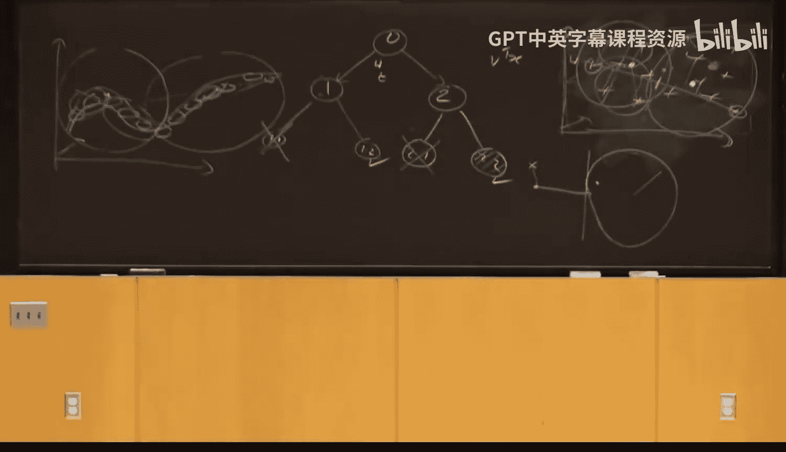

Okay， any more questions？Okay， have a little demo。 I actually wasted several months of my life trying to generalize balls into eggs。

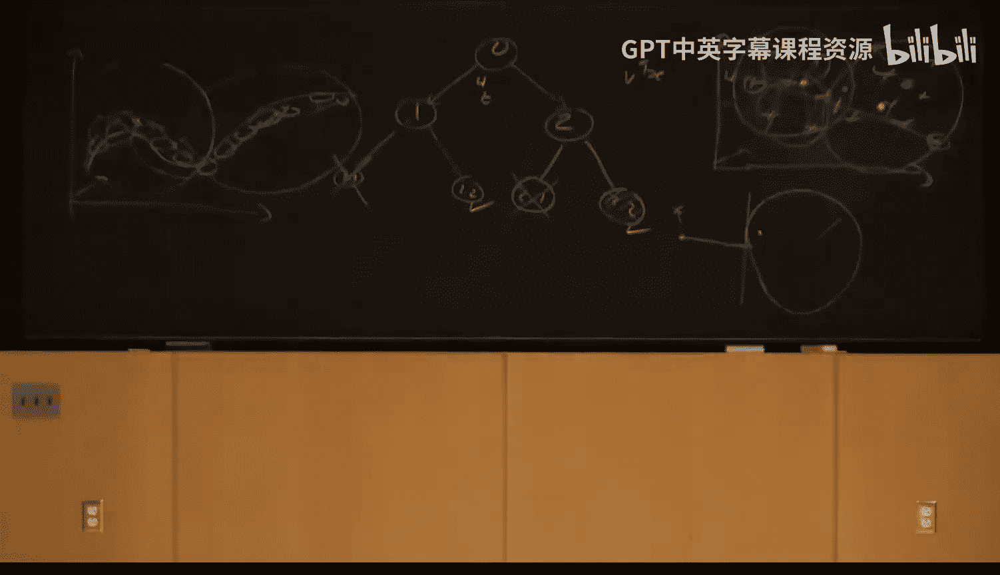

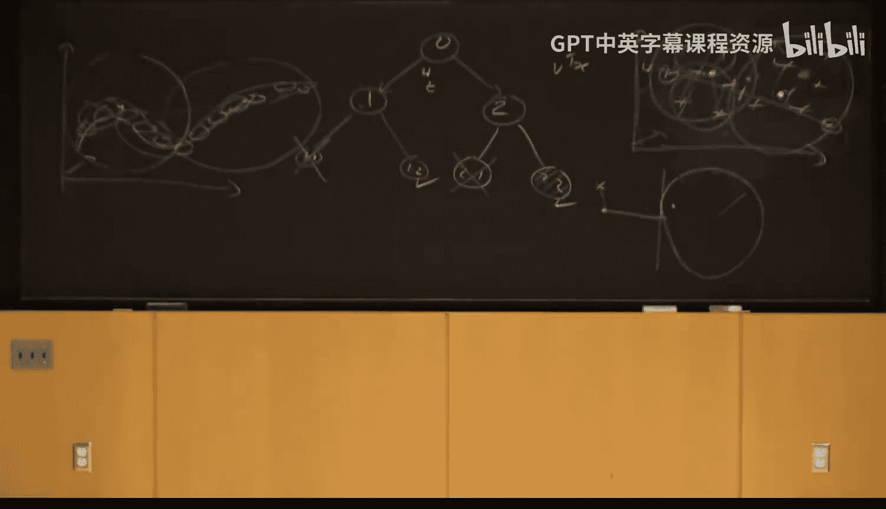

I just thought of this because I drew that egg。 So actually。

 I thought it could generalize as ellipsoids。And I called it egg trees。

And had these great jokes about eggs and Easter eggs and egg hunt and all this stuff。 But ultimately。

 it's not faster because the， the distance to an ellipoid actually is computationally so expensive that it's just much faster just to have two more levels of abalry。

😊。

Alright。Okay， so one thing I want to show you is first， a ball tree visualized。

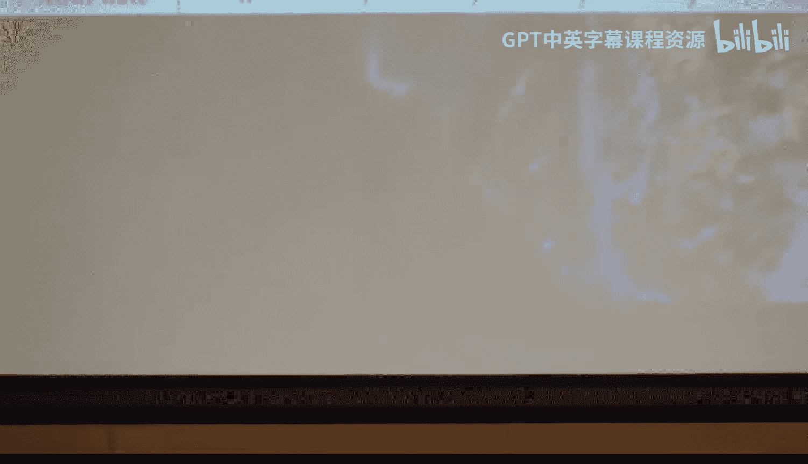

嗯，被哦哦哦。Okay， good。 Yeah， so this here is my data set。Oh my gosh。 This is like a。

Can you see the green dots inside the。If you do， you have good vision。That is。😊，Okay。😊，诶。😊。

So this is my data set。 actually， let me just trace it， so。Some of these dots are pink。

 Some of them are green。 If you only see the green ones， you should go see the doctor。And。Sorry。

So here's the， the data set follows the spiral here。

And the top node is basically a gigantic ball that contains the entire data set， right。

 species just take the mean of the data and take the massive， you know。

 just the radius to the furthest point of most distant point。 And that contains the entire data set。

😊，Now， I divide this in two， And this is what I get， Two more balls。

 and they have huge overlap overlapap here。 right， You can see this。😊，And then now I keep recursing。

 So in each one of these balls now， I find two mobile， right， and I keep doing this。

 I keep doing this。 I keep doing this。 And what you see now is these little balls， right。

 They really trace the data set very， very nicely， right。😊。

And I was I keep doing this until I basically have some stopping criteria。

 And this is my final data structure。 This is really a tree， right， So the top ball is the top node。

 And then I， you know， you know， you always have like 2，2 sub balls。😊。

And now if I want to do a nearest neighbor search， this year is my test point。

 The blue point is my test point。 So the first thing I do is I look into which one of these two。

 two spheres do I fall into。 I fall into the green 1。 So I descend into you know。

 always descendscent now。 So now again， I have two sub balls。 I fall into this one into this one。

 you， to see what's going on。 right， I'm going down the tree。 I always have two balls right or left。

 and I choose one of them。 Okay， and that's the one where I'm closer to the mean。

 That's the 1 I'm picking。😊，嗯。And so then I'm in the final ball。

 And here I do my nearest neighbor search。 I compute the distance to these， these guys。

 and I find my nearest neighbor。😊，And now I go into the， you know。

 go one up and I can actually rule out all these bossts。

 right because they all each one of them is already further away。 Then they my nearest neighbor。

 So I'm done。 Okay， so actually， the number of distance computations I had to make to data points is 3。

 I only have to compute  three distances。 And I had to compute a few distances to the means。

 But that's know， maybe 5 or something。 It depends how deep the tree bots， right。

 So in terms of computation， right， It's a massive saving。😊，Let me do one more。

 So here's another one this also。 Actually， this this is very， very close。 So， you know。

Maybe there's not。What。I don't know what just happened。W， do you still see them now。Sorry。

 about my time。OK。哎 yeah， here we go。嗯嗯。Oh， these are all very close。 So essentially you。

 you see what's happening。 I'm basically sending， then I compute the nearest neighbors。

 and then I go back out and all the red points。 I， I could rule out right away without actually any more distance computations。

 So it's a very， very effective way to do the nearest neighbor search， yeah。😊，That's all。ちょっと書いてます。

It's solve the problem for high dimensional data， if。Your data is intrinsically low dimensional。

 that's really。 So the nice thing of all trees is the ambient dimensionality。

 the the space of the ambience， so dimensionality of the ambient space does not affect your data structure。

😊，I can actually， I have that plot for you， too。嗯。Here's a bo。

 Here's a demo where I take a data set of digits。And I。Res。Sorry。I don't know why the。 Oh here we go。

 So， so what you see here on the right。Is what I'm doing here is I'm， I'm。

Increasing the dimensionality of my data。And I'm showing you here how many distances I have to compute。

 right， And you see even very low dimensional space。 these boundaries， you know。

 I have to compute like hardly any distances at all。 This is the power of 10 to the 7。

 There's a pretty large data set。 right， And but as my dimensionality increases。

 you can see have to compute more and more distances， right， So the， the savings go down。😊。

If you look at the time， actually， here's something funny。嗯。So here。

 the number of dimensionality basically tells me it takes me longer and longer。

And after 40 dimensions。I'm actually， I become slower than the brute force attack。

 So the blue line here is， what if I just did a brute forest attack and just compute the distance with everything。

And。Because not it's not actually all that much affected by by dimensionality。

So as I hit 40 dimensions at 40 dimensions， I still only compute fraction。

 like about half the number of distances。 yet I'm actually slower。

 Can anyone tell me why what's happening。So one more time that you understand what I'm doing here。

 right？ So what this graph tells me is how many distances I have to compute to other data points。

 right， actually， and and within the ball structure。

 So if I increase the dimensionality of my data set。😊，RightIf I do a nearest neighbor search。

 I have to compute more and more distances。 And this is because I can prune fewer trees。 right。

 That's the curse of dimensionality starting to bite me。In this data structure。

 I don't get much saving anymore。 But even at， you know，60 dimensions。

 I still only compute roughly half of the distances。 Yet if I look at the wall clock time。

 how long it takes me， I'm actually slower， right Does this see how long the red lines is。

 how long it takes me and actually， I'm actually slower than the blue line。

 the blue line is brute force。 What if I just compute the distance from every point to every other point。

😊，So how can this be。But compute the distance from every point to every other point and actually faster than if I just compute half the distances。

 Any suggestions， yeah。😊，The backtrackking takes too much time。 Actually。

 the backtrackking takes very little time， very， very little time。 What that's。

 but it's a good suggestion。 Yeah， else， yeah。That's exactly right。 So it depends on them， you know。

 It's because modern computers are designed for， actually just two things， Ca performance。

And number two parallelism， right。 So matrix modification， you can actually compute the distance。

 as you've seen in Project1。 If I compute the distance of a point to many， many other points。

 I can actually， you know， this basically just a matrix vector operations。

 which are highly optimized， right， and can be done parallel on these vector vector units on your chip And so you can exploit this very effectively。

 whereas if you do one distance at a time， you cannot exploit it。😊，And so as computers get， you know。

 with modern computers， this intersection point moves down rapidly。 actually。

 with GPUs it somewhere here， right， So GPUs allow you very， very fast parallel computation。

 and there's little benefit for from B trees。😊，What you effectively do is you just make the。

 the ball size， the leaf size much， much bigger。 That's essentially what you're doing， right。

 just means now you can search if you have hundreds of millions points and each leaf actually has maybe 100000 points。

 something like this。😊，Okay， any last questions about Ba trees。

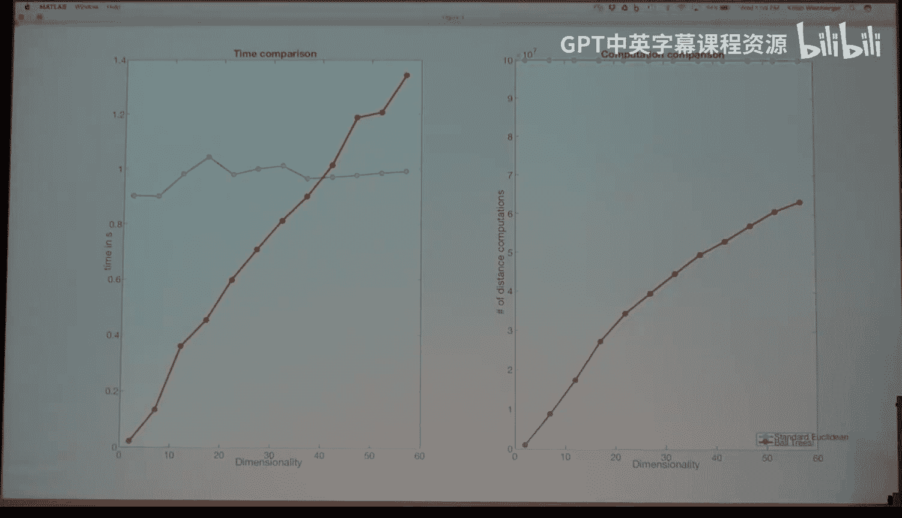

Yeah。Like。Be that for。Great like。哎哎。Every you。啊。

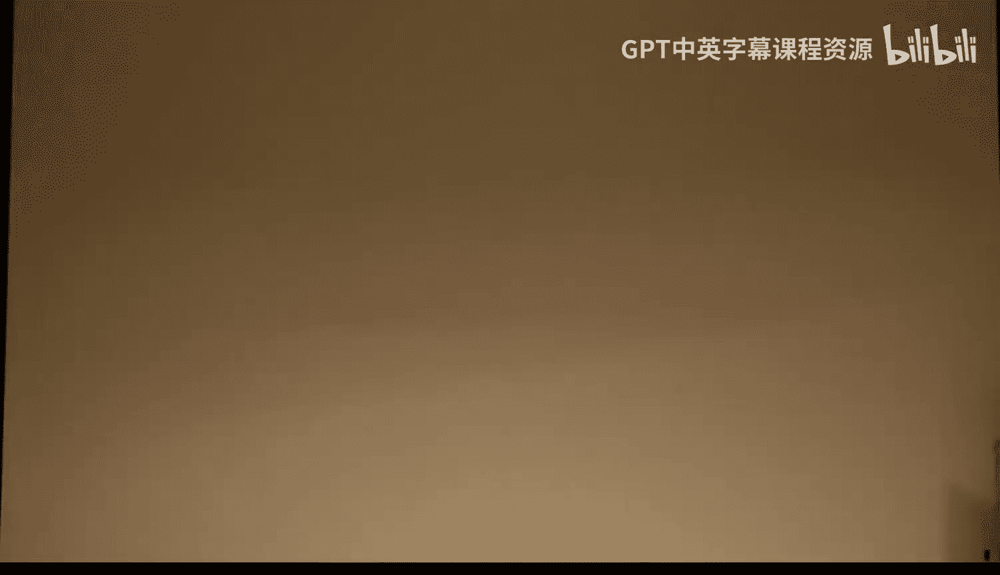

Yeah。near point。Yeah。So you want to position the space into， I mean。

 that's essentially what these are doing， though。Okay。

So spheres are nice because the distance to a sphere is very halfph to compute。😊。

And that's why you want to use spheres or boxes。Right， that that's really the motivation。 I mean。

 otherwise we could do， you know， I'd be known now for my egg trees， but it， you know。

 didn't it wasn't possible， right， because like other data structures is much more expensive。

 The distance to a sphere is really easy， right， Just compute the distance of this point to the center。

 right， subtract the radius， right， So that's really， really fast。😊，All right， any last questions？

Okay， good stuff。Well， there was a reason。 actually， I， I， I want to talk about this and。

It's the next topic。嗯。Oh， shoot。 Does someone have two copies。 I gave my own copy away。Wait， wait。

 before you pass them on。 No， no， no， no， no， I have to intercept。Okay， thank you。

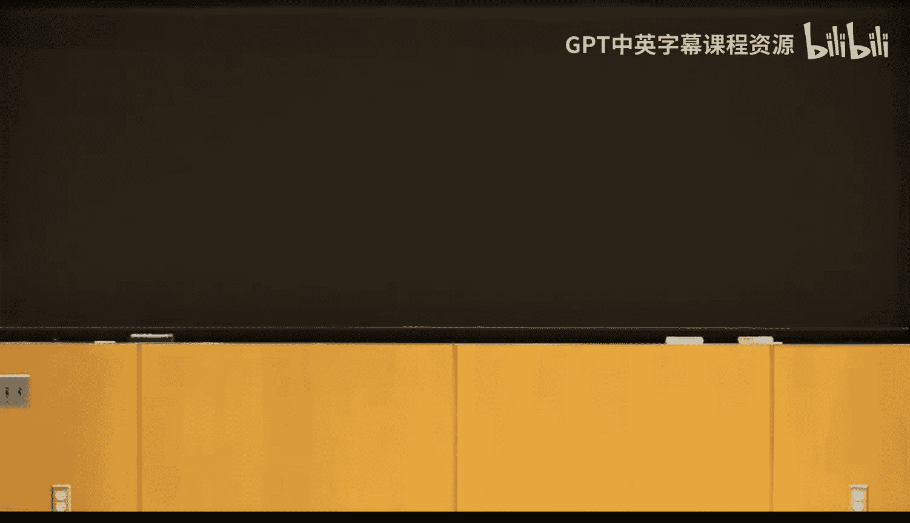

O。Yeah。What we look cover now is one of the oldest machine learning algorithms。

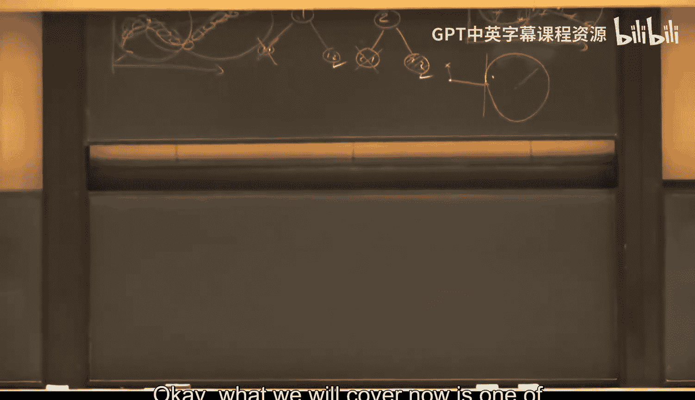

But， it's actually。It was written off as， as pretty bad and kind of didn't get much the attention anymore。

But then actually had a major comeback。Because it turns out， actually。

 So we talk about as decision trees。And decision trees are not very good algorithms。

 They really are not。But if you understand， buyers variance straight off。

Then you can make them amazing algorithms。 And that's what we will talk about now。

 So let me briefly introduce you decision trees。 And what I will do is I will start with Kaie trees。

😊。

So here's the idea。 One more time。 we have this Kay tree。嗯。let me draw。

 You know what you deserve a new Katy tree。Yeah。Here's a new。Okay， assume you want to do。

One year is neighbor classification。 We have two classes for now。So if I put my， my。Oh am I。

My access。And this is what my dataset looks like。And now I want to do nearest neighbor search。Well。

 the first thing that people realized is that even with Katy trees， things are still too slow， right。

So actually finding the exact nearest neighbor。It takes a lot of time。

 And most of the time you're back tracking。 But actually， all this backtracking， right。

 is just to make sure that you really， really got the exact nearest neighbor， right。

 You probably got a pretty good nearest neighbor when you went down here and did your first church。😊。

And then just make sure it could somewhere here behind a wall hide another nearest neighbor， right。

And when you think about it， it doesn't actually really matter who your nearest neighbor is。

 right Again， nearest neighbor classificationification。You just care about making a prediction。

 right， And if it has the same label， it doesn't actually make any difference。

So the first thing people did is they did approximate nearest neighbor search。

 and approximate nearest neighbor search is really simple。

You build a ball tree or you build a Kty tree。😡，You have a test point。 you go down to a leaf。

 You find the nearest neighbor in this， in this leaf。And that's it。You don't do any backtracking。

And that's super fast。 That's ridiculously fast。you just have log and operations to go down to the leaf。

 That's it's nothing， right， And then you do a few nearest neighbor searches in here。 right？

 So now your nearest neighbor search is really， really， really， really fast。

Sometimes a little bit less accurate。Because you didn't actually correct correct。

 Maybe you were just on the boundary。 And， you know， maybe you were just behind a wall。

 and turns out that， you know， right behind the wall， a lot of points from the other class。

 But these are kind of pathological cases。So one more time， you just go down the leaf。

 You find the nearest neighbor in that leaf。You return that nearest name。

so that's approximately nearest Ne search。Works great for nearest neighbor classification， because。

 again， there， you don't need the nearest neighbor。 The The exact nearest neighbor doesn't matter。

Alright， so that's good。 But we can make it even faster。案子。Here's how。 Well。

 imagine to go down this tree， right， And now you're in this box。And now I。

Computing the nearest neighbor。Well， I claim I don't actually have to do it。Why not？Any ideas。Okay。

 one more time， The question is。You go down， go down into these leaves。 And I claim actually。

 that in three of these four leaves， you don't have to find the nearest neighbor。

 I give you a minute。 Try to figure it out with your neighbor。

Orhy is it too obvious that people just shy。There's two obvious okay。Well。

 if someone who's not author raises his hand and says that's the right thing。 then I， yeah。No我爸。所有的。

8。YouYou know that。You know what the box is， And why do you not have to find the nearest's neighbor。

来。They're all X。 That's right。 right。 So as you construct the tree， right， you just say， by the way。

 these are all aes。 right So if you ever fall in there， the nearest neighbor will be an X， right。

 Don't bother finding it， right。This is all axis， right， This all， sorry， thiss old O's。

 Thiss old O's And here in this one here， there's three O's。And two for five times exit。Okay。

 so if you do get approximate years neighbor search， you fall in here， you just say， oh， right。

 you don't even have to do it。And that's。Even faster。

 And it's even better because you don't have to store the data。 You just store the tree。

 You just store this label at the bottom and you don't actually have to store anything else， right。

 So now suddenly， your data set， your algorithm beforehand， you needed D times N storage。

 You have to store the entire training data set and that data structure on top。

 Now you just have to store the data structure。 right and the data structure takes absolutely no storage is tiny。

 absolutely tiny。 So that's not a big deal at all， okay。So last question is。

 what have we fall in here， right， This is， this is the box where we have 30s and 2，4，5 x's。

 right here， we would have to do a nearest's neighbor search。😊。

But one thing we can just do is we can say， well， actually。They you， skip it。

And let's just store the following and say， well， the probability of an x is 5 over 8。

 and the probability of an O is 3 over 8。And we just pick your nearest name at random。

And if we do this， then we， we can also throw away the data。 and all we need to store is how many x。

 how many Os there are， right， So basically here we say you are dead certain。

 here we say you' are uncertain。 but we know exactly how we uncertain。

 we know that actually three out of eight times。 It's an， it's an0 and five out of8 times。 it's an X。

 yeah。😊，Like。发。Very good question， so。Okay， wait， before I get to this question。

 does this make sense， raiseise your hand if that makes sense。对个。Okay， some people seem confused。

Raise the hand， it doesn't make sense，'s。All right。So one more time。

 I this decision tree to bid this Katy tree to find the nearest neighbor。What I do during test time。

 I go down to the leaf。You know， compute the nearest neighbors。 The first， you know， go to one leaf。

 find the nearest neighbors。 then I backtrack， you know， and check every single leaf。 if they are。

 you know， the nearest neighbors in there， I can prune some。😊。

The first approximation we made is we said， okay， well。

 all you do is you just go into the first leaf that you fall into and you find the nearest neighbor there。

 That's a lot faster。😊，The second approximation to say， well。

 we don't even find the nearest neighbor。 We just output like if these are all the same label。

 then we don't actually have to find the nearest neighbor， we just have to say what that label is。

 because all the nearest neighbors have the same label。

 And we know what you're going to use that label for for the nearest neighbor classification。

 So doesn't make any difference。😊，If you fall in such a leaf where there' actually this mix between xs and o's。

Then you would have to do a nearest neighbor search， but we say， well， don't bother。

 All we're doing is we just say， you know， in this case。

 there's eight points of the training that fallen into this。 three of them are O's，5 of them are Xs。

 So we just give you that information。 We say， well， we are uncertain about the label。

 but there's  three，8 probabil is an O and 5，8 probabil in X。Now。

 the question that was just asked was， well， if we know we are doing this。

 couldn't we just keep splitting until this is。Could be， for example， split this one more time。Right。

And you keep splitting and splitting and splitting until。Every leaf is pure。 First question。

Is that always possible。can I always take my data and keep splitting。Until every single leaf is pure。

If yes， why， if not， why not？Or。If it's possible under what conditions is it possible。

 I'll give you a minute， You and your neighbor try to figure out the proof one way or another。

 Either come up with a counterex or proof that it's always possible。被。は。Yeah。你有。你要。死你。Yeah。어 살。

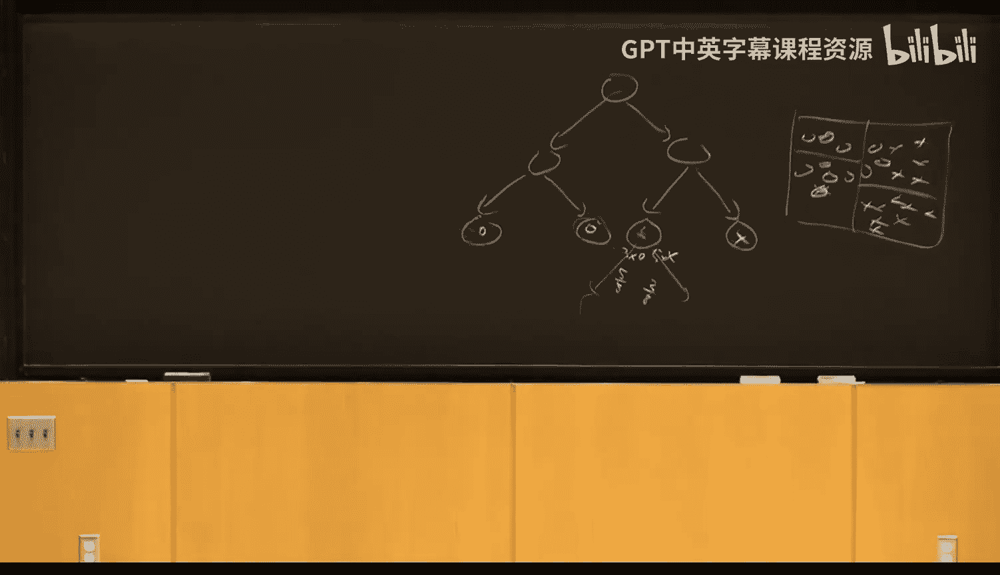

Okay。I。不。有。Yeah。

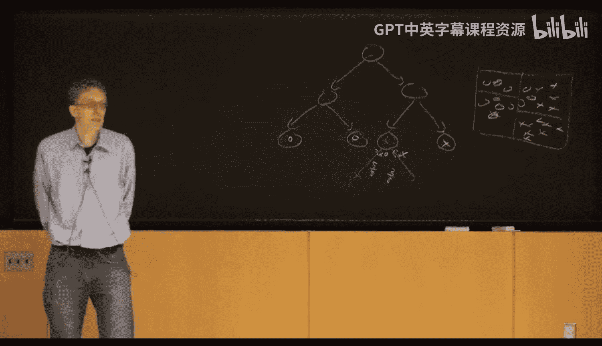

Yeah。8。I。不。All right， who has an answer， Raise your hands。

Can you always keep splitting until every single leaf is。P yes or no。2，3， Any else。Okay。

 quickly have a vote。 Who says yes， Ra your hand。Who says no， Raise your hand。It's tied。哎。Alright。

 so first argument。Sure。Answer yes or no。 Can you always do it or not。然。Yeah。So on。If you， I mean。

 so if you haven't。Cent are exactly on top of each other with different labels。

 Then there's just no way to split that up。 That's exactly right。 So the answer is no。

Because you could have two points that have exactly the same features。That have two different labels。

sych。Yes， that is kind of a， you know， it's a pathological case， but it's absolutely right。

 So that's the counter example， right， you cannot do it。😊，But if you rule out that case。

 can you now always do it。Yes， right the answer is yes， right， so。

And that's exactly the official answer， by the way。 That's absolutely correct。 So， you know。

 as long as the moment you have two points that are exactly identical。

 they will always end up the same belief。 There's nothing you can do about it。

If you don't have that case。嗯。Then you can always split。

 And what you can do is that you the proof is very simple。 that basically its say， you know， by。

 you basically prove it by contradiction。 You say， assume it's not possible。

Then you build up a tree and you end up with a leaf that has two points that have different labels。

These two points can't be the same because that would be the counter example you just mentioned。

 We ruled that out。 Therefore， they must be different in one feature， at least。So what we can do。

 we can just take the median。 you know， we can just difference between these two and split on the median。

 And now we could split again。 And now they're in different leaves。 So that's a contradiction。 right。

 So， it must always be possible。Okay， very nice。 There's a question。 No， yeah。So， O， good question。

 So what does that case exist。 So it's easy to check。 And basically。

 you have to implement this in your project and you have to make sure that doesn't。E corrupt you。

That's also a very simple way of making sure this never happens。

Any idea how to make sure that can't happen yeah。Yeah， either one。 That's exactly right。

 You just add a little bit of Gausian noise。 right， That's basically 10 to the -9， right。

 so it doesn't make any difference， but it's the computer can tell the difference between them。

 You add a little noise to every single training point。 Now。

 two points will never be exactly identical， right's。😊，Probity 0， essentially。 And then。

 then it will always work out， yeah。Where。3ポイン？おいて現に。对。我还要等担。欢迎。変った。有や的。嗯。

So if you split on the median， you always say the median either goes to the right left。

So you just think that it you say greater equal to the right or less than to the left， yeah。

I have some little thing that I want to do。 But， you know， given us 2，15。

 maybe we start next lecture。With my slides。