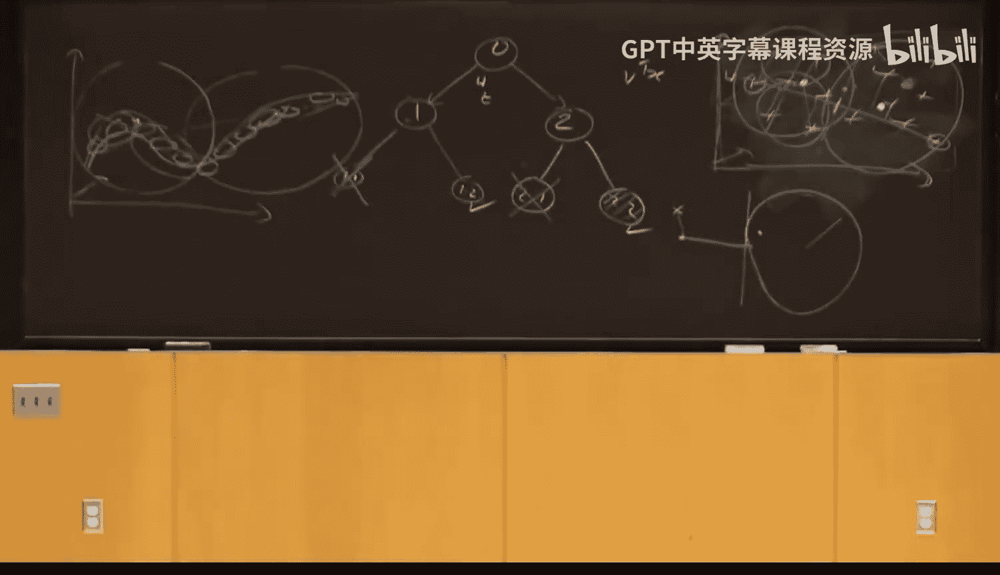
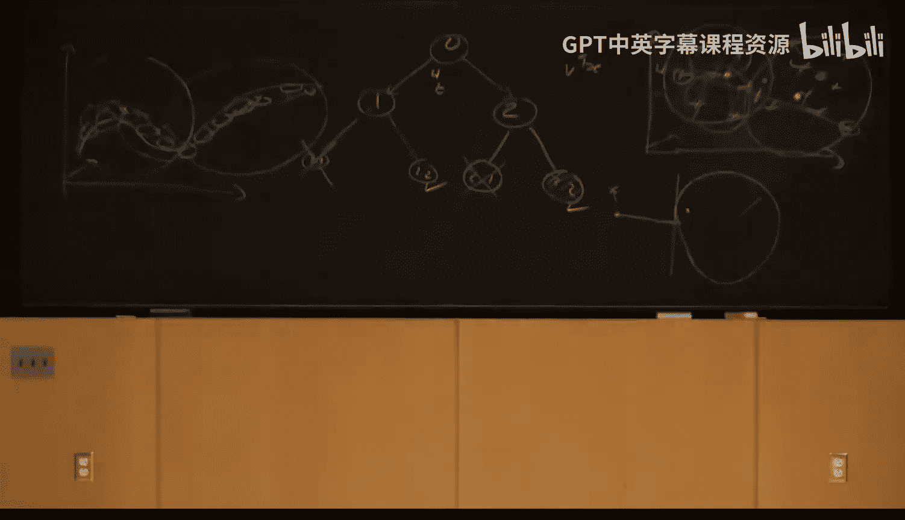
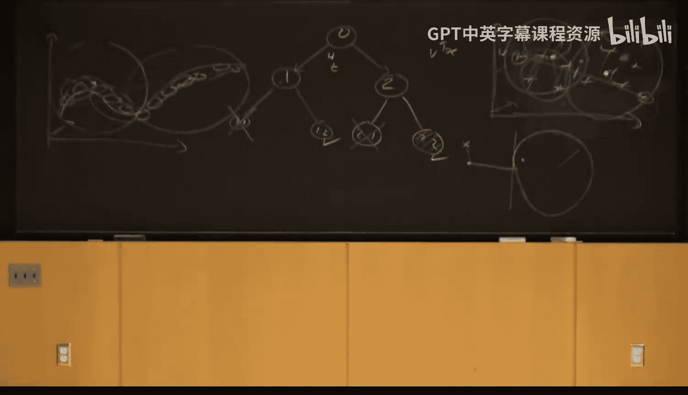
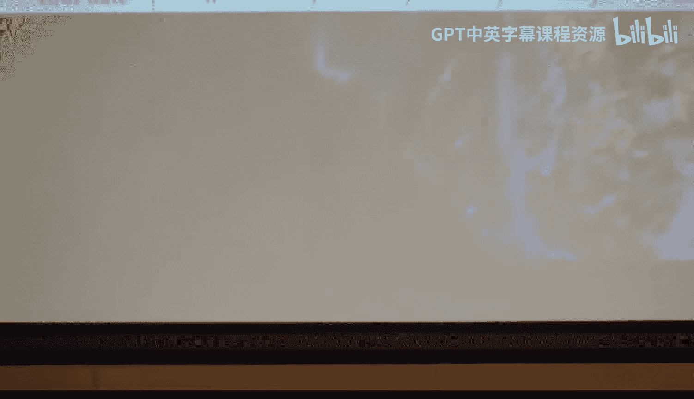
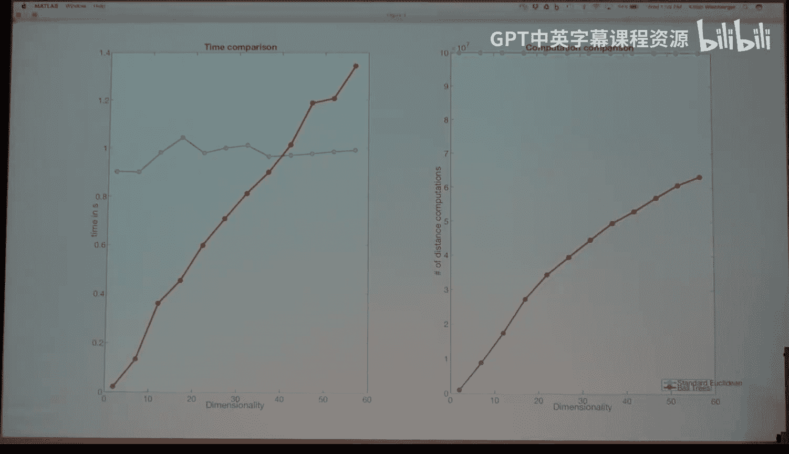
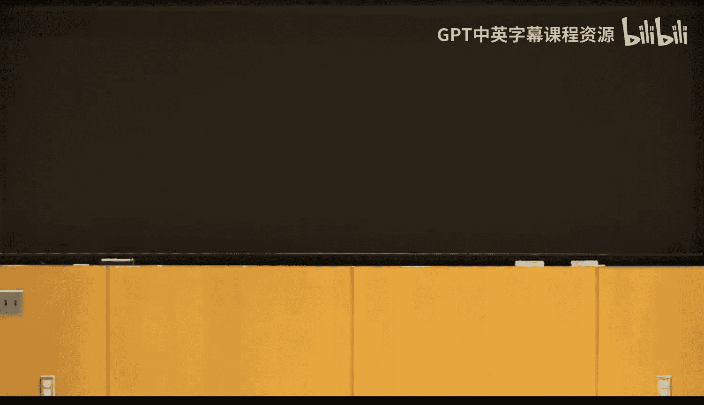
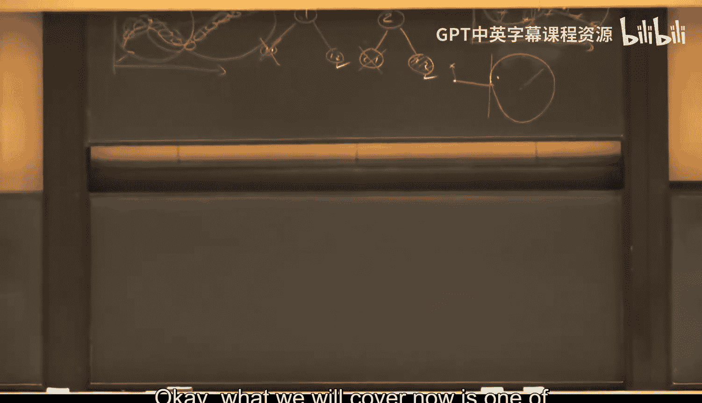
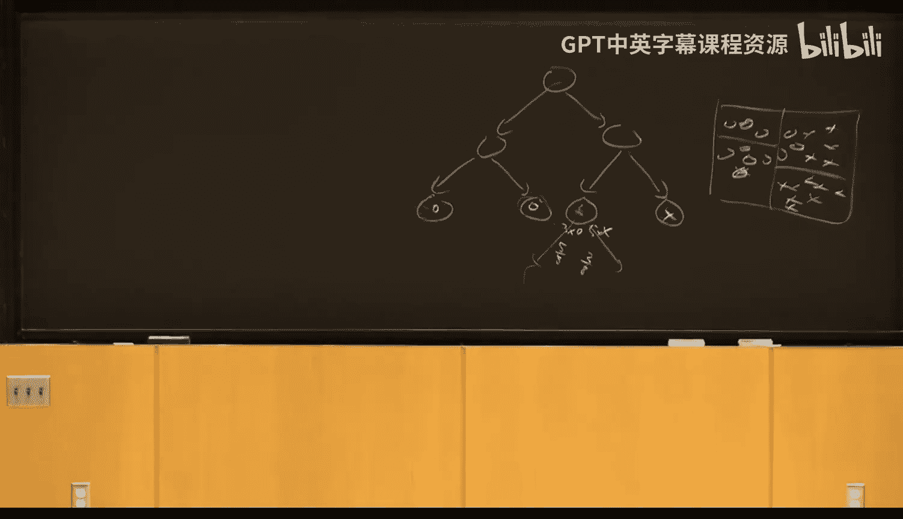
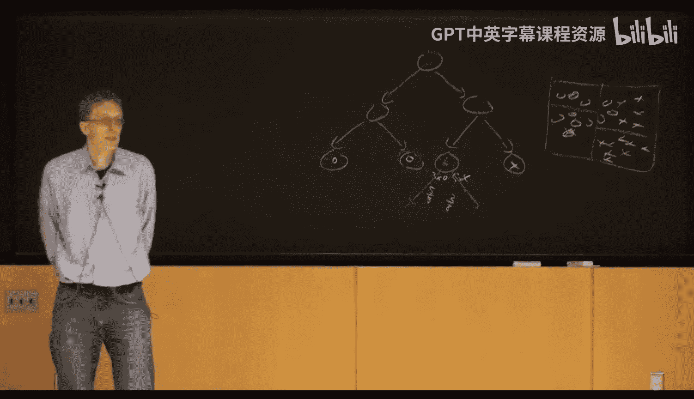

# 机器学习：028：球树与决策树 🎯

在本节课中，我们将学习两种重要的数据结构：球树（Ball Trees）和决策树（Decision Trees）。我们将从回顾上一讲介绍的KD树开始，探讨其在最近邻搜索中的应用及其局限性，然后介绍球树如何克服这些局限。最后，我们将看到如何从近似最近邻搜索自然地引出决策树的概念。

## 回顾：KD树 📐

上一节我们介绍了KD树，这是一种用于加速最近邻搜索的数据结构。其核心思想是递归地将数据空间沿坐标轴进行分割。

### KD树的构建

构建KD树的算法很简单：
1.  从包含整个数据集的根节点开始。
2.  选择**数据分布最分散**的维度。
3.  计算该维度上数据点的**中位数**。
4.  将数据点分割：大于中位数的进入右子树，小于中位数的进入左子树。
5.  对左右子树**递归**地重复步骤2-4。
6.  当节点中的数据点数量小于某个阈值 **M** 时停止。

这个过程会生成一个二叉树，其深度约为 `log2(N)`。

### KD树的最近邻搜索

对于一个测试点，搜索其最近邻的算法如下：
1.  从根节点开始，根据分割规则**向下遍历**树，直到到达一个叶节点。
2.  在该叶节点内计算测试点到所有点的距离，找到**当前最近邻**及其距离。
3.  以测试点为中心，以当前最近邻距离为半径画一个“球”。
4.  开始**回溯**。对于路径上的每个父节点（对应一个分割超平面），检查这个“球”是否与超平面**相交**。
    *   如果**不相交**，则可以“剪枝”——排除该超平面另一侧的整个子树，因为其中不可能有更近的点。
    *   如果**相交**，则必须进入该侧子树进行搜索。
5.  重复步骤2-4，直到检查完所有可能包含更近点的分支。

这个算法本质上是带有剪枝的深度优先搜索（DFS）。

### KD树的局限性

KD树在**低维空间**（如2维、3维）中表现优异。然而，在**高维空间**中，其性能会急剧下降，原因在于“维数灾难”：
*   在高维空间中，数据点趋于稀疏，最近邻的距离与最远邻的距离差异不大，使得最近邻搜索本身意义减弱。
*   更重要的是，KD树使用**轴对齐**的分割方式。在高维空间中，数据点几乎总是位于分割超平面的“边界”附近，导致回溯时无法有效剪枝，最终可能仍需检查几乎所有数据点。

即使数据**本质上是低维的**（例如位于一个嵌入在高维空间中的流形上），KD树依然无效，因为轴对齐的分割无法适应流形的复杂结构。

---

## 球树：应对高维数据 🌐

为了解决KD树在高维空间中的问题，我们引入了球树。球树的核心思想是**放弃轴对齐分割**，使用超球面来划分空间，从而更好地适应数据的几何结构。

### 球树的构建

构建球树的步骤如下：
1.  对于一个数据集，我们希望找到一个具有**最大展布**的方向进行分割。一个高效的启发式方法是：
    *   随机选择一个点 **A**。
    *   找到离 **A** 最远的点 **B**。
    *   找到离 **B** 最远的点 **C**。
    *   向量 **BC** 的方向近似于最大展布的方向（类似于主成分分析的效果）。
2.  将所有数据点投影到方向 **BC** 上，并沿投影值的**中位数**将数据集分成两部分。
3.  对于每个子集，计算其**均值点**（中心）和到最远点的**距离**（半径），形成一个能包含该子集所有点的**最小包围球**。
4.  对每个子集**递归**地重复步骤1-3，直到满足停止条件（如球内点数少于阈值）。

最终，我们得到一棵树，每个节点存储着一个球的**中心**和**半径**。

### 球树的最近邻搜索

搜索过程与KD树类似，但判断逻辑变为基于球面距离：
1.  从根节点（最大的球）开始，根据测试点离哪个子球中心更近，选择一条路径**向下遍历**至叶节点。
2.  在叶节点包含的数据点中计算最近邻，得到当前最佳距离。
3.  开始**回溯**。对于路径上的每个兄弟节点（对应一个球），计算测试点到该球**中心**的距离。
4.  如果 `(距离 - 球半径) > 当前最佳距离`，则该球内**不可能**有更近的点，可以剪枝整个子树。
5.  否则，必须进入该球进行搜索。

**球树的优势**在于：
*   **对高维不变量**：其性能主要取决于数据的**本征维度**（如流形的维度），而非环境空间的维度。增加无关的噪声维度或进行旋转，对球树结构影响很小。
*   **几何适应性**：球面分割能更好地包裹低维流形上的数据。

### 球树的性能考量

尽管球树在高维下比KD树更有效，但随着维度升高，其剪枝效率也会下降。此外，在现代计算机架构下需要权衡：
*   **向量化计算**：暴力计算（计算测试点到所有点的距离）可以利用高度优化的矩阵运算和并行计算（如GPU），速度极快。
*   **单点查询开销**：球树每次查询需要计算点到球心的距离并进行逻辑判断，当数据维度很高、剪枝收益不大时，其开销可能超过暴力计算的向量化优势。
因此，在实践中，可以通过**增大叶节点球的尺寸**（包含更多点）来平衡树的深度与向量化计算的优势。

---

## 从近似最近邻到决策树 🌲

基于树结构的最近邻搜索可以进一步优化，从而引出一个经典的机器学习算法——决策树。

### 近似最近邻搜索

首先，我们做一个近似：进行最近邻搜索时，**不进行回溯**。
1.  从根节点开始，沿着树向下遍历到**一个叶节点**。
2.  仅在该叶节点内寻找最近邻并返回。
这种方法速度极快（仅需 `O(log N)` 次遍历），虽然可能不是精确最近邻，但对于分类任务，只要返回的邻居标签正确，结果就是可接受的。

### 存储标签而非数据

我们可以进一步优化：在构建树时，记录每个叶节点内数据点的**类别分布**。
*   如果一个叶节点内的点**都属于同一类**，那么任何落入该节点的测试点，其最近邻都将具有这个标签。因此，我们无需存储原始数据，只需在该叶节点上存储这个**确定的标签**。
*   如果一个叶节点内包含**混合类别**，我们可以存储类别的**经验概率分布**（例如，5个A类，3个B类，则概率为5/8和3/8）。对于测试点，我们可以根据这个分布进行随机预测，或者直接输出概率。

这样，我们就不再需要存储原始训练数据，只需存储树结构以及每个叶节点的标签或标签分布。模型大小变得极小。

### 决策树的诞生

上述思想自然引出了**决策树**算法：
1.  它是一棵树结构，每个内部节点代表一个基于特征的判断（类似于KD树的分割规则）。
2.  每个叶节点代表一个决策结果（分类标签或回归值）。
3.  预测时，从根节点开始，根据测试样本的特征值选择分支，最终到达一个叶节点，并输出该节点的结果。

一个关键问题是：**能否通过不断分割，使所有叶节点都“纯”（只包含同一类数据）？**
*   **答案是否定的**。反例是：存在两个**特征完全相同但标签不同**的数据点。它们最终必然会进入同一个叶节点，无法通过基于特征的分割将其分开。
*   **排除上述情况后，答案是肯定的**。只要没有特征完全相同的异类点，总可以找到某个特征及其分割点，将不同类的点分开。可以通过归纳法证明。

在实践中，为了避免“特征相同、标签不同”的情况，可以在数据中加入微小的随机噪声（如 `1e-9`），这在数值上几乎无影响，但能保证算法的顺利进行。

---

## 总结 📝

本节课我们一起学习了：
1.  **KD树**：一种用于低维空间最近邻搜索的高效数据结构，使用轴对齐分割，但在高维空间因维数灾难而失效。
2.  **球树**：通过使用超球面分割来改进KD树，能更好地处理高维数据和低维流形，其性能依赖于数据的本征维度。
3.  **从近似搜索到决策树**：通过放弃精确回溯、仅搜索单一叶节点，并最终用叶节点的标签分布代替原始数据，我们自然地推导出了决策树的基本框架。决策树是一种古老但重要的模型，后续我们将看到如何通过集成方法使其变得非常强大。