# 029：康奈尔大学《智能系统的机器学习｜CS4780 Machine Learning for Intelligent Systems 2017》中英字幕 p29 -29-Machine Learning Lecture 29 ＂Decision Trees _ Regression Trees＂ -Cornell CS4 -BV1Lo6gBxEKE_p29-

Alright， so last time。If today's something event is， is something event today why is it so sparse。

 is there a reason。

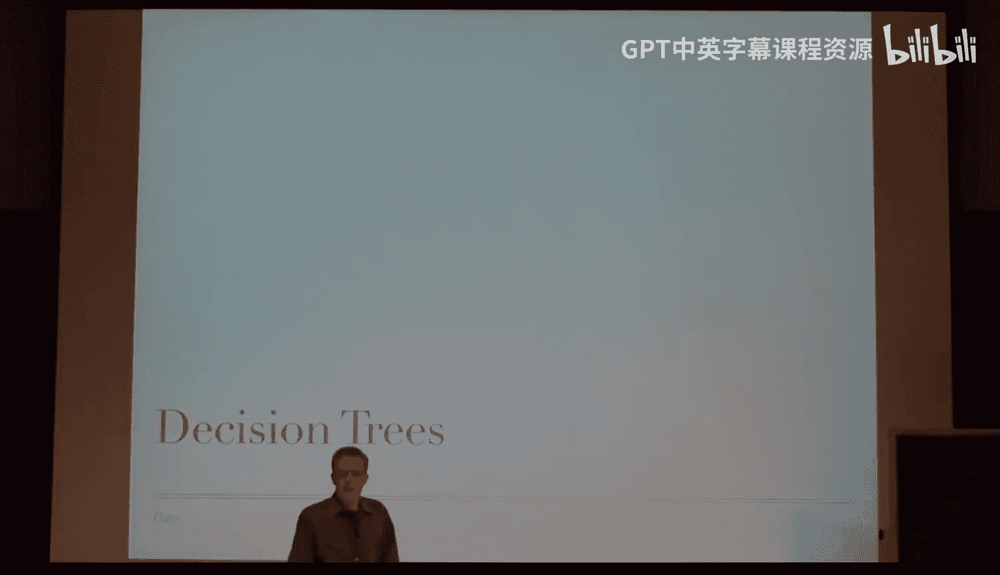

Sorry。Oh yeah， they're goats。 Yeah， they're goats on the lawn。 I got to put a goat on my way here。

 They're goats on the lawn。 Okay， well。I can't come people with goat， can I。So。Where are the goats。

Its right outside of Gold Smith pretty much in the Okay， al right。Yeah。嗯。All right。

So last time we talked about Kad trees。And， in particular。We thought， well。

 the first thing we started out with， sorry one second， where's my chalk。嗯。

So we built this decision tree。Like repeatedly splits the data in half。And so we said。

 all if we used this to do nearest neighbor classification。Then one thing you could do is， you know。

 it could actually， it doesn't really matter if you have the exact nearest neighbor as long as you have it approximately。

 because ultimately， you're not interested in what exactly is your nearest neighbor。

You're interested in what is the label of the nearest neighbor。 So if you get the。You know。

 one removed to something。 It doesn't probably doesn't make much of a difference。

 So we could speed up the algorithm a lot if you just go down the tree and then just only do a nearest neighbor searching that leaf。

And that was the first approximation。 That's called approximation nearest neighbors。 Then he said。

 well， wait a second， if we do this， right， if I only search for the nearest neighbors in here， well。

 imagine we have the scenario that all the points in here actually across。😊。

Then I don't have to do a nearest neighbor search， because the only thing I'm interested in is what is the label of my nearest neighbor。

 Well I know the label of my nearest neighbor inside this box without even finding the nearest neighbor。

 it's a cross， it's positive。😊，So one thing you could just do is instead of actually doing the News research。

 you just associate a label with each one of these， right。Something like that。And。

That's essentially where decision trees start。 So I just have three slides， you know decision trees。

 And just to get you guys started。 So I want to go back to the problem that we've seen before。

 It's a very important problem in the real world。 Its is your day good or evil psychopath。😊。

And the training did said once again， are superheroes。

 So we have good superheroes that are all psychopaths and bad superheroes who are also psychopaths。😊。

嗯。And， my feature said， I think I got it right this time。 I think last time someone found a mistake。

 but I think。😊，So we have the features。 Do you have wear a mask， Do you have a cap，Do you wear tied。

 as I remove the feature， if you wear your underps outside your pants。

And so the first three are good。 The next three are evil。 And these year are my test cases。

 So these three， I'm not sure about bad girl， the Ridr。 And this is your date。😊。

And you would like to know， is he or she evil。 And instead of knife base this time。

 what I would like to do is build a decision tree。And。Here is a decision tree。

So I basically first thing I say， does the person smoke， yes or no？And if the person smokes。

 then I say， do you have ears， Well， ears， I mean， pointy ears， I guess。Most people have years， and。

If I say if the person does not smoke， then it comes down to let the person may a mask。 If no。

 then while people who don't smoke and don't wear a mask are usually evil。

 But if the person wears a mask， then depends on what is the height greater than。1 75， that's not。

 that's mere It' any。 that's my European upbring。 Okay， so we can now test this。 First question is。

 this is a good tree。 Would it misclassify anybody。 So maybe just take a look。

And you and your neighbor see if I can， if this is consistent。That means do I get everybody right。嗯。

And feel free， discuss it with your neighbor。 I give you a minute。Yeah。Yeah。Great。Yeah Iで。我这个。

All right。Yeah。Any complaints。点啊。Alfred， that's right。 Poor Alfred， right。

 It's always been a loyal friend。And we say he's evil。 Let's just test this。

 So we put all the people in there。We check who smokes and who doesn't smoke。 So if you do this。

 turns out only penguan actually smokes。Then we check next devil。

I think that's just the penguin as he has point that is not at point ears。 So he's evil。

 Then we have all these other guys who wears a mask。 who doesn't wear a mask。

 turns out Joker and Alfred don't wear a mask。 right， So here we have our misclassification。

 Alfred actually is turns out as good， but he becauseman is evil。

 Now we have the remaining ones that' I think Batman， Robin and the cat womanman。

 And turns out the cat woman is a little smaller。 So she's evil。 But we get Alfred wrong。 right。😊，So。

Of course， what we showed last time is you can actually always get a consistent tree。 right。

 And that's important you could split here again， get any idea how we can split again to make this correct。

😊，Any idea。该。Tie， for example， That's right。 So the tie， then will be if you wear a tie。

 then it will be good。 Otherwise it will be evil and then you split again。

 right So and we derived this last time， as long as we don't have two identical points。

 We have different labels。 You can always keep splitting until you get everything right， right Now。

 it turns out actually in practice， You know， you can do this， you can keep splitting。

 and you can make a really， really complicated tree that's always gives you 0% trusting error。

 But turns out that's actually not typically what you want to do。

 any idea why you may not want to do this。😊，Yeah， bitting。 At least overfitting。 That's right。 right。

 So if you basically essentially， you know， split until basically every single point is right。

 You have millions of data points。 You know what you what you're essentially do is you just memorize your data set。

 right， so that's the danger and。😊，What I will show you in a minute。

 in a few minutes is that decision trees。Have a very。

 There's a very tight balance between biasers and variants。So can anyone tell me。

 when do we have high bias， when do we have high variance。As a function of the depth of the tree。

Yeah。一会带。That's right。 Low depth means high eyes。系的。That's right。 So high depth means high variance。

 Okay， so I will show you demo in in a minute to see this on a real data set。

 So the promise if your data is， you know， if you're。😊，If you a tree is too small。

 then you probably even have a high error on your train asset。 That's a high bias scenario。

 If it's too deep。 and you get your train asset right。

 But actually you test that you will have a large error。

 And so what you want to do in practice is you would like to find the tree。

 the smallest tree that gets your trained dataset。 All right。 That would be the perfect， you know。

 that' it's kind of the goal of the decision tree algorithm。😊，And turns out that's an N hard problem。

So who has heard of NP hard？Okay， awesome， good。 So MP hard is really hard。😊，Take a long time。

 So it just means basically， if your data set gets larger， the amount of。

Extra computation time I have to do to accommodate the extra data grows exponentially and everything that grows exponentially should。

 you know， scare you。 So basically very soon you will have a data that you know。

 will force you to train longer than， you know， the time we have left in our solar system or something。

 right， So that's not。 that's invisible。 But turns out there's many good heuristics to find trees that are actually small and and work well。

 So。😊，one second， let me just， Oh， sorry。Okay， so this we did。This we the last time。

 So one quick quiz， maybe I give you a minute。 You and your neighbor。

 try to come up with the smallest tree that gets every single point right。Yeah。

 did you know it already。Okay， as is the question。 Yeah。

 can you So if you the right side of that have Oh yeah， you can split on the same feature。

 The question is， can you sp on the same feature multiple times。 And the answer is， yes， absolutely。

Alright， so I give you a minute。 Try to figure out what's the smallest possible tree that gets every。

 every， every data point， right。い个。Yes。え。Yeah。じゃあそれらはい。Okayて。这一らこで。Okay。Yeah。If you have cake。1外块钱。

Yeah。Yeah。Okay， any suggestions。Who is a small tree？ Yeah， How many spits do you have，2 spits？

 That's pretty good， yeah。23。哎。That that makes Batman and Robin good。

 And everybody else is still in limbo， yeah。What are。And that cuts off Alfred。 That's good。

 And everybody else stay you。 That's's right。 That's， that's perfect。 That's great。

 I think that's the smallest tree you can actually get。 Actually， when I made the slides。

 I think I didn't find that solution。😊，It's MP hard。😊，Alright。

 I don't think I do have an animation here。 So that's actually that， that was my tree。 step 2。

 but actually has three notes instead of two。😊，Okay。Let me just show you how to do it in practice。

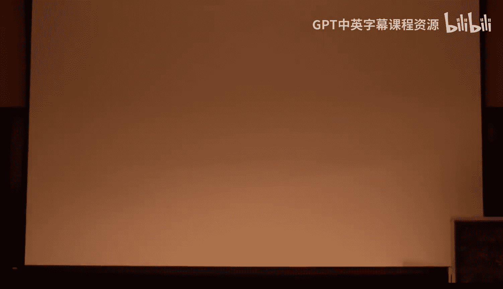

How do actually， how do actually build that。

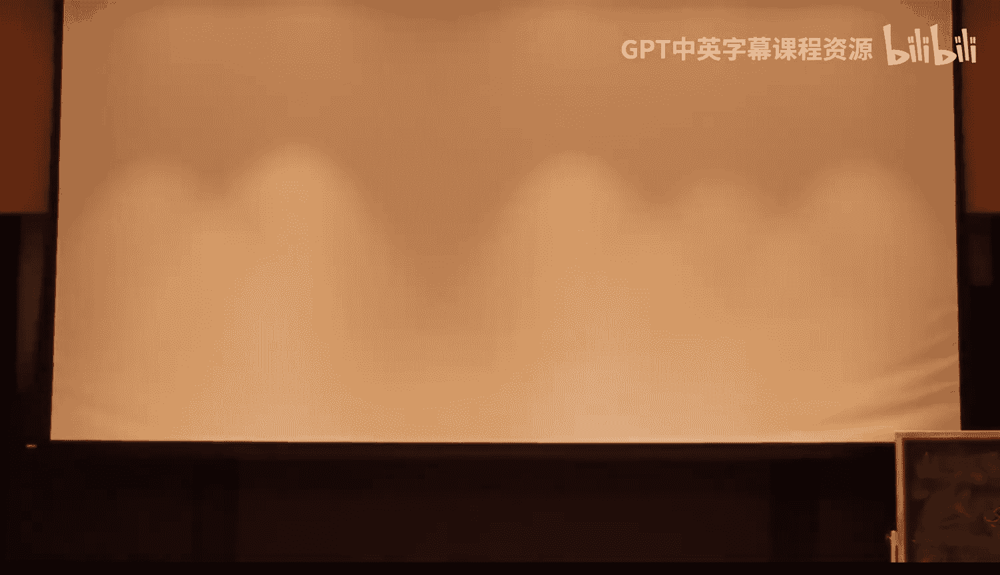

How to build these trees。Alright， and the way it works is， it's actually very similar to K D3。

Usually， we just， there's many different variants of decision trees。 And by the way。

 one thing I just want to say is decision trees are horrible machine learning algorithms。

 They really suck， right， They're absolutely terrible。However。

They have such clear bias variance problems。That it's very， very easy to address those problems。

And if you address the variance with bagging and if you address the bias with boosting。

Then they become amazing algorithms。 So don't be disappointed yet。 today， we're doing decision trees。

 Very soon we will be backging on boosting。 And these are basically basically methods to， you know。

 compensate for high bias or high variants。 And then they become very， very good algorithms。 In fact。

 actually， you're probably using it every single day。 So search engine， for example。

 are just boosted decision trees。 That's typically what people use。 And also random forests。

 which is bagged trees are one of the most one of my favorite machine learning algorithms。

 They're very， very， very strong。 So a single tree is not very powerful。

 But once we we correct them you know， we will do this in the next couple lectures。

 they become amazing classifiers。😊。

Okay， so once again， we have our data set。

And we have N data points， and。Just as before， what we want to do is a data structure where we split out our data set on some specific dimension。

If some dimension， you know， X T， X T is greater than some threshold go to the right。

 If it's less than a threshold go to the left。But with candy trees。

 what we try to do is we try to split the data exactly in half to get， you know。

 to basically get petitioning， get a balanced tree。 Now we have a different objective。

 What we really want is we want to have leaves that are pure right such that every single point in the leaf has the same label。

 And the reason makes that， you know， the reason obvious because once we've done this。

 then we know if a test point goes in there with very high probability。

 that's just that the same label。😊，Okay， and so what we need is impurity functions。

An impurity function。嗯。Let me just write this down。

And purity functions are functions that measure how pure a set is， in terms of， for example。

 the label。 Okay， And so what you want is that basically， you know， you want to have high purity。

 That means every single point in that data set has the same label。嗯。The first impurity that。

 you know， I just want to mention， I think it's less commonly used， but it's still， you know。

 quite popular is the genuine impurity。And the Jimmy impurity。

 I don't know if you guys have heard of the Jimmy index。 So the Jimmy。

indexdex is something very similar。 It's an index that people compute to measure。 For example。

 how uneven is a society， How uneven is the income distribution in a certain country。

That's not the same thing as the Ginie index。 So always Gi impurity。

 So it's's invented by the same mathematician。 His name was Ginny。

 And he had the Ginni coefficient and Ginni impurity。Okay， the idea is very， very simple。

 The ideas you basically say。For a set。Of data points， let's call this my my set。 Its my。

 This could be the set in a certain leaf。So I've N data points。

 and I would like to know how pure is this set of data points。What I say is by， first。

 the computer probability of getting a certain labels。 Let's say have， you know。

 K different labels or capital K different labels。Then I say， well。

 the probability of picking a certain label is like， you know。

 I simulate if I just pick one point at random， What's the probability that I would pick a particular label。

And so I can estimate that with maximum likelihood estimation and the probability for label K is just the subset。

 The number of points with that label divided by the total set。😊，Its where the S K。

 S K is defined as the subset。X comm a y element of S， such that y。Equals K。Okay， so one more time。

 this is my total data set for which I want to compute the impurity， thats A F。Capital K。

 possible labels。 So what I do is for each possible label， I define a set S K。That is just the。

 contains just the data points with this particular label。Okay， so。S is the union of S1 union。

Union S capital K。Al， does that make sense。 And these。

 there's no intersection between any two of these subsets。

And then I say the probability that I pick a point with a particular label is just the number of points of that label divided by the total。

 So this is， this should be pretty clear。 raise your hand that makes sense。😊，Okay， all right， good。嗯。

So in this class， basically， if I just say， you know。

 what's the probability of picking undergrads as I have undergrad and grad students。 So I， you know。

 I just petition the class。 I say the probability of picking an undergrad is。

 the number of undergrads divided by the total number in the class。😊。

And then I say the impurity is the。Of the set， S。It's very simple。 She I some of all my。1。

 to capital K。 I guess I call it C in this。 And what I say is I P K times 1 minus P。

So I go over every single class， and I modify the probability of。

Picking someone of that of that class times the probability of not picking someone of that class。

And when you think about this a little bit， like， say， you have。You know。

 the two dimensional the case of two classes， right。

 And this has exactly the probability of picking class one times the probability of。

Thinkeaing class 2。And that's just the function of。

 can just make it the function of probability of class 1。And。And the G X looks something like this。

Right。G of the probability P of one。走。One more time。 So if I have just two classes。This year becomes。

嗯。P times 1 minus P。プス。1 minus P times p。 So that's obviously two times p times1 minus P。Okay。

 so this is my P。 This is my1 minus P。 And the other class has exactly the opposite。😊。

This year has my Gen index。And if I， make that a function of P。Then， of course， if p is 0。This is0。

 The Gens is 0。So my my诶。嗯。Myia index is very， very low。 If it's 1， it's very， very low。 and 。

5 is really， really high。 Okay， so there is a measure of impurity。 So what I want。

 I want this to be low。 Okay， so imp at the highest value， Basically。

 Ive even split between one class and the other class。😊，And what I want to get。

 I want to get a case where I either have just one class or or there's the other class。

So I'm basically starting out with somewhere here。 And every time I'm splitting。

 I I'm trying to basically improve my score to go down here。Rise hand if that makes sense。O。

Any questions about the gen coefficient？ Yeah， as's sorry D index， yeah。Yeah。

 so so I guess here's a function of P， but P is defined through S。Yesス。で。Yeah， so you。

 the reason I didn't draw it for more classes is because you can't really draw it for more classes。

 So。It becomes a little more high dimensional， I guess。Because you have more than one parameter。

 if you have two classes。Then I can say the probability of the first class that that's， that's P。

 And the probability of the other class is therefore the determined。If you had three classes。

 then have the probability of the first class， the probability of the second class。

And the third class is 1 minus the sum of those two。So then it becomes a three dimensional plot。

I'm not good at drawing those。 I mean， it looks very similar， right。

 It's maximized when they are all the same。Any more questions？

So the important thing is in a purity function。 All it does。 It measures。 We have a set。

 It measures how pure is how impure is that set。Okay。And so it should have the highest value。

 and basically all the classes are equally common。And has a low。

 a low value when it's dominated by one class。Okay， another one。Is the entropy。

And let me just quickly。

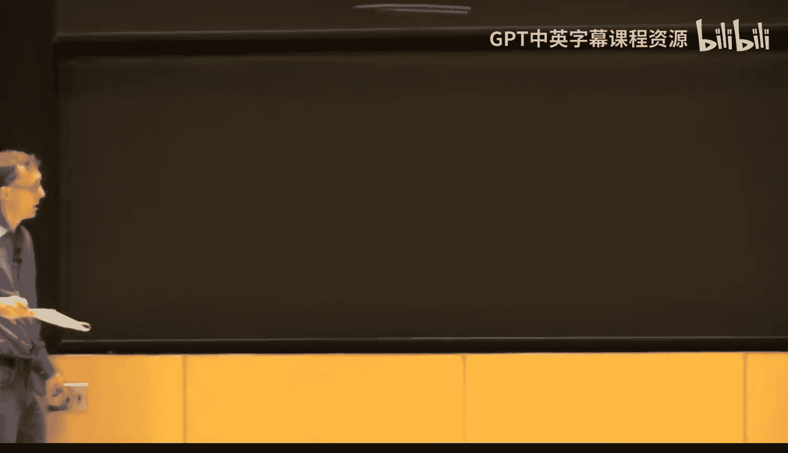

Toed to what the entropy scores。 hass anyone heard of information entropy in the information sense。

Okay， awesome。Oh， my be， you've all heard。There wasn't the placement exam。

 There was a trick question。All right。And。The entropy。Does the following。ItBa says， what do we want。

 right？actually， what do we not want。And what we don't want is leaves where every single class is common。

 right， That's， that's the case what we don't want。

 We want to split such that every single leaf as just， you know， just one class。Now。

 the worst possible distribution within a leaf will be the following。

Where P1 equals P2 equals P K equals1 over O， so each one of the classes is equally likely。Okay。

 does that make sense。 That would be the worst possible outcome。

 right you have a terrible decision tree， right， You go down the leaf and then the leaf。You know。

 all the classes are equally likely， right， So you really don't know what the class of your test point is。

Any questions about this？This year is。This is the enemy。We don't want this。周。

What we are trying to do is try to find a different distribution that's as far away as possible from this this distribution。

And。One way to measure distance and distribution is the K I divergence。

 And this is exactly why I place this on the placement exams。 if you just。

Close your eyes for a second and remember the questions on the placement exam。嗯。There we actually。

 you know， define the K divergence and the K divergence basically tells you how different two distributions are。

😊，And the K divergence is defined as follows。 the K L divergence between the distribution P and Q。

Is the following。K equals 1，2， K some all the different classes and speak K times log。P K over Q K。

Actually， let me， let me call this your queue。So the evil one is Q。

So we'd like to find peace that are really far away from Q。Now， think about this for a second。 Okay。

 so Ps are probabilities， Qs are probabilities。And for each one of these K events。

 we have a probability that， you know， that it happens。They sum to one， obviously。

 So what does the Kl dirgence do， Well， if P K equals Q K。This has one。Log of one is。0ero， right。

 So then actually they are the same。 So that's good。 That's a good sanity check。Right。

 and now what's a little less obvious is that this scale diversion is always not negative。 right。

 So this， also this thing can become negative。Right， if2 K is large larger than P K。

 But then actually this here is small。 So negative values are have a small weight。

And that was actually what you play proved from the placement exam that this cannot possibly be negative。

 It's always a non negative term。Okay， good。 So we want to actually maximize this term where Q is this here。

 So Q is basically the distribution that we don't want。 we want to say。

 let's assign P such that has a very large K divergence from this horrible case。

 Q for every class is equally likely。😊，And how do we do this？ Well。

 let's first plug in one over C here。 Any question at this point。Yeah。Okay， so。

 so we want to find you build a tree。Okay， and what I what I'm telling you right now is not yet how to build a tree。

 What I'm telling you right now is how to evaluate if a tree is good or not。

 That's basically a metric that we're trying to optimize。 rights a machine learning。

 you always have a loss function that we're trying to optimize。

 And that once you have such a loss function， then you can basically make the tree to optimize this loss function。

 So right now， just for a a particular leaf node， you you have a tree like this， right。

 And I would like to know for a certain leaf node。 is this basically， did we build a good tree。

 that we build a bad tree。😊，And one thing I'm claiming is it's a bad tree。

 If this leaf has points of all classes evenly， right， because then if you didn't achieve anything。

 right， that was the case where basically we have the Joker and Alfrreed here， right。

 So if you now your test point goes in here。 Well， here's equally likely that you're good or bad or positive or negative。

 So you haven't haven't actually achieved anything。 right What you would like to build a tree。

 is that trees that basically all the leaves are here all positive。

 These are all negative or something。😊，These are all positive， and these are all negative， right。

 These leaves are all pure。 Then when a test point comes into falls into a particular leaf。

 then you know， that's the label that I want to predict。 Okay， does that make sense。

And what I'm giving you now is a function where you stick in a leaf and all the points of that leaf。

 That's the set S。And it tells me how pure that leaf is。

 It basically gives me a number of saying how good a job we did。

And if all the points have the same label， then that is zero。😡，And if they all have different labels。

 then it's larger， and we try to minimize。What we will do then is， if eventually， basically。

 if a leaf basically has zero loss， right， then we just stop。 And if it has large loss。

 then we split again， such that the two leaves that we create will each one have have lower loss。

 Thats， that's the algorithm， essentially。Any questions about a high level view。Athur。

 you look like you have a question。那O。All right。So now we're doing this。

 And so the first thing is we take this leaf， this leaf。 This is set S。 And out of that set S。

 we now define probabilitybabilities。 You basically say， what's the probability。

 If I would draw a data point randomly， what's the probability that I get a certain class K。

 So each leaf here give So I gives rise to P1 to P K。😊。

And that's basically the fraction of points with that label inside this leaf。

And what I would like to do is that one of them is one， and all the others are 0。

RightThat would be great。 That basically means we have a pure leaf。Okay， good。

 And now I'm giving you， these are my pieces。And now I want you to get some score that basically tells me how good it is。

 And then why do I need such a score。 I know that I want this kind of thing。

 But one thing I don't know。 You know， if I， for example。

 have something where I have a distribution whip， P1 is this and P2 is this。You know， P3 is this。

 I don't know how good that is。 Okay， if that is better than something else。

And so that's what I need。 I need to have some， some score that tells me how good is a certain。

 you know， petition， how good is a certain leaf。That's what this function will give us。

 And the way we define this， as we say a leaf is good if it's far away from this pathological case。

 where every single class is equally likely。😊，Okay， raise your hand if that all makes sense now。

Alright， okay， good。 So now we compute this。 And we say what's the distance of P to Q where Q is this pathological K。

 We actually know what Q exactly is Q is one one over capital K。😊，We can plug this here。

It's one of a capital K for every single one。And。One thing we can do now is we can save all。

 we can split this up。 So this equals。PK。呃， log PK。So I'm just splitt this up。

s the sum of two different terms， times P K。Log 1。呃。Wai， sorry， minus。 So this should just be K here。

 right。Okay。Okay， does this step make sense goinging from here to here。

All I did is I took a fraction。 If you have a fractions at a log that becomes a minus。

 and I have another fraction that becomes another minus。 So that becomes a plus。😊，Last lock。

Raise hand if you're still with me。Okay， good。Now， this year is a constant。Right。

 and to be a summing over O K。Now， this is log K。some of a P K times log K。L K here。

 or is's the capital K。So this does not depend on my。那我看一下是。So what I can do is I can pull this out。

Just the back of the envelope calculation。So what I'm getting is that's the same thing as log。

Of K times。PK。Can anyone tell me what this is？1， right， because it's one。 So we just get lo。

All right， perfect， good。we take us out， very nice。Now。

 the other thing is that we actually want to maximize this term。RightWith respect to our piece。

 this is independent of our piece。 This is a constant we' are always adding。

 It doesn't make any difference。So when we maximize this this score here。

 that's equivalent to just maximizing this， right。Because this has this is no。

 no matter what what our P are， this actually is always the same。

 We're just lifting the whole function。So what we're ultimately maximizing is the following。

 the maximizing over P。嗯。K， P， K log。PK。AndThere's one last rule。That is maximizations for losers。So。

 we minimize instead。So we minimize。He negative。沙么不开。DK。Log， he。All right。

And that's the negative entropy。嗯。bit about of people negative。来。Intu depletion。

 we be trying to minimize it entropy。Right， did I like sorry， this is the entropy， sorry。

But I got it wrong。对对对。You want to minimize。 yeah， yeah， yeah， sorry。Okay。

I think there's a negative sign of my notes。 thats， yeah。Okay， good， good， good catch。 Yes。

 so Enp is maximized and everything is the same。😊，And what we want to do is we want to minimize the entropy。

 right， So we want to kind of， in some sense， create order in the universe。嗯。

Any questions about this？And please， please correct this There's a negative sign in front of the H of S。

 That's actually wrong。 So the H of S actually is negative K， P K log。Okay， here we go。

 Any questions about entropy。

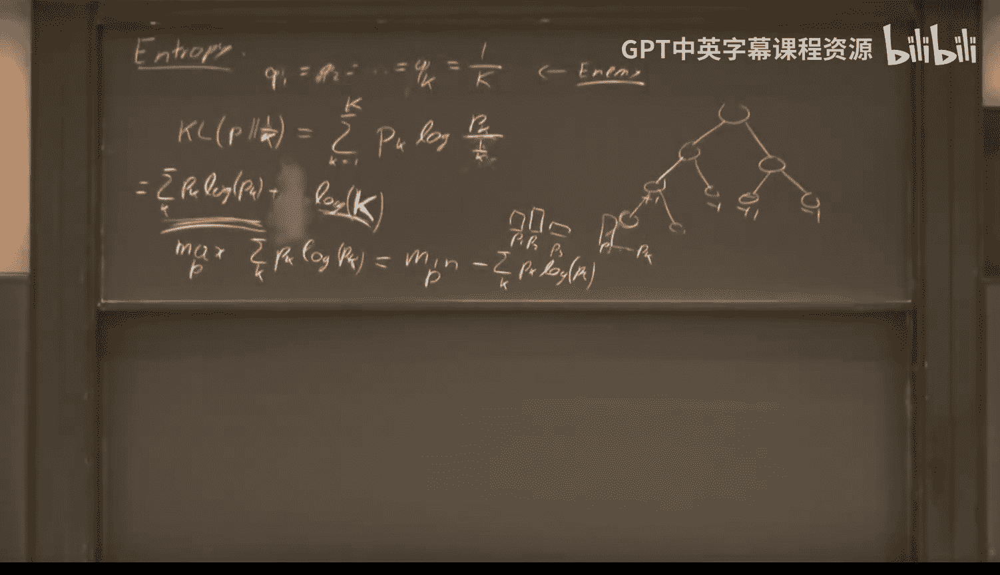

系。turns out the entropypiece also is actually very， very important， not just in decision trees。

 it's information theory， and has anyone taking an information theory class。😊，Very few。 okay's。

If you're basically going into compression， so one。

 you can view all of machine learning as just compression。😡。

So one of the first machine learning algorithms in some sense， was a spanm filter。

Will you basically imagine you take， oh， you spam email or you're not spam email？😡。

You put them both in the zip file。And when the new email comes in。And you just either add it。

 you add it to both zip fights。To the spam zip file and to the not spam zip file。

And you see which one increases by the least the smallest amount。And that's probably the class it is。

 right， because if it's spam， it looks a lot like spam。 So it's much more compressible。

 And so then you can actually use your your spam compressor works better。 right。

 So machine learning is actually very， very similar to compression。😊。

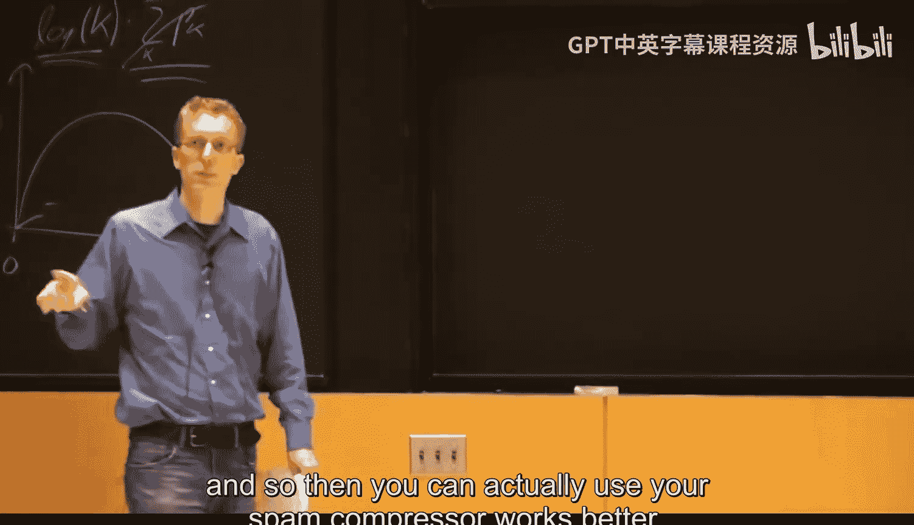

And also， if you have a very good model of your data。Then actually， you， you know。

 you can use that for compression。 Actually， the way compression algorithms work essentially is you have some。

 some data stream。 And what you're doing is you're just saying， given the past data。

 I'm trying to predict the next bit of data。😊，We'm very very good at doing this。Then。You know。

 you basically just， oh， you have the same model。 I send some some data to you。

 You have the same model。 So you predict， you know， the next next bit of information。

 the next bit of information。 If the prediction is right， then I don't have to tell you anything。

 I just have to correct it， when it's wrong， essentially。So。There's a little bit more to this。

 But that's essentially how how compression algorithms work。

Okay， good。 So we now know what we want to do， right， We want to minimize the entropy of a set。

 So you know， Asia is basically the entropy of a set。 And what we would like to do is minimize this。

And。For any given Z， we can compute the entropy。 right It's very， very simple。 This here is the term。

 Okay， by the way， please keep pay good attention because you have to implement this in the next project。

 which we。😊，Post in a few days。Of course， you knew you would have。 Okay。

 so for everything single I said， you just compute these， this piece， that's trivial。 right。

 It's just the number of point， the ratio of points of a certain class。😊。

And then you just compute this， this certain term。And。Okay， good damn。 What is this。Okay， good。So。

Were almost done。The last thing is， what is the entropy over a tree， so far。

 we only have entropy over leaf。 But what if you leave this。 So that say you have a data set。

 you can compute。This is my data set， S， I compute the entropy of S。That's easy。 I can do this。

And now what I want to do is I want to say。I want to make a split。Into。As left and as right。

Such should the entropy of these two。I's actually lower than the original entropy。

And how do I define this well， It's quite simple， I basically say。The， you know。

 the entropy over such a split as the following。 I first took a point randomly of basically。

 either go left or right randomly。And then a computer entropy of this， of this leaf。

And when I go left to right， I basically pick the choose。

Based on the number of points on the left side， on the right side。

 So let me just explain this some more time。 So P， L is the number of points on the left。

Divided by the total。PR is the number of points on the right。Divided by the total。

So this is the fraction of points on the left， the fraction point on the right。

And then just say the entropy of this tree。Each of this three here。It's just。P。

L times the entropy of on the left and side。Plus， PR times the entropy on the right。Yeah。

 we're just taking away to that。That's exactly right。 We take a weighted average of the two entros。

 right So we take a set， We split it into two sets。You compute the entropy of each one of them。😡。

And then we take a weighted average where we weight each set by proportional to how many points are in it。

😡，第二。If what is。If PK is0。Oh， then this here is 0。This trumps that guy。哎这 is you yeah。Okay。

 any more questions？So。What you want to do is you want to find。

You want to find the tree that actually has minimum entropy。And here comes the algorithm。

 how to do it。 So now basically， what I， what I did， I showed you what entropy is。

 Entropy is an impurity function。😊，That is lowest when basically a。You know。

 it's biased towardss just one label and all the other labels don't are not in it。 It's highest。

 and all the labels are equally likely， which is what we don't want。

So we start out with such setting usually。 And then what we want to do is we want to reduce the entropy。

And we do this by repeatedly splitting the data， taking the data and we split it into two halves。

 and then we basically now say， okay， now we compute the entropy on this level。😡。

RightThat's just debated average of these two。利。Now， here comes to questions。 Okay， so this is。

 this is basically all you need to do。 Now comes the question。 how do you find the optimal split。

 right， And that's the MP hard problem。But we can do really， really well by doing being greedy。😡，And。

 it's actually， the algorithm is trivially simple。So what we want to find is we want to find a particular sp on a certain feature。

Now， this might be my data set。That's a here， my， my access。V Os。

And I want to find the split that gives me。That decreases my， my entropy by the most。 right。

 right now， the entropy is pretty high。 Let's say there's an equal number of x's and O's。

So right now， the anthtropy is basically as high as it gets。But if I make one split。

And the right split， of course， is here。Then actually， my entropy here is actually minimized。

And in this case， I just have one little O here。 So I would have to do a second split to cut this off。

 okay。And how do I find these bits？ And the answer is very， very simple。The answer is。

 I try out every single one。that's the algorithm。So basically， what you do is you say， okay。

 well I split here， right， I could split here。 I split here。 I split here。 I could split here。

 I could split here。 You know， I could split here and so on。 And I try for every single one。

 I compute。😊，The entropy of the two leaves。And then just take the one that is the lowest。That's it。

And so the algorithm is trivial。And you do this for every single dimension。

 You can either do it here or you can do it in this dimension。 You could split here， here， here。

 and so on。So for every single dimension， you try every possible split。

And then you pick the one that's best。 Yeah， wait， but。So doing each。

 you're doing an entropy test n times the number of times。 And each entropy check is。Takes O D。

 So is that N D squared running guy。N D squared or n n times D squared or n times D squared。

 So the number point you had type the dimensions。呃。

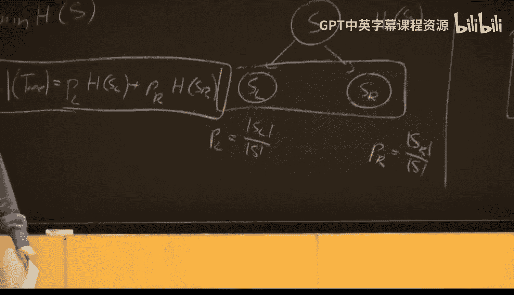

Now， you've n times these splits。Right，So for every single dimension， you have N splits。

 Why do you have N splits。 Can anyone tell me why you have N splits。You got n minus1。That's right。

 You only， you only have to cut once between any， any two points。

 So you look at all the gaps and you cut between them。 That's right。 So you try n， N splits。

 You try this for every single dimension。 So you have n times D splits that you try calculating entropy。

 Is that also O the operation。Oh， I see。 that's an of the sure。So's an of K operation。

 You do it for every class。Okay， so it's n times D times K。

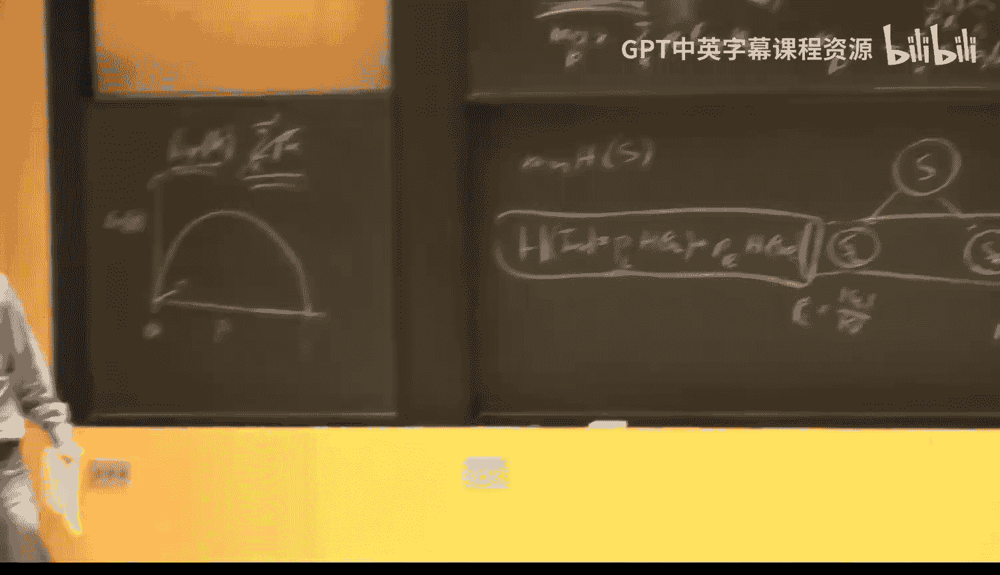

That's not bad。 That's pretty good。对。Right， good question， so the question is。Here。

 you're assuming that you have discrete classes， you do a classification problem。

 What if you have a regression problem， right， And regression is wouldn't work anymore。

 And that's right。 Very， very good point。 And I didn't quite want to get there yet。

 So then you just use， for example， the square loss or something。 I get to this in a minute。😊，Yes。

 but you can extend actually in the project。 what you primarily have to implement is the regression。

Brittain。Okay， any more questions， do you have a question？Sorry。I say， why， okay， good question。

 Why are the splits always access a line， Why don't you make them diagonal， right？ And people have。

 of course， done this， And because decision trees were so popular back in the days， people。

 there's every single variant， every every single single thing you can think of how you could split。

 People have explored。In practice。As aligned splits work pretty well， and they are very。

 very fast to compute。 So it typically does not pay off to have non access aligned splits。Yeah。

That's a good question。 But， but， you know， there's pathological cases in which you may want to have non access answer。

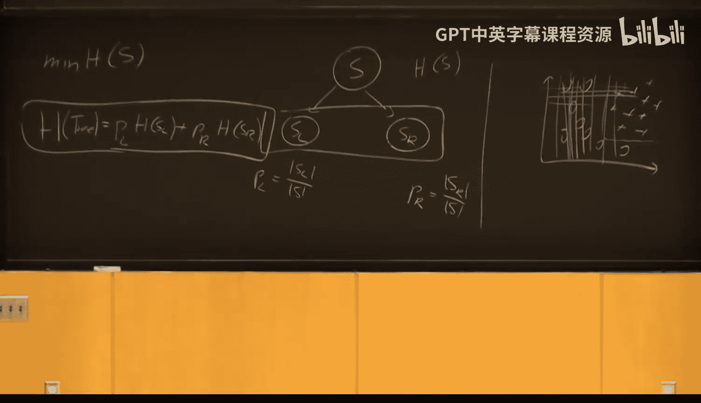

Okay。So。Well嗯。Who wants to see a demo。Alright， let's do it。我不道。一个。Goods。な。Yeah。All right。

 so here's my good old window， I can add some data points。😡。

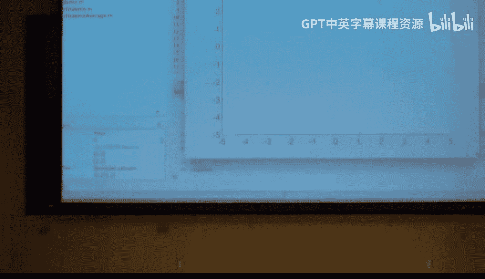

So let me add some positives and any suggestions for what data set you want to see。Smiy face。

Smiy face is always so ill defined。 I don't know what positive and what's negative。 Allright。

 negative。 The smart part is， oh。😊，I just made a positive sigh。😊，Okay so here's my positive。

 and then I guess you give him freckles or something or her。诶。Okay， so these are the negative points。

😡，I mean， we can now build a tree。This is what does Pam。Right， and so basically， it。

 it stops pretty quickly。诶。And。One thing you'd see is very interesting， right？So it。

 it doesn't actually care about these kind of this region here。 right。

 So it doesn't have any points here。 So this is why， why decision trees have problems。

 If you don't account for bias invaris， right， So by basically trying to find the minimum number of splits。

 here can actually cut this whole region here off because it turns out theres all O's。 But you guys。

 of course， know， it was a smiley face。 So actually this year would be actually the X's region。

 right，😊，But this is just what it does。 This is actually a very small trees。

 Only a couple of splits here。Any other data set？A diagonal data。 So what do you want。Obviously。

 okay， so， he's trying to be really， really mean because he knows the algorithm is access aligned。

T I can show you ID33。 All right， here we go。嗯。Because actually when you do this too often。

 you get actually repetitive stress injury。Cropal tunnel is something。 Okay， good。 And here we go。啊。

Yeah。嗯。So and then once again， you get a simple tree that actually explains the data that very well。

 But one thing you can see here， like different to an SVM or something that would actually cut here right down the middle。

 it basically cuts down these， these weird little， you know， corners， right， you would。

 That's clearly not as good as an SVM， for example， right， But turns out actually。

 decision trees have many， many nice advantages。😊，That make it make it work really。

 really well in practice。 And， and one of those is， for example。

 that the features can have any scale， right， some Ss can be very large scale or very small scale。

 It doesn't。 This doesn't matter。 And in the next two lectures， we will even more。

 maybe I show you one last thing。😊，SD。嗯。Here's a data set of that I drew from a Gausian distribution。

So these are two Gaussian distribution。 These are my positive points。 These my negative points。

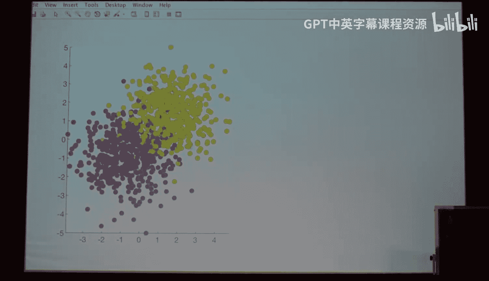

And here's what I。Draaw out。If I just make a single split， right。

 It just allowed a single split and it splits down here。

And it basically tries to cut off the positive points。 And so here。

 what you see here on the top right is the training area on the testing are both pretty high and pretty close together。

 So what kind of problem is this bias a variances。😊，That's bias， right。

 So training and testing very small gap。 Training is high。 That's a bias problem。

 Now you make the tree bigger and bigger， right， So they allow two sps three sps in this case，4。

 And we keep going。😊，And so now you always see like it's kind of， there' something funky here。

 right I's trying to get one x here， right， So it splits down in the middle and。And eventually。

 you would get every single point right， right， It's like trees。 You know。

 they have there's no man left behind， right， That's the slogan。And they keep splitting。

 But one thing you see is here， the training error keeps going down， right， Merciless， right。

 keep splitting until you get every single point right， but it no longer generalizes， right。

 and the testing error goes up And the reason why decision trees are problematic is because this sweet spot right。

 where you actually have the optimal depth is really， really hard to find。 Like in some sense。

 what you would like to have this reason to be large， right， But there's very little wiggle room。😊。

And what we will do later on is kind of try to， to make that wider。Okay。

 so in some sense you can all you can do is kind of try to forward a depth of4。

 And that's the best thing you can do。 And then you're already overfitting。Allright。

 we continue on Monday。