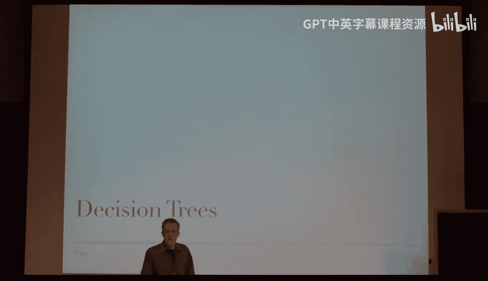
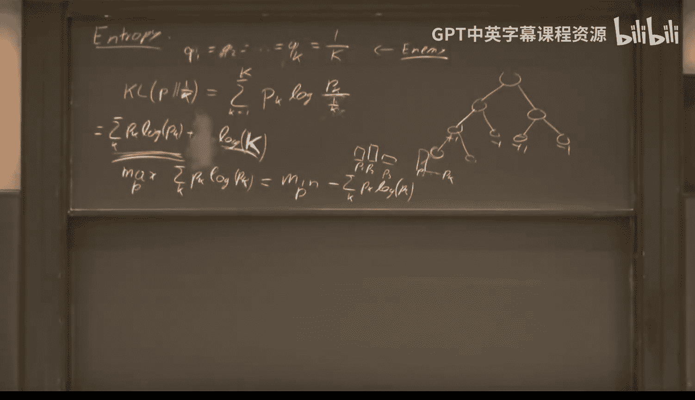
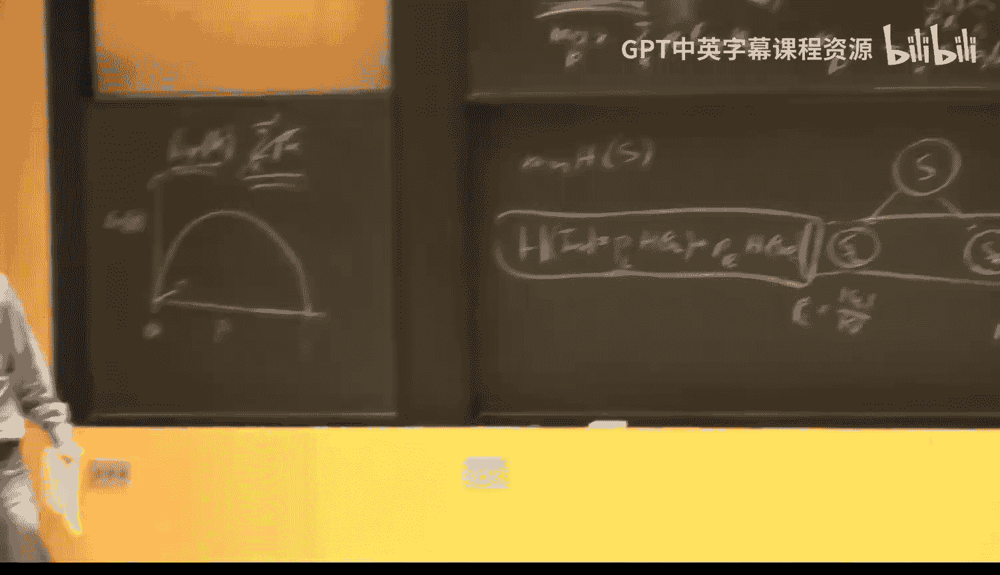
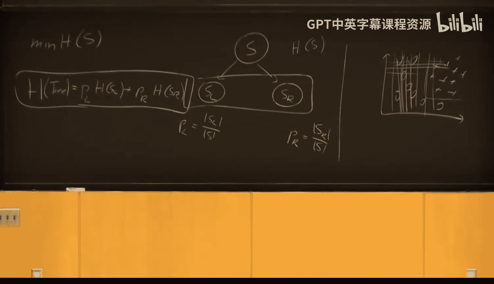
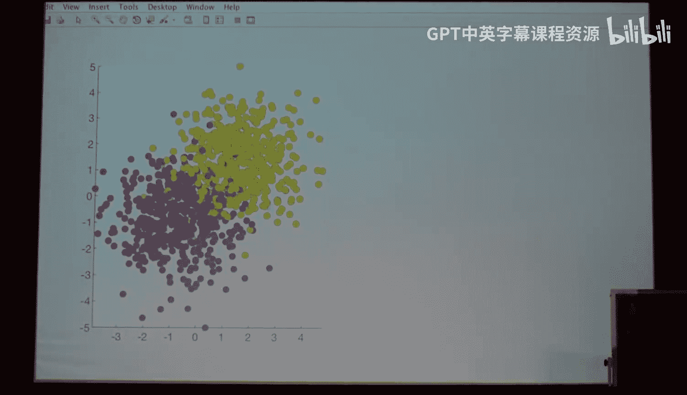

# 机器学习：029：决策树与回归树 🌳

在本节课中，我们将要学习决策树的基本概念、构建方法以及如何将其应用于分类和回归问题。我们将从决策树的直观理解开始，逐步深入到其背后的数学原理，特别是如何通过“不纯度”函数来构建和评估决策树。

---

## 从最近邻到决策树

上一节我们介绍了KD树，它是一种用于加速最近邻搜索的数据结构。我们提到，如果只关心最近邻的标签而非其确切位置，那么可以只搜索KD树叶子节点内的点，这是一种近似最近邻方法。

本节中我们来看看，如果更进一步，我们甚至不需要在叶子节点内进行搜索。如果一个叶子节点内的所有数据点都具有相同的标签，那么任何落入该节点的测试点都可以直接被赋予这个标签。这就是决策树的起点：我们不再存储数据点，而是为树的每个叶子节点关联一个标签。

## 决策树示例 🦸

让我们回到一个现实世界的重要问题：判断一个超级英雄是正义还是邪恶。

**训练数据**：
*   正义英雄：蝙蝠侠、罗宾、猫女
*   邪恶反派：小丑、企鹅人、阿尔弗雷德（？）

**特征**：
*   是否戴面具
*   是否戴帽子
*   是否打领带
*   是否把内裤穿在外面

**测试案例**：你的约会对象（需要判断其善恶）。

我们可以构建一个决策树来进行判断。例如：
1.  首先判断“是否吸烟”？如果是，进入右分支。
2.  在右分支判断“是否有尖耳朵”？如果没有，则判定为“邪恶”。
3.  如果“不吸烟”，则进入左分支，判断“是否戴面具”？
4.  如果不戴面具，则判定为“邪恶”；如果戴面具，则根据“身高是否大于1.75米”进一步判断。

通过这个树，我们可以对测试点进行分类。然而，这个树可能无法完美分类所有训练数据（例如，可能将善良的阿尔弗雷德误判为邪恶）。这说明我们需要一个更好的树。

一个关键点是：只要没有两个特征完全相同但标签不同的数据点，我们总可以通过不断分裂（增加树的深度）来构建一个在训练集上达到100%准确率的树。但这通常会导致**过拟合**——模型只是记住了训练数据，而无法很好地泛化到新数据。

决策树在偏差和方差之间存在紧密的权衡：
*   **树深度较浅**：模型简单，可能无法很好地拟合训练数据，导致**高偏差**。
*   **树深度很深**：模型复杂，能完美拟合训练数据，但对训练数据中的噪声敏感，导致**高方差**（过拟合）。

我们的目标是找到一个**足够小但又能很好拟合训练数据的树**。然而，寻找最优规模决策树是一个NP难问题。幸运的是，存在许多有效的启发式算法来构建表现良好的树。

**请注意**：单个决策树通常不是最强的机器学习算法。但是，当我们后续使用**装袋法**来降低方差，或使用**提升法**来降低偏差时，基于决策树的集成模型（如随机森林、梯度提升树）会变得非常强大，被广泛应用于工业界。

## 如何构建决策树：不纯度函数

与KD树旨在平衡分割不同，决策树的目标是生成“纯净”的叶子节点，即节点内所有数据点尽可能属于同一类别。

为此，我们需要一个**不纯度函数**来衡量一个数据子集的“不纯度”。我们希望不纯度越低越好。

以下是两种常见的不纯度函数：

### 1. 基尼不纯度

对于一个包含 `N` 个数据点的集合 `S`，假设有 `K` 个不同的类别标签。我们定义类别 `k` 的概率 `P_k` 为：
`P_k = |S_k| / |S|`
其中 `S_k` 是 `S` 中标签为 `k` 的子集。

基尼不纯度定义为：
`Gini(S) = Σ_{k=1}^{K} P_k * (1 - P_k)`

直观理解：从集合中随机抽取两个样本，它们属于不同类别的概率。对于二分类问题，`Gini(S) = 2 * p * (1-p)`，其中 `p` 是一个类别的概率。当 `p=0` 或 `p=1`（纯净）时，基尼不纯度为0；当 `p=0.5`（最不纯）时，基尼不纯度最大。

### 2. 信息熵

熵来源于信息论，是更常用的不纯度度量。一个集合 `S` 的熵定义为：
`H(S) = - Σ_{k=1}^{K} P_k * log₂(P_k)`

熵衡量了从该分布中随机抽取一个样本时所携带的“信息量”或“不确定性”。当所有类别等概率出现（`P_k = 1/K`）时，不确定性最高，熵最大。当只有一个类别（`P_k=1`，其余为0）时，不确定性为0，熵最小（为0）。因此，**构建决策树的过程可以看作是一个最小化熵（创造秩序）的过程**。

**熵与KL散度的关系**：最小化熵等价于最大化当前分布 `P` 与最糟糕的均匀分布 `Q` (其中 `Q_k = 1/K`) 之间的KL散度。KL散度衡量了两个概率分布之间的差异。

## 决策树算法：贪婪分裂

现在我们知道如何评估一个叶子节点的好坏（用熵或不纯度）。那么如何评估一次分裂的好坏呢？

假设我们将数据集 `S` 通过某个特征和阈值分裂为左子集 `S_L` 和右子集 `S_R`。这次分裂后的总体不纯度是左右子集不纯度的加权平均：
`Impurity(Split) = (|S_L|/|S|) * Impurity(S_L) + (|S_R|/|S|) * Impurity(S_R)`

一次好的分裂应该使 `Impurity(Split)` 比分裂前的 `Impurity(S)` **降低**得尽可能多。这个降低的量有时被称为“信息增益”。

**贪婪分裂算法**：
由于寻找全局最优树是NP难的，我们采用贪婪策略：
1.  从根节点（包含所有训练数据）开始。
2.  对于**每一个特征**，对于该特征上**所有可能的分裂阈值**（通常取相邻数据点特征值的中点）：
    *   计算如果在此处分裂，会得到的不纯度 `Impurity(Split)`。
3.  选择所有特征和阈值组合中，能产生**最低不纯度**（或**最高信息增益**）的那个分裂点。
4.  在生成的两个子节点上，递归地重复步骤2-3，直到满足停止条件（例如，节点不纯度已为0、节点内数据点少于某个阈值、树达到最大深度等）。

这个算法的时间复杂度对于每个节点大约是 `O(n * d * k)`，其中 `n` 是节点内样本数，`d` 是特征数，`k` 是类别数，在实践中是可行的。

**关于分裂的说明**：
*   决策树通常进行**轴平行分割**（即判断 `特征_i > 阈值` 吗？）。虽然也可以进行斜分割，但轴平行分割计算高效且在实践中通常表现良好。
*   上述讨论主要针对**分类问题**。对于**回归问题**，目标变量是连续的。此时，我们不使用熵或基尼不纯度，而是使用衡量预测值（如节点内目标值的均值）与真实值之间差异的损失函数，例如**均方误差**。分裂的目标是使左右子节点的加权均方误差之和最小化。

## 演示与偏差-方差权衡

通过可视化工具，我们可以直观看到决策树如何分割空间以及深度对模型的影响。
*   对于简单可分的数据，浅层树就能很好地工作。
*   对于复杂或对角线分布的数据，决策树需要更多分裂，可能产生不规则的决策边界，不如SVM等模型的边界平滑。
*   在一个从两个高斯分布生成的数据集上演示表明：
    *   当树很浅时，训练误差和测试误差都较高且接近，这是**高偏差**（欠拟合）的典型表现。
    *   随着树深度增加，训练误差持续下降直至为0，但测试误差先下降后上升。测试误差开始上升的点就是**过拟合**的开始，此时模型**方差**很高。
    *   决策树的“甜蜜点”（最优深度区间）往往很窄，很难精确把握。这凸显了后续使用剪枝、装袋或提升等技术来控制过拟合的重要性。

---

本节课中我们一起学习了决策树的基本原理。我们了解了决策树如何从最近邻搜索中演化而来，学习了使用熵和基尼不纯度来衡量节点纯度，并掌握了通过贪婪算法构建决策树的过程。最后，我们通过演示观察了决策树深度与其偏差-方差特性之间的关系，认识到单一决策树的局限性，为后续学习更强大的集成方法（装袋法与提升法）奠定了基础。