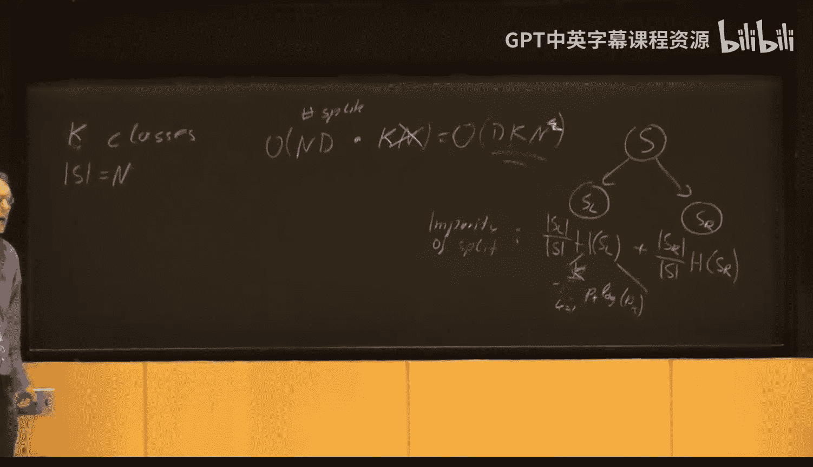
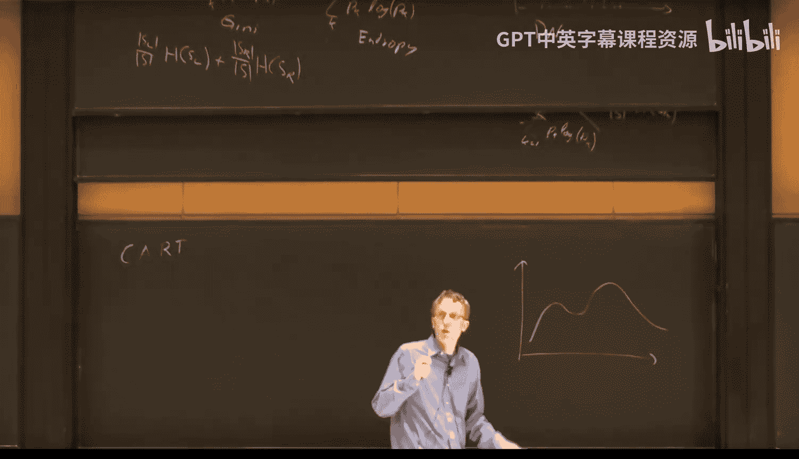
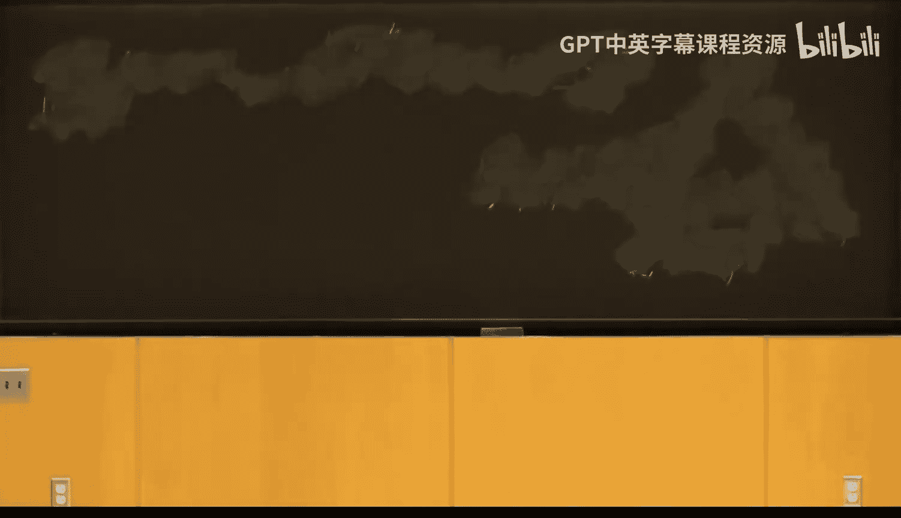
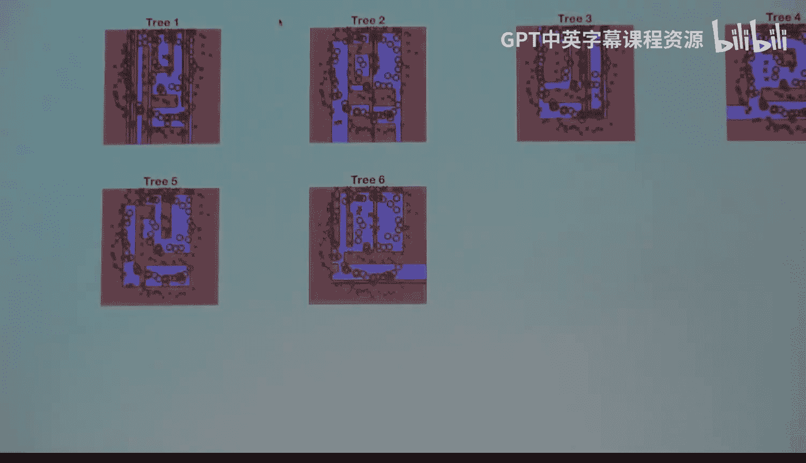
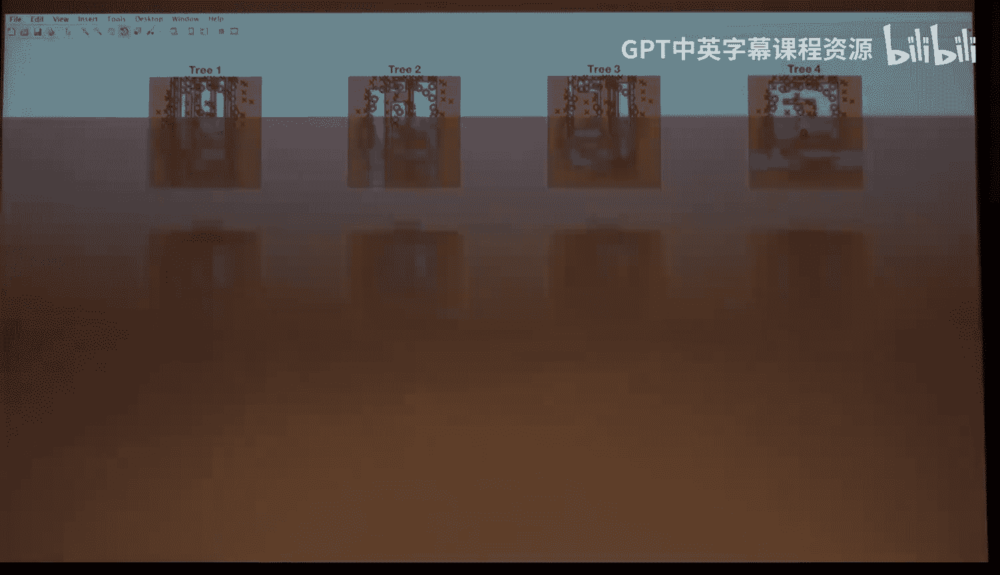

# 030：康奈尔大学《智能系统的机器学习｜CS4780 Machine Learning for Intelligent Systems 2017》中英字幕 p30 -30-Machine Learning Lecture 30 ＂Bagging＂ -Cornell CS4780 SP17.zh_en -BV1Lo6gBxEKE_p30-

Wellcom everybody。All right， so。E2 quick announcement。

 So one thing is rebuild the Kaggle competition is done。So we will， I guess， post this on piazza now。

 So these are optional for credit points。 So basically， the way it works is you have to。

 you can' submit something like， you know， there's basically a data set。😊。

You get a training data set， and you get the test points， but not the test labels。

And then you have the train to classify on the training data set and submit predictions for the test points。

And then there's a leaderboard。 and you basically move up on the leaderboard。

 We submitted a bunch of straw men。 And if you beat these straw mens。

 the the more straw men you beat， the better you get， basically。

One thing is you're not allowed to infer the labels of the test point。 So you could actually。

 these are actually images。 I can tell you this right away。 These are images of handwritten letters。

As I not have written machine written letters。 you could just take the test points if you wanted to and look at each one of them and label it a hand。

 It' would be really boring。 And you would get  hundred0 percent correct。

 But you actually have to submit the code。

At the end， and you have to write that one page write up。 If you want to get it for credit。

 describing what you did。

Yeahや。

Sorry。You can use any library。 Yes， you can use any library you want。 So there's an open。

 You don't have to use vcaria or anything， right。

Can use any algorithmic y want， et cetera。 The only thing is， you cannot use humans。To infer that。

 you can also not go online and search for the data set or something。

 The data actually something to we created， but you may find something else。

 So you have to use that training data set and that test set。

Any other questions？Yeah。Wednesday De， I believe it's May 10 I not entirely sure it's on the Caran Compet Webage。

 It's the last day that anything can be due。Yeah。一方块。It's teamwork。

 And I believe the team can be up to four people。 He specified it on the， on the Webage， yeah。

All right。 Oh， yeah， last question yeah。

Whatever other you have to do You have to scream。 Everybody else， please be quiet， yes。So， yeah。

 there's gonna be there's nothing with three people。 That's what you're asking。

I just try to you know， increase my coverage。

Okay， any more questions？

All right。Okay， so last time。

You know， maybe next time I do pie， you can have pie。 Alright。

 so last time we talked about decision trees。 So the way we arrived there was we said。😊。

We have a data set and this data set may have different classes。And beforehand。

The first thing we did is we did Kd trees to speed up nearest neighbor church。

And then they kind of realized， well， actually， if you build a K0 trees。

 it would be good if you have leaves that are all pure because in that case。嗯。You know。

 you don't actually have to do the nearest neighbor search anymore。 You can just look at， you know。

 what's the label in that leaf。 And then you just return that label。Now。When we build a KD。

 so decision trees are essentially the same thing as Kd trees。

 you only always split along one dimension， but you have a different splitting criteria。

So with Katy trees， what you did is we just look at each dimension。

 We depict pick one dimension at a time， and we split such the data set was exactly divided in half。

And that was very easy because you just have to basically look at the feature value along this direction。

You just split along the median。 right So if you find the median that's easy to find， you just count。

The moment you have half your data， you split there。 So that's very， very simple。With decision trees。

 it's not so easy。 What you want to do bless you。 What you want to do is you want to find a splitting such that the two halves afterwards are as pure as possible。

By the way， it doesn't have to be exactly balanced。 So how do you do this， right。

 with Katy trees it was easy， We just split it on the mean with decision trees， it's not so easy。

 And therefore， it's a very simple trick。 We just try out every possible split there is。 That's。

 that's the solution。So what you do is you just look at every dimension and at every single split you could make。

 and you try out every single one。I so there's D dimensions， in this case， there's two dimensions。

 There's n data points。 There's D times n splits。It says M-1 to be technically correct because you only split between two points。

So basically， what you let say， I would like to split along this direction。

 I try that dimension first。 Then I look at every single data point。

 This is the projection onto this direction。Which is does that coordinate。

 And I try out a split between any such data points。So we need a second ingredient。

 The first ingredient would how do we find the best splits。 The first thing is well， okay。

 we just try out every possible split。 That's great。 Now we need one more thing。

 We need to be able to evaluate how good a split is。😊，And for that， we need an impurity function。

 And last lecture， we went over two of those。 Ginie， coefficient and sorry。

 Ginie index and the entropy function。😊，And so the way this works is quite simple。

Let's say we evaluate this split here。We want to know how pure is that split。哎。And so basically。

 what we're doing is we look at each one of these subsets。

 So we take the entire set and we divide it in 2。 This is the right subset。 This is the left subset。

And。What we compute， we compute the following is have this function H， which for a set。😡。

Comp how pure that set is。And we are two different ones， the entropy or the。Entropy。

Oh we had the Gie。 Ginnie said with sum of a K Pk1 minus Pk， and entropy was be sum of a K。

PK log of PK。We do this negative。 So that's the only difference。 This is， jinny。This is entropy。

And so both of these function have one thing in common。 they kind of if。You know， P， K。

 let me just define P， K， remind you of what P K is。 for each one of these subsets。

 let's say you have， you know， this set S。Then， I define。S K is the set of all the points。

 X element of。Element of S such that y equals K。So all the points with a particular label。

 that I say Pk is the fraction of points。That half that lately。All right， so when I do a split。

 what do I have to do， I look at， you know each set individually in each set individually。

 And what I do is if I compute。What's the fraction of。

Points with give a label I compute this for every one of the labels。And then， I compute。The impurity。

 either using this formula， It's entropy or using this formula it Virginia。Now， I get a。

A impurity of the left inside and the purity of the right inside。

And how do I weigh these two just based on how many points are in each side。So， if this is my。

Left inside， this here is my right inside。Then I say theurity of the split。Its。H of S left。

Times the fraction of S left divided by the whole total。Plus， H of S right。Times the fraction。

O the right。Okay， any questions at this point。Yeah。Regression。That's what this lecture is about。哎。

Good question。Any other questions Yeah， also， so we made the assumption that if you went into a lead。

 you probably wouldn't change。Were。You're probably not going to change into another heaven nearest neighbor。

 it's approximately the nearest neighbor， yes， yes。😡，In practice， does this work out well enough？

In practice， it the decision treess are so much faster if you don't have to store the data points。

That it's actually well worth it。So yes， so by the way。

 I'm still standing with this decision trees a lousy algorithms。Right。

 but if you bag them and boost them， they become really good algorithms。

 And that's all we will talk about。 So because they're now so， so， so cheap。

 we can actually compute many of them and average them。 And that's essentially bangging and boosting。

Okay， any more questions。Okay， raise your hand， that's clear now。Okay。All right。

 so now comes a little quiz。When you consider a split。What is the complexity？

Of evaluating this formula。Complexity， what I want to know is this big O notation。 All。

 So how many in terms of dimensions in terms of samples。

 How many operations do I have to make in order to compute。The impurity of a particular estate。

It's a you and your neighbor。To give you a few minutes。Try to figure it out。Yeah。Yeah。

Okay。Okay。YeahYeah。Yeah。Yeah。Yeah。Yeah。Yeah。でもな。Yeah。Okay。So。All right， who figured it out。

Any he guesses， I make a split。And I want to know， So now， given that split。

 I now basically divided the data set left and right。

And now I have to compute this impurity to know how good that split is。😡。

And so basically have to compute the imp purity on the left and side。

 and imp purity right and side and have to weigh it by these two terms。 What fraction of the points。

 go to the left， What fraction of the points go to the right。

And I have to do this for every single one of the splits。 So I have n times these splits。

And now the question is， why does the computation of。Evaluating one particular bit。Who has a guess？

So what is the computation of of。What are the computational requirements？

What's the computational to computational complexity of computing this term here for a particular split。

 So if a split a split and write the light。😊，What does it cost me in terms of a number of classes。

 number of data points。Any guesses。一几餐仔。So， yeah， I guess I call last time called Cs O Ks number of classes。

So this function S H F L is actually， you know， let's say it's the。1，2， capital K or C。呃PK log。PK。

Right， that's definitely a sum。That goes over K。You know， all classes， right， capital K classes。

 So we definitely have what's called a capital K， Why not。So， we have capital K。Classes。

 and then what was your guess， just K times N times n and Y N， because you have to go for each class。

 you have to go through the entire data I same which。That's right。

 So you have to go through the entire data set， see which one goes left and which one goes right。

And you also have to go。 And within each subset， you have to。Baically count how many for every class。

 How about the fraction of points of that class， right， So you have to compute your P K， right， So P。

 K。So， you know， ultimately， you go over all the data points。So it's n times D splits。

 and each evaluation goes K times n。 So that is。The complexity is D times K times n squared。Okay。

 any。Yeah。他们で。That's not no problem， right So you always split the data set in two halves。

And this function here just sums over all your classes。 Theres a。

So this is actually nothing here that's about binary。You keep splitting。

And so the impurity function goes over multiple classes。 That's fine。😊，哦，这。在这。That's right。 You want。

 what you want to do is you want to find leaves that have only one particular glass， right。

 but you could have many， many different classes， not a problem。Okay。Rise， this makes sense。Not many。

 Okay， Who understands speak O notation。Okay。This by the way， I was invented at Cornell University。

Big O notation was a touring award。嗯。Yeah。いてな。That。Oh， we' gonna make this a lot faster。 Don't worry。

So one more time， what this here is is basically how much work do we have to do right。

 in order to find a good split。And so what do we do， we go of all D dimensions。😡。

And we try out every possible split。 if you have n data points。

 you can kind of split before each data point。In that dimension。

So we have n times the possible splits that we want to evaluate。

In order to evaluate a split to see how good it is， you have to do that much computation。😊。

We have to basically go over all our data points。And divide them up into K classes。

 And then we go over each K class， and be。嗯。Express this term here。

 which is basically says the entropy。 It actually negative。

 We just have to sum up over all these K classes， and compute this term。😊，Okay。

But estimating all these P or the fractions for each class cost us order N because we have to go over each data point and see which label it is。

😊，Does that make sense now， Raise your hand and makes sense now。O。All right。So， it turns out that's。

This is the computational complex。 That would be pretty bad。 because it's quadratic。

 That means if your data gets twice as large， it takes four times as long。

 So that's actually a pretty slow algorithm。 You couldn't run this over large data sets。

Turns out there's a very good trick in how to do this much， much， much faster。

 And that's the following， imagine。😊，I want to evaluate a split。

But I've already evaluated the split before。 And please pay attention now。

 because that's exactly what's going to be。The question 3， I think， in your next project。

So if you implement your tree。The first thing you can do is you basically implement the exactly that you chart every single split。

 and for every single split， you compute the purity。And then you just pick the one that basically。

 you know， minimize your last function。 That's it that you remember that split， you output that。

 and then you build an next split。 So you ought build a tree one by one。So Bay。

 you have your original node， you find the best split that gives you two sub notess。

And then recursively， for this one， you find the best split。你不在重你犯的呗。

But each one of these requires you to go over the entire data set if you implement it naively。

But if you're smart。And you do the following。 You go through these splits， one by one。

And you will realize one thing every time you， let's say， I've already evaluated the split。

 Now I move one to the right。This bit I already evaluated。 Now I want to move evaluate this split。

The only change is that one cross moves from the right side to the left side。Okayk。

 does that make sense， Otherwise， these sps are exactly the same。The only difference is， this guy。

For this spirit is on the right hand side。 For this spirit， it's on the left and side。Okay。So。

 on the right hand side。My fraction of points， but my counter of points with the crosses goes down by one on the left inside side。

 it goes up by one。Okay， that's a constant operation。So if you do the splits one by one。

 then actually evaluating the splits only costs you order K。

 So you can actually get rid of this factor N。😊，So you don't need this vector n。

Because you basically can reuse all the computation from the previous split。 You just count。 Now。

 when you move one to the right， you basically say， okay， well， exactly one point moved over。 So。

 you just keep a counter how many points you have of each class on the left and side。

 And the moment you move one step to the right， only one of these counters goes up。 That's it。

And then you basically have， again， all the these probabilities for every single class， class label。

So that's how you implement the project。 And that actually now makes this algorithm really。

 really fast。 Now， it's linear with the data set size。 So now， if you data size doubles。

 the algorithm is only twice as slow， not four times as slow。 It makes a huge difference。😊。

Any questions， yeah？You do have a log in there for sort sorting。 Yeah， I kind put that under the rug。

Log n is 30。All。Any other questions。Yeah。Okay。II was。ありがと。one。

For each time you're just classifying everyone。不。I was say。By the N was in there。

 The question is initially， I was the end there because you have to compute the Pk。

You have to know how many， what's the fraction of positive points on the left and side。

 What's the fraction of negative points on the left and side。So you have to。

 these Pks are computed from these data sets， right。Sk， with these counters。

 How many points are positive。On the left and side， right you have to put the left and side sec。

Right， what I'm telling you is if you move the split， that can only change by one。

So you just keep counter here， how many positive points you have on the left and side。

 How many positive points you have on the right and side。

 and you just decrease one and increase the other。Does that make sense。Oh， you're okay， good， good。

 but that's， that's good。Okay， any more questions。Alright， let me get to Arthur's question。

 Then Arthur's question was， how do you do this for a regression question。

喂。So， imagine。You want to。The regression。And so in regression， we try to we don't have to classify。

 We don't have classes， but our class actually real numbers。So， for example。

 you want to learn a function that looks like this。Can you use decision trees for regression？

And the answer is yes， absolutely， it is just called regression trees。And actually， if you see cards。

They're often called car trees， classification and regression trees。 So from the beginning。

 they were actually considered for classification and for regression。😊，How does this work？ It's very。

 very simple。You do exactly the same algorithm。

The only thing is you don't use entropy or you don't use the Ginni coefficient。

 instead you use the square lot。So you say my loss function for a certain set。

Is the following is P summ1 over two。X comma y。Element of S。And you just compute。Y minus mu。Squares。

For muu equals the average， the mean point of all labels and and。呃。In S。Okay。

 so here's what you do for a set。You say the impurity of that set is how close everything is to the mean。

So for a set S you compute the mean， the average label in that set。And then you say， on average。

 how far am I off from the， from that meat。Does anyone recognize this formula。

Some my minus mu squared。It's a variance。 That's right。

It's just the variance on the right and on the left。 That's all there is。哎。So， our practice。

If you do this， what happens？ So you take every data points here， sample from this。This function。

So what do you do， you take this function， you split it somewhere。

And you estimate everything on the right by the mean and everything on the left by the mean。

 You say my function kind of looks like this。I just two straight lines。

That allows the approximation of that function。 right， That's O because you can keep splitting。

 So you split again。You say， okay， well， now I take this mean and this mean， right。

 And here has split again， Take this mean， and maybe this mean。

 And then I split again and again and again。 And at the end， if you do this many， many times。

What you will get as a function like this will be approximated There many such。No。Straight。

 straight lines， basically。so each leaf basically just predicts one value。And you， you know。

 you basically predict you， you split your space repeatedly。And then for any given x value。

 that all the points are basically falling to one interval， you just predict the same label。

So it's not a smooth function。But actually works surprisingly well。😡，诶。Any questions？

What do you need to do in homework7？😡，Is you have to show that this update can also be computed incrementally。

So if you basically move your splitttting point one to the right。You can also update the mean。

 and you can update this loss with just a very small computation。

So you don't actually have to always compute the mean on the right， the mean on the left。

Because the fact that， you know， this one point moves to the right。

 you basically subtract a little bit from the mean on the right。

 a little bit on the add a little bit on the mean to the right air left。

And then you just clean up these factors。 And the way this works is by just summing out But this as y squared-2 y mu plus mu squared。

 And then you keep track of each one of these terms。 That's， in some sense。

 Now it's a big hint for homework 7。😊，And so you need to do that first before you implement it in the next project。

Any questions？When we had the concept of pure leaves。 we knew to stop when we had a pure lead。

 but we're not going to get something with variant 0。 to stop。 very good point。 So his question is。

 we keep splitting。And you can always keep spreadting and improve your results， right？

 So when do you know when to start， right， Because this。

 you will never have two points that exactly or very rarely， you know。

 all the least with the same value。 And that's absolutely correct。

 And what you essentially do is you trade off。 You basically just say you only grow to a certain amount of depth。

😊，Or you only， you stop when theres end points in your leaves。That's， that's what it is。

Very good question。Any more questions？第二。额。Oh， you can use any loss you want， right it's。

 it's actually， you know， this， you know， because you try out every single split， right。

 you can even use losses that are not differentiable， which is awesome。 It is really。

 really powerful， right， You can have a really complicated loss if you want to。😊，The absolute right。

 right。The mean is just， you know， square is just neat because you're actually computing the average on each side。

 but。You can use any kind of loss。Very good question。Okay， any other questions？All right， so。

Decision trees are in some a very different way of doing the machine learning than empirical risk miniizations with these linear classifiers。

😊，But you also， it's somewhat analogous， right， You also have a loss function。

 You minimize that loss function。You don't minimize it with gradientad descent。

 You minimize it by repeatedly sting your data。And changing your predictions。

And you also have a regularization term。 And the regularization in the Baesy says。

 don't make your solution too complex。And in empirical risk miniization。

 we said it's lambda times the square norm of W。 for example。

 that was the one regular visor on S BNs here， we typically say， you know。

 we just limit the depth of the tree。So we basically say。

 we want to find a tree that minimizes our loss。Subject to the constrain that our tree can have most depths of 10 or something。

Okay， and so this step is。You know， what you have to balance bias variant straight off。

And what I showed you last time is this little demo where you could see the training in the test error。

By the way， what people typically do。 So in our homework project。

 we just say we limit the depth of the tree。 A better thing to do actually。

 is to limit the number of nodes in a tree。To basically say， well。

 a tree could look like this where you actually have a split here， a split here。

 Then you have two more splits here。 Maybe something like this， right？

 And that's only a complexity of 2，4，6。😊，Right， that works a little bit better than just mini limiting the depth of the tree in practice。

嗯。So if you take the， the depth。Of your tree。Then the training error。

As a function of debt will always go down。And it will go to zero eventually。😡，Right。

 unless you have two identical points， they can't be split anymore with different labels。

And the reason is because you can keep splitting until every single leaf is pure。Okay。

 until you basically means that must mean you have zero training error， even in the regression case。

 right， as was just pointed out earlier， you can keep splitting until you make zero error anymore。

Now that there's the training error。The testing error。Looks like this。Rightい。

And so here is the problem of decision trees。That it's very hard。To find the sweet spot here。

 And the reason is。P risk mini with Lambda。 Lambda can talk any real number， right， Decion trees。

 This has to be。😊，This has to be an integer。So you can either have 3 or4， but you can't have 3。3。

 It doesn't really work right because you can only go in these these integral steps， right。

 You basically keep going down， and then you go up and then there's not much wgle room here。😡。

So it's very， you know， it's the sweet spot， basically you know。

 theres some depth that actually gives you the minimum test error。

But it's not a very good way to balance like it， it doesn't allow you to have a fine grained。

 sensitive analysis of what the best tradeoff is between buyers and variants。And that is。

 in some sense， the downfall of decision trees。 That's why in practice。

 they don't work very well because。You know， there's basically really only one setting and that may not wgle that well。

 right， But you would really want is something in between here， but it doesn't exist。

 There's no notion of that。So what we'll do the next two lectures and actually starting now is。

Fix this。 So decision trees have a bias and a variance problem。Right here they have hi variant。Here。

 they have high bonds。And finding the sweet spot is really， really hard。

So what we will do is we will find a sweet spot with a different way。

 not changing the depth of the tree。It will either basically make the depth small and admit that we have a bias problem。

And then combat the bias。Another way。Or we will make the tree really， really deep。

And then we have a variance problem。 Then we are memorizing our data and overfitting until the cows come home。

 right。But that's okay because we can' actually address the variance problem in another way。

 And that's exactly what we'll do now。And that's called bagging。Yeah。Yeah。Yeah。Yeah。All right， so。

Remember the。So we first， what we will do is we will grow really big trees。

And just say they have a variance problem。 and we try to reduce the variance。And so actually。

 the way I will describe。Bage to you is independent of the caifier。 And actually。

 bagging is something you can use with any caifier that has a variance problem。

 And please remember it。 It's something that somehow people have forgotten over the years。

 It the algorithm from the 90s， early 90s。😊，invented by Leo Bman， Berkeley University。 And it's。

 it's really a fantastic algorithm。 It's ingenious， and it works really， really well。

 So please keep it in mind when you have a various problem。 like when you go out in the real world。

 you use machine learning on your data sets。😊，Analyze the problem you have if you have a variance problem。

 Use bagging。 It's amazing。😊，So here's how bagging works。😡，So if you look at the notes。

 who didn't get a note。Almost everybody。Sorry， that was a printer problem。

 The printer died once again。It's not an excuse。 I'm not， you know， It's not that my， my dog。

 I eatte the homework。 It's it really ties a pandy quite a bit。嗯。Okay。

 so you remember that bias variance decomposition。So the error decompose it to three terms。😡，Noise。

 bias and variance。Andvariance is the following。😡，There's just a reminder， so we have HDd of x。

Can anyone tell me， remind me what's H bar， What's H D。Who remembers？1。That's right。

 So H D is if I have a training that said D， H D is the classifier I learn。

 His expectation is also over D and over x。😊，And H bar is the expected classifier。

 if they integrate R D。And so if you have a variance problem， that means this term here is large。

So it means that your classifier is quite a ways off from the expected classifier。 right。

 So if you had a trying slightly different data， you would get a very different answer。😊。

And that's exactly what you get with decision trees。 Can anyone tell me why。

 Why is that happening with decision trees。Why do they have a variance problem？Why do you get a。

 you know， if you have a slightly different data set， you will get a different classifier， yes。

Maybe we。は。I saw it one day。Yeah， you're right。 So basically， you split on the data points， right。

 And you keep splitting until you make no more mistakes， right， So if， you know， at the end。

 you would get everybody right， But all these low level splits， they are very data specific， right。

 So if you had different data， you would get very different splits。

 and you would split on different dimensions， right？ And that makes completely different classifiers。

😊，Alright， so decision trees have a variance problem。 So how could we fix it？ And heres a bear。

 He's agenious way of fixing it。Instead of just saying one， you have one data set D。

I just asked my uncle， who's a magician。And he gives me many different data sets。D1 to DM。Okay。

 and I train a decision tree for a classifier on each one of these M data sets。

And then what I do is I say my final classifier H。😡，It's just the average of those。😡。

And it's called this a DJ， right， so。You know， I asked someone to give me M data sets。 you know。

 let us not think about how I get those M data sets。 But if I had M data sets。Then what I could do。

 I could train a classifier on each one of these M data sets， and I could average the results。And。

Why is that a good idea？Well， if M gets large。And this here becomes exactly H bar。😡，Okay。

By the weak law of large numbers。😡，That's because these are basically IID drawn。

 These are basically my random variables here。嗯。And as my classifier becomes closer and closer to H bar。

This turns， this becomes zero。So if I had access to M different data sets。

And now I could make M really， really large。Then I could make the variances arbitrarily。

 small and go to  zero。 and because I have a variance problem。

 my error is dominated by this term so I can make my  error error really， really small。

What's the catch？Why isn't everybody doing this？😡，Yeah。So by the， I guess what you implying is。

 you know， that I take my data set D and divide it into M data sets。 I actually thought that。

 you know， somehow miraculously， my uncle gives give me M times more data。😊，But you're right。

 So the answer is you don't actually have those data sets， right。

 And one thing you could do is you could take your data and divide it into M small data sets。

 But then you you're totally right。 Then you're actually trading that off， you know， And actually。

 you're making the you also making variances worse because your data is smaller。 right In fact。

 you you can't make M infinitely large because in the extreme case。

 you only have one training data point，😊，So you can't do this， right。

 because you don't have M data sets。 You only have one。One data1 data set。

 And here comes the ingenious thing that bagging does。 right， Bagging does。 Well， never mind， right。

 Let's just keep going。 Let's just pretend we have these M data sets and。In fact。

 we can make them up。 And here's the trick。Ha anyone heard of bootstrapping before。

And bootsottrapping comes from the， you know， baron from money housing。

Who you've probably not heard of， But he was a。bigig aristocrat in Germany。 And he was a big liar。

And one day， he got stuck in the snow and they asked him how'd you get out。 And he said， oh。

 I pulled myself cell up up on my own bootstraps。That was his expression。 Obviously。

 that's not possible。 It was lying， but the name stuck。So what we will do is people， you know。

 kind of， this will make a lot of sense in the minute。

We will actually create these data sets out of the original data。 And here's what we do。We say， okay。

 yes you take our original data set D that we have。

And now we create M different data sets with a little magic trick。😊。

Reample endpoints with replacement。So sampling with replacement。With。Replace。And we do this M times。

 so we get D1。BM。Okay， so basically， what we do is we take endpoints that we fill this data set up。

And every time one point at a time， and every time you roll a die and pick one data point you at random。

😡，Now， the important thing is that we do it with a replacement。

And because we're doing it with replacement， these data sets are not all the same because you can pick。

So with replacement basically means you can pick the same point over and over again。 right。

 in the extreme case， this data set could just consist of one data point， repeated at n times。

 The chances are very small。 The chances are one over n to the power of n， right， but it's possible。

Okay， so what we will get is we get M different data sets that each one of them consists。

Off data from my original data set D。Any questions？Raisezy hand if that makes sense。Okay， awesome。

 you will have to implement it in the next project。All right。So now， if we do this。

they can basically now do the same thing， because just on each one on these data sets。

 we train our classifier。😡，And we get H1。H2。To H M。And we average them。Now， that's one thing。

As M goes to infinity。This does not become the average classifier。

 can anyone tell me why without looking at the notes？😡。

Which property of the weak law of large numbers is violated。Yeah。That's right， right。

 So they're actually not independent。哎。If I tell you this data set and this data， this data set。

 you get a very good idea of what's going to be in the next dataset set because this is drawn from the same point。

 It's the same points over and over again， right。There's only so many points that go around， right。

So。You have these M data M functions。 That's okay， right， So this is no longer holds。

But it holds approximately。 given some assumptions。It kind of holds。哎。Or at least say。

 this term still goes down。嗯。So they are no longer dependent。

 But one thing we can show is that these data sets are still。 So you know。

 there's another problem that we could have。And that's these data sets are no longer drawn from the original distribution。

 So our distribution D is drawn from Z distribution P。嗯。You know。

 one thing we need to show is that these distribution are。

 these data sets are drawn from the same distribution P。嗯。What's the time。Yeah。

 let me let me do it Rick。Turns out you can prove this。Relativeivity easily。And here's the proof。

So what I want to show is that each data D I or DJ is drawn from the original distribution P。

And so here's what I want to say。 Let's， let me call the following distribution Q。

Heres the distribution where I basically pick a data point。From this data， uniformly random。嗯。Sorry。

 Q is distribution from which。This data set， DJ is drawn。

 And I want to show that's the same distribution as the original data set。P。And so， here's。

So what was the process of， of Q， Well， the process of Q is I first draw data point to my data set D。

And then I draw N of them to D into my D D I。 Okay， that's basically the process。 That's a process。

You know what， why， Why didn't I just show you your demo and I do this next lecture。I mean。

 people give me this， this look like， oh my gosh， you're three minutes left。 Come on。唉。

I generate a data set。So we do something hard。 Any suggestions。 What shall we do。

 Alnating points in a check your board fashion。 Oh that's so easy for this regression tree。

 You can just split horizontally and vertically。😊，It's like a spiral。 Allright， Okay， spiral。

 But spiral is actually really， really hard for decision tree， right， There's like this， you know。😊。

Decision trees nightmares are made of spirals。Oh。Okay， this is my spiral。It's a good spiral。Okay。

 good， here's my spirals， like ying and Yang。Okay。So what I will now show you。Oh， yeah。

 you can actually see it。 Okay， good。 those actually been happen I average many， many decision trees。

And then。Yeah。And never lets me down。 Allright。 and what you see is that here is actually。

 you see the average of many， many trees， right， So on average， basically， right。

 it actually covers us very， very nicely that basically， where there positive masses。

 right where the X' are， actually， on average， these trees are doing very， very well， right。

 And although each one of them looks very， very different。 actually。

 let me let me show you one more demo actually， can actually even。😊，嗯。Random forest verytable。 ones。

Okay， one more time I do one more。 Oh yeah， here we go。 This is a slightly different data set。

And what I have here， I show you different decision trees that are learned in a slightly different data set。

哎，ba一。Doing， doing bootstrapping。And what you see in the bottom now is the forest。

 right And so one thing you can see very very nicely。 Look at these， these vertical lines here。

 right， But the decision tree basically makes some wack decisions， right。

 just because the splits here， these all of this is blue， right。

 it makes these long vertical lines because at one point。

 it kind of takes this entire area and makes it makes it blue or red。 right， So that's the high bias。

 That's where the is where the high variance of decision trees come in because they always make access the line splits。

 it kind of always cut the entire space in half， right， But if you look at the forest， on average。

 actually， this is very well behaved。 And you see this kind of you know。

 this is kind of spiral Lee data set here。 that you actually。😊，Com out here very， very nicely， right？

 And so it turns out random forests actually very， very。

 So these these random forests basically the decision trees of forests average decision trees are very。

 very good classifiers。 right， So you can take some really bad classifier。 that is because you know。

 it has a variance problem。 And that's I think that's the key thing。 I want to take home from this。

 right， We took a crappy classifier。 But we knew it was a variance problem。😊。

You could address it with bagging。 And then you got a really， really good classifier。

 And so please remember this when you， you know， do data science later on your life， right。

 when you analyze and you have a variance problem， you do baggging， Bagging works really。

 really well。 has some very nice advantages that we will get to next lecture。😊，All right。

 so you guys。

