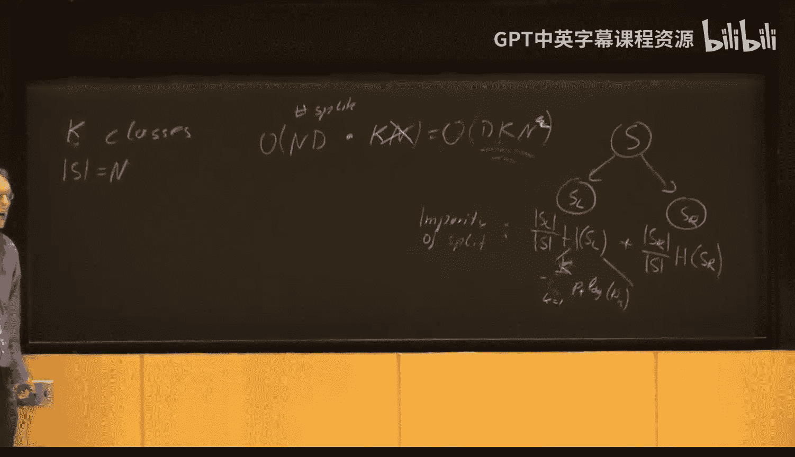
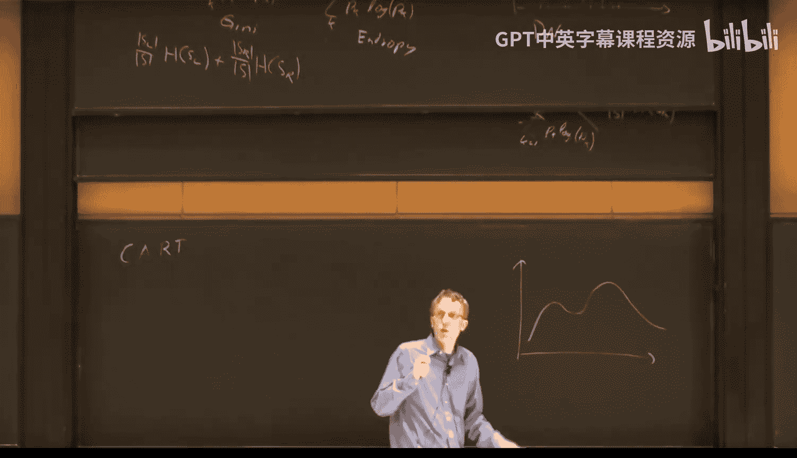
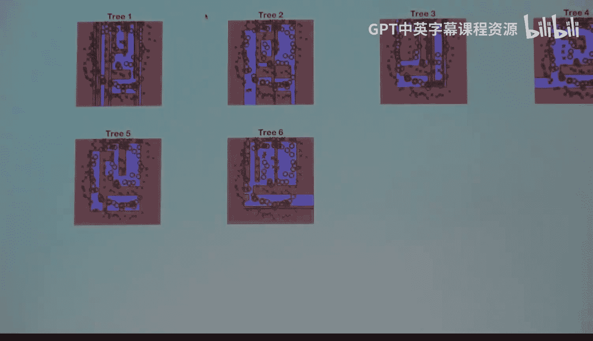

# 机器学习：第30讲：Bagging 🎒

在本节课中，我们将要学习一种名为 **Bagging** 的强大技术，它可以帮助我们解决机器学习模型中的**高方差**问题。我们将从回顾决策树开始，理解其局限性，然后深入探讨Bagging的原理、实现方式以及它为何如此有效。

---

## 回顾决策树 🌳

上一节我们介绍了决策树。我们从一个数据集出发，这个数据集可能包含不同的类别。我们最初使用KD树来加速最近邻搜索，但后来意识到，如果构建的KD树叶子节点都是“纯”的（即只包含一个类别的数据），那么我们甚至不需要进行最近邻搜索，可以直接返回该叶子节点的标签。

决策树本质上与KD树类似，总是沿着一个维度进行分割，但使用了不同的分割标准。对于KD树，我们依次查看每个维度，并选择中位数进行分割，将数据集精确地分成两半。这很简单，因为只需找到该维度上的特征值中位数即可。

然而，对于决策树，情况则不同。我们希望找到一个分割点，使得分割后的两个子集尽可能“纯”。这里的“纯”意味着子集中的数据点尽可能属于同一类别。决策树的分割不要求子集大小完全平衡。

那么如何找到最佳分割点呢？一个简单的方法是：尝试所有可能的分割。具体来说，对于每个维度，我们考虑数据点在该维度上投影值之间的每一个可能的分割点。如果有 `D` 个维度和 `n` 个数据点，那么大约有 `D * n` 个分割点需要评估。

为了评估一个分割点的好坏，我们需要一个**不纯度函数**。上节课我们介绍了两种：**基尼指数**和**熵**。

*   **基尼指数**：`Gini = Σ_k p_k (1 - p_k)`
*   **熵**：`Entropy = - Σ_k p_k log(p_k)`

其中，`p_k` 是某个子集中属于第 `k` 类的数据点的比例。

对于一个将集合 `S` 分割为左子集 `S_left` 和右子集 `S_right` 的分割，其不纯度计算如下：
`Impurity(split) = (|S_left|/|S|) * H(S_left) + (|S_right|/|S|) * H(S_right)`
其中 `H` 可以是基尼指数或熵函数。

### 决策树的复杂度与优化

如果我们朴素地实现决策树，对于每个候选分割点，我们都需要遍历整个数据集来计算左右子集的不纯度。假设有 `K` 个类别，那么评估一个分割点的复杂度是 `O(K * n)`。由于我们需要评估 `D * n` 个分割点，总复杂度将达到 `O(D * K * n^2)`，这对于大型数据集来说非常慢。

然而，有一个巧妙的优化方法：当我们按顺序评估一个维度上的连续分割点时，每次移动分割点，通常只有一个数据点从一个子集移动到另一个子集。因此，我们可以维护左右子集中每个类别的计数器，并在移动分割点时仅更新受影响的计数器。这样，评估一个分割点的复杂度可以降低到 `O(K)`，使得总复杂度变为 `O(D * K * n)`，算法效率大大提高。

### 决策树用于回归问题

决策树不仅可以用于分类，也可以用于回归，此时称为**回归树**。其算法流程基本相同，唯一改变的是不纯度函数。对于回归问题，我们通常使用**均方误差**作为不纯度度量。

对于一个集合 `S`，其不纯度（损失）定义为：
`L(S) = (1/2) * Σ_{(x,y)∈S} (y - μ)^2`
其中 `μ` 是集合 `S` 中所有标签 `y` 的均值。这实际上就是集合 `S` 中标签的方差。

在回归树中，我们通过不断分割来近似目标函数。每个叶子节点预测一个常数值（该节点内数据标签的均值），最终得到的预测函数是分段常数函数。

### 决策树的局限性：偏差-方差权衡

决策树面临的主要问题是**偏差-方差权衡**。我们可以通过限制树的深度（或叶子节点数量）来进行正则化，防止过拟合。

*   **训练误差**：随着树深度增加，训练误差会持续下降，最终趋于零（除非存在无法分割的相同点）。
*   **测试误差**：随着深度增加，测试误差先下降后上升，呈现U形曲线。

问题在于，树的深度是一个**整数**参数，我们只能在离散的深度值（如3、4、5）之间选择，很难精细地找到偏差和方差之间的最佳平衡点。这导致决策树单独使用时，性能往往不稳定。

---

## 引入Bagging：降低方差的神奇方法 🛡️

决策树，特别是深度很大的树，通常存在**高方差**问题。这意味着训练数据的微小变化会导致学到的模型发生很大变化。Bagging（Bootstrap Aggregating的缩写）正是为了解决此类高方差问题而设计的通用技术。

Bagging的核心思想非常直观：**如果我们能训练多个模型并对它们的预测进行平均，那么整体模型的方差就会降低。**

### Bagging的工作原理

1.  **创建多个数据集**：我们只有一个原始数据集 `D`。Bagging通过**自助采样法**从 `D` 中生成 `M` 个新的训练数据集 `D_1, D_2, ..., D_M`。
    *   **自助采样**：每次从原始数据集 `D` 中**有放回地**随机抽取一个样本，重复 `n` 次（`n` 是 `D` 的大小），形成一个新数据集 `D_i`。由于是有放回抽样，`D_i` 中可能包含重复样本，也可能缺失 `D` 中的某些样本。
2.  **训练多个模型**：在每个生成的数据集 `D_i` 上，独立地训练一个基学习器（例如决策树），得到模型 `h_1, h_2, ..., h_M`。
3.  **聚合预测**：
    *   **分类问题**：采用**投票法**，即最终的预测结果是 `M` 个模型预测中出现次数最多的类别。
    *   **回归问题**：采用**平均法**，即最终的预测结果是 `M` 个模型预测值的算术平均。

**最终模型** `H` 可以表示为：
`H(x) = (1/M) * Σ_{i=1}^{M} h_i(x)`

### 为什么Bagging有效？

回顾偏差-方差分解，模型的期望误差可以分解为：
`Error = Noise + Bias^2 + Variance`

其中，**方差**衡量了模型对于训练数据变化的敏感度。对于高方差的模型（如深度决策树），`Variance` 项很大。

Bagging通过平均多个模型来降低方差。从理论上讲，如果这些基模型 `h_i` 是独立同分布的，那么随着模型数量 `M` 的增加，聚合模型 `H` 的方差会减小。虽然自助采样产生的数据集并非完全独立，但实践证明，这种平均操作能显著降低整体模型的方差，而对偏差的影响很小。

### Bagging的优势

*   **通用性**：Bagging是一种元算法，可以应用于任何高方差的机器学习模型（不仅仅是决策树）。
*   **并行化**：由于每个基模型是独立训练的，因此Bagging非常适合并行计算。
*   **效果显著**：它通常能显著提升不稳定模型（如决策树）的预测准确性和鲁棒性。

---

## 总结 📚

本节课我们一起学习了以下内容：

1.  **回顾了决策树**，包括其构建过程、不纯度函数（基尼指数、熵）、用于回归的均方误差损失，以及其存在的**高方差**和**偏差-方差权衡难**的问题。
2.  **引入了Bagging技术**，它是一种通过**自助采样**构建多个训练集，并训练多个模型进行**聚合**（投票或平均）来降低模型方差的有效方法。
3.  **理解了Bagging为何有效**：它主要针对并减少了模型误差中的方差部分，从而提升了整体模型的稳定性和泛化能力，尤其适用于像决策树这样不稳定的学习器。

Bagging是构建强大集成模型（如随机森林）的基础。下一讲，我们将探讨另一种强大的集成方法——Boosting，它主要侧重于降低模型的偏差。