# 031：康奈尔大学《智能系统的机器学习｜CS4780 Machine Learning for Intelligent Systems 2017》中英字幕 p31 -31-Machine Learning Lecture 31 ＂Random Forests _ Bagging＂ -Cornell CS4780 SP17. -BV1Lo6gBxEKE_p31-

F you logistical things。 So the k competition is up and running。EThe homework assignment was due。

 but we still have slipped days， the project on kernels。😊。

And the next project will come out on Monday。 That's the current plan or maybe Friday。

 Friday on Monday。Then。

We were， so I guess， basically， you know， we had this this。

You guys filled in the survey how to improve the class。

 So I think the three main things were C M S pushing the grades onto C S。 that's done。😊。

One thing people ask is， you know， make the homeworks more related to the project or more related to the course。

now the homeworks will have a very clear link to the project。 Certainly， the next homework。

 you will see this。 And the last thing was recitations。 And so we now actually do have recitations。

 Some， Some people already went to the last recation on kernels。😊。

And there will be one on Gaussian processes。 So there's still something unclear about Gaussian processes。

 Please go to the recitation。The student giving it actually， is。

 he's writing his PhDs last year of his Ph D on Gausian processes。

Few people in the world to know more about it than he does。嗯。Okay， good。Then last time。

 we talked about baggging。And baggging is a very effective way to reduce the variance of a classifier。

And so we're using this in the， you know， in particular， in the context of， of decision trees。

 because decision trees， if you grow them fully。A very high variance classs。

And so the idea behind bagging is very simple。 You have some distribution P from which your data is drawn。

You don't know this distribution P， but do you have this finite data set D。

And so now if youre trying a classifier， this classifier has high variance。 So what does that mean。

 It means that in some sense， you're worried that you。

 your classifier captures stuff about this specific distribution， like this this specific data set D。

That is actually not all that common in the distribution peak。 So you're overfitting。

So how do you combat that problem？ It's quite simple。 What vgging does is the following。

 You take this distribution D that has N as sorry， this data D that has n data points。 And from it。

 you draw multiple data sets， D1。All the way to DM。

Each one has the same size as the original data set。 And you draw them with replacement。

 uniformly at random with replacement。Okay， so the difference， basically。

 if you draw the replacement， basically draw one point at a time。

 but you can pick the same point multiple times。 Every single point is kind of drawn， you know。

 independently from this data set。And then what you do is from each one of these data sets。

 you now learn classifier H。唉。And you train all of these。😡，And then he' is saying， well。

 my final classifier is just the average of all of these。 So now you go back。

You say my final classifier。It's just the average。Lets make us J。And that's it。

And the idea basically， is that let's say you're overreacting， right。

 you can kind of view overfitting。 There's an overrea to certain your synccrasies in your data set。

 Well， these will be all different in these different data sets。 in the essentially average out。

 right， So that's basically the idea。 And yeah。😊，Inreasing all of your training and your testing by a factor。

 that's right。 That's right。 But you know what you do， you just buy M computers。

 You do it all in parallel。Yeah。So it's actually true， by the way， now that we， you know。

 computers are so cheap。 a multi every computer now has whatever 16 cores。

 at least something if you buy a desktop， But it actually becomes very cheap to run things in parallel。

 right So in some sense， it becomes you know， a more， more appealing method。 like modern hardware。😊。

嗯。So the testing is， however， slower。 that's， that's fair。 The testing takes M times as long。

But you get another advantage。 And the， you know， one advantage is basically reducing variance。

But there's another advantage。 that is that now you actually get a very good calibrated probabilities。

 So one thing you can say is， you can actually， you know， let's say， on average。

 you predict a certain label， you could actually look into each one of these different classifiers and see how many of these classifiers have predicted that certain label。

 right， And that basically tells you how certain you are about your prediction。😊，嗯。All right。

So let me。 divging is really， really awesome。 I'll show you a little demo in a few minutes。😊。

One of the most。他比了。Intances of bagging is called random forest。And randomfor is。Awesome。

 is a really， really awesome algorithm。😊，It almost。

 was at least the machine learning was almost forgotten。And then。嗯。

It came back big time as was also invented by Leobriman。

 Leobriman was the same person who was invented bagging after he was done with bagging。

 He also invented invented forests。And randomfor is very， very simple algorithm。

 It's basically bad decision trees。But there's a very small modification。 And so here's what you do。

😊，He， basically。You take your data points。 You take your data this data a D。

You draw the different data sets， D1 to D N。And now for each one of these。

 you learn a decision tree all the way to the end。Right。

 so basically you keep splitting until you have zero training error or until you basically have two points that are identical。

 and you can't splitit them anymore。O， so that's you're really overfitting in some sense。

 Each one of these data sets， right， You're so confident that bagging is gonna rescue you， right。

 just， you know， driving， you know you。Going all in with the variance。And in fact。

 you do go even crazier。You make a small modification to your decision tree algorithm。And that is。

 whenever you make a split。Right before you split。 Currently， what decision  tree does。

 it tries out every single dimension and every single dimension it tries out every single split。

What you do in random force， you say， instead of doing that， I'm trying all D dimensions。

I randomly subsample K dimensions。And I restrict my search to those K dimensions。Alright。

 so basically， I build a tree。 I take my data set and say， you know， D3 here or something， right。

 And then I split it in half， right， was roughly in half and two different subs here is now my my first node of the tree。

 But here for this split， I split on some particular particular feature F and some particular threshold T。

😊，So， you know， basically if X F is greater than t you go to the right and otherwise go to the left here。

 I'm only considering K where K is less than。😊，K is less than than D dimensions。

And the reason I'm doing it doing this is to make sure that these data。

 these classifiers are all very different。Right， so you're basically splitting on very different dimensions。

And。mean think about it， right， What's basically happening here is that because they are so different。

They will make very different mistakes on test time。 And now， if you average them。

 the mistakes average out。O。And that is an extremely effective algorithm。

 randomand Forest is one of my favorite algorithms。😊，So just， you know。

 I'm not going to write down the pseudo code。 It's on the notes on the random forest。But really， the。

 the important thing is that you only split one second， Only split。On K。lesson第。Features。 And so。

 so the important thing is。For every single split， you sample K features afresh， right。

 So it's not for every single function。 you you sample sample features of Every time you split。

 right， So here， when you do this， but again， you pick K features at random and you split on those。

 And then you find you find the best one。 And then here you pick K features at random。

 find a best split。😊，Any questions， yeah？没得ま。其他时啊。I like a minimum value。People waiting。Okay。

 actually， maybe， maybe this is I'm bragging it。 maybe it's just less， not less less， okay。

So it works for any kind of dimensionality。And so one question is， how do you set K， right。

 So now we have an additional hyperparameter。And it turns out there's a very good justification that I'm not going into。

Just that K to square root of D。And you round up。And that turns out to work really。

 really well in practice。 And I've never really seen。

That's basically hyper parameter that's that you don't have to tune。

 You just set K to the square root of the。O， and people have analyzed this and there's this theoretical justifications of why this works so well。

 But for all means and practices， can almost consider it not a hyperparameter。Now。

 here comes the beauty。 Here's the reason I love random forest so much。 I mean， actually。

 I would say， oh sorry， yeah going。😊，啊。Yeah。Oh， then you try out every single one。

And for each dimension， you've tried every single split。

And you pick the one that minimizes your imp purity。

So this is just the normal decision tree algorithm。 right， You just during that time， basically。

 you pretend that you only have these K features， right， That's all。 You could just， you know。

 if you implementing this and Python or something， you would just say， you just。

Just only take out those K features and now just call you a splitting function。嗯。Okay。

 so one reason I love to reinforce so much is because。😊，It really， you know。

 it's not the very few algorithms that works out of the box。

 So when practitioner comes to me and it happens a lot， people say， like， oh。

 I have this following data set。 I collected， whatever。 Like， you know， samples of horses。

 and I did the following strap the following sensors on， etc cetera， whatever， right。

 And I measured the heart rate， and these kind of things。😊，嗯。They have feature vectors。 They。

 you know， they are totally different， you know， units， etca， right，1 is the gender of the horse。

1 is the age of the horse， One is the heart rate， etcter。

 right If you want to use most machine learning algorithms。

 you have to make sure that these actually scale between 0 and 1， etc cetera。 know。

 you have to preproces， these features very carefully。 When in forest。

 you don't have to do any of this。 because you're just splitting。 So actually。

 the scale of the feature doesn't matter at all if you measure your height in c or nanometer or feet doesn't matter。

 right，😊，So you can just， most of the time， you can just take your data out of the box。

 And now comes the beautiful thing。 What are the hyper parameters of random force。 It's K。 Well。

 you know what to said it's square root of D。 you're done， right。😊，And you have M。Right。

 how many of these do you， How many of these data sets do you subs sampleample And how do you set M Well as large as you can。

 right。There's no real， you know， it can't be too large。Like basically， you know。

 you said it until you get bored。 you know， you keep training。 And then somebody you just stop。

 And that's the only thing。 So you can't go wrong， right。

 That's the the only thing if you go wrong if you're too impatient。 You said M equals1 or something。

 But you know， typically M is 100 or thousands， you know。You know。

 it gets a little better as you know， it M gets larger。 like usually the error can but it， right。

 someone there's no benefit anymore。So it's a beautiful algorithm because it's so， so easy to use。

 And actually， it's really， really amazingly good。😊，So most of the time， like my rule of thumbs。

 is's always the second best algorithm。So if you basically。

 if you give take another algorithm that actually is tailored towards， you know， you know。

And massage it very carefully and makes about assumptions that you can do better。

 You typically you can always do better， but it takes a lot of tender loving care to get there， yeah。

😊，So how is the size of。Oh， they， they're unrelated。So you choose M independent of the size of the。

says no no， M can be can be 10 million if you want。 That can be larger， right。

 M iss just how many times do you want to sub sampleample a data set， right。

And so the important thing is each one of these data sets has the same size as D。

You're not taking this data set and splitting it into M partitions。

What you're doing instead is you take this data set and you sample a data set has the same size。

 the same number of data points， but with the replacement。No。

 they're not the same because you're sampling with replacement， right， So let's say Ive。

 Ive a data set has， you know， ABC。And I want to sample from that。

 another data set that has three entries。 right， So you trust a coin。The first one，'s say you get B。

you stick being here。Second one， you think， you know， it just a coiner you could see。Third one。

 you may get a again B。Right， so then basically， this data set is quite different from that one。

 And so that that's the key。 And because you repeat some data points。

 you basically give more emphasis to some data point sometimes。

 And other times you actually don't sample them at all。 then。You know。

 you get this into different decision boundaries， yes。They number。あてきま。That's a lot。Sureru。

 if you I said yeah， if you can afford it， Yes， absolutely， you know。

 But you may want to use that electricity for something else， you know。😊，I know。

 charge a Tesla with it or something， yeah。这以为的。How to think about the class priority。

What is the ensemble of a decision， What is the average of a decision here So。

First clip on one of the。What are the trees in your forest。I split on the this is， let's say， K1。

And they。So yeah， okay， good，'s a good question。 So you're basically saying。

 can you give us some intuitions about how， what it means to average decision trees， right， and so。😊。

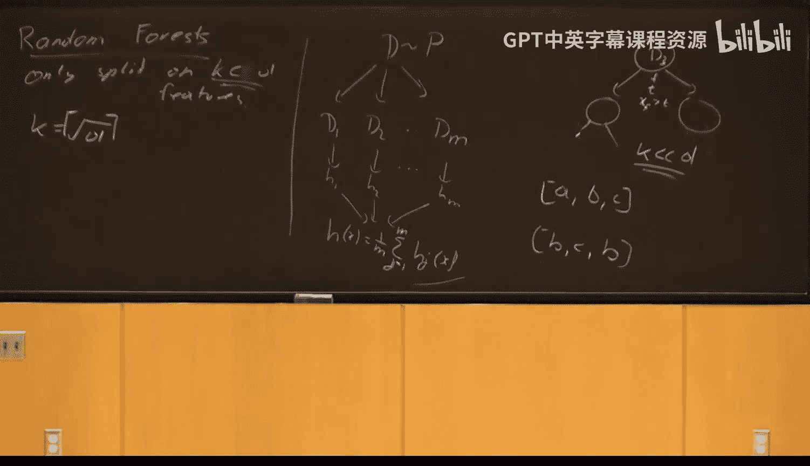

Think about the following way where I have a data set。 and I have， you know。

 some access here you know， say some some。I draw this it's hard two dimensions。 actually。 Okay。

 let's do this one， right。And you could either split this way and you're doing fine。

 or you could play this way。 and you're doing fine， right， And if you average out。

 you're actually splitting out both ways。😊，Right， so half the time you're spinningi this way。

 half the time you' spinningi this way。So each， the first tree would say all of this is positive。😊。

And all of this is negative， right。Because you split this way。

The second tree would say all of this is positive and all of this is negative。😊，Right。

 but on average， what you get is the following。 This years positive。This year is negative。

 this year's kind of a I I'm not really sure about， right， And that's the neat part。

 It actually gives you uncertainty。 right， So now you have a test point here， you say， well。

 that on this is positive。 here this is negative， right， And here。

 I'm not sure it could go either way。😊，And so the how dimensions。There's not exactly 50，50， yeah。

Good question。 Yes， any more questions。Yeah。別。Yes， yes， yes。 random force， actually。

 then one of the most commonly used algorithms for feature selection。 And basically。

 what you do is let's say， so what is feature selection selection。

 feature selection is the following task。 I give you a data set。 I try to predict something。

 And I want to know which features are most predictive， You know， which features are most important。

 And why is， Why is that something that's interesting。 So when I worked， you know。

 I used to work lot with neuroscientists。 And they， for example， one thing they did is you know。

 one collaboration I had is they they implanted， for example， electrodes。😊。

Into onto top of someone's brain。 So they， they took the skull open。 They opened the skull。

 put electrodes a foil of electrodes onto the brain。 And then they closed the skull again。

 let the person run around， you know， for a couple of weeks。 and they。😊，Yeah。And they recorded。

 So they basically had the people wore a data glove。

 and they recorded the finger movements and hand movements of these people。 But by the way， sorry。

 these are not volunteers。 These people actually， not my grand studentss or something。 They actually。

😊，These are people who actually had to get done。 had had the surgery done for other reasons。

 And so we basically used that。Mm。And they all， you know， mean， they theyre very volunteers。

 but it's not that they are just randomly cutting people's heads open。

So these are amazing people had to get the surgery done。 They had to get this， this。

 these electrodes implant into their brains。 And so then we asked them to wear this data glove。

 And this data glove basically recorded the position of any given finger and arm at any given time。😊。

And then the task that we looked into is can we， you know。

 basically be recording the brain activity all the time the motor cortex。

 the motor cortex is the part that actually of your brain that basically， you know。😊。

commands your muscles， essentially。 And so the question was， can we predict， you know。

 finger movements just based on the brain signal。 And you get a lot of brain signal the whole time。

 And turns out you can actually predict it pretty accurately you can predict the hand movement， etc。

 And so what we could then do is we could actually then you know。

 just based in the brain signal actually predict where the arm movement was。

 And then we could ask these patients to then， for example， plays on computer games。

 but they just thought of moving a joystick and that actually work。 And But ultimately。

 the reason the neuroscientists really want to do this is because they they were less interested in actually the application of of brain computer interaction。

 What they were really， really interested is which part of the brain does what。 So they ultimately。

 what they really， really want to do is they wanted to figure out which part of the motor cortex controls your index finger。

 for example， And so they then basically， once we had the model that actually could could make these predictions。

 they came back to me and said， okay，😊。

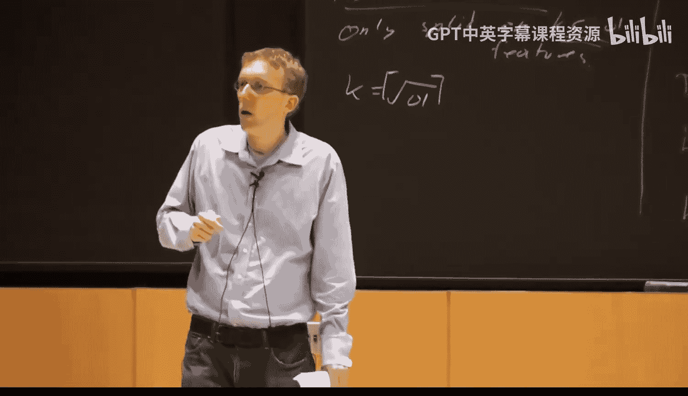

Nice， right， It's great。 And we could do this。 But， you know， how how does it work， right。

 And so that's when you do feature selection。 And what you， for example， do is a random forest。

 And now if you have several thousand of these trees。

 what you look at is basically whenever you split on a certain feature。😊。

How much does the impurity go down， So that's basically。 And then you rank them by that amount。

 And and that actually is a very， very good signal that a feature is very important。

 right because ultimately， these random forest because they are so random they split on every feature eventually。

 because eventually， they always overfitting right， So they split on the noise。

 But when they overfit the impurity goes down very， very little。 But you know。

 when they split on a real signal， the impurity goes down a lot。 Okay。

 so if you average that and rank the features， then actually you get very， very strong signal。

 And then what you usually do is you select like very few features。

 These are basically a few electrodes and a few frequency bands in that case。

 and you retrain the classifier and you show that it still works。 And then you know， okay。

 you found the region of the brain that doesn't。😊，那这样。EThat。

 that's random forests work really well on high dimensional data。

 versus low dimensional data actually works as surprisingly resilient towards the against the course of them curse of dimensionality。

😊，And in some sense， because you never really compute distances in a high dimensional space。

 different than， for example， the RBF column， etc。So it， it gets slower in high dimensional spaces。

 but it still works pretty well。Yeah。Okay， any more questions。啊，周。One more time。

 randomfors are so awesome because they， they extremely， you know。

 the most out of the box classifier that I know， right， They only have two hyper parametersameter。

 And I can tell you exactly how to set them。 right。

 K is spread of V and M is as large as you can afford。 right。

 So maybe a couple hundred maybe a couple thousand。 And that's it， right， so。😊，Keep this in mind。

 There's actually。呃。There one additional advantage。 that's some advantage。 It's very easy to run。

 You don't have to preproces the data。 And there's a last advantage。 And that's a killer advantage。

 And that actually is an advantage that every bagging algorithm has。

And it's called the out of bag era。So remember when we did model selection before。

What we did is we took our data。And be split it in training。And validation。Okay。

And so let's say you want to， you know， develop some system， et。 And you， you know。

 in order to know or you're training a test， right， And in order to know the error。

 what basically what you do is you train your algorithm on this part。 let's say 80% of the data。

 And then you evaluate in 20% of the data。 And that tells you。

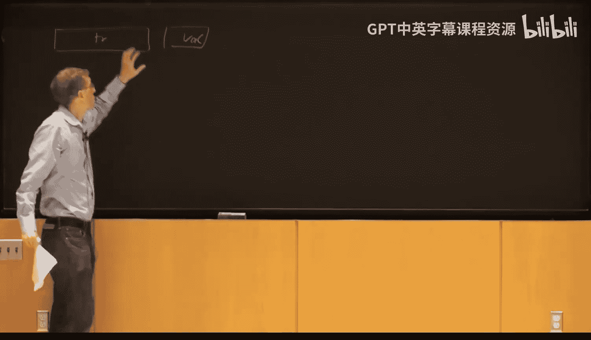

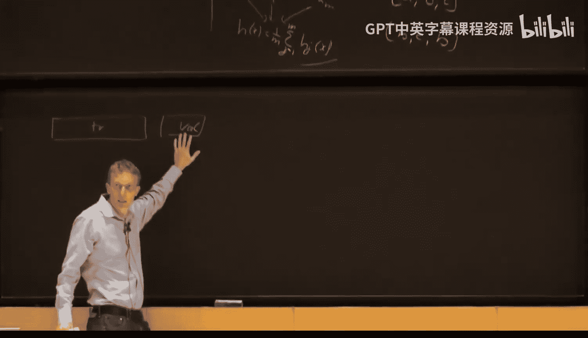

How well you're probably doing on the test data set。 you know， real life in runtime。

 right on the true distribution。 Okay， the downside of this approach is that you have to only train an 80% of the data。

so that's kind of a pain setup。Turns out for random forests or for bad classifiers。

 you don't have to do this。You do not have to make a training validation dataset split。

You can actually estimate your test error directly on the training data set。 That seems crazy。

 but you can actually do it。😊，Any ideas how we can do it？Called the out of bag estimation， yeah。

Because also， we have many data to the R。That's right。 That's right。

 We have many media assets that are all different。This is like an estimated the pre error。多人。

That's exactly right。 So what you do is you want to know， what is the test error， right。

And you want to estimate it on your training error。 So here's what you do。

You go through all your trained data points。And。For every single training reader point。

 I say you have many different classifiers， H of X。Equals。HJ。Offfex。All right。嗯。

Each one of these was trained on a different data set。 Do want to D M。All right。

So here's what we can do for every single training point。We can estimate the error， right。

 So what's the error。 The error is just basically， you know， saying the loss， right。

 If you want to compute the loss。 And that's just。The average loss。You know。这 yeah well。

Right so we have point X and y。 Then we basically actually compute the loss of x and Y。

 which is the loss of the whole classifier。 The whole classifiers。

 There a sum of many different classifiers。 So it's just the loss。 You know。

 the average loss of all these different classifiers。😊，And here comes the cool part。

Some of these classifiers。Will not have had that point X in the data set。

 So if have one particular data point X， I， Y I。That will not be included in all of these data sets。

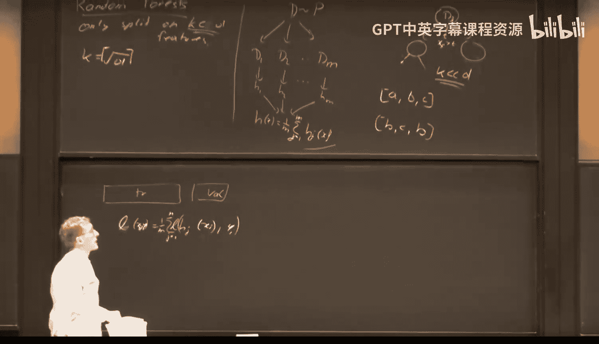

Right， does that make sense。So when I sample this data with replacement， in expectation。

 I get around 60% overlap with the original data。And the other 40% are just repetitions of data points being chosen multiple times。

Okay， for example， here， I had this， this here was my D。 This here is my D D1 that I'm subsampling。

 In this case， I didn't subsample point A。 Instead， I had point B twice。😊，Okay， does that make sense。

 Raise your hand， if that makes sense。Okay， awesome。 So what I do is for my point A， what Im。

 what I'm choosing， I just compute the error only on those classifiers that were trained on data sets that didn't contain A。

All right。And therefore， I basically took it out， right， Therefore。

 it was basically implicitly in the validation data。And if your M is large enough。

Now it doesn't really matter if you just remove a few classifiers， right。Just make M twice as large。

 right， And then you're removing， you know， basically essentially， But every every single data point。

 you remove 40% of the classifiers。 right， That works really， really well。

So maybe I can formalize this just a little bit。 So basically， what I'm saying is my， my error rate。

 I call it the out of back error。

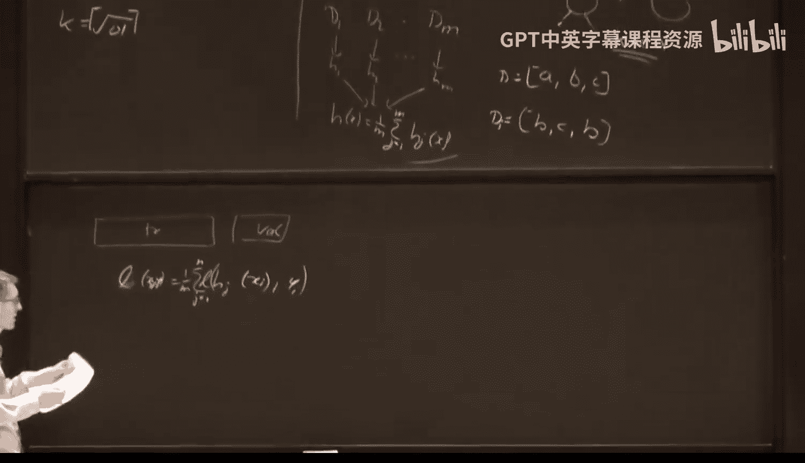

Is the following and some of all my data points。To end。Guess the average。And。Then I did。

For each one of these data points， I basically sum all the。The J。Such that X I。

Y I is not an element of DJ。And so I take all the data sets for which。X I was not in there。

 So I take all my data points again for every single training point。

 and for every single training point。I now go over all the classifiers。 and I say。

 actually only take those classifiers that were not trained on that data point。And then， basically。

 a computer loss。Of that particular classifier。XI。喂安。And I。Average that。Where Z I。

 Z I is just the number of data points。The sum number of data points that。X， I。

Let just take a one here。 So Z I is just the number of number of classifiers that were not trained on X I。

Okay， this is just a normalization。 So I just average them。 That's all it， all it does。Any questions。

Raise your hand if that makes sense。Okay， awesome， okay， so。This is extremely powerful。

 because this means you train your whole classifier on all your data。And for free。

 you're getting an unbiased estimate。Of how well your classifier is doing on the test。And。

This is super， super， super powerful。 It doesn't get easier than that。

You don't have to be careful with your train validation， setup， et。And， you know。

 if you have good implementations of， of random forest， you just spit that out right away。 right。

 So you know how well you're doing on your test。Okay， any last questions about random force？Yeah。ESo。

 okay， good question。 So saying is there any data which randomd are not good。And。So one thing。

 for example， in computer vision， if you take images。

There are specific algorithms that we will cover next week， actually。

 that take into account that vision like pixels are kind of colocating and have a very specific structure。

And randomand forests don't really do this。 They treat each dimension independently。And so。Therefore。

 they， they can probably never do as well as algorithms that take into account the specific structure of。

 of an image。There's， of course， other data sets for you， for example， have structured data， etc ce。

 So then then it's also trickier。

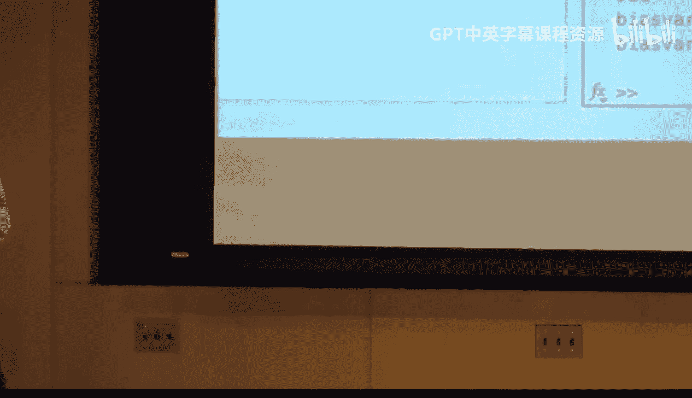

Yeah。😊，What is the problem regression problem， No problem at all。 Youre just taking regression trees。

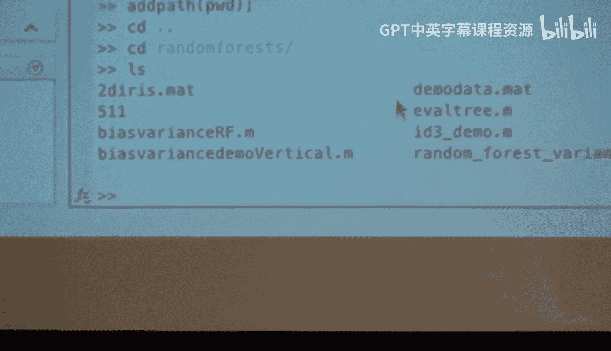

Yeah， yeah。 It's great。 It's awesome。 Here' is actually another thing reason why' so good for regression is because random forests give you an uncertainty。

😊，For regression， which you typically don't get。 if you do it， you know。

I kernelize regression of something。 You have to use Gausian processes to get that。 uncertainties。

 right。そいあげ。So all only Gaussian processes and going forests give you an uncertainty estimate for your regression value。

 Yeah， regression， would you still be dividing your leaves down until there's one point in each leaf。

Yeah， okay， so you may， you would stop at some point。 That's right。

 So you would introduce that hyper parameter。嗯。That's actually one thing you can improve and enforce a little bit。

If you， for each tree。Do you bear the fortune to me？And then you prune away from the bottom。

Like you take a split and you see if that split does not improve my out of bag error。

 then I remove it。So you basically， does that make sense。 You have the full tree。

 and you look at the last split。 You know， Any two node a basically 1。 of1 split。 You say。

 does that split actually improve my out of bag error。

 There is those data points that were not in this in my training data。And if it doesn't。

 then I just remove it。 So you kind of reduce the size of the tree。

 That help tends to help a little bit。

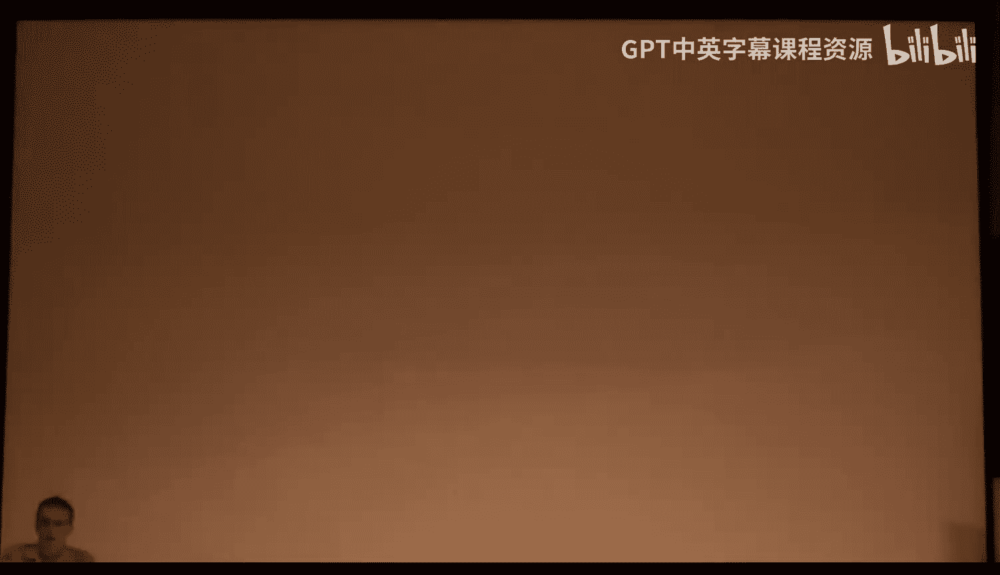

Because you're busy removing total noise splits， yeah。

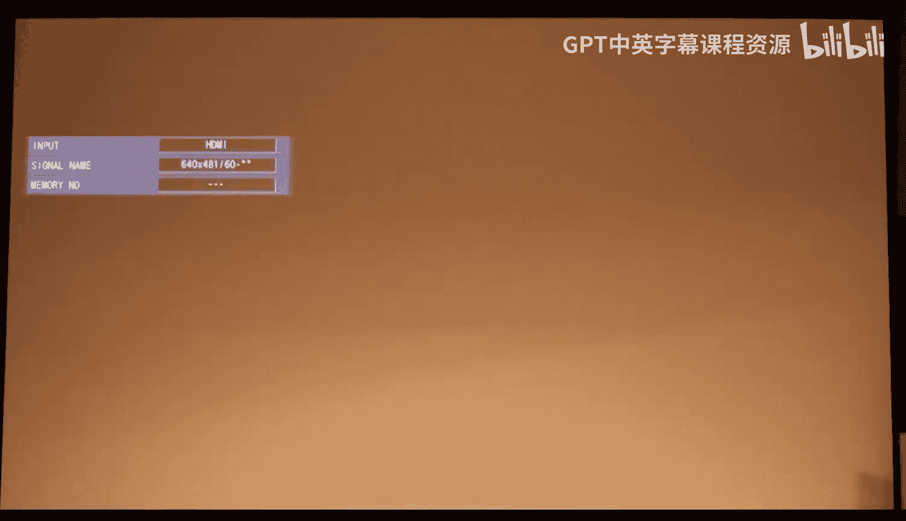

Or if you basically compute the error。😡，诶。Across all trees。Yeah， I would probably visit you。

 It's not very interesting。Well， well actually， it's not a entirely tree， right。

 It is 0 for all the trees where on which it was included in the train data set。

But for 40% of the trees， a training point was not included in the training dataset。And for those。

 it will not be0。No， no， no， no， because you include it will be lower， right。

 because you including all the trees that were actually trained on that particular point。

W does that make sense。Let's say you train a random forest。

On a on a data set and you take one data point that you totally mess up。 You flip the label。

 makes no sense， right。Only the trees that were actually trained on that particular data point will get that point right。

 Everybody else would get it wrong。So the out of bagarrow will be very high because whenever was not in the bag。

So in， in that， in that data set， it will be wrong。

 but the training error will be right low because 60% of the time， it was in the training set。

 And therefore， you got to write 60% of the time。The training era is not very interesting for reinforcefor。

Yeah。Okay， good。 so here's one little， Oh yeah， one thing。

 I want to show you the bias variance demo that you all know。 I can now do it with random force。😊。

And so what you see on the X， is the exact same demo that you've seen before that you basically was on your project。

And so what you see here is the ensemble size。 The ensemble size is the number of trees that I'm averaging。

And。What do you see here is the few interesting things。

 So now I'm increasing the number of trees that I'm averaging。And the first thing。

 one thing you notice is that the bias is very， very low。 Like， if I have one。

 then it's just a standard decision tree。😊，In this case， by the way。

 I'm not doing the random feature selection just because the two dimensional data sets。

 So square root of 2 is 1。4。 roundunded up is 2 again， so。So one thing you see。

 if I just take a little a single decision tree and I train it， you know， basically， I have basic。

Ially know about bias， right， The bias is basically0。And the variance is very， very high。

 So the variance， The variance is black line。 Black line is the variance。The green line is noise。

 It's a pretty noisy dataset。 It's the same data that you had。 It's basically two Gausians。

 I didn't show the data set here， but it's two Gausians that basically have some overlap。

 And I try to disambiguate them。And this here is the error basically of the whole thing。

 And it's basically essentially bias plus variance plus noise。

 which is exactly what the theory would tell us。So here's the beautiful thing， right。😊。

As the ensemble size goes up， one thing you can see very， very nicely is that， you know。

 the variance goes down drastically， right， here we have 10% variance， right， and it goes down a lot。

 right， to 4%， And it keeps going down。 But you also see this diminishing returns， right。

 So this is my M。 So as my M increases my variance keep going down and eventually eventually basically you know。

 plate right， So it doesn't doesn't change anymore， But you get a huge improvement here。

 I drastic improvement。😊。

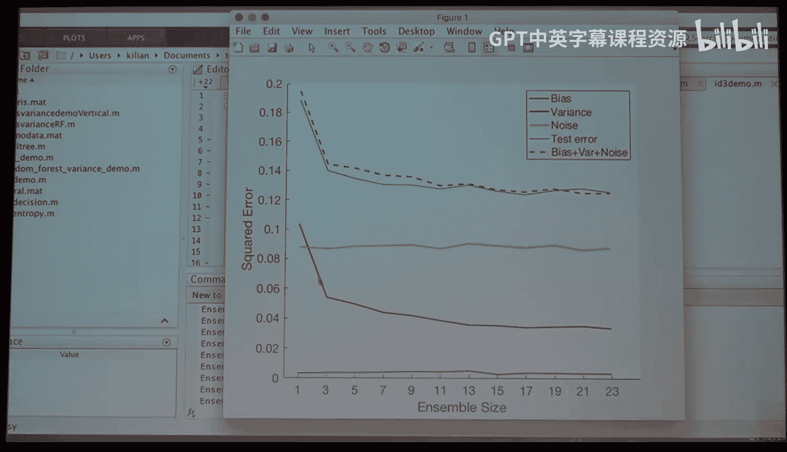

And the， the amazing thing about bagging is it reduces variance， but it does not increase bias。

 right， Bi is unaffected。😊，It should be very easy to prove that bias term actually is not affected at all by averaging the classifier。

 Can anyone tell me why。Yeah， you're just heading towards to me。Yeah， but actually。

 thats a very obvious reason。Yeah二。That's right。 bias is not a function of H。

 right of your classifier that youre getting。 It's a function of the average classifier。

 which is unaffected in this case， right。😊，So， you know。

 basically just having more averages of more averages， right， like， it doesn't， you know。

 doesn't make any difference。So， so the bias stays constant， but the variance goes down beautiful。

 right， And this here is just the fluctuation because they have small sample size。😊，Okay。

 any questions。About this demo doesn' it speak， but that don't make sense。

So I think it really shows very， very nicely that this amazing power of random force。

 So so please keep in mind baggging and keep in by mind random force。😊。

They really are some algorithms。Okay， if there's no more questions， Then we can move on。

 Last question， yeah。Oh， I see。 Good question。 They're very good question。 So he's saying。

 what if you do classification and I have apples and bananas， right， These are my two class labels。

 And what I get is at the end，60% of the trees say it's apple and 40% say it's banana， right。

 What's the output。 It's something in between。😊，What you do is you pick the mode。You pick the mode。

 you pick the most common one， and then the ratio tells you the probability with which you predicted。

第二。All right， good stuff。Now， comes。Menopho is pretty awesome。

There's only one thing that's more awesome。And that is boosting。And today， we did boosting。

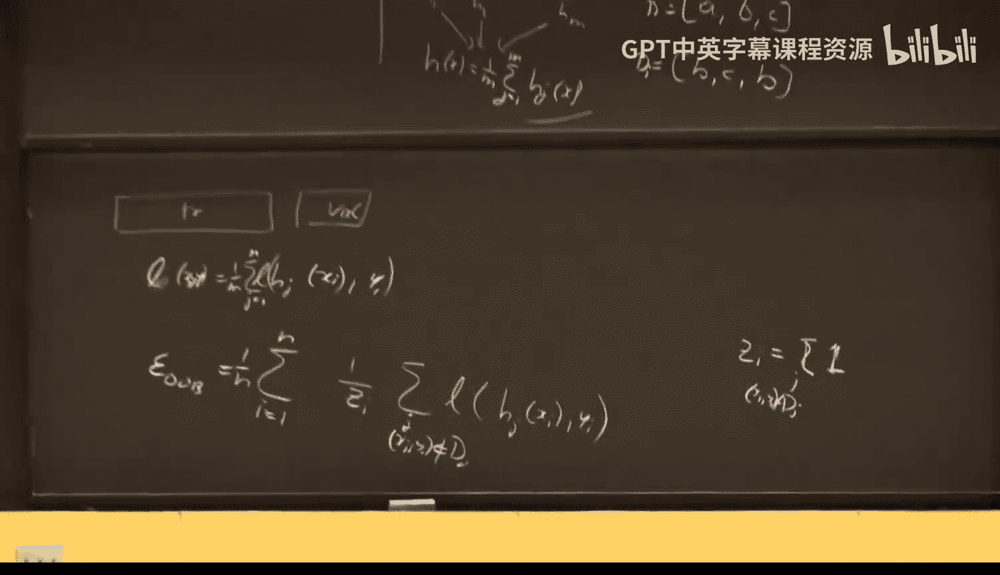

かし냐。I。Sorry。Can you， good question， The question is， can you apply bagging to any algorithm？

And the answer is yes， you can always bag everything。😡，And。

It really helps when you have a variance problem。LikeBaing would use as variance。

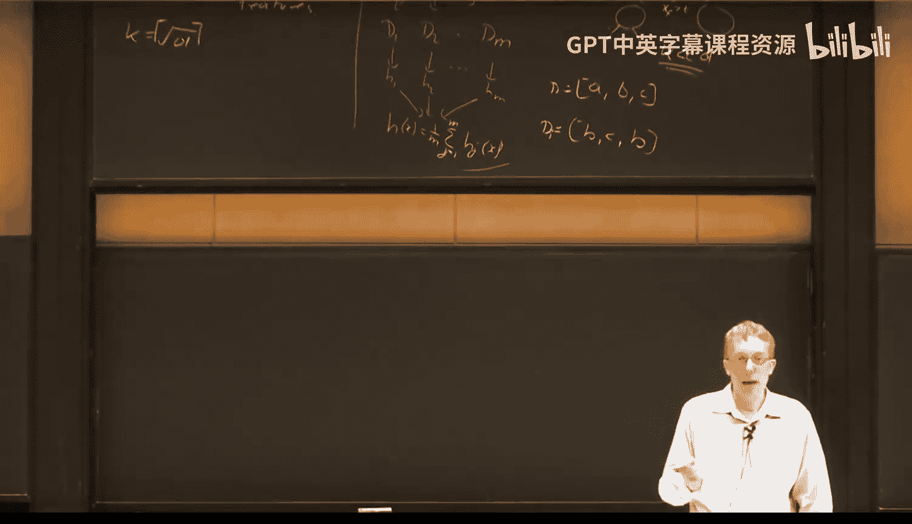

So if you don't have a variance problem， if your training error， you know。

 on the test area are roughly the same， essentially。It doesn't do anything。 It just makes you slower。

 right。

But yes， you can， you know， people have back all sorts of things。Okay， good。 So boosting。Is。

 I would say even more beautiful than baggging。😊。

It brings me to tears， sometimes。哎。But it's also a little bit more complicated。

So it's not quite as simple。But I think you can get it。 So just， you know， just please pay attention。

So in sometimes， bothing and bagging are very related。

So， both of these are。Ensembles of classacifiers。So in bagging， we just said， you know。

H of x is just the average。嗯。Okay。Let's put the one over end of here。And in both things。

You do the same thing。 You say H of X is。J equals one to N M。You just have an alpha here， an alpha T。

alphapha J， sorry， alphapha j。So it's the same thing。 Like you're also averaging many classifiers。

But boosting goes the other way。So boost thing says， what if we have a very。

 very simple testifier that has really high bias。 so right now with bag game。

 we have basically low zero bias， but really high variance。 So we average out the variance。😊，Now。

 we're doing something else。Yous saying， what if we have really， really high bias。

How can we get rid of the bias。It turns out something very， very similar。Can be used。And actually。

 started with a very famous question。 And this was in 1988。

 Michael Curs who a professor at University of Pennsylvania and is one of the fathers of learning theory。

😊。

He asked a very interesting question。 He asked the question， can if you have weak learners。

 which is very similar to basically high biased learners。

 So weak learners are basically classifiers that， you know， they can never learn。😊。

Go down to zero training， error。Can we combine weak learners， Like if you， you know。

 if you have multiple weak learners， can we combine them to a strong learner。 So can you。

 if you have a classifier that is so bad， it can never get even zero training error。

 Can we take multiple such classifiers。😊，And kind of。You know， construct like a， you know。

 a super classifier out of there。That then actually can get a serious training error on every single data set。

 So that that's the idea。 So that's called a strong learner。 So then， basically。

 people were convinced by， you know， the big question was。

 question was which classifiers can give you zero training errors and which cannot， like。

 which can learn something。😊，Whi cannot。 And so he asked that question， and it was an open question。

And Robert Shapirri， a few years later， he was a postdoc at the time。

 he actually came up with the answer very famously。 and he came up with a proof。

And it's really cool。 The Ra is a really nice guy。 He came up with this proof that actually showed that。

 yes， you can。😊，And the proof basically constructed some algorithm that， you know， basically said。

 oh， yeah， you can always make a， you know， combine bad classifiers to make a very strong classifier。

 But he was a pure theoretician。 though he didn't even think of it very much as， you know， as a。

It just， it was just a proof， right， But actually， a few years later， you know。

 he basically realized well actually， we can actually make this an algorithm。

 And he had a papers called Atda boost。😊，And this was a huge chip， right， This was published。

 I forgot which conference。 But and the Ba said， you know， if anyone of you right。

 have a shitty classifier， right， I have a way to make it really awesome。 And everyone's like， yeah。

 I have a shitty classifier。 I just published one。😊。

And so。It it became a tremendous hit， right， Like， you know， suddenly。

 everybody started using boosting。 and it has amazing theoretical guarantees that people go over the next。

 I guess two or three lectures that can basically show that not only if you boost the classifier where you always end up a zero training error。

 no matter how bad your classifier is， even if you have really bad， you know， really bad bias。

 right It's the simple as classifier you can think of， you can bring it down to zero training era。😊。

But not only that， you can bring it down to zero training error in a very small number of steps a step that actually is logo rhythmic with the training data。

 So it's ridiculous。 It's 30 of them， right， So it's tiny。So very， very quickly， you know。

 you can turn， as it's an extremely practical algorithm。

 You can turn any kind of loose idea that you have。 You know。

 you just come up with some algorithm not very good。

 right You boost it and becomes an amazing algorithm。😊，嗯。And。Maybe I。What time is it now。Okay。

 so I set up the， the overall system， and then we will get div a little bit more into it。

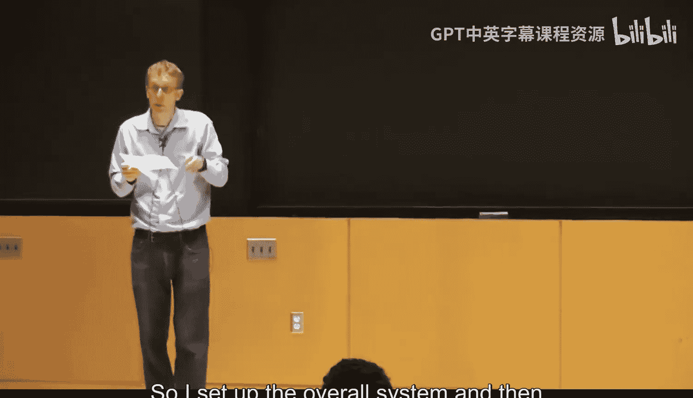

In the next lecture。And these is the following。 So let me just call capital H is the classifier that I'm assembling。

 Let me call this a capital H。

Yeah。😊，Capital age is basically an average of many classifiers。 And these are all have high biasers。

 They're not very good。 but I would like to kind of kind of make。You know。

 combine them into some really strong Frankenstein classifier。 That's the idea。And so。

What we need to do is be， well， you know， the first thing we need in a loss function that tells us how well I class it does。

 We've done this before。 We just take any of the loss functions that we've seen before。 For example。

 the exponential loss the square loss doesn't really matter。

 And let me write the loss function a little differently。

 Let me say the last function is now the loss function over H。😊，I right。

 this is a little bit of abusive notation。I'm saying the following。

It's basically the sum of all the losses。嗯。Some of all the losses are all the data points。I that's。

It should be pretty clear， right， So basically， the last。

 basically I'm writing the loss as the loss of a function。 I have， know I have a function。

 And I say the loss of that function is if I go over all my training data points and look at the prediction and the real label and I compute the loss and the average that's the loss of my classifier。

 And the loss function can be the square loss or exponential loss or whatever you like， right。

 your favorite loss function。😊，K the hinge loss doesnn't matter。Okay。

So here's the idea And the idea is。This age is a sum of classifiers。Okay， and。

So imagine I've already done a few iterations。What I would like to know is which classifier do I have to add。

 right， So if I now go from M to M plus1。Which classifier I have to add， So initially， you would say。

 I just have the zero classifier that predicts 0 for everything。😊。

And so given that I already have some classifier， what classifier should I add。

 And so I can that as the following。😊，Question。Which little function H？😡。

I this is this out of the set of my terrible high bias classifiers， my weak learners。

Should I add to my H such that I minimize my loss， So which function should be add a such that I minimize the following function。

H。Plus， alpha times T A H。Okay， does that make sense。 So this here is basically。This set here is。

 basically。My， my set of my sum of classifiers， if I add one additional classifier to it。

 that's what I'm interested in。 Okay， and I'm trying to come up with a mechanism。😊。

That tells me when you have a set of classifiers， which one should you add to it。Okay。

 and once I have this mechanism。Then I can just start with any kind of classifier， just a random。

 you know， And then I just keep adding， you know， use that mechanism to add classifiers to it。

And that minimizes。My last one。 so this is what I'm trying to solve。Any questions at this point。第二。😡。

对。要的地块。好嘞。On my first thing， you just take an arbitrary one。 actually。

 what you really do is the first classifier is the old zero classifier。So just gives you always0。

And then you basically start from there。Right， so this is kind of the base case。 Yeah。

 but its a good point。Yeah。Oh， okay， good question。 How does alpha come from For now。

 let's actually not。 So we will get into how to choose alpha optimally。 For now。

 I's just say alpha is just a small constant。Okay， yeah。 who's the point we will get into。All right。

You know， here's what we do。 We just stop here， but you got to promise me that next time you eat a lot of fruit before you come here and you're mentally alert。

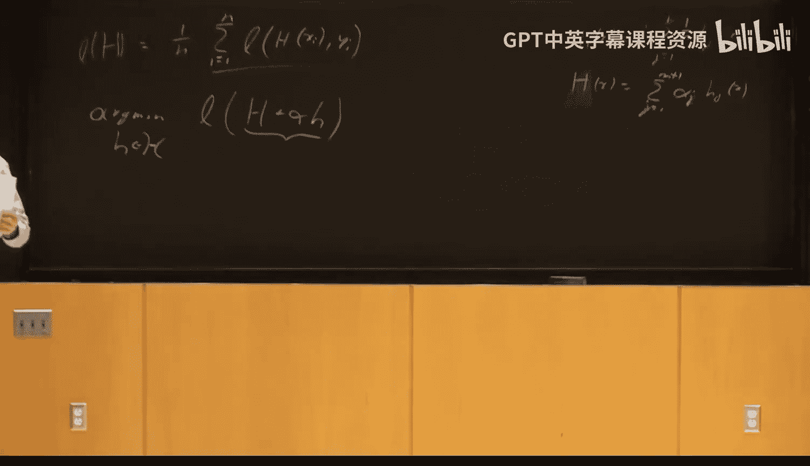

And then we gonna to go through it。