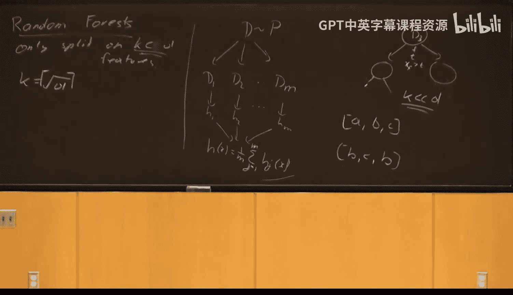
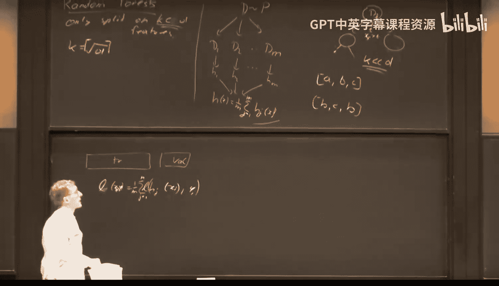
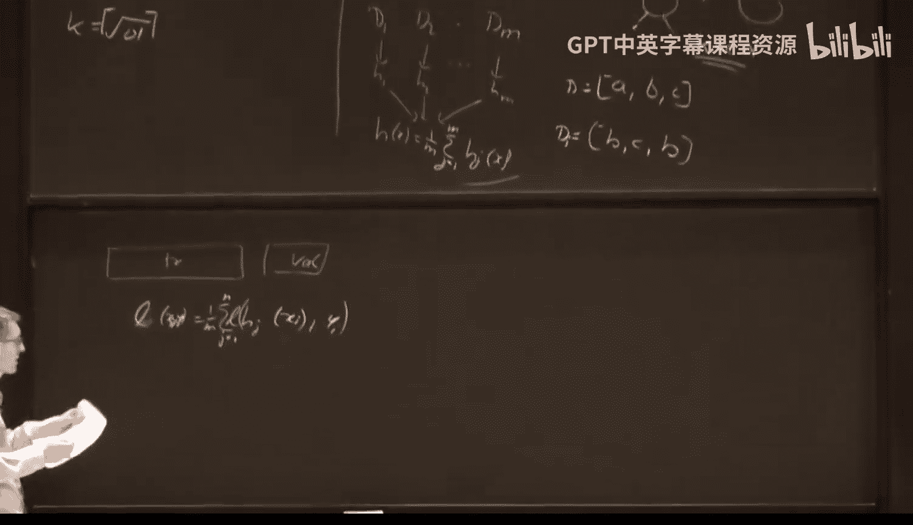
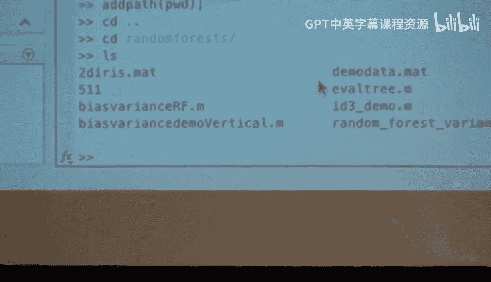
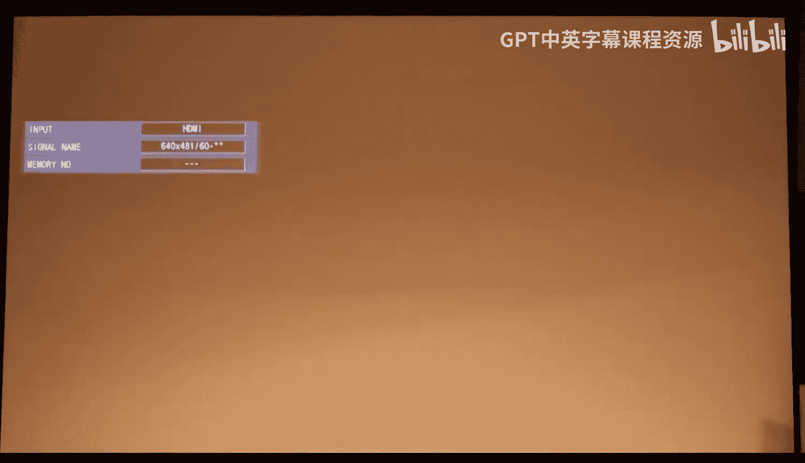
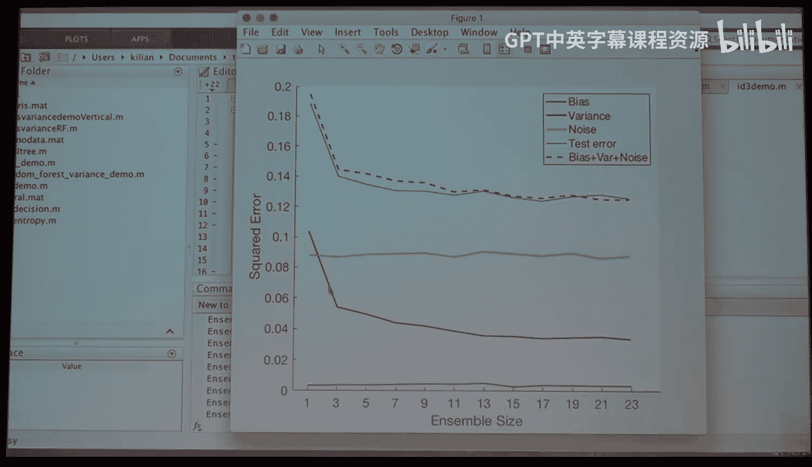
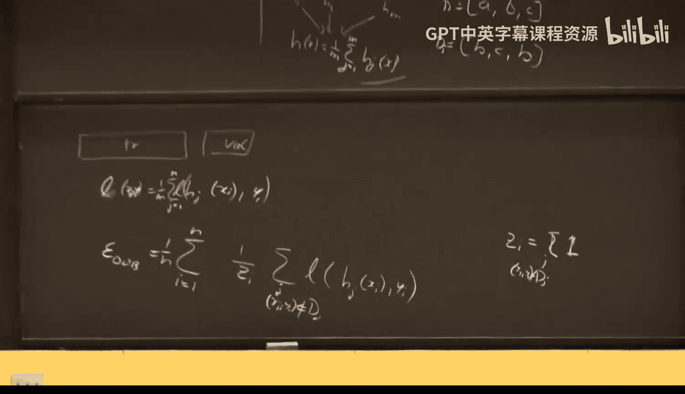
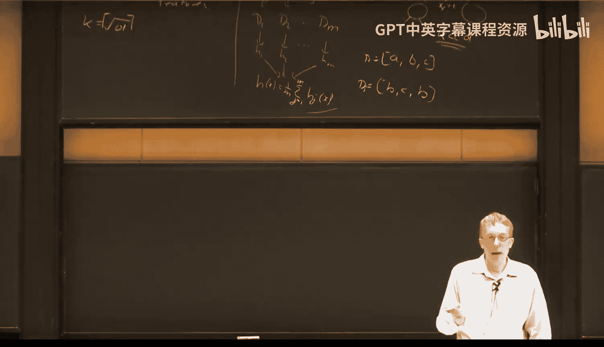
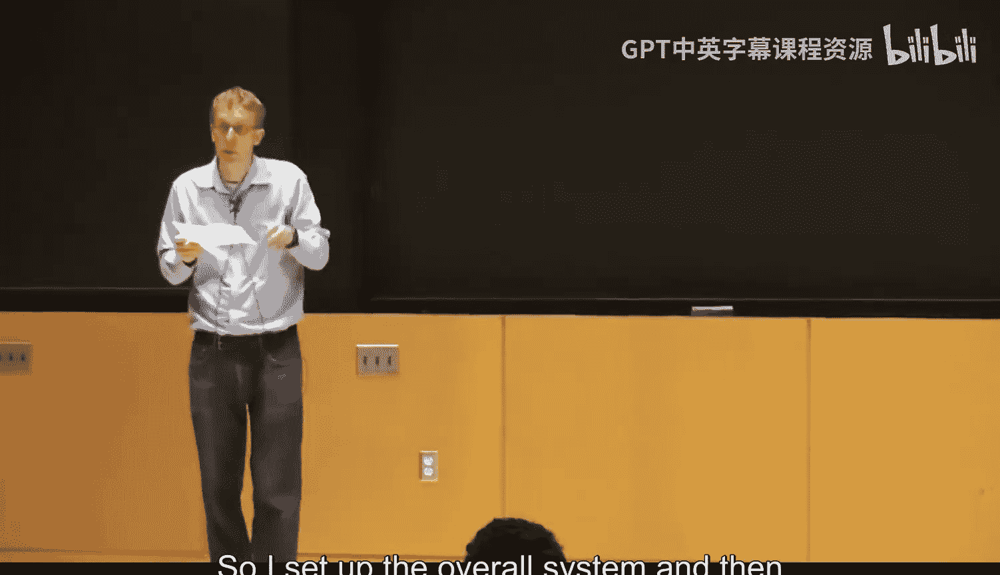

# 机器学习：第31讲：随机森林与装袋法 🌲

在本节课中，我们将学习两种强大的集成学习方法：装袋法（Bagging）和随机森林（Random Forests）。我们将了解它们如何通过组合多个模型来提升预测性能，特别是如何降低方差和估计不确定性。

---

## 课程公告与回顾

上一讲我们介绍了装袋法。这是一种非常有效的降低分类器方差的方法。

我们特别在决策树的背景下使用它，因为如果让决策树完全生长，它会成为一个方差非常高的分类器。

装袋法的核心思想很简单。你的数据来自某个分布 **P**，但你不知道这个分布，你只有这个有限的数据集 **D**。

如果你训练的分类器方差很高，这意味着它在某种程度上过度拟合了这个特定的数据集 **D**，捕捉了数据中并非普遍存在于真实分布 **P** 中的特性。

那么如何解决这个问题呢？装袋法做了以下事情。

你从这个有 **n** 个数据点的数据集 **D** 中，抽取多个数据集：**D₁, D₂, ..., Dₘ**。

每个数据集的大小都与原始数据集相同，并且是**有放回地、均匀随机**抽取的。

有放回抽样的区别在于，你每次抽取一个点，但同一个点可能被多次选中。每个点都是从数据集中独立抽取的。

然后，你从每一个抽取出的数据集中学习一个分类器 **h**。

你训练所有这些分类器，然后你的最终分类器就是所有这些分类器的平均值。

所以你的最终分类器 **H** 就是：
**H(x) = (1/m) * Σⱼ hⱼ(x)**

基本思想是，假设你过度拟合了数据集中某些特定的“怪癖”，那么这些怪癖在不同的数据集中会各不相同，最终在平均过程中被抵消掉。

当然，这会增加你的训练和测试时间，但你可以通过并行计算来解决。现代硬件使得并行计算变得非常廉价。

测试确实会变慢，测试时间大约是原来的 **m** 倍。但你获得了另一个优势：你现在可以得到校准良好的概率估计。

你可以查看每个分类器的预测，统计有多少分类器预测了某个特定标签，这基本上告诉了你对这个预测的置信度。

装袋法非常强大。随机森林是装袋法的一个著名实例，也是一个非常出色的算法。

---

## 随机森林算法 🌳

随机森林算法非常简单。它基本上就是对决策树进行装袋，但有一个很小的修改。

以下是具体步骤。

你抽取不同的数据集 **D₁** 到 **Dₘ**。

现在，对于每一个数据集，你学习一棵完整的决策树（一直分裂直到训练误差为零，或者直到无法再分裂）。

你对装袋法非常有信心，相信它能拯救你，所以你甚至“更疯狂”一点。

你对决策树算法做一个小修改：每当你要进行一次分裂时，在当前决策树会尝试所有 **D** 个维度和每个维度上所有可能分裂的基础上，在随机森林中，你改为：随机子采样 **K** 个维度，并将搜索限制在这 **K** 个维度内。

基本上，你构建一棵树。你取数据集，比如 **D₃**，然后你将其大致分成两半，这是你树的第一个节点。对于这次分裂，你基于某个特定特征 **f** 和某个特定阈值 **t** 进行分裂。

如果 **x_f > t**，则向右走，否则向左走。在这里，我只考虑 **K** 个维度，其中 **K < D**。

我这样做的原因是为了确保这些分类器都非常不同。它们将在非常不同的维度上进行分裂。

试想一下，因为它们如此不同，它们在测试时就会犯非常不同的错误。现在，如果你对它们取平均，这些错误就会相互抵消。

这是一个极其有效的算法。随机森林是我最喜欢的算法之一。

伪代码在关于随机森林的笔记中。但重要的是，对于**每一次分裂**，你都重新采样 **K** 个特征。不是为每个函数采样，而是每次分裂时都采样。

所以在这里，你随机挑选 **K** 个特征并在其上寻找最佳分裂。然后在这里，你再随机挑选 **K** 个特征并寻找最佳分裂。

一个关键问题是：如何设置 **K**？现在我们有了一个额外的超参数。

事实证明，有一个非常好的经验法则：将 **K** 设置为 **√D**（向上取整）。这在实践中效果非常好。

人们已经分析过这一点，并且有理论依据说明为什么它如此有效。但就所有实际目的而言，你几乎可以认为它不是一个超参数。

---

## 随机森林的优势 ✨

我喜欢随机森林的原因有很多。首先，它是少数几个可以“开箱即用”的算法之一。

当实践者带着一个数据集来找我时，他们通常有各种不同单位和尺度的特征向量。对于大多数机器学习算法，你必须确保这些特征被仔细地预处理和缩放。

对于随机森林，你不需要做任何这些，因为你只是在进行分裂。特征的尺度根本无关紧要。

其次，它的超参数很少。**K** 被设置为 **√D**，**M**（树的数量）则尽可能设大。没有“太大”的说法，你一直训练直到觉得够了为止。通常 **M** 是100或几千。

所以这是一个非常容易使用的算法，而且效果出奇地好。

我的经验法则是：它几乎总是第二好的算法。如果你花大量时间和精力去调整另一个针对特定问题假设的算法，你通常可以做得更好，但这需要很多“精心呵护”。

---

## 袋外误差估计 📊

装袋算法还有一个杀手级优势，叫做**袋外误差**估计。

以前我们做模型选择时，会把数据分成训练集和验证集。为了知道误差，你在80%的数据上训练算法，然后在20%的数据上评估。这告诉你在测试数据集上可能表现如何。

这种方法的缺点是你只能在80%的数据上训练。

对于随机森林（或任何装袋分类器），你不需要这样做。你可以在训练数据集上直接估计测试误差。这听起来很疯狂，但确实可以做到。

方法如下：因为你有很多不同的数据集，它们都各不相同。

对于每一个训练数据点，你都有许多不同的分类器 **hⱼ(x)**，每个都在不同的数据集 **Dⱼ** 上训练。

对于每个训练点 **(xᵢ, yᵢ)**，你可以估计误差。误差就是损失的平均值。

关键点在于：有些分类器在训练时**没有**包含数据点 **xᵢ**。

因为有放回抽样，平均而言，每个自助采样集大约包含原始数据集中63%的独特样本，另外37%是重复样本。这意味着对于每个数据点，大约有37%的树在训练时没有用到它。

所以，对于我的数据点 **A**，我只计算那些在训练数据集中**不包含 A** 的分类器上的误差。

因此，数据点 **A** 在那些树中实际上是隐式的验证数据。如果你的 **M** 足够大，即使你移除了少数分类器也没关系。

我可以将其形式化一点。我的袋外误差定义如下：

**OOB_Error = (1/n) * Σᵢ [ (1/|Zᵢ|) * Σ_{j: (xᵢ, yᵢ) ∉ Dⱼ} L( hⱼ(xᵢ), yᵢ ) ]**

其中，**Zᵢ** 是那些没有在 **xᵢ** 上训练的分类器集合的大小，这只是一个归一化因子。

这非常强大，因为你可以在所有数据上训练你的分类器，并且免费获得一个关于分类器在测试集上表现的无偏估计。你不需要小心处理训练-验证集的划分。

---

## 随机森林的局限性与应用场景

那么，有没有随机森林不擅长的数据呢？例如，在计算机视觉中，图像像素具有特定的空间结构和相关性。随机森林并不真正考虑这一点，它独立对待每个维度。因此，它可能永远无法像那些考虑图像特定结构的算法那样好。

当然，对于结构化数据等，情况也更复杂。

对于回归问题呢？完全没有问题。你只需要使用回归树。随机森林对于回归的另一个好处是它能给出不确定性估计，这是你通常从核化回归中得不到的，你需要使用高斯过程才能获得。

在回归中，你仍然会将叶子节点分裂直到每个叶子只有一个点吗？实际上，你会在某个点停止。这是一个你可以引入的超参数。

实际上，有一件事可以改进随机森林：对于每棵树，你可以在构建完整棵树后，从底部开始剪枝。你看最后一个分裂，检查这个分裂是否能改善袋外误差（使用那些未包含在训练集中的数据点）。如果不能，就移除它。这有助于减少纯噪声分裂。

---

## 偏差-方差分解演示 📉

我想展示一个关于偏差-方差的演示，现在可以用随机森林来做。

在X轴上，你看到的是集成大小，即我平均的树的数量。

这里有几件有趣的事情。当我增加平均的树的数量时，你首先注意到偏差非常低。如果我只有一棵树，那就是标准的决策树。

在这个例子中，我没有做随机特征选择，因为这是一个二维数据集，√2 约等于1.4，向上取整又是2。

如果你只看一棵决策树，偏差基本上为0，但方差非常高。黑线代表方差，绿线代表噪声。这是一个相当嘈杂的数据集，和你们项目里的一样，是两个有重叠的高斯分布。

这条线是整个模型的误差，基本上是偏差+方差+噪声，这与理论完全一致。

美妙之处在于，随着集成规模的增加，你可以非常清楚地看到方差急剧下降。这里我们有10%的方差，它下降了很多，降到4%，并且持续下降。但你也看到了收益递减，所以这是我的 **M**。随着 **M** 增加，我的方差持续下降，最终基本达到平稳。

装袋法的神奇之处在于它降低了方差，但**没有增加偏差**。偏差项完全不受影响。

这很容易证明：偏差不是你的分类器 **h** 的函数，而是平均分类器的函数，而平均分类器在这种情况下不受影响。

所以偏差保持恒定，但方差下降得很漂亮。这里的波动只是因为样本量小。

这个演示很好地展示了随机森林的强大能力。请记住装袋法和随机森林。

---

## 从装袋法到提升法 ⚡

装袋法已经非常棒了，但还有更棒的东西：**提升法**。我们今天开始介绍提升法。

提升法和装袋法非常相关。两者都是分类器的集成。

在装袋法中，我们说 **H(x) = (1/m) * Σⱼ hⱼ(x)**。

在提升法中，你做类似的事情：**H(x) = Σⱼ αⱼ * hⱼ(x)**。你也是平均许多分类器，但带有一个权重 **α**。

但提升法走的是另一条路。提升法说：如果我们有一个偏差非常高的简单分类器（弱学习器）会怎样？装袋法处理的是低偏差、高方差的情况，我们通过平均来消除方差。

现在，我们做点别的。我们在想：如果我们真的有很高的偏差，我们如何摆脱偏差？事实证明，可以使用非常类似的方法。

这始于一个著名的问题。1988年，Michael Kearns（学习理论之父之一）提出了一个非常有趣的问题：如果你有弱学习器（类似于高偏差学习器，即永远无法达到零训练误差的分类器），我们能否组合多个弱学习器，形成一个强学习器？能否从多个如此糟糕的分类器中构建出一个超级分类器，使其实际上可以在任何数据集上达到零训练误差？

这就是强学习器的概念。当时的问题是：哪些分类器可以给你零训练误差，哪些不能？这是一个开放性问题。

几年后，Robert Schapire（当时是博士后）给出了著名的答案和证明。证明表明，是的，你总是可以将糟糕的分类器组合成一个非常强的分类器。他是一位纯粹的理论家，当时并没有过多地将其视为算法。

但几年后，他意识到这实际上可以变成一个算法。他发表了一篇名为“AdaBoost”的论文。这是一个巨大的成功。论文基本上说：如果你们任何人有一个糟糕的分类器，我有一个方法可以让它变得非常出色。每个人都想：是的，我正好有一个糟糕的分类器。

它变得非常流行，每个人都开始使用提升法。它具有惊人的理论保证，我们将在接下来的两三讲中介绍。这些保证表明，不仅通过提升，你最终总能达到零训练误差（无论你的分类器多差），而且你可以在非常少的步骤内（步骤数与训练数据量成对数关系）达到零训练误差。这太神奇了。

这是一个极其实用的算法。你可以将任何不太成熟的想法，通过提升，变成一个惊人的算法。

---

## 提升法的基本框架

我来建立整体框架，下一讲我们会更深入地探讨。

设 **H** 是我正在集成的分类器。**H** 基本上是许多分类器的加权和。这些都是高偏差分类器，不是很好，但我想把它们组合成一个非常强大的“弗兰肯斯坦”分类器。

我们需要一个损失函数来告诉我们一个分类器表现如何。我们可以使用之前见过的任何损失函数，例如指数损失、平方损失，这并不重要。

让我把损失函数写得稍微不同一点。设损失函数为 **L(H)**，这是一种简写。它的意思是：
**L(H) = (1/n) * Σᵢ L( H(xᵢ), yᵢ )**
基本上，我遍历所有训练数据点，查看预测值和真实标签，计算损失并取平均。损失函数可以是平方损失、指数损失或你喜欢的任何损失函数，比如铰链损失。

核心思想是：这个 **H** 是分类器的和。

想象我已经进行了几次迭代。我想知道应该添加哪个分类器。所以如果我从 **M** 到 **M+1**，我应该添加哪个分类器？最初，你可能只有一个预测所有结果都为0的零分类器。

给定我已经有了一些分类器，我应该添加哪个分类器？我可以将其表述为以下问题：

我应该从我的那组糟糕的高偏差分类器（我的弱学习器集合）中添加哪个小函数 **h** 到我的 **H** 中，以便最小化我的损失？我应该添加哪个函数，以最小化以下函数：
**L( H + α * h )**

这基本上就是：我的分类器集合，如果我向其中添加一个额外的分类器，这就是我感兴趣的。我试图想出一种机制，告诉我当你有一组分类器时，应该向其中添加哪一个。

一旦我有了这个机制，我就可以从任何分类器开始，比如一个随机的，然后我只需不断使用该机制向其添加分类器，从而最小化我的损失。这就是我要解决的问题。

目前，我们暂时不讨论如何最优地选择 **α**。我们假设 **α** 是一个小常数。我们下次课会深入探讨。

---

## 总结

本节课中，我们一起学习了：

1.  **装袋法**：通过有放回抽样创建多个数据集，训练多个模型并取平均，以有效降低模型方差。
2.  **随机森林**：基于决策树的装袋法，并在每次分裂时随机选择特征子集，进一步增加模型多样性，是强大且易于使用的“开箱即用”算法。
3.  **袋外误差估计**：随机森林等装袋方法提供的一种无需单独验证集即可估计测试误差的强大技术。
4.  **从装袋法到提升法**：引入了提升法的核心思想——通过组合多个“弱学习器”（高偏差模型）来构建一个“强学习器”，并概述了其基本优化框架。

下一讲，我们将深入探讨提升法的具体算法（如AdaBoost）及其工作原理。请保持思维活跃，我们下次继续。