# 032：康奈尔大学《智能系统的机器学习｜CS4780 Machine Learning for Intelligent Systems 2017》中英字幕 p32 -32-Machine Learning Lecture 32 ＂Boosting＂ -Cornell CS4780 SP17.zh_en -BV1Lo6gBxEKE_p32-

Welcome。唉。Please， everybody， close your laptops。Everybody， close your laptops。 Thank you。哎。All right。

Good stuff， so。Quick thing about logistic logistics。 The support vector machine project is done。

Turs out the competition was a little hard。 Not too much variance on that one。However。

 the kgi competition turns out a little bit too easy。Some people are doing really。

 really well already。 That's really， really cool。😊，I won't。

 please remind the after submit a write up， describing a solution。And code， at the end。哎。Okay， good。

So we are talking about boosting。 So last lecture， we still talked about daging。Bagging。

 if you remember， basically classifiers that have a variance problem。

So if you have a variance problem。

You know， you can identify this。 Your training error is much， much lower than your test error。

 typically。what you do in bagging， you basically need to sample a whole bunch of training dataset sets with replacement and you train a classifier on each one of them on your average。

And we could see very nicely that reduces the variance does not include spes。 So therefore。

 your test error goes down。 Bar is a very， very good solution。 If you have a variance problem。

 So today， we are doing boosting。 And boosting is the setting。😊，Where you have a bias problem。

 And it started out with a question I mentioned this last time。 whether weak learners。

 this was in the 80s， the late 80s， people considered the question differentiated between weak learners and strong learners。

Weak learners are algorithms that cannot learn， you know， bring your training error down to 0。

 and strong learners cant。So that was important distinction back then。 And the question was。

 can we take weak learners， If you have many weak learners。

 Each one of them cannot get your training error down to 0。

 Can you combine them in a way to get zero training error。And can you do this efficiently。

And so this was a question posed about Michael Curs。 And very famously。

 Ra Shapirri came up with the answer。 He proved， first just proved theoretically， yes。

 that's always possible。 And then he came up with an algorithm that was essentially part of his proof that actually showed how to do it。

 And that became a huge instant hit。😊，So what I want to give you today is a， first。

 I want to start up with a little intuition， how that works。And。

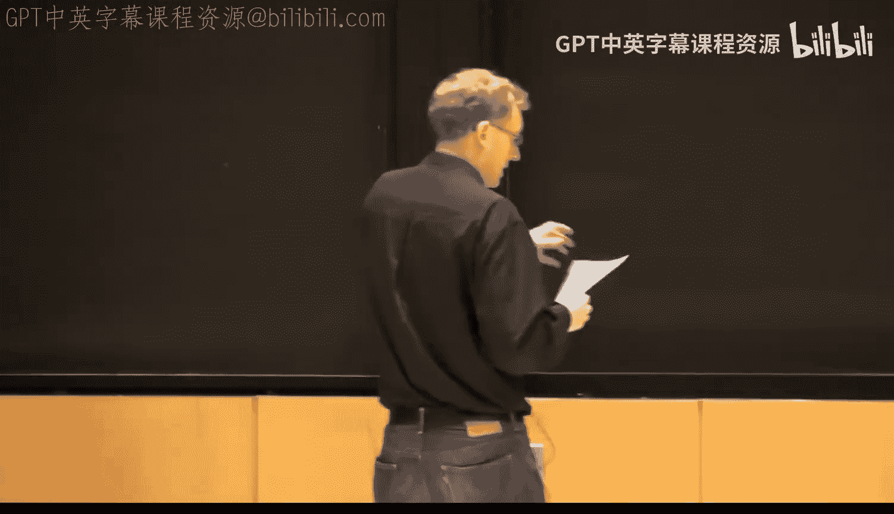

So once again， our classifier is the following me of H of X is an ensemble。

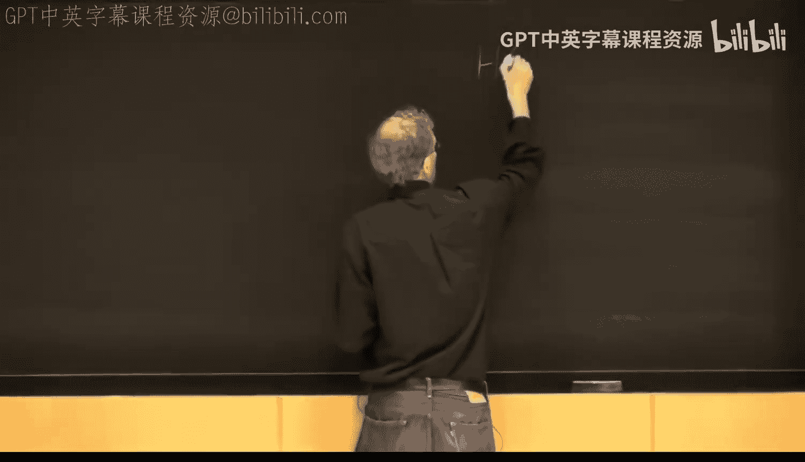

Of many different classifiers。But each one of these little teas， a weak learner。

 So that's an algorithm that's not very good。 And the way we define weak learner is in the classification setting。

 it does better than a random point toss。😊，Okay， so's， that's all。 That's a pretty blow bar。 right。

 That's better than guessing。嗯。And。Okay， so now I'm gonna give you some intuitions。

 So please pay attention。嗯。Because if you reprehend around this。

 then everything becomes a lot easier。So imagine we can write， you know。

And they've introduced the following coordinate system that we've seen before in the context of Gaussian processes。

Where。嗯。I give you an n dimensional space。 We have N training points。And I can now。

Dine an n dimensional space where each axis corresponds to one training point。O。

 basically says the prediction or the label of that training point。 right。

 So we have kind of your X1。X2， X 3， but these are， this is important。

 These are not the feature values。 These are the labels， right。And so。In this space。

 let's say you have a three dimensional space。Let's say I have a data set。 I know。

 I'm just making this up X 1 has the label 1。X 2 has the label。-1。X3。Has Labour won again。哎。Then。

 I can actually。These are my ys， right， This is my y 1， Y 2， y 3。

 So I can make a vector y equals y 1， y 2， y 3。And that is a point in this three dimensional space。

so in this case， why， y 1 is1。 So I'm here。Y 2 is negative。 That's actually。downown here。

And by 3 is positive。 So that's here。 right， So I basically， now I kind of go here。

 and then I go down。And this here is my vector Y。 Okay， raise your hand if you're still with me。O。

 awesome， okay。And now， I can。Define my loss function。

 I can just map this basically all in this space。 Okay， I can basically say， well。

 if I now run a classifier capital H on my data。😊，What I get is predictions for every single training point。

So what my add H gives me， it gives me a vector， H of x 1。H of X 2。A to x 3。

AndSo that's basically what my function does。 right， I stick in。's basically， you know。

 stick in my mindset X 1， x 2， x 3。😊，And out comes a vector like this。You can call this H。

This is my H I。 Okay， this is my prediction vector。N I have a strong learner， for example。

 an RB F SVM， or I have a decision tree that I grow all the way to the bottom， like without stopping。

This will be exactly the same as y， right， Because these algorithms can drive the training error down to 0。

 Okay， so。😊，You know， you train the， you know， you train the algorithm then on the training data set。

Right you will basically get exactly the same point。系。But a weak learner。When it's not very good。

 for example， a decision tree that only allowed to split twice， right， so。Of limited debt。

Will not be able to。Get every single training point， right。So what I will give you。

 this is my little H now is get a vector H of x 1， H of x 2， H of x 3， but it won't match this。😊。

Right it's pretty crappy。 So let's say， you know， it's here， right， I's sticking my train data。

 And this here is my prediction。哎。The C equals。A2 x1。A to x to。It makes3。Okay。And so。The question is。

If I have an algorithm that gives me these kind of lousy predictions。Right。

Can I somehow combine many of those。To actually get to the， you know， to the true answer。

Allright that's， that's the question we have。 That's the question of boosting。And。

The idea is quite intuitive， actually。 it's quite simple how this works。

So think of it in terms of a regression problem。 Okay。

 let's say you want to do regression on these labels。

So what we do is we start out and we train our classifier age。On our training data。

 And because our classified H is not very good。 right， What it will give us is this point here。

 right， And we know this is far off because we have the labels。 Why we compute。 Oh my gosh， right。

 This this is not great。哎。So we wanted this， this vector here。 But what we got was this vector here。

Okay。😊，So here's what we do。 It's a little bit like， like。你疗。Is it like what when you when you。

When you're drunk， right。You can do this experiment tonights Friday， right， So go out。

Go to collegetown get， you know， not too drunk as， you know， that's dangerous， but， you know。

 drunk enough that you can't walk properly anymore。And then try to walk home。

And so what happens is now， you know， overall， you're probably， you know， are gonna be pretty bad at。

 you know， pinpointing which direction your home is， right， but you're still gonna make it home。

 right， And why， Because， well， you know， on average， are you， you know， going home。

 having a good time， right， On average， if you sum up all the steps。 each one of them is pretty bad。

 right。

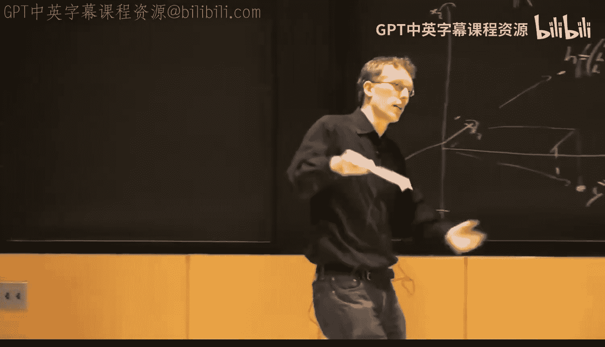

Eventually， you get there。So this， this is what you're doing。 You have this drunk little drunk H guy。

 right， It's pretty bad。But it's not horrible。It's not horrible in a sense that at least it know which direction has to go。

 right， It knows， you know， well， roughly south， right。So we trust that a little bit。

So instead of going all the way， we just go a little step， right， you know。

 we just take a little step in that direction。And we stop here。And now we reevaluate again。

And in some sense， basically， now we have exactly the same problem we had before could now imagine a new coordinate system that starts。

 Here's the origin。 Here's our ys。 our Y vector is slightly different。😊，哎。And we solved the problem。

 again。And you get to another age。 You know， I wass like， again， this drunk， you know。

 algorithm gives us another H， right， Let's say this kind of point， you know， whatever points here。

 right。So you take a tiny step in this direction。I me stop you。And then you solve again， right？

And it's essentially， what you're doing is very， very similar to gradient descent。

 So gradient descent， Basically， you always get a direction that kind of doesn't really point you to the minimum。

 but it points you in the direction of the minimum。And you just take many。

 many such steps and add them up。And that's exactly what boosting is。

 Boosting is gradientding descent in function space。 So you have a function。

 and you just basically perform in gradientding descent on these， on these functions。😊，And。

The condition that you have on the weak learner is really， really mild， so。

What you want to do is every single step。 you want to get somehow closer to your goal。

And that's the case。If。You know， if I take this weak learner， say this here is my weak learner。

 I' pointing in this direction。哎。I'm， I'm making progress as long as the inner product of that weak learner and my label is possible。

 So basically， as long as I'm not going completely in the wrong direction。 right。

 So if I basically point in this direction， that means the goal must be somewhere forward ofly。

 it can be over there。 It can be over there。 That's okay。😊。

So I just can't have more than a 90 degree angle between the direction that I'm that my regular is pointing me and the true label。

Now， turns out that's very easy to find。 right Imagine you have a weekly learn that's really。

 really terrible， right， And in fact， here's the true label。 Instead。

 what it tells you it has it to go here。That's not a problem。 Why is that not a problem。Any idea。

Yeah。You can just flip it。's right。 You can， you can detect this。 So if it's negative。

 you just flip it。哎。So then you're actually pointing in the right direction。

So the only case where it really doesn't work at all is if you're completely the orthogonal。

Then there's nothing you can do anymore。That's kind of。Now that's when you at your limit。

 That's actually when the algorithm stops in something。Allright。

 And that's exactly what boosting that。 So basically boosting you basically itly。You know。

 find a new new weak learner。 You add your ensemble。 That means now you move。

 And now you find a new weak learner。 and， you know， you add your ensemble， ettera， etctera。

And the smaller steps， you know， the longer it takes you。 But you know， often the， you know。

 the more accurate you you are at the end。Any questions about this intuition？第二。No， no， no。

 They just weekly owners are basically a little better than toy crossing。A coinin tossing， sorry。

 terms of classification， you get better than let's say you have a balanced data set， binary data。

 you get better than 50% accuracy。And a big question。Essentially， you have an inner product。

 You know， would you find it in a minute， Like， what exactly do you have。

So you're not just orthogonal to it。So you go， yeah。That's exactly right。

 So each of this is basically all my little steps。 right， So I basically take alpha as a small value。

AndThis basically gives me each of these bigers trying to predict the label all the way， right。

 that gives me a vector that points that it thinks points to the label And what I'm saying。

 I'm multiplied this by a small constant。 Just add them up。Yeah。大変ってます。How do you know， sorry。

Even everything。那。Okay， good question。 So he's raising。

 how do we know that averaging all these classifiers will give us the correct answer， right？

 And the answer is very simple。 The answer is the following， if you。Like I'm here， right？😡。

This here is the Y vector that I want to get to。嗯。I have a big learner that's not very good， right？

Let's see points in in whatever。 points in this direction， right。Because。If you take the， you know。

 this defines a hyperplane。 So because the label is on that side of the hyperplane。

If I take a step in this direction， I must get closer to why。And whyhy is this as Pythagoras again。

 Right So if you take the distance to Y， right。Or the distance to why after a small step。は。

This here must be closer。 And the reason is because the distance to y is a squared plus B squared。

A squared stays constant， and B squared just got smaller。Okay， so provided。

Why does actually lie on that side of the hyperplane。On the positive side of the hyperplane。

 And your step size are small enough。 If you overshoot it， then it doesn't work anymore。

 If Your step size is small enough。 You must get closer to why。So every single step。

 you are getting closer to why， right。And so eventually， basically， you will get very close to it。

 So that's basically， that's kind of how the convergence works。I you of the。So yeah， at some point。

 if you weak it's so weak that basically it can't point。

It basically the only thing you can do is point orthogonal to I， right。Like， if you're pointing here。

 and the only thing I can do is return back just like this。Then， then I'm done。 Then my week and I。

It's just not good enough anymore。第。Are we introducing。 So the question is。

 are we increasing variance？ That's a question。呃。It's it's actually呃。There，s a funny question。

 So Adabu seems to surprisingly resistant。At an increasing variance of your classifier。

 So it reduces bias。 and it's actually amazing at not increasing variance。😊，嗯。

And I will get let me get to this a little bit at the end again。Okay， last question， maybe yeah。这一。

costifier you set your why？Yeah， you will see that exactly in a minute。 That's right。

 So we basically have to make a different call to the weak learner， right。

 because because now our after step。😊，The why has changed， right， the angle that we want to buy。

 So in some sense we have a new coordinate system。 And now this year is our Y。 right。

 So that's a very good question。 that will exactly will。😊，Exactly address this now。

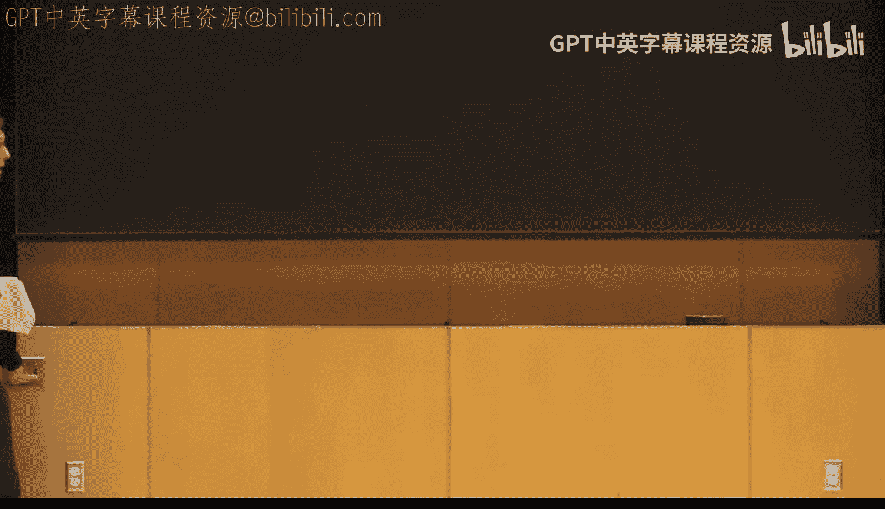

Okay， and this is actually where I stopped last time。 So if we just， if you formalize this。

We have our H， let me just write it down one more times if we have it on the sport。😡。

Is the sum T equals one to capital T alpha。Ht of X。And so for now， let's just keep alpha constant。

 Later on， we will actually optimize alpha as well。 And This is when we get to add boost。

 to add a boost stands for adaptive boosting where alpha is adaptive。 So that that's the， the second。

 And then we get an amazing classifier。😊，嗯。for now， Al is just a constant。And so。

Imagine if basically you run for a few steps。It could be， you know， could be 0， right， initially。

 we just say。You know， T is 0。 Then we just have the all zero prediction。 We had the origin。

And the question is， which next classifier shall we at。And so to formalize this。

 we're basically saying we would like to find H。Which minimizes。

We have a hypothesis class It a set of all the weak learners that we could possibly get。

 We would find the H that minimizes the loss of H plus alpha times H。😊，Okay， so far good。

 raiseise the hand of you with me。Okay， good。 So the last function is basically。

 The last function that is defined over my H is， for example。

 one example of loss function could be L of H equals to sum I equals 1 to n。😊。

H of X I minus Y I squared， but it really doesn't have to be the square loss。

 It can be any kind of loss can be the exponential loss or something， right。

 So it just has to be differentiable and has to be convex。So。Okay， so we take this loss。

 and now we want to add one where we take one more step。😡。

We want to find which age which direction is， is that step。

So we do exactly the same thing that we did with gradientding descent。 Does anyone remember。

 how do we solve this for gradientding descent。😊，Within an approximation。 It begins with Tay。

 and ends with Li。Taylor， that's right。 How did you know。So， this year。Is approximately。EleH。拉时。

The inner product。Of the last function， with respect to。8。And little age stands alpha。Okay， good。

 so we can plug this in。Now， I know some people are scared right now。

 This' is an inner product over two functions。you may have not seen this before。 Just don't worry。

 just。It won't be as as bad as you think。 So iss now the the argument over these two terms。

This here is a constant。 it's not affected by age。 So don't worry about it。 We just drop it。

And what we get here is the inner product。Of D， L， D H plus alpha H。So。Okay， good。

So we know we want to minimize this。Now， what's the inner product between a function and a derivative of a loss function with respect to another function。

 right。 we did this in middle school。 No， I'm kidding。Actually， it's not very complicated。And so。

You's， you know， you can define us in multiple ways。

 But one way you can just do this is basically to say， we just evaluate both of these guys。Add。

 you know， many different points and multiply them。 So if you basically had。

 because we are a coordinate system with just end points。It's simply the following。

 It's simply just be some I equals1 to n。And it's D， L， D， H of X I。Times alpha h of X。嗯。So if you。

 does， why is this correct or why does this make sense。Think of your function。

Because we are only interested in these end training points， essentially。

 of be expressing everything in terms of these end training points。

We basically say a function is represented by the values it gives for these n training points。

So the function， in some sense， is a point in this in the space。

 So two functions could be very different out。 But on these end points， they' are the same。

 Then we can consider them the same for now。And then this is just the inner product between two vectors。

 And so that's exactly the definition。Okay， any questions about this。嗯。Okay， good， so。

I wrote a little something about in the nose。 but it's really， you know。

 the idea at the end of the day is that we just。Think of these as vectors， right， So each， basically。

 for each one of these， these coordinates， x 1， x 2， x 3， we basically get a value。

 And that gives us a point in this n dimensional space。

 that we take the inner product between these two points。😊，So that's， that's totally doable。Okay。

 awesome。 So now。物业系。Okay， so。Take a step back。We're trying to do things The intuitionless space that we take。

 We add up many of these little weak learners that are not very good。哎。To get a strong learner。

And what we need to do is the following at any given time point。😡。

If you already have a bunch of them found， you want to find the next one。

And all we need to do for that。😡，It needs an algorithm that says。

If I have the derivative of the loss function， let' back to every single point。

 obviously a training point。Then I want to find the little H。

That give me the minimum amount of product with this vector。Okay， so。I'll get to a few examples。

 in a minute。Let me first。 This is my still seem scary。 So let me just uns this， in some sense。😰。

Well， why don't we just do this。 I give you a minute， you and your neighbor。

Figure out what this term is。For the square loss。It's up here。Okay， so let's say you want to。

 We want to minimize the square loss。 What is this term。If have one minute。

 please feel free to discuss with your neighbor。Yeah。Yeah。All right。Who still。

 who once another minute。Who thinks he or she has the answer。Okay， goods。Yeah。That's right。 Ex。

 And so actually， I cheat a little。 I made a one half in front of it to get rid of two。

But then it's actually just H of X I。Mus Y I。So that's easy to compute。😡。

Right so you have a function H， you evaluate it on each one of your training points。

And he's subtract from the label。So in the figure that we just had。The figure that we just had。

Here's our true vector why。And。Let's say we are here after our first， you know。

 after a bunch of iterations， we kind of ended up here， there' is our H。😡，Right， what is this。

 This basically。That's very question哎。And so what you want to do is you want to find an H that has the minimum in a product with the vector。

What's minimum in the product？It's exactly the opposite。Right， that's pointing in this direction。

That's pointing exactly to why。Okay， does that make sense。So if we want to find。This vector here。

 the derivative of l vector H is the vector from y to H。We want to find the function capital H。

 our current current classifier。We fun to find a little of H。That has minimum in of product。

 Minim amount of product means a very negative value。 So if the error goes this way。

 we go exactly the opposite and be a pointing to why。And that's exactly。 It's kind like a compass。

 right， It's always pointing towards why， right， the labels of our training data points。

And that's exactly what we want to add。 right， And if the weaker earnner could actually do it。

 then you would just have to add one more and be done。 But the weakerner is pretty lousy， right。

 That's the problem with， you know， drunk classifiers， right， you kind take a small step。 you know。

 go like this， this like this。 But it will always point to one， right， no matter where where you are。

 So you will eventually get that。😊。

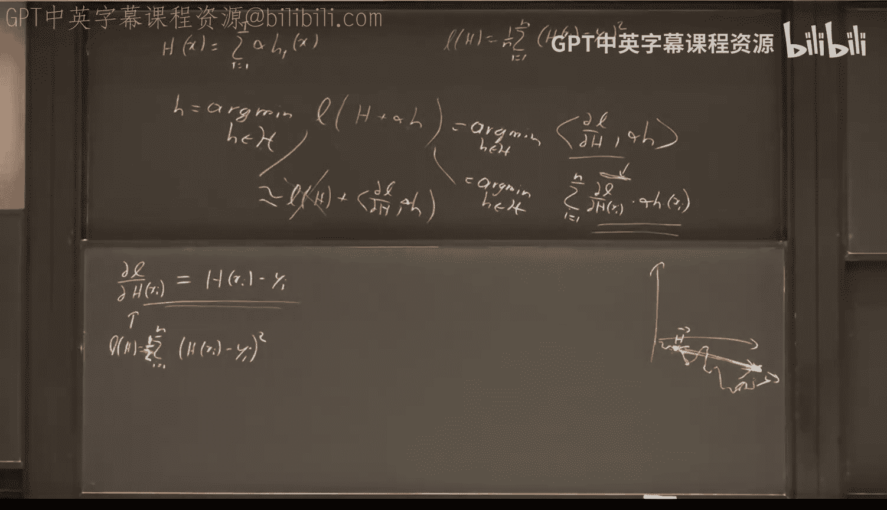

So just that you believe me， I made a little demo。And so what I thought is。

 what's the crappiiest classifier on the planet， I really have to think about。 Like。

 what's the stupidest thing I could possibly do。

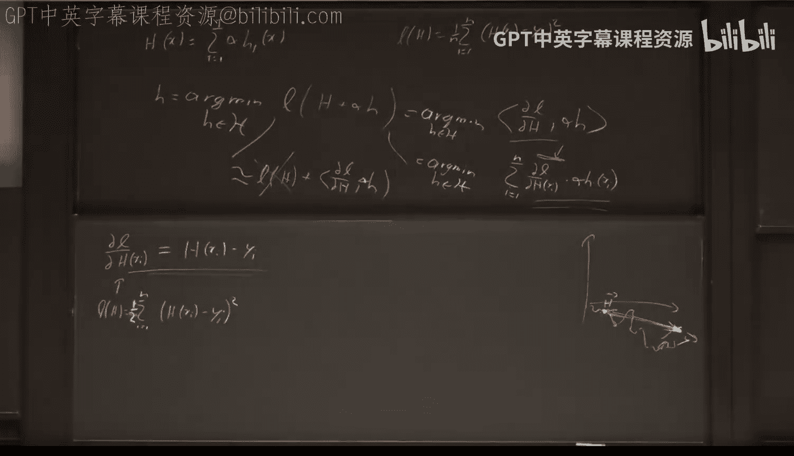

And I came up with something。嗯。And that was， like。The stupidest algorithm in the world takes。

A data set of feature vectors X and y。Totally ignores the axis。And。

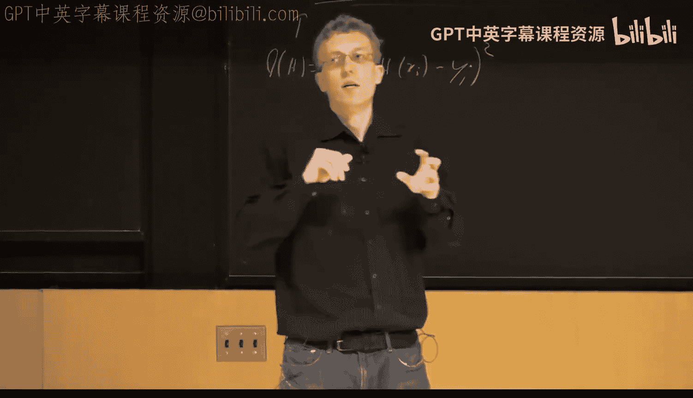

Returns to random labels。That's pretty stupid。Now， you have to be a little better than that。

 because has to be a weak learner。So here's what we do。We just。You know， I actually。

 what I'm predicting is just labels plus 1 or -1。

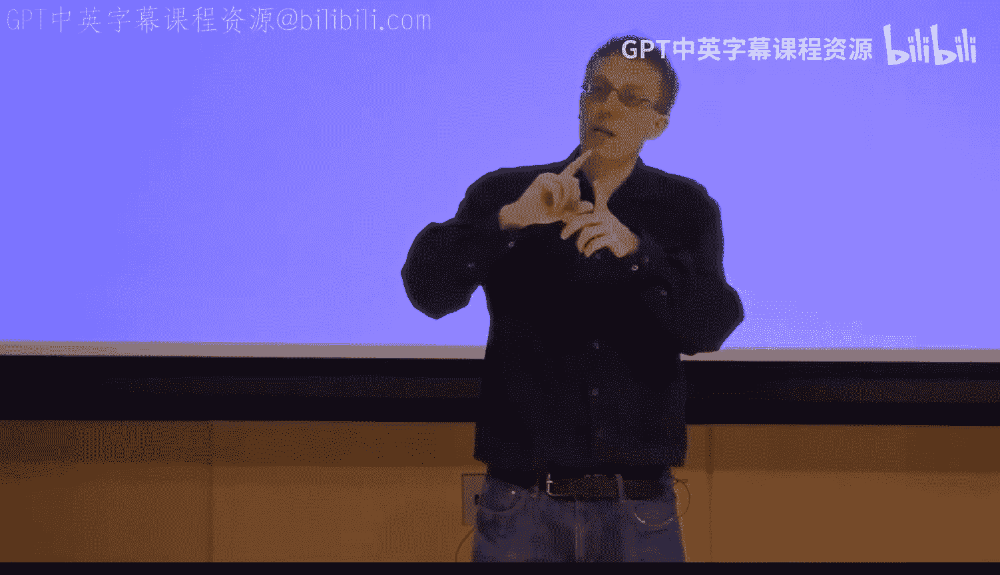

And I tried doitive versions。 I either flipped them。Or I don't。

 And I see which one gives me a lower loss。 That's it。Right， so basically do this。

 Like I point in a random direction and say， if that's actually， oh， that's actually backwards。

 Oh never mind。 go in this direction。 And that's all。 that's all I'm doing。

Its like a b drunk guy giving you directions where you're like， you know。

 how do you get there this way。 I don't think that can't be right。 Well， then it must be this way。😊。

So。

And。All right， good。And so let me explain to you the image。So this year is now exactly what I do。

 So this here is my origin。 The red point is where I am right now。 That's the old zero vector。

 So initially， I'm predicting the old zero vector。😊，There's just a three dimensional case。So。

 it's three training points。This is the label of the first data point。

 second data point and third data point。 So here， the label is -1，1 and -1。Okay。I'm starting here。

 and I'm running my first classifier， and the first classifier gives me a random garbage， right。

 But the random garbage is such that it kind of always points in in the。😊，Basically。

 it's positively aligned with the true little。 that's the only thing I guarantees。 otherwise。

 I would have flipped it。嗯。And now I keep adding them up。 And so here's what what's happening。

 So what you see here is basically the red point is basically moving。 And down here。

 you see the errors at the beginning， every single， you know。

 there's the squared error to the Y vector。 The root mean square errors。 So at the beginning。

 it's really high。And now， I keep moving。And I'm adding to these are just。

Dumb as classifiers on the planet， right。You know， and it really kind of looks like a drunk guy。

 doesn't？ Like， you know， can， you can see it's like， that was a good night out， right。😊。

Is it slowly getting there， right，' Sking up there。I didn't hit boom。 right。 And now， at some point。

 you have basically。this is not a stage where you get home and you can't fit the keyhole。re like。So。

 it would never be that exact， right。That's where I get stuck。哎。

There's actually how you can win k competitions， right， So if you carry competitions。

 then the prize money is actually given out in the training data， right。

 then what you do is just always upload random noise， right， And if the error is above chance。

 then you keep it， Otherwise， you just flip the the random bits。 right。

 And then you just keep adding them up and you will win the competition eventually。 right。

 That's why people don't。 That's why people have secret test sets。😊，Otherwise。

 you could just always do this cheat。 And this is， yeah， this is also related to why in science。

EMany results are not reproducible because we make small decisions that basically lead us to。

To the outcome that we want。Okay， any questions about this demo。

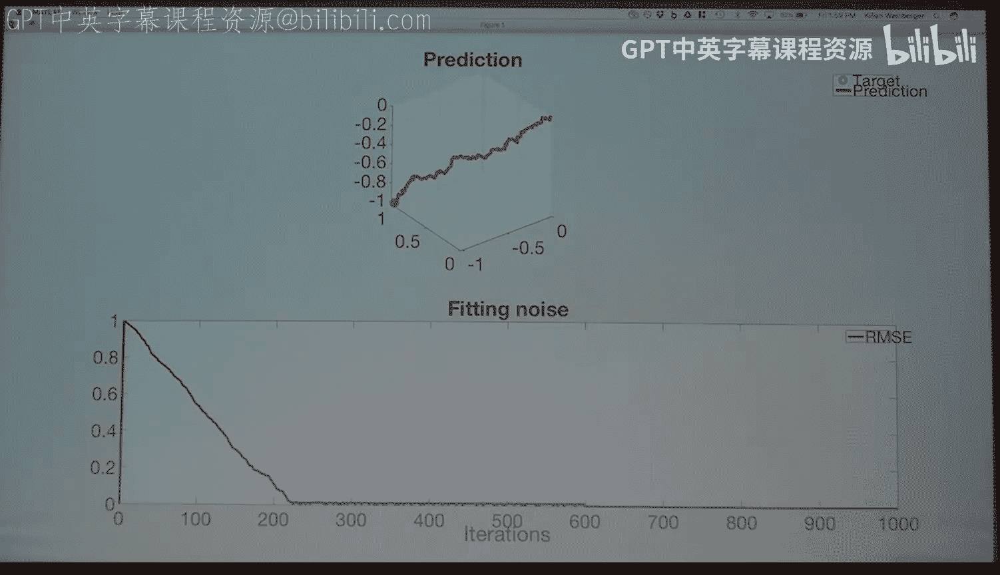

No， okay， good， awesome。

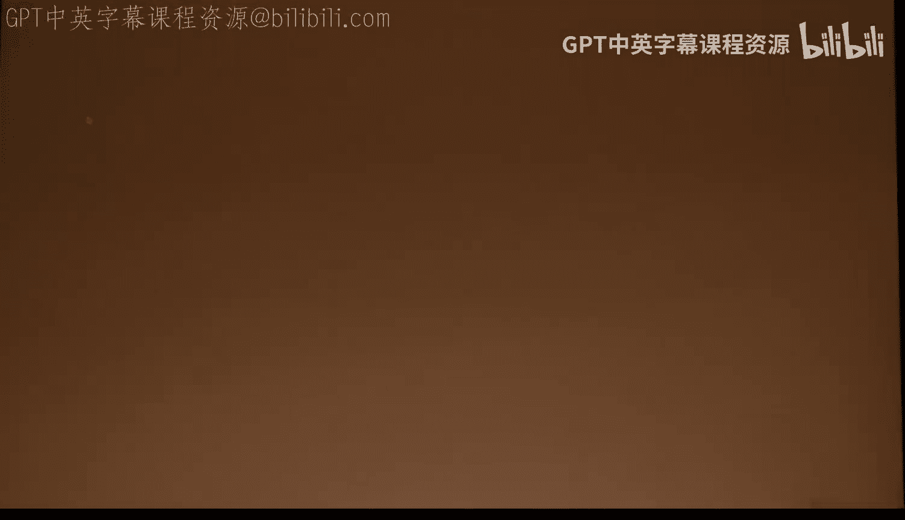

So。

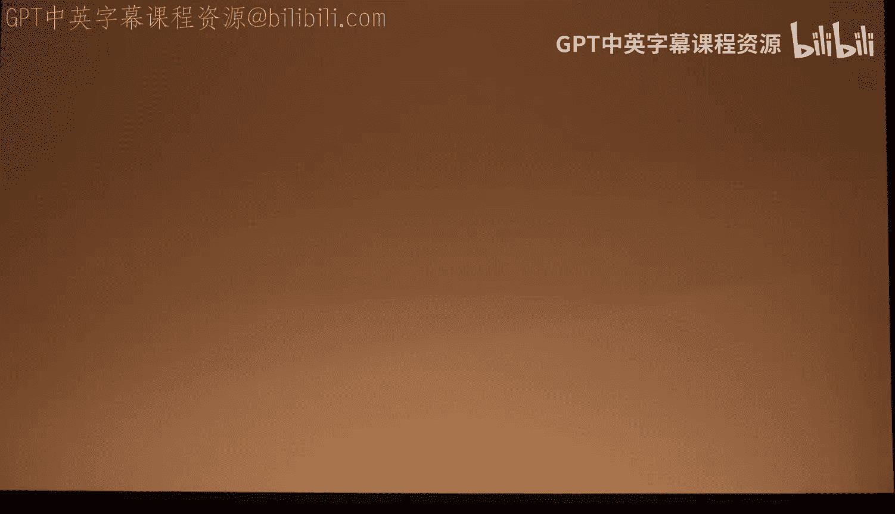

Alright， so the the resulting algorithm is called any boost。

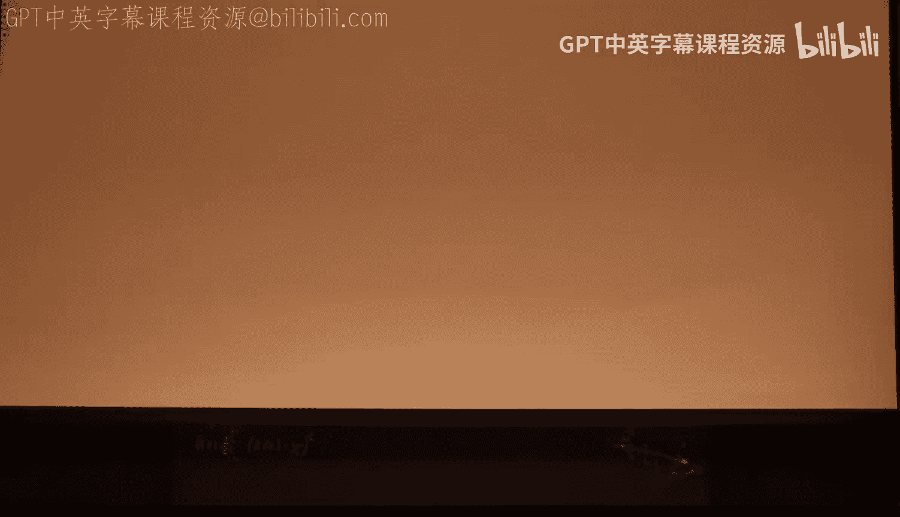

And by the way， that was invented 10 years after the first boosting algorithm， so。

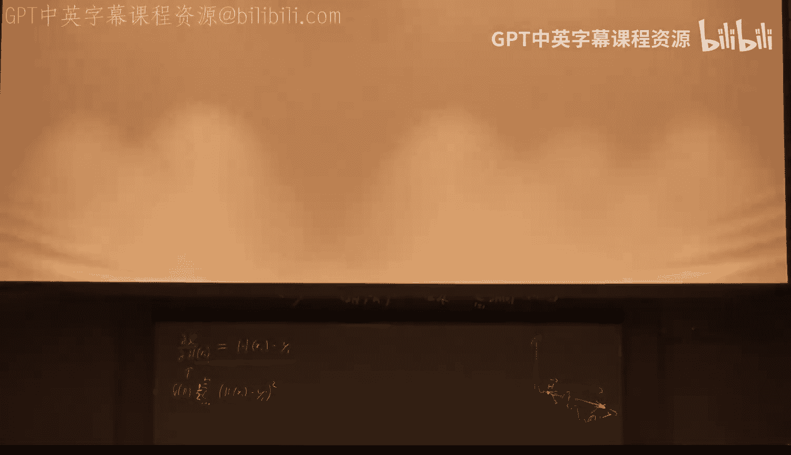

It's amazing in hindsight， But it took 10 years for people to realize that boosting was actually gradient descent。

 It's exactly gradient descent and function space。 You just taking the gradient。 We're adding it。

 It wasn't clear at the time。 And in part， because the notation was very different。

 People thought of it very， very differently。 So and now it's's you know， it's very obvious。

 So if you look at your notes， the any boost algorithm basically summarizes this。

 you compute the gradient for every single data point。😊。

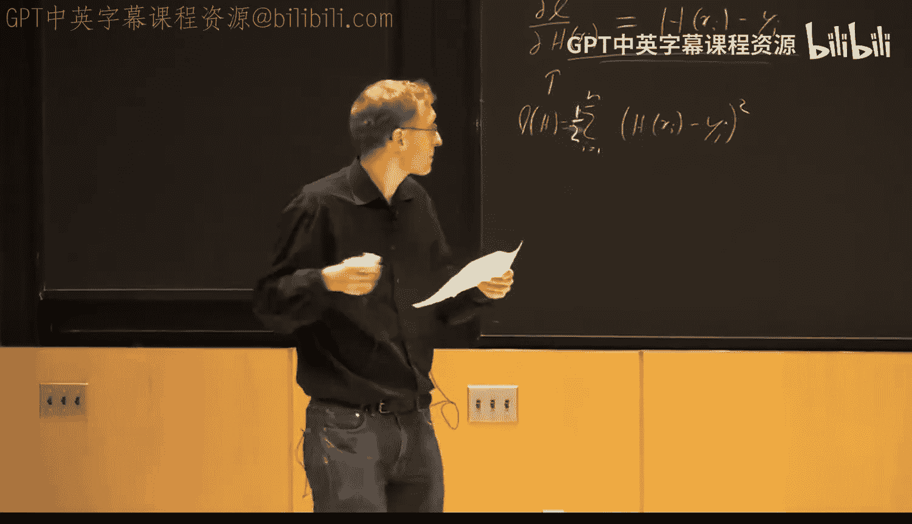

That's， I call。This part here， I call this R。And then you call you algorithm that basically gives you a minimum alignment。

 And one thing I have to have to stress is that this doesn't have to be very good， right。

 This doesn't have to be exact minimum。 It just has to be something thats， you know。

 that's pointing somewhere in the right direction。 It even works in this absolutely worst case。

 but you just have this random classifier。And then you， you know， you just add them up。 and that's。

 that's it。Okay， good。 Any questions for any then。Let me move to there's two very famous cases of those that have special names。

 Now I would like to go over them。 the first one。😊。

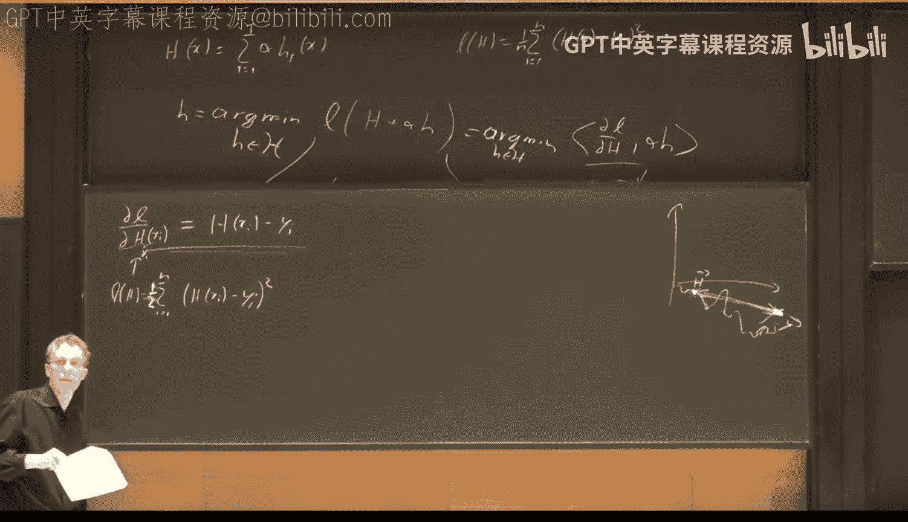

Gading boost of trees。 And the second one is add a boost。

Greatraing boosted trees has become extremely popular。😊。

Because that's essentially what search engines use。

 So if you use Google or Yahoo or Microsoft Bing or whatever。

 basically the the way they predict what you're looking at is the output of a gradient booster tree。

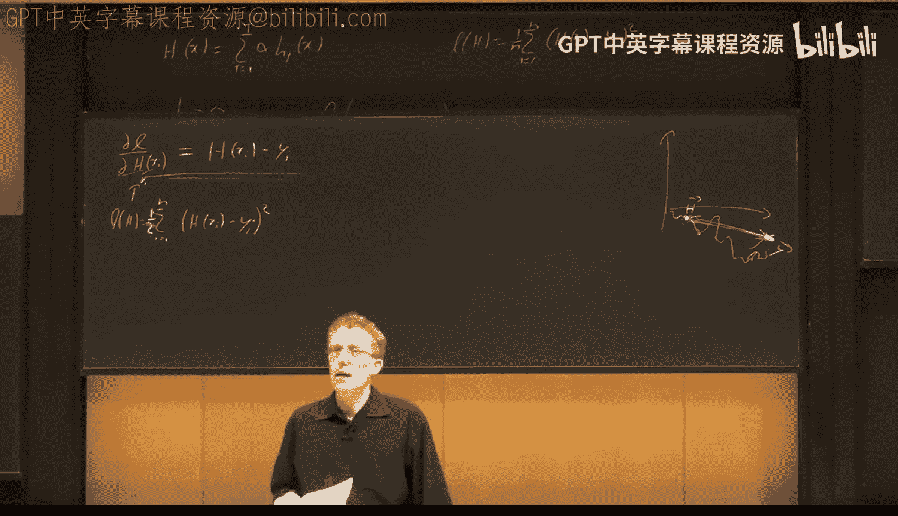

And there's there's very good reasons for this。 And this is actually something I used to work on when I was at Yahoo research。

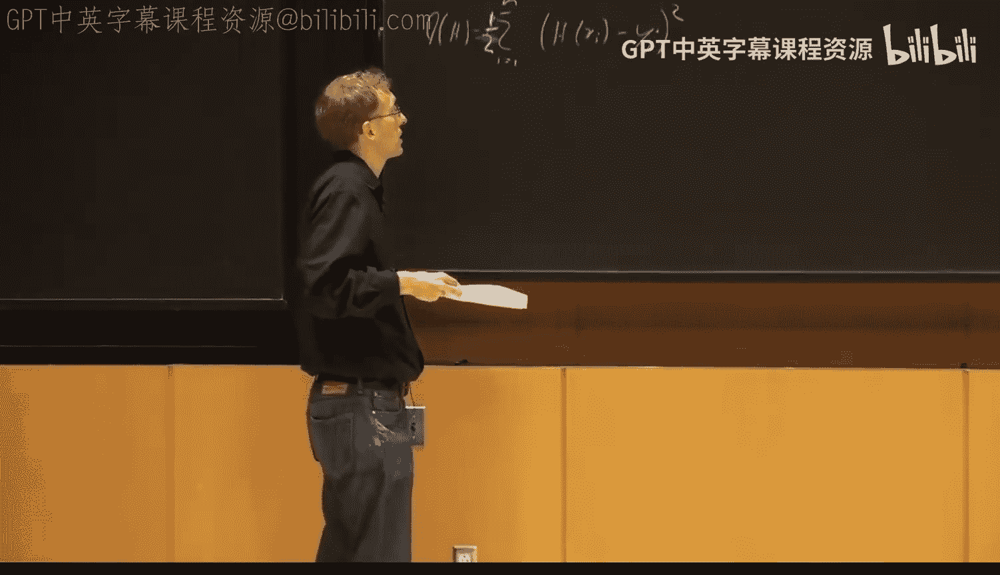

嗯。

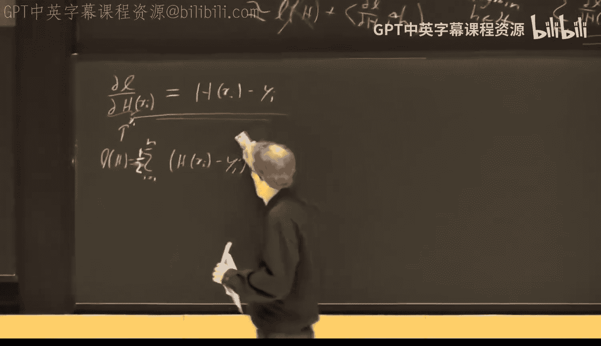

And in some sense， they are basically just very specific choices about this， this boosting algorithm。

And then greatly boost the trees。The first choice is that it can be regression or classifications。

 Are we not setting， you know， Y eyes can be anything。 Let's say the y eyeses are regression。😊。

Can you multi class， move the dimensional regression。诶。And the ages。

 the weak learners are trees of limited depth。So H is decision tree or car tree。

Actually sorry question trees there heart trees。Of limited debt。

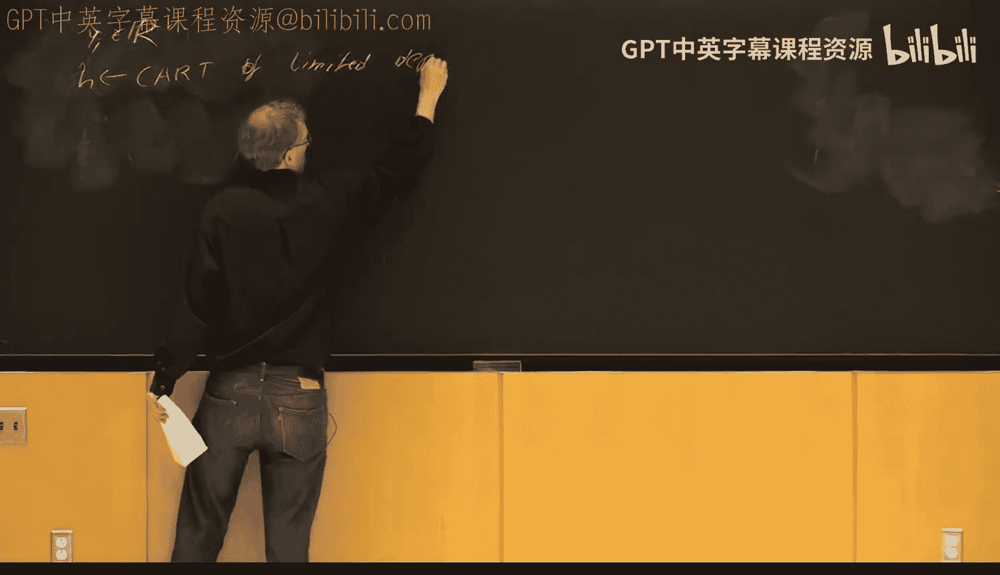

Typically， maybe depth equals。4 or five。Maybe 4 to 6。Right not more than that。

 So these are highly biased classifiers， right， Theyre only allowed to split four times， right。

 or five times。So each one of them is pretty lousy。嗯。They're very nice because they' are very fast。

 It can be evaluated very， very fast。 and they don't make any assumptions on the scaling of the data。

 etc。😊，嗯。Alright， and then the， the last assumption you're making is Al is a constant。Small cars。

Okay， good so。So far， there's nothing special， right， why， why can't we pick， you know， H to be， no。

 why is just a regression problem， That's fine。 We， you know， But， but we just， what I just。

 we just talked about。You know， we actually assumed that why， you know。

 just a point in this this n dimensional space。 that's， there's not no problem with this。

 Off a small constant。 That's what we assumed anyways。 That's fine。😊。

This year is where it gets tricky。Age is a car tree。Right。But so car trees trees。

 we found that they can either minimize you know， entropy loss or gen loss， John geni impurity。

 or they can minimize square loss。😊，But we， what we want to do here is this alignment between two vectors。

 So we have this vector with all these gradients。 We would like to find a tree that actually aligns with it。

That's， that doesn't really。 We don't really know how to use car trees for that。

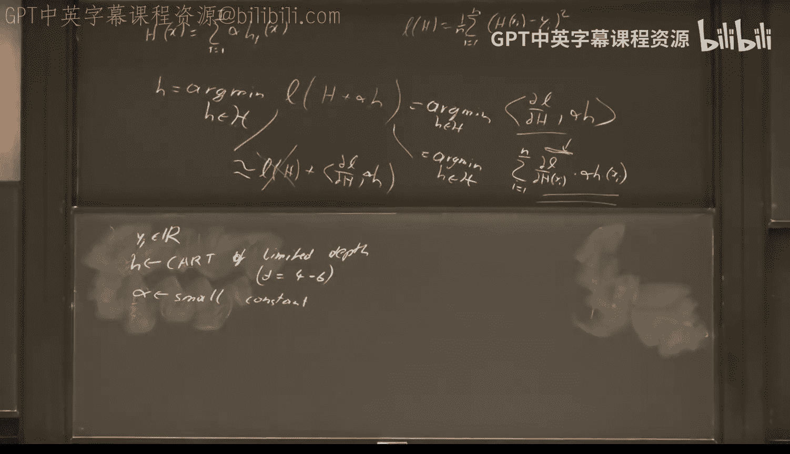

And that's the one thing we have to quickly fix。Any questions？Okay， good。 So one more time。

 what we want to find is a car tree that solves this equation here。 Let me just write it down。

 Arcman。😊，8 element of age。 I think it is now。Cards， step 4 or whatever。Car trees trees。Such that。

The aligned R I times。Of H of X。Where our I here is this。The gradient of。

The gradient of the loss with respect to H of X I。And you just derive correctly that for the square loss。

 this is just the residual。 right， This is just the direction from my current prediction， from my。

 from my label to my current prediction。😊，So I want to minimize this function。

And I want to find a tree that minimizes this function。The question is。

 do I have to derive a totally new card algorithm to minimize such a function。 So so far。

 we haven't had this。 This is not a convexlash function。 This is like a weird thing， right。Turns out。

 actually， we can show on this very， very easily into our existing regression tree framework。😊。

So the first thing you getta notice， Let me just do one thing。 Let me just say， well。

 this year is the gradient。 Let's just define the negative gradient。Is minus T。

So the negative gradient。This he as my figure。This is my why。This is my current H。 Now。

 the negative gradient points exactly to y。So if I want to。

EDo some other things more intuitive that I want to go towards whats why。Okay。

 so if I plug in my T I and I don't want to， because this is negative gradient。

 I don't want to minimize anymore。 I would have to maximize。Maximizing maximizing its producerrs。

 So what we do instead is we just minimize the negative， right we say augment。呃， negative。I RI。

As sorry， T I。A of X I。Okay， so what I did is it's very very simple。 I just T I is the negative R。

And so I just have to put a negative here。I also drop the alpha because the constant doesn't make any difference。

Raise the hand if you're still with me。Okay， any questions？So one more time。

 were trying to to minimize this in a product。 This is the function we are learning。 This is a tree。

 This is a， a limited depth tree。 It's not very good， but it's， you know， it's a function。

These are given to us。 Those are the gradients of the last function。

With respect to every single point。What I now did I just said， okay， we have the negative gradients。

And then I get a minus here。And because minimizing this is only half as good as minimizing it twice。

 I just put a factor two in front of it。Why not， right？ I can do it。doesn't make any difference。

Alright， raise hand if you're still with me。Okay， good。So far as are good。Now， here comes。

 here comes a little but step。 you have to believe me。

The first one is that I say the sum of old T I is a constant that's independent of my age。

That's true。 So the T Is are given to me。Some of all the squarety I has nothing to do with H。

So it can just add it， right， It can just add。T I squared。Al right。

 raiseise your hand if you're still with me。Okay， good。 Now comes the the last bit。

I'm telling that some of I， H of X I。Squared is also constant。Now， this is not true。But。

 it's very convenient。嗯。So here' is why we should make it true。Because if you want to minimize this。

😡，You could just take any tree and just multiply it by a large large number。

And you get a smaller value here。Okay， because this is linear isn in a product。 So essentially。

 what we're saying is I want to find a tree that points towards why。 right。

 But if I just get a really， really， really long error， right， that actually。

That seems better than than a short error， But that that doesn't matter because we are just。

 just interested in the direction。Okay。So what we are saying that H square should be constant。

 What we are essentially saying H square should be lying on a circle of radius C。

Whatever see is doesn't matter。So this way， we are just decoupling the。

 the length of the vector with this direction。So we're just enforcing that。

 We're just saying H of X I。Although the， the sum of all the squares must be a constant。

 we can easily achieve this。Because whatever tree we have。

 we can just evaluate it on all the training points。And then just rescale the predictions。

 such as a constant。Okay， we just know， we can just make this one and not make this one doesn't matter。

O， so we just normalize the outputs。So we changed the car tree algorithm， teeny a little bit。

If that's the case。Then， I can also add。Thats it， because now it's a constant， right。

 I'm just adding this constant。So if I do this， I get a min。Here's my constant。

 I'm just adding a constant。O， H of X I squared -2 T H of X I plus T squared。Constant， constant。

 the thing we want to optimize。😡，What's going on。Youho can see it。嗯。This is。The scaredoff。

H of X minus T squares， which is exactly what the regression tree minimizes。So we have done。

 we don't have to do anything。哎。So all we need to do is just。Here's our。Our label affected vector Y。

This， this vector here is what we initially have。 That's basically one value。

 one label for every single training point。We stick that into our tree。It sends us here。Actually。

 sends us here。 But we just take a small step。And now what we do。We just take the remainder。Right。

 and stick that into our tree。 And' like， okay， well， that was a good start。 one more time。 Allright。

 yeah， I say， okay， you know。😊，Stick in this vector。 Now we end up here， right。

We stick in this vector， right？ Let's say we go here and so on。 I mean we keep moving around。

 But every time it's target， you just take the residual， which is exactly the， the thing that's left。

 the direction that's left between our current prediction and the label。😊。

And that's all there is to a Gi boost trees。 It's like a beautiful algorithm。

 Let me write it down in pseudo code。 How much time do I find。 Okay， good。😊，Here's the， here's the。

 see， I just need a small blackboard here。 The entire algorithm will fit on this blackboard。

And now you can go out and build your own search engine。So here's the idea。

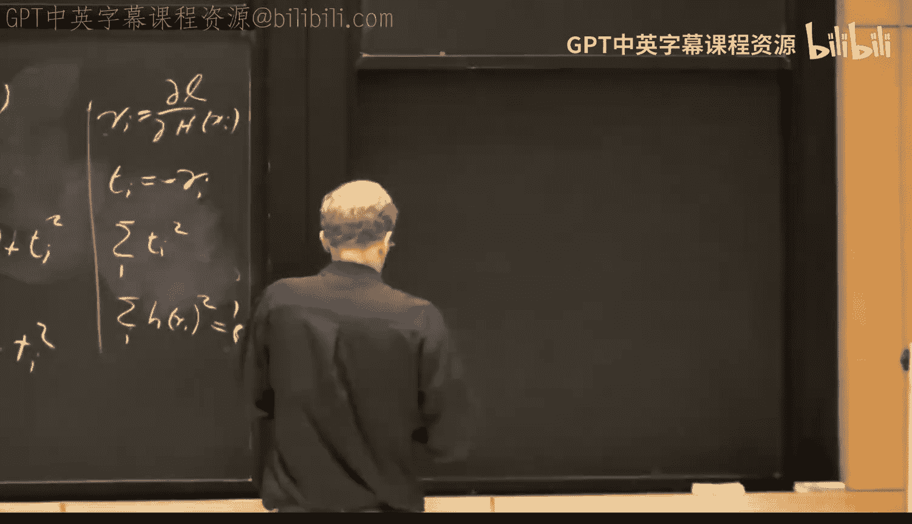

Just say， initially。H equals0。All right。So initially， we don't， you know， by the way。

 that algorithm here。That was， you know。Please ignore that。 we wrote that on the on the。

on the notes that are online。So here's what we do。We take key steps。And every time the following。

We say， T I。Equals。Y I minus H of Xi。😡，So we take our vector。 We take our labels。

And be subtracted from them， what we already have That's that we already have in the bank， right。

 That's how close we already are。 Be subtracted from the label。And let me say， okay， the next。

 next H you're trying to find。It's just the country。That minimizes。嗯。The square loss。

With what's left。啊TI。And then I say， my H。Becomes H。Plus， alpha times H。And that's it。

Then you say end。You repeat this。So it's like it's。4 lines of code。Plus a loop。

It's one of the most powerful algorithms。哎。And the only hyperparameter you really have。

It's two is like one is how deep your trees are。And the second one is your step style。

That's something you have to tweak a level。So， usually。Basically。

 deeper trees give you more exact steps， more exact steps。 And you also， you have more variances。😊。

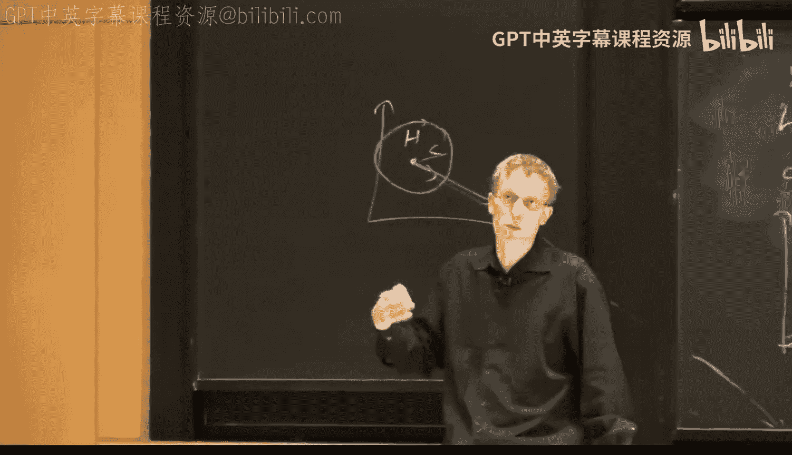

嗯。And if you take smaller trees， well。You know， you have to find something in the middle。

 Usuallyly 4 to6 is good。And the step size here， if you make alpha smaller， you have to boost for。

 you have to boost for more iterations。But that's really all the。

Any questions about great deal boost of trees， yeah。B。

So with certainly with creating boosting beyond， yes。So in general。

 does it because this seems like on some level， rather complicated。But it's four lines of code。

 What are you talking about。I can put this inside of here。 Then it's three lines of code。啊。

we got to increase variance too much and end up with the reverse problem。 Yeah， that's okay。

 So the question is like， why don't we just。 So here's actually， that was a。

It was actually a big competition。 So when Yahoo actually fell apart， which was a couple years ago。

 like， you know。Actually， right when I left the。还能话。

They had a big competition where they basically took all their search engine data and made it public。

 They anonymized it and made it public So all the features。

 and they tried to make a big a big competition。 you know。

 they offered several thousand dollars of price money for the person who can build a best search engine。

😊，And actually， the the winner， what they did is。They boosted。For 10 iterations。

And they did that several hundred times， and then they backed those。And the result was like。

 you know， I think was actually， it was even more。 That was like， you know， the result was。

 I think 10 million trees that you had to evaluate for each search query for each webage。

 So it takes like， you know， minutes and minutes for each search query to you know get any result。

 But it was the most accurate by far。 So you can， you know， you're right， right in some sense。

 basically they introduce the variance problem。 and then they reduced it again with bagging and so on。

😊，Typically， however， the variance doesn't go up too quickly。And so if you。

 if you keep your alpha and your T in track， right。

 you don't make alpha too small and you don't boost for too long， you actually should be fine。第二。

It's not that。アァイ。I mean， they are different。 So the question is we are not why we not combining different weak classifiers。

 But these are very different trees right， every single tree would be very， very different。

It's just not yeah。 We're not combining trees and S VMs or something。 right， Yeah， yeah。

 That's right。 But you basically have one type of algorithm that generates you weak classifiers。

 and you basically want to make a strong classifier out of that。All right。 thank you， everybody。

 See you next week。😊。