# 机器学习：032：Boosting


在本节课中，我们将要学习Boosting（提升）方法。这是一种将多个性能较弱的“弱学习器”组合起来，形成一个强大预测模型的技术。我们将从直观理解开始，然后探讨其数学形式，并介绍两种著名的Boosting算法：AdaBoost和梯度提升树。


---

## 从Bagging到Boosting

上一节我们介绍了Bagging，它通过组合多个高方差、低偏差的模型来降低整体方差。本节中我们来看看Boosting，它要解决的是相反的问题：**偏差问题**。

Boosting起源于20世纪80年代末的一个核心问题：能否将多个“弱学习器”（即性能仅略优于随机猜测的学习算法）高效地组合起来，达到“强学习器”（能将训练误差降至0）的效果？Robert Schapire从理论上证明了这是可能的，并提出了实现它的算法。

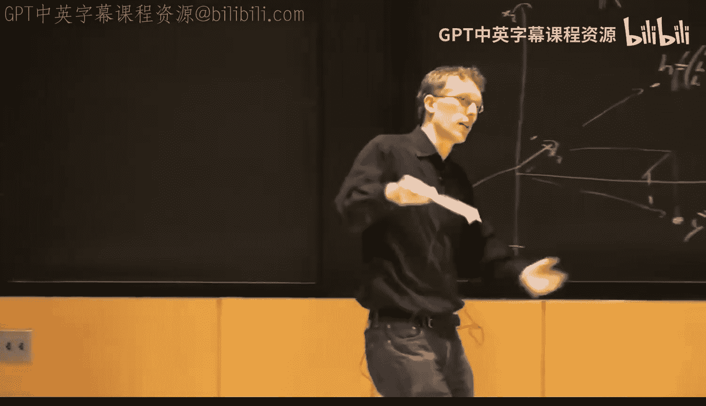

## Boosting的直观理解

Boosting的核心思想是**在函数空间中进行梯度下降**。我们可以通过一个几何类比来理解它。

想象一个N维空间，每个坐标轴对应一个训练样本的真实标签。那么，整个训练集的标签向量 `y` 就是这个空间中的一个点。同样，任何分类器 `H` 在训练集上的预测结果也可以表示为此空间中的一个点 `H(x)`。

*   **强学习器**（如深度决策树）的预测点 `H(x)` 会与真实标签点 `y` 重合。
*   **弱学习器**（如浅层决策树）的预测点 `H(x)` 则会偏离 `y`。

Boosting的目标是：从一个初始点（例如全零预测）开始，通过**逐步添加弱学习器的预测**，使最终组合模型的预测点不断逼近真实标签点 `y`。这就像一个醉汉回家：每一步方向都不太准（弱学习器），但通过不断朝着大致正确的方向迈出小步（以较小权重 `α` 添加弱学习器），最终总能到达目的地。


这个过程的关键在于，每个弱学习器只需要保证其预测方向与当前“残差”（即从当前预测点到真实标签点 `y` 的方向）的夹角小于90度。如果方向完全错误（夹角大于90度），我们只需将其预测结果取反即可。只有当弱学习器的预测方向与残差方向完全正交时，算法才会停止进步。

## Boosting的形式化：AnyBoost

基于梯度下降的视角，我们可以推导出Boosting的一般形式，称为AnyBoost。

我们的目标是构建一个集成模型：
**H(x) = Σ_{t=1}^{T} α_t * h_t(x)**
其中每个 `h_t(x)` 是一个弱学习器，`α_t` 是其权重。

在每一步 `t`，我们已经有了前 `t-1` 步累积的模型 `H_{t-1}`。我们希望找到一个新的弱学习器 `h_t`，使得添加它后，损失函数 `L` 下降最快。这等价于求解：
**h_t = argmin_{h ∈ ℋ} Σ_{i=1}^{N} [∇L(H_{t-1}(x_i))] * h(x_i)**
其中 `∇L(H_{t-1}(x_i))` 是损失函数在当前模型预测值处的梯度。

对于平方损失函数 `L(y, H(x)) = 1/2 (y - H(x))^2`，其梯度简化为残差：
**∇L(H(x_i)) = H(x_i) - y_i**
因此，寻找 `h_t` 就变成了寻找一个与当前残差向量（真实值减去当前预测值）**负内积最小**（即方向最一致）的弱学习器。

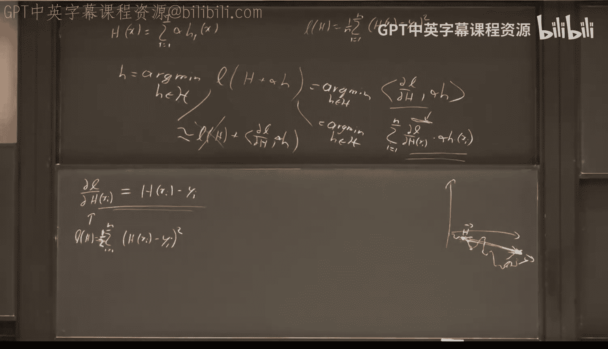

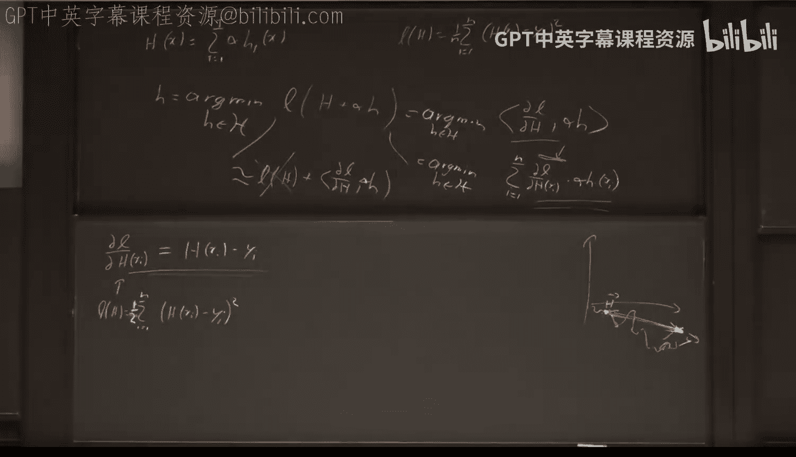

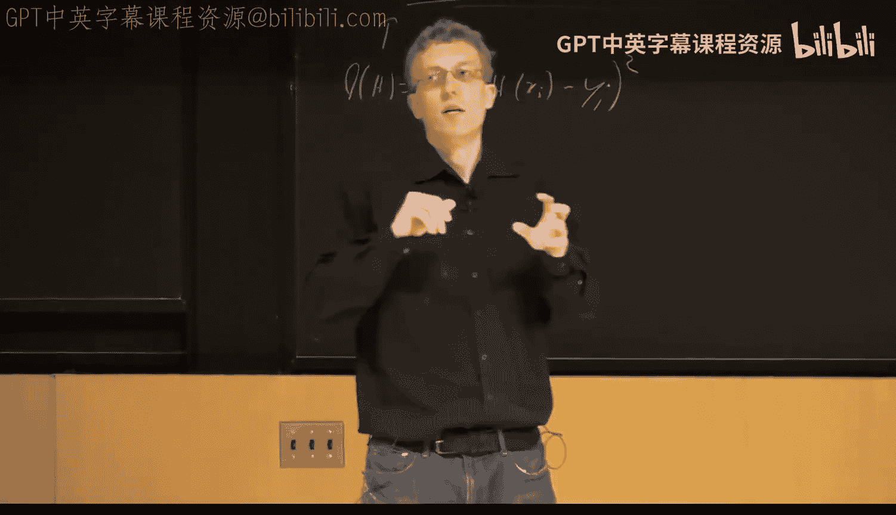

以下是AnyBoost算法的步骤：


1.  初始化模型 `H_0(x) = 0`。
2.  对于 `t = 1` 到 `T`：
    *   对每个训练样本 `i`，计算负梯度（对于平方损失，即残差 `r_i = y_i - H_{t-1}(x_i)`）。
    *   训练一个弱学习器 `h_t`，使其预测 `h_t(x_i)` 尽可能与 `r_i` 相关（即最小化 `Σ r_i * h_t(x_i)`，或等价地，用 `r_i` 作为伪标签来拟合 `h_t`）。
    *   选择步长 `α_t`（可以固定为一个小常数，或通过线搜索确定）。
    *   更新模型：`H_t(x) = H_{t-1}(x) + α_t * h_t(x)`。
3.  输出最终模型 `H_T(x)`。

## 著名的Boosting算法

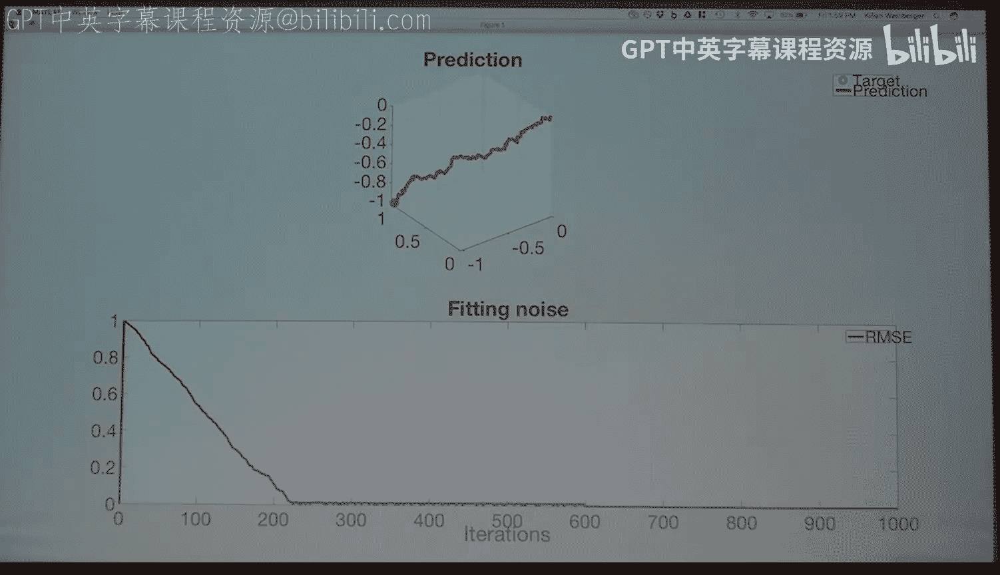


基于AnyBoost框架，有两个特别重要且广泛应用的变种。

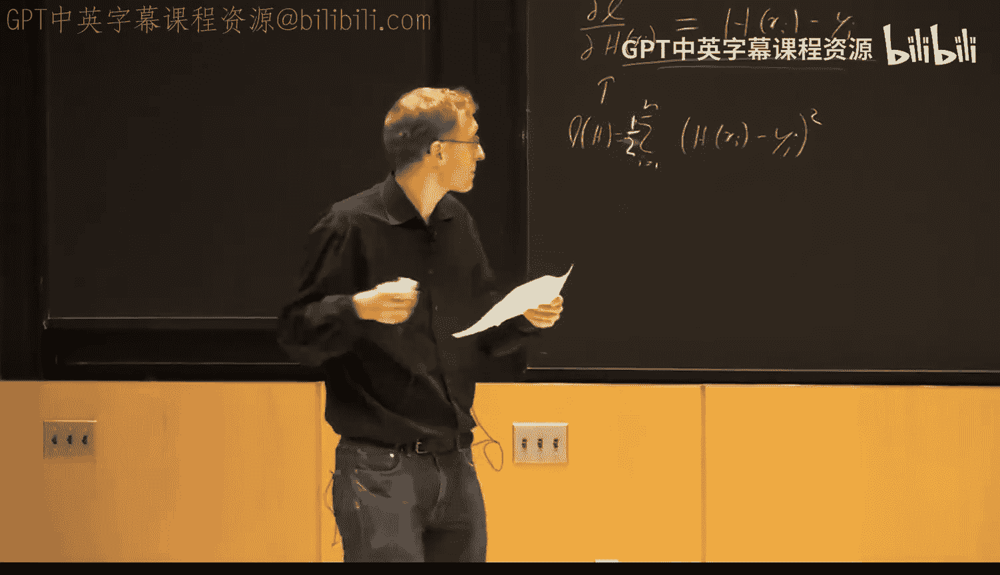

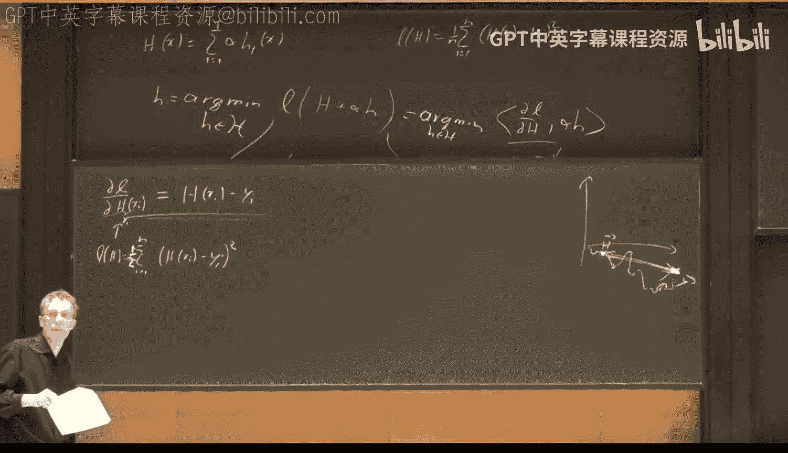

### 梯度提升树（Gradient Boosted Trees）

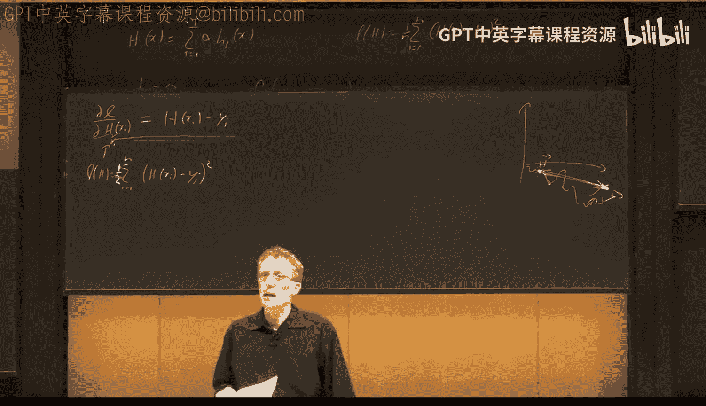

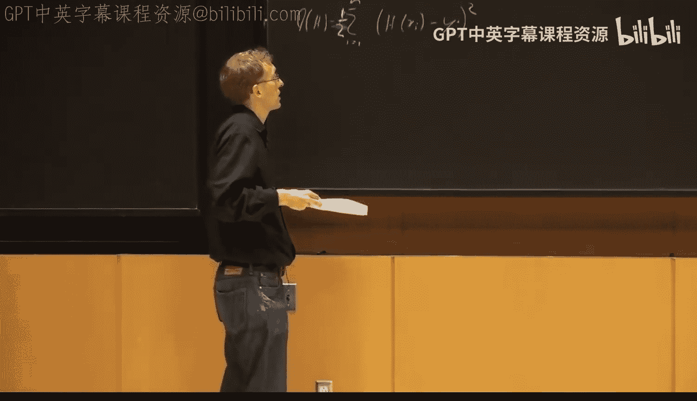

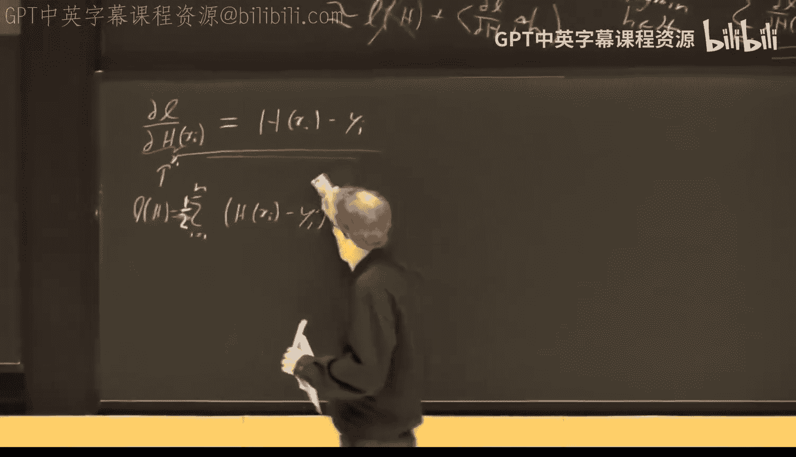


梯度提升树是当今最强大的机器学习算法之一，被广泛应用于搜索引擎排名、推荐系统等领域。

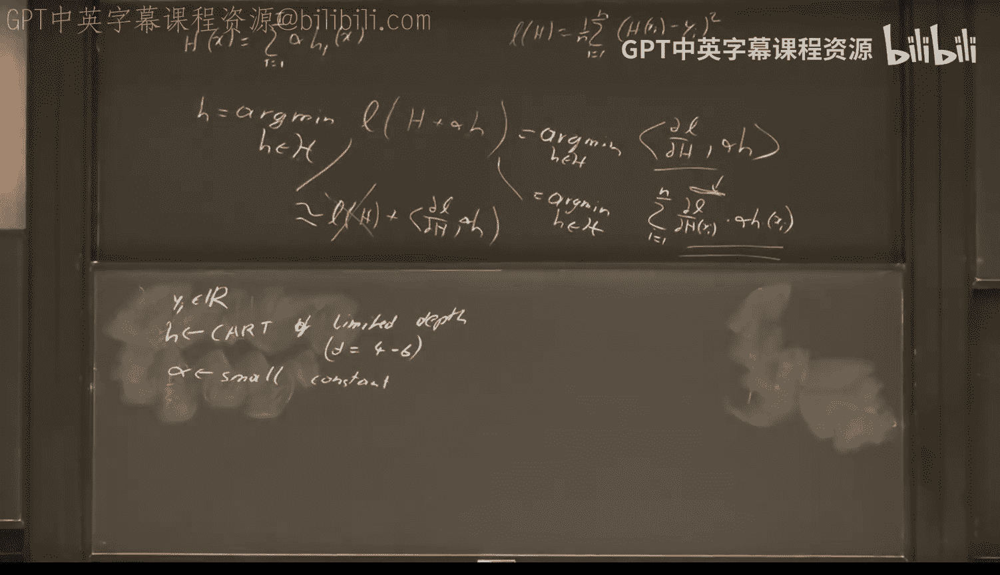

它做出了以下具体选择：
*   **弱学习器 `h_t`**：使用深度受限（例如4-6层）的决策树（CART树）。这种树训练和预测速度快，对数据尺度不敏感，但偏差较高。
*   **损失函数**：通常使用平方损失（用于回归）或对数损失（用于分类）。
*   **拟合目标**：在每一步，我们让决策树去拟合当前模型的负梯度（即残差）。有趣的是，对于平方损失，这等价于让决策树直接以残差 `r_i` 为标签，去最小化平方误差。因此，我们可以直接使用标准的回归树算法，无需修改。

梯度提升树的伪代码极其简洁：
```
1. 初始化 H(x) = 0
2. For t = 1 to T:
   a. 计算残差: r_i = y_i - H(x_i), for all i
   b. 用数据 {(x_i, r_i)} 训练一棵回归树 h_t
   c. 更新模型: H(x) = H(x) + α * h_t(x)
3. 输出 H(x)
```
其主要超参数是树的深度和步长 `α`。树越深，单步拟合能力越强，但也可能引入更多方差；步长越小，需要的迭代次数 `T` 越多，但过程更稳定。

### AdaBoost

AdaBoost（自适应提升）是历史上第一个成功且实用的Boosting算法，比梯度下降视角的提出早了约十年。它是AnyBoost框架在特定损失函数（指数损失）下的特例。

AdaBoost专为分类问题设计，其核心思想是：
*   **样本权重**：在每一轮迭代中，它会增加上一轮被错误分类样本的权重，使得弱学习器在后续轮次中更关注这些“难”样本。
*   **弱学习器权重 `α_t`**：它会为每个弱学习器计算一个权重，该权重基于其分类准确率。准确率越高的弱学习器，在最终模型中的话语权越大。


虽然其原始推导与梯度下降视角不同，但最终都归结为以自适应（Adaptive）的方式确定弱学习器及其权重 `α_t`，这也是其名称的由来。

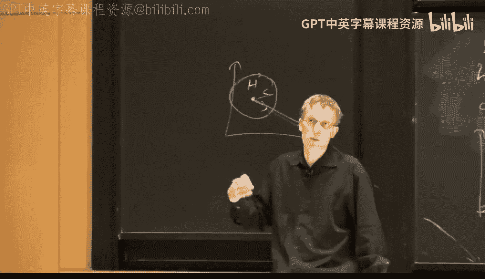

## 总结

本节课中我们一起学习了Boosting方法。
*   我们首先理解了Boosting要解决的是模型的**偏差问题**，其目标是将多个弱学习器组合成强学习器。
*   我们通过一个几何类比，将Boosting直观地理解为**在函数空间中进行梯度下降**，通过不断朝正确方向迈出小步来逼近最优解。
*   我们形式化地推导了Boosting的一般框架**AnyBoost**，其核心是在每一步寻找与当前损失函数梯度最对齐的弱学习器。
*   我们介绍了两个最重要的Boosting算法：**梯度提升树**（通过拟合残差来迭代提升回归树）和**AdaBoost**（通过调整样本权重和分类器权重来提升分类性能）。

Boosting，特别是梯度提升树，因其强大的预测能力和相对简单的实现，已成为现代机器学习工具箱中不可或缺的组成部分。