# 033：康奈尔大学《智能系统的机器学习｜CS4780 Machine Learning for Intelligent Systems 2017》中英字幕 p33 -33-Machine Learning Lecture 33 ＂Boosting Continued＂ -Cornell CS4780 SP17.zh_en -BV1Lo6gBxEKE_p33-

Okay， we're talking about boosting。And just to recap last time。

The basic boost thing， what we do is we say， our age of x。

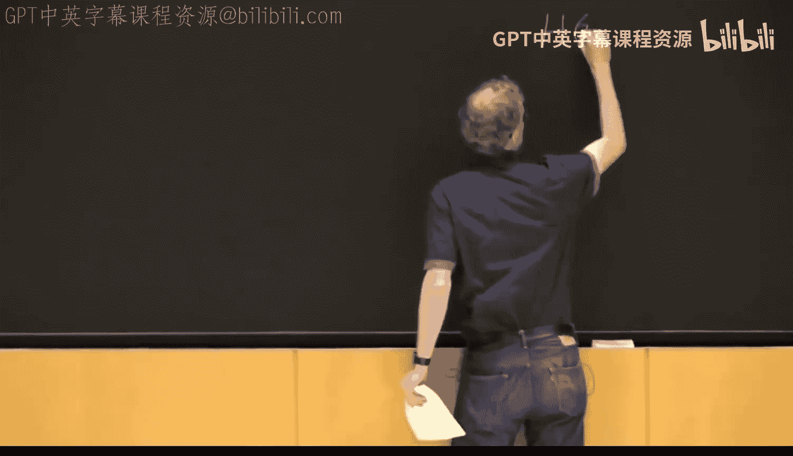

Is a sum。Of capital T classifiers。嗯。And in some sense， what we are doing， we basically say， each。

 you know， we assume each one of these caifiers is roughly， you know。It's pretty weak。

But it's better than a random coin cost。 So at least it shows in the right direction。

And then what boost for gradient boosting does is。V。We start out at 0。 and this here is the。

 this here is the n dimensional space。But every dimension corresponds to a training point。

And so this year is my Y vector。And I would like to have my predictor point exactly to this Web vector。

 the moment I do this at0 training error。And so what I do is I have my first little classifier。

 and it， it doesn't。😊，Preict why， you know， predict something here。

 But I take this vector and take a step in that direction。And then， I。I basically say， okay， well。

 let gonna start here。 Now my whys have changed right。 So one thing either you know。

 update your why or you just say， you know， I'm starting from here。

 And now you another classifier and the points that say gives me this as answer， right。

 because they are pretty noisy。 You take that vector and you take a small step in that direction。

 And you repeatedly take small steps into the direction of y。

 And because each one of these classifier is a little more right than wrong。

 a points at least in the right direction。 You have to get to y exactly So that's that's that's the rationale basically。

😊，And that's called gradient boosting。So you basically have a last function in every single iteration。

 you train a little classifier that really points you in the direction of the gradient of your last function。

😊。

嗯。Okay， any questions about this。One thing that's important is that theres two loss functions。

 actually， right， The one first loss functions is loss function around why we try to get closer here。

And the second one， So if you are a certain point， let's say。We are here。

 and the gradient points in this direction toward what why。

 And then the function that I'm actually calling my weak learner with says。

 give me a give me a weak learner that points in the same direction as this gradient。

 So the first gradient comes from the global loss function。 I'm trying to minimize。

 And then every time I take a step， I call my weak learner by giving it a new， basically new target。

 And that's， you know， and then it solves its own little loss function。😊。

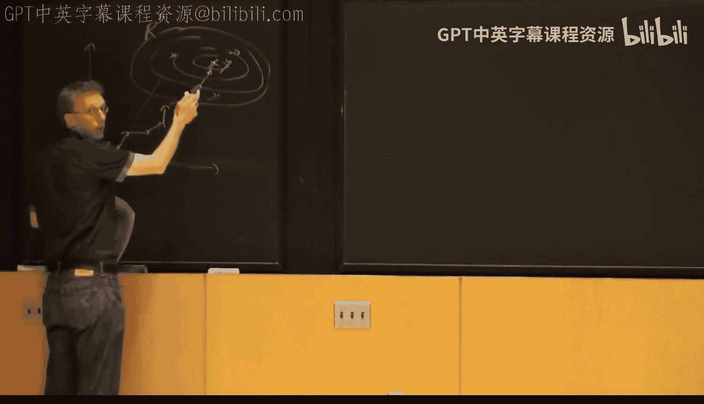

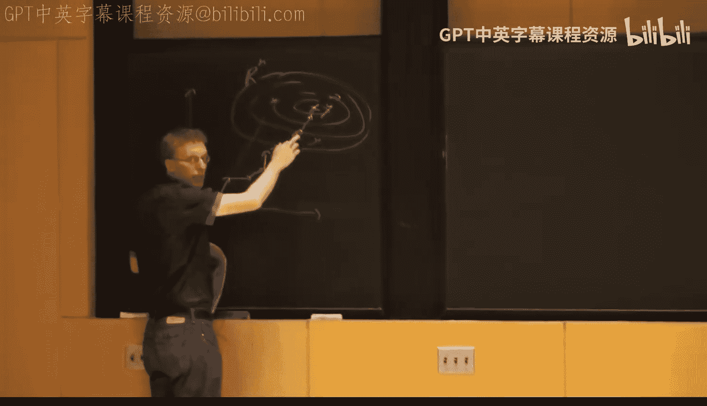

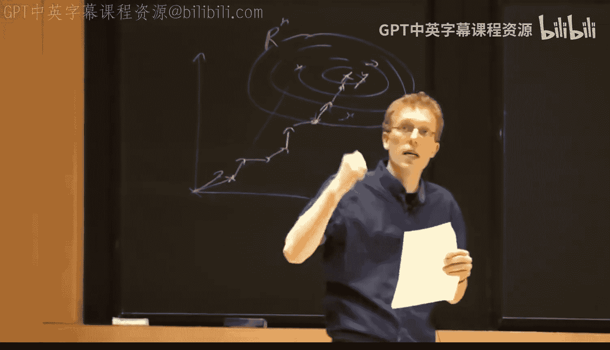

An in boost of trees that's to square us。Okay， any questions about gradientad boosted trees or gradientad boosting in general。

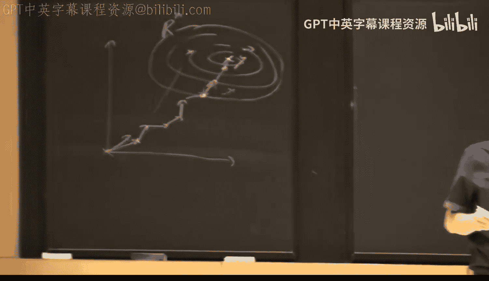

All right， okay， today。We are going to do the most famous boosting algorithm。

 which was also the original one。And it's called At boost。

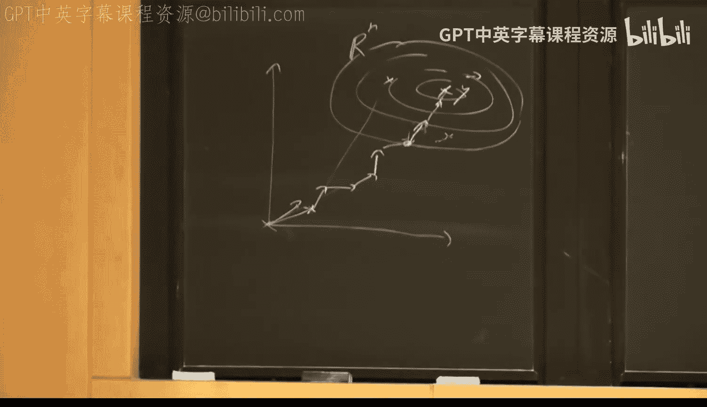

Ada boost stands for adaptive boosting。

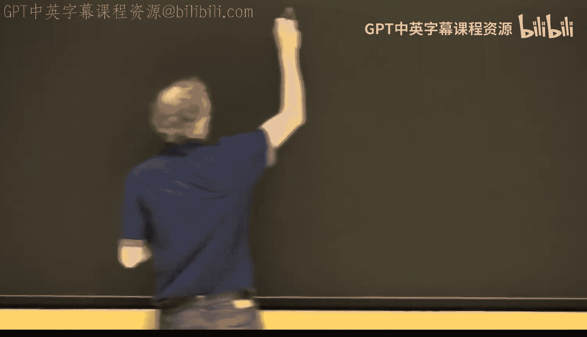

And to add a boost was actually what was originally invented。

 And people did not realize that what it was doing was actually gradient de and function space。

 So the order is the other way around， right， So I just described this gradient boosting， actually。

 is a whole family of algorithms， you can take any loss function and any big learner。

 But that wasn't clear at the time。 people just came up with at a boost and know， you know。

 like that algorithm a lot。 And once they analyzed it。

 They realized that this was actually a very specific instance of gradient descent and function space。

 And so that it took years for people to discovered this more general framework。

 which is called you know， gradient boosting now。😊，And Adamoo is a very specific instance。

Where we make a few choices， the first one is the last function。

The loss function in add boost is just the exponential loss。So it's E to the some of all data points。

 E to the minus Y I， a to X I。Sorry， age of X。 That's the exponential loss。

So remember this from your puregri risk minimization。So in gradient boosting， we kept that open。

And the second thing is the step size。呃， step size。And here we no longer set alpha to be a constant。

 Instead we optimize alpha to take the ideal step。So optimize， we call it actually a line search。

What does that mean？That means we have this loss function。

 which is basically this exponential loss around our optimal you know the minimum that we try to get to。

😊，And。Let's say we are somewhere here。And you would like to take a gradient step。Before we said。

 okay， well， you know， it's have， you know， the gradient points in this direction or something。

 It's not a little noisy。 It it goes goes in this direction， right。

 So the gradient goes in this direction。 we gonna have points in this direction。

 And we just said before， we just take a small step。 some alpha， we just fix it。 maybe 005。

 So we take a small step to here。😊，In in， in Atbu， what we will do is we will say， actually。

 let's say， I'm staying with this direction。Then I basically look at this whole line and say。

 what's the minimum of the loss。 And That's right here。

And I go all the way until my loss motion is minimized。 And that's my next step。 Right。

 So then I get a new weekerer。 ideally you would like to go in this direction because the weak learner。

 you know， let's say， I go in this direction。 And again， I take a step until my loss is minimized。😊。

that's the idea。 So each step is basically of different length。And。But you know， when you。

 the the good thing is when you finally find a good week learn and they are pretty noisy， right。

 But occasionally， you will find really good ones。 You take a really large step。😊。

And because of that， atda boost can converge really， really quickly。 And， in fact。

 we will prove that it will always converge very very quickly。Okay， so those are the two design。

 two design choices。 one more design choice。 that's up being classification。😊。

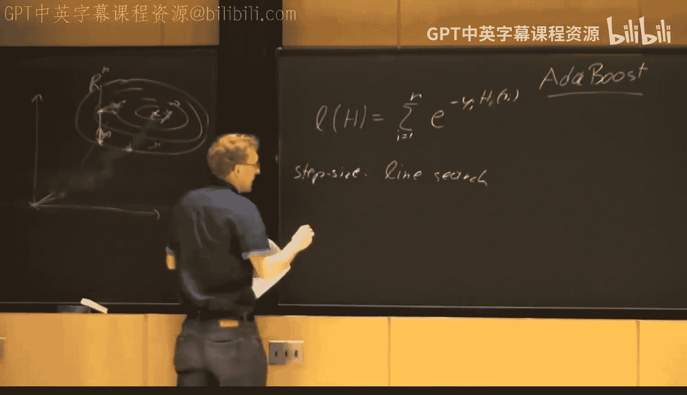

So it only works for classification。 So the Y I is an element of  -1 plus1。

And we also assume that the weak learners only return us -1 and plus 1。 So weak learners。

They return age of。X I is element of -1 plus1。For all， for all X。

So these are the assumptions about a boostto first。You know， what's gradient Bo thing。

 We have to choose the last functions。 So we pick the exponential loss。

You have to pick how we set the step size。 We say we gonna， we will do a line search。

And then we have to set the setting。 In this case， we say it's a classification setting。

 and the weak learners will just be binary classifiers。 plus  or -1。

 So it's a very specific setting of gradient boosting。😊，And turns out， when you do this。

 you get some very beautiful properties。😊，And so as I said earlier， it was in history。

 it was discovered the other around。 So people basically first invented alabo。 and then they said。

 well， could you also run this with a different loss function。

Could you also around this with different settings here and so on。 And then they actually。

 that's how people notice that actually， this is much more general。

 Boosting is much more general than at a boost。😊，Okay， any questions before we dive into it？Okay。

 good。 There's going to be a little bit of derivations today。There will be a demo， at the end。嗯。

So please bear with me。 it's really not very complicated。It's actually。

 this class is never really complicated。嗯。And just stay with me。 there' like 3，4 steps， right。

 And then， then we get there。So。The first thing is we have to go through the same steps as last time。

And that was， imagine we already have a function H。We want to know。

 what is the next weak learner that we should should get。 Okay， so let's you know， for now。

 just assume。Don't worry about but alpha yet。One second。Okay， yeah。 So， and when you remember from。

 So you basically you want to have alpha plus alpha times little H， you want to find the next。😊。

You want to find the age that minimizes。Our loss， right， So you basically have some last question。

Okay， so we did this last lecture or two lectures ago。 right。

 So given that we already have a bunch of weak learners， which one should we add now， right。

 So that's the， that's basically the part of the boosting。 But you call the weak learner。

 And say give me one more function。😊，嗯。I'm not going through the derivation again。 Basically。

 what you have to do is you have to take the gradient。Of this function with respect to H。

and so let's just do this。 So that was that was previous lecture。One second， let me just make sure。

 Yeah， So let's， let me define this。So the gradient of the loss function with respect to H of X。

One particular X。Is if you look at the loss function， where is it up here。

I give you a minute to maybe figure it out yourself。There' is my last function。

 I would like to take the gradient with respect to H of X I。Any suggestions？Alright， okay， you。

 you take， you take a minute and discuss it with your neighbor。

 I want everybody to figure out what that last function。 So here， here's my last function。

 I would like to take the gradient of L with respect to H of X I。😊，Yeah。Yeah。Yeah。Right。

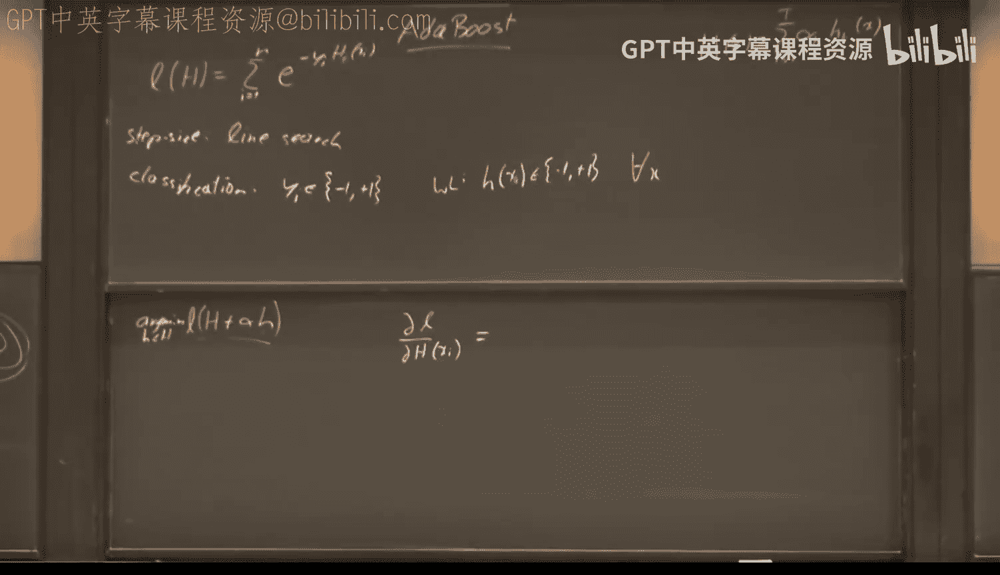

All right， who can tell me。What does the loss function， someone who hasn't said all that much。

What's the gradient， yep？我爱他。E to the negative Y I， H of X I。

 but actually it's not a sum because all of the terms are 0 because we only take derivative with respect to H of X I。

 yeah。

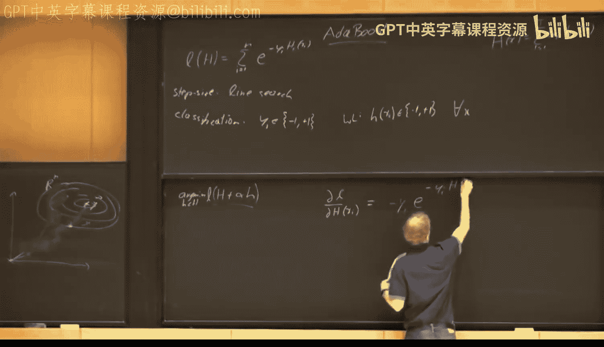

So， good。So where are we in the boosting process， Right。

 So we assume we're already taking some steps。 Now we are right here。And now we want to know which。

 which direction to go next。 So what we are doing is we're computing the gradient of the last with respect to every single dimension。

 And that gives us some vector here。 right， So that's basically what that is。

And every single dimension， basically， this year is the great， okay。So fars are good。

And let's just call this。 This is our R I。 That's what we call this R I。In the past。

And so here's what I want to do。 I just call。Just to make notation later on easier。

I call this thing here。WI。It's quite actually W at。All right。Why not， And that's a weight。

So this is basically， what is this， This is basically the last。 If you just look at。

 this is just the last。Of this particular data point， O， how much does this particular data point。

 I contribute to the last function。 That's what it is。 right， New sum of all of those。

 That's the loss。Okay。Whereise the hand of you sit with me？All right， good， good， good。

And we call listening here。 And let me do something else。 We call Z。The loss。

I know what you boil down。This thing here， I just call this Z。😡，O。There's the sum of all。

 that's basically just the sum of all the losses， right。That's the overall us。And then， I say。

W I equals W I hat over C。Now， who can tell me what's the sum of old the I。WR。Give you a minute。

 discuss it with your neighbor。Give you one hand。 That's not Z。So， W are in one。Okay。Yeah。It's one。

 exactly。 It's one。Why is it one？😡，That's right。 right。

 So that is basically some of all IW head over Z。And what's the sum of OW I hat， that's this。

 And if I sum over those， that's exactly the definition of Z。 so it's Z over Z。😡，It's one， okay。嗯。

And they're all not negative。 So really， in some sense， they kind of weights。

 That's why I call them W action。 Theyre weights。嗯。Okay， good。 So far as there good。

 So just remember what we're trying to do， right， we are somewhere here。 We have our age so far。

 we are trying to find the direction in which to go down。

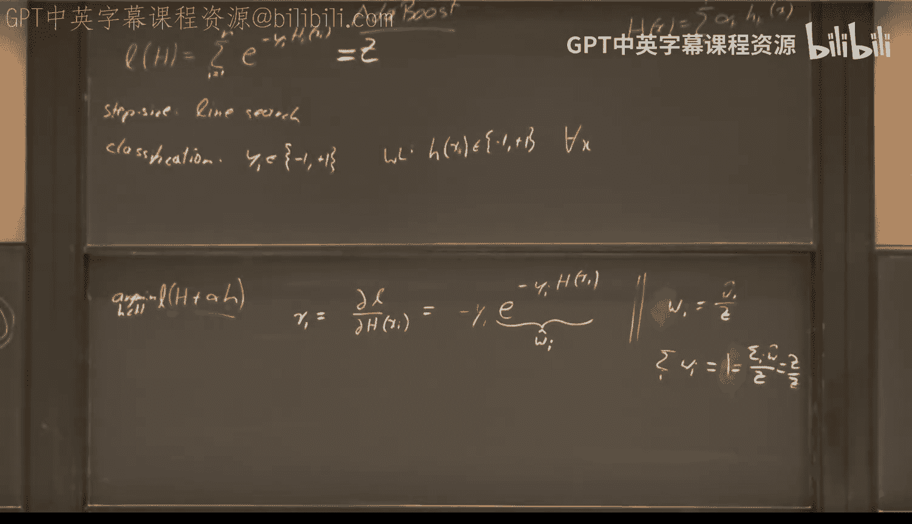

To most increase our loss， how are we doing this， we're computing the gradient of the function L with respect to every single dimension。

 Sure， why not， right And this is what we get， right。Okay， good。

 And now we want to find a weak learner that is best aligned with a gradient。 Okay。

 you would like to find ideally kind of points exactly in that direction array。😊，So， there is。

That's how we find H of X。So now next H of X I equals。Aric Min。

 and this is exactly from last lecture。So within our set of weak learners。

 we try to find the weak learner that minimizes the inner product。😊。

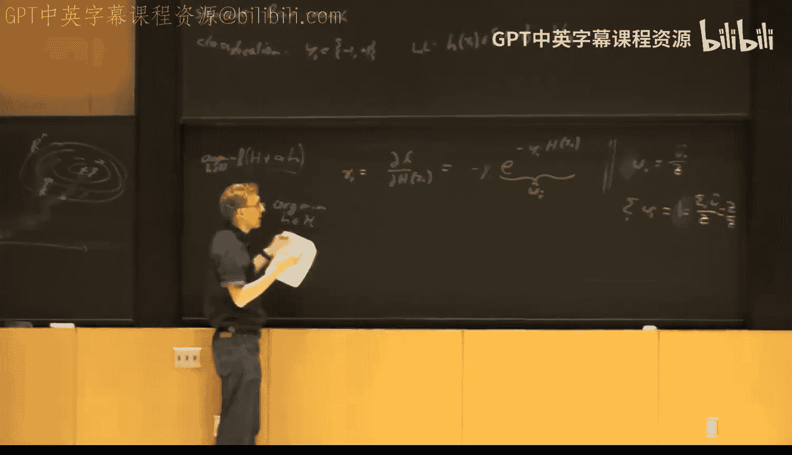

Between this gradient。And the output of the big learn。 So what we go is we go over I equals one to n。

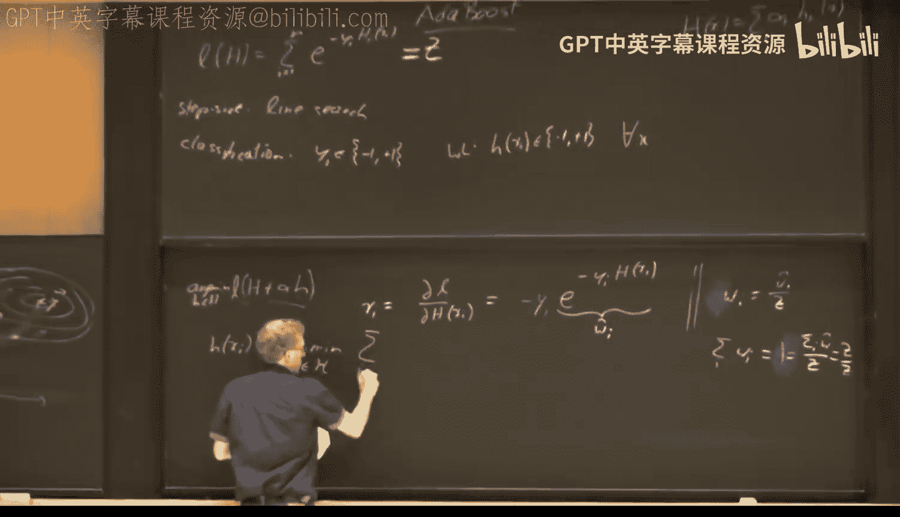

H of X I times the gradient。 Well， the gradient is this thing here， right。

 So that's W I E to the minus Y I， H of X I。You have a nice。Okay， raise hand。

 if you understand what I'm doing you。That's not many people。 Okay， yeah。why呀。OhOh， sorry。

 that's a why。 Yeah， yeah yeah。 Okay， good， good， good。 Thank you。 Thank you。😊，嗯。Good， O， good。Wait。

 I made a mistake。 this， this was my Y eye。 This was my Y eye。OK。Okay， we can also do this。

 We can also do。Stop ahead of iron。呃，YI。Okay， is now correct。Okay， good。Okay， so one more time。Guys。

 pay attention。So here's what we do。 We are here。 Those are H of X。

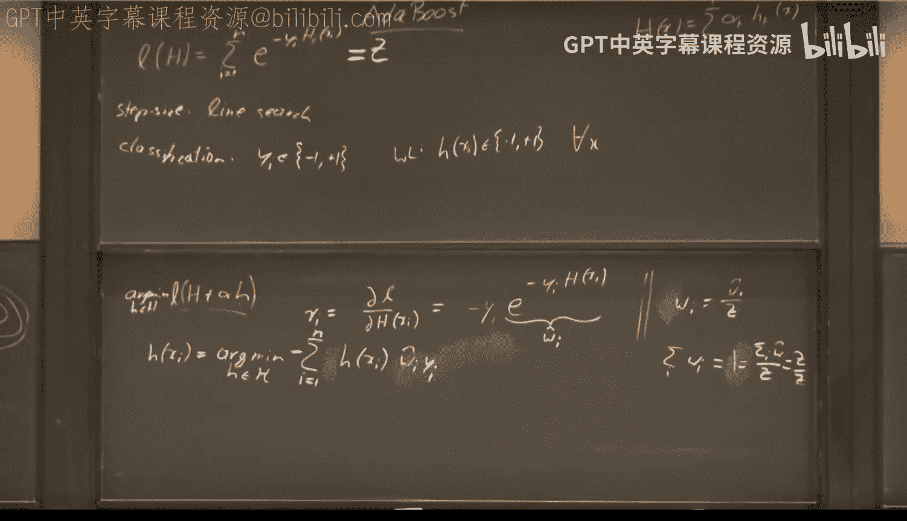

Thats where we currently are。 Thiss our H。Now， we try to find a direction。

 The gradient points in this direction。 This here is my gradient， right this gradient。

 What does it look like， It's like。You know， R 1， R 2， R N， right， That's my vector。

 I want to get something， but each R is exactly this。

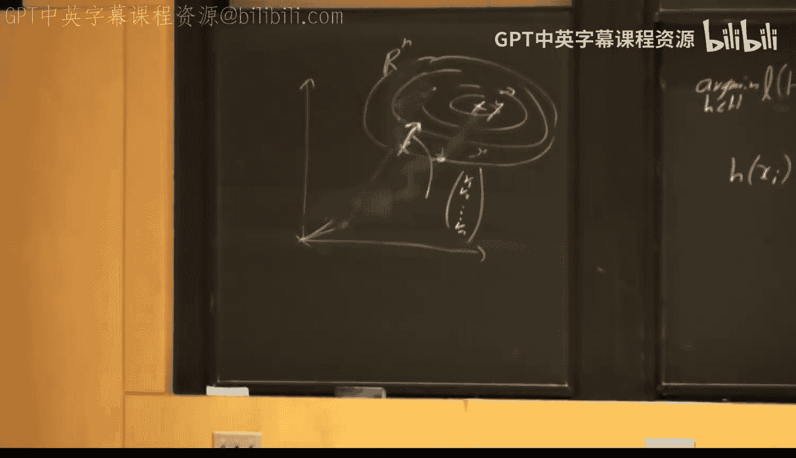

I want to find a function。The only thing is it points in the other direction because gradients points in the wrong direction。

嗯。Now， I want to find a function H that is a line that goes that points down here。 right？

 So what I want to do is want to find a function H that has minimum inner a product with this is my R I。

So this's basically the inner product between the R vector。

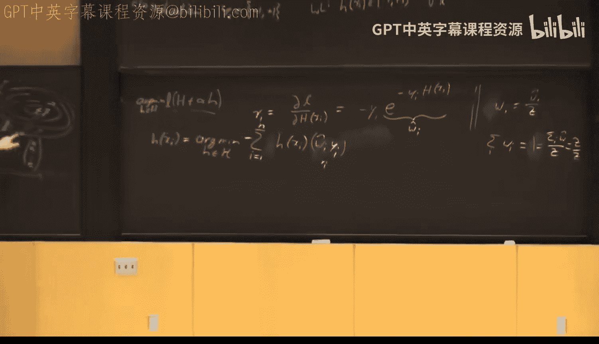

And my A vector。so I just go over all dimensions， and I just compute H of X I items R I and so on。

 And that's exactly the inner product between these two vectors。 So this is， this is very。

 very large。 And I'm basically pointing exactly in that direction。😊，Raise your hand。

 that makes sense now。O。嗯。If it doesn't make sense， please read last lecture notes again。

 because that's exactly what we derived last time that you basically have to minimize this in a product。

Okay， let's just。Go ahead from here。One thing we can now do is we can actually now。

Multiply divide by Z， because why not it's a constant， right。😡。

And then this here becomes my W I here。嗯。Okay， so given the previous step， does that make sense。

 The next step， I just took this and just multi by one over a Z。 And now I get。

 instead of a W I head， I just get W I because W I is W I head over Z。😊，Razy hand。

 if that makes sense。Okay， good。 Were almost there， guys。 We're almost there。

Let me rearrange some terms。W I。Y爱。What is this， H of X items Y I。

Canone tell me what values does that take on？Yeah。That's right。 It's either positive。

 It's either plus1 or it's -1。 Okay， if， if this guy gets this point correct， it's plus one。

 If this guy gets this point incorrect， it's -1。 So this is in plus 1，-1。😊，Okay， cool。 Now。

 last step。T has were one step。

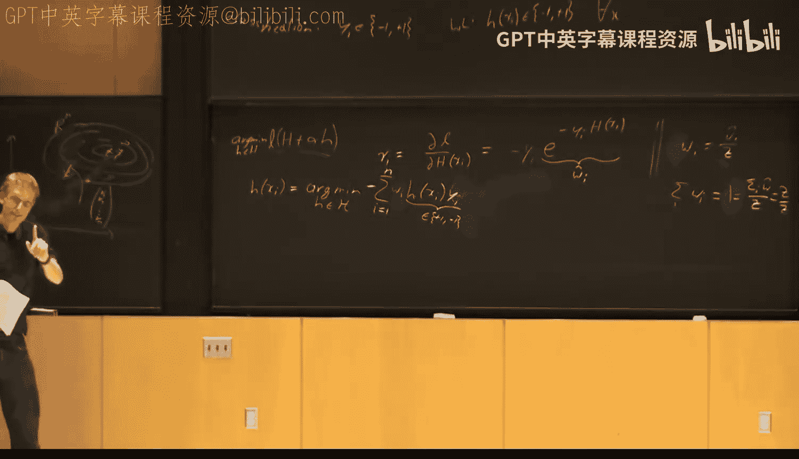

没得呀。here켜요。We now divide it up actually two more steps I like， you know。All right， two more steps。

 So here's what we do。These are the plus  one or -1。So what we do is we just divide up the sum。

 be sum of all the points where it's positive。Nmi all the points that's negative。Right， why not。

So you first sum over all the points it's positive。Eyes as that。Y I equals H。 Let's do this way。

 H of X I equals 1。And there is always one。 This is WI。Plus， now we whole the point by negative。

Is -1。Then this is just minus w Y。Okay。Rise the hand， that statement made sense。Okay， awesome， good。

 good， good， good。They get it there， okay。Now， can anyone tell me what this is。That's kind of tricky。

And some were all my data points。Actually， let's do this one。This is easier to interpret。

As's to this champion。AndSome of all my data points with y I H of Xi is -1。

And as some of their weights。So I'm summing over all the points that I got wrong。

 And I sum up their weights。 What do I get。You， you want to say that yeah。わないです。Yeah。

 this is basically， this is basically the the。This is the weighted error， right。

 It's basically if I give every data point。Away WI。And as some of all the points that I get wrongg。

 that's their weights。 And that's basically the amount of weight that I got wrongg。

There is the weighted error。 This is the weighted accuracy。哎。

So let's call that weighted error Epsilon。 Let's call this thing Epsilon。All， why not？

Then what is this？ this is Epsilon。 And what is this。It one minus is epsil， Ex， right。

 So what we get is the following。😊，嗯。So， we have fear。呃。in-1 minus epsilon。Minus epsilon。

And that gives me epsilon。Plus minus some constants that I don't care about。Okay。So。

What does that mean。It's actually a really profound result。IJust just put it， put it back in。

So what we are minimizing。Some of all I equals 1，2， n。呃，啊sorry。H of X I， not equal Y I。WI。

Let me illustrate to you what that means。They basically have a data set。😡，Alright， I can do this。

 This is really fancy。

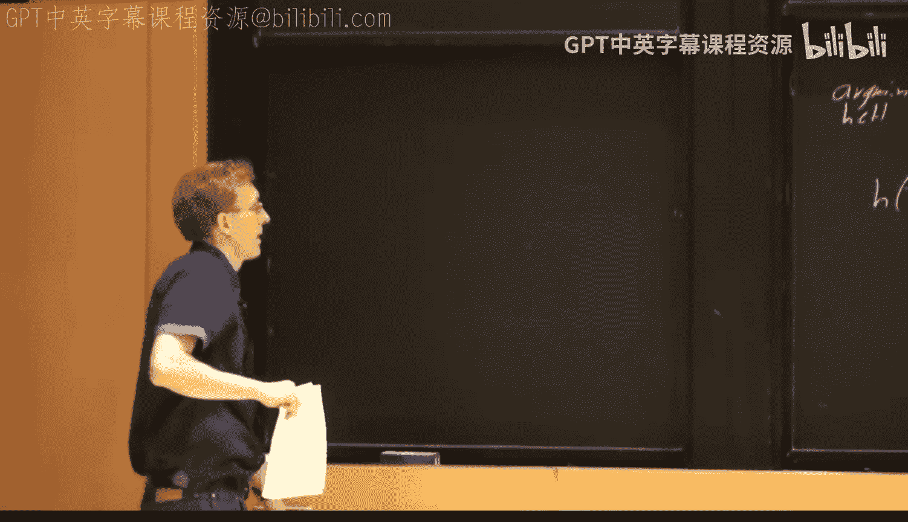

TheEverything I set of positive and negative points。

And each one of these points has a weight associated with it。😡，So， let's say this here is。0。3。

 you know， whether 0。05，0。025 or something， you know，0。025， etc ceteraa。

 Every point has a weight associated with it。Or I can also draw them smaller and bigger。

 How was this。 this guys a big weight。 So it's big。Right， this gets a small way。 It's tiny， right。

And what I'm trying to minimize is the weighted error。 That's it。So I want to find the H。

That minimizes my weighted error， which is basically here I'm all my own data points that I got wrong。

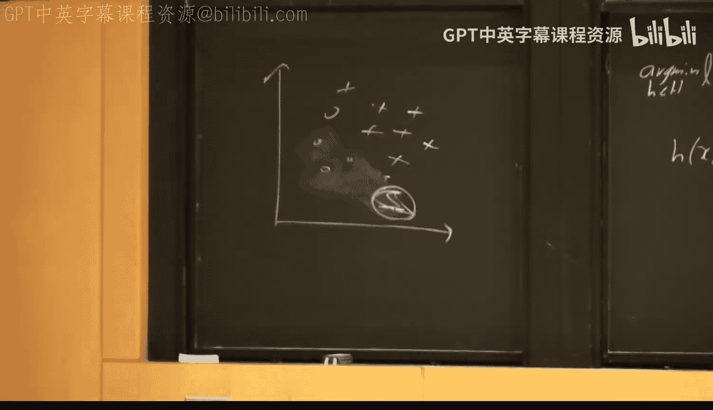

And I sum the weight of all the points that Im going to be wrong。 That's what I want to minimize。

Okay。😊，That's the idea。 And the weights that define a very specific way。

 but it doesn't really matter， right， So this is my definition of the weight。

 Where' is it somewhere here。 Where no weights。I guess it disappeared， but， but it used to be there。

 It was beautiful。Alright， so， so what you need for add a boost is an algorithm that takes in x's and ys and weights。

And it tries to find you the lowest weighted error。I if we can do this， then we can do boosting。

Any questions？So for're exponentialed to letter and because we only have two classes。

 our our weights all going to be the same because it's all just E to the negative y。Oh no， Oh no。

 Oh no。 So initially。 Oh yeah， okay， good。Initially， right， So initially。

 what he's saying is my age of X is just 0 or something initially， right。

 Or then each one of these weights is one， right， And that's， that's great。 That's what we want。

 Initially， we get a data set and everything is equal。😊，And then what Arabbu does。

This is basically the idea。We have data point。 Everything is equal。 Now we run the first classifier。

 Let's say you put it here。We say， oh， this is positive， or this is negative。

These points here all correct。 These three points are wrong。 This point is wrong。

So what will adabo do， It will now increase the weight of this guy by a lot。

Increase the weight of this guy。 and this guy。I just say like， look， these guys are much bigger now。

 right。And now it runs another classifier and say， you know， now run it again。

 Try to get this data set right。And now we won't misclassalify these data points anymore because these are now really。

 really heavily weighted。these are very small weight， in comparison。

So now you get a different classifier。 Maybe it does this， right， Everybody says， these are negative。

 These are positive， right。And now， this guy is misclassified。

So what we now do will give this guy a larger weight and so on。 But to every duration。

 you rerate your data points and it give those data points that you're still getting wrong more weight。

And those that you're getting right， lower weight。😡，And not only this， well get to this in a minute。

The weight increases exponentially。

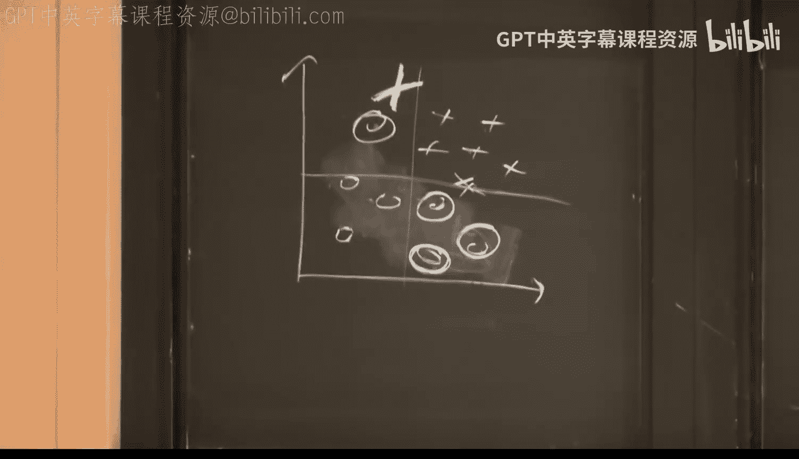

So if you get a point wrong repeatedly， at some point， you will all the weight on that one point。

 like， damn it， I'm going to get it right， until you get it right。😡，And then it will back off again。

 So it's， you know， but using this like， you know， by doing this， it has a lot of power， right。

 It can basically enforce that every single data point， no matter where it is。

 will'll eventually get the attention it needs to get it right。That's basically what's going on。

 That's the intuition behind aos。Any questions。Yeah。我。你个你哋。Mimizing the， yeah， yeah。

 it's the same thing， right， So minimizing the error is the same thing as maximizing the accuracy。

Yeah， it's the same thing， right， because one is 1 minus the other。

 So the accuracy is1 minus the error。第二。Absolutely。いや、かし。Sorry， said again冇 more time。😊，内。Yeah， no。

 but the nice thing about abu is you can take classifiers that are very， very， like they are very。

 very simple， right。😊，And so they will get a lot of points wrong。

 But now the next time you take these points and made them higher， right。

 So boosting SVM doesn't make too much sense， actually， right because they're already。

 as you're saying， they're already doing that， right。

 but they are specific to there's various reasons why occasionally you want to use add a boost。

 right And in part because decision trees are a great algorithm So you can just boost trees。

 but you can actually boost anything right like just SVms。

 you won't get much benefit anymore because they don't really have a bias problem， rights really。

 there is a bias issue， right， So you to classify as a bias towards， these lines。😊，Yeah。

 last question。What looking each。Yeah， so the， the amazing thing about Atda boost。

 And then when I started my PhD， there was like when you went a conference， this was everybody。

 Like you went for a beer afterwards with some people from the conference。😊。

Everybody was talking about， why does Adam Bo not overfit， and nobody knew the answer。

And it was this open question。 Like everybody machine learning was scratching their heads about it。

 right， It was reducing the error so quickly and it was so powerful yet it didn't overfit。

 And the curve just didn't look like it。 Like， you know， if you looked at。😊，So， yeah。Here。

 the number of durations。There's number abits。The training error went down like this very。

 very quickly。In the testing error。Looked like this and didn't go down。 And nobody knew why。

 like every theory， like， you know， we had no reason， like， nobody could make， you know。

 rhyme reason about it。 And that actually took a long time。

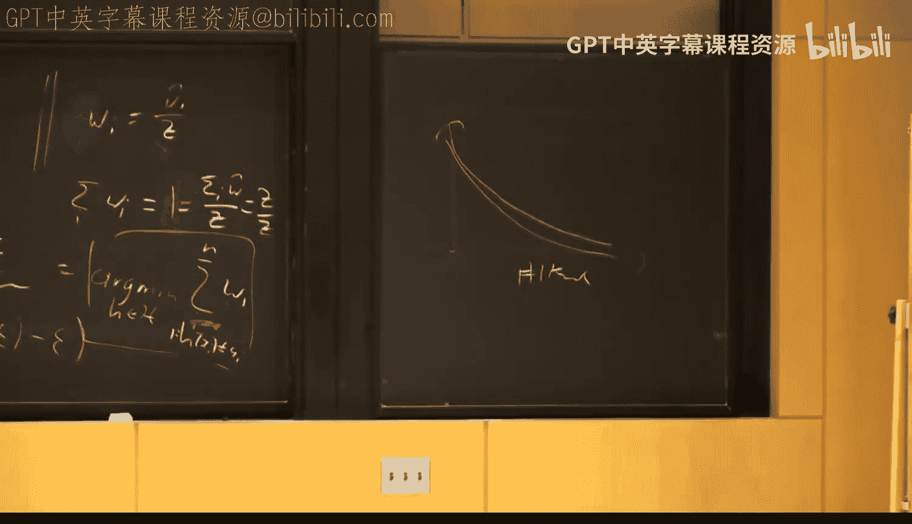

And in fact， their computers just to get faster。 But basically at some point， people actually。

 what they did is they just kept boosting for a really， really long time。

And then what they saw is that it slowly goes back up， slowly。And then， actually。呃。To that。

 if you plot this on a log scale， we just say here log durationerations。

That actually just looks just like any other。So basically， the amount overfis actually， does not。

 you know， basically grow at logarithmic scale。 There there's good reasons for this。

 Why this is the case。 So， yes， they do have a fit。😊。

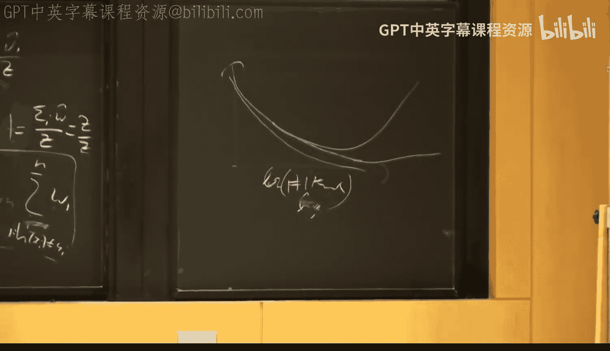

But the beauty of otherda boost is that it overfis really slowly。

 which gives you a lot of flexibility to find the sweet spot。 when to stop。 And that's why it's so。

 so， so powerful， right， It's really hard。 You know， if you have so much time in the world。 You know。

 like you know， slowly starting to everfi。 But yet you still keep boosting for another week， right。

 Well that's really your own fault at this point， right So you really get， you know。

 very good heads up in some sense， That's very different to decision trees。 decision trees。

 They go down a bam， go back up， right， So they overfi like very， very quickly。😊。

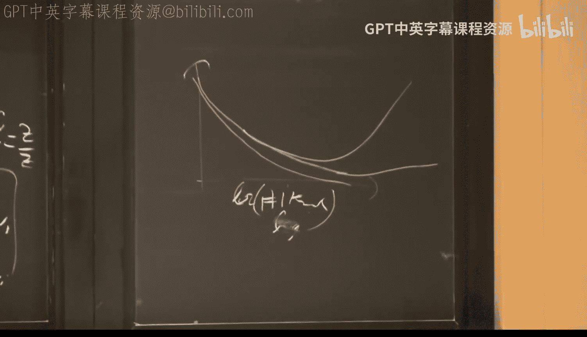

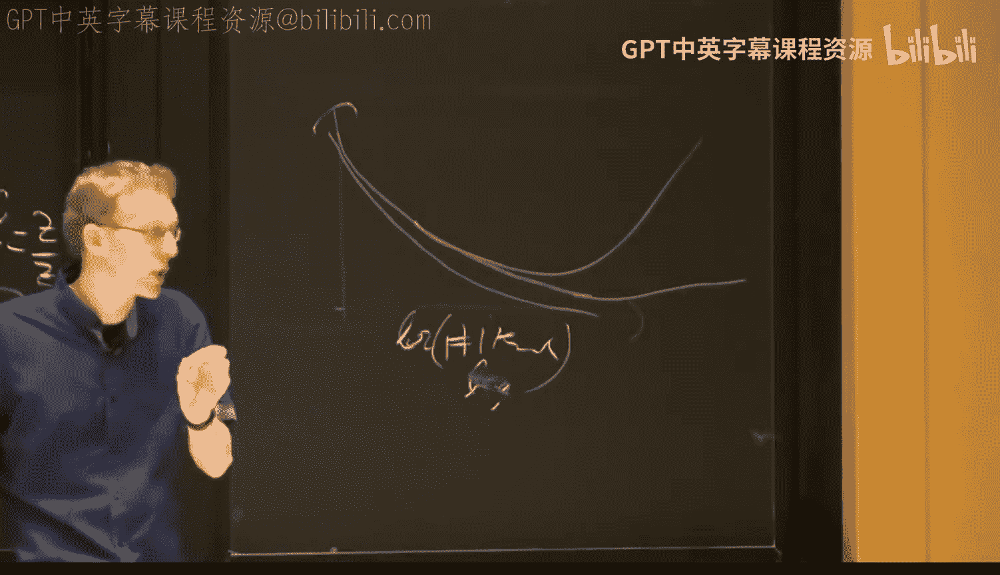

Yeah， and actually， this is what， you know， Rature Perry。 actually。 So he， he invented boosting。

 and then he went to Princeton for 15 years， he basically worked on nothing else and tried to really understand now you wrote a book about it。

 I think there's multiple chapters on that question。 So， it's， it is counterintuitive。

 And that's why it was so surprising。😊。

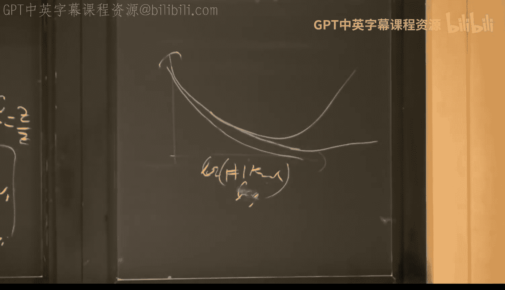

Actually， I can explain you why that。 I can use， use the intuition。

 The intuition is that these alphas。Get really， really tiny。

Because you basically get closer and closer to the loss。 So at the beginning。

 you take gigantic steps。 But because you do this line search， right， you basically。

 there's very little to be gained from each step。So you add very， very small alphas。 So actually。

 you're doing a lot less， right， And as you keep going， your offers get smaller and smaller。

 So the more youre adding， the less you're actually changing。😊，Does that， does that make sense。

So you take like at the beginning， you take really large steps。 and you take really。

 really small steps。So that's kind of this auto built in system against overfitting。Alright。

I have another derivation for you guys， but I feel like。People are kind of done with derivations。

 Who wants to see demo first and then derivation。Was like， who's for demo first， raiseise your hand。

Who's for demo a second。Some people are hardcore。 Oh right good。 You know what， I think it's。哎。

It's a tie， So I can choose。Yeah。All right， good。So here is again。 one thing I want to show you is。

Okay， first， the good old demo where I play some dots。And so let's make some challenging data。

 this decision trees。 So I'm boosting some decision trees。 These are very little decision trees。

 So any suggestions。😊，If your leak viral。Interleve spes。 Okay， you guys are nasty。And。All right。

 okay， good。Because I think this is actually against， you know， some conventions。

 treatment of algorithms， but okay。Alright， let's do this。 just make them a little。

 Make them ying and yang。 That's more positive。😊，嗯。All right。Okay， good。哎呀，OK不不不。😊，Okay， shoot。

So what are you seeing here， This is a decision boundary， and it adds little classifiers， right。

 And it's trying to basically to get the points right。😊，And it keeps reing them。And。

So this one actually got all the points right already。 So the error is0。

 The error on the right side is the black line。 So red one is the loss。

 So the loss keeps going down still。 So it still actually adds classifiers to the ensemble。 right。

 And it basically refines the decision the decision boundary。

 So keeps adding trees keeps adding trees And what you see here， the red thing is where it's very。

 very sure it's positive blue thing。 It's very sure it's negative。 And so you know。

 here is the regions where it's not entirely sure right。

 But it gets it right really cuts around nicely around this the spiral， right， I mean。

 this is really a really good decision boundary in this case， It makes a lot of sense。

 And the amazing thing is this is just built out these very simple trees So just by adding them repeatedly。

😊，You know，And then do you see， you see， your question was like， is it going to overfit， right。

 And you see no， actually， like the decision boundary doesn't go crazy， right。

 It doesn't do silly things， right， Like decision trees we saw。

 they kind of did really silly things to cut out one1 point。

 Here you keep boosting for 200 iterations now， right， and really cut it out very， very nicely。

 And there is probably， you know， a reasonable decision and boundary。😊。

Let me maybe do one more example now that you know what to look at any other data set。

Centric circles。 that's easy。That that's too easy， actually。

Because decision trees can do that by themselves， right。那是， you know。

It's like the boosting algorithm will laugh。At noise。 Oh， okay， you're nasty。 Okay， you got it。

 So here's， here's the， here's the problem with ada boots。 Atda boots is actually anal re。 right。

 So So when at this little point， that's mislabeled， It just can't look past it， right。

 It's gonna give it all the way。 It's like like a little piece of dirt right at your grandma's house。

 He's like， now I got clean it away。 You know， that's。😊，That's what you get。 All right，Alright， here。

 think very prominently here。Actually， it's probably we。 it's put right in the center。

 that's so so nasty yeah。😊，I feel bad。 All right， okay。Allright， okay， here we go。 Here we go。

I had to。 I was forced to do it。Okay， here we go。So it's cutting out， right see。

 but it's still has this one point。It's fighting。 It's fighting around that piece of dirt。

 It keeps scrubbing。 Oh， no， got it right。 They got it。 You know， they actually got it， right。

 They cut around it。But it will not stop until it gets every single point right， right， It just。

 at some point， it just gives this point all the way in the world。 and then。Yeah， you know。

 it always gets it right。Okay， yeah。Yeah， I actually have another demo， but it's not very good。

 This is actually， I don't like this demo， but I show it to you anyway。Right， what is this。

And this's actually， so now what you can see is actually the weights。So let me。

 let me do the spiral again， because it's。It's， it's interesting。It just gets very messy。 So I I。

 I tried to make this look cool by by making the points large， but it didn't work。 So I apologize。

 this is below my demo standard， like。I only show up because you ask for it。 Allright， give it go。

 So， let's do this。And what you see is you see， you see the debates。You see。

 some points are're really， really large， right， like。And a lot of points are basically disappearing。

 right， You see these points in the way it's really sure theyre disappear。

 You cant there below one pixel now， right， It doesn't care about them anymore， right。

But it's still fighting around these points in the decision。 You know where the decision boundary is。

 right， They are just， you know， obsesssses about them， right。

And it keeps getting back and forth between them。So basically adds one that gets a circle ride。

 and then it gets one that gets a cross ride and and， you know， gets them。Als between them， right。

 And so some point， you see this on the right。 This is quite nice。 These， these crosses on the right。

 They disappear。 then it gets them right and then doesn't care about them anymore。

 You see now get them wrong again， right， So then it's like， oh， wait a second， right。

 It's a little like wam mo， right， Whatever that is。 Allright。😊，Okay， any more questions？第二。ずつと？

When it is sub abu never stops。😡，Adder boost will never stop because the the loss is always non is always non zero。

 because each of the something it can never reach 0， only in the limit will reach 0。

 So adder boost will， you know， when we are all dead， right， Add boost will still be boosting。

Any more questions。Okay， I can show you we show you one more demo。 this bias variance。

Bance variance boost。 So here's the good old data set of。And she， let me show the data this time。

Okay， good。So this year the data set one more time。 So I have positive and negative points。

 and I try to separate them。 And I I believe I have very simple decision trees that just have one split。

 I believe。😊，嗯。So it's a little bit artificially easy dataset set， but it's very noisy， right。

 So this actually， this is quite bad for ada boost， right， So this， this kind of。

 this is what it can't do all that well。And what I'm showing you now is the decision bound。

 the bias variance curve。😊，And so。This is actually not a great example。

 But what do you see is initially， the bias is really high， right？

 And the first iteration of boosting。 after three durations of boosting， the bias got， you know。

 halved， right， It's now， you know， from 002 to 。01。

 right The second thing that's very interesting is as that goes down。 the variance。

 This is the black lines， the variance。 The variance does not increase。

 This is actually quite noticeable， right， similar to bagging， bagging reduced the variance。

 but not actually increase the the bias。😊，Ada booth is pretty good about not increasing the the variance。

 right， Eventually， it will go up。 but this takes a long， long， long time， right， So here， actually。

 basically the error goes down very quickly And， and so the bias goes down very quickly here at this point。

 it doesn't， you know， it goes down very， very slowly because it is a very noisy dataset。

 So what happens it just obsessses over the noise， right。

 So add boost is not great when it's when it's too noisy。😊，That's the weakness of a boost。 but。

 you know， I mostly want to show you this for this beginning here。

 But you see this massive drop in error， right。😊，There's a huge drop， right。

 was just a few durations of Muslim。嗯。This， by the way， the test error。

 is's not the the training error。 The training error has long been 0 at this point， right。

Any questions？第二。For all of these。There is always bit about bias that。yeah， with this data set。

 it was hard to find a data set that's so by an algorithm that's so biased。

 It's not not generally true。Yeah，It's just because I have this simple 2D data set。

And so in some sense， actually， a linear， you can actually have a line。

 It's actually the optimal classifier。啊。Okay， good。Obviously， I can do one more。

 This is actually the spiral。 Thiss actually。😊，There is a pre pre。 There's a can spiral。it's spiral。

Okay， I forgot what that demo is actually。

Oh yeah， okay， so this year is actually a， iss a more complicated spiral。嗯。

And what you see here is basically the exponential loss goes down very， very nicely。

 The training error is already zero， right。😊，And， and so here's basically the spiral。 in some sense。

 it cuts out the spiral。 This is a very sparsely， sparsely sampled spiral。

 So decision boundary doesnt doesn't look as cute as it could be。 But one thing is nice。

 The error change testing error does not really shoot up。

 right And this is really I think something you should know， right， So as you start boosting。

 you get this initial drop。 This massive drop of test error。

 And then it doesn't really go up very much， right， So boosting is really very forgiving for that。

 right So you can boost for quite some time。 And then find the lowest validation error。

 it's not a problem。😊，The other thing that I really want to emphasize is we haven't shown this yet。

 It's the last is actually an upper bound of the training error。

So once the loss is lower than one over end， you know， you must have zero training error right。

 because it's an upper bound。 The loss is always larger than a training error。

 And so the loss will go down every single iteration。

 So that is why boosting will always give you  zero training error。

 because you're driving down the loss and the loss is an upper bound。Al right， Any more questions。

All right。

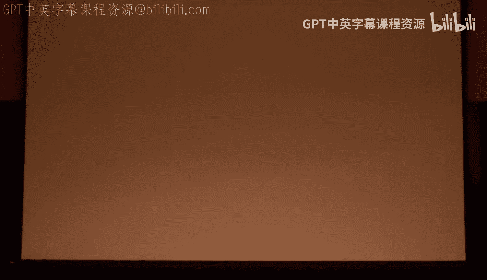

So。Maybe we spent the last few minutes。Looking at the proof of how to find the step size alpha。

 And the most amazing thing about this is。😊，And it's gonna show you the problem setting。

 And then I want you and your neighbor to kind of look at it independently。

Not independently by yourself。嗯。And that's the following。

Imagine you now how this classify H， right？ We， we now know how to find the classifier H。

 We just get our weights。 We give the weekly learn the weight of the data。

 and we turns us a weak learn， right。😊。

So now what we like to find。 So now we have this H， if we would like to do the following。😡。

This is our new classifier。 H is done。 This we have from the previous round， Alpha we don't know。😊。

So we would like to know the alpha that minimizes。 this is the line search。

That minimizes this expression。 So what that means in the space here。You have a point H。

We have our loss function。It gave us a gradient。 It gave us an H。

 let's say points in this direction because they're pretty bad。

And now you would like to find how far do we have to go to minimize this function。喂。

And so it turns out this is actually a closed form solution。 So if you do this。

 it turns out alpha is just one half。Log of 1 minus epsilon over epsilon。 That's it。

Where epsilon is the weighted error。 This is the accuracy over the error。

 That's basically what it is， right， the weighted accuracy divided by the weighted error。

You take the natural log and times1 half。 That turns out to be always exactly the right step size。😊。

The proof is youre under finding the step size。 So why don't you and your neighbor just you know start reading through this and just make sure you understand every single step。

This， by the way， my， my adabu is such magic， right， because this year is trivial。

 This is one line of Julia， right， two lines of Python， right。😊，So this is really。

 really simple to implement Data boost to implement data boost is with literally5 with， you know。

 maybe 7 lines of code。 And by the way， that's exactly what you will have to do in the next project。

 So this is coming out today， maybe tomorrow morning。😊。

You have to build in decision trees and add a boost and daging。嗯。So we exponential。 Now。

 everything just works out beautifully because the exponential loss。😊，Okay， so I last don have。

That's right。 They also have other names。 That's logic boost， that's logistic La， right。

 So for most people have now analyzed all of these last functions。

 It just turned out that atda boost， it was the first one。

 actually has the most beautiful properties。😊，我我哋书。So。still optimize the alpha often， it does not。

 often it does not have a closed form solution。 or you you can't。 We you could just line search Yeah。

 You could just try out 30 alphas to pick the lowest one。 but it's not， it's not a close form， yeah。

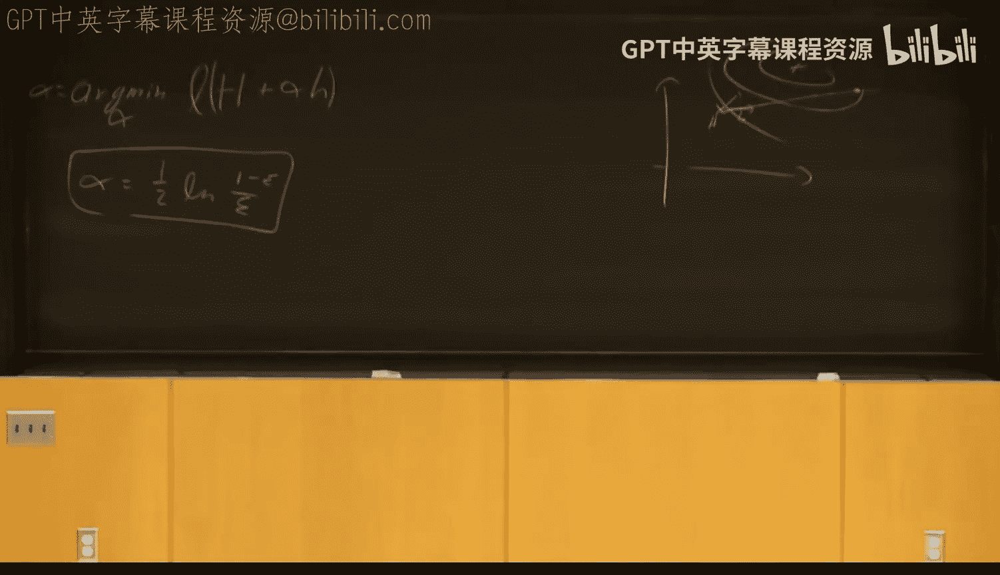

Yeah。Allright could。 And time is up。 Why don't we continue this next time， Please。

 until next lecture， please read through this little proof。And you come in with a head start。

