# 034：康奈尔大学《智能系统的机器学习｜CS4780 Machine Learning for Intelligent Systems 2017》中英字幕 p34 -34-Machine Learning Lecture 34 ＂Boosting _ Adaboost＂ -Cornell CS4780 SP17.zh_en -BV1Lo6gBxEKE_p34-

Finally， I can sit down comfy too。Please put your laptops away。All right。

 thanks to whoever put that chair here。哎。Alright， a few logistic things。So。嗯。

First thing is the calendar competition seems to be going strong。People are doing extremely well。

 a little bit too well， actually。So several people， at least three times。

Three teams have 100% accuracy on the test set。

Oh， I guess we do clean our。Yeah， has an XKCD though。Andant， it seems very suspicious。

 one team gets 100% accuracy just after one try。So I don't know how that is possible。

That's not how the world works， usually。So either you're extremely lucky。😊。

there might have been some tip。And。I don't know what that means。

 but I can read this part Tensorflowlow。 Oh， you shouldn click on this。😊，Okay， but yeah。

 so basically， please everybody who does hasn't submitted yet。You know。

 it seems like it's actually a very easy way to move up your grade。 So don't don't let this。You know。

 don't waste this opportunity。嗯。I talk to some students what they're doing is very， very interesting。

 So， you know， they're really using the tricks they learned here。 That's really awesome。😊。

So then there's a new homework assignment out， a new project。

And so someone actually asked on their tumor projects， and the answer is yes。Yes two more projects。

And。One person is excited。So， but don't worry， so there's Project7 which just car trees。

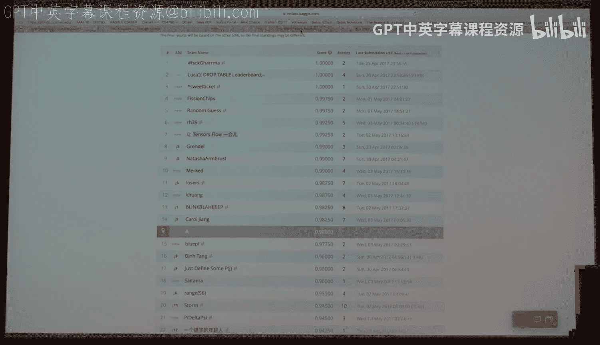

And that is。Amongst the more challenging ones。So please take that very seriously。

 That was pushed out yesterday。So what you have to implement there is I just bring it up here。 Now。

 that's the other one。Here car。So you actually have to base the implement trees。

 And then you have to， you know， you visualize just a normal car tree on a data set。

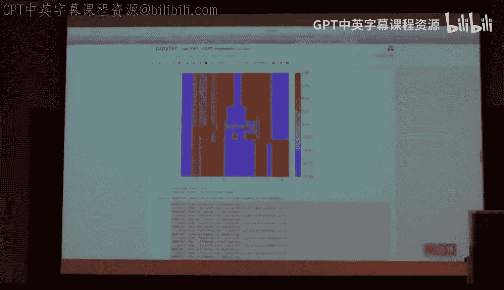

Then you have to implement bagging this year is bagging。

And you see the  error as the error goes down。So this has number ofrigererations that you bag for。

Training and testing error。 And then you have to implement boosting。

 And so here you see the testing error go down as you keep boosting and the training error。

 in this case， on this data set， actually boosting outperforms baggging by quite a bit。

you can visualize the decision boundary of boosting。So you have to implement car trees。

 You have to prevent bagging， and you have to implement boosting。Ada boost， thereof。

So getting car trees dry， take a little bit of time。

 I actually revamped the whole assignment this last time the feedback was。

 this assignment was too hard。 So I made it easier at this time。 So it's only regression trees。😊。

And in particular， if you've done the homework， then you should have actually had， you know。

 done all the math that you need to do implement these regression trees efficiently。 So， you know。

 it's basically what you did in the homework。 Just implement that。 So it shouldn't be that hard。

When you're done with this。You know， take a well deserved break of an hour and then switch over to the next project。

And that's will be what we cover starting very， very soon。 that will be the next topic。

 The next project age is very easy。 So I'm not just saying this it really is very， very easy。

' kind of like， remember the Perceptron project。😊，It's easier than the perception on project。 right。

 So it should only take you an hour or two hours。 So just don't leave it until the last minute in case something goes wrong。

 but you should easily be able to do it in a couple。 So we will only give you a week to do it。

 but you should easily be able to do it。 It's really not hard。Allright。

 so then a few more things you know。A few weeks ago， we did this midterm evaluation。 And at the end。

 I asked you， what， what do you still want to cover。And， you know。

 the people put in all sorts of things。 So here's a list of things you wanted to see。

As a deep learning， deep learning， deep learning， deep learning， deep learning， deep learning。

 neural nets， neural net， neural nets。 And have the feeling you try to tell me something。😊。

So I decided to last the last couple lecture。 It' actually all along。 This deep learning。

 deep learning， deep learning， deep learning。 at some， you know， finally， at the end。

 someone says kernels。😊，Yeah。So it's a tie。哎。But I decided to go with people that because I came first。

So what I want to do today is actually， I want to finish up boosting。 And in fact， what I will do。

 I actually have， if you look at the notes， there's a lot of stuff that we haven't covered yet。😊，嗯。

But a lot of it is just derivations。 So it's actually the high level is quite in quite simple。

 And you just read through the derivation。 So what I did is actually add a lot more description in the lecture notess。

😊，And I just trust you that you read through it。 And if you do this deal。

 that you read through the lecture notes carefully and you make sure you understand the derirations。

 Then I don't have to do the deris in the lecture， which is。Kind of boring anyway。 I。

 there's not that much value in going through it in the lecture。 And you just。

 because you often lose half the audience。And then， we can just move on today。 So let me briefly。

Go over the lecture notes and just tell you， because you have to do it for。

 You have to know it for the project。

So remember last time we basically talked about boosting and maybe in boosting， Okay， where are we。

 we basically add。You know， sorry， let me just go to the very first equation here。 Okay。

 we basically have a classifier that basically a sum of many different classifiers。

 and we have to in every single duration we add， you know， we have our previous classifier capital H。

 and we add a little weak learner， little H。😊，And when we solve this。

 what we realize is what we have to minimize is the inner product of this little h with the gradient of the loss function。

And so then we went to two different case study。 The first time was gradient boosting。

 two lectures ago。 And last time we did add a boost。😊，And addda boost we the two things。

 So A performed a line search。 So if remember this， let me just go through this。

 We're trying to minimize this function。This is my function。This yes， the minimum。

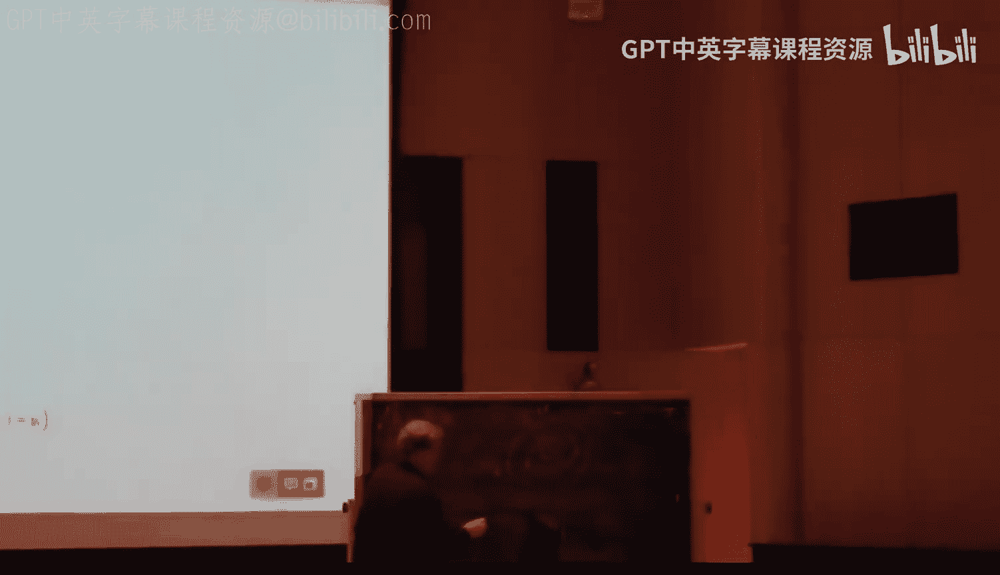

And I'm at some point here。 This is my current age。Now I get a gradient information。

 which is basically you know， pointing downhill their function。

And then I get a weak learner that is aligned with this great information。

 So I try to approximate this with a weak learner。 It's not going to be great。

 So let's say it points a little bit off。😊，And then what I do in add boost is I， you know。

 I don't just have a small step size。 I don't just take a small step。 Instead。

 what I'm doing is I try to go as fast， you know， exactly the。

 the longest step to minimize my function。 And if I look at this， the slice through here。

 what's the minimum value of the objective function。 And because the vector function is convex。

 I can actually solve it in closed form。 And in particular， because the exponential loss。

 So I jump right here。 right， And I can basically now go take the next step。

 So that's one of the reasons why add boost converges so quickly。😊。

And turns out if you solve for this。If you basically say， what's the best alpha。 So here。

 here's an optimization problem。 I try to find the alpha such that if I add my weak learner with that step size。

 I'm minimizing the loss。 So that's basically this equation here。😊，And if I go through this math。

 it's relatively straightforward。 It's just， it's just algebra。Then what I see that actually。

 at the end， alpha is one half log 1 minus epsilon over epsilon。 But Epsilon is the weighted error。

 right， And that is beautiful because that means we don't really have to do anything。 right。

 So typically， when you try to find the right step size。 What you do is you try many。

 many different step sizes and pick the minimum。 In this case， we don't have to do this。

 You get this magical equation。 It tells us exactly this is the perfect step size for this particular weak learner with this error。

 right It's amazing。 It just takes as input the the weighted error and out comes the the optimal step size。

😊，And this gives rise to。To the the following algorithm。 So this year is adabu。

 And this is exactly what you have to implement in the project。

 And you see now you can see why its became so popular。

 It made everybody go crazy when it came out because it's just a few lines of code， right。

 So let's just quickly walk through it。 So you start out initially， you have the zero prediction。

 And the W Is， this is the weight of every single points。

 So you give every one of your changing points the same way。 It's just one of ran。😊。

And then what you do is you say， I'm calling my weak learner。

That minimizes my error approximately of my data， X1， Y 1 to x and Y N with。

 And this is the typo here。 This should be W N with， with these weights。

 So basically have a weighted version of my data。 Every single data point has a weight and my algorithm。

 a weak learner algorithm。😊，Takes as inputs these weights and gives me a weak learner for this weighted data。

And then all I need to do is I compute the weighted error。

 So I look at all the points that I get wrong， and I sum up their weights。

 So that's basically the fraction of weight that I got wrong。And。If that's。

 if that's greater than one half， then I stop， because that means that actually it can never be greater than a half。

 Then I can just flip the predictions， right， but it can be exactly one half up to machine machine precision that I'm toast。

😊，But as long as it's less than one half， that means on average。

 I'm doing a little better than random。 That that's my requirement。 right。

 So you have to have a weekly learner that on average or that that every time you give it a weighted data set。

A binary classification data set that's weighted。 It does a little better than random coin tsling。

 right， It can be arbitrarily， you know， small how much better it does。😊。

Then I just get my step size， and I just add this classifier to my H。 and that's it。

And there's one more thing。 I have to add recompute my weights。 If you think about this it's very。

 very simple。 it's just， I just， you know， if you remember the weight was actually just defined as follows。

😊，The weight was this term here。So it's just e to the minus h times y。

 It's just the loss of this particular data point。So now， because we added alpha H to it。

 we also have to add this in the exponent。 So we just multiply W with this term。Okay。

 so my W now gets space。 my O W times this term。 And if， this is actually very important。

What does this mean， Alpha H times y is either plus 1 or negative 1， right。

 Because both of these are either plus1 or -1。 So if this year is if H of X I agrees with Y I。

 So my little my weak learner gets this point correct。What happens And this here is just one， right。

 It's 1 times 1 or -1 times -1 is over1。 right？ Then what I'm doing is I take this weight that I have。

 and I multiply with E to the minus alpha。 What is E to the minus alpha is pretty small。 Okay。

 it's a small number。 because Al is my step size。 E to the minus something is small。😊。

So what I'm doing is I make my weight a lot smaller。If I get this point wrong。

 H and y doesn't do not agree in sign， then this is minus-1。Minus minus is positive。

 So I get E to the alpha。So this means I take my weight and I multiply with E to the alpha。

 So it gets larger。 right And so if you do this repeatedly， if you get a point wrong。

 a couple times in a row， every time you multiply with E to the alpha。 right， So， you know。

 alpha can change。 But so basically， there is an exponential growth in weight。 And the other one。

 you know， has an exponential decrease in weight。 So what happens if you get a point wrong basically ink the weight gets so large。

 right， that eventually， the entire data set will just consist of this one point right。

 It's just like get this one point right。 And the next we gonna will get it right eventually。

 and that's the magic of the data boost， right So basically always focuses on the data point that you can still get it wrong and just assigns more weight to it。

😊，And because it's so aggressive with the waiting， it converges very quickly。

 Can anyone tell me a downside of this。😊，第二。If we have a noisy data。 if you have a noisy data。

 that's exactly right。 So if you have a mislabeled data point， right， So let's， you know。

 you if said everything is fine， but one point just accidentally flip the label。

 add boost will not be able to look past it， right。

 It will just get it will the entire decision boundary go all the way into that region， right。

 and and get the rescue that one point。So that that's， that's inherent limitation mutation of adabu。

 If you have noisy data， you know， this is， it's not the right algorithm， right。

 But if you have trust your labels， adabu can be an amazing algorithm。 and it It works really。

 really， really well。😊，All right， and。Down here， we developed the divide by this term，2 epsilon。

1 minus epsilon。And so， again， I'm not going through the de here。

 but it's actually very easy to show that that's actually the normalization。 So if you sum over all。

 that's exactly the loss。 you sum over all the weights。😊，That actually has exactly this term here。

So you don't even have to do that， right。Any questions？So the pseudo code is really just， you know。

 these， these five steps here， right， You call your weighted。

 your algorithm to get the weighted data set， you compute your error， computer step size。

 add it to your classifier， reweight the data points。 repeatat， right， And that's what you。

 that's what you're doing。😊，For regression。 Does our step size still work out as nicely as it does。

 Oh，4 regressions。 We cannot do data of boost for the regression。没有。There's no such thing。

Then you have to do regression boost。 I mean， the other boosting algorithm can do it。

 But the adaptive boosting does not work。Yeah， good question。Okay， any more questions。Alright。

 And finally， let me just go over one last beauty。 That's this kind of the last thing。 If。

 if you're not convinced here that Adabu is the most beautiful thing you've ever laid your eyes on。

 Here comes the last thing that will convince it's gonna blow you away。 can you take it。😊，All right。

Wait， it's not here。 Where is it。Oh， I haven't。Where's my proof。One second。No problem。Oh， shoot。

 I stashed my gi changes。I was a good era。Alright， that's， that's horrible。I I will。

 I will recover this。 Sorry about this。 you won't see the most beautiful thing you've ever laid your eyes on。

😊，And。But， I cant。That's really bizarre。I see。 Okay， so I guess I had a conflict with my T S。

On I he that the get sucks。 Sorry， get this horrible。嗯。I mean， it's great for code。

 but it's horrible for electrons。 Okay， so here， yes， let me just， let me just tell you。😊。

Let me just tell you，Why I， okay， let me just close this。

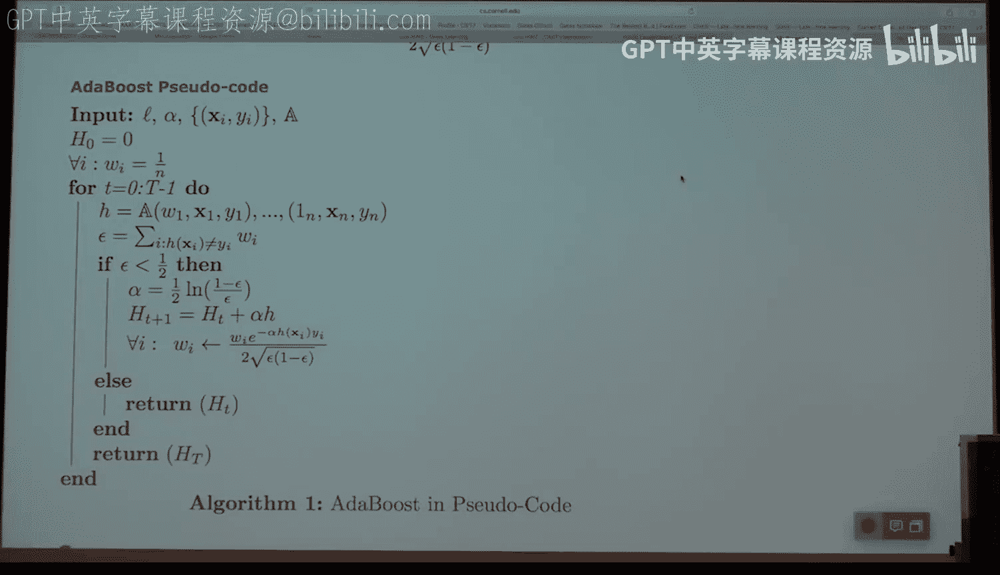

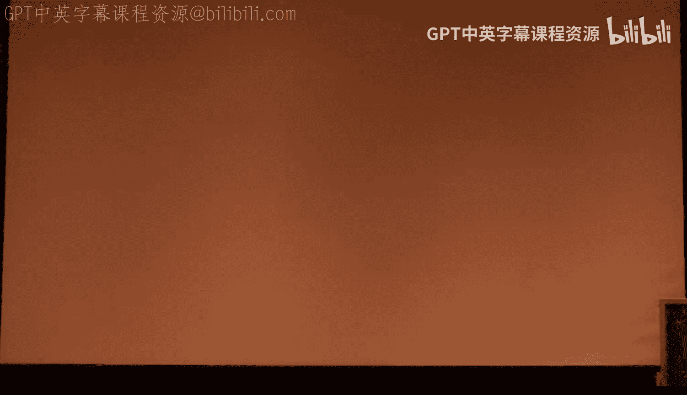

I have to tell you this last thing。Yeahah， okay黐啊。好。ok 诶。

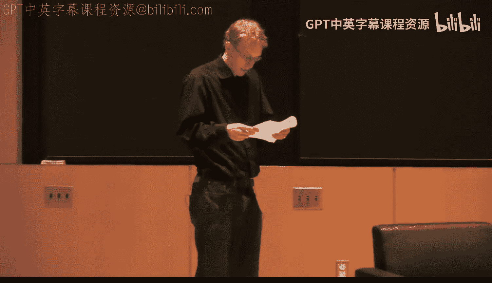

So in in the notes， sorry， it's not here right now。 But the moment I will recover my gi mishap。

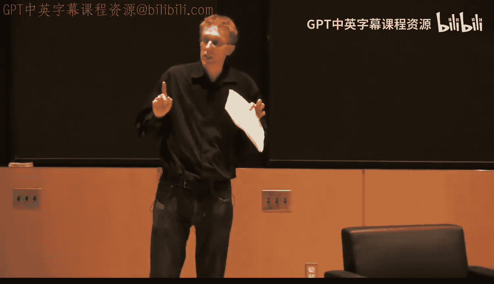

I it will be back， back on the notes。嗯。It's easy to show two things。

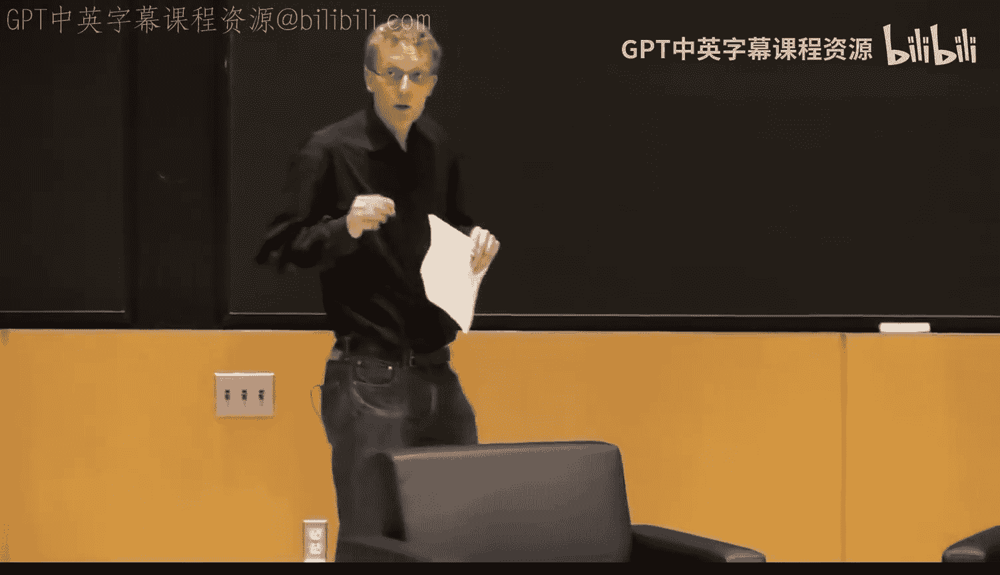

So the loss of a classifier。Is some of I each of the。And minus y， I H of X I。Okay。

In the error of a classifier， the training error is the following is， it's called this。第。Of8。

Equs sum of I equals one to n。Delta。H of X， I。Does not equal Y I。

 But this is either one if that's the case and 0 otherwise。Now， I give you a minute。

Try to prove to me that this year is an upper bound of that。

So I' claim the loss is always larger than your era。哎。So maybe you spend a minute。

 You and your neighbor try to prove it。It's a one line proof。Half a line and Julia。Yeah。Okay。Yeah。

Yeah。Yeah。あり。We got what。Yeah。All right， who has a suggestion， how do we prove it？😊，Yeah。

The max on the error it can be is n。 Okay， that's right。So that's true。 That's true。

 The maximum is larger here。诶。But I guess in the， so that's based in the worst case。

 the loss can be much larger。 But the question is， can the loss also be lower。

 Could it be that the loss ever lower， So the max that's true。 You're totally right。

But I want to show that， actually， on every possible case， like even not at the maximum。

 this must be larger。Yeah，The right insiders is going to be。Yeah， you， you go in the right direction。

 That's right。 So it old。Yeah， so yeah， you have exactly the right thing。 So basically。

 there's two cases。 Let me just write down that。 There's two cases for any X and Y。 first case。😊。

H of X I equals Y I。Right， so they are basically positive。 And this here is。😊，E to the minus。

In this case， they match。 So it's just e to the minus H of X I， I guess。Well， I guess the you know。

 positive value here。And on the right hand side， if that's zero， right？

So no matter what this is up here， there is always greater equals 0， right。So if theyre correct。

 the theelta term is 0， Well each of the something is always greater equals 0。 we are fine， right。

 So for all the points that are that are correctly classified， we are fine。😊，Second case is。

H of X I does not equal by。Well， in this case， this here equals one。

And this here equals E to something positive。😊，Right， so。H of X I， right。Well， that's actually。

 you know， each of the0 is one。 Each of the anything positive must positive must be greater than one。

 right？ So again， the left hand side is greater than the right and side。😊，Alright， so in every case。

 we are always greater than the right inside side。 So the loss is always greater equal than than the error。

 alright。😊，So that's great because we are driving down the loss very， very quickly。 And therefore。

 we must be driving down the training era。 right， So we know certainly， and he comes the cool thing。

 We know that the moment the loss is less than one。😊，We can't have a single training point。

 training error anymore。Right，So if this is less than one， this must be less than one。

 So it must be 0， right， because the smallest it can be is you get1 point wrong。And so。Now。

 if you look at the these notes， which will be online。This afternoon。嗯。It's very easy to show。

 It's like five steps that I'm just not going through right now because it's not it's easy。

 but not very exciting。But the last， actually。The last。Is bounded above by n times1-4。

Sometimes terms gamma squared to the T over 2。So。What does it， This doesn't matter。

 This year is a very small number。 So this year is less than one。

As it pause number less than one to the power of T。T is the number of iterations you boost。

So loss goes down exponentially with the number of iterations you boost。So it goes to 0 very。

 very quickly， right。So every time basically comes， comes slower by that factor at every single time。

 right， you multiply by some number that's less than than one。

So it must be less than than one after a finite number of steps。In fact。

 if you solve this and you say， when is that less than one right， You could solve this。

 And what you get is that after T is， you know， log n after log n steps。

So basically after log in steps， because the loss。It's less than some term that goes down exponentially。

 So this term here。Looks like this。 right， It goes down very， very quickly。

 You see on the right hand side， the loss is lower than that term。

 and the error is even lower than that term。Now， because this year it is's very quickly less than one。

 The loss must be less than one， and the error must be less than one。

 And That means we can't get a single point wrong anymore。And that happens after log n steps。

So login step is not very much。 Thats tiny， right， So if you burst boost after after a couple of durations。

 you will have no more training error。 And there's a guarantee。 It will always happen。

And that's the amazing thing。 That's that the people kind of blew their minds when they first saw us。

😊，Yeah， just to random question， is there any benefit to running variabless boost what you already got the training error down。

Yes， there is。 Yes， There is， because。😊，It it's a good question， actually， It's a very good question。

 But actually， what you're doing because you're minimizing the loss。😊，And by minimizing the loss。

 what are you doing， You are still increasing age， Like basically after a final number， like after。

 you know， log end steps， you will have that the signs here are correct。

 So everything is on the right side。But then what will happen？ What are you doing next， right？

 You're pushing the points that are closest to decision boundary further away。Right。

 and so that's what you're doing。 You're building a margin。

So add boost actually becomes a large margin classifier。It took people years to figure this out。

 actually， people at the beginning， people had exactly this。

 like you stop when you have  zero training error because people hadn' didn't't discovered the large margin。

 only when SVMs came along with a large margin， then you know， people kind of realize， oh。

 that's exactly why at a boost keeps lowering the test error even after you have  zero training error。

 People thought the moment you have zero training error。

 you stop boosting because you're starting to overfit。 But actually it's the opposite。

 writing the margin。 So you actually get a better generalization。 Yeah，😊。

The the loss will not never be 0。The last each of the something will never be 0， only in the limit。

也不是。No， no， no。 it will keep going down。The last basically is E to the。

 think about it E to the E to the minus Y I H of X I。 If this has my decision boundary。

 you have a point really close by， right， This here has the right label。

 So this E to the minus something this is small。 But if I move。😊。

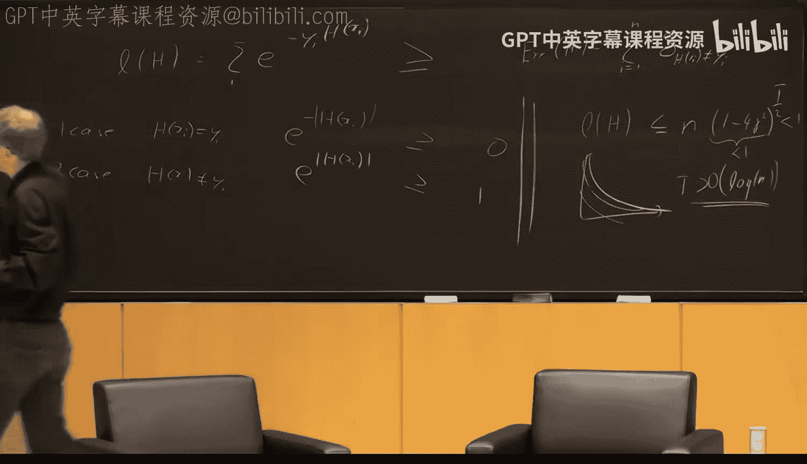

This point further away， is if I move to the decision boundary further away from the point。

 this will be even larger。 So the loss will be even smaller。So H isn't zero or1。Oh yeah。

 So H is the sum of many alpha times 0 and one。 Yeah， yeah， very good point。 Very good clarification。

 That's right。 right， Each one of the little hs is plus 1 or -1， but H actually can be。

 can be is a real number。 Yeah， very good point。 Otherwise， you're right。😊，Thanks for asking that。

 yeah。Any other questions？Okay， last， last chance。 So， okay。

 what I handed out is so people ask for more practice questions。

 So what I gave you is a practice question， so。😊，I thought。Instead of doing this in class now。

You can do it at home and see this preparation for the exam。And so what I did here is basically。

 I started out with a data set， the blue plus pluses and red minuses， and at the beginning。

 everything has a weight of 1 minus n。And then youve read the first classifiers。

 That's basically this always this vertical line on the left and side。

 the divided a positive and negative。Now you see some points I'm mis classifiedified。

 these three little circles I'm mis classifiedified。😊。

And what you're supposed to do in everything around， you have to supposed to compute the error。

 So there's epsilon  one and green below it。And he's supposed to compute the step size。

 and he's supposed to compute the weight for every single point。

And then you can do the next it generations。 The next it generation。

 Then we found the next classifier， which is another vertical line。That's an iteration 2。

In the center the the left hand side is the first classifier。

 and the middle one is the second classifier。And then again。

 please compute the error and the step size， and then comes to the third classifier in iteration 3 that's on the very right。

😊，And so if you keep computing these， then at the end， basically， you get the final classifier。

 you see every single point is correct， right， So but if you walk through the motion it should become very。

 very clear in your head， what's going on。 Any questions about this prompt that and what to do。 Yeah。

 so should we always run for an odd number of steps， So we don't have any zero points。

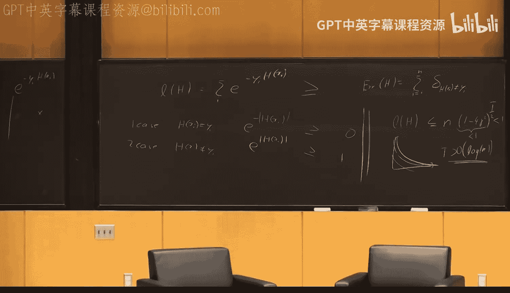

呃。In our age， like， so age of the point is never。 Oh see is never that's。Today， I mean， actually。

 because you ran by alpha， it could actually， it could actually happen any time。Yeah。第二。

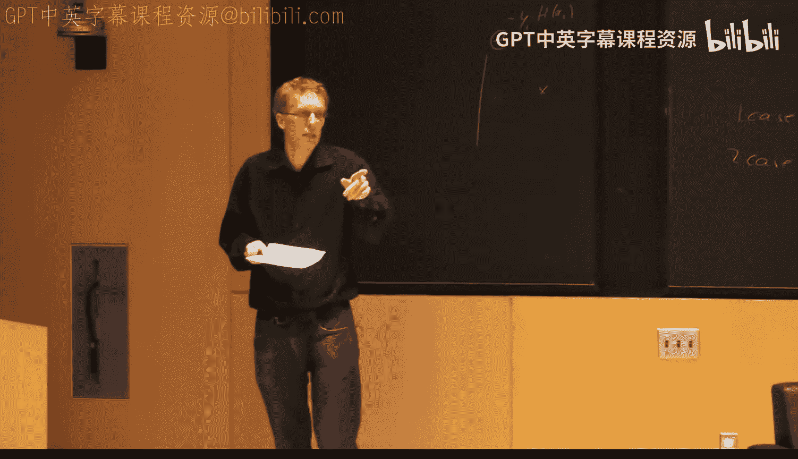

point zero。Oh， I see， once you have a training。 So actually， very a very good question。 He's asking。

😊。

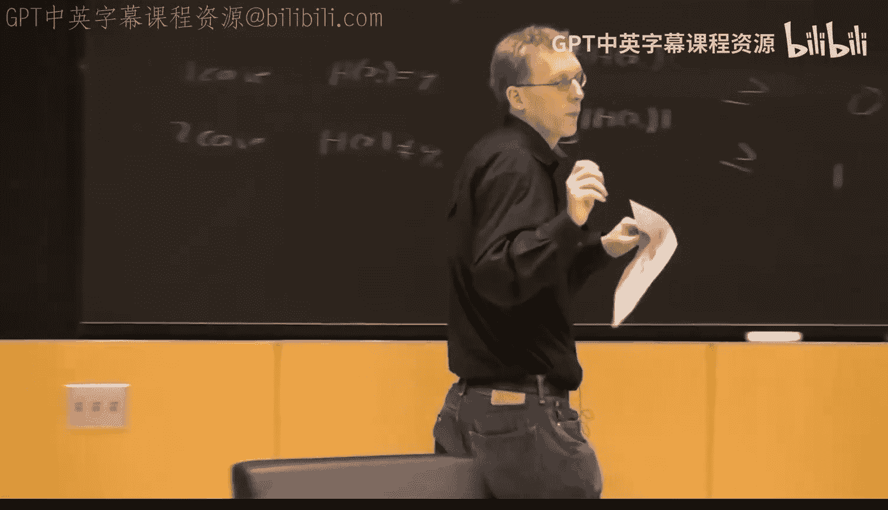

Once you reach the point of training， zero training error， don't you just move around that point。

 right， actually， be， be careful。 This is not the point of， of zero training error。

 This is the point of the minimum loss。Actually basically get， in this case。

 now the bo is actually really far away。 you don't get there。

 at least the step size get smaller and smaller。 Alpha will get really， really small at some point。

 Youre just creeping up to this。It could be that V already， you have zero training error。Yeah。Okay。

 any more questions？All right。If that is the case。 Then we can now finally， I can。Answer your calls。

And we get to deep learning。

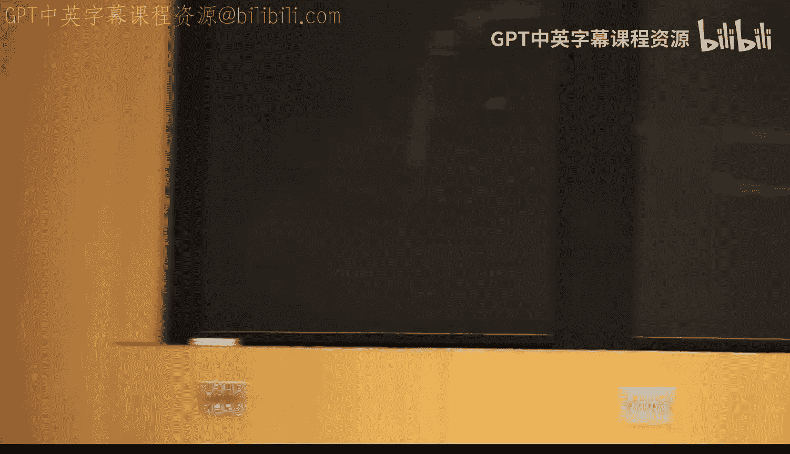

And so one， I clearly have to apologize。Today you will not get deep learning。

 You will not get printed notes。Because I'm actually rewriting that part of the class， so。

The last one thing you don't know is the last nine years。嗯。Everybody always got handwritten notes。

So you're just only getting it the very last lecture。😊，So， once。

Because deep learning changed so quickly。I don't want to use last year's notes for this。

If you can't read my handwriting， you're not alone。ます。

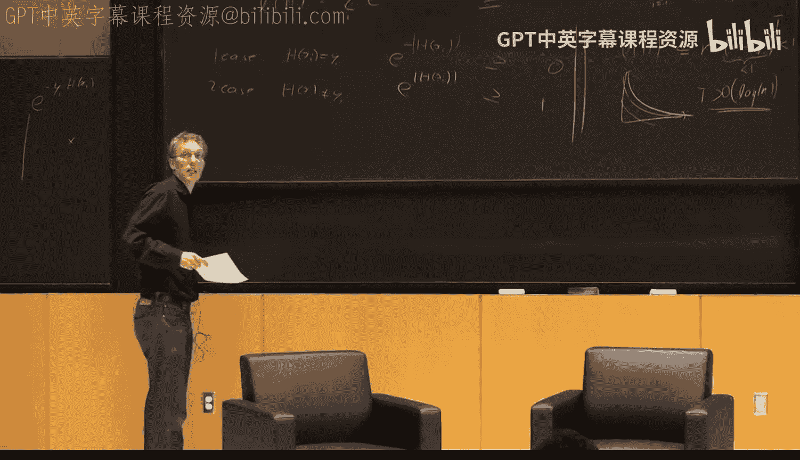

あすいですか。Right。

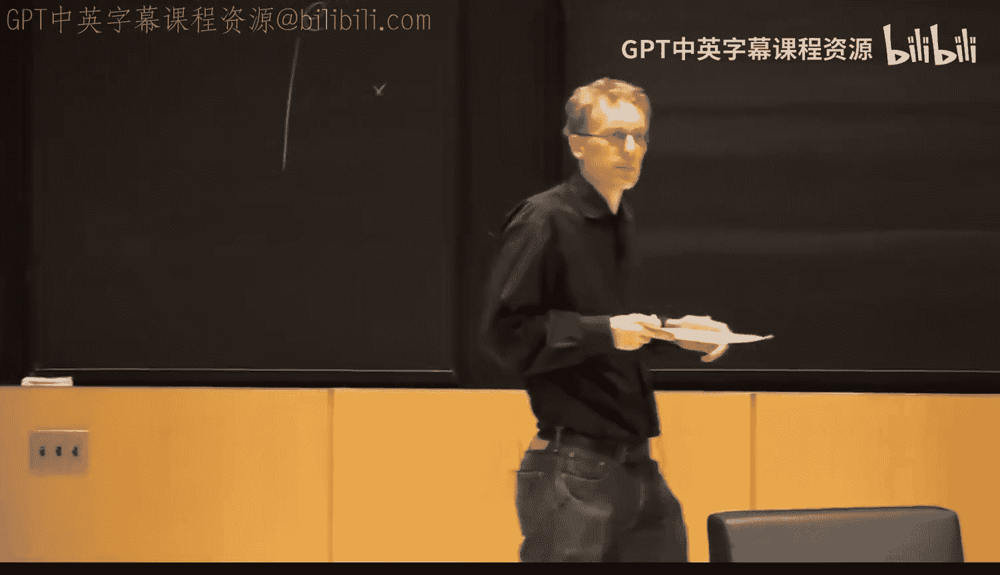

All right。So。A lot of you have probably already heard of deep learning in neural networks。

 And actually， before I get there， I remember something I want to mention。

 So lunch time last time I had lunch with students。 someone asked me about。

 I posted some demo of some bike demo of the other GPS。 Theres two GPS。 One is Gaussian processes。

 The other one is genetic programming。😊。

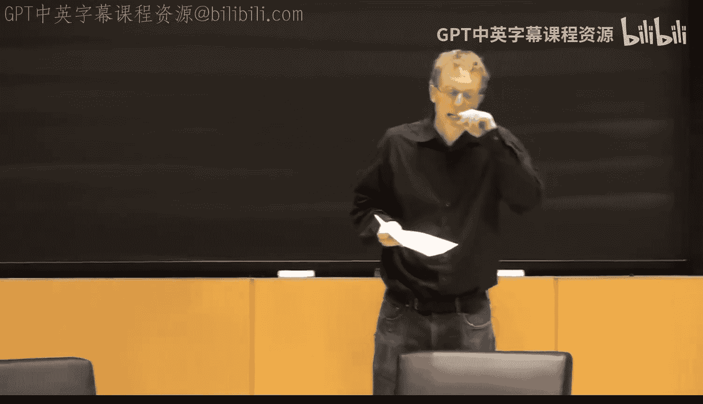

And so。Someone asked， you know， are we covering genetic programming or evolutionary。

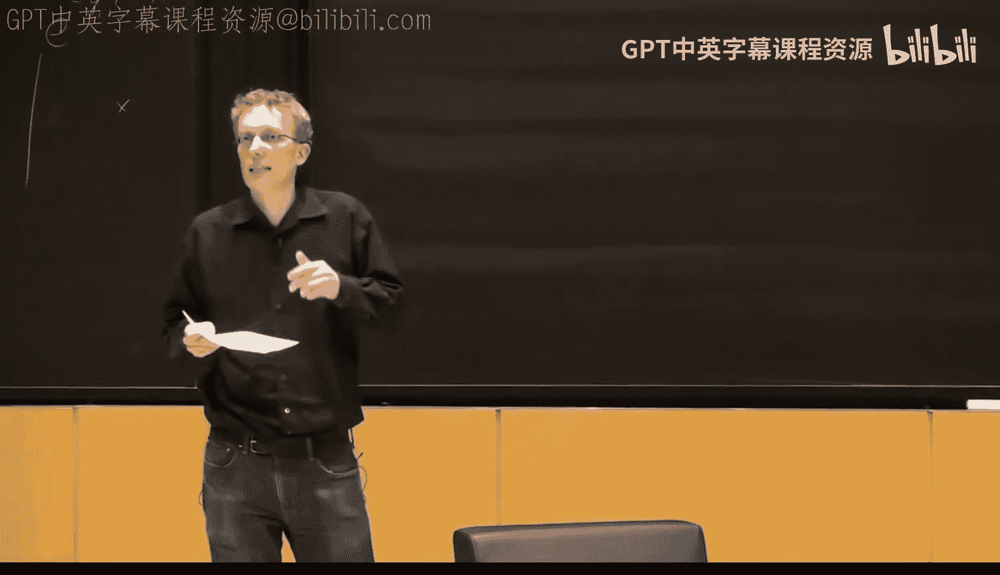

Programming。And the answer is， no， absolutely not。And。And I just want to。

Maybe give us two minutes explanation， so。Genetic programming is something that's very popular。

 and it's probably also something that a lot of you have heard of。

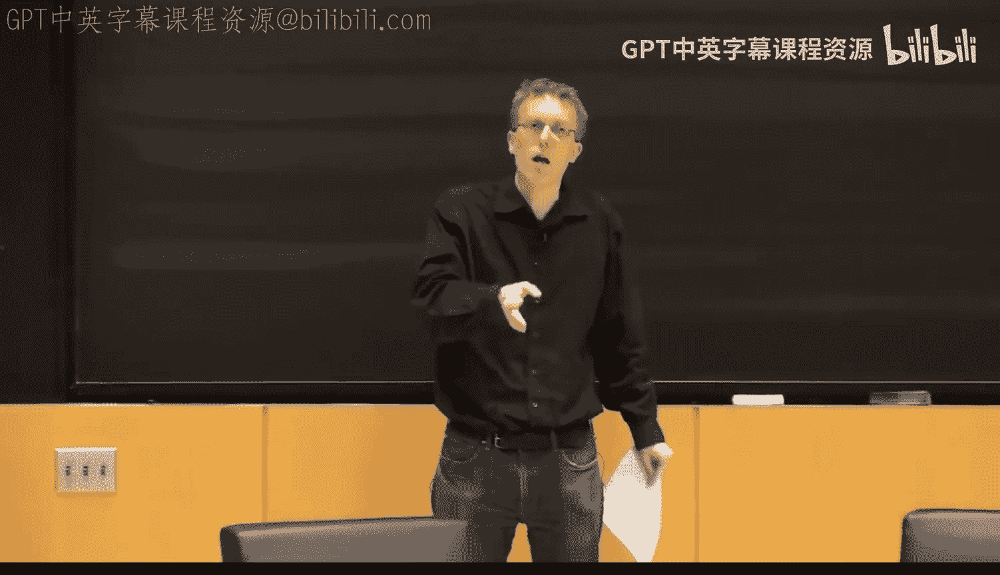

And it， it's。嗯。Like， you know that random forest is kind of always the second best algorithm。

 Genetic programming is almost。OrAlway the worst algorithm that still kind of works。And it its。

 it's kind of like the bad light， right， the bad light of machine learning algorithms。哎正这嗯。Actually。

 that analogy actually works pretty well because， you know， you're wondering， like。

 why do people drink bad light。 It's terrible beer。 But why why is that happening。

And because it's like because of marketing， right， I guess， right， Like people， everybody knows it。

 So he's like， oh， why not， right， I guess sometimes in a situation where you just have no other choice。

And genetic programming is similar， So it should have died out a long time ago， right。

 It's really a terrible algorithm。 Like， it doesn't make a lot of sense。And。

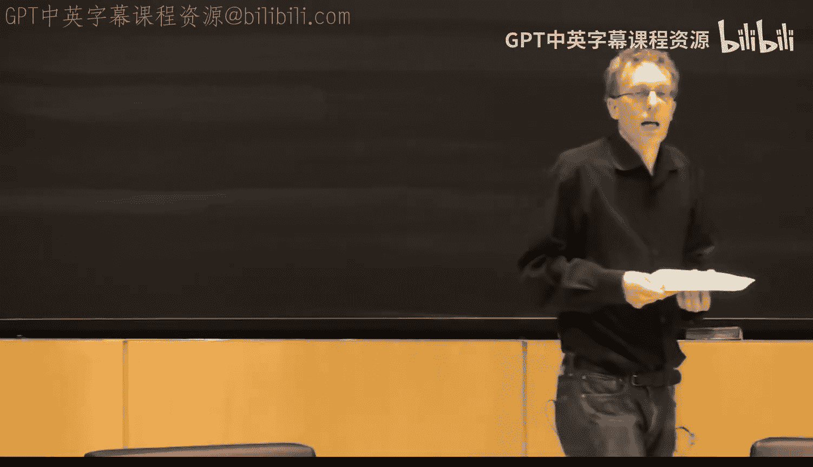

It's。嗯。Now， my personal explanation is that basically it was invented by people like a machine learning experience section of statistics。

Computer science， optimization theory， information theory。 And sometimes people reinvent things that。

 you know， because they don't talk to other fields。So something， but， for example。

 fuzzy logic was something like this， right， But basically， people who very familiar with logic。

 tried to incorporate uncertainties， and they。You know， instead of using statistics。

 like talking statisticians who had like， you know， decades of experience with， you know。

 dealing with uncertainties， they kind of came up with their own way of doing logic with uncertainties。

 and it didn't really work。

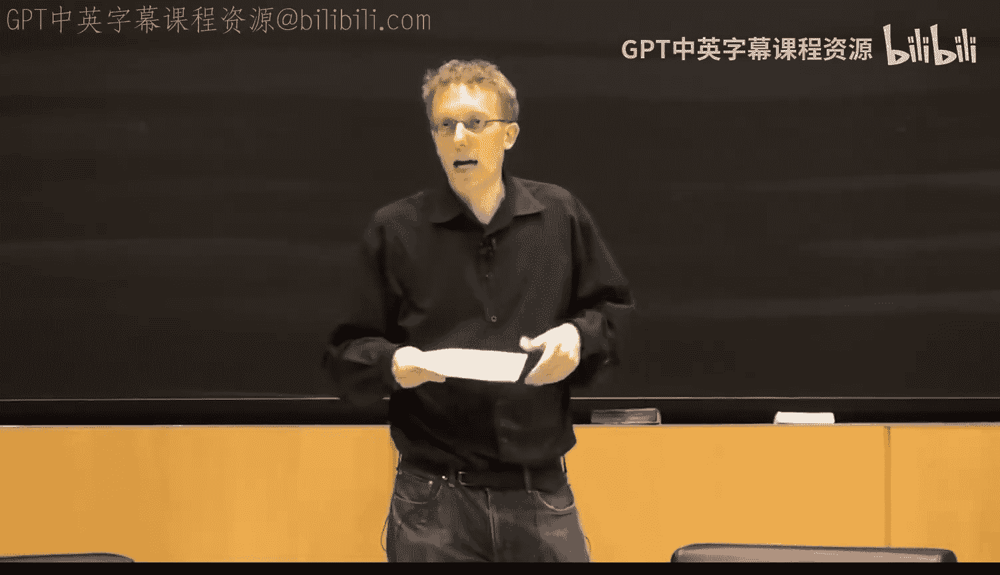

Nowadays， nobody really works。 or very few people work on ph logic。

 And so genetic programming is similar， Right， So some people who basically didn't really embrace optimization theory。

 which is really its own field and has very smart people working on it kind of came up with this idea。

 And the idea is not bad， Right as basically inspired by evolution。 So the idea in some sense。

 is you try to minimize a function。😊。

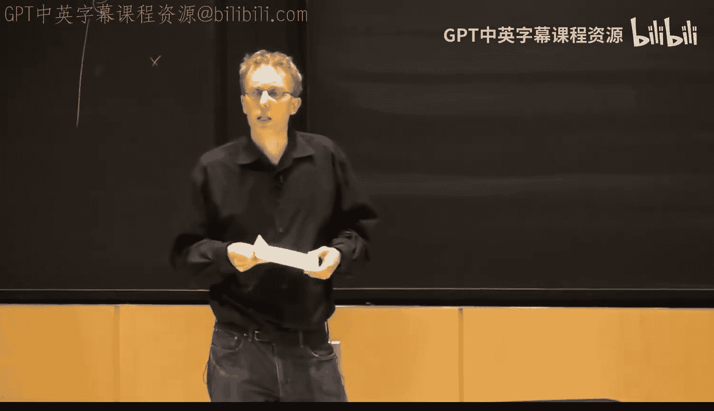

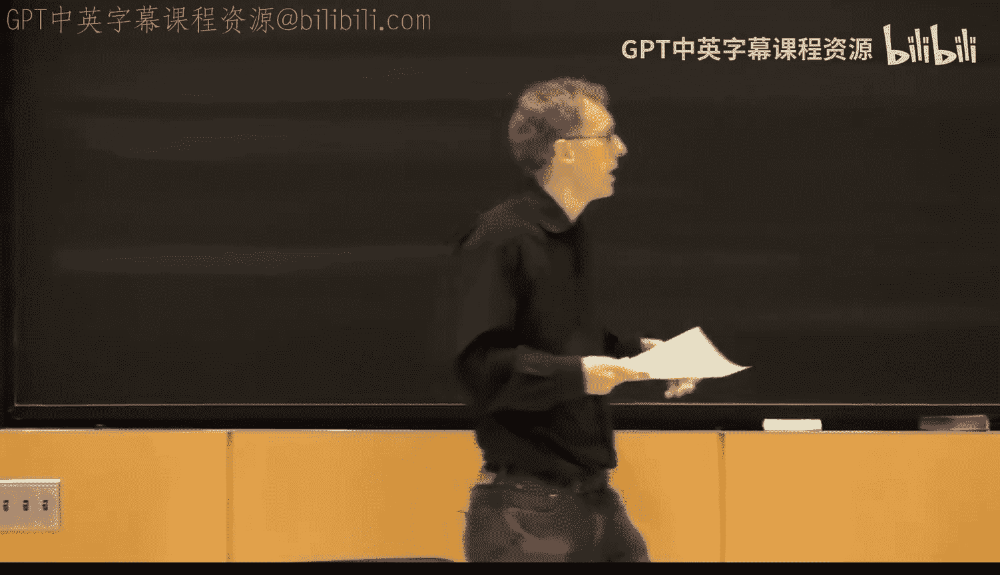

But I don't really know what that function is。 So I can't take gradients something。

 So what I do is I try out some points， and I get a function value， try some other points。

 get some function value and points here。 And then I say， okay， well， let's mix mix these points up。

 So I know this one does pretty well。 So let me basically kind of say， well。

 at least two now you know， get married and have offspring。 you know， they don't have to get married。

 Actually， it's a little old fashioned， but。😊，can see what I'm you。And so then basically you say。

 okay， well， let let's just try out some random points around here， basically， right。That。

It's a terrible way of doing it。 I'm trying not to judge。 O，'s。Seoptimal way of doing it。Because。

Because you're not taking any information into account， right， So basically。

 what you're not doing is you're not taking into account。 Well， here's a direction， right。

 That's very， very interesting， right， And so maybe if I follow that direction， it keeps going down。

 right， So what Gaussian processes， for example， do is it would fit a line around this。

 So here I'm really uncertain。 right。 So maybe I should explore something down here。 right。

 that's very informed。 That takes a lot of second old information about these points into account。

 etc。 So genetic program doesn't do any of this， right。

 So because of this also has no converence guarantees about has it converges， But you know。

 occasionally， And。😊，Now it doesn't mean， you know， it doesn't work at all。 right。

 So sometimes all you need is some reasonable， you know， solution of your function。 And so it works。

 It's just never the I've never encountered a single setting where it is the right algorithm to use or the optimal algorithm to use right And the reason it's still very popular is because at least that's my explanation is that it's very intuitive。

 right and it has this very cool name， like genetic programming Like it's a branding。

 Its that bad light， right， like there's always， you know， Super Bowl commercials， right。

 good looking people on the beach， drinking bad light。' like， that sounds pretty good。

 So it's kind of like this， right， So we all know evolution work really well。

 So why shouldt network well on computers， right and。😊，Of course。

 computers is very functional optimization and computers is completely different than evolution。

 So the， the， you know， in the evolution， you have trillions of organisms who kind of mutate。😊。

And it never happens that they all get together and say， okay。

 let's dos now it's kind of look at the gradient de directions。 and let's all make an update。

 everybody spread out again。 Allright it doesn't work。 It has to be completely distributed。

 But at the moment you have a computer， you can always kind of do some centralized update。

 and you get a lot more information， if you incorporate this。 Also you don't have to be。

 it's not that half your organisms suddenly die because a meteorite know， comes in or something。

 Like it's just a very， very different setting， right So that's why I don't really go into it。

 And if I ever find a setting where it's actually the right algorithm to to use。

 then I will incorporate in my class。 But I've been saying this for many years。

 I've never come up with a single one。 And no one has been able to show me one。

 the demo that I posted， by the way。 It's kind of cute。

 So I may look at its on the web page you know， little bikes that basically have to write a little track。

 And then the one that's furthest， you know， has a higher chance of basically getting offspring。

 etca。😊，And。It looks cute。 But actually， what it really shows is how。

 how slow such optimization problem is。 like if you just watched this twice once or twice， you see。

 you know， that actually。😊，You know what the right configuration would be。 But actually。

 the algorithm really does not discover it。 It's still a cute demo。 And it was actually， it was。

 in fact， written by a high school student， right， And then in some sense， shows it， right。

 like it's， it's， it's it it's awesome right high school student did a really good job at implementing that genetic programming demo。

 And so it's really also the kind of thing that you can do when you're in high school， right。

 So you don't need a sta degree。 you don't need something to know something about optimization theory。

 But if you do， then I think it's not particularly interesting。 So anyway。

 I just want to say this because I know there's always every year。

 there's lot of people want to know about genetic programs。 And I。😊，That's kind of all I give it。

Any questions。All right， good， neural networks。

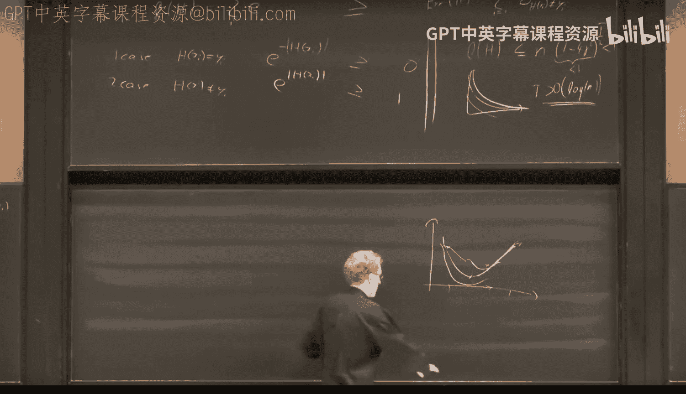

So neural networks also have a branding problem。嗯。单子。

Just quickly in neural networks were invented at Cornell University。EBy Frank Rosenblt in 1963。

 I believe。呃。And。😊，He back then， didn't call it neural networks。

 He called it multi layer perceptionion。So it's also called multi layer perceptionceptron。

Or as a few years ago， it's called deep learning。It's all essentially the same thing。

 So it's actually literally the same thing。诶。Moly， perceptron was， I guess the original name。

 you know， Perceptron got a little bit of It has has been renamed a couple times。

 Perceptron got a little bit of a bad rap because of it， you know， because of the AI winter。

 when it was renamed to neural networks， that was really here there was a big brain inspiration。

 And and when it first came out， people thought that artificial neural networks are doing something that's similar to the brain。

😊，AndThat's really。Not really the case。's if you squint。And look at a very tiny brain。

 Maybe that's the case， but。There's still a lot of lot of things that are different。 if you。

 you know， and that makes a lot of sense because the hardware is very， very different。 And in fact。

 actually， a lot of。嗯。A lot of inspiration that came from the brain but people thought， oh。

 this is how the brain does it。 So maybe we should do this on computers。Ultimately。

 I think there are mostly distractions， to be honest， like， it's rare that I。

 does' anything of any of these leads have followed up。Ne networks were very popular in the 80s。

 So in the 1980s， machine learning was。There was basically two approaches to machine learning。

 logic based machine learning。 that was， and new networks， based machine learning。 And， in fact。

 the people who did logic based machine learning， they did not recognize new networks as a proper thing。

 and they did not accept them at their conferences。And so the people who did neural networks got mad。

 and they started their own conference。 It's called new information processing systems。

And that's today， actually the number one conference in machine learning。😊，And so that actually。

 that conference became very popular。 and there was a lot of papers on neural networks and， you know。

 became very， very popular。Until the 90s， late 90s， when SVMs came around。

And people just fell in love with S BMs。 They were so beautiful。😊，And so， then， people。You know。

 like SM so much， there were more and more SVM's paper， SVM paper。 until actually。

 some some 2002 or 2003， it happened There was not a single neural network paper anymore at Nps。

 the conference on neural information neural networks。😊，And。In fact。

 every single paper that had neural networks then got started getting rejected。 So in fact。

 it was a new generation of students， and they basically thought neural networks are just stupid。

 right， That's the old way of doing it。 The new way of doing it is S B， S。

And it got so bad that hardly anyone neural networks anymore。

And there were three people who held onto it very much。 like Jeff Hinton， Yaanniong and Yosha Benio。

 three professors from NY U， Toronto and Montreal。And at some point， they got together one night。

 This was in 192006。And they got together over glass wine。 They kind of all chatting about。

 you know how frustrating it is， that all their papers get rejected just because they have the word neural networks in it。

 And students just rejected because reviewers just rejected just because they mentioned the word neural networks。

And then one of them had the idea， well， why don't we just stop saying neural networks， We just。

 just don't， We don't say it。I was like， well， what should we say， just said， well。

 we just call it deep learning。

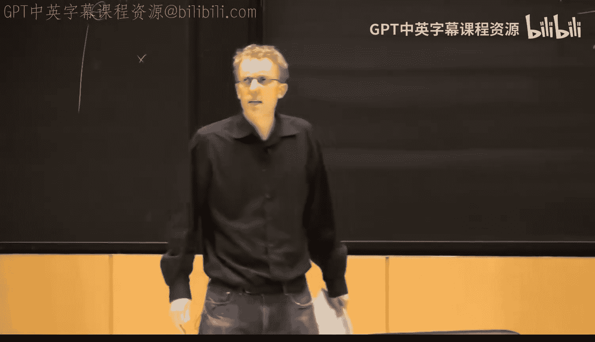

And why deep learning， because then everything else is shallow learning。

And that does literally what happened。And so they wrote papers and they just changed， you know。

 you know， replace all right， like neural networks to deep learning。😊，Deep network。 And suddenly。

 the papers get accepted because people were like， well， what is this deep learning。 Oh。

 it's interesting。 Yeah， interesting stuff。😊，And they， you know， a lot of people are interested。

 And now， actually， people say， oh， that's the new machine learning。 It's deep learning。😊，So， well。

 so。But really， you know， conceptually， not much has changed。All right， let me。

Let me tell you the basics。So it's actually very related to kernels。

 Now you will see why people fell in love with kernels。

 So it's kind of the way I'm explaining it is kind of upside down， right， like history upside down。

 So I'm starting with kernels。 and then tell you how to make neural networks out of it。😊。

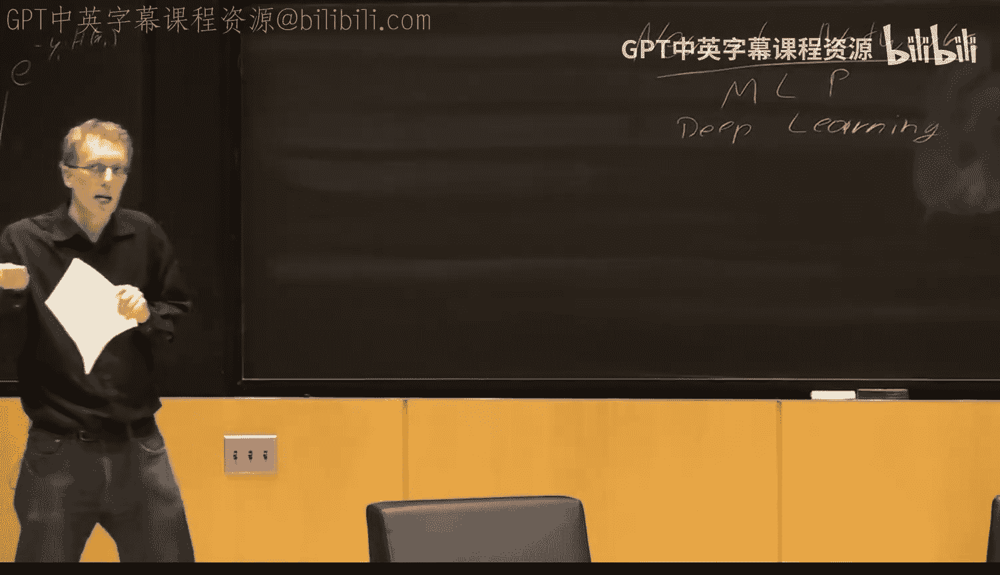

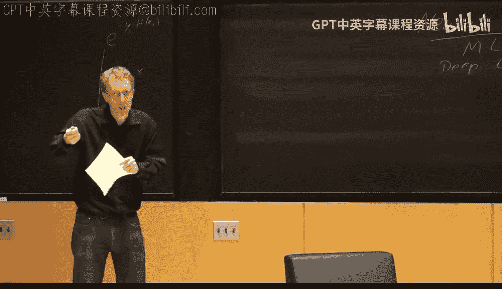

So in kernels， we had linear classifiers。H of X。Equals w transpose X。

 And he said that's just the linear classifier。 That's too simple， right。

That's the same problem that Rosenbld had here at Cornell back when he invented the perceptron。

So the solution of kernels was， well， why don't we just have some function 5 of x。

 We map our x into a very high dimensional space。 And in that space， you know。

 now we have a lot more expressive power and that， you know。

 that linear decision boundary now becomes a lot more powerful and actually becomes a nonlinear decision boundary in the original space。

😊，And so the way colons did this is they had a very， very well crafted。😊。

F such that the inner products of these functions are computed。 It can be computed in closed form。

 So we don't actually have to do this mappingping。That's awesome。

 right because you have to do this mapping implicitly。😊，And。It's very， very fast。

 but it's restrictive。Because you can only pick functions such that you actually know how to compute that in a product。

 Like， for example， the RBF kernel， the polynomial kernel。Now， what deep learning does。

 what neural networks do is say instead of actually making a handcrafted function like the RBF kernel or something。

 what we do is we make5 of x just a parameterized function。 So we just actually learn that function。

😊，And so in neural networks， what we say is P of x。Equals the following equals sigma of a of x。

Plus B。Where a is just a matrix。 So I just take my X， multiply that matrix。😊，And then。

 add a constant to it。So basically， what are you doing， right， if you multip a matrix。

 it's an a find transformation。 So you take your data， you kind of stretch。

 you stretch arbitrary directions and other directions， you shrink。Right， so you。

 you kind of it's like your， your， your data is kind of， you know， made out of rubber or something。

 might your space。 and you， you， you pull it。

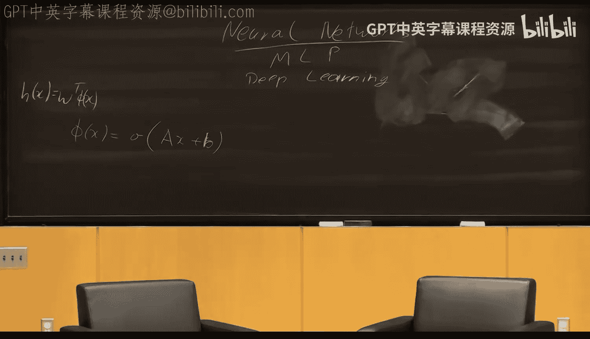

And then you have this sigma here。And what is that sigma， That Sigma is some non nonlinear function。

And for a long time， what people had here is sigma is the sigmoid function。

 That's why it's still called sigma。 The sigma is sigmoid。

 you know that from logistic regressiongress is one over one plus E to the minus Z。😊，So。

That was at least what Jeff Hin used in 19， you know， in the 80s。 And he， that caught on。

 And if you remember what that function looks like。It looks like this。

 So it's basically if z is very， very negative， it becomes 0。And then it goes up to one half。

 And then if it becomes very， very positive， it goes to one。单子。And you apply this function to every。

 This is a vector， right， So X times matrix is a vector。You apply this to every single dimension。

And so the inspiration， in some sense was， this is like the brain， right， neuro space get some input。

And the either switched on or switched off。 So basically。

 what your vector becomes is either ones or zeros， essentially。

 right So either you have a large value then you have a one or you have a small value。 You have a 0。

😊，So you basically take your input。 You add it to some different space of zeros and once。

But for different inputs， they are different。 right， So basically you switch them on or off。And。

And everybody used this actually， for 20 years， Sigma might function。And then， actually。Jeff Inton。

 who was one of the people who introduced it just a few years ago， was like。Actually。

 don't use a sigma function。 Sigma function is terrible。嗯。I remember why we introduced it。

 and I remember when we introduced it。 And we didn't really have a good reason to use the sigma function。

 And actually， it has big disadvantages when we optimize it。

 So what people nowadays do is actually something much much simpler。 So they just use the max for 0。

😊，It's called a rectified linear unit。So that looks like this。

And I me explain to you in a minute why why one is much better than the other。

So it turns out you need some nonlinear function here。

So far of extra is basically an a find transformation。 You take your input。 you multiply by a matrix。

Yeah， it' some constant。 And then you have some， some nonlinear function here。

 where you basically in this case， nowadays， you just take all the negative values and z to 0。嗯。And。

So if you didn't have this， then actually it would just become a linear classifier。

And that's easy to show。 If you didn't have this， then if if Sig was actually not there。

 then you would just have W transpose。A X plus B。 Well。

 that just becomes W transpose A X plus W transpose B。Where this is another vector， W hat。

W hat transpose X plus， this is my B， B hat。Right， so if you just have a transformation without the sigma。

Then actually multi by a vector is the same thing as if you would just learn a different vector。

 So you still actually just have a linear classifier。😊。

So the trick of neural networks is you have some Ahan transformation， which is very。

 very general here。 right， It's just the magification of the matrix。 That's it。😊。

And then you just have some very simple function that just sets everything that's negative to 0。

And that's all that is going on。And and when you learn it。

 you basically learn W and you learn A and you learn B at the same time。Next lecture。

 we will tell you a lot more about this。And we get into all the details。

 And I show you a ton of demos， actually。会过去。