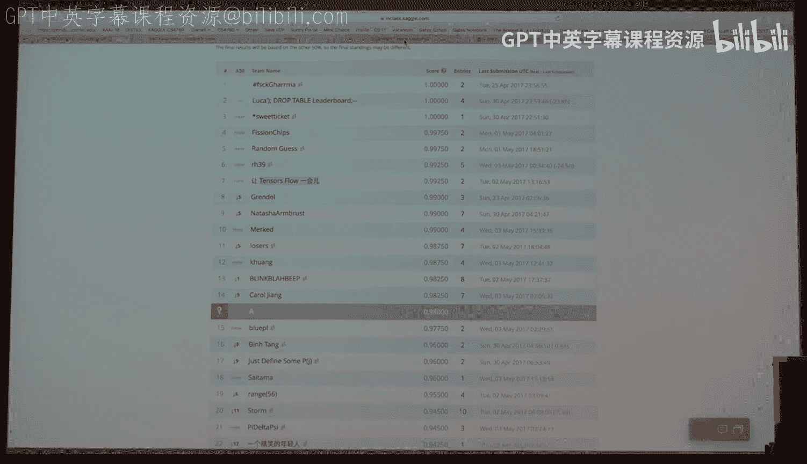
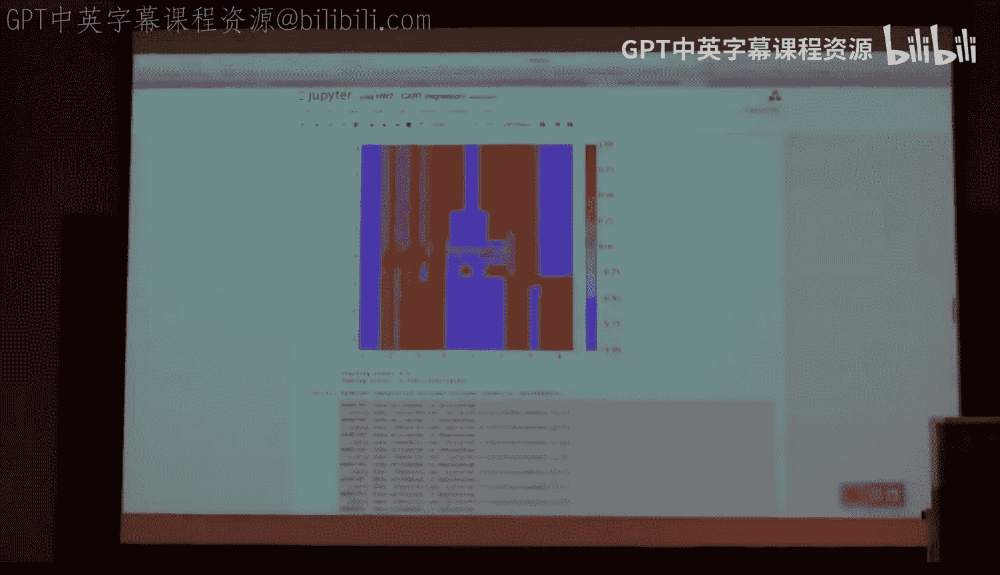
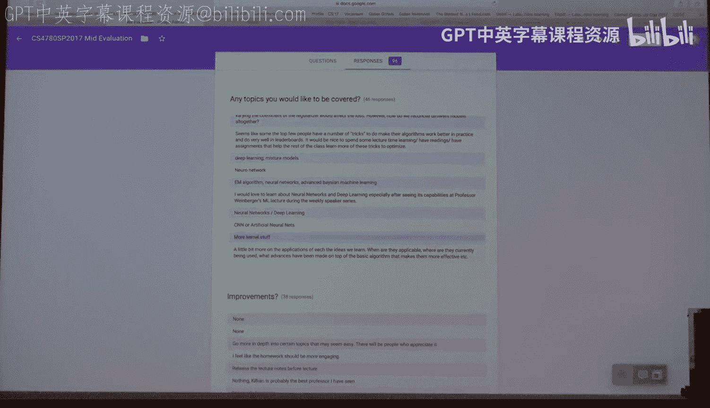
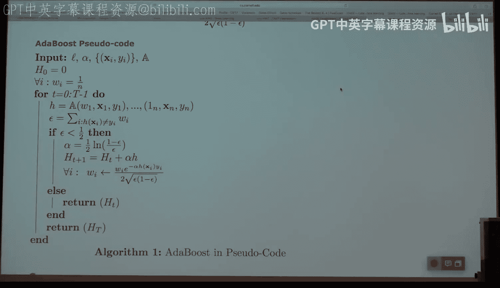
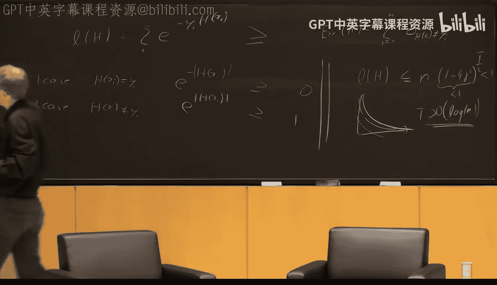
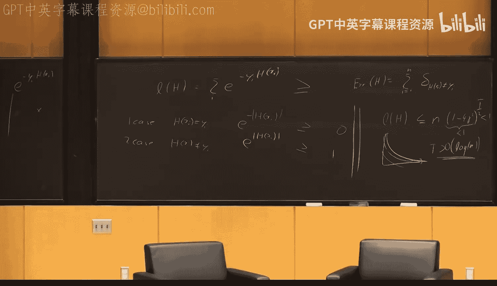
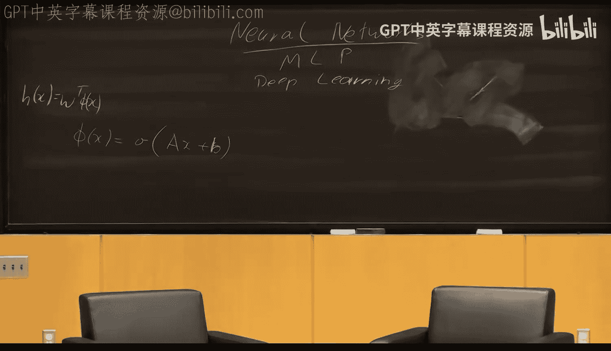

# 机器学习：034：Boosting与Adaboost

在本节课中，我们将深入学习Boosting算法，特别是Adaboost。我们将探讨其工作原理、算法步骤、优势与局限性，并理解其为何能快速收敛。

## 课程概述与通知

首先，我们来看一些课程相关的通知。

日历竞赛目前进展顺利，部分团队在测试集上取得了100%的准确率。这有些出乎意料，请大家在提交时注意竞赛规则。

新的作业项目已经发布。项目7涉及实现CART树、Bagging和Boosting（特别是Adaboost）。该项目有一定挑战性，但基于之前作业的数学推导，实现起来应该更直接。完成该项目后，下一个项目会相对简单。

根据期中评估的反馈，许多同学希望学习深度学习相关内容。因此，在完成Boosting的讲解后，我们将开始介绍神经网络与深度学习。

## 回顾Boosting与Adaboost

上一节我们介绍了Boosting的基本思想，即通过组合多个弱学习器来构建一个强学习器。本节中，我们来看看其中最著名的算法之一：Adaboost。

在Boosting框架中，我们有一个由多个分类器加权求和得到的总分类器 **H**。在每一轮迭代中，我们在当前分类器 **H** 的基础上，添加一个新的弱学习器 **h**，并为其分配一个权重 **α**。我们的目标是最小化损失函数。

对于Adaboost，我们使用指数损失函数。关键步骤在于，我们不仅沿着弱学习器 **h** 的方向（近似于损失函数的负梯度方向）前进，还会进行一次线搜索，以找到能最小化损失函数的最优步长 **α**。

### Adaboost的最优步长

通过求解优化问题，我们可以得到一个封闭形式的解，用于计算最优步长 **α**。公式如下：

**α = 0.5 * log((1 - ε) / ε)**

其中，**ε** 是当前弱学习器在加权数据集上的错误率。这个公式非常优美，它意味着我们无需进行繁琐的线搜索，只需根据错误率就能直接计算出最佳步长。

## Adaboost算法详解

以下是Adaboost算法的具体步骤。你需要在自己的项目中实现它。

1.  **初始化权重**：对于训练集中的每个样本 **i**，初始化其权重 **w_i = 1/N**，其中 **N** 是样本总数。
2.  **迭代训练**：对于 **t = 1 到 T**（T为迭代次数），执行以下步骤：
    a.  **训练弱学习器**：使用当前样本权重 **w_t** 训练一个弱学习器 **h_t**。该学习器需要在加权数据集上取得比随机猜测（错误率小于0.5）略好的性能。
    b.  **计算加权错误率**：计算弱学习器 **h_t** 的加权错误率 **ε_t**。公式为：**ε_t = Σ_{i: h_t(x_i) ≠ y_i} w_i**。
    c.  **计算弱学习器权重**：根据错误率计算该弱学习器的权重 **α_t**。公式为：**α_t = 0.5 * log((1 - ε_t) / ε_t)**。
    d.  **更新总分类器**：将弱学习器及其权重添加到总分类器中：**H(x) = H(x) + α_t * h_t(x)**。
    e.  **更新样本权重**：根据当前弱学习器的表现更新每个样本的权重。对于每个样本 **i**，新的权重为：**w_i ← w_i * exp(-α_t * y_i * h_t(x_i))**。然后对所有权重进行归一化，使其和为1。

### 权重更新的直观理解

权重更新规则是Adaboost的核心。让我们分析一下：

*   如果样本 **i** 被正确分类（即 **y_i * h_t(x_i) = 1**），则其权重乘以 **exp(-α_t)**。由于 **α_t > 0**，**exp(-α_t) < 1**，因此该样本的权重会减小。
*   如果样本 **i** 被错误分类（即 **y_i * h_t(x_i) = -1**），则其权重乘以 **exp(α_t) > 1**，因此该样本的权重会增加。

这意味着，Adaboost会重点关注那些之前被错误分类的“困难”样本，在后续迭代中给它们分配更高的权重，迫使新的弱学习器努力去纠正这些错误。这种机制使得Adaboost能够快速聚焦于决策边界附近的点。

### Adaboost的优势与局限

**优势**：
*   算法简单，易于实现。
*   通常收敛速度很快。
*   在实践中经常能取得非常好的效果。

**局限**：
*   对噪声数据和异常值非常敏感。一个错误标记的样本可能会获得极高的权重，从而将整个决策边界拉向错误的方向，导致过拟合。

## Adaboost的理论保证

Adaboost有一个非常强大的理论性质：它的训练误差会以指数速度下降。

我们可以证明，Adaboost所使用的指数损失函数 **L(H) = Σ_i exp(-y_i H(x_i))** 是0-1训练误差 **Err(H) = Σ_i I(y_i ≠ sign(H(x_i)))** 的一个上界。也就是说，**L(H) ≥ Err(H)** 始终成立。

进一步推导可以得出，在经过 **T** 轮迭代后，训练误差的上界满足：
**Err(H) ≤ N * (Π_{t=1}^T 2√(ε_t(1-ε_t)) )**

由于每个弱学习器的错误率 **ε_t < 0.5**，因此乘积项 **2√(ε_t(1-ε_t)) < 1**。这意味着训练误差的上界随着迭代次数 **T** 呈指数下降。理论上，在经过大约 **O(log N)** 轮迭代后，训练误差就能降为0。

### 超越零训练误差

一个常见的问题是：当训练误差已经达到0后，继续运行Adaboost还有意义吗？
答案是肯定的。即使所有样本都被正确分类（**sign(H(x_i)) = y_i**），继续优化指数损失函数 **L(H)** 仍然有意义。这相当于在增大分类器 **H** 对于每个样本的“置信度”或“间隔”（margin）。将样本推离决策边界更远，通常能带来更好的泛化性能。因此，Adaboost在达到零训练误差后继续运行，实际上是在构建一个大间隔分类器。

## 实践练习与算法对比

为了加深理解，我们提供了一个手算练习。你需要在一个简单的二维数据集上，模拟Adaboost的三轮迭代过程，计算每一轮的弱学习器、错误率 **ε_t**、权重 **α_t** 以及更新后的样本权重。通过这个练习，你能清晰地看到权重如何随着分类结果而变化。

最后，我们简要对比了其他算法。有人问及遗传编程（Genetic Programming），它受生物进化启发，通过随机变异和选择来优化函数。然而，与基于梯度信息或概率模型的现代优化方法（如高斯过程）相比，遗传编程通常效率低下且缺乏收敛保证，因此在严肃的机器学习应用中很少被视为首选方法。

## 迈向深度学习：从核方法到神经网络

在课程的最后，我们为下一讲的内容做了铺垫。许多同学期待的深度学习，其核心思想与我们已经学过的核方法有深刻的联系。

在核方法中，我们通过一个映射函数 **Φ(x)** 将数据映射到高维特征空间，然后在该空间中学习线性分类器。核函数的巧妙之处在于，我们无需显式计算 **Φ(x)**，只需计算内积 **K(x, z) = Φ(x)^T Φ(z)**。

神经网络，特别是深度学习，采取了一种不同的策略：它不再使用手工设计的核函数，而是**直接学习这个映射函数 Φ(x)**。具体来说，在神经网络中，**Φ(x)** 通常是一系列可学习的仿射变换与非线性的组合。例如，一个简单的单层映射可以是：
**Φ(x) = σ(Ax + b)**
其中 **A** 是权重矩阵，**b** 是偏置向量，**σ** 是非线性激活函数。

历史上常用Sigmoid函数作为 **σ**，但现代深度学习更倾向于使用更简单的**整流线性单元（ReLU）**：**σ(z) = max(0, z)**。ReLU因其在优化中的良好性质而被广泛采用。

如果没有非线性激活函数 **σ**，那么多层变换最终仍会退化为一个线性变换，模型的表达能力不会增加。因此，非线性激活函数是神经网络获得强大表达力的关键。

在下节课中，我们将深入神经网络的细节，学习如何同时训练权重 **A**、**b** 以及最终分类层的权重 **W**，并观看一些精彩的演示。

## 本节课总结

在本节课中，我们一起学习了：
1.  **Adaboost算法**：详细剖析了其初始化、迭代训练、加权错误率计算、弱学习器权重（步长）计算以及样本权重更新的完整流程。
2.  **算法核心**：理解了Adaboost通过指数级调整样本权重来聚焦于分类错误样本的机制，以及其快速收敛的理论保证（训练误差指数下降）。
3.  **优缺点**：认识了Adaboost对噪声敏感的特点，以及其在达到零训练误差后继续优化以增大间隔的原理。
4.  **与深度学习的联系**：初步了解了神经网络如何通过可学习的非线性映射 **Φ(x)** 来替代核方法中固定的映射，为理解深度学习奠定了基础。

通过完成相关的编程项目和实践练习，你将能够巩固对这些重要概念的理解。