# 机器学习：035：神经网络与深度学习

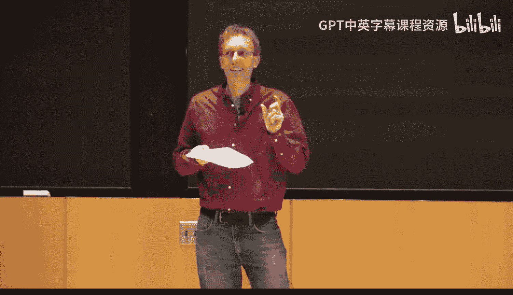

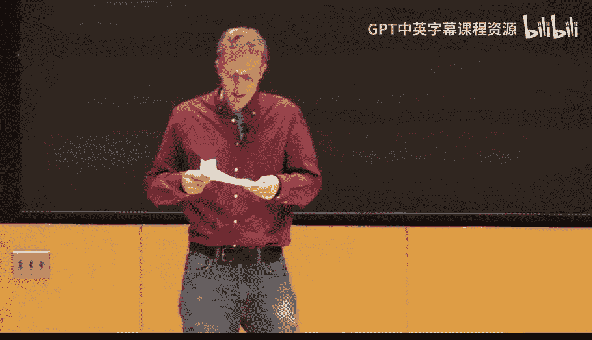

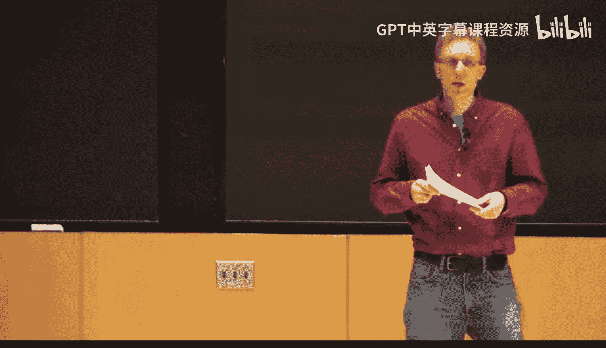


在本节课中，我们将学习神经网络与深度学习的核心概念。我们将回顾神经网络的基本思想，探讨其近年复兴的关键原因，并通过直观的比喻和示例来理解其工作原理。

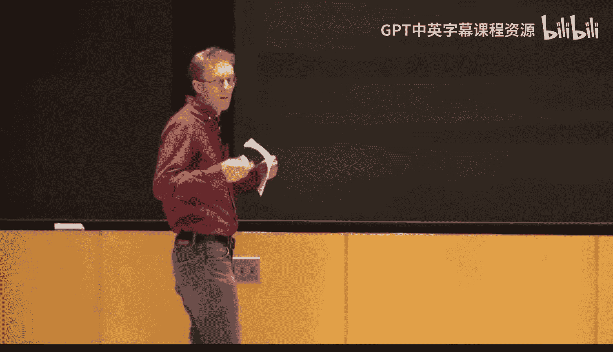

---

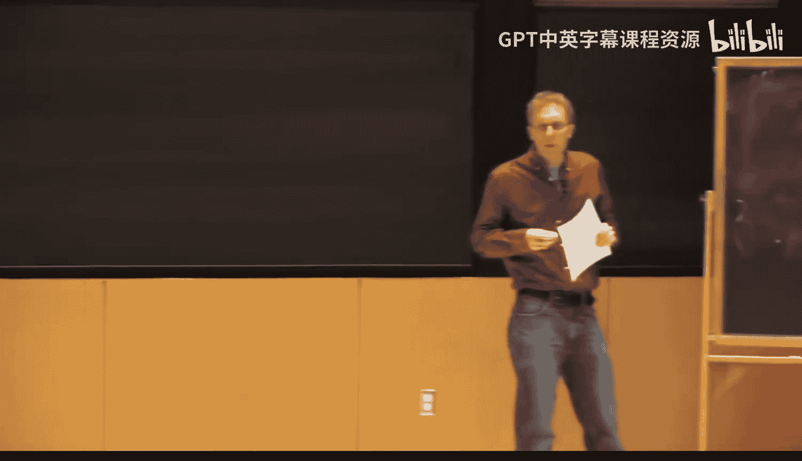


## 课程概述

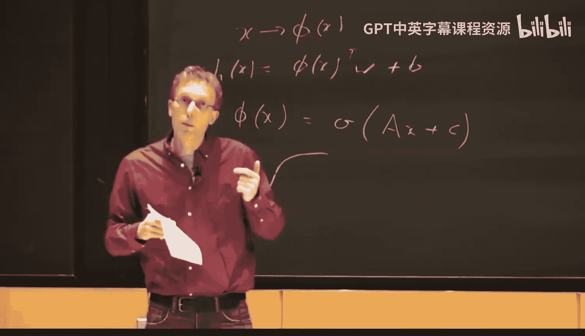

神经网络是一种强大的机器学习模型，其核心思想是通过学习数据的非线性映射，并结合线性分类器来实现复杂任务的分类或回归。近年来，由于**整流线性单元（ReLU）**、**图形处理器（GPU）** 和**随机梯度下降（SGD）** 等技术的应用，深度学习取得了突破性进展。

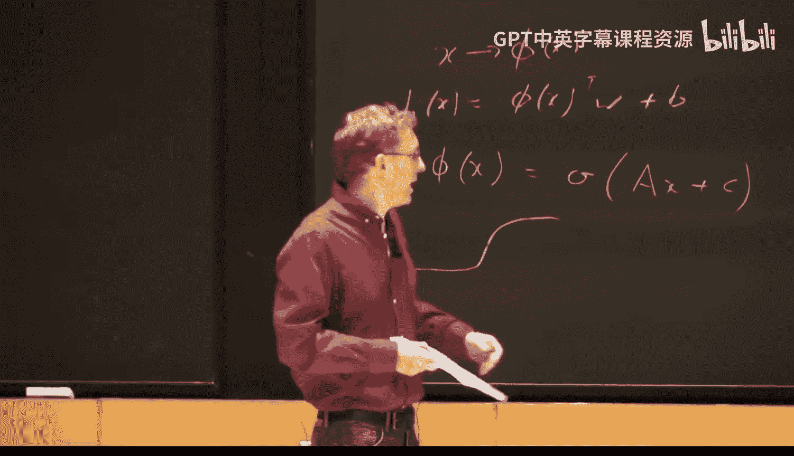

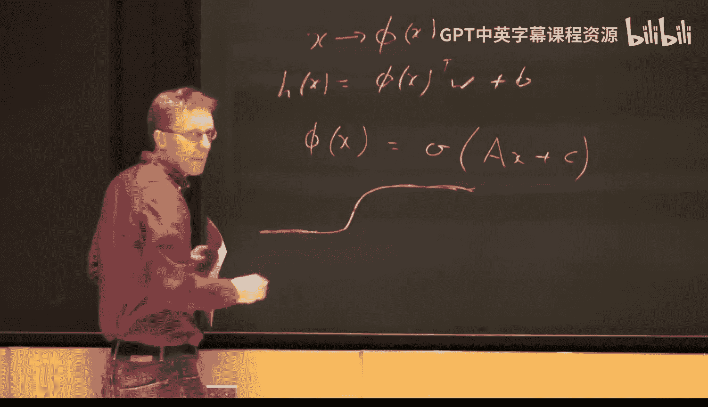

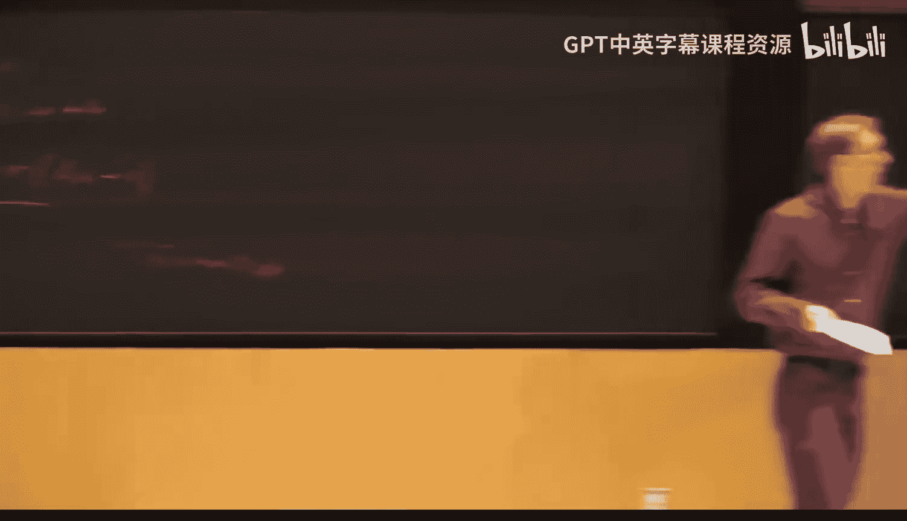

---

## 神经网络回顾

上一节我们介绍了线性分类器的局限性。本节中，我们来看看如何通过神经网络来增强模型的表达能力。

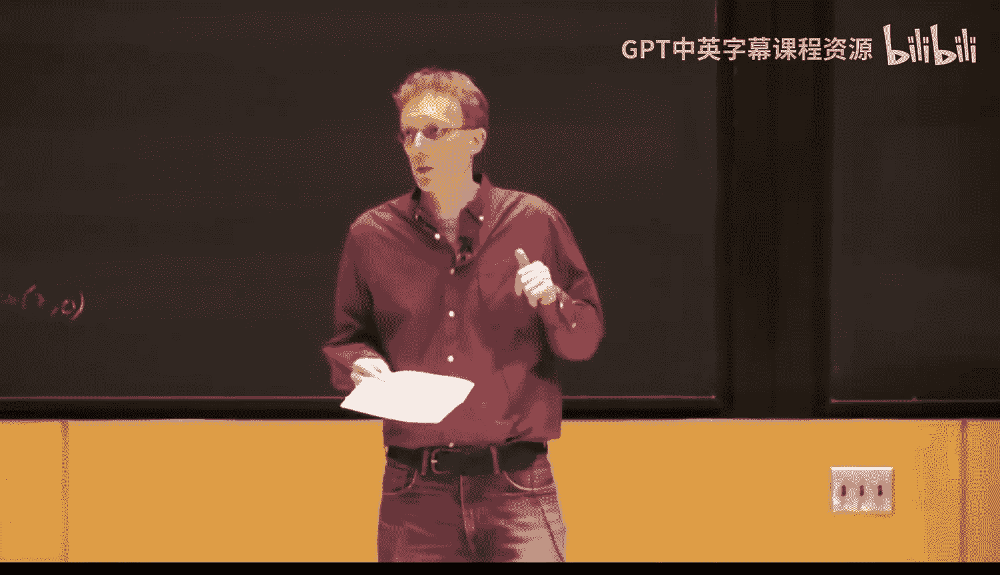

神经网络的基本形式是学习一个映射函数 **Φ(x)**，使得分类器变为：
```
h(x) = Φ(x)^T w + b
```
与核方法不同，神经网络同时学习映射函数 **Φ(x)** 和分类器参数 **w** 与 **b**。这使其比单纯的线性分类器更强大。

---

## 深度学习的复兴

神经网络并非新技术，但其近年来的复兴主要归功于以下三个关键变化：

以下是促成深度学习复兴的三个关键因素：

1.  **激活函数的改变**：人们开始使用**整流线性单元（ReLU）** 代替传统的Sigmoid函数。ReLU的公式为 `σ(z) = max(0, z)`。这解决了Sigmoid函数在饱和区梯度消失的问题，使得基于梯度下降的训练更加高效。
2.  **硬件加速**：**GPU** 的普及极大地加速了神经网络训练。神经网络训练的核心运算是矩阵乘法，而GPU非常擅长并行处理这类计算，使得训练大型网络成为可能。
3.  **优化算法**：**随机梯度下降（SGD）** 虽然从纯优化角度看并非最佳算法，但其在实践中被证明能有效防止过拟合，并适用于大规模数据集。

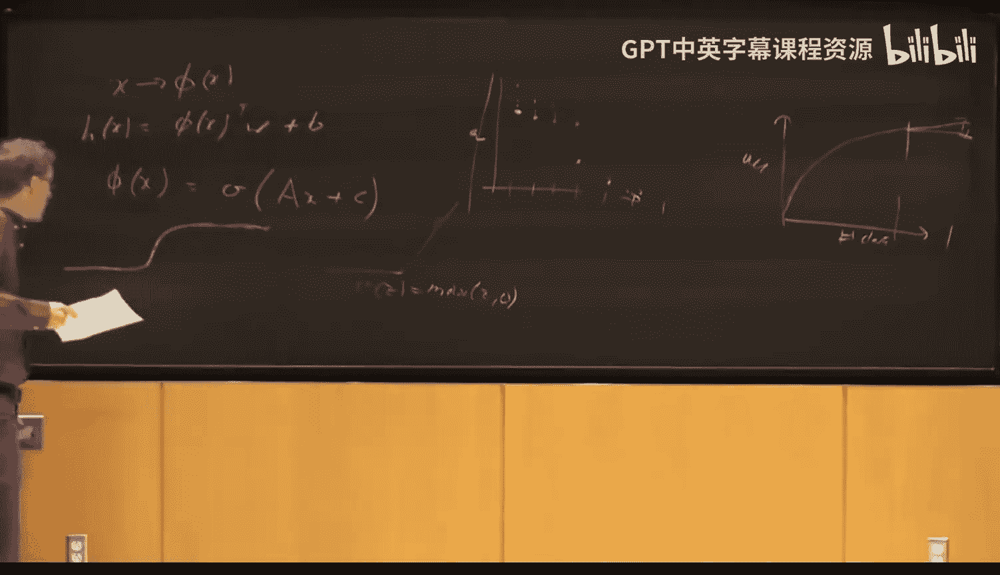

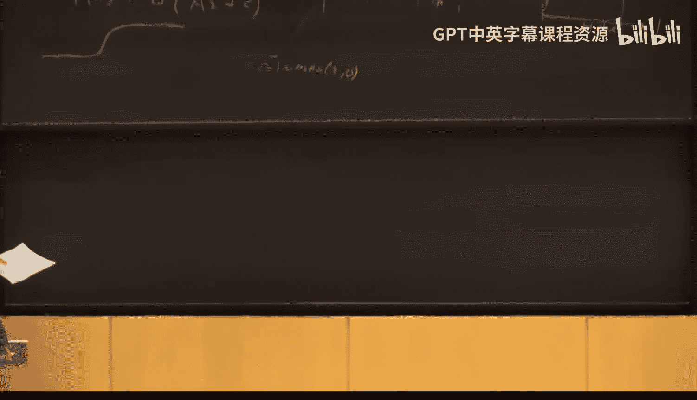

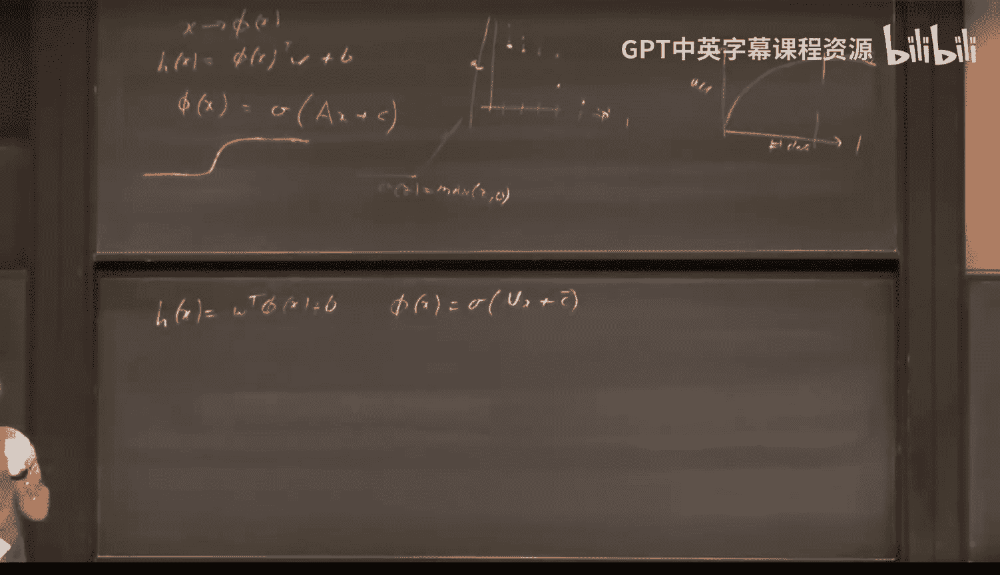

此外，“深度学习”这个名称本身也是一种成功的重新定位，让人们意识到这与过去的神经网络有所不同。

---

## 深度学习的优势与应用领域

与核方法相比，深度学习有一个显著优势：其计算成本随数据量增长呈**线性**增加，而核方法则通常是**平方级**增长。这意味着深度学习能更好地利用海量数据。

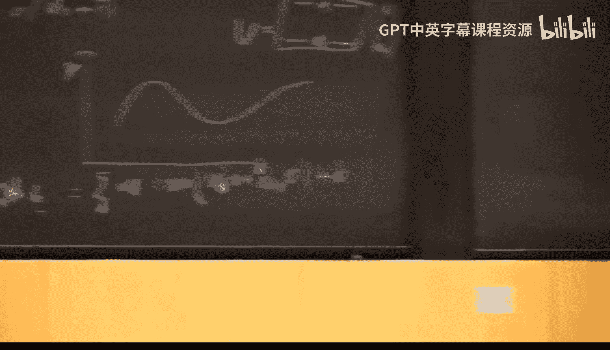

深度学习在以下两个领域取得了革命性成功：

*   **图像识别**：深度学习模型能够端到端地学习从原始像素到最终标签的映射，省去了复杂的手工特征工程流程。在ImageNet竞赛中，深度学习模型将错误率大幅降低，甚至超越了人类水平。
*   **语音识别**：同样，深度学习也彻底改变了语音识别领域，使得手机语音助手等应用成为可能。

---

## 神经网络工作原理剖析

为了理解神经网络的内部机制，我们以一个回归问题为例。我们的目标是学习一个函数 `h(x) = w^T σ(Ux + c) + b`，其中 `σ` 是ReLU激活函数。

我们可以将这个公式展开，将其视为多个“小函数”的加权和：
```
h(x) = Σ_d [ w_d * max(0, u_d^T x + c_d) ] + b
```
这里的每个 `max(0, u_d^T x + c_d)` 都是一个“折线”函数（在更高维是超平面）。它由权重向量 `u_d` 和偏置 `c_d` 定义，在输入超过某个阈值后被“激活”（输出正值），否则输出0。

神经网络的学习过程，就是通过调整所有这些 `u_d`, `c_d`, `w_d` 和 `b`，用许多这样的折线段来拟合目标函数。理论上，只要有足够多的这样的“折线单元”（即足够大的隐藏层维度 `H`），神经网络可以以任意精度逼近任何平滑函数，这被称为**通用近似定理**。

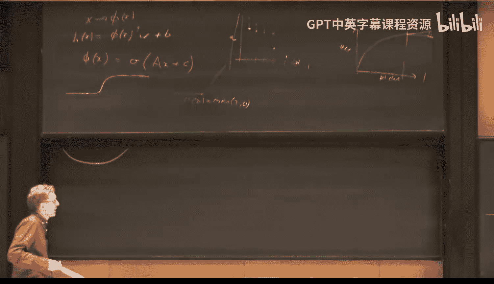

---

## 深度（多层）网络的威力

之前我们讨论的是单隐藏层网络。深度网络则通过堆叠多个这样的层来构建：`Φ(x) = σ( U_1 σ( U_2 x + c_2 ) + c_1 )`。

一个直观的比喻是折纸：
*   **单层网络**：像在纸上折出一条折痕，定义一条分界线。
*   **深层网络**：像进行多次折叠。第二次折叠是在第一次折叠形成的复杂结构上进行的，这使得模型能够复用已学习的基础模式，以指数级效率组合出更复杂的函数。

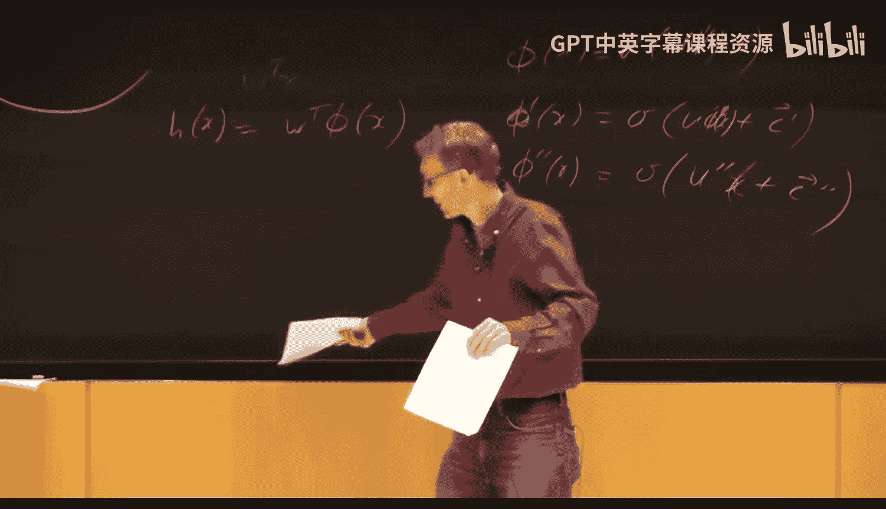

理论上，一个足够宽的单层网络可以表达任何函数，但所需的参数可能极其庞大。而深度网络通过多层组合，可以用少得多的参数达到同等的表达能力，这是其强大之处。目前的研究趋势是构建更深的网络。

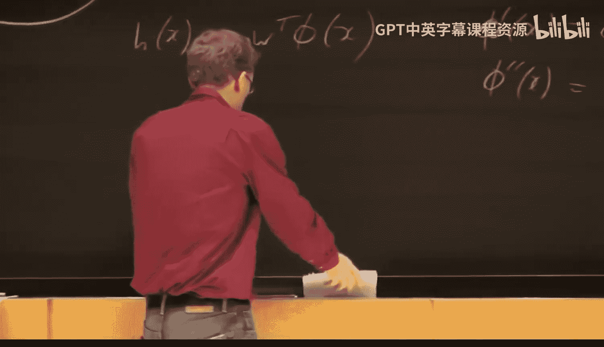

---

## 关于过拟合与随机梯度下降

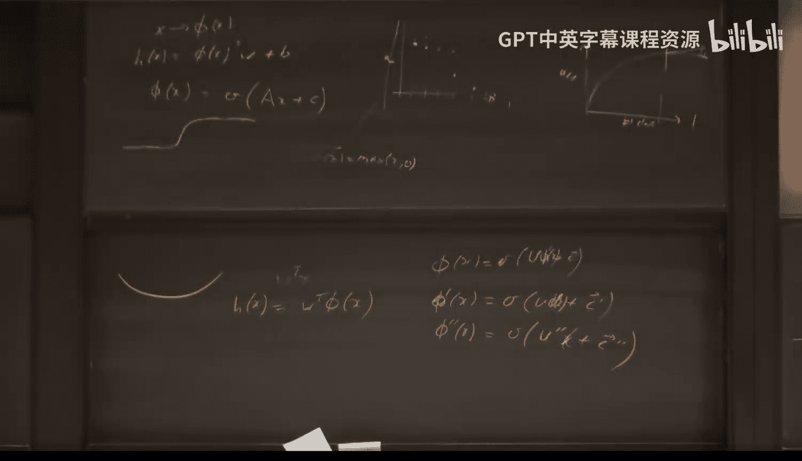

一个自然的问题是：如此强大的模型为何不会严重过拟合？这很大程度上要归功于**随机梯度下降（SGD）**。我们将在下一讲详细讨论SGD。简而言之，SGD的随机性使其在优化过程中不会精确收敛到训练损失的最低点，从而无意中起到了正则化的作用，缓解了过拟合。

---

## 演示实例

我们通过一个简单的一维回归demo，可视化了不同数量隐藏单元下神经网络拟合曲线的过程。单元越多，拟合的折线段越多，对复杂函数的近似能力越强。

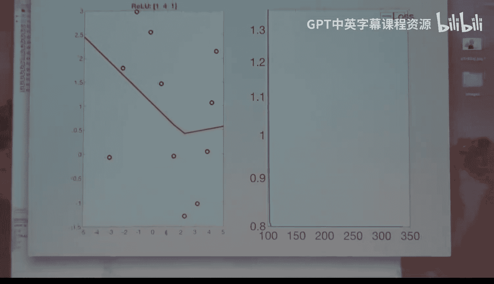

此外，还有一个有趣的应用演示：训练一个神经网络来判断人脸是否“好看”（基于Hot or Not网站数据）。尽管这是一个非常主观且复杂的任务，神经网络在测试集上达到了约74%的准确率（优于随机猜测），并能对知名人物给出符合大众预期的评分，这展示了其学习高级抽象概念的能力。

---

## 课程总结

本节课我们一起学习了：
1.  神经网络的基本框架：学习特征映射与分类器。
2.  推动深度学习复兴的三大关键技术：ReLU、GPU和SGD。
3.  神经网络的工作原理：通过组合多个折线（超平面）函数来近似复杂函数。
4.  深度网络的本质：通过层叠结构，指数级提升模型表达能力。
5.  深度学习的优势：擅长处理图像和语音，并能有效利用大数据。
6.  对过拟合的初步解释：与SGD的优化特性有关。

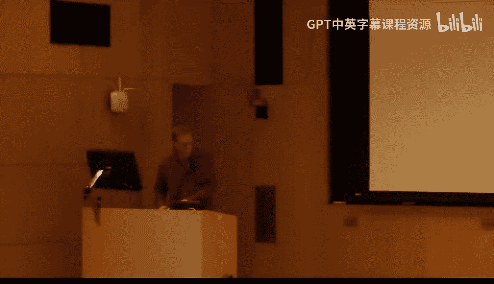

在接下来的课程中，我们将深入探讨随机梯度下降的细节及其在训练神经网络中的关键作用。