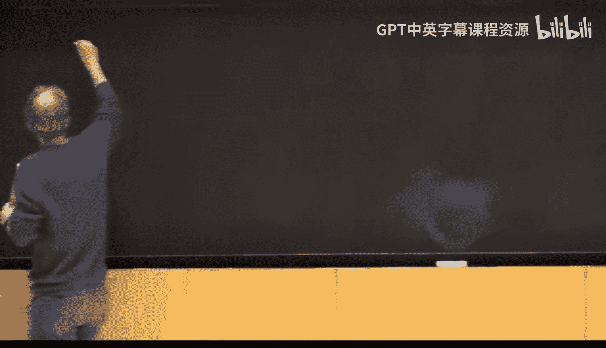
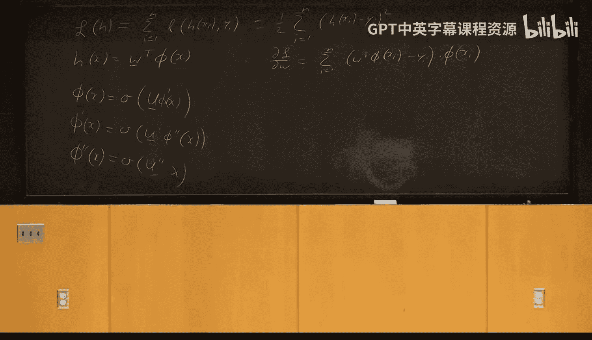
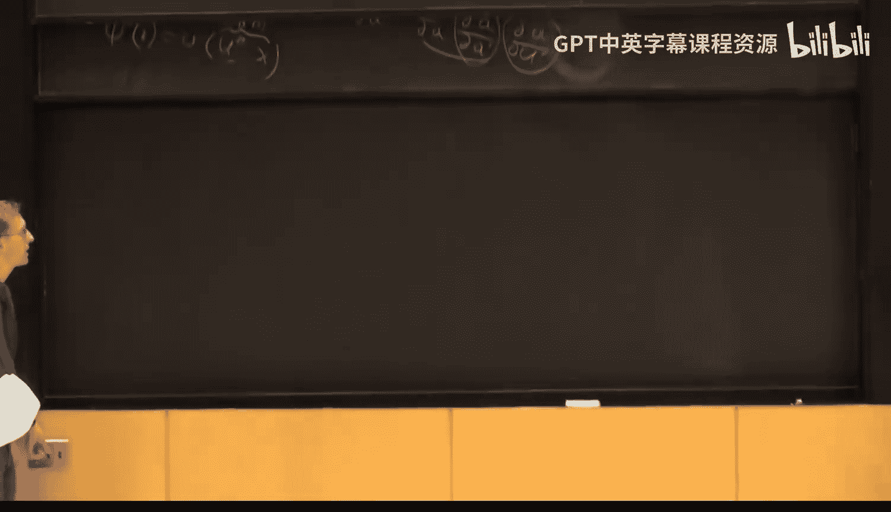
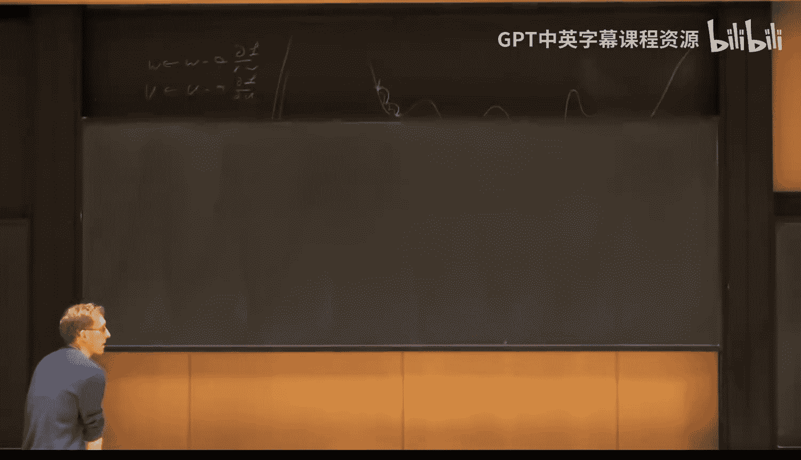
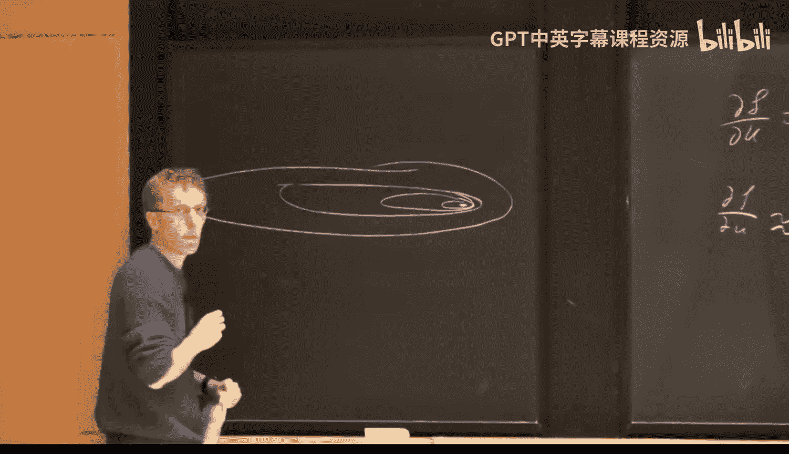
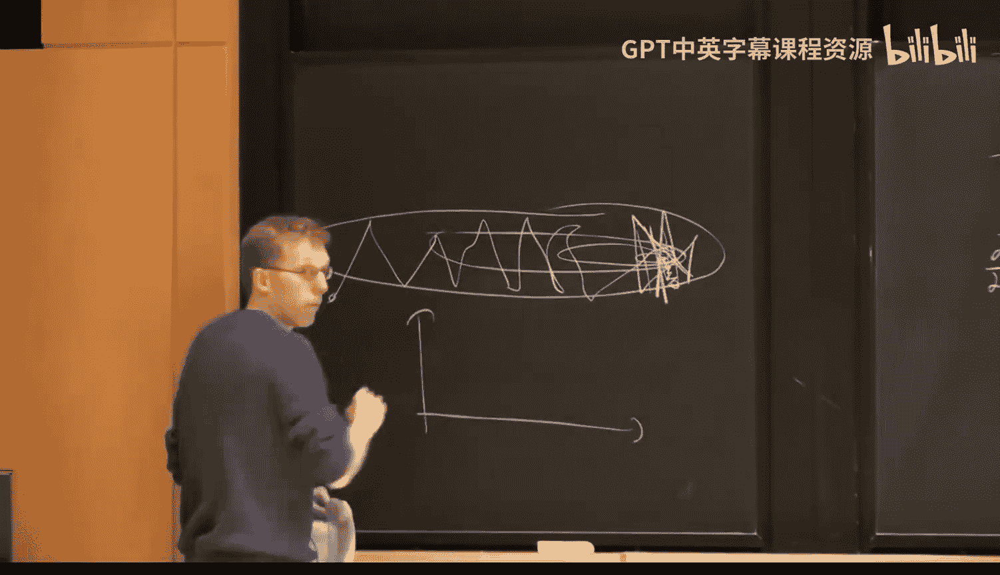

# 机器学习：036：神经网络与深度学习（续）

在本节课中，我们将继续学习神经网络与深度学习的核心内容，重点探讨如何训练神经网络，包括梯度计算、反向传播算法以及随机梯度下降等关键概念。我们还将讨论神经网络优化中的一些重要细节，如初始化、非凸优化以及现代深度学习实践中的常用技巧。

---

## 课程安排与项目更新

倒数第二节课。机器学习课程。请大家，除非坐在最后一排，否则请收起笔记本电脑。

项目8已发布。正如之前所说，不必担心，它相对简单。它比项目7容易得多，项目7可能是较难的项目之一。

最新的作业也已发布。这是可选的。因此，您不需要提交它。您仍然应该完成它的两个原因是：A. 因为它是考试的良好准备；B. 因为您在作业6中推导的内容正是您在项目8中需要实现的内容。如果您完成了作业，它将极大地帮助您。项目8确实非常简单。

此外，有人询问了模拟考试。我已将它们发布在Piazza的“资源”部分下。最顶部是“模拟期末考试”之类的。请在准备时查看这些资料。

最后，我相信冲突考试的提前报名现已结束。因此，我认为只有极少数人因大学认可的冲突而无法参加考试。我们将安排一个替代日期。请做好准备。我相信我们今天会发布相关信息。

有任何关于课程安排的问题吗？很好。

---

## 神经网络回顾与学习目标

我们讨论深度学习和神经网络。

正如我们上次所讲，深度学习本质上有一个损失函数，它是我们预测器H（即假设）的函数。这可以是一个通用函数，遍历所有不同的样本并计算损失。例如，一个典型的例子可能是平方损失：`(H(X_i) - Y_i)^2`。这是回归设置。

神经网络只是线性分类器的简单扩展。`H(X) = W^T * φ(X)`。这里的技巧在于，`φ(X)`本身是一个映射。所以，`φ(X) = σ(U * X)`。让我们暂时忽略偏置项。这就是一个单层神经网络。如果您有多个层，您可以在这里再嵌套一个函数。那么您有 `φ'(X) = σ(U' * φ''(X))`，依此类推。您可以根据需要创建任意多层。在这个例子中，我们有一个三层神经网络。

输入进入这里，乘以一个矩阵，应用一个激活函数（例如ReLU，将负数置零），得到一个向量输出，再乘以一个矩阵，再次应用ReLU，依此类推。最后，您得到您的预测。

今天我想讨论的是如何学习这样的神经网络。我们有一个损失函数。之前我们看到，当您有一个损失函数和这样的分类器时，我们只需进行梯度下降。对于神经网络，您实际上做完全相同的事情。唯一的不同是，您不仅仅有一个向量W，您还有这些中间矩阵。这些是您的参数。您有最后的W（最后一层），以及所有中间层，每层都有一个变换矩阵。

那么如何进行梯度下降呢？首先，您必须计算关于每一个这些矩阵的梯度。然后，实际上，和以前一样，您只需取梯度，然后进行一个小步长的更新。您只需说：`U` 变成 `U - α * 梯度`。这就像经典的梯度下降，没有什么特别的。

---

## 计算梯度：链式法则与反向传播

稍微棘手的一点是，您必须计算这些位于网络深处的权重矩阵的梯度。您基本上必须考虑如何通过这个函数，再到下一个函数，依此类推，直到最终到达输出层。

事实证明，有一个非常好的技巧可以做到这一点。它被称为链式法则。谁听说过链式法则？太棒了。谁听说过链式吸烟？实际上差不多。

以下是您的做法。第一个梯度很简单。那就是梯度 `dL/dW`。在这个例子中，这只是平方损失的梯度，其中 `H(x)` 是 `W^T * φ(X_i)`。所以 `dL/dW = Σ_{i=1}^n (W^T * φ(X_i) - Y_i) * φ(X_i)`。到目前为止，这没有什么特别的。您已经实现了这个，在ERM作业中，您正是这样做的。`φ(x)` 是您的特征向量，您最小化平方损失，计算梯度，然后进行梯度更新：`W` 变成 `W - α * 这个梯度`。

现在轮到计算关于中间矩阵 `U` 的梯度了。这变得有点棘手。我们如何使用链式法则得到它呢？我们想要 `dL/dU`。使用链式法则，您会意识到，您必须经过所有这些链，每一层都会使计算越来越昂贵。但事实证明，实际上它非常廉价，因为您可以重用计算。这被称为反向传播。

反向传播的发明实际上花了很长时间，远在神经网络发明之后。起初，人们并没有使用链式法则来训练它，这是有原因的。

我们想要计算关于第一个矩阵 `U` 的梯度。它基本上在 `φ(x)` 内部。我们如何做到这一点？我们可以说 `dL/dU = (dL/dA) * (dA/dU)`。这里我们使用了一个简单的技巧：将 `U * X` 的输出称为 `A(x)`，然后 `φ(x) = σ(A(x))`。这只是为了给每个步骤命名。

所以，根据链式法则，损失函数关于 `U` 的梯度等于损失函数关于 `A` 的梯度乘以 `A` 关于 `U` 的梯度。

现在让我们尝试计算第二层的梯度。我们想要知道损失函数关于 `U'` 的梯度。同样，根据链式法则，这等于损失函数关于 `A'` 的梯度乘以 `A'` 关于 `U'` 的梯度。

关键点在于：`A` 关于 `U` 的梯度是什么？`A(x) = U * φ(x)`。所以 `dA/dU` 就是 `φ(x)`。这很容易计算。当您将输入推过这个函数时，您已经计算了所有这些 `φ(x)`，而这些正是您在这里需要的梯度部分。

那么 `dL/dA` 这部分呢？这部分您已经在上一步计算了。所以您需要做的就是计算 `dL/dA'` 这部分。事实证明，这非常容易，它实际上就是激活函数的导数。

我不会更详细地讲解，因为它很繁琐，而且对您帮助不大。最好您自己完成。请认真对待，完成作业，推导所有这些更新。关于它的美妙之处在于，最终您会得到一个非常简单的算法。它只是说：好了，我想计算所有这些不同矩阵的梯度。我该怎么做？我计算第一个梯度，然后将其乘以一个向量，得到第二个梯度，再乘以另一个向量，得到第三个梯度，依此类推。这是一个非常简单的过程。实际上，我在笔记中提供了伪代码。如果您查看笔记中“反向传播”的部分，那就是伪代码。在项目8中，您需要实现的就是那个代码。当我说它简单时，我的意思是：是的，它只有三行伪代码。

---

## 梯度下降与随机梯度下降

您的问题是，我们使用真正的梯度下降还是随机梯度下降？给我两分钟，我会讲到。

关键点是，当您计算位于神经网络深处的梯度时，假设您有10层，您需要做的就是取前一层的梯度，几乎全部使用，只需乘以一项，就得到下一个梯度。因此，计算所有这些梯度实际上非常高效。这就是关键。

如今，计算这些梯度变得越来越不重要。即使在五年前，博士生们大部分时间都在计算梯度和实现梯度，这非常痛苦。您必须让它快速运行。但如今，实际上只是最近的发展，所有这些语言都有自动微分。所以您实际上只需计算函数，输入函数，然后说“计算梯度”，它就会符号化地计算梯度。这是过去几年才变得非常高效的事情。所以现在，如果您使用TensorFlow或PyTorch等所有软件包，它们都会为您计算梯度。但了解其原理仍然很重要。

---

## 神经网络优化的特殊性

现在我们知道如何计算梯度了。特别是当您完成作业后，一切都会变得非常清晰。

基本上，我们有了我们的网络。我们得到所有这些不同的梯度。然后我们需要做的就是进行梯度下降。所以我们说：`W` 变成 `W - α * dL/dW`，`U` 变成 `U - α * dL/dU`，依此类推。对所有参数都这样做。然后重新开始。

还有两个细节，与之前我们所做的相比有两个重要变化。第一个是普通的梯度下降，我们已经做过了，并且您已经实现了它。

一个非常微妙且重要的区别是，这个函数不是凸函数。这是我们过去推导梯度下降时所有损失函数都是凸函数的情况。凸函数看起来像这样。我们说，您可以从任何地方开始，所以我们从零向量开始，然后进行梯度下降。每次您迈出一小步，都会进一步下降。最终，我们会到达最小值。这就是凸函数上的梯度下降。

对于神经网络，我们仍然使用凸损失函数，但整体不是凸的。为什么不是凸的？因为 `φ` 本质上由于激活函数的存在。所以关于 `W` 是凸的，但关于 `U`、`U'` 和 `U''` 不再是凸的。因为您有这些非线性，如果您取二阶导数，很容易证明它不是凸函数。

所以您试图最小化的函数看起来像这样。您可能忘记了找到全局最小值。您永远找不到全局最小值。有指数级的局部最小值，像这样的小坑，您总是会陷入其中一个。所以找到全局最小值是不可能的。您想做的是找到一个好的局部最小值。

因此，最重要的变化是，初始化突然变得重要了。您从哪里开始不再无关紧要。以前总是无关紧要的，您可以从任何地方开始，从全零向量开始很方便。现在不再是这种情况了。如果您从这里开始，进行梯度下降，会发生什么？您会一步步下降，收敛到这个最小值。因为梯度下降会收敛到局部最小值。如果您从这里开始，您会到这里。如果您从这里开始，您会到这里。所以初始化是一件大事。

当然，如果您能负担得起，训练10个不同的网络并取最小值。更好的方法是平均输出，将它们集成起来。

所以初始化现在非常重要。事实上，如果用全零矩阵初始化，您会得到糟糕的结果，因为那样每个维度都是相同的。记住我们上次说的，低层特征学习什么？这些低层特征学习非常简单的函数。然后基本上，下一层学习更复杂的函数，由这些简单函数构建而成。但如果它们都被初始化为相同，实际上每个函数都是相同的。所以您希望随机初始化它们。人们只是用随机噪声（低阶高斯噪声）初始化这些 `U` 矩阵和 `W` 向量。

这是神经网络优化与例如支持向量机之间的一个非常重要的区别。这也是人们如此喜爱支持向量机的原因之一，因为它们是全局的。它们全局优化事物。您得到全局最小值。您保证每个人在相同数据上训练相同的支持向量机得到完全相同的答案。对于神经网络，您和我在相同数据上训练神经网络。我们随机初始化。我们得到不同的答案。这让人困惑，人们不喜欢这样。

---

## 随机梯度下降的优势

第二件事是我上次提到的，随机梯度下降非常重要。问题是，人们在神经网络的第一轮中使用了这些非常激进的求解器，例如近似海森步长的梯度下降等。这些是伟大的优化算法，因为它们能尽快让您到达最小值。如果您知道，通常负担不起海森或牛顿法，但人们使用近似的牛顿法，这些方法非常有效。优化社区已经开发这些方法很长时间了，它们只需几步就能收敛到最小值，比梯度下降快得多。所以人们说，不要使用梯度下降，使用这些更快的优化算法。所以您从这里开始。事实证明，是的，只需几步，您实际上就在最小值了。这太棒了。承诺是这样的。

但神经网络表现不佳。问题是您处于高度非凸的空间中。所以无论您从哪里开始，附近总有一个糟糕的局部最小值。现在，如果您使用这些非常激进的优化算法，它们基本上会立即收敛到局部最小值，您会直接到达那里。但通常这些不是好的最小值，通常好的最小值在很远的地方。

这就是随机梯度下降的用武之地。让我告诉您什么是随机梯度下降。

每个权重的梯度基本上是 `dL/dU`。它是所有数据点的和，`i=1` 到 `n`。基本上，我们对每个数据点求和，每个数据点都对梯度贡献一点点。我们计算这个总和，那就是我们的最终梯度。

现在，随机梯度下降背后的想法是这样的。想象您有一个像这样的函数。我试图最小化它。它是非凸的。周围有很多坑。

随机梯度下降非常简单。您说，与其计算所有数据点的梯度（这是正确的做法），我不如近似它。我用一个点来近似它。所以我说，现在 `dL/dU` 大约等于一个点的损失梯度。这完全错了。梯度是许多小梯度的平均值。而我说的是，好吧，我一次只看一个训练样本。我只计算一个训练样本，它给我梯度。我假装那是我唯一的训练样本。

假设我在这里，梯度指向这个方向，因为它与损失函数正交。但如果我只取一个样本，我可能会指向这个方向。这很糟糕。但这是我们以前见过的。您在哪里见过这个？很多嘈杂的梯度，对吧？完全相同的想法。如果您有很多嘈杂的梯度，您所做的就是取一个非常小的步长，朝这个方向迈出一小步。平均而言，这些梯度正是正确的梯度。所以有时偏右一点，有时偏左一点，等等。这让我回到了醉汉梯度下降算法。所以您迈出一系列步伐，平均而言，朝着正确的方向前进。

酷的是，计算精确梯度需要 `O(n)` 次操作，因为您必须遍历整个训练数据集，计算每个训练点的梯度贡献并求和。现在，您做的是随机梯度下降。在这段时间内，您实际上可以采取 `n` 步。所以您迈出一小步，再一小步，再一小步，依此类推。当您这样做时，您向前移动，您的梯度也会改变，因为如果您在这里，梯度实际上更多地指向这个方向。所以当您已经处理了一半数据后，您实际上已经取得了一些进展。现在，未来一半的数据点，平均而言，不再指向原始梯度的方向，而是指向我所在点的梯度方向，实际上更多地指向这个方向。

所以，在原始梯度下降中，您基本上采取一些大步，像这样，像这样，依此类推。在随机梯度下降中，您采取许多非常小的步伐。但是，因为您可以在处理数据时调整方向，您实际上更快地到达最小值。

您的问题是，您切换了故事。最初您从局部最小值开始，现在您告诉我关于醉汉的事情。公平地说，这不是他说的原话，但没错。

这是一个原因，为什么人们最初不认真对待随机梯度下降。随机梯度下降是已知的，但人们认为它是一个糟糕的算法。我可以告诉您为什么。因为如果我试图证明，需要多少步才能找到精确到 `10^-5` 精度的最小值，事实证明，随机梯度下降需要永远。为什么需要永远？因为最初，您非常接近最小值。一旦您在那里，您会采取许多随机步骤。您永远无法真正达到它。这又是一个醉汉回家的例子，他到了家，却找不到该死的钥匙孔。这就是问题所在。您就在这里，因为太嘈杂了，您永远无法真正收敛。

但这并不是一个大问题，因为在机器学习中，我们实际上并不关心精确的最小值。整个损失函数本来就是人为构建的。

但还有更好的事情，这让我们回到优化。事实证明，现在我们正在回家，这里有很多小坑。这个函数是非凸的，这里有很多吸引子。基本上，函数看起来像这样。当您下山时，如果您使用精确梯度方法，您会计算这里的梯度，并且总是会找到这个确切的最小值。但随机梯度下降非常嘈杂，它会做什么？它会经过这里。它不会找到这个愚蠢的最小值。它会直接走过去。

因为它是一个如此糟糕的算法，它实际上很棒，因为它不会掉进沿途的每一个坑。您只会最终掉进一些大坑里，无法逃脱。人们没有想过这个，但事实证明这正是您想要的。您想要这些大坑。为什么？人们认为您想要非常深的坑。您想最小化损失并变得非常非常深。这就是梯度下降在这些二阶方法中真正擅长的。

但您实际上不想要这个。想象函数看起来像这样。最小值实际上在这里，这个非常陡峭的损失。但我声称这是一个可怕的损失。您真正想要的是最终在这里。谁能告诉我为什么？没错。这是您的函数。但有一个函数，我的损失函数。我的损失函数是我的训练集的函数。它是两样东西的函数：我的数据和我的函数（我的假设）。如果我固定数据（我在这里这样做），那么我得到的是我的假设的函数，我试图找到最小值。

但我们后来实际要做什么？后来，我们将丢弃训练数据，转向测试数据。当我们在这里放入不同的数据集时，函数将会改变。我们有这些非常陡峭的局部最小值。现在会发生什么？基本上，它们优化了这个东西。现在在测试时，实际上有一个不同的函数。也许它看起来像这样。哎呀，我在这里，现在却在这里。突然，我找到的最小值变得非常非常糟糕。这说得通吗？

所以，如果您有这些非常窄的最小值，它们往往非常特定于您训练的具体数据集。如果您有非常宽的最小值，如果您改变数据，它实际上不太可能改变很多。所以，您真正想要的是在一个非常宽的最小值上尽可能降低损失函数。而这是随机梯度下降唯一能够找到的东西。这实际上是至关重要的。

如果您有一个非常大的数据集并且可以负担过拟合，那么这些影响变得不那么危险。没错，这意味着如果您有一个非常大的数据集，函数的变化会非常小。没错。

但什么是非常大的数据集呢？这些是非常高维的空间，您总是采样不足。所以人们发现，最初他们只是凭经验发现，如果使用随机梯度下降训练神经网络，它突然变得好得多。花了很长时间才理解其原因。

梯度步数是否受训练点数量的限制？不，您一遍又一遍地遍历数据集。在梯度下降中，您所做的是遍历所有数据点，计算梯度，采取一个梯度步长。现在您所做的是随机取一个数据点，计算梯度的那个小近似值，进行梯度更新，并不断迭代。所以您无法真正保证。只是如果有一个非常窄的最小值，我的意思是在高维空间中，在一维空间中，很明显这个东西会掉进去。但即使在二维空间中，想象这是我的函数。这里有一个小坑。我太接近了，实际上掉进去了。梯度突然指向这个方向，不再指向那个方向。但因为随机梯度下降如此嘈杂，您会再次指向它并迈出一步。我不清楚。所以您实际上最终掉进去似乎不太可能。它只是不断摇晃。

实际上，人们在实践中优化这些东西时使用两个技巧。第一个是，他们实际上不只是随机取一个点。他们取大约64或128个点，称之为小批量。原因很简单，因为如果您通过网络传播一个点或64个点，成本大致相同，只是因为您的计算机有这些小的并行向量和L1缓存等。所以实际上这样做是高效的。

第二件事是，最初，您使用一个相当大的学习率。这回到了您的问题：我们如何保证不掉进这些局部最小值？最初，您使用一个相当大的学习率。好处是这可以防止您掉进小的局部最小值，并让您接近实际局部最小值所在的区域。所以也许您做100个周期（一个周期是遍历整个数据集一次），使用大的学习率。然后之后，您大概在这里。现在您只是跳来跳去。这看起来有点像这样。现在您在这里，您所做的是在这之间来回跳跃，因为您的步长太大了。然后您做的是将学习率降低10倍。然后您基本上采取小步长。这意味着现在我收敛到实际的局部最小值。让我再画一次。这是基本思想。想象您的函数通常看起来像这样。这是最小值。所以您想做的是，您从这里开始，最初采取许多步骤，像随机步骤。它们非常嘈杂，让您到达这里。现在您只是来回弹跳。您这样做几步，直到基本上不再有进展。然后一旦在这里，您采用小的学习率，现在您基本上向下移动到这里，直到得到最小值。当您查看损失时，它实际上看起来像这样。如果您查看现代神经网络的损失，它看起来像这样，然后您降低学习率，它看起来像这样。有时您会再次降低学习率。

您的问题是，一旦您做了一段时间的随机梯度下降，现在您相当确信接近局部最小值了，为什么不直接使用二阶方法呢？您可以。在实践中，通常不值得实现，因为现在您已经做了很多工作，您只需用小的学习率进行几次迭代，就可以了。但没错，您可以。

或者有更技术性的解释。随机梯度下降保证它最终能够爬出来。是的，有。这需要我花一个月来解释。但如果您感兴趣，现在有大量文献分析这个问题。问题是，是否有更严格的答案，为什么随机梯度下降能给出好的局部最小值？答案是，是的。您可以用多种方式形式化这一点。如果您愿意，课后我可以给您一些直觉，解释为什么会这样。

问题是，如果函数看起来像那样怎么办？没错，那是一堆。实际上，这就是它的样子。您有数百万个参数。您处于一个百万维的空间中，不仅仅有几个这样的坑，有数十亿个最小值。您最终会掉进其中一个。

不过，关于这一点的一个好处是，如果您想用神经网络进行装袋法，您通常有足够的随机性，以至于不需要对数据进行子采样。通常，当您进行装袋法时，您用替换法对n个数据点进行子采样。但对于神经网络，因为您只是随机初始化网络，您从空间的不同部分开始，最终到达非常不同的局部最小值，甚至不需要对数据集进行不同的子采样。您实际上会得到行为非常不同的神经网络。令人惊讶的是，它们往往有大致相同的错误率，但会犯非常不同的错误。这使得神经网络非常适合集成。所以，如果您真的想获得最低的错误率，例如在Kaggle竞赛中，您所做的就是训练5个神经网络，然后平均它们的结果。这实际上带来了巨大的改进。

---

## 神经网络的“神经元”视角

我想向您展示一些东西。在我结束之前，我想谈一件事：什么是神经网络中的“神经元”？人们总是谈论为什么它被称为神经网络？这些都是函数。我试图以这种方式解释，因为我认为这与我们到目前为止在课程中所做的并没有太大不同。

但让我快速向您解释为什么人们称它为神经网络，以及什么是神经视角。我不是很喜欢它，因为它会导致《连线》杂志等出现奇怪的文章。

但基本上，人们说，您可以将这表示为某种图。您的X输入，我画出来。对于X的每一个维度，这里有一个小球，一个小圆圈。所以这是一个向量X，这是第一个维度的值，第二个维度，等等。这是一个五维向量。这说得通。这只是向量表示法。如果这说得通，请举手。太棒了。

现在我要做什么？我把我的X放在这里。我得到一个新的表示，称为 `φ''(x)`。这有一堆维度。这里的转换是 `x` 变成 `U * x`。所以 `φ(x) = σ(U'' * x)`。这说得通吗？如果这说得通，请举手。很好。

现在我们再次邀请，这是 `φ'(x)`。这是我的 `φ(x)`。这是我的 `H(x)`。

现在，如果我考虑这个，这是什么？这是每个输入的函数。所以人们做的是画一个箭头，说这个值是这个家伙的第一个维度，它基本上是U矩阵的第一行乘以x。所以他们称这些为连接。然后您对每一层都这样做。现在您有了一个网络。我不喜欢它。我可以告诉您为什么我不喜欢它。因为人们然后与大脑进行类比，分析这些神经元，说这些神经元做什么等等。问题在于，我不太喜欢它，因为它实际上只是一个D维空间，您可以旋转空间，得到完全不同的表示，但输出完全相同。所以在某种意义上，解释空间的不同维度似乎很奇怪。我看不出这有多大价值。但这导致了很多误解，人们认为这就是大脑所做的（这不是真的），或者说这些神经元做的比实际做的多得多。它实际上只是一个函数 `φ(x)`。当然，这是一个D维向量。所以这些向量中的每一个都有一个值。但重要的是，当人们说“我观察一个神经元的值”时，他们真正的意思只是这个U矩阵的一个维度。

顺便说一下，最初它是受大脑启发的。最初的神经网络来自那个方向。在实践中，人们除了ReLU还使用其他东西吗？答案是，如今，修正线性单元非常非常流行。原因其实很简单。人们以前认为必须使用连续函数和可微函数。修正线性单元，如果您仔细观察，会发现它是不可微的。所以您在不可微函数上进行梯度下降，这似乎很疯狂，会导致各种问题。事实证明，如果您使用随机梯度下降，它已经非常嘈杂，实际上并不重要。所以当人们开始使用随机梯度下降时，实际上可以使用修正线性单元。然后，与tanh和sigmoid函数相比，其优势变得明显，因为这些tanh和sigmoid函数非常平坦。记住它们的样子。它们基本上将所有东西映射到0到1之间。使用这些sigmoid和tanh函数的网络得到的是它们饱和得非常快。所以修正线性单元往往更擅长不陷入局部最小值。

权重衰减在使用这些sigmoid函数时很重要，因为您希望将它们保持在中间。权重衰减只是L2正则化的另一个词。没什么别的。它只是与VDK并行发明的东西。所以人们也对权重使用正则化。但对于修正线性单元来说不那么重要，但仍然有助于避免过拟合。

---

## 演示与总结

我想向您展示上次没成功的东西。现在它在这里。这个函数，黑点基本上是我的训练点。在左边是一个带有修正线性单元的神经网络。您在这里看到的结构有一个输入，2个隐藏节点和一个输出。所以两个隐藏节点意味着我的第一个函数将一维输入映射到二维输出。然后下一层将二维输出映射到一维输出。

所以您在这里映射的是维度的数量。您看到修正线性单元有两个节点。所以它基本上有两个转折点。您看到tanh要平滑得多。现在我可以引入四个节点。您在这里可以看到一件事，这就是人们认为tanh好得多的原因，因为tanh几乎击中每一个转折点。错误率要低得多。而修正线性单元在这里有点挣扎。但原因是，修正线性单元存在的这些问题是因为它们难以优化。当您有数百万个时，这些问题就消失了。基本上，总有一些指向正确的方向。所以修正线性单元在复杂问题上往往更好，但在这些小演示中更差。这是误导性的。现在我可以，每次，8维隐藏表示，等等。所以，我让它越来越复杂。您在这里可以看到，tanh函数非常非常好地优化了这个。在这里，您仍然有这些分段线性函数。您在这里可以看到的是，在某种意义上，它在这里产生了一些幻觉。函数在这里上升，尽管没有数据支持这一点。这没关系。

我还想快速向您展示一件事。TensorFlow。我不知道。TensorFlow是谷歌的免费软件包。实际上，大多数人更喜欢PyTorch，它来自Facebook。但我认为TensorFlow稍微容易使用一些。

您在这里可以看到，我们可以取一些数据。这些是我的数据点，正的和负的。我现在可以构建一个新的网络。如果您输入TensorFlow playground，您可以玩这个，他们提供了一个不错的小演示。这是我的输入。这是我输入的第一个维度。这是我输入的第二个维度。所以基本上这是我的X坐标，我的Y坐标。然后我有一个四维的学习表示，这是我的 `φ(x)`。这是我的输出。让我们只做一个一维输出。为什么不呢。我现在可以训练这个东西。您在这里看到的是输出。它现在训练了这个，并且全部正确。现在我可以看的一件事是，我可以实际查看这个单层神经网络，观察这些神经元是否有意义。所以在这里，您实际上看到它学习了一堆函数。现在我可以输入一个例子，让它更难一点。优化这个。您在这里看到。它在挣扎。来吧。所以您做的是，您知道，挣扎，您只需添加更多神经元。好了，更好了。所以，您看到的是，这些是我的输入。现在我可以查看，当我把鼠标悬停在这个上时，您可以看到右边的图像变化。所以它向我展示的是这个特定函数的激活情况。您可以看到它学习了这些单独的小函数。最终的输出现在是这些函数的组合，它正好完美拟合了异或数据集。

现在我可以做一些非常难的事情，但我可以先做这个。这个应该更容易。现在。它应该能够完美拟合。没时间了。哦，是的。漂亮。现在螺旋，螺旋实际上非常难。我们现在可以看到这个是否有效。它可能做不到。它在做什么？哦，是的。所以您现在做的是添加更多神经元。看看它做什么。不。我添加了另一层。就像千层面。更多层通常更好。它在做什么吗？开始了。整个事情是JavaScript，在我的笔记本电脑上。所以有点不公平。哦，对了，它在做某事。我们可以添加更多。我不知道。让我们，您知道，好吧，让我们最大化它。它使用修正线性单元。看看会发生什么。还没有。它最终会到达那里。它能做到。它能做到。只是需要一段时间。

让我打断一下。最后一件事。上次我提到，这在图像处理中变得极其强大。这里有一个例子，是一个初创公司。他们实际上销售他们的深度学习社区。他们所做的就是训练深度网络，输入图像，并在右侧分类。所以这是一张图像，基本上写着日落、水、黎明、黄昏等等。所以我们现在可以做的是尝试我们自己的图像。他们实际上可以。去谷歌图片搜索。我应该搜索什么？大象。好了。我用了我的？是的。那是我的搜索。所以。好了，这是图像。有点小，我们可以试试。他说，这个，这个，这个怎么样？这是我年轻时的照片，当我还住在德国时。我想，好吧，没关系。这里说这是图像。我不是机器人。它说什么？它说成功。哦，我的天哪。

我们得在高潮中结束。所以这是最后一个。下周三见。