# 037：康奈尔大学《智能系统的机器学习｜CS4780 Machine Learning for Intelligent Systems 2017》中英字幕 p37 -37-Machine Learning Lecture 37 ＂Neural Networks _ Deep Learning＂ -Cornell CS478 -BV1Lo6gBxEKE_p37-

Butdy。This is the last lecture of machine learning。I'm sad too。M。😊，All right。

Given that this is the last lecture， and we actually last once one day short， in some sense。

 because of the snow day， actually， we lost one lecture。 and unfortunately。

 I worked out that exactly one lecture short。 That's okay。😊，But that leaves me。

 leaves us with a choice。 SoUltimately， this is your class。 So I want you guys to decide。EWhat we do。

 so。We can do。 There's multiple things we can do today。

 So I know some people have been asking for a review session。 So the exam is next week。

And exactly one week， I would yeah。😊，So one thing we could do is we could go over all the material briefly。

 kind of do， you know， a three minute mini version of the class one more time and just summarize the important points。

That's boring but useful。 Another option is that I could you can continue on deep learning。

 and I can talk about convolutional neural networks。 I know a lot of you would like to hear about it。

 That's also how you win the Kaga competition。😊。

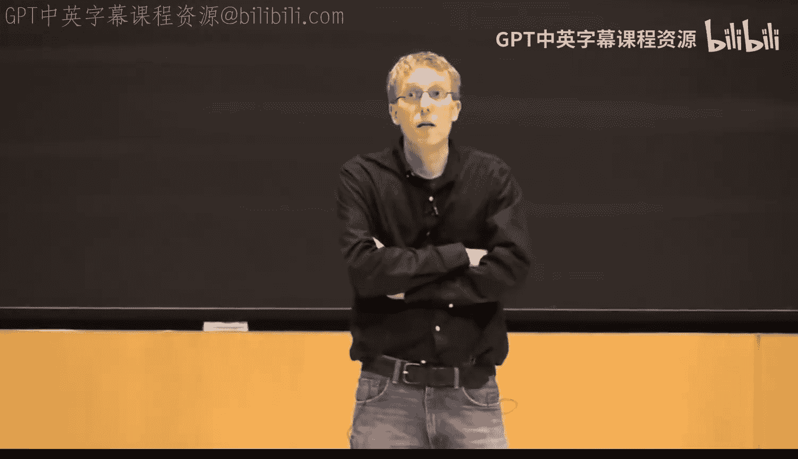

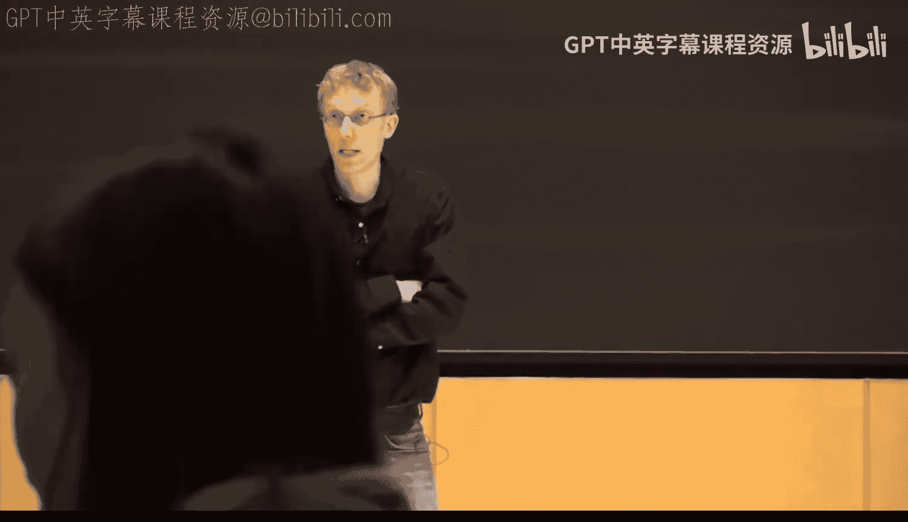

And then some people asked what's going on in research right now in machine learning。

 So what's know after this class。 So one thing you could talk about is what are different areas of machine learning that we do not cover。

And what research topic。 So， so these are， in some sense， we have four choices， I believe。

 So one is review session， One as we talk more about deep learning。One as we talk about。You know。

 other。Other stuff， you know， other classes in Cornell that are about machine machine learning。

 like what is unupervised learning， was active learning， what is reinforcement learning。

 all the things we did not cover。 And finally， what is current research。 And， you know。

 I could show some research that's going on in my lab。 So these are the four different choices。

 And so why don't we have a quick vote。😊，And then I decide to ignore your vote and just do whatever I want right。

Okay， first ones， the first one is review sessions， so who is in favor of a review session？Okay。

 it's gonna be hard。 actually， It's gonna okay， wait one， please raise your hand。 Only one hand。Okay。

 alright， we have to come down to one more vote， like in France。 Okay， that was review session。

 Second thing was deep learning。 Who wants to do more about deep learning。Oh okay。

 review sessions is out， all right。Third one is other classes at Cornell。Nobody， okay。

 forget about other classes right and finally， current research that's going on。😊，Oh okay， well。

 was that a majority？Okay， one more time。 deep learning。 Okay。

 how about current research on deep learning。 How about this。All right， okay， have a winner。

All right， okay， good。So we can do this。 That's that works fine。😊，So。What I need to do， though。

 is I need to give you a five minute explanation of what confidence are， actually。

 because that's what current research。So is on。So。And the last lecture we've done in the last couple lectures。

 we've talked about。Deep neural networks。 And if you remember correctly。 And I've， you know。

 summarizes now many times。 you easy say you have a function Texas input data instance。

 and you would like to make a prediction this W transpose phi of x where the trick is that phi actually is another。

 you know， function inside that function that you know， looks something like this。

 And for those people who've implemented the homework， you know， you know， all about at this point。

 And I realized everything electron called it something else。 U， Alright， And this again。

 can be phi prime of x。😊。

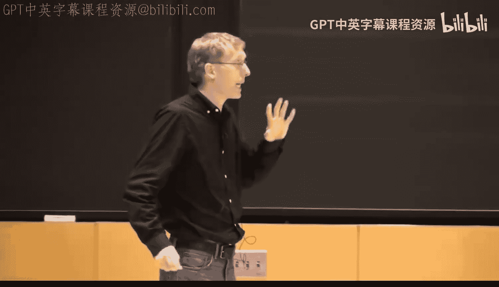

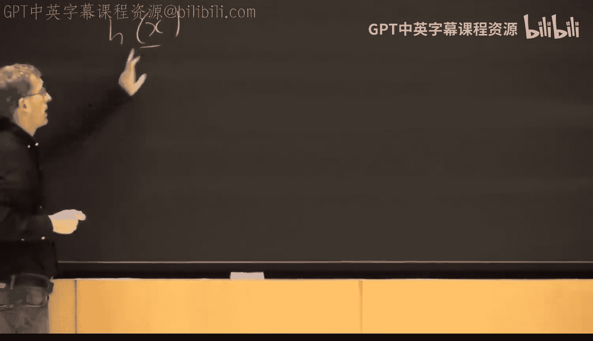

So you basically have this nest that， these multiple layers of。In this case。

 we have just one hidden layer。Okay， so that's great。

 And that's what people call a fully connected network。

 and a fully connected network means if I write this as a network structure。

 but take my original input。😊。

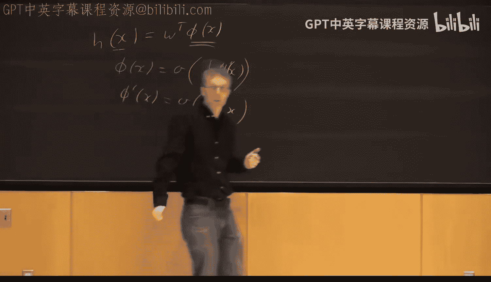

And I write every single dimension as a， you know， one of these circles。 This is my x。

 Then what I learned is first， I learn Phi of x。 I call this Phi prime of x。 Then I learn phi of x。

 and then I learn my H of x。😊，And every single dimension of this function here has its input。

 every single dimension of the previous previous representation。

 So this is where this notion of network comes from and it's fully connected because everything is connected with everything else。

😊，And。That's the most general form。 know， of course， you can draw this out and at the end。

 you easily have one dimensional or multiple dimensional outputs。So that's great and that's very。

 very general。 But turnsza when you work on images。

 you have a lot more information and you would like to incorporate that information into your classifier and in fact。

 if you take your image and you represent it as a vector right you have an image that consists of 6 million pixels whatever the resolution of your iPhone camera and if you vectorize it then every single dimension corresponds to a pixel。

😊。

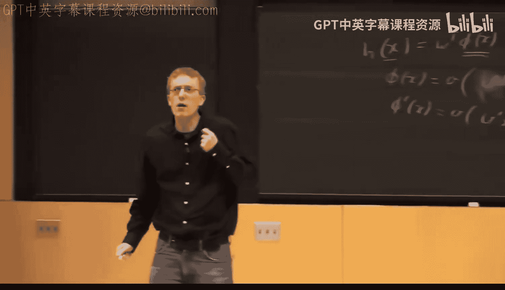

The problem is， you've now thrown away something， you've thrown away the fact that actually it was a two dimensional image。

 and well， you say， you know， it's not a problem， right。

 like this is something that just represent it differently。 I just represent it as a vector。

But turns out natural images have very specific features or very specific properties that don't apply to data generically。

 And that is， let's say， I have a little picture of， you know， some good looking person like me。

 Here we go。😊，And if I know， you know， if you classify this and you say， okay。

 this is whatever person X， right。😊，If I would now move this person and move it a little bit to the right。

It would still be the same person。I if a move a little bit up or down in something， right。

 it wouldn't change。But this factorial representation would change drastically。

And it would look completely different because the pixels would be completely different of those two images。

And we call this translation andvari。 So images are locally translation andvari。

 So if I take any part of the image and move it a little bit， the image， actually。

 the semantic interpretation of the image， does not change。😊，And that's crucial。

 And the reason it's crucial is because if I train a neural network to recognize objects and image。

If I want to learn this here is， you know， whatever person access this here is， you know， whatever。

 let's say， Donald Trump or something and。😊，Arguably less good looking as I am if you know， you know。

 it would always recognize if it's exact in this position。But if you actually have them over here。

 right， you wouldn't recognize them anymore。 So what you would need is you would need training training data in where。

 you know， it basically in every single part of the image， right。

 So you you have one image like this and one image like this， etctera。 right。

 So you need millions millions of images。So what convolutional neural networks do is they change this function phi。

To incorporate that。So basically say， if you would change your data input a little bit by just moving things around。

😡，It won't change the apple。And it turns out that's， that's the big hit。

 Like that made all the difference in the world because it reduces the amount of data that you need to learn something exponentially。

😊，Losers what？Next。Yeah。Well， I agree。

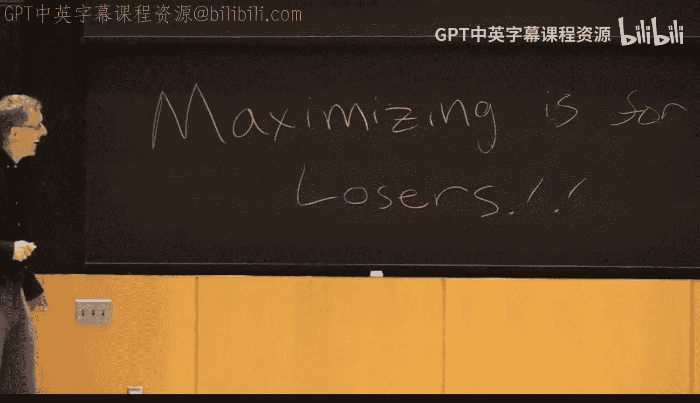

Let's keep that， let's keep that， that's good， I like it。😀Yeah。😊，All right。

So what convolution on neural networks do？They take an input image。😡。

And they respect the fact that's an image。 And so they actually say the image has multiple channels。

 So actually typically what you have， you have three channels。

 So what that means is if you have an image that has natural colors， you can divide it into red。

 green and blue right So if you actually you have three images where this one just shows you。

 the red， how red every single point is， it shows you how green every point is is how blue every point is。

 And if you add these two up， you get the color image。

 So you take that as an input to your x to your function file。 So this is my X。

 My X is basically consists of three different images。😊，And what my function P now does。

 it takes that input。And then it generates new images。😡。

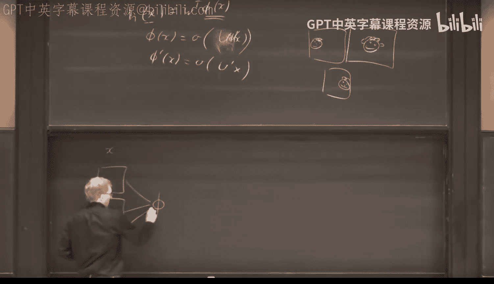

And this doesn't have to be3。 It could be many。 It could be 100 or something。 It doesn't matter。

 And then my next function， P prime takes these as input。And generate， it's another。

 whatever 100 images in。 So you never， ever。You know， destroy the image form。😡，And only at the very。

 very end， do you get a final representation and you know， output some， some H of X。

 which is actually， So maybe here you actually have some， some fully connected layer or something。😊。

哎。O， so far so clear。 raise your hand if you're still with me。Okay， awesome。

 So how does this work And the trick is the convolution operator。 So what this function Phi does。

 it actually has a little， you know， instead of actually taking a weighted average。😊。

This image here actually is associated with a particular convolution。 Who， who's sort of convolution。

 Raise your hand。😊，Okay， so basically what you do is you have a little teeny little image。

Of maybe three by three pixels。And what you do is you move that image around， so you start here。

And you multiply this pixel with that pixel。And this pixel with that pixel this pixel up with that pixel。

 and you sum them all up， and that gives you a value。 And that's the value here。😊，Okay。

 and now what you do is you take this and shift it one to the right。So now you take this pixel here。

 I multi with this pixel and so on， you sum them all up。And you get this value here。

 So you take the same， this little image and just move it around and compute the inner product everywhere。

 And that gives you an image here。😊，So what that does is essentially。

 you're kind of blurring the pixels， right， So the pixel here。😊，Is an average of。

The corresponding pixels around the same location on this image。 So that's what you're doing。

But it's a weighted average， and that's the key。So these weights， these。

 these values here are actually weights。 They basically tell you how much do I value。

 Now how much do I weigh the pixel here， here and here， for example， right。

 And imagine you had strong weights here， but low weights here。

 What you would be doing is you would get a large value。 if in the image here。

 you have something similar。 You also have， you know， something like this。

 And so what you're essentially doing is you detect edges that look like this。😊。

So what's happening is that these images here。 what they are doing is they are basically detecting local features in an image。

 So some of them detect edge edges like straight edges or you， horizontal edges， vertical edges。

 circles， etc。😊，And you keep doing this。 So initially。

 you just have very low level things that you're detecting。

 And so you get these images here that basically highlight。

 highlight certain certain features or highlight edges or highlight circles or highlight something like this。

 And then you know， here， basically， you know， you highlight， you know。

 more complex things that correspond of， you know， out of So， for example， here。

 you could be highlighting eyes， right， Eye consist of edges and circles。😊。

And so our eyes all look pretty similar， actually， no matter what you tell your， your date， right。

's actually they're all look pretty similar。So， so， you know what basically。

 what you can do is you can build an eye classifier somewhere here that basically is a kernel that basically goes over the image and scans for eyes。

 That's essentially what they are doing。 right And you have these little things that basically check for eyes。

 right， But these things here again， consists of little， you know。

 is there on edge or is there a circle or something。

 Does that makes sense So you're building more and more complex pattern detectors。

 That's essentially what it is， yeah。😊，So when after。Involved you pass。offer。You， you're right。

 So you do actually have non nonlinear。 you have rail functions in between。 Yeah。

 so these are actually raillu functions in here。 That's right。

 So you said everything that's negative to 0。😊，But you have to have this。 Otherwise。

 you just have one linear operation。Yeah， good point。Okay， does this make sense， any questions？

And the way you train this is just the same way。 turns out， actually。

 the convolutionary network is just a special case of this， right。

 So you could actually view that this here is one pixel in， you know， in this image here， right。

 And what I'm doing is I'm basically， you know， setting zero weights to almost all of it and just attaching it to。

 you know， just to the first。😊，3 by three pixels here。 So these are the only。

 only connections that actually have nonze weight。 Everything else has a 0 weight。

 So you can take a fully connected network and make it identical to convolutional in your network。

 So the fully connected network is always more powerful， But the promise is too powerful， right。

 by restricting。😊。

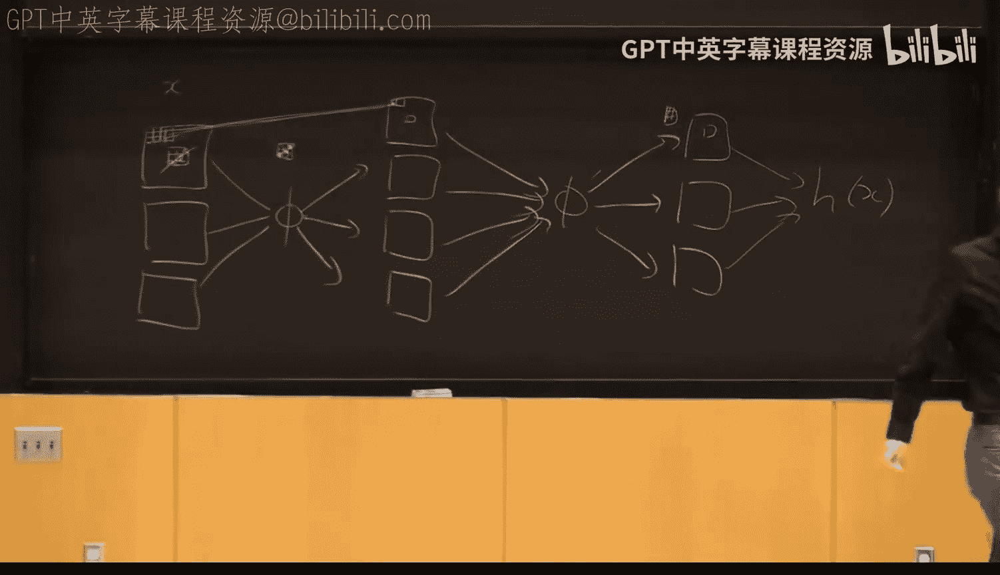

Your network to only learn functions that are locate translation and variant。

 You actually make it easier for the network， right， You're saying whatever I'm learning。

 it has to be something that if I shift the image around a little bit。

 The content of the image around， it shouldn't change much。 And that's crucial。 And's very。

 very important to understand。😊，Natural images。 and the。

If I would say the big success in deep learning was essentially in these two domains。

 So one was speech recognition and the other one， but know by vast vastly more successful is images。

 So convolution in neural networks， It's really the area computer vision is the area。

 But deep learning is much better now than anything else So it used to be that computer vision used all sorts of different paradigms。

 SBms， etc cetera boosting convolution your networks have really in the last2，3 years。

 actually taken the computer vision conferences by storm。 And now nowadays，'， you know。

 if you go there， you don't see a single paper anymore that doesn't have convolution in neural networks Yeah。

 So youre talking about translation。 what about rotation。 Yeah。

 so they are actually also a little bitvari。 not not all that much， but by a little bit。😊。

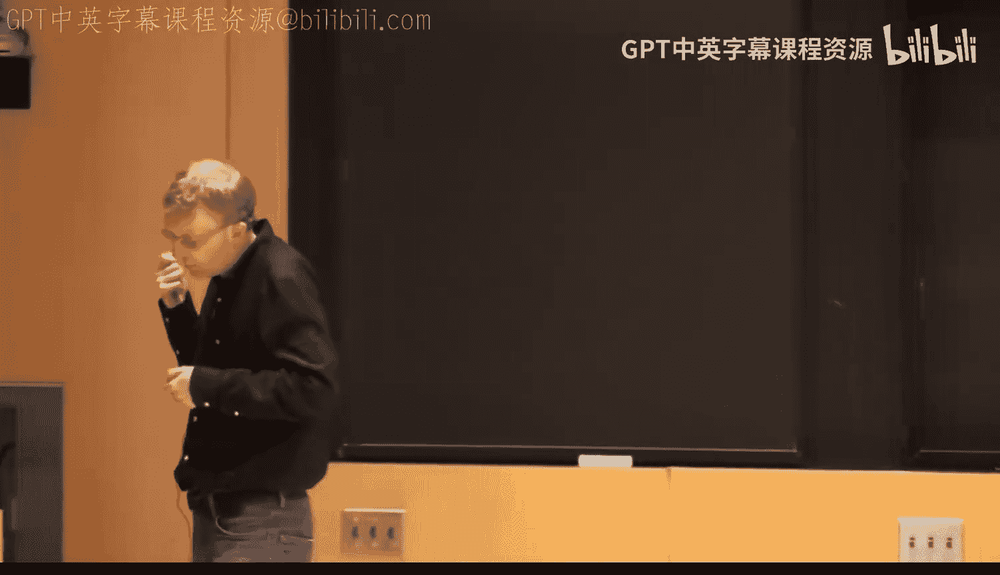

Because you're blurring， But if you blur， you know， if you rotate it a little bit。

 it still looks the same， roughly。Right， it's a good point。

 You can explicitly point that code that gets more complicated。

 The nice part about neural networks is that it consists of very， very simple building blocks。

 but can。😊，You can learn very complex functions that way。 And so here。

 this convolution is a really simple building block。Yeah。

 you know how usually like that is something like procrarop。

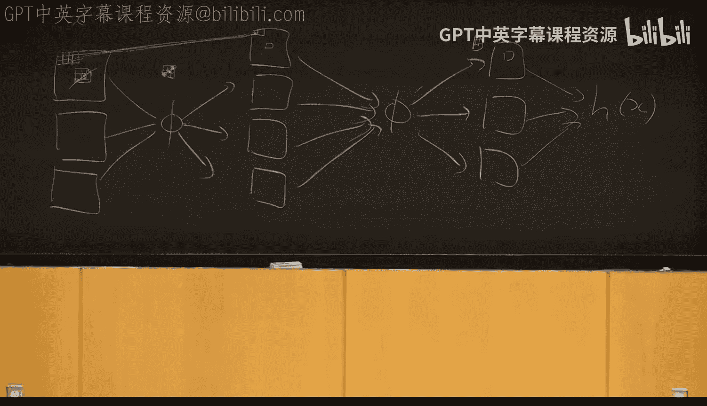

If you want to generate stuff like how you did research where you generated images。

 you just make your H of X have so many outputs that it can be like an image。

 and you set your lost function or like works。 I will get to them。 actually。

 that's exactly what I want to show you， actually， So maybe I can show it to you。 So okay。

 any more questions about comfort confidence。 So actually。

 what I'm going show you now is research on confidence。😊。

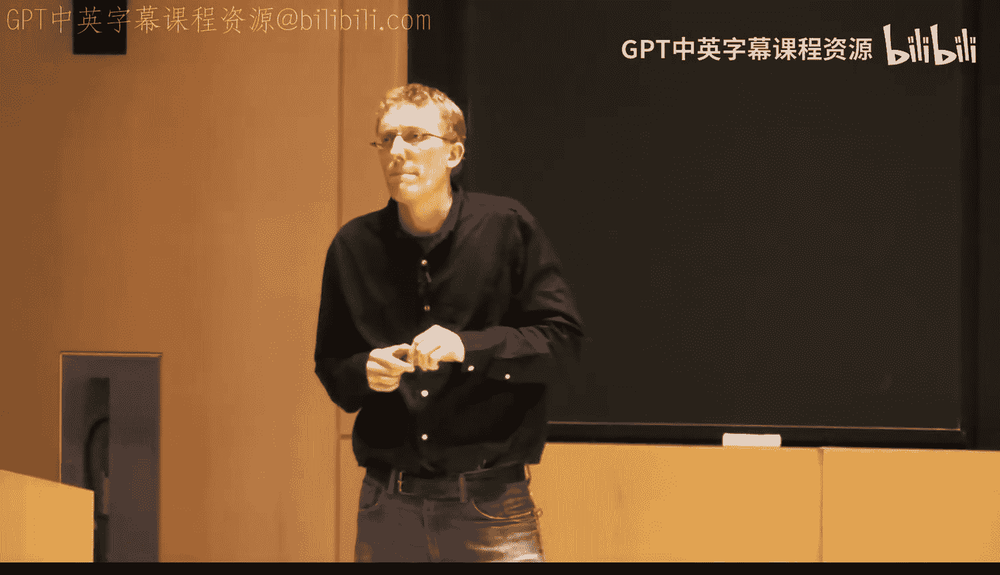

So basically， trying to improve the state of the art。 And I will try to go over it slowly。But please。

 please feel free to ask me questions。Yeah。the3 grid that you are referring to。

 how you multiply every shift have you determined the you learned， you learned。 So you do back。

The question is， how do you learn these convolutional kernel， How better they come from。

 And the answer is you learn。 That's exactly what you learn。

 Those are the weights of your neural network。

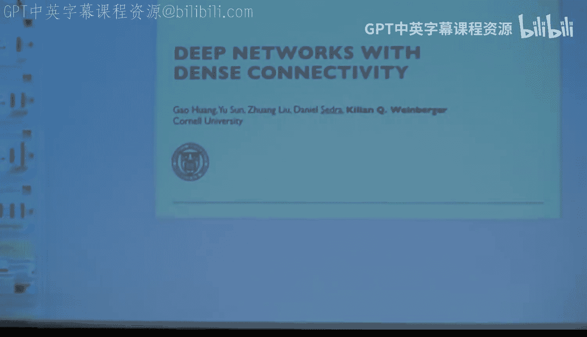

And。

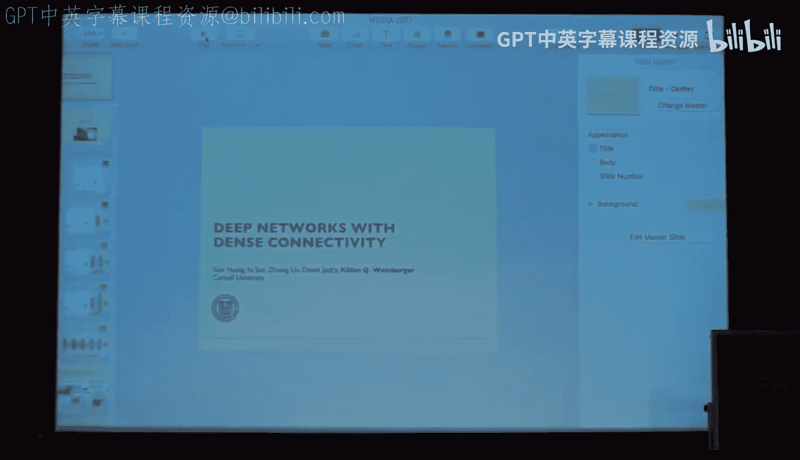

This is a talk I gave very recently at Nvidia actually， Nvidia Corporation。

They are very interested in deep learning because they sell GPUs。😊，嗯。W。

hy don't I actually quickly go over this。 So this is kind of a summary。

 This is how I summarize for them deep learning。And。It starts with the perceptron。

 right So The perceptron invented 1957 at Cornell。 And the idea， you know。

 you know that's very very well。 You implemented it yourself。

 You just have this hyperplane that separates positive and negative points， right。

 And so let me just write in perceptron as a neural network， right， It basically is the following。

 you have your input。 and it's directly connected to the output node。

 And every single connection is just one weight。 So if you look at the neural network graph right。

 you encode an inner product， W transpose X。😊，Just as this graph， right。

 So the value of the node here is the input。Those is my different dimensions here。 X1， don't have。

X 1 to X N。X D。 And then you multiply them， by the way， that's associated with every single。

 every single edge。 So I don't know if you can see this here have my X1 multiply by W1。

 And if they come together here， then that means you add them up。 Okay。

 does that that graph now make sense。😊，Raise your hand。 that graph makes sense。Okay， awesome。

 So when people talk， this is in some sense， the way people did think about neural networks。

 And actually， I love these graphs。 actually， It's not that I think they are bad。 I just。

 the problem I have is when people start relating them to things that's going on in the brain。😊。

Because often that that's， that's less helpful。So。One second。 So in deep learning。

 the only difference， basically what we're doing is we have one additional transformation W， right。

 we have our x， and we just applied x times W， right， Then we have our nonlinear transition function。

 which in this case is the rectified linear unit。 And then we apply our linear classifier。 right。

 So this year is my phi of x。😊，哎。For the longest time， if you think about what a kernel is。

 a kernel takes your data and maps it into a very high dimensional space。 So for a long time。

 people just thought， you just， what you need to do is you just to take your data and map it into a ridiculously high dimensional space。

 And that's very， very good。 And that was， in some sense， we could show that that theoretically。

 iss just as good as a deep network， But turns out that in practice， actually，😊。

If my basic certification is cheap because you have GPUs。

 then it's actually better to have just many of such layers。

 And that's the new thing that came out in the last couple years。 But suddenly。

 GPUs are fast enough to actually train these things。😊，So just one time。 you know， here。

 deep network， all we have is like X multi W。 Then we have a， you know rectified linear unit。

 Then we multiified by another matrix and so on。 And matrix modification here is just a fully connected graph。

😊，哎。So。Yeah， so deep learninging really， really works。嗯。So， here's the， the。The interesting thing。

 So so here comes my my research。 So that is something that my。

 my group and I have been developing last year。 And basically， you try to fix a problem。😊。

And here's the problem。 So these are kind of， the way the new neural networks look like。

 They are very， very deep。 right。 So if you look at new neural records。 now people have even know。

5000 layers or something。 And so one thing that's kind of going on on your network is you kind of what you do is you're playing a game of telephone。

 right， is it called telephone。 Yeah， telephone。 where the first layer is that this guy here is the input。

 and it sees this car。 And then you kind of talk to each other until the last layer， right。

 And the car says is like， it's a car， right，😊，And the reason the game telephone is fun。

 right is because people always mess up And you see something else。 So here we have， you know， she。

 you know， says bar， right， And then you know， because this person only hears the output of this layer。

 you know， the final output actually is fun。 So in some sense。

 the reason that the game telephone is set up in a way that basically have every single person is the bottleneck and you're just waiting for someone to mess up。

 right Well， that's exactly the setup we have in our neural networks。 right So we have many， many。

 many many layers， then what happens is that each one of them。

 you know if that messsses up and extracts the wrong features doesn't really fire properly。

 everybody else afterwards is you know。😊，Looks like this。So。The problem is during training。

 you can't tell because during training， actually， these layers don't mess up， right。

 Or if they mess up， you just do a gradient step and they don't mess up again， right。

 But the question is what happens during testing。And the longer my my neural networks are。

 the more likely it is that eventually I will mess up。😊。

So what we're trying to do is we trying to reduce the impact of layers。

 And so one thing that someone introduced is a very informationfal paper。 And this was 2016。

 Kaing he from China。 And he had this great idea。 we basically said we make additional connection。

 We connect the output here to， to this layer。 So if this guy mess up， we still have some kind of。

 we still have the information here around it。😊，So on telephone， that kind of would be。

 you listen to the person before you but you can also listen to the person before that。 He said。

 like what did you say， And that reduces the probability of mess ups。That kind of works。

 but you still have the same problem。 Like it's still， you know。

It's still the issue that during training， these layers don't mess up。 right。

 So what the network learns is that actually you can kind of ignore these skip connections。

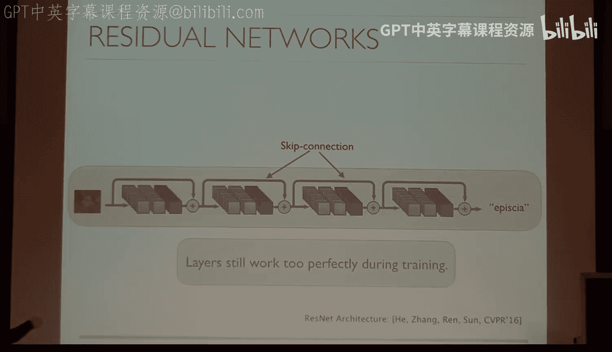

So here's what we came up with。 There's a very， very simple trick， but it's very， very effective。

 That's why I thought it's good to present it today。😊，So let's say you train on neural network。

 and it's really， really deep， right？😡，There's a really good trick。 you should try it。

Next time you train a really it in your network。 Here's what you do。 You actually introduce a coin。

 So for every single layer， you introduce a coin。And you flip that coin every time you do the and update。

And if it's heads， you keep it， and if it's tails， you remove it。

So you just basically surgically remove certain layers from your neural network randomly。

And then you just pretend the network is much， much smaller。When you now do an update， right。

 you just， you know， propagate forward。 and then you do a gradientding update。 right。

 So you get your original network。 And the next step， you do this again。

 So now you trustss again tos and you remove different， different layers。😊。

So every single time I do stochastic gradient descent。 Every single time I do an update。

 I remove different layers。 So I'm really kind of messing up my network。 right。

 I do the worst possible thing you could do， right。And so the reason you want to do this。

 So it's the one thing that I'm， you know， it's not actually the coins are not all the same。

Distributions， so you don't want to remove the very first layer。 You never want to remove the data。

 right， Then you have nothing to go on。 So that'll be ill advice。

So you have a  zero post probability。 You of removing the data。

 You have a 50% chance of removing the last layer， and you kind of interpolate between them。So。

 you know， when you train， basically， you know， you train this kind of network， right。

 So every single time， you never see the same network again，s Sp unlikely。嗯。

When you finally classify， you actually take the full network。

I can tell you now why this is a really good idea。 So here's a really good idea。

 Here's why it's a really good idea。 The first one is the final network is one that you that you actually use doing testing is where every single layer is there。

 That's something you never actually trained on。😊，Not one story training did you see that network。

 because it would be extremely unlikely。So what you're actually doing during testing is you take an average of all these networks that you train during training。

 so you kind of have some ensemble。But the other thing is a lot faster because during training。

 you only just take these very， very short networks。And finally， you know。

 you actually have more information slow。 I didn't go into this。

 but actually the gradient actually propagating the gradient to so many layers at the end。

 you you hardly have anything left repeatedly。😊。

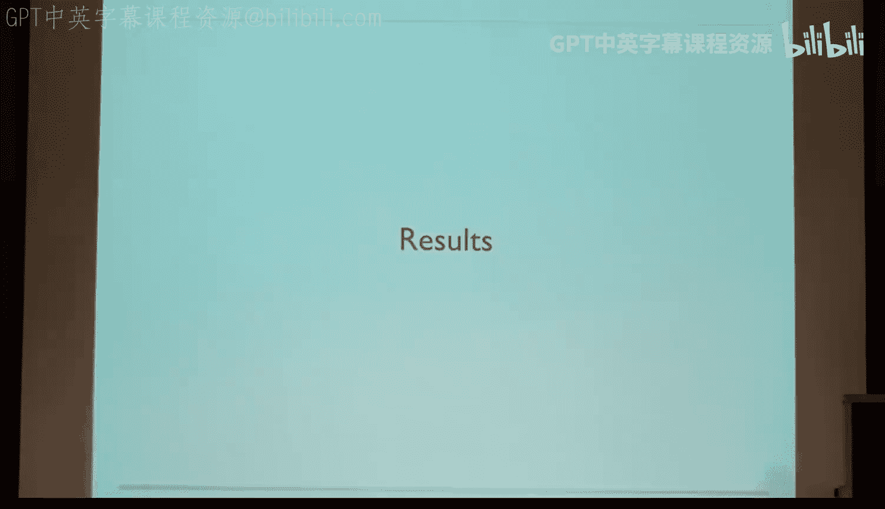

Anyway， let me show you， let me show you the effect of this。 So here I take this。

 this was the current world record on one of the tightest data set。 you know。

 this is actually Cy for 10。 but it's all the works on Inet。This is the current era。 This， is。

 these are images where we have 10 different classes。 we try to classify them into， you know。

 this is a boat。 This is a house， etc ce。If you take this network and the only change you make is introduce these coin tosses and remove networks layers during training。

 this is the error that we get。 right， So basically the error drop Str。

 This is this was the world record at the time， right， So in everything of all these data sets。

 Everything single data set we tried， the error goes down。 And the reason there is very intuitive。

 right， So basically what you're doing is during training。

 you're trying to lower the gap between training and testing error。

 your training error actually goes up But your testing error goes down， because during training。

 you actually simulate the fact， something goes wrong。😊。

And one thing that my students want to do is I say， okay， well， this is cool。

 now they can exchange a really， really deep network。 So beforehand， the Rogram was 110 layers。

 So they meant 1200 layers。😊，Which took about as much electricity as all of Ithaca or something。

 I'm not entirely sure， but it was a lot。 So this is what it looks like。😊，This is100 layers。😊。

And that gives you a little bit of an edge。Okay。😊，哎。And so they published this。

 And this was actually gave a lot of， got a lot of attention。 And then I felt really bad。 I was like。

 what did I， what have I done， I've told the whole community to train。😊，Networks have 1000 layers。

 right， This is like， you know， the amount of electricity on CO2 I'm generating is like， you know。

 this is I。😊，It's the opposite of， know， what I believe in， so。So something's going wrong。

 I felt responsible for this。 I told my students that they were like give were all like。

 this is awesome。 And I was like， no， it's not。 It's terrible。' done something wrong。

I don't want to go in that direction， so we became with something else。And so here's the idea。

That actually， in some sense， what a network does is reads the previous state every single layer。

 reads the previous state and writes the next state。

 You you can kind of read the Z neural network as It's kind of a function， right。

 where basically read the state do the manipulations and write it again。😊，And。

What we could show is that if he actually just remove something in the middle。

 that doesn't make much of a difference。Now， that's really weird， right。

 That basically means that these， these individualgenous functions， these are my functions far here。

 right， They're not doing much， They can't be doing much because I just remove them randomly， right。

It like if its always like like， you know， someone， you know。

 if you just randomly remove something and there's no difference， well that didn't do much， right。So。

They have a ridiculous amount of redundancy。 That's basically what's happening in these networks。So。

哎。Here's an interesting thing。 Well， let me just explain this。 So the problem is， in some sense。

 we are still playing the game of telephone。 Just occasionally， we remove people， right。😊。

So everyone has to speak louder。 if you you don't know if the next person is still gonna be there。

 you have to speak louder， That's crazy what it is。 So that' that works。 That's better， right。

 But it's somewhat still stupid。 Were still playing telephone。 So， you know。

 there's a reason we don't play telephone and we have business meetings。 So why don't we do this。

 Why don' we we do that setting instead。 Everybody can talk to everybody。 So believe it or not。😊。

You know， this is something that， you know， no one had thought of until this year。 Actually。

 we just showing this。 This justica published。 be presenting this next month。

 So we basically take you have an input input image。😊，And what we do is we take， you know。

 the first function。 But that actually is the input to every subsequentent function。 So every input。

 every function basically takes as input all previous functions。 right， So this function。

 Phi of x since this function basically takes this function is input。

 but also actually this layer is input and all sub previous layers is simple。😊。

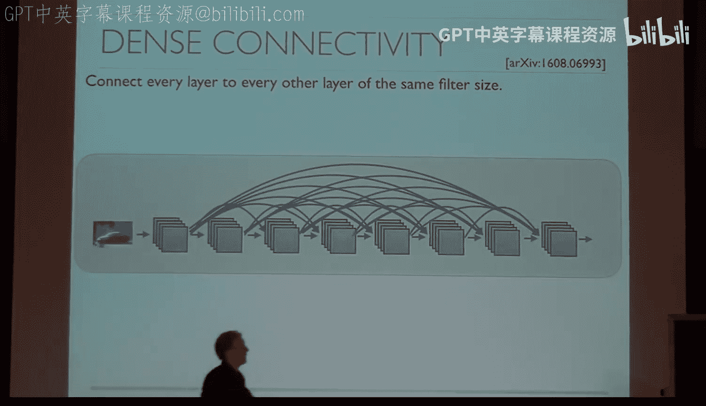

Let me not go into the details。😊，The beautiful thing about this is that actually you have no more redundancy。

 Like all of these layers basically， in some sense， learn everything they learn。

 you can can reuse later on。 If you do this， just a very small network immediately improve your result。

 And this's actually currently the state of the art and deep learning。

 So if you want to do deep learning， You want to win a prize on kle， use dance nets。

 Not many people know about it。 You're presenting it next month。 So you have an edge for one month。😊。

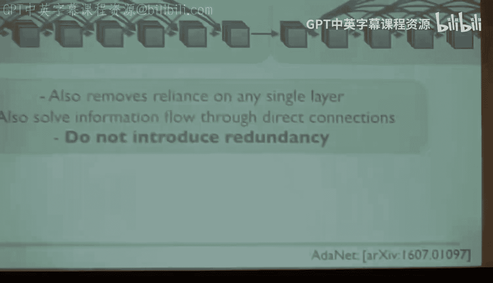

哎。H。And。Then of course， my students say like， oh， it's make a really， really big dance now。So。

So that next you can't get。So there's the 26 million weights。 it's ridiculous。 actually。

 it's illegal in some states， I'm sure。😊，But actually， if you do this。

 actually you can't pretty much win the you， be the world record on any data set。All right， good。

That's one thing。 So just just keep that in mind because， you know， it works really really well。

So let me， let me ask you。 let me show you another project。

 This is something that I asked my students， and。So you've working a lot on these deep nets for images。

 And so one question I ask my students why is it， that companies works so well on images， right。

 Like you have this translation of variance， But it's still like， it's so amazing， right。

 Like if you put in this translation of variance into other project algorithms。😊。

It doesn't help all that much。 It's not as good as confidence。 So why is this， And so。

 so had a conjecture。And my conjecture was the following。That what deep netts are doing。

And this is very interesting， by the way。 is transition in in machine learning。

 So machine learning used to be completely deductive。

 So that means we have some axioms that we think of。😊，Something like boosting， for example。

 It's completely deductive。 Right， So we think if we have weak learnners and we have the following properties。

 And now we be basically， if you assume these aoms。

 we can now derive an algorithm that is following guarantees。

Inductive research is the other way around。 you have something and you try to like em， right。

 you have the cell It's made by some。 I don't know who made the cell， right。It's alien technology to。

 to us。 And we try to figure out。 We try to do experiments。So in some sense。

 what we're doing is actually something inductive here， which is very rare machine learning。

 So we kind of look at these you know networks and you say， well， why， what are they doing。😊。

What are they learning。 And this basically these， you know， these very deep neural networks。

 And so my conjecture was images lie on manifolds， right。

 So thats we know this because otherwise we couldn't do anything with images。

 And also if you were just randomly sample an image， you would always get noise。

 right You would never you could just randomly assign pixels to an image。 look at it。

 it will never be anything interesting， So we know the lines are very small part of the space of all possible images。

 And we know they're locally smooth because if you take two very。

 very similar images on average them， you still get something that resemblebls an image a lot。😊。

So what I was claiming is， but deep nets are doing is that all this convolution youre linearizing the manifold。

 And this is not something that， you know， I didn't come up with this conjecture。 I was， you know。

 there is something that a lot of people kind of this kind of。You know。

 people were kind of talking about this。 It was in the air， right， How do you， how do you figure。

 how do you prove this stuff， So here's， you know， an experiment。 So basically。

 what I'm claiming is like you have this image of， of this manifold of images。

 So manifold is basically this curled， you know。Surface in a high dimensional space。

 And I claim that this neural network somewhere internally， turns us into a subspace。😊，嗯。And。

Then actually， everything becomes easy。 And so this doesn't come from nowhere because at the end。

 the last layer is still a linear classifier。 So in some sense。

 what we must be doing is we must be somehow linearizing this。

 And one thing people realize is if you train a new。😊，Network on some task。

And then you actually just take。That representation。

 and you stick in some images for some other task， it still actually works pretty well。

So somehow they're doing something more than just learning that task。 They are somehow， you know。

 the conjecture was， maybe you know， they're just linearizing the whole manifold of the images。

 So here's the here's the idea I came up。 so， you know。

 let's take a problem that's really easy for deep nets。 But it's pretty complicated。

 Like dos have beards or not， right， So here we have people。 These are all men。

 And they have no beard。 and these have beards。😊，And so I claim that on this manifoldt。

 they look really far away from each other。 But like two bearded man and take an average， right。

 It's not gonna to look like anything pretty， right， just because they have beard。

 does not mean I can they look alike， right， So theyre looking all over the manifoldt。😊。

The same with people， man without beards。 You can't just take you know， two。

 like by the do people understand this my my， my averaging analogy， if you have。

Like a manifold like this。 I take an image here， an image here。 and I complete the average It here。

 So it's off the manifold。 That means it's no longer a true image。 does that make sense。

 So only things on the surface are images are true images。 Okay， so that's what we realize。

 if you take two images that are really far apart。 right， Take you know。

 Donald Trump Hillary Clinton， take the average between the two， it's not a natural image anymore。

 right， So， but that's even true within， you know， just generic people with be without beard。

 But actually， a linear classifier works really， really well on that space。

 you can train a deep net very easily to classify， you know， this person of a beard。😊。

So years what I want to do I said， okay， well， if my projectjecture is true。

 then I could take a network that's not trained on beerard at all。

 It's trained on classifying dogs and cars and trucks and anything。Now。

 I stick in an image that's never seen before。This person。And I move him。 He doesn't have a beard。

 Ar， and I I try to move him towards the bearded people。Then you should get a beard。That that's。

s that was my contract。So we trust this。 So this is the setup。

So what we did is we took this neural network that was actually trained by not by us， right。

 We want to just say， what do neural networks do that other people trained。

 So we took trained by the University of Oxford， you know， and they put the neural network online。

 and we just downloaded it。 Now we take this image that was clearly they didn't have， right？

 I know this for sure。 So I take that image in。 And I。

 I represent this image now as all the activation。 So what I'm doing is like all the internal basically values of the neural network。

 make one long， long， long vector。 right，'s that's how I represent that image。😊，Okay。

Now I take the space， and I claim this is now now here in the space space these things are linear。

Is no longer a manifold It's now a subspace。 So here's， I do this。

 I take additional images of people of man， They kind of look similar to me more or less。

Not George Clooy。 It's not there。Without beard and with beard。And I average them。Okay。

 so this in some sense， the average man without a beard is the average man with a beard。

Another question is， if this describes a vector， right， This is the different vectors。

 This is the direction of beardedness right in this high dimensional space。

 If you go along this direction， you should get a beard。 Thats， that's my hope。 If it's a subspace。

 If it's not a subspace， we're gonna move off into Lala land and it's gonna be look ugly， right。😊。

So now we can take this vector and add it to my image。And now， hopefully。

 this year will now be the version of me with a beard。So how do we find this out。 Well。

 it's quite simple， Actually， So we now take this， go back to our neural network。

 And here's what we do。 We just take the， we just take， you know。

 this basic whole lot of numbers that basically correspond to values in those neural networks。

 now we can。😊，Just populate the neural network with these values。😡，And now to gradient descent。

 not to change the weights， but to change the input image。

And say which input image would give me rise to these values。

 So which input image would give me this point。Okay， so I'm just reversing this。All right。

 does that make sense？Rraaising the hand if that makes sense。Okay， awesome。 All right。

 do you want to do it， You ready。Allright，1，2，3。Here we go。it works。

There's nothing special about me they can take other people， they are randomly chosen people。

And some celebrity data sets。 So I know some of them not personally。 I just recognize them。

 And so we're gonna take them and add add beers to them。😊，But actually。

 there's nothing special about beerard either。 So we can just take， you know， take these images and。

 and， you know， make them look older。Make the mouth open， right？ So here we can make the eyes open。

 This looks a little weird here。 But this guy pops out right away。And can make them smile， right。

 you give them glasses， all that stuff， right， And the important thing， though。

 is that all of these are just linear interpolations。 So all I'm doing is I take this image。

 put in the space。 I'm not training any neural networks， right， I'm just putting in the space。

 I add a vector to it， and be constructed。😊，Andm it's really about improving a point the point is that now I'm in a subspace in a subspace。

 everything becomes easy。😡，He also do something funny。

 you can take people's faces and cut out the middle part。So this way， we move off the manifold。

 then because it go back into the manifold， and then the face comes back。So these are， by the way。

 these are not the right faces。 These are totally different face。It's just a face。 But， but。

 you know， it tends to give women female faces。 And men， and this just means there's not。

 It doesn't learn anything， right， It just basically means it has learned a space in which space。

 if I go back to the subspace， I'm， I'm， you know， like sematicically makes sense， right。

 so that basically women on some region and men on the other region。😊，哎。

We can even try this some very high resolution。 So this is now 1000 by， I think 900 pixels。

 So this this fellow years， we can now take this point at this guy in and move him along。

 along the direction of beardedness。😊，And so this's what we get。 You can go be back again。Right。

And so。It's not bad if you look at your boyfriends they're like， you know， maybe maybe stop here。

 right？嗯。This is my dad。So of course， I can't even believe like even I enter my lab。

 like every time like my students are hiding something， he's like， oh。

 we just made you into a woman or we just made you。A lot of it I't。 I don't want to see it。

 Nobody wants to see it。 But this I go on。 this basically， I think at the very first lecture。

 I showed this image。 this kind of they took me and aged me right。

 I like this a lot because of they ultimately me younger and then went to my wife and asked。

 is that what he used to look like when you met him。 And she was like， yeah。

 that's kind of what he looked like。😊，Right but you can see basically。

 this is kind of the progression of agent。 it puts in wrinkles， and it puts in， I don't know。

That's what I have to look forward to。😊，诶。Anyway。Oh yeah， this also a good one。 So this is a boy。

 So obviously this's an image that doesn't exist， right， you know。

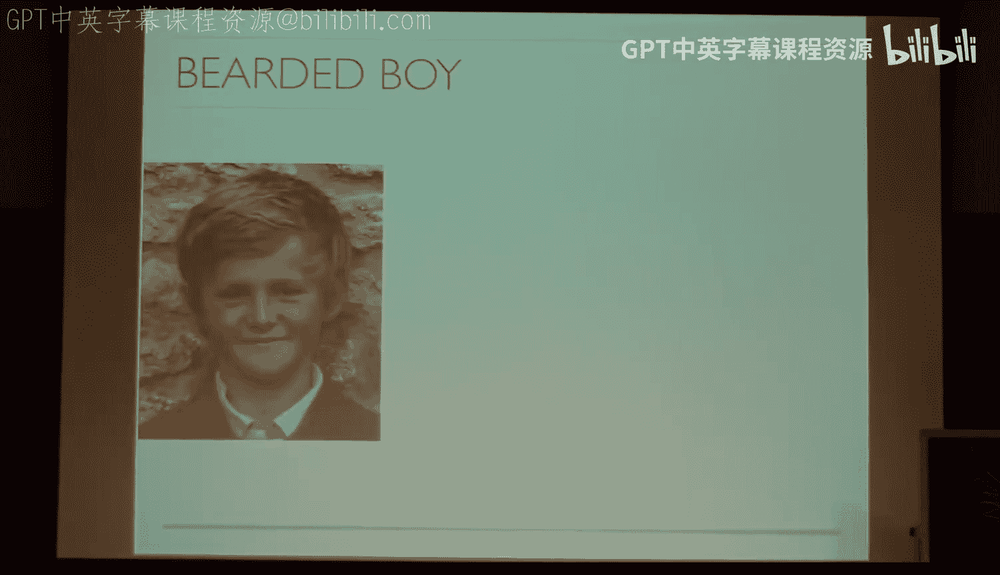

Yeah。Surprising how much fun you can have like adding beers on the people。H。😊，It turns out actually。

 so it works really well， actually， for men。 if actually I was on failure cases。

 where does it not work。 And this is also very interesting way it breaks because it tells us something。

 So this is this person here。😊，We， we gave him a beard， but we also actually changed his race， right。

 So he looks a lot darker。And what we found is that basically what we did is like the images of people with。

 we try to find similar people。 So they kind of the people are baled and actually have a beard。

And to that， that's actually more common， I guess， in the African American community。

 So so somehow we actually had a vector that kind of。Pointed in two directions。

 beness and you know a different ways， basically。So we thought that's interesting。 In some sense。

 species， you could actually do two things。 you could basically do two changes。 right。

 first add Vietnam centuries。 And actually， turns out women is much， much harder than men， which。😊。

Is for two reasons， A because the naifold like is more complicated of women。

 And that's because there's a lot more variations going on。 So man don't， you know。

 it's kind of funny。 Man can all look pretty similar， actually。

So there women have more variety in terms of lipstick or， you know。

 like makeup and hair is much more variety compared to men。 So what you would need a lot more data。😊。

But actually， we get our data from the Internet。 actually turns out that we get celebrities。

 actually a lot of them as politicians。 So there's a huge bias towards。EMan。

 so we actually had fewer women， but you would have needed more women。

So this is something I think it shows you basically how densely sampled the manifold is is crucial。

 I think that's the last slide I have on that project。 Is there any questions So anything。😊。

That I talked about。嗯。Okay， good。 next actually， you know what。

 I can actually show you one more demo， okay。😊，嗯。so诶。Yeah。Can you talk more about？

Between the like physicallyly connect deep net and like drop off， like when trade used to。

For example， you drop out， drop， drop out， I mean， see our dropping layers and nets。呃CNN的 drum mall。

I。So I said some more time， drop out， do you mean， I see。

 So drop out or dropout does but we are dropping layers。 So you shrink the length of the network。

 drop out changes the width of the network。RightSo changing the width of the network is not so。

 it's not such a big surgery in some sense， right because you're just removing a few notes。

 If you change the layers， you could actually change multiple layers that you're really kind of breaking the network。

So the effect is very different， actually。AJobout used to be just for those who don't know。

 it was something introduced as a regularization method。

 You just take different dimensions and set them to  zero inside a neural network。嗯。And。

 but it actually has recently， it was very popular for a couple years and has recently gone away because people now use batch normalization as a new thing。

 So the one thing about deep neural networks is the area is moving very。

 very quickly every few months， there's completely new papers that come out。

 And so something that's within the three years is kind of the lifespan of any technology。 And then。

😊，ENew things， new better things come out。Allright， good， so。Well。

 I know who was the number one last time or。Raise your hand if you want to see one last demo。Okay。

 sure。 Okay， good。 So this is。that's about researchers。

 I guess so what I thought I kind of I was ready for any outcome of this， of this of this vote。

 So what I want to tell you about the other class。 So the other class is machine learning for。😊。

Data science。 So we have this is machine learning for intelligence systems。

 And the other one is data science。And the distinction actually， is that intelligence systems。

 in this class， what we did is predictions。 So we tried to basically say。

 let's make a prediction try to predict something like in a self-driving car or you know。

 try to predict the stock market， etc cetera， for decision making。

In the other class in machine learning for data science， what you do is you learn that。😊。

You learn to discover structure and data。 So you have basically。

 imagine you have a data set your biologist， and you try to make sense of it。Then basically。

 what you would like to find cluster structure， you try to find low dimensional。

 low dimensional subspaces， etc。

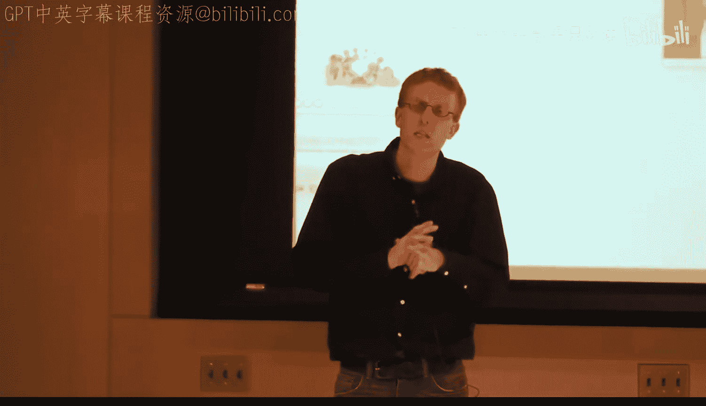

So there is something I worked on you know you saw just now。 I talked about manifolds。

 So one thing I've been working on a lot in my life is actually learning manifolds。

 And so there is in some sense why I'm working the book I just presented to you like how we learning manifolds。

 this' is really something I've been working on for 15 years， actually。

 like my PhD thesis was on how to learn manifolds。 So I've been thinking way too much of my life。

 actually， about this。 I think the question is， given that data lies in the manifold。

 How can I learn this low dimensional representation。😊。

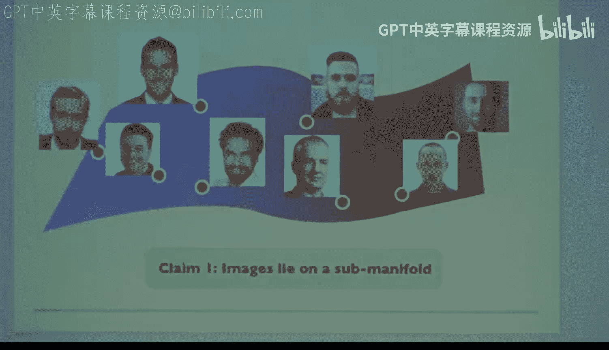

And this was a，10， you know， maybe 12 years ago。 This was a very， very big topic。

 And I can show you some。here we go。 Some of this actually algorithm that was my PhD thesis is here you have data that's in a three dimensional manifold。

 It's like two dimensional manfold that's embedded in a three dimensional space。😊。

So this is an unsupervised。 this kind of data analysis。

 This is kind of stuff you would learn in the in the other class。 And the idea is basically。You know。

 here's， you know， what the algorithm would do。 And people thought it was very exciting。

 I thought it was extremely exciting at the time。😊，You have this data set。 It's， it's true。

 it's three dimensional， but it's truly two dimensional。 How can you discover this。

 And what you see what you do is you build a graph and you kind of flatten that graph。

 So this is what happens。And actually， it learns that actually。

 this lies in a two dimensional subspace and。😊，It's very similar to what conflicts are doing。

 So you actually now can take any point here and move to any other point。

 And you just move in a straight line。 And what you're doing along the straight line actually is。

 you know， iss actually a mini four distance in the original representation。

 If you would hear the blue blue point and you move in a straight line。

 you would always move off the manifoldt， right， and you move somewhere where theres no data。

 So once you have this representation， you can， you can。😊，You can do a lot more with the data set。

 so。Does the sound work， I don't know if the sound works。Can I test the sounds of what？诶。

I think it's on。Okay， so， so this was my PhD thesis。

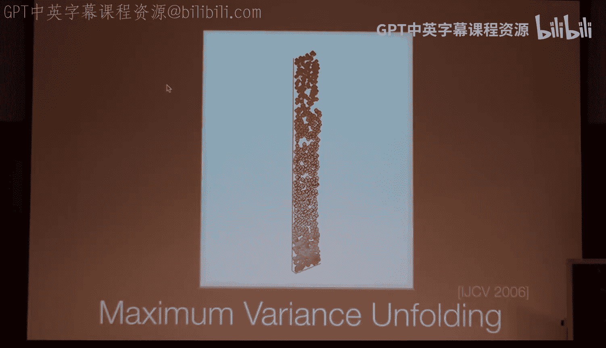

I worked a lot on this。 And at the end of my PhD thesis。I had a workshop。That I organized。

 So this was me。And this is not computer generated。 This is actually me younger。

And this was basically on applications of dimensionary reductionductions。

 So if you can basically learn these manifolds， right。If you can do something like this。

 but data is really truly on a manifold， right you can unfold it。 What are the applications。

 we thought there's going to be so many applications。 It's huge。

 So we had this workshop and people came and this is the applications that we found。😊。

Like every single moment was the same stupid Sw data set that was completely artificial。

 And this actually， this is why I got out of that， actually。

 because there was absolutely no future to it。 So， so。😊，Basically， what turns out that actually。

 at the time， we could really only unfold very synthetic data sets。

 So now now we can actually do it 15 years later， we can actually learn the anyfolds。

 But at the time， we could really only unfold these very， very low dimension。

 these kind of synthetic data sets。 So I was extremely disappointed。

 And I I gave this talk in front of the entire field。 And I was like， you know。

 basically every all our data sets are synthetic。 And can't we find a single real world data。 And。😊。

So I was like， well， I found one data set thatd be like。 And that's the， the Swiss role。

 the X Cinnamon role。😊。

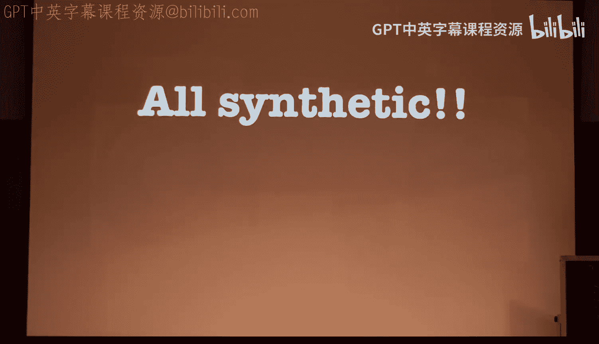

And so I tried to apply these algorithms on the cinemamon roll。 And so here。

This is my own PhDP algorithm applied to the cinemamon roll。 Let's see if the。Sound works。

 I hope the sound works。Yeah。And this was kind of a competitor。 His local linear bedding。

 Local linear em bedding was a different paradigm。 You take out manifold。

 You cut it up to little pieces。 They're all linear。

 and then you stitch it together and load dimensional space。 You can do that， too。😊，か。我是怎么？Oh。

It's amazing you got a job after this。Of course， one thing you can always do is you can just instead of doing these nonlinear unfolding methods。

 you can just use a linear method。 right So the most famous one is PCA。

 So principle component analysis is basically projected data in a low dimensional space。

 You can try this， too。😊，And the nice thing about linear methods is you can reconstruct the data。

 so this is the reconstruction。Anyway， ultimately， of course。

 the whole point is to do something with this data， this load dimension for data。

 but it turns out it didn't matter。My core author is Azimore。Anyway， that's。just funny Bye by。👏All。

Thank you all this was a wonderful class and I see you all on Wednesday。

 M myTs told me to make the exam easier and I will try。

