# 机器学习：037：神经网络与深度学习

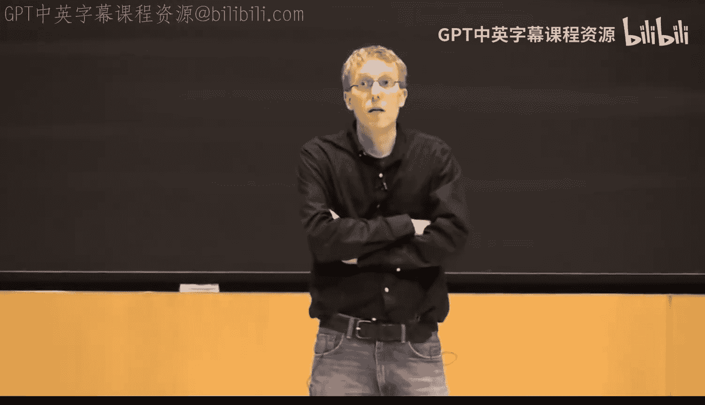

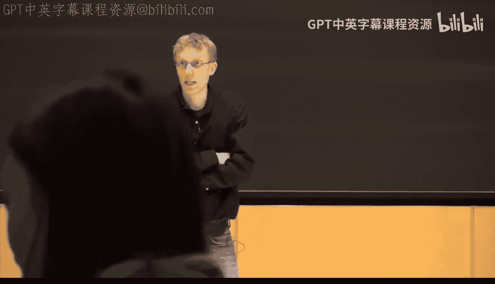

在本节课中，我们将学习神经网络与深度学习的核心概念，特别是卷积神经网络的工作原理，并了解当前该领域的一些前沿研究。

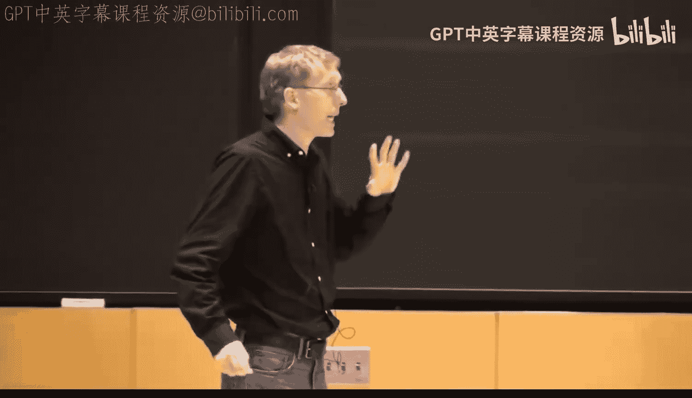

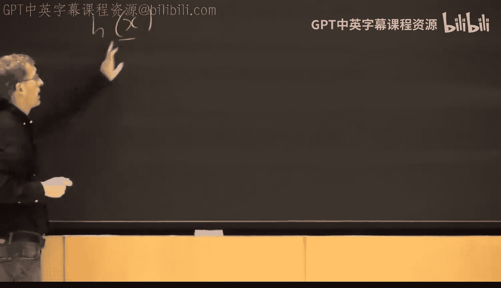

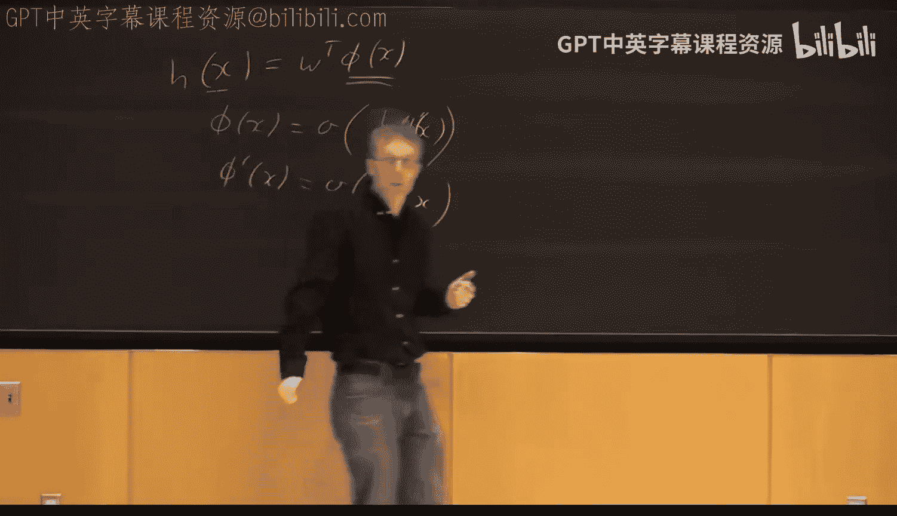

## 课程概述

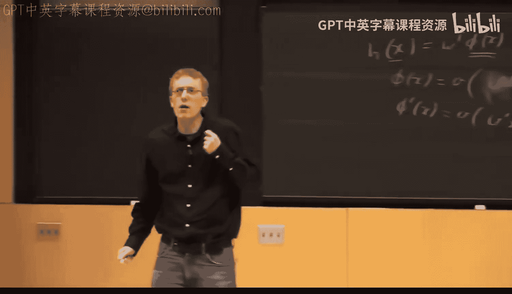

这是本课程的最后一讲。由于之前因天气原因取消了一节课，我们今天需要做一个选择。根据大家的投票，我们将继续深入探讨深度学习，特别是卷积神经网络，并了解一些当前的研究进展。

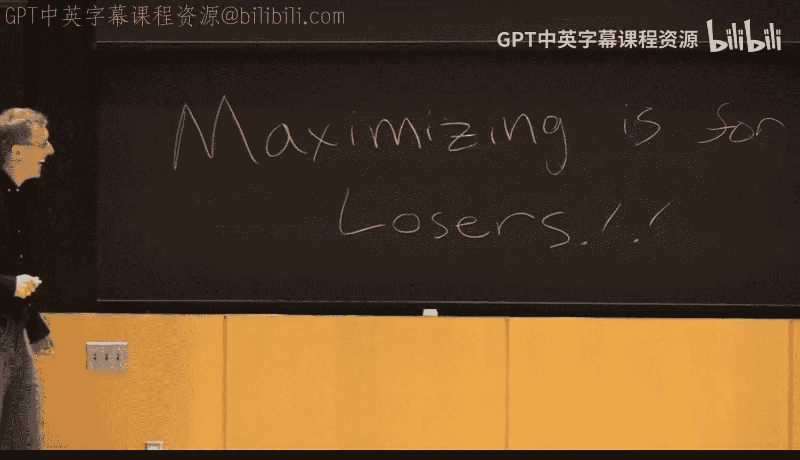

## 神经网络回顾

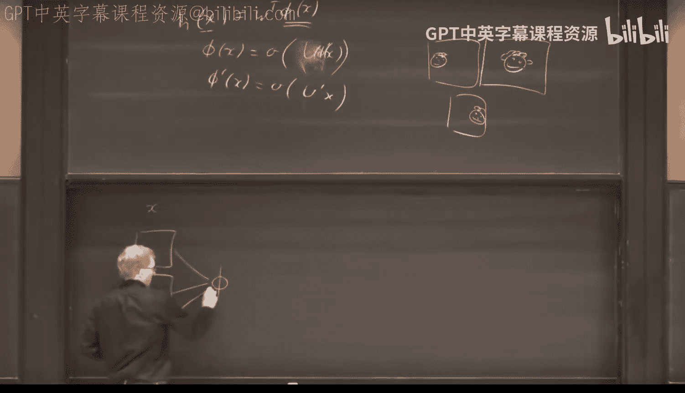

上一节我们介绍了神经网络的基本概念。简单来说，神经网络旨在学习一个函数，其形式为 **h(x) = Wᵀ φ(x)**。这里的技巧在于，**φ(x)** 本身也是一个函数，它可以由更基础的函数嵌套构成。例如，**φ(x)** 可以是 **φ'(x)** 的函数，从而形成多层结构。

这种结构被称为**全连接网络**。如果我们用图形表示，输入 **x** 的每个维度都是一个节点，这些节点连接到隐藏层 **φ(x)** 的每个节点，隐藏层再连接到输出层。之所以称为“全连接”，是因为每一层的每个节点都与前一层的所有节点相连。

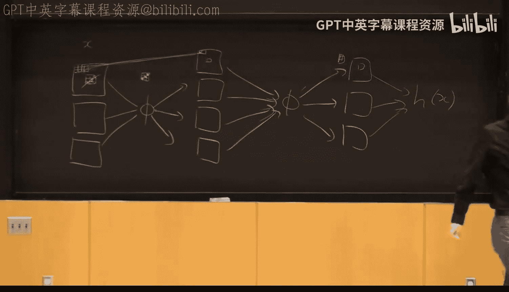

## 卷积神经网络的引入

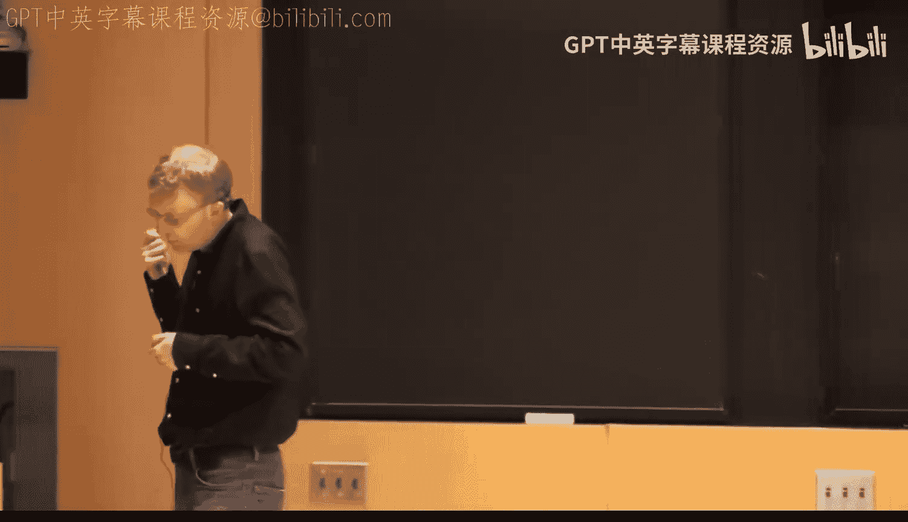

然而，在处理图像数据时，全连接网络存在一个问题：它忽略了图像固有的空间结构信息。当我们把一张图片的像素展开成一个长向量时，就丢失了像素之间的二维邻接关系。

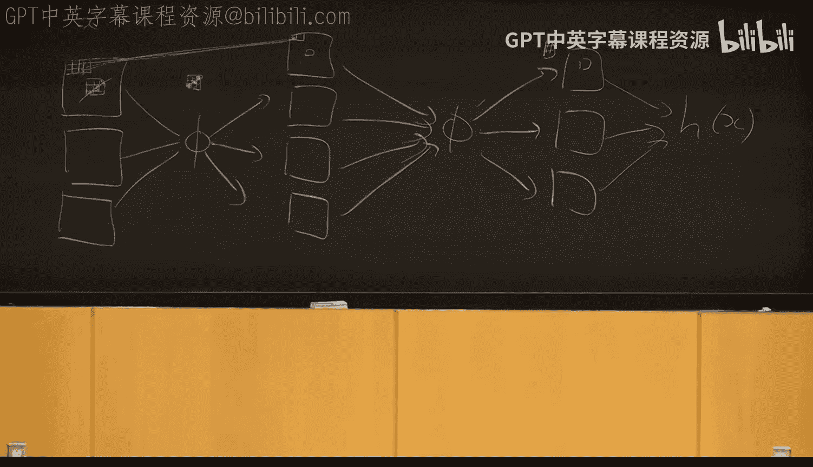

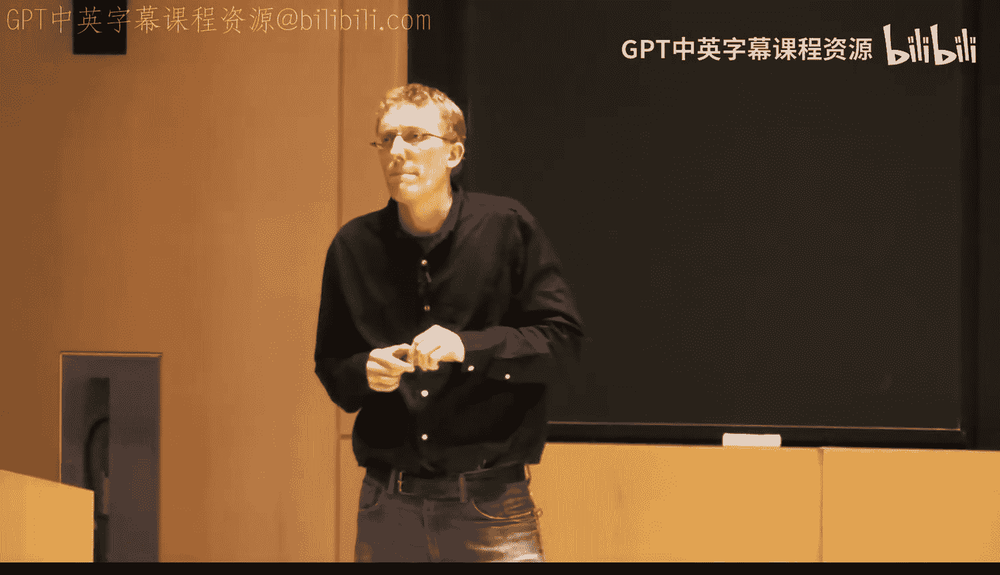

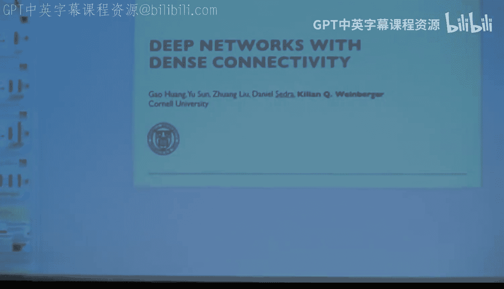

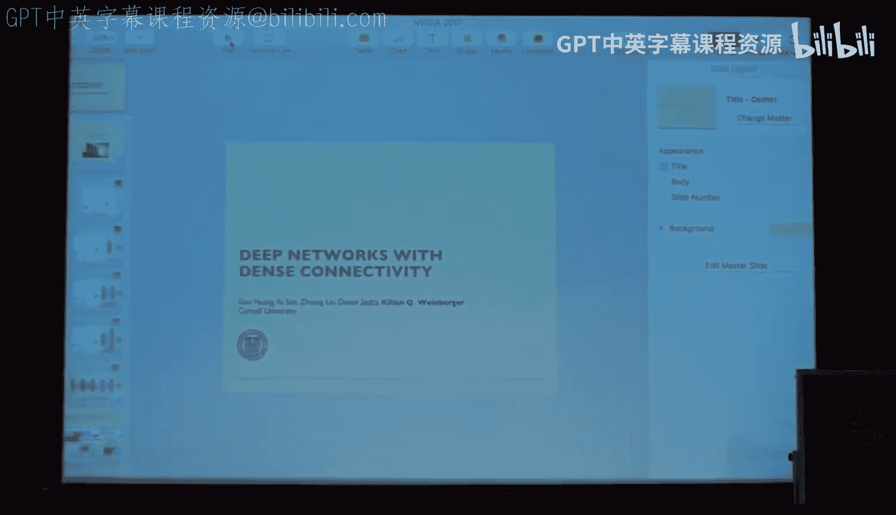

图像有一个关键特性：**局部平移不变性**。这意味着，如果图像中的物体（比如一张人脸）在画面中稍微移动一点位置，它仍然代表同一个物体。但对于向量化的像素表示，位置的微小变化会导致向量值发生剧烈改变，因为对应的像素完全不同了。

为了识别物体，一个全连接网络需要看到物体出现在图像所有可能位置的训练样本，这需要海量的数据。**卷积神经网络** 通过修改函数 **φ** 的结构，将这种平移不变性直接编码到网络中，从而极大地减少了所需的数据量。

## 卷积神经网络的工作原理

卷积神经网络尊重图像的原始结构。它的输入不是一维向量，而是具有多个通道的二维图像（例如，彩色图像的红色、绿色和蓝色通道）。函数 **φ** 的作用是接收这些图像，并生成一组新的图像作为输出，下一层的 **φ'** 再以这些新图像为输入，以此类推。直到网络的最后，才将图像表示转换为一维向量进行最终分类。

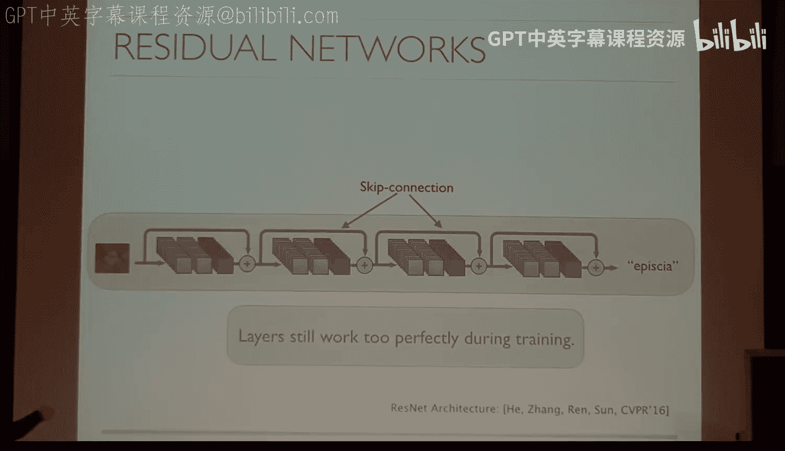

这个过程中的核心操作是**卷积**。具体做法如下：
*   我们有一个小的滤波器（例如一个3x3像素的网格）。
*   将这个滤波器在输入图像上滑动。
*   在每个位置，计算滤波器与对应图像区域像素值的**点积**，结果作为输出图像在该位置的值。

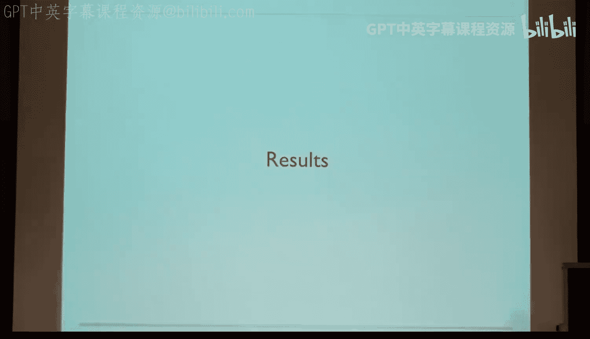

这个滤波器中的数值就是需要学习的权重。通过训练，不同的滤波器会学会检测图像中不同的局部特征，例如边缘、角点或圆形。随着网络层数的加深，后续层可以组合这些低级特征，检测出更复杂的模式，如眼睛、鼻子等。

训练卷积神经网络的方法与训练普通神经网络相同（例如使用反向传播）。实际上，卷积网络可以看作是一种特殊的全连接网络，只不过我们将大部分连接的权重强制设为零，只保留局部连接。这种限制迫使网络学习对平移变化不敏感的特征，这正是其成功的关键。

## 当前研究进展：提高网络鲁棒性

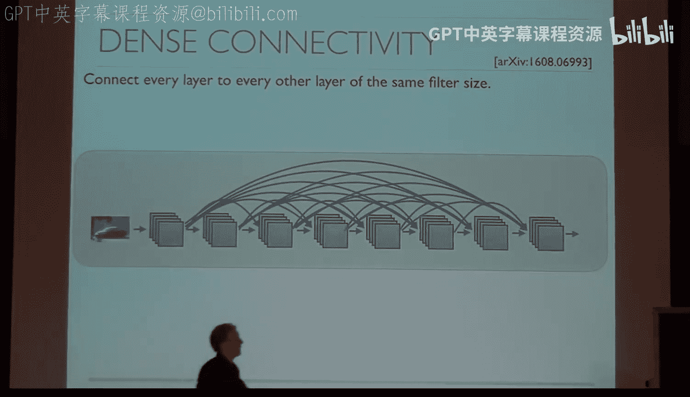

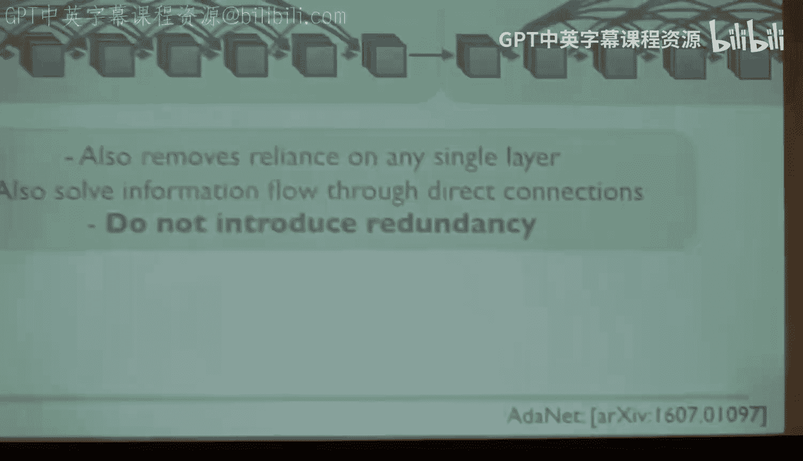

卷积神经网络在计算机视觉领域取得了巨大成功。当前的研究致力于改进这些网络。一个主要问题是：现代神经网络往往非常深（甚至有上千层），这类似于“传话游戏”，信息需要经过很多层传递，任何一层出现误差都会影响后续所有层。

为了提高深度网络的鲁棒性，研究人员提出了多种方法：
*   **残差连接**：让某一层不仅能接收前一层的输出，还能接收更早层的输出，确保即使中间层“传错话”，原始信息仍然可用。
*   **随机深度**：在训练时，随机“丢弃”（暂时移除）网络中的某些层。每次参数更新时，都随机选择不同的层组合进行训练。这迫使网络不依赖于任何单一层的完美运作，并且最终用于测试的完整网络可以看作是许多较浅网络的集成平均，提高了泛化能力。

## 前沿研究：密集连接网络

基于随机深度等思想的启发，我们提出了更极端的架构：**密集连接网络**。在这种网络中，每一层都接收前面所有层的输出作为输入。这就像开会时，每个人都能听到之前所有人的发言，而不仅仅是前一个人的。这种结构极大地减少了网络中的冗余，让信息流动更高效，通常能用更小的网络取得更好的性能，目前是多个基准数据集上的最优方法。

## 研究探索：理解网络所学

另一个有趣的研究方向是理解深度网络究竟学到了什么。我们的一个猜想是：深度网络（特别是卷积网络）能够将图像数据所在的复杂“流形”映射到一个线性子空间中。

为了验证这一点，我们进行了一个实验。我们使用一个在ImageNet上预训练好的网络（从未见过特定人物）。我们将一张没有胡子的人物图像输入网络，得到其高维特征表示。然后，我们计算“有胡子”和“无胡子”人群平均特征向量的差值，得到一个“胡子方向”向量。将这个向量加到原人物的特征上，再通过优化方法反推出对应的新图像。结果发现，生成的新图像中，人物确实长出了胡子，且看起来非常自然。

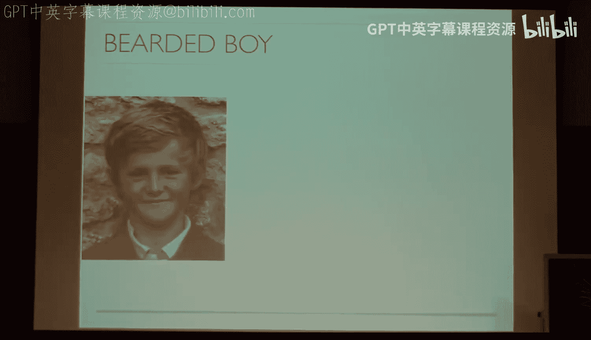

这表明，深度网络学习到的特征空间具有很好的线性特性，语义概念（如“有胡子”）对应着空间中的特定方向。我们还可以进行其他操作，如让人物变老、微笑、戴眼镜等。这个实验也揭示了方法的局限性，例如数据偏差（数据集中男性远多于女性）会导致在某些情况下效果不佳。

## 无监督学习简介

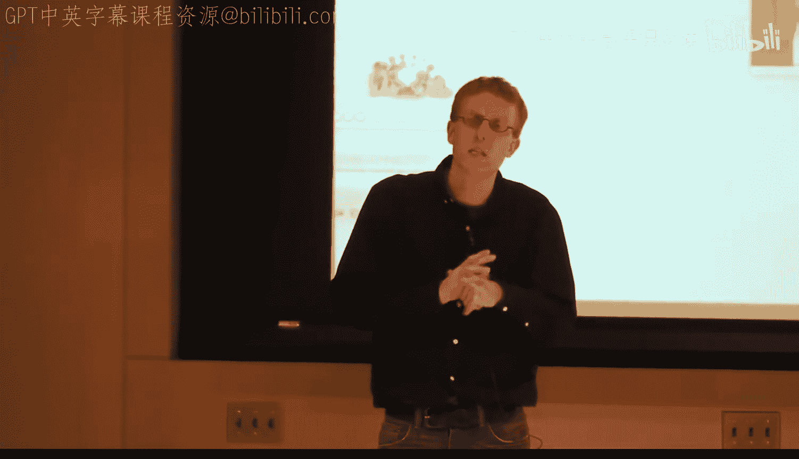

最后，我们简要提一下机器学习的另一个重要分支：**无监督学习**。本课程主要关注有监督的预测任务。而在无监督学习中，目标是从数据中发现内在结构，例如聚类或降维。

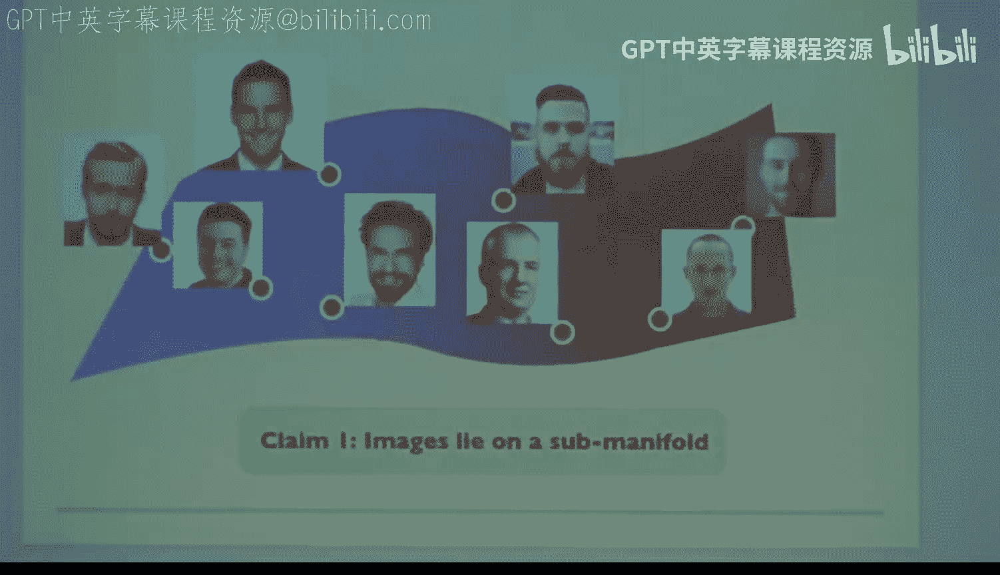

一个经典问题是**流形学习**：假设高维数据实际上分布在一个低维流形上（就像一张皱巴巴的纸放在三维空间中），目标是找到这个低维结构并将其“展开”。早期的方法（如等距特征映射、局部线性嵌入）只能处理简单的合成数据。如今，深度学习为处理真实世界复杂数据的无监督学习提供了新的强大工具。

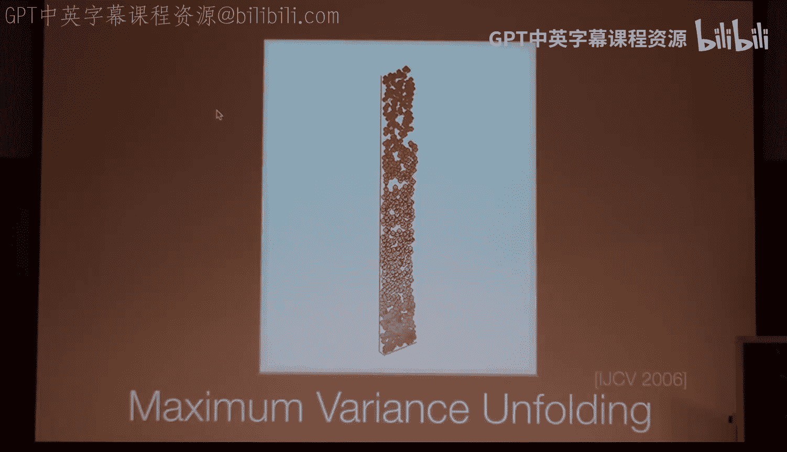

## 课程总结

本节课中，我们一起深入探讨了卷积神经网络的核心思想，它通过卷积操作和权重共享，巧妙地利用了图像的平移不变性。我们还了解了当前深度学习领域的一些前沿研究，包括提高网络鲁棒性的技术（如随机深度、密集连接）以及对网络所学表示的探索。最后，我们简要对比了有监督预测和无监督发现结构这两大机器学习范式。希望本课程能为你进一步探索机器学习领域打下坚实的基础。