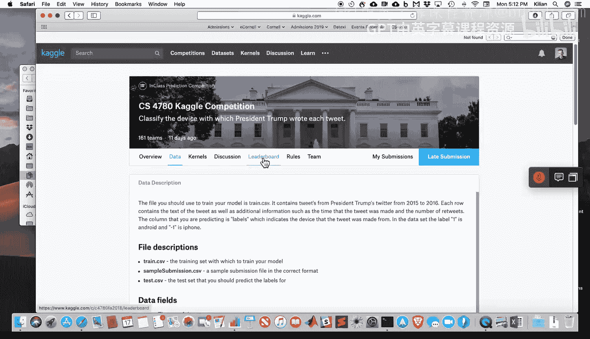
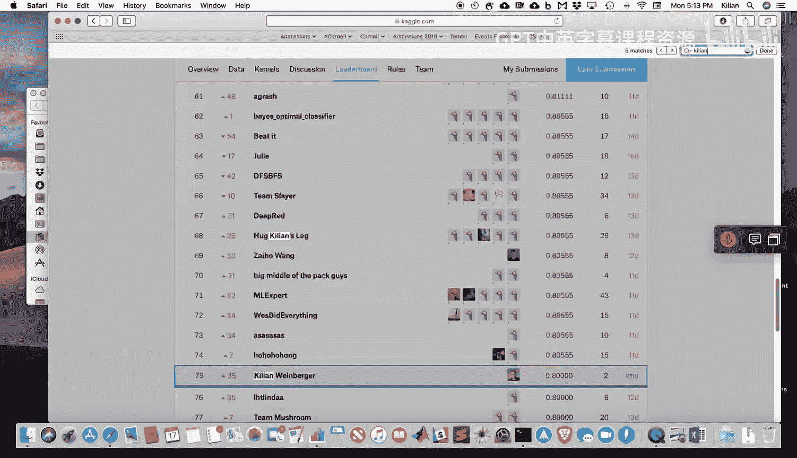
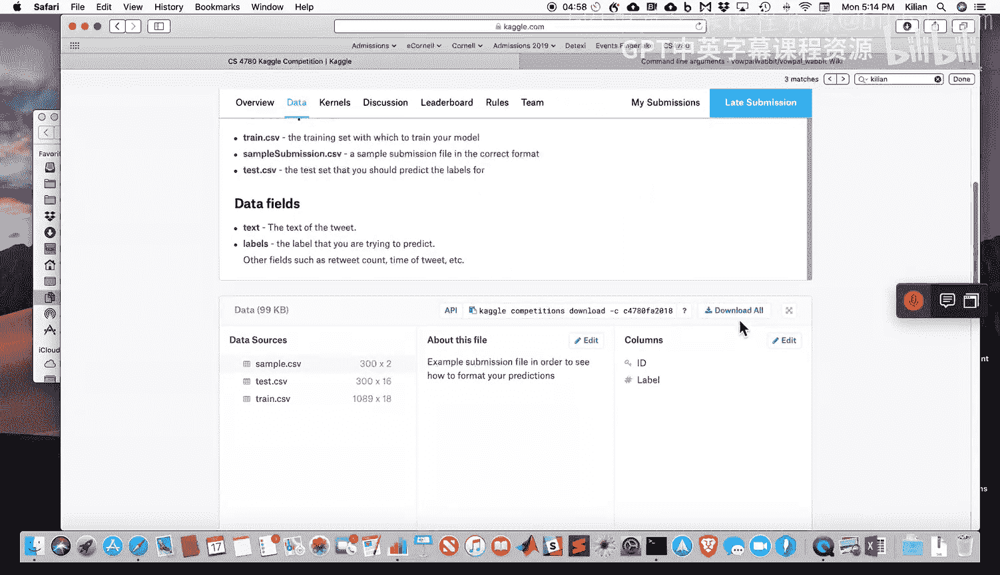
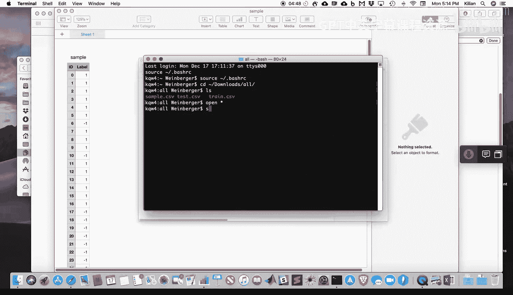
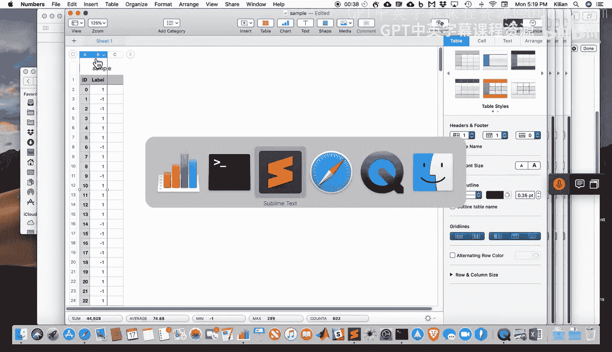
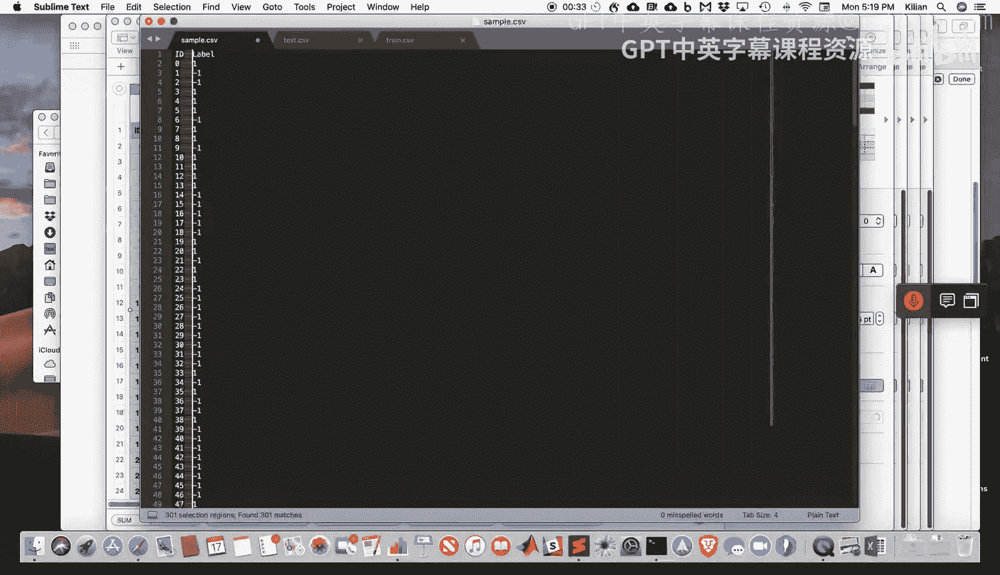
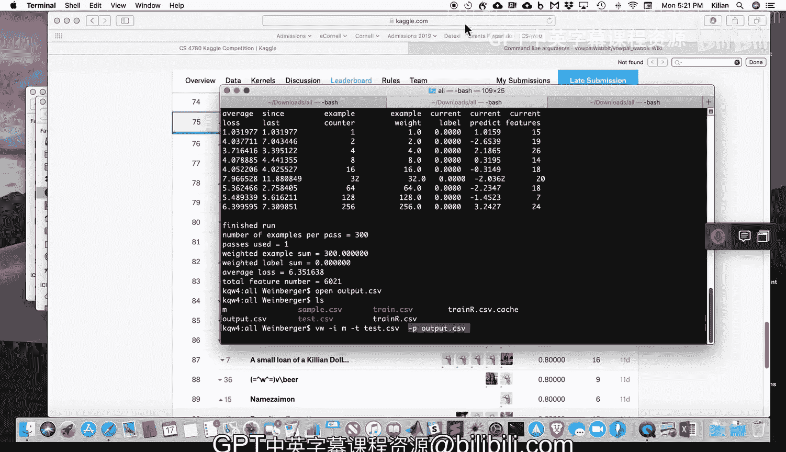

# 机器学习：038：五分钟内完成Kaggle课堂竞赛 🚀

在本节课中，我们将学习如何利用一个名为Vowpal Wabbit（VW）的高效机器学习工具，在极短时间内构建一个文本分类器。我们将通过一个具体的课堂竞赛案例——根据特朗普总统的推文内容，判断其发布设备是iPhone还是Android手机——来演示整个流程。

---

## 数据与任务介绍

在我的课堂上，我们曾组织过一次Kaggle竞赛。我们向学生提供了特朗普总统的推文，他们的任务是判断这些推文是用iPhone还是Android手机发布的。其背后的假设是：总统本人可能使用Android手机，而他的工作人员可能使用iPhone。如果同一个账户下的推文确实由不同的人发布，那么我们就能训练一个分类器来区分这两种设备。



我们为此创建了一个排行榜。我本人也提交了一个预测结果作为基准。我给自己设定的挑战是：在五分钟内完成从数据准备到提交预测的整个过程。




游戏规则是：如果学生们能在三周内，用比我五分钟内更好的成绩击败我，他们就能在这个项目上获得满分。事实证明，击败我并非难事。我的基准准确率是80%，而排行榜上顶尖学生的准确率达到了90%，这是一个显著的提升。


上图是私有排行榜的成绩。后来，学生们向我发起挑战，希望看到我实际训练分类器的屏幕录像，以验证我是否真的能在五分钟内完成。接下来，我就为大家展示具体步骤。

---

## 工具选择：Vowpal Wabbit

我选择使用的工具是**Vowpal Wabbit (VW)**。这是一个由John Langford（先后任职于雅虎和微软研究院）开发的分类器。它的特点是**非常快速**，本质上是一个高效的逻辑回归分类器，但也支持平方损失等多种损失函数。它的一大优势是集成了**特征哈希（Feature Hashing）** 技术，这意味着你可以直接将单词作为输入，VW会自动将它们哈希到对应的特征桶中，省去了繁琐的特征工程。

安装VW非常简单，可以通过包管理工具（如`brew`）直接安装。

---



## 实战演练：五分钟倒计时



现在，我将设置一个五分钟的计时器，开始实际操作。


### 第一步：数据准备

首先，下载竞赛数据。数据包含训练集和测试集。


在测试数据中，我们只需要推文文本本身。我并没有使用提供给学生的元数据（如发推时间）。实际上，这些元数据是非常强的特征，很多学生正是利用它们击败了我的基准模型。

以下是数据预处理的关键步骤列表：

*   **格式化标签与特征**：在训练数据中，标签（iPhone或Android）在左，推文在右。对于测试数据，我们需要先添加一个占位符标签。
*   **清理文本**：需要移除VW无法处理的特殊字符，例如冒号(`:`)、竖线(`|`)、点号(`.`)和反斜杠(`\`)等，因为这些字符在VW的输入格式中有特殊含义。
*   **统一大小写**：将所有文本转换为小写，以减少特征维度。
*   **移除表头**：确保文件没有标题行。

### 第二步：训练模型

数据准备好后，我们需要将其顺序打乱，然后调用VW进行训练。

以下是我使用的核心VW训练命令及其参数解释：

```bash
vw train.vw --loss_function logistic --learning_rate 1 --passes 5 -c -f model.vw --initial_t 1
```

*   `--loss_function logistic`：指定使用逻辑回归损失函数。
*   `--learning_rate 1`：设置学习率为1。
*   `--passes 5`：指定对整个训练数据进行5轮迭代。
*   `-c`：创建缓存文件，这在多轮训练时能提高效率。
*   `-f model.vw`：将训练好的模型保存到名为`model.vw`的文件中。
*   `--initial_t 1`：设置学习率衰减的初始时间步。

### 第三步：进行预测与提交

模型训练完成后，使用它对测试集进行预测。

以下是预测命令：

```bash
vw -i model.vw -t test.vw -p predictions.txt
```

*   `-i model.vw`：加载之前保存的模型。
*   `-t test.vw`：在测试集上进行预测（`-t`表示测试模式，不更新模型）。
*   `-p predictions.txt`：将预测结果输出到`predictions.txt`文件。

得到预测结果文件后，只需按照Kaggle要求的格式稍作整理（例如，添加ID列），即可提交。




最终，在计时器结束前，我成功完成了文件上传。




---

## 核心要点总结

本节课中，我们一起学习了如何利用Vowpal Wabbit工具进行快速的文本分类任务。整个过程可以概括为以下几个关键点：

1.  **工具高效**：VW凭借其**特征哈希**和优化算法，能实现极快的模型训练。
2.  **流程简洁**：核心步骤就是**数据清洗**、**模型训练**和**预测输出**。
3.  **命令核心**：训练命令的关键在于指定损失函数、学习率、迭代轮数并保存模型；预测命令则是加载模型并应用于新数据。

回顾我的五分钟挑战，一旦掌握了正确的命令行参数，整个过程就变得非常直接。我使用了逻辑回归损失，学习率设为1，进行了5轮迭代。在实际应用中，这些超参数（如学习率、迭代轮数）通常需要通过交叉验证来优化，但本次挑战旨在演示快速原型构建的可能性。


希望这节课能帮助你理解如何运用高效的工具快速解决机器学习问题。这就是全部内容。



