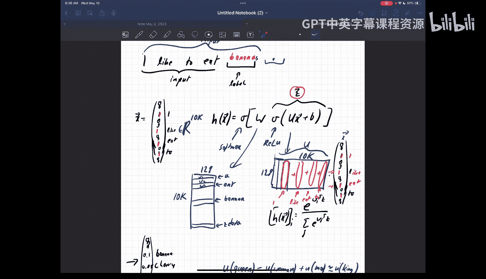
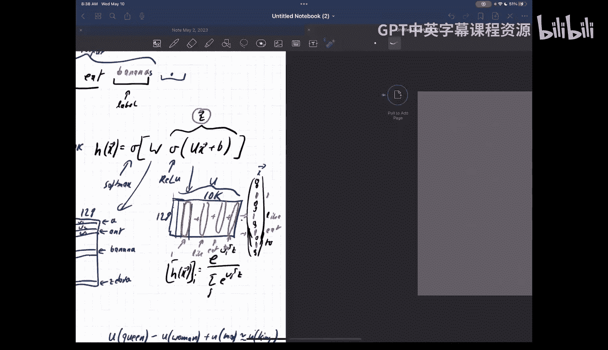
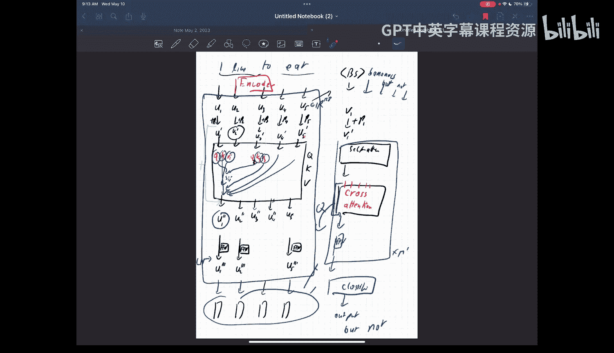
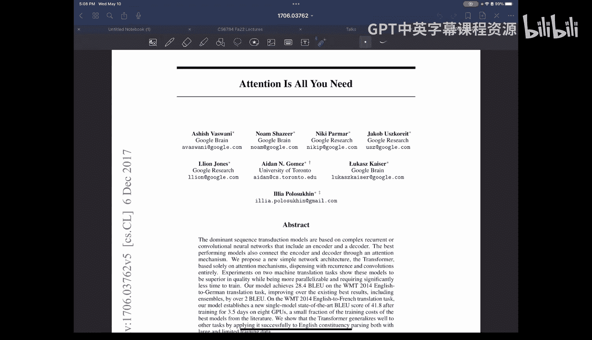
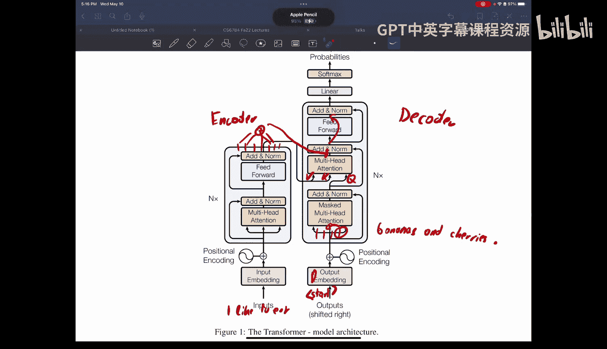

# 040：康奈尔大学《智能系统的机器学习｜CS4780 Machine Learning for Intelligent Systems 2017》中英字幕 p40 -40-CS4780 Transformers (additional lecture 2023).zh_en -BV1Lo6gBxEKE_p40-

Alright， I am talking about transformers。And at the heart of that problem is a language， you know。

 language modeling problem。 So transformers can be used for many， many things， but， you know。

 often theyre used for language modeling。 And so language modeling is the following， you know。

 problem。 You have a sentence。You know， let's say， you know， I like。To eat。Right， and now I have。

 I want to predict the next word。 So this here is my input。

And this here is the label I'm trying to predict。How do you do this right and the simplest thing in some sense that we've already learn in this class is you can represent your input as a bag of word vector。

 so in this case my input vector is x right is some really high dimensional vector with many。

 many zeros right and you have somewhere a1 right for I。😊，And do you have somewhere I want for like？

And somewhere I want for it。And somebody one for。2， and the rest is zero。 right， And this is a very。

 very high dimensional vector。 Almost all of it is。zeroeros， right， there's only very， very few ones。

 these you know， these four ones here that actually correspond to the four words that I have in my my input context。

And then I train a neural network to predict the last word so what does that look like that I have some function？

😊，And that， basically。You know， is a classifier。And。You know。This is。

 this is what a neural network looks like。 So here， this year， you know。

This year may be a re function。And this year， maybe。A soft max。And the U here is one big matrix。

 that basically。嗯。Maps。Maps our input。Let's say we have a vocabulary。That's， you know， maybe 10。

000 dimensional。RightAnd this is 10，000。But maybe some  hundred28 dimensional space or something like this。

And w is the matrix that goes from。und and twenty eight to ten thousand0 again。

So let me just explain this right， so this is the first hidden layer， my X is mapped onto you。

So I have my X vector here。😊，It's my with you， that gives me and the B is just a constant。

 this gives me a new representation， 128 dimensional representation。

And then I multily this with W and W， the way you have to think about it is that each row of W。

This can be W 2。 This is W1， right， Each row of that is actually a classifier。That predicts。

This particular word so this may be the classification of a right and this here maybe be and right and so on and this here down here is zebra right so I have all my possible words in my dictionary right and I have a classifier for each one of them that just says is the next word and or is the next word zebra right and somewhere here I have banana right？

😊，And let's say banana is pretty likely， right， because I like to eat bananas， right？😊。

And the transition function at the end is the， the softm here。What is the softm， the softm。

 basically。Let's call this。 Let's call this here。Let's called this here Z， right。

Then the softm is essentially just。H of x。Is E to the。Oh sorry， let me let me just say the， the。

The I dimension of the softm。H of x is a vector。And the I dimension of this is E to the W I transpose Z divided by。

E to the Wj transpo C。 So what does that mean that basically says this here is the strength of the classification for WI。

 Let's say W is banana right this here gives mean inner a product if this is large that means banana is likely as the next word and if there's a small that means banana is not likely。

 And this here is all the other words in a dictionary right and E to the reason to be expentiateated it says positive or non negative right So the output here is definitely greater equal1 right and all the different dimensions also sum to one So the output of this function here is a probability distribution over all possible words。

So I take my input vector in my input context。I transform it to the bag of word vector。

 Then I stick it into a neural network。 right， This neural network lends me a hidden representation。

And then in the hit representation， I have apply a classifier W。

 which gives me a classifier for every single word in my dictionary right and so then I pick the you know。

😊，I have to make a decision， right， They all give me a different strength of how likely a certain word is。

 So I can turn this into probabilities with the softm function。 This here is my softm function。

 right， So I apply the classifier and then apply the softm。😊。

And so the output then is something like some vector， where I basically say， well， the word banana。

Maybe。That has a 10% chance， right， in the word cherry。Has an opened off right now， the word table。

Has a 0% chance， right， I， I don't like to eat tables， right， Nobody does， right， and so on。 So most。

 most things have very， very low probability， but some words actually have higher probability。

 And then if I want to pick the next word。I pick it randomly from this probability distribution and so for example。

 let's say I pick banana right then actually I fill in the wood。😊，Banana， right。And then。

 if I want to。Continue the text， I say， okay， well now this here is my new input。😊。

RightAnd I'm predicting the next word after this， maybe I like to eat banana。You know， bananas。

 sorry。But。You know。Not if they are too old or something like this， right， Or the last word is。

 you know， I'm actually predicting a full stop here， right， So maybe I'm just predicting period。

 right， That's also reasonably likely， right， And the sentence is over。

 And then I start a new sentence。So this is kind of the simplest language model you can imagine。

 right this is not yet a transformer， but let us just think about this a little bit。😊。

So what's going on here， right the first thing is I'm converting my text to a bag of word vector right and then I multiply this with U。

So there's two things that are happening。 So if I multiply this bag of word vector。

 Let me maybe copy and move it over here， right， copy。And。Paste it， here here's my。

 my bag of word vector。 And I multi this with the matrix U。What happens， right？

 I'm actually taking the different columns of U。And I might apply them with this， you know， x vector。

 so I might be the first column。With 0， right， So this guy is multip with 0。

 The second column multip with 0， right， but this column here is multi pipe with one， right。

 So in some sense， you can think about it is as if I'm pulling out this column of U。

And then I'm pulling out another column of U that corresponds to to this one。

 and I'm put another column of U and another column of U， and then I add them all up。😊。

So this here corresponds to the word I right， this you like， you know eat right。

 So what am I doing I'm basically pulling out columns that correspond to words。

 So this column of u corresponds to I， this corresponds to like this to eat and this to2， right。😊，So。

And then I add them all up。 Then I sum up these columns， right And that's actually my。

 my word representation， right， that's my my secret， my， my representation， Z。

 my hidden representation in my neural network。😊，So there's two observations number one。

 the order of that sentence is lost right if I say I like to eat or I say eat like to I right would be exactly the same bag of word representation would be exactly the same hidden representation Z right so that's a little funny and we have to fix this right that's a downside of this representation。

😊，Of this algorithm， the second thing we gonna to observe is that the matrix U。

 This here is my matrix U。 just to make this clear。 this is。This is U， right？嗯。My matrix U。嗯。

Each column of you corresponds to the representation of one particular word。

 and this column is only ever used。If that word is in the input， otherwise it's not used。

When I then train this function with backp right and so I get a loss and then you know I say well the word was actually cherry right so I kind suffer some loss and I update my weights and myW my U and my B right I update all of these three guys right then I'm changing the representation of these words。

😊，And this is。This word representation is something that's very。

 very similar or essentially known to as word2 V representations or word embeddings。

 So if you take a large corpus。😊，And you take this some very large text， like， for example， you know。

 Wikipedia， right and you take any kind of sentence of K words before。

 and then you try to predict the next word， right？To be honest。

 sometimes people also take the words before and after and predict the word in the middle， right。

 that works， too。And。Then you learn this matrix U and you can basically now you pull out these these word embeddings。

 That basically is some representation of the meaning of the word。

 And one thing you observe is that words that are very similar， like January， February。

 March or something right will have very similar representations and words that are。You know。

 different， you know， you know， very， very different and people actually then take these。

 for example， you of queen， right the word queen。😊，And he subtract you of woman。

And you add you of man， right。And that is roughly you of King， right。

So the relationship between these word vectors actually has some meaning， right。

 So somehow woman and man in relationship to king and queen kind of， you know。

 stand in a meaningful relationship with each other。All right，Okay。

 so one more time we have our word set encoded in here， we pull out the word vectors from you。

 which is also what we're learning with backPro later on。😊。

So we're learning a representation for these different words。

 we sum them up and then we stick it to a classifier to predict the next word。😊。

So one thing we already observed is that， you know the。Order of the words here。You know it's lost。

 which is problematic if you have a long context， right， it's very。

 very important what the last word is， right？😊，And another issue is that。

嗯。You know that each word has a fixed embedding。 So let me give you another example。

I say， I may。Visit。In May。Right？If I。Ignore capitalization here。 right， So here we have。

These two words may and May， which are actually the same word， right？😊，But they have very。

 very different meaning right， So one is the month May and the other one is May like in wood could。

 right， So you would expect this word here should have an embedding that's very。

 very similar to wood or could because， you know。😊，Or might， right， you could also have might here。

 right， which is essentially the same thing as it may， right。

 It wouldn't change the meaning very much， right， And here you know， you could have February， right。

 which of course。😊，You know， would change the meaning， but but you know。

 it was perfectly fine to substitute this in some sense， May here should be very similar to to。

February， March， the other months of the year， right， The issue is the following that if I。

Turn this into a vector， you know input vector x right and then apply u you know u times x。

 What does it look like right my x vector here in this case has you know a one for I right。

 a one for in， right a2 for May and a1 for visit， right。😊，So here， essentially what I'm doing。

I'm just， you know。Ting these two words exactly the same right I'm going to do gradient descent。

 I'm not differentiating between the two different meanings of this word， which is very problematic。

So how can I tell that the second May is different than the first May is different than the second May and the reason is the way I can tell is from the context right so if I say visit in May right and here I may right that essentially gives it away that these two have two different meanings。

😊，And so essentially， the context changes the meaning。 And this is essentially what。嗯。

What transformers are doing， Con transformformers learn contextual embedding of the words。

 So very similar to what we had before， right， where we mapped。Our inputs to word vectors。

Transformers do the same thing。But they do it such that the inputs can influence each other。

 And I will now explain how this works。 So the first thing transformers do not have a bag of word embedding。

 I can remove this right there's no bag of words because that， you know。

 removes the order So that's you want to keep the vectors alive。

 So the first thing we're doing is we map each vector to a。Pretde mapping。And that's just indexed。

By the word itself。So。You know， in this case， this year becomes U of you1。You， you know， you2， you3。

Before。You5， right。 And this is essentially just。The U5 fear is just you of me。Like个。

But U is sum matrix， just like before， U is some matrix that has a vector for every single。

For every single word。 So the word may has some word here。 So U 5 here equals U 1， right。

 This is still， we still have the same promise before。 This is May。 This is May。 Oh was sorry U 2。

 So you U 5 equals U 2， because they' are both the same word。So this is a problem。

 because these are not the same words， right they actually quite different words， right？😊。

And we need to change this， and this is essentially what transformers allow you to do。

So how do transformers do this？They take these vectors。And they embed them into a space。

 So these vectors are now U I at element of some， let's say， hundred28 dimensional space。 right。

 This city goes from 10 K to 128。And。In this 128 dimensional space。

 all these different birds are basically just now points。And。

We want these words to influence each other。 We want to want that this word in influences may that the word I influences may and so on。

 right。嗯。So。😊，The first thing is that we need to differentiate。嗯。The fact that， you know。

In gets influenced May the second and may gets influenced in because they follow right after each other。

 right， The eye influences may because they follow right after each other。

 So somehow position is very， very important， right and。How do we do that。

 How do we encode the position into these embeddings， And this is relatively simple。

 We basically add a positional something that's called positional embedding to it。 So we say you。

U I becomes U I plus P of I。And P of I is a vector。That only depends on the position。对。

So it is a function of sine waves。Where you essentially have P of， you know， So what is P A P of I。

 P of I is some high dimensional vector。Where each dimension。

 that's also128 dimensional in this case。And。Each dimension。Corresponds to some sine function。

That is just a function of I， the position I'm in divided by some constant， right。

 That's a function of D。And so when you look at these position embeddings。

 they essentially the first dimension is maybe a high frequency signal。 So， and， you know。

 different position space you have different values here。😊。

The second dimension is more slow frequency and so on。

 you get increasingly low frequency or something， right。🤧And。

And the the first vector basically has these values， right， And the second vector has these values。

 the third vector has these values， right。So in the first dimension of this value。

 or second dimension of this value， the dimension of this vector and so on。

 And the whole point is that vectors that are close together。A very similar。

Reaspectus theyre far away gonna have different different representations because you have some really low frequency signal down here。

 right， where this guy may be very different than this guy down here。

So this is essentially a trick to make。Vctorors that are close together。More similar， right。

 So give the neural network some chance to learn which vector。Is in what position of my context。

 So be busy here again to。プラス。P of I， right， That's the， that's the new。new one prime。

 And then we have here。You choose， plus P。2， right And here we get plus P3。And so。

So the first things some are doing is they。They add these positional embeddings。嗯。

Let me maybe move this up here。Okay。Once this is done。We now have something that。

We already achieved something， right， The word may and May here are no longer the same。 right。

 Why is this because they have different positions。 This here is in position。2。

 and this here is in position 5， right， So this here is。U of May plus p5。

 and this is U of May plus P2， right？So these two maps in slightly different places。

 let's say this guy maps here in this guy。Maps here or something， right？Maybe I should。

 maybe I should say。Yeah， actually， these are the vectors。

 right this guy moves here and this guy moves here。Okay。

 so the first thing we need we've already solved， the problem that basically shuffling the words in different order will give us different embetics right beforehand。

 we had this problem in the bag of word representation here。 we had the problem that it was in。

 you know。Independent of the order in which the words appear right here actually we don't have that anymore right so the order of the words actually is important it gets baked into into the representation through this positional embedding。

😊，Okay， good， so now we have these vectors， U1， prime， U2 prime， and so on， right？You three prime。

U4 prime and so on。 so here we have position for。And。

 but now what we want to do is we want to allow the word may to be modified by the word in and the word I to be。

 you know， modify the word may， right， and maybe visit can also modify May。 I'm not sure， right。

So how does that work？Essentially you， and this is now where transformer， you know。

 when attention layer comes in。 this is kind of the heart of a transformer。

 we take each one of these vectors and we map them into this space like they are basically in this space here in this 128 dimensional space。

And the Cs are 128 dimensional。And。What we're essentially doing is you're saying each factor we find the nearest neighbors。

And we make the vector become an rateed average of its nearest neighbors。

 So the way you can imagine this is U I becomes some overall J。S， I J， U J。

Some summing over all other vectors。There should be a prime here。I'm summing over all other vectors。

 and I weigh them by some score S I J。And so one property， all the S I J。S I J。S to1。

 and all S A J are non negative。So this is a weighted average of my neighbors。

 So each vector becomes a weighted average of its neighbors。 So the neighbors change。

Change the vector。Now this is great， right？And this is what's called attention。 right。

 The only issue is that。And。That you don't actually。You know。

You may want to modify words that are not like you。 So for example， let me give you the following。

 you know， in this case， the word in and the word may may actually be really far away from each other。

 right。One reason they should be close is because they are in similar positions。

 but the original embedding of in in May is probably quite quite different。

 right the same with I in May right so they may actually not be nearest neighbors right but if I have this nearest neighbor approach where I say I get modified by my nearest neighbors I want these two to be close to each other。

😊，And that's where multihad attention comes in。😊，And this is the following that you're essentially saying。

Each vector U I。Becomes three vectors。It becomes。Q I is Q times U。K。K I is K times U。V I is V T， U I。

 and again。Q， K， and V are matrices that we learn。And。So。What are these， What are these vectors。

If I want to modify， if I want to modify。The vector U I， right， What do I do。

I find my nearest neighbors， by matching。K Q i with K J from everybody else。And。What does that mean。

 So QI basically stands for query。And query basically what you are looking for。K is K is key。

And means this is how you can find me。And V is the value。 This is the value that I'm passing on。

Let me give you an example。So for example， I have the word white， right？The word right can modify。

The word House， right， if I have the word House， but in front of it， I have the word white。

 that really changes the meaning of House， right， So as the White House。

 So we're talking about presidents， right。It can also be chocolate， right。

 So if I talk about chocolate。And I'm modifying the word chocolate and suddenly I'm talking about white chocolate rather than dark chocolate。

 or I can also modify the word paint， right？And the other way around。

 these words can also modify white， right so if I have paint around it。

 then I'm talking about a color， if I've chocolate， I'm talking about sweet and if I have house。

 then I'm talking about， you know something presidential， something political。😊，嗯嗯。So。

The word white maybe looking for words that are actually quite different than itself。

 it may also actually look for， by the way， white， you know， you can have white blue， right？😊。

You know， whiteh blue per shirt， right， so here actually it's looking for a word that's quite similar。

 right to itself。😊，So。The way you can view these cues in the case are a little bit like a dating profile right imagine you set up a dating profile on a webpage。

 right？The K is your dating profile， right， The K is basically says how you want to be found right。

 So you set up a profile that basically describes you as a person right。

 Let's say you're a 23 year old female right who's a college student or something right And so that is basically how you describe yourself。

 That's what you want others to see about yourself to find you。嗯。Q is the query， right。

 The query may be different from from UK， right， because maybe you are， you know。

 a female college student and you may be looking for， you know， a male。

A college student who's maybe older or something like this but。

The query is what you are searching for。And the K is what you want。

 how you want to be discovered by others。 And that's the same thing with words right。

 So in this case， the word Q may be looking for something like like house， right and。

This year is the the vector of house that actually wants to be found by by the word white， right。So。

How does the attention layer work？哎。Take for， let's say， I'm modifying this， this word here， right。

 you2。Then I actually take my Q2 and I look at all the other case right。

And I compute their similarity with each other。And the similarity between any word。Any two words。

 S I J。Is the inner product between Q I and KJ。This basically says， how similar are these two words。

And to make sure that we can compare these inner products。😊，V。Again， apply the soft bags so we。

Just go over all other primes。 and we say E today。Qai。😔，K J prime。And this year is now。

The new seminarity。Between these。 so this basically says。How much word J should influence word I。

 right when I'm modifying， I'm transforming word I， right。

So I take word I and I'm now transforming it by pulling information from the other words right this is my context to modify this word how much should word J modify word I right and for this I map word I into some Q vector。

😊，Which I'm just learning， right， This is just a matrix I'm learning。And any other word K is J。

 I'm mapping to a K vector， which again is just a linear transformation that I'm learning。

And I see how good of a match are these two words to influence each other right and if there's a large value。

 we will dominate this sum right and that basically means this will be a strong value right？😊。

And once I've computed all of these， then I go back to my equations that I had here， right。

 see here's this equation， let me just pull this down。

So now my new UI becomes the sum of all the other words。Compute the weight。 How much would they。

Will influence would I。And now。I'm changing this year。I'm actually making this V J。

So you haven't talked about V yet， what is V？This is the value that J sends to I。 So in this case。

Want us in send to May right to modify Ma that is Vj right and what does I send to May to modify this May right。

 that's the you know V1 here and this here is the V4。Right。So every word has three vectors。Q， oops。

 sorry。Q is so that I， you know， what I am looking forward to modify me。K is。The vector that。

 you know， others can discover to modify them。And V is what I'm sending to others to modify them。

 That's actually the value I'm passing on。And all of these matrices are learned。

And this is actually all there is to a attention layer。 So we now go back to our。A transformformer。

 I clean this up a little bit let move this down。What are you getting here？

It's the following that I have these U vectors and now I have a transformer。😊。

Like this here is basically positional embedding。That's the first thing I'm doing。

And then I have an attention layer， and attention layer takes as input。A bunch of vectors。

hen computes for each one of themq，有。mapps them into these three different vectors， Q K and V。

And lets them all influence each other。 So the output is， again， a U1。You too。You 3。And so on。You，5。

And internally， what's happening is this year becomes。A Q， Q1， K1， V1。Right， and。This， he becomes。Q。

 Q 3。K3， V3， right。And these different。K and V values get matched with the Q values of these。

 these match。With a Q value。To become S I J。And then these v values basically influence the vector。

And this becomes this new。New entry。By the way， I can also be influenced by my own v vector， right。

 because I'm also matching my Q value with my own key value。Right。

So this guy here is now a weighted average of all the other vectors but because the softm is such that because I've been exponentiating here。

 right if one value here is a little bit larger than all the others that because I'm exponentiating。

 this will be much， much， much larger than all the others。

 So really what's happening is that this is sparse that really this Ui vector will only be influenced by a few words right。

 not many。😊，And so probably for example， this may vector will be influenced by May and by you know the word that precedes it right so in May these two basically give me a new vector here and these two here give me these two give me a new vector here。

 right？And probably actually， the may also may influence the end， I don't know。嗯。Okay。

 so transformer transforms the vectors， right that this the vector corresponds represents the meaning of every single a word。

 and then I transform them you know through the context so how do the different words influence each other？

So that's the attention layer。Thiss tension。🤧嗯。Let me write this down here。Attention。

Often actually referred to as self attention， because。You know， all the vectors kind of。

Attending each other。And there's always cross attention， which is。And you have two sets of vectors。

And。Okay， good， so what do you do once you're done with this？Then actually， in a transformer。

 you do one more step where each vector just gets mapped with a。With an MLP， a feed forward network。

Into。A new vector。And this is the same fee forward network。 So you have some。

Network where a vector comes in。U I comes in。And then you have some。

In a mod layer perception and a fee forward network is the same thing， right and。嗯。

The vector comes out of it。And that that's really all there is to。 So。

 and you apply the same network。 Oh sorry， you apply the same network。For every single vector。You5。

So this， this network， you know， just has some parameters。 right， if you write this out， this spa is。

 you know， U I triple I equals， you know， some。Transition function of。W times。

Sump and sister functions off off。呃，有。You it's called not you。 It's called it something else。

They haven't used yet。W prime， maybe。嗯。Of you， I。so I take my。An import multiply by a matrix。

 apply transition function， multily by matrix。T transition function。 And that is just。

 this is my neural network here。嗯。And now I'm done， so now the inputs this year。😡，Essentially。

 is one transformer layer where I have。嗯，A。Se effect that come in。

And a set of vectors that come out and actually the number of vectors is preserved and actually their position is preserved so the first vector corresponds to the first vector all along right。

 the fifth vector corresponds to the first vector all along。

 but in the process here they can be influenced by each other。😊，There's a few more subtleties。

 one subtleties that actually you have a skip connection。😊，So you're actually adding here。

The original。Back to to it。So you actually have something。 you know。

 this is just so that you can learn the identity very easily。

 So if you basically have a word vector to here that that's good， right， in some sense。

 you don't want to lose that information， right， this is a little like residual network resonnets right So there's just a standard trick。

 same thing here。 you basically add the output here to the input So you can just say this here is actually plus。

😊，Plus u I right。 So you just add that input to the output at the end。

The other thing is that you have a layer normalization。You I like can have different positions。

Often you have it here， where you actually just normalize。

Normalize the representation to have zero mean。 And， you know。

 this is essentially very similar to batch norm， except you actually go over the different dimensions of the input。

 So it's called a layer normalization。So this is just to make sure that， you know。

 you don't get some crazy large values。 And if you have crazy large values。

 then optimization becomes very hard。 So you just make sure that， you know。

 your output overhead has has zero mean。And small standard deviation。嗯。Okay。

So this is essentially a transformer。And。Let me add this。 Maybe here， we have a layer norm。Laonorm。

We have one more Le on。And。And now you can just stick the output again into another transformer layer。

And something like G4， I think， has 96 transformer layers。 B has， I think，13 transformer layers。

 right， So， you know， you can just do this times M， right。

 where M is the number of layers that you have。AndOne more subtlety is that at any given layer。

 right， So basically， let's say you have busy this。 We have， you know。

 input comes in you have one layer。Input another transformer layer。Another transformal layer。

 you could actually have multiple such layers in parallel。So you actually have each word。Go see here。

 but each would also。Go here。And then you combine them again。When you done。This is very。

 very common practice， right？And。Basically， everybody does this。

And the way you combine them is by just taking the outputs。OfOf each of these layers。

You con garnate them。 So you basically get U1 of the first of the one layer， U1 of the other layer。

 right， and so。That， I don't know， howo， howo。Maybe I'm going change the color。And then。

 I have another。You know。You one of the third layer， right， This see is my。Green layer。

 And the it is may red layer。And I concatednate them all。

And then I multiply them with some projection matrix。 It's called this l。

And this actually now gives me the output that's basically combined。

 That's the output to the next layer。Yuwen。crime。Double print。So。Okay。

 one more time so you have the different words to come in here， I stick them to a transformal layer。

 In fact， I stick them to many different from transformable layer。

 each one has their own Q K and V matrices， right？😊，And then， I。Combine the outputs。 and again。

 I stick them into many such layers， transformer layers。And I put them again， combine them， right。

 And this is very similar to a convolutionary neural network where you actually also have an input image and then you transform it with one convolution operator。

 I get a new image， another convolution layer， another convolution layer。

 And then you combine them again， right in the next layer。嗯。Okay。So once you have all these vectors。

 you can now actually do a lot of stuff with it。 So now we actually have a contextual embedding of our sentence right and it's contextual embedding because each word corresponds to a word vector but the word vector is influenced by two thing number one。

 what the word is and number two， what the other words around it are And now I can use this to predict the next word in the sentence and the simplest thing is I could just average them right to sum them up and then run it through a classifier to predict the next word。

😊，Of what people use is they have a decoder。And then they call this perge part here。

 this part here is an encoder that basically goes from text to you know， these word embeddings。

 we call this encoder。And the decoder is essentially the same thing。

decota is essentially the same thing， except。It's。嗯。Has cross attention。

 So let me just explain what what a decoder is。So decota goes to the same steps。嗯嗯。

And decota is usually the stuff。 So in this case。This is the text that I'm given to me as a context goes into the encodeder。

 And then a decoder what I do is I I start with some dummy token that basically says beginning of sentence。

That's just a decokota first token。Beginning of sentence。And I stick this into my decoder。

And then I have， you know， this gives me a mapping。 It's called this V， right， V1。

Then I add positional embedding。For position  one， that gives me re1 time。

Then I have a self attention layer。Self attention。Attention。In this case。

 it's trivial because I only have one vector。 so it become a linear combination of myself。

And then comes cross attention。 versus cross attention。Cross attention。 or let me right。

 let me write this cleaner。嗯。Cross attention。 and cross attention is very， very simple。Cross。

Attention。In the cross attention， I take my input vectors。And I mapped them to a Q matrix。

But then I take these guys here。And map them to K and V。So cross attention。

I take the output of the encoder。The map with。Keys and values。And I take this guy and map it with Q。

 right， So this is in some sense， you know。A dating app where you have two different colleges right and people from one college are only allowed to date people from other college or something right。

 but not within a college So this is basically what it is so everything in the decoder is allowed to find something in the encoder to modify it right but here they don't modify each other right。

😊，And then I get a new， new representation here。 So this means that the token here is actually a linear combination of the。

 of the stuff from the context， right， These， these altogether give me a new vector。

 which corresponds to this guy。😊，系。Of course， I still have skip connections。

 So I I'm not totally losing the information that I have。And then again， I do， you know。

I do some feed forward neural networks and so on。 and I have multiplepo layers。

 So the encoder is essentially the same thing as a decoder。

 The only thing that's different is this cross attention that I'm basically applying attention to all my context。

And the reason you're doing this is because sometimes you have a lot of context。

 So let's say I take a lot of text， you know， that I put in as background。 And now I want to start。

 you know。嗯。Generating new text。嗯嗯。So in something I don't want to every time reencode this stuff right so obviously keep this stuff encode it once。

 you know encode these vectors once， and then I just every time I'm generating new words。

 I just cross a tent over this context。🤧嗯。So。Once I'm done here。I'm。You know。

 I step some feet forward neck resist this here against my may。You know。

 have some fee forward vectors。You some MLPs here。呃， feet。Forward network， this is the same as here。

 right that's going on。And at the end， I get， get some vector out， right， I can do this again。

 you know， M prime times， right， And the end， basically， I get some vectors here。

 That's my contact my form encoder。 And then I run it through a classifier， right classifier。😊。

And predict the next word。Output。Let's say here the output now is， you know。

 let's go back to my original original example I like to eat， right？Let's go here。 I like to eat。

I like。2。Eat， right， And now I predict bananas， right。

Then what I do is I go back to my encoder and put on the root bananas。Right。

And now I go through the whole thing again。 And I predict another word， right。

 What what I'm predicting now， Maybe now I'm predicting。You know， but， right。 So then I put in but。

eight。And then， I predict。Not， right。But not。You know。

When they are too young or something or when they are too， you know。嗯。I like to eat bananas。

 but not when they are too fresh or too not ripe or something like this， right？

So this is the sentence that I'm busy generating here。

Okay， so in the actual。Paper that presented introduced the transformer。

 It's called attentiontion is all you need。

From 2017。嗯。

You can see a layout of the transformer architecture， and you should now be able to understand this。

So。First， we have the inputs。 These are actually the words， right I。Like to eat bananas， something。

And。Then， you have。Do these words I like or something get mapped in two vectors。 So now we have U1。

 U2 here。Here I had the word May， May I visit in May， right， You have two words that identical。

 They get mapped to exactly the same vector， because I'm just looking up the word， you know， in this。

 in this kind of U matrix。 I have a U matrix。 and I just pull out the， the corresponding vector。😊。

Then I add the positional embedding。 So this is basically P1。

 P2 for each token I added vector that is only you know， specified by the position。

 So here is now where the two mas will differ， right。

 So one is basically the beginning of the sentence， one at the end of the sentence。

 So they change a little bit just based on their position。Then we have the multiha self attention。

 So we take all these different vectors and they attend over each other。

 So each vector becomes an elevateded average of the other vectors。 right。

 You just sum up the rate average and get a new vector here。Here。

 the word may will change because it will be influenced by its previous vectors。

We also adding the original vector to this。 So this space， this in vector comes in。

 Then it gets modified by the other vectors。 and here it comes out right。

 And they take the input vector and add it to the output vector。 This is the skip connection。

 This is， this is what we have here。This is called add。 we also do a normalization。

 So we just make it zero mean all the representation0 mean and， you know， divide by some constant。

 I have the standard deviation small。Here comes the feed forward。

 and you've also understood this now so that we have a vector。

 and we just apply neural network to get a new vector right And you just do this for every single vector in isolation。

 So here they don't interact with each other。 And again。

 we have a skip connection and we have a normalization。 And that gives us the output vectors。

 So this kind of architecture has input vectors right。

 then they mix up with each other right So each one becomes an weighted combination of each other。

 and I get， you know then I pass them to the neural network and then I get the output vectors and then I put them back into the next layer。

 So I do this n times。😊，I've N such transform layers。The output of this is a bunch of vectors。

 That's basically the text encoded。This is called the encodecoder。Right。Encoder on the left and side。

You could now actually take。 You could take the the text of the。The output here run it through。

 you know， average them and and run it through a classifier。 right。

 But this is not actually typically what people do。 Typ what they do。 They have a decoder as well。

 decoder is the same architecture as an encodeder。 This is exactly the same。

 except there's one small change as this thing here。And what is this， This is basically。

 after you take your inputs in here。And you push them through。Here， they， at this point。

 you actually only have。The Q matrix。From the inputs and the K and V from the outputs of the encoder。

They see my output vectors。 They go in here。 So what's happening here in the decoder。

 This is basically the encoder encodes my context that I'm not going to， you know。

 this is this given to me， right？ And now I'm encoding my first word。 So imagine， for example。

 if you have Che G B T， you put in a prompt， the prompt goes in the encoder。

 and then I want to decode something。 So I start with a token。And this usually。

 I just start with the star token。 I have some special basic the special word that basicallyie means now I'm beginning。

And I stick this in。 This is going to turn to a vector。 Then I do self attention here。 right。

 This is going to become a linear combination of itself triviality that don't change。

And now here comes interesting thing。 This now becomes a query。 So I'm looking， you know。

 the Q vector。And I attend over all the vectors from my， from my context。

 and I make the new vector a linear combination of my context。 So sum， I sum up these guys here。

 right， I sum them up。Some baited some of these guys， right？嗯。Of their of their V values。

Becomes my new vector here。Then I think it's your neural network。

 and I do this a couple times over and over again。 At the end， I get a linear e vector。That， I。

Through a linear layer， I just make one vector and I run it through a classifier。

And that final prediction here。As I classify over all possible words。So this year， maybe， you know。

 I like to eat， right， I stick this all in。 I get a whole bunch of vectors。 Then I put in start。

In the decoder。 And that leads to bananas， right， the word bananas。

 And where does the word bananas come from。Because you。You cross a tent。

The start vectorctor with all of these guys， right， And these guys basically tell it， Oh， yeah。

 a reasonable word afterwards gonna be bananas。And then here you have a classifier that basically turns into probabilities。

On you have bananas， you stick that in as the next token into the decokota？

You push it through and you get a new word out， and you stick that in as a new word。Push it through。

 get a new word out。 St that in and so on。 right， So you always kind of add the previous output as a new。

Ass a new input。 This is why it's called outputs shifted right。

 So you always have the previous output here， you know， as an input。One more detail。

 this CS S masked morety had attention。 So what does that mean if I have all my outputs that I've generated。

 So let's say I've generated the word banana。Hy， banana， I'd like to eat bananas。And。Cherries， right。

 this is what I've， you know， what I've generated so far。

 And Next time I'm gonna generate a full stop， right， So these are now all gonna become my inputs。

When I have these tokens， bananas and cherries， right， start bananas and cherries。

 and I do cross attention。Then in this case， I don't want。cherries to modify bananas， why。

Because by the time I wrote bananas， I didn't actually know about cherries yet。 right。

 so I can't actually have information from the future。 right， So when I'm generating these。

 these vectors， they're always just a linear combination of of the previous vectors。

 vectors that actually came beforehand in time。 So in the decoder， time is actually a component。

 because you are generating the words1 by one。😊，RightThis this word here can and cannot be modified by cherries because when I generate and。

 I don't actually know about chries yet。 I only know it up to here right I'm generating these words one by one。

And this is important because if I do this， then I can just keep these vectors in memory。

 right And now I add a new word， and I just add one more vector， right。

 and it can be a linear combination of everything in the left。

 So I don't actually have to recompute the representation of the previous words if I add a new word。

 Does that make sense。 So this way， it's very， very fast to do actually to do the decoding。

 I don't actually always have to re put put everything else into the encodeder amount time decoder amount more time。

 this encoder text is bidirectal。 that's encoded it once。😊。

And every word in the decoder has just decoded one by one by one by one。嗯。We can now。

So we can now try this。 Here's G D 3。And I start the sentence I like to eat。 And now in the way。

 he says， here's where deep should start。And I press submit。And is now generating text。

 and I will insert it in a minute。And here you can see， I like to eat boiled eggs。

 boiled potatoes and some greens。 I usually have some fruit， blah blah， blah for the dessert， right。

 And so essentially what it does it just starts， you know， generating one word after another and。😊。

You know， each each one if you now run it again， you will see that actually it generates different texts。

嗯。Because it。Has呃。Its samples different words， right， So if I do it one more time， I like to eat。

All kinds of food， But my favorite type of food is Mexican and so on。🤧嗯。You can also。嗯。If you here。

 you can H D。And。Give it something else。 I can actually say， you know。嗯。Quick sort。

Primentation in Python， I can say death。Quick sort or my quick sort or something。 My quick sort。嗯。

I taken a variable， un sorted。Lists。And then I say， well， continue this text now， right。

 I say submit， and it should actually。Give me Python code， right。

 And so this is pretty amazing that actually， it has learned code。😊，So well。

 from just basically seeing code on its strange asset that actually keeps the。Varable names， right。

 So here unsorted list that I introduced here I actually uses this throughout。 And basically says。

 well， if， you know， if you look at this code， it's probably correct， right。嗯。I haven't checked。

 you know， I haven't checked the code， but you。It seems pretty reasonable。

And so these are what these is what people call emerging abilities that you actually by predicting the next word。

 what actually helps is to understand something about the world。

 And so here actually you know Gp3 has actually understood something about coding and maybe this is a very common examples it's probably seen something very similar on the Internet。

 but you may have seen these examples where you can type and put in some code and ask it。

 what is the bug and actually finds the bug and there seems to be some bizarre understanding of of the world that it had to learn in order to predict the next word。

Accurately， and this is what people are so excited about these days。😊。

