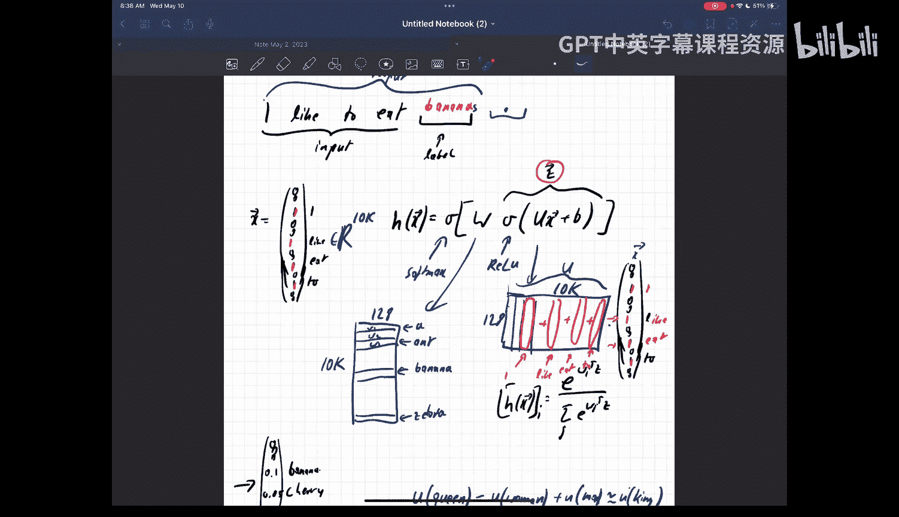
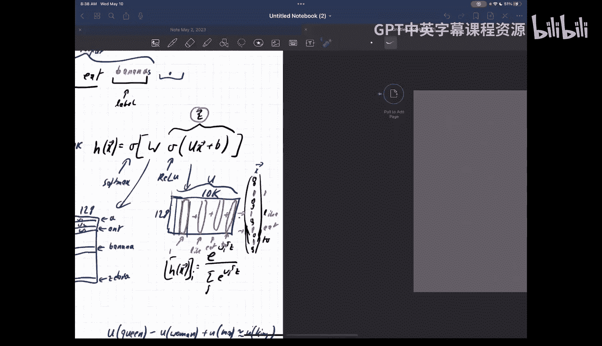
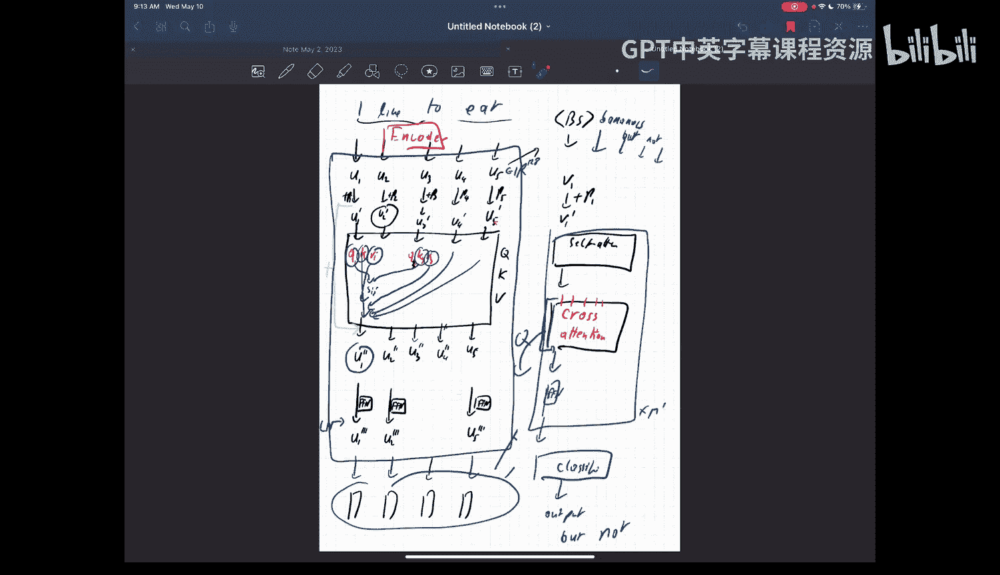
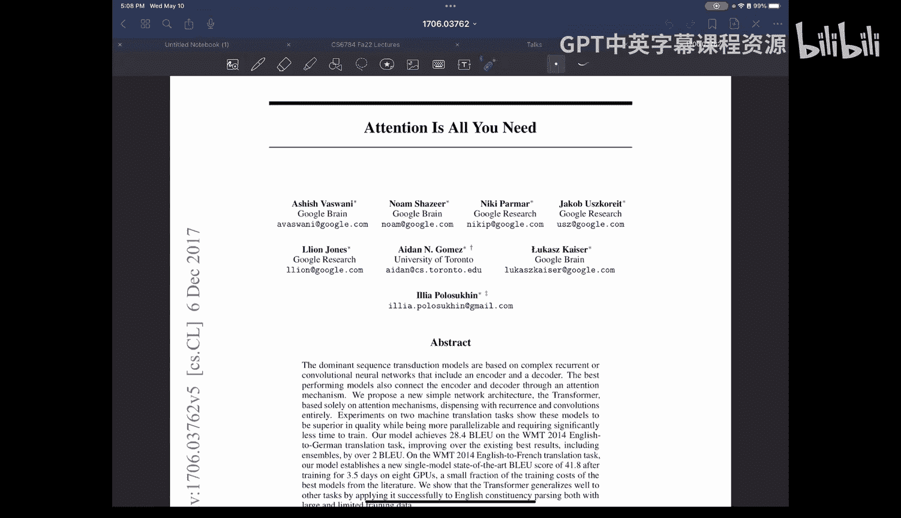
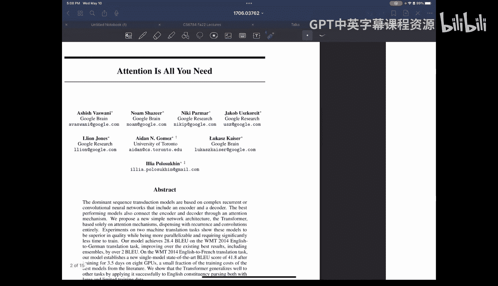
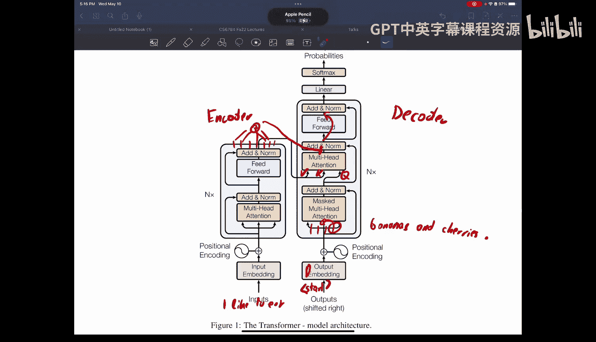
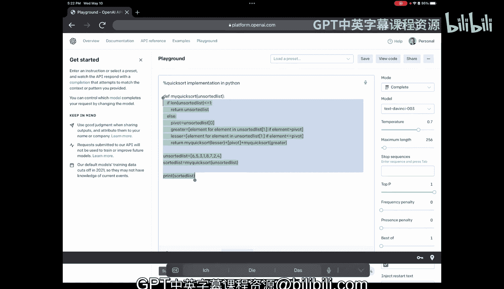

# 机器学习：040：Transformer模型详解 🧠

在本节课中，我们将学习Transformer模型的核心原理。Transformer是当前自然语言处理领域最重要的架构之一，它通过自注意力机制为每个单词生成**上下文相关的嵌入表示**，从而解决了传统语言模型中词序丢失和一词多义等问题。我们将从最简单的语言模型开始，逐步构建出完整的Transformer架构。

---

## 从最简单的语言模型开始

上一节我们介绍了语言建模的基本概念，本节中我们来看看一个最简单的实现方式。

语言建模的核心任务是：给定一个句子序列，预测下一个单词。例如，输入句子“I like to eat”，模型需要预测下一个单词（如“banana”）。

最简单的模型是将输入表示为**词袋向量**。这是一个非常高维的向量，其维度等于词汇表大小（例如10,000维）。向量中，每个单词对应一个位置，如果该单词出现在输入中，则对应位置为1，否则为0。

对于句子“I like to eat”，其词袋向量 `x` 在“I”、“like”、“to”、“eat”对应的四个位置上是1，其余位置都是0。

然后，我们训练一个神经网络来预测下一个单词。该网络可以表示为一个函数：

```python
h(x) = softmax(W * ReLU(U * x + b))
```

其中：
*   `U` 是一个矩阵，将高维的输入向量 `x` 映射到一个低维的隐藏空间（例如128维）。`U * x` 的操作本质上是取出输入单词对应的 `U` 矩阵的列向量，并将它们相加。
*   `ReLU` 是一个激活函数。
*   `W` 是另一个矩阵，其每一行都可以看作一个针对特定单词的分类器，用于判断该单词是否是下一个词。
*   `softmax` 函数将 `W` 的输出转换为一个概率分布。对于第 `i` 个单词，其概率为：
    `softmax(z)_i = exp(W_i^T * z) / sum_j(exp(W_j^T * z))`
    这里 `z` 是隐藏层的表示。`W_i^T * z` 的内积大小代表了单词 `i` 作为下一个词的可能性。





模型的输出是一个概率向量，我们可以根据这个分布采样得到预测的下一个词（例如“banana”）。然后，我们将预测出的词加入输入序列，继续预测下一个词，如此循环即可生成文本。

---

## 词袋模型的局限性

然而，这个简单的模型存在两个主要问题：

1.  **词序丢失**：词袋表示完全忽略了单词的顺序。“I like to eat”和“eat to like I”会产生完全相同的向量 `x` 和隐藏表示 `z`，这显然不合理。
2.  **静态词嵌入**：每个单词通过矩阵 `U` 获得一个固定的向量表示（即**词嵌入**，如Word2Vec）。但这无法处理一词多义的情况。

例如，在句子“I may visit in May”中，单词“may”出现了两次，但含义不同（一个是情态动词“可能”，一个是月份“五月”）。在词袋模型中，两个“may”会被相同地处理，因为它们的初始嵌入 `U[“may”]` 是相同的。模型只能通过上下文来区分它们的不同含义，但当前的架构不具备这个能力。

---

## Transformer的核心思想：上下文嵌入

Transformer的核心目标就是解决上述问题，为每个单词生成**上下文相关的嵌入**。它不再使用词袋表示，而是保留每个单词的独立向量，并让这些向量能够根据上下文相互影响。

以下是实现这一目标的关键步骤：

### 1. 位置编码

首先，我们需要将单词的顺序信息注入模型。Transformer为每个输入单词的初始嵌入向量 `U_i` 加上一个**位置编码向量** `P_i`：

`U_i' = U_i + P_i`

`P_i` 是一个仅与单词在序列中的位置 `i` 相关的向量。它通常由不同频率的正弦和余弦函数生成：

`P(i, 2d) = sin(i / 10000^(2d/D))`
`P(i, 2d+1) = cos(i / 10000^(2d/D))`

其中 `d` 是维度索引，`D` 是向量的总维度。这样，相近的位置会有相似的编码，而相距较远的位置编码差异较大。通过这种方式，即使两个相同的单词（如两个“may”），也会因为位置不同（`P2` 和 `P5`）而获得不同的初始表示 `U_2'` 和 `U_5'`。

### 2. 自注意力机制

这是Transformer的核心。它允许每个单词的向量根据序列中所有其他单词的向量进行更新，从而获得上下文信息。

具体来说，对于每个位置 `i` 的向量 `U_i'`，我们通过三个不同的可学习矩阵 `W_Q`, `W_K`, `W_V`，将其转换为三个向量：
*   **查询向量** `q_i = W_Q * U_i'`
*   **键向量** `k_i = W_K * U_i'`
*   **值向量** `v_i = W_V * U_i'`

我们可以将 `q` 理解为“我在寻找什么”，`k` 理解为“我是怎样的以便被找到”，`v` 理解为“我提供什么信息”。

然后，为了更新位置 `i` 的向量，我们计算 `q_i` 与序列中所有位置的键 `k_j` 的相似度（通常用点积）：

`s_{ij} = q_i^T * k_j`

这个相似度分数经过softmax归一化后，得到权重 `α_{ij}`：

`α_{ij} = exp(s_{ij}) / sum_k(exp(s_{ik}))`

最终，位置 `i` 的新向量 `U_i''` 是所有位置的值向量 `v_j` 的加权和：

`U_i'' = sum_j(α_{ij} * v_j)`

**这个过程就是自注意力**。每个单词的新表示都成为了整个序列中所有单词信息的加权组合。由于softmax的特性，权重 `α_{ij}` 通常是稀疏的，即每个单词主要只受少数几个相关单词的影响。例如，句子中的第二个“may”会更多地受到前面“in”的影响，从而获得与第一个“may”不同的表示。

### 3. 前馈神经网络与残差连接

在自注意力层之后，每个位置的向量会独立地通过一个相同的前馈神经网络（FFN）。这是一个简单的多层感知机，通常包含两层线性变换和一个激活函数：

`FFN(x) = W_2 * ReLU(W_1 * x + b_1) + b_2`

为了训练更稳定、更深入，Transformer还引入了**残差连接**和**层归一化**。
*   **残差连接**：将子层（如自注意力层或FFN层）的输入直接加到其输出上，即 `Output = LayerNorm(x + Sublayer(x))`。这有助于梯度流动，使模型易于学习恒等映射。
*   **层归一化**：对每个样本的所有特征维度进行归一化，使其均值为0，方差为1。这有助于稳定训练过程。

---







## Transformer的整体架构

一个完整的Transformer层通常按以下顺序堆叠：
1.  多头自注意力层（带残差连接和层归一化）
2.  前馈神经网络层（带残差连接和层归一化）

**“多头”注意力**是指并行地运行多个自注意力机制（每个头有不同的 `W_Q, W_K, W_V` 矩阵），然后将所有头的输出拼接起来，再通过一个线性投影层进行融合。这允许模型同时关注来自不同表示子空间的信息。

Transformer模型可以堆叠很多层（例如GPT-3有96层）。每一层都进一步整合和抽象信息，最终输出一系列富含上下文信息的向量。

---

## 编码器-解码器架构

最初的Transformer论文《Attention Is All You Need》中描述的是一个用于机器翻译的**编码器-解码器**架构。

*   **编码器**：接收源语言句子，通过多层Transformer层进行处理，输出一系列上下文向量。这就是我们上面描述的部分。
*   **解码器**：用于生成目标语言句子。它的结构与编码器类似，但有三个关键区别：
    1.  **掩码自注意力**：在解码时，生成单词是一个接一个进行的。为了确保在预测第 `t` 个单词时，模型只能看到前面 `t-1` 个已生成的单词，解码器的自注意力层使用了掩码，阻止当前位置关注未来的位置。
    2.  **交叉注意力**：在解码器的某个Transformer层中，除了自注意力子层，还插入了一个**交叉注意力**子层。在这里，**查询向量 `q`** 来自解码器上一层的输出，而**键向量 `k`** 和**值向量 `v`** 来自编码器的最终输出。这使得解码器在生成每一个单词时，都能有选择地关注源语言句子的不同部分。
    3.  **输出**：解码器的最后一个输出向量会通过一个线性层和一个softmax层，预测词汇表中下一个单词的概率。

对于像GPT这样的纯解码器模型，它只使用了Transformer的解码器部分（带掩码的自注意力），并将整个任务（如文本生成）视为自回归的下一个词预测问题。



---

## 总结



本节课中我们一起学习了Transformer模型的核心原理。我们从最简单的词袋语言模型出发，指出了其**词序丢失**和**静态词义**的局限。Transformer通过引入**位置编码**来注入顺序信息，并通过**自注意力机制**让每个单词的表示能够动态地受到整个上下文的影响，从而生成上下文相关的词嵌入。模型由多头自注意力层和前馈神经网络层堆叠而成，并广泛使用**残差连接**和**层归一化**来促进深度训练。标准的Transformer采用**编码器-解码器**架构，其中解码器使用**掩码自注意力**和**交叉注意力**来完成序列到序列的生成任务。正是这种强大的架构，使得模型在仅训练“预测下一个词”的目标时，也能涌现出对语言和世界知识的深刻理解。