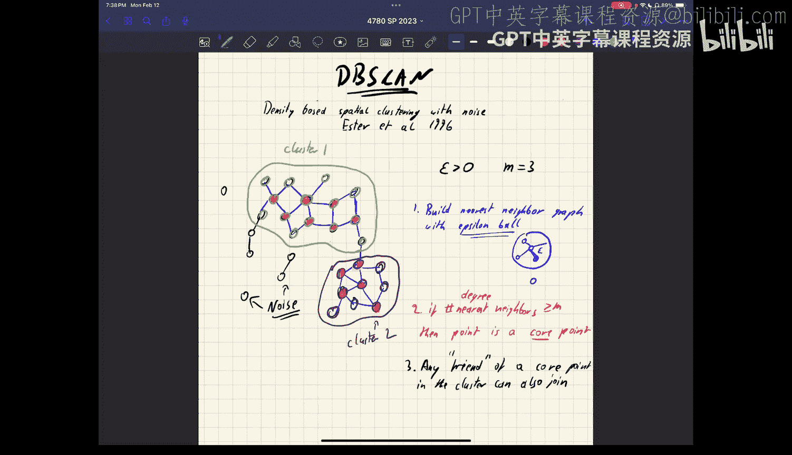
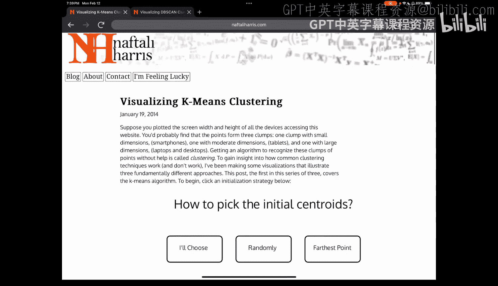
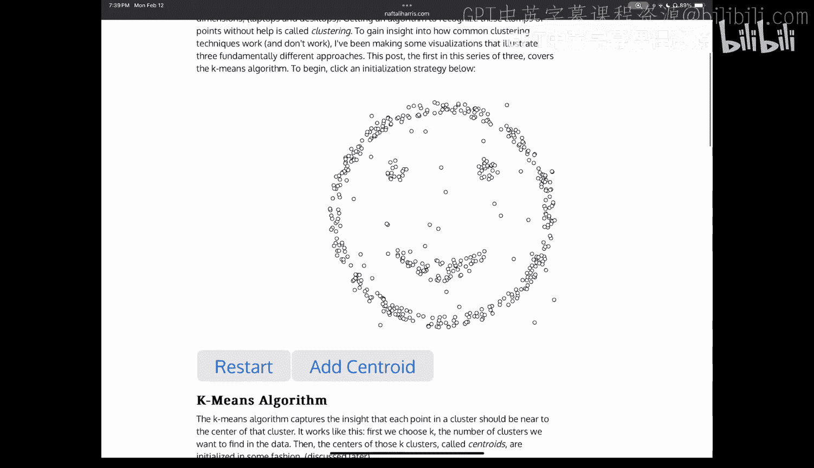
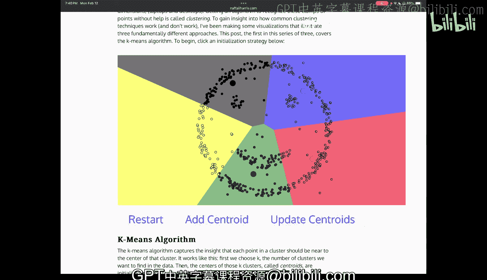

# 041：康奈尔大学《智能系统的机器学习｜CS4780 Machine Learning for Intelligent Systems 2017》中英字幕 p41 -41-The DBSCAN Clustering Algorithm Explained.zh_en -BV1Lo6gBxEKE_p41-

Hello， as promised， a short video on DB scan DB scan stands for density based spatial clustering with noise。

DV scan。 and I was invented by Esstardal in 1996。 D B scan has become my personal。

 my favorite clustering algorithm。 It is really， really cool and has many nice advantages over。

 for example， Kameian or Gaussian mixture models。😊，DB scan has two parameters， Epsilon and M。

And the way it works is as follows。 So the first thing you look at epsilon。

 Epsilon some small constant。And let's say this here on the left is my data。

 So for now just look at the you know， these points right。

 ignore the graph and the coloring and all this stuff。 So this is my data。😊。

And the very first thing you do is you take a data set and you convert it into a nearest na graph。

And the way you do this is you take any single data point， you draw an epsilon ball around it。

 distance epsilon， and you look at all the points that are inside of it。

 and these become your nearest neighbors。And points that are outside of it do not become nearest neighbors。

 so the nearest neighbor， you know when you have dense region of the graph。

 you have a lot of nearest neighbors。And in your sparse region， you know。

 then in your data point data set， then you actually have no nearest neighbors， for example。

 this guy here has no nearest neighbors because there's nothing inside of an Epsilom ball。Okay。

 so you do this， for example， this guy these are you know。

 these points are all within its nearest within Epsilon distance。

 so these are all the nearest neighbors， this guy also then this guy here has only two nearest neighbors。

😊，This guy here has， you know， and so on multiple nearest neighbors and so on。

 And so you build this whole graph。AndThat's the very first thing you do to do DP scan。

Then the second thing you do is you take the second constant m equals 3。And you define core points。

And the definition is very simple。 Any data point that is a degree。

Which is also the same thing as number of nearest neighbors， greater than M。

 greater equal M is a core point。 In this case， I drew them all as。Red points。 So， for example。

 this guy here has 1，2，3，4，5 nearest neighbors。5 is more than 3。 So it is a core point。

 This guy has 1，2，3 nearest neighbors，3 is greater equal，3 zs， Yes， also core point。 This guy，1，2。

3 core point。 This guy，1，2，3 core point。 This guy has only one nearest neighbor， not a core point。

 right not cool enough。 This guy， not a core point， only two nearest neighbors。😊，So again。

 you compute this for every single data point and you get all your core points。Here are here。

 these red。You know， red points。Now you've done all the preprocess。

Now we can start with the clustering。And the clustering。Essentially。诶。Follow us a simple principle。

 The first thing you do is you pick a random core point。 For example， this guy here on the left。

This is now my random core point， and I signed it to cluster  one。

 so this year let's call this cluster1。 So right now I have cluster  one and only consists of one point this core point here。

And here comes the clustering rule。Any data point that is connected with a core point。

 it's important that it's core。That's already in their cluster will also become part of the cluster。

 so all of these guys also become part of the cluster。

Because they're all connected to this God here and because it's a core point。

 all its neighbors can come in， it's a little like it's a party and only the core points are allowed to bring their friends with them to the party。

Now。You know this core point led in these these different points。

 but this guy here also came in with it， and this is again a core point。

So this point here that you know， can let it strengthen。

 so we have these two points that also come in。Because they're friends with this score point。

Now we have this core point in the cluster and now again。

 all of its friends can come in right So now we have these points as well part of the core cluster again。

 two more core points。They let their friends in。 So they are also part of the cluster。

 And this core point lets this point in。 So this is now the last point that's LED into the cluster。

 So if you draw the cluster line， you'll notice that this here is exactly。The cluster line。

 all of these points inside the green circle， are part of the cluster。

It's important that this point here is not part of the cluster why it has a friend that's in the cluster。

 but this year， not a core point。Only core points can bring their friends to the cluster。All right。

 so at this point we have run out of neighbors that we can let in and what we do is we just you know repeat the process。

 we start， we take our new core point at random， for example， this guide down here。Okay， we say。

 all right。 this guide down here is part of cluster number2。Clster。2。Yeah， this is discuss too。

And we do the same thing this guy has， you know a whole bunch of nearest neighbors can bring them over with him to the party。

Now， this core point has a bunch of neighbors can let them all in。

This core point can let this guy in and this core point can let this guy in and before you notice it。

 you realize all of these points belong to cluster number2。

Now we would again pick a random class a core point， but there aren't any core points left。

So what we do now is we take all the points at this stage that have not been assigned to any cluster。

And call them noise。 So these are just noise points。 Basically。

 they are not part of the cluster structure。We just they're kind of in their own category。

One thing that's also interesting to see is。This point here in the middle could really be in either one of the clusters。

 but because cluster one was assigned first。This point basically joined the party of this core point and couldn't join the party any more here because it was already a sign somewhere else。

 Every point can only be in one cluster。 That's sometimes why the first clusters may be a little bit bigger than subsequent clusters。

I should draw a little。Circle around this guy。And that's all there is to Db scan。

 I can now show you this a little bit on。

So you have a noisy， smiley face。And min points here is four epson is 1， Let's get started。

And the first thing it does is picks a random core point and lets all its neighbors into the。

Into the cluster。Then， you know， once they're all done， it picks a second core point。

And he finds a new cluster， there is the blue one now， a second cluster。And again。

 let's in all its neighbours。 we can see how this bottom up creeps around。

And captures the circular cluster very， very well。Buthich is something Kamemins could never do。

 right because Kminan basically assumes that the whole circle inside of it must be a cluster that can't just be a circle。

It must be filled with points。And now that signs the third cluster。And the fourth cluster。

 and now it's done with all the core points and everything that's here with a black circle is a noise point。

 And look how beautifully Db scan nailed this。😊，Pretty challenging cluster structure if you do take the same data set。

And run。K means on it。 You can now do this at a sroid。

1，2，3，4。 tell it how many clusters there are。 There are four clusters。

 we give Kmin in some set an advantage。 Let we tell it how many clusters there are。

 and we start assigning centroids。And you can see here what does it do。

 it just basically divides the space up into five clusters。

 is completely oblivious to the true cluster structure。Of course， you know。

 were beating up K means CF K means， actually。You know。

 does work very nicely when its assumptions are satisfied。

 but one thing I like about DB scan so much is that it doesn't make as many assumptions。

 So in practice it can sometimes be more robust and you know。

Bring out cluster structure even challenging data sets。

