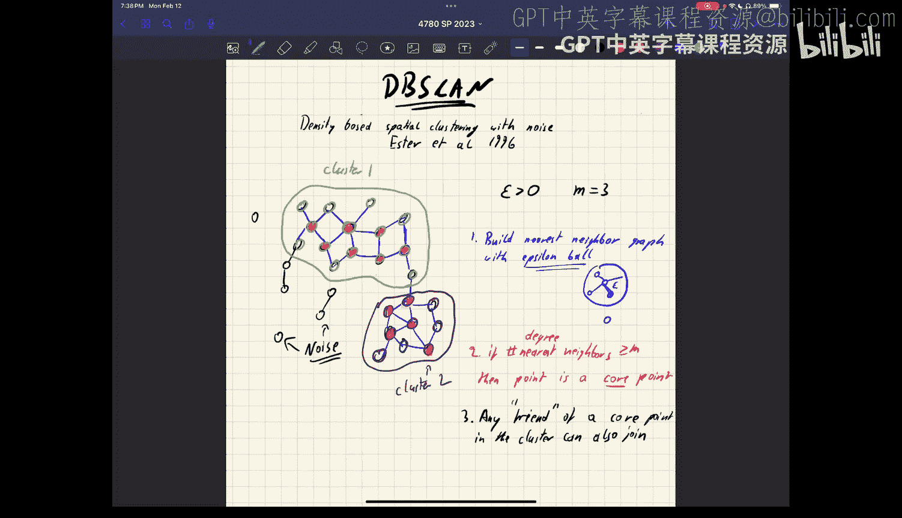
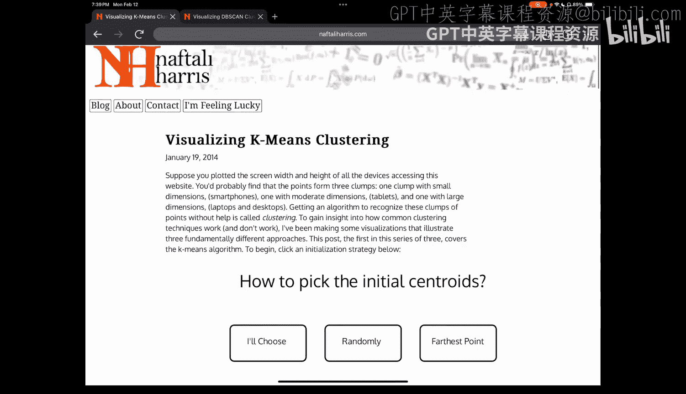
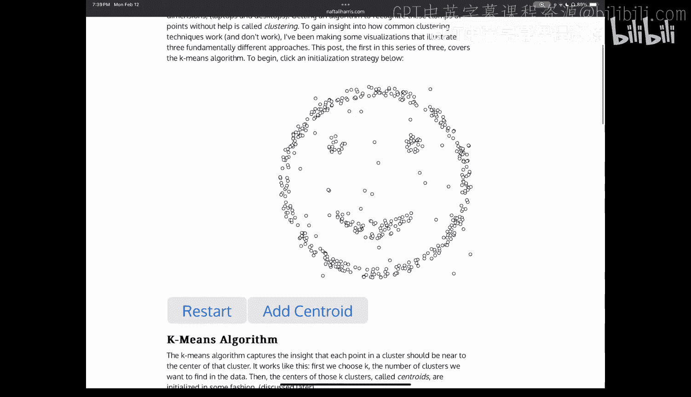
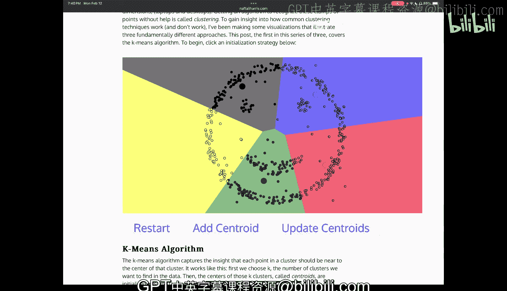

# 机器学习：041：DBSCAN聚类算法详解 🎯

在本节课中，我们将学习一种名为DBSCAN的聚类算法。DBSCAN是一种基于密度的聚类方法，它能够识别任意形状的簇，并能有效处理数据中的噪声点。与K均值等算法相比，DBSCAN具有独特的优势。

---

## 算法原理与参数

DBSCAN算法由Ester等人在1996年提出。它主要依赖两个参数：**Epsilon (ε)** 和 **M**。

*   **Epsilon (ε)**：一个距离常数，用于定义邻域范围。
*   **M**：一个数量常数，用于定义核心点。

算法的第一步是构建一个基于ε的邻域图。对于数据集中的每一个点，我们以其为中心，画一个半径为ε的圆（或高维空间中的球）。所有落在这个圆内的点，都被认为是该点的“邻居”。

**公式表示**：点 `p` 的 ε-邻域 `Nε(p)` 定义为：
`Nε(p) = { q ∈ 数据集 | distance(p, q) ≤ ε }`

---

## 核心点、边界点与噪声点

在构建了邻域关系后，我们根据参数 **M** 来识别核心点。

**核心点**的定义是：如果一个点的 ε-邻域内包含至少 **M** 个点（包括它自己），那么这个点就是一个核心点。

**代码逻辑**：
```python
if len(Nε(p)) >= M:
    p 是核心点
```

不是核心点的数据点，则根据其与核心点的关系，被进一步分类：
*   **边界点**：如果一个点不是核心点，但它位于某个核心点的 ε-邻域内，那么它是一个边界点。
*   **噪声点**：如果一个点既不是核心点，也不是任何核心点的邻居，那么它被标记为噪声点。

---

## 聚类形成过程

识别出所有核心点后，就可以开始形成聚类簇。以下是聚类的步骤：

1.  **初始化**：随机选择一个尚未被访问过的**核心点**。
2.  **扩展簇**：
    *   将该核心点分配到一个新的簇中。
    *   然后，**“邀请”该核心点所有 ε-邻域内的点（包括核心点和非核心点）加入这个簇**。
    *   对于新加入的点，如果它本身也是**核心点**，那么递归地将其所有邻居也“邀请”加入当前簇。
3.  **重复**：当一个簇无法再扩展（即没有新的核心点邻居可以引入新成员）时，回到步骤1，选择另一个未访问的核心点，开始形成新的簇。
4.  **标记噪声**：当所有核心点都被访问过后，剩余未被分配到任何簇的点，即为噪声点。

这个过程可以形象地理解为：只有“核心点”有权举办派对并邀请其所有朋友（邻居）参加。被邀请的朋友如果是核心点，他们也可以继续邀请自己的朋友。最终，所有通过这种朋友关系链连接起来的点，就形成了一个“派对”（簇）。没有被任何派对邀请的人，就是“噪声”。

---

## 算法演示与对比



为了直观理解DBSCAN的工作过程，我们可以观察它在一个人脸形状数据集上的表现。该数据集包含几个圆形簇和分散的噪声点。

当设置 `M=4`， `ε=1` 并运行DBSCAN时：
*   算法首先随机选中一个核心点，并逐步扩展，形成一个完整的圆形簇（如绿色部分）。
*   接着，它选中另一个核心点，形成第二个簇（如蓝色部分），并完美地勾勒出圆环形状。
*   这个过程持续进行，直到所有核心点都被处理，最终准确地识别出所有圆形簇，并将散布的点标记为噪声。

相比之下，如果我们对同一数据集使用K均值算法（即使预先告知它存在4个簇），结果会大不相同。K均值倾向于将空间划分为几个球形区域，完全无法捕捉到数据中固有的环形簇结构。这凸显了DBSCAN在识别非凸形状簇方面的强大能力。



---



## 总结

本节课我们一起学习了DBSCAN聚类算法。我们了解到：
1.  DBSCAN是一种基于密度的聚类算法，核心参数是邻域半径 **ε** 和最小点数 **M**。
2.  它通过识别**核心点**、**边界点**和**噪声点**来工作。
3.  聚类过程从核心点出发，通过密度可达关系不断扩展，能有效发现任意形状的簇，并对噪声数据不敏感。
4.  与K均值等基于距离的算法相比，DBSCAN在处理复杂簇结构和噪声方面通常更具鲁棒性。



掌握DBSCAN为你提供了一种强大的工具，用于探索那些簇形状不规则或包含大量离群点的数据集。