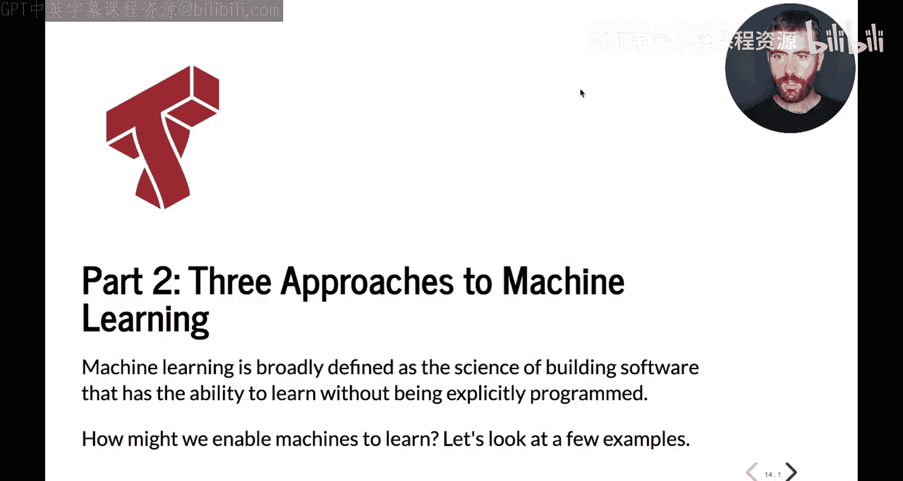
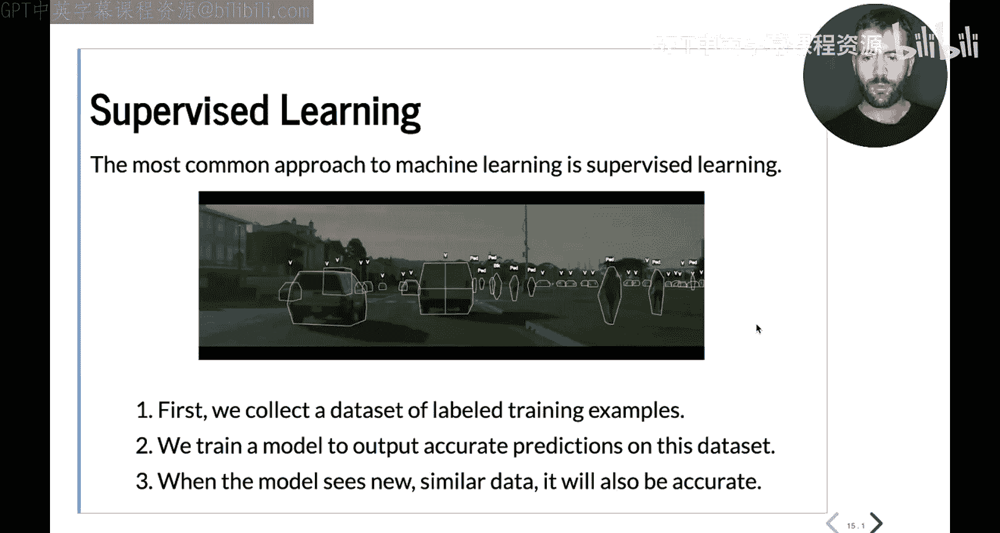
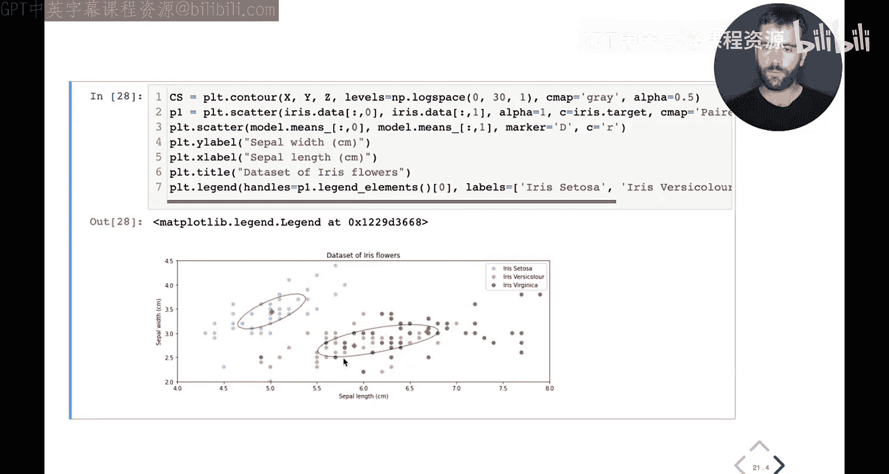
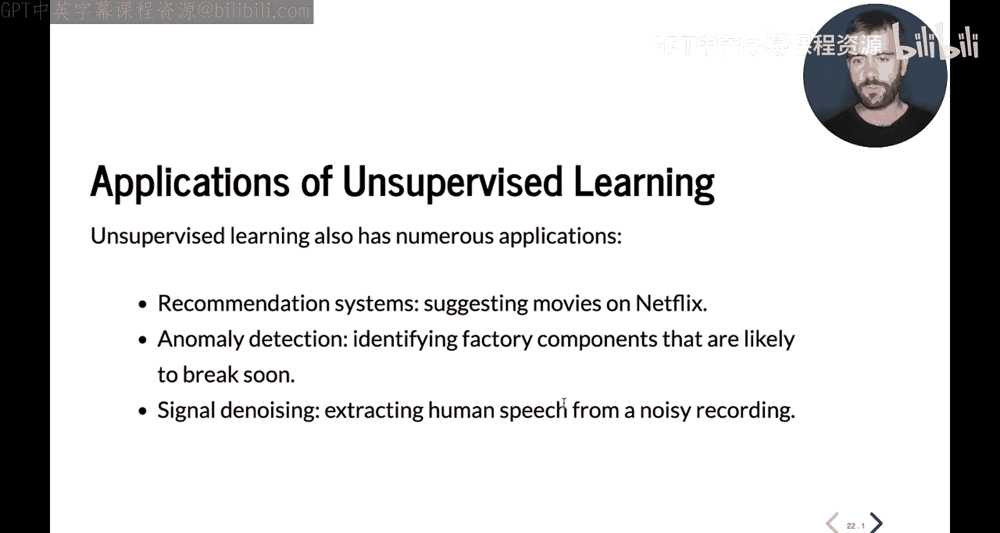
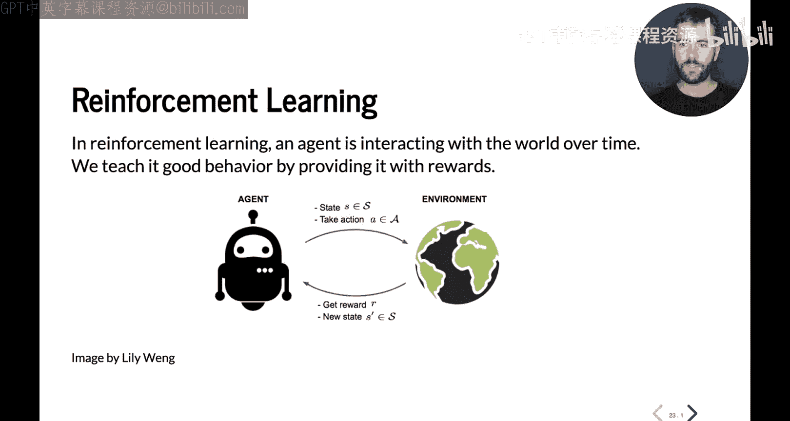
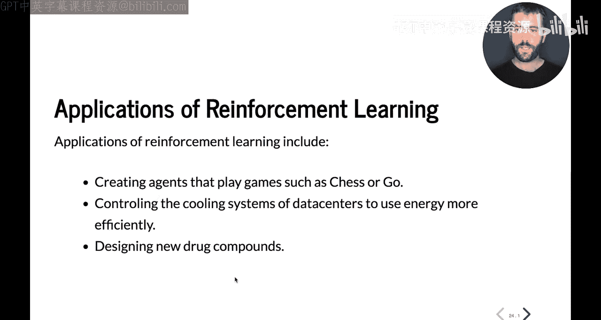
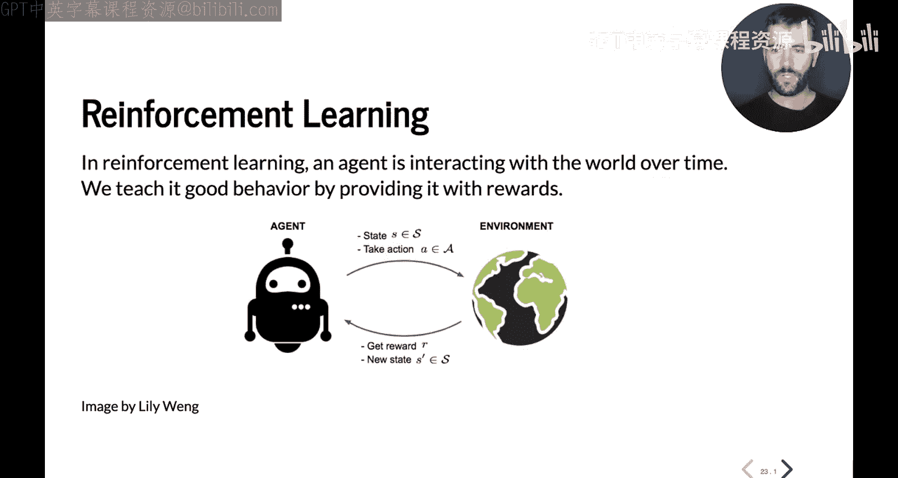
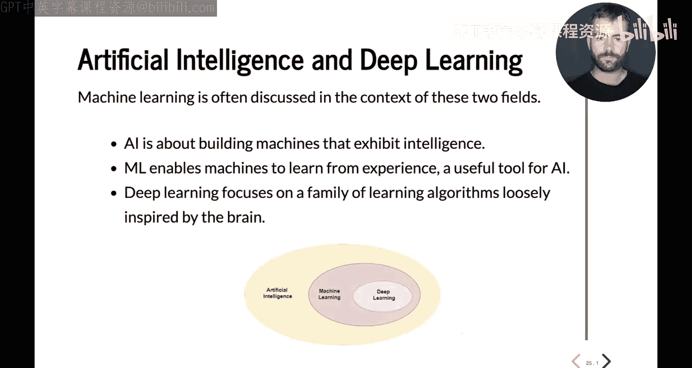
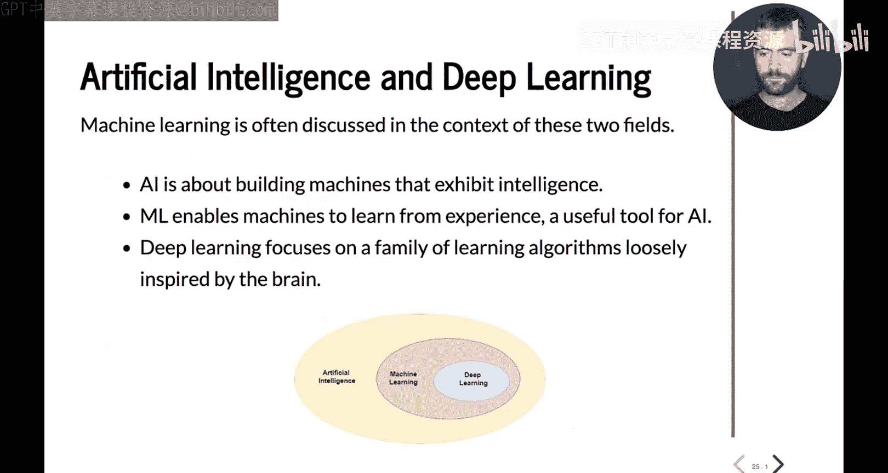

# 1.2：机器学习的三种方法 🧠

在本节课中，我们将继续介绍机器学习，描述三种通用的机器学习算法家族。这三种方法代表了构建机器学习系统和解决机器学习问题的三种高层次途径。

## 监督学习 📊

上一节我们介绍了机器学习的基本概念，本节中我们来看看第一种主要方法：监督学习。监督学习的核心思想是，我们希望机器学习算法能对一组特定的输入输出有用的预测。实现这一目标的方法是收集一个带标签的训练数据集，其中包含输入和输出的配对。然后，我们训练算法，使其在我们的数据上输出正确的预测。当模型看到与训练集相似的新数据时，它也能输出准确的预测。

在自动驾驶汽车检测行人的例子中，我们有行人和汽车的标签。如果我们给这个计算机视觉系统足够多带标签的区域，它将学会在从未见过的新图像上准确预测什么是行人，什么是汽车。

以下是监督学习的一个更具体的例子：波士顿房价数据集。数据集中的每个数据点代表一所房子。我们知道关于这所房子的不同属性，例如价格、社区、面积、邮政编码、房间数量等。我们可以使用Python中流行的机器学习库Scikit-learn加载这个数据集，并使用Matplotlib库将其可视化。

在这个可视化中，X轴代表社区中未获得高中文凭的成年人百分比，Y轴代表房价。可以看到，在未获得高中文凭成年人比例较高的社区，房价往往较低。一个简单的监督学习算法会将某些输入（如教育水平）映射到特定输出（如房价）。我们有一个由x（教育水平）和y（房价）组成的训练数据集，可以将其用作监督学习算法的训练数据，以预测新房屋的价格。

这里，我们从Scikit-learn库加载一个名为Kernel Ridge的特定算法。我们将在课程后面详细了解这个算法。现在，我们只需加载这个算法，在数据上训练它。算法会学习一条穿过数据的曲线，该曲线揭示了社区教育水平与房价之间的关系。未来，如果获得一个新的社区教育水平数据，我们就可以使用这条曲线进行新的预测。这是一个非常简单的监督学习例子。

监督学习方法可以应用于许多领域。当今一些最成功的机器学习应用都涉及监督学习，例如分类医学图像、语言翻译，以及之前提到的在自动驾驶汽车系统中检测物体。

## 无监督学习 🔍

监督学习并非我们唯一能做的机器学习类型。本课程将涉及的另一个重要类型是无监督学习。在无监督学习中，我们有一个没有任何标签或人工注释的数据集。我们的目标是学习数据中结构的一些有趣信息。

例如，我们可能会发现这个数据集包含几个聚类，即数据中存在彼此更相似的不同点群，找出它们会很有用。也许我们有一些具有某些相似性的个体群体，例如相似的生理测量值，这可能意味着他们有相似的疾病或健康状况。我们可以通过检查数据的结构来发现这一点，这对于后续可视化结构也很有用。或者，可能存在一些不寻常、有趣的数据点或错误，我们希望识别这些数据点。无监督学习的另一个应用是，如果我们有一个被噪声掩盖的信号，但知道该信号具有某种有趣的结构，我们可以尝试从噪声中恢复它。例如，尝试在嘈杂的房间或电话中恢复人类语音。

这是一个无监督学习能做什么的小例子。我将使用Scikit-learn库数据集模块中的函数加载另一个名为Iris（鸢尾花）的数据集。在这个可视化中，每个数据点对应一朵花，X轴和Y轴分别代表以厘米为单位的萼片宽度和萼片长度。仅观察这个数据集，你已经可以看到它具有某种结构：这些点似乎彼此更相似，而这些点则不同。

无监督学习算法可用于提取数据中的这种结构。具体来说，我们将尝试学习该数据的概率密度，并使用一个在本课程中也会看到的算法，称为高斯混合模型。我们假设数据由三个我们试图学习的成分组成，但我们只告诉算法有三个成分，然后看看学习数据会发生什么。实际上，它首先发现这里有两个组：这一组和这一组，这是我们通过检查数据已经看到的。然后它进一步指出，这一组可以分解为两个更小的子组，由这里的两个红点表示。

有趣的是，这个数据集实际上是有标签的。我之前没有使用它们，但现在也可以加载它们，并用不同的颜色显示每朵花的标签。我们看到，数据中确实存在三个类别：第一个类别对应这个聚类，所有这些蓝色的花实际上来自同一个鸢尾花亚种，称为山鸢尾。而这组点实际上也包含两种类型的花，这里用黄色和棕色标记，分别称为变色鸢尾和维吉尼亚鸢尾。这两种花彼此更相似，但通过无监督学习，我们能够发现这两个点对应这两个类别的中心。确实，黄色的花往往更多地出现在这个组的这一侧，而棕色的花则更多地出现在另一侧。在没有查看标签的情况下，仅通过观察数据的结构，我们就能够识别出这三组花，尽管我们不知道它们具体是什么。

无监督学习也有很多实际应用。例如，被称为推荐系统的系统，如Netflix上的电影推荐系统，其某些组件或某些版本可以是无监督的，或者至少更复杂的生产系统包含一些无监督组件。我们还可以将无监督学习用于异常检测，例如识别错误、噪声或与正常状态截然不同的数据点（如可能发生故障的工厂组件）。我之前提到的信号去噪是无监督学习的另一个有用应用。

## 强化学习 🎮

最后一种机器学习类型，也是一种非常有趣的方法，称为强化学习。在强化学习中，我们有一个略有不同的设置。这里有一个智能体在某个环境中行动。这个智能体基于其内部状态决定采取特定行动。它将行动发送给环境，环境以某种方式发生变化。然后，根据发生的情况，智能体的状态发生变化。随着状态变化，智能体还会观察到在特定状态下采取特定行动所获得的奖励。这个智能体的目标是随时间最大化奖励。

让我给你一个更具体的例子：想象一个试图执行某项任务的机器人，比如清洁厨房桌面的一部分。如果机器人执行涉及清洁的任务，它会获得奖励（我们说“好机器人”）；如果机器人做了不相关的事情，比如打碎了一个玻璃杯，我们会给它一个负奖励（我们说“坏机器人，停下”）。从这类奖励中学习的智能体和算法被称为强化学习智能体，这是我描述的第三种机器学习方法。

这种方法也有很多实际应用。例如，玩国际象棋或围棋等棋盘游戏的智能体，最先进的智能体是使用强化学习构建的。强化学习在工业中也有很多实际应用，例如数据中心的冷却系统。我们可以使用强化学习来设计何时开启或关闭冷却的策略，以保持数据中心处于最佳性能，同时不产生过多成本。

强化学习与常规监督学习略有不同，不仅因为这种奖励结构，还因为这些状态。在强化学习中，智能体常常会遇到一些能带来即时奖励的局部最优决策，但这些决策可能导致其进入奖励不佳的状态。智能体可能会陷入某种不良状态。因此，强化学习比其他类型的机器学习更具挑战性，因为我们必须进行这种长期规划和探索，以确保不会陷入任何不良状态。此外，导致我们进入良好状态的决策可能不会立即显现其好结果，好的结果可能在未来更远的时间才能观察到，这使得学习智能体的良好策略变得更加困难。

## 人工智能与深度学习 🤖

最后，我想在本视频中区分的两个相关领域是人工智能和深度学习。我们经常在机器学习的相同语境中听到它们，但它们并不完全相同。

首先，人工智能是一个普遍的学术和应用领域，关注于构建模仿人类智能行为的系统。人工智能的最终目标（也称为通用人工智能或强人工智能）是构建表现得像人类一样智能的实体。但实现这一目标还有许多子目标，例如逻辑推理或规划。

机器学习是人工智能的一个子集，专注于构建能够从经验中学习的机器。这是智能系统的一个特征，但不是唯一特征。例如，逻辑可能是智能系统的一个属性，不一定与学习相关；逻辑推理也可能与学习无关。尽管如此，机器学习被认为是构建人工智能系统的一个非常重要的工具，也被认为是实现那个长期目标最有希望的方法。

深度学习是机器学习的一个子集，专注于一种称为神经网络的特定模型，其灵感大致来源于大脑的工作原理。这类模型在今天非常成功，可以解决许多重要的实际问题，如图像识别、语音识别、机器翻译。在这些任务上，深度学习模型取得了非常令人印象深刻的结果，这就是为什么深度学习是当今一个特别有趣和令人兴奋的应用领域。

## 总结 📝

本节课中，我们一起学习了机器学习的三种主要方法：监督学习、无监督学习和强化学习。监督学习使用带标签的数据训练模型进行预测；无监督学习旨在发现未标记数据中的内在结构；强化学习则让智能体通过与环境交互并获得奖励来学习最优策略。我们还简要区分了人工智能、机器学习和深度学习之间的关系。理解这些基本方法为我们后续深入学习具体的算法和应用奠定了坚实的基础。