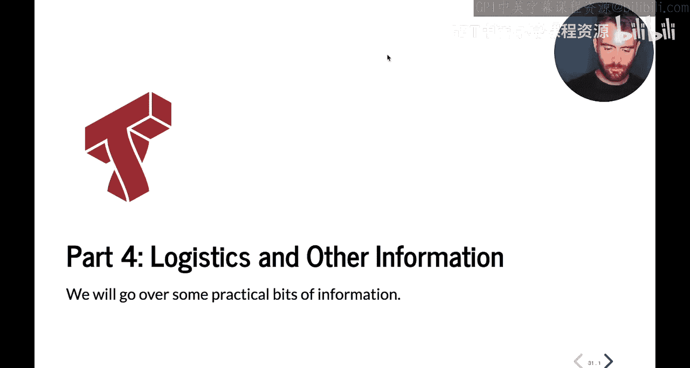
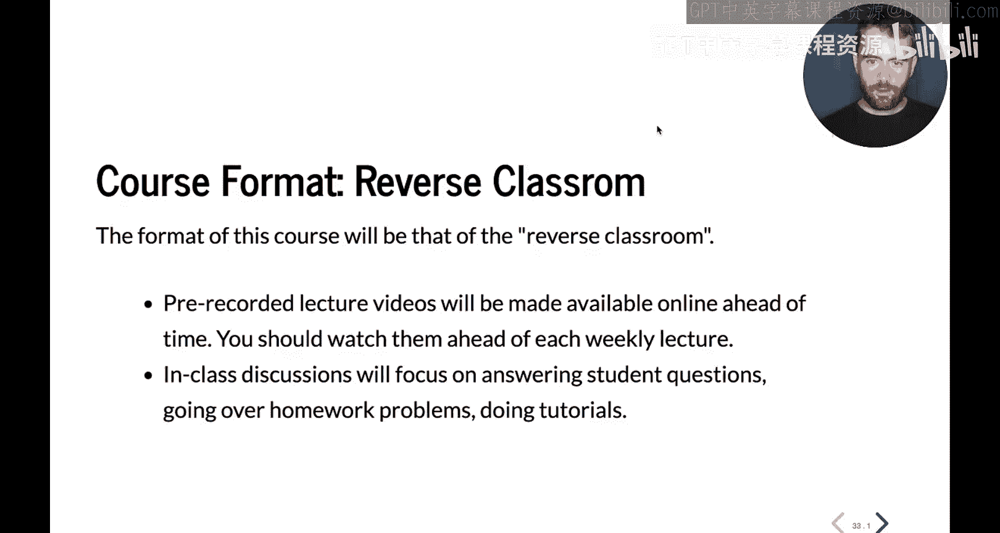
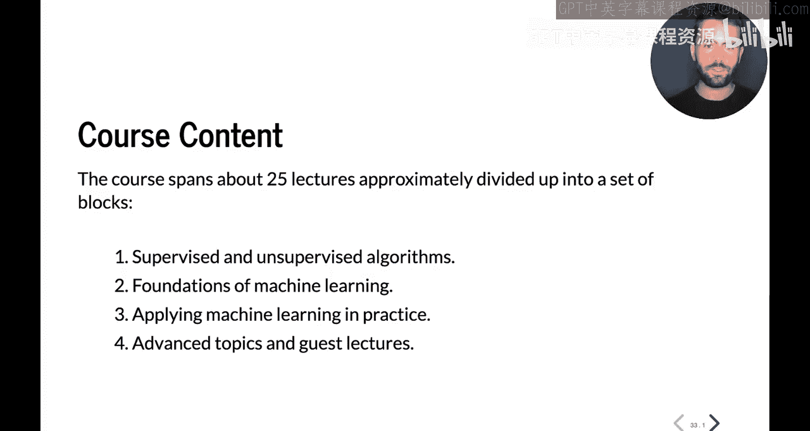
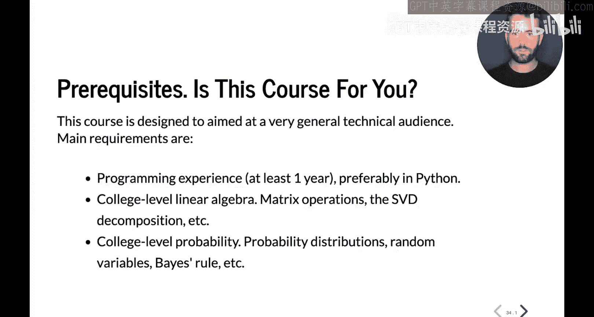
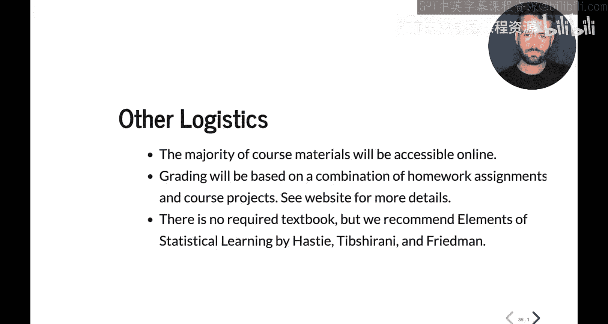
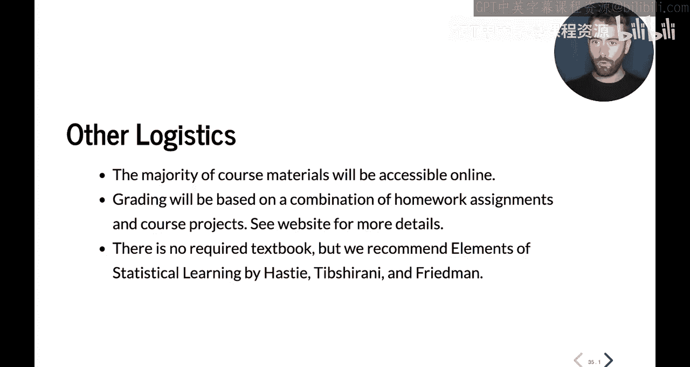
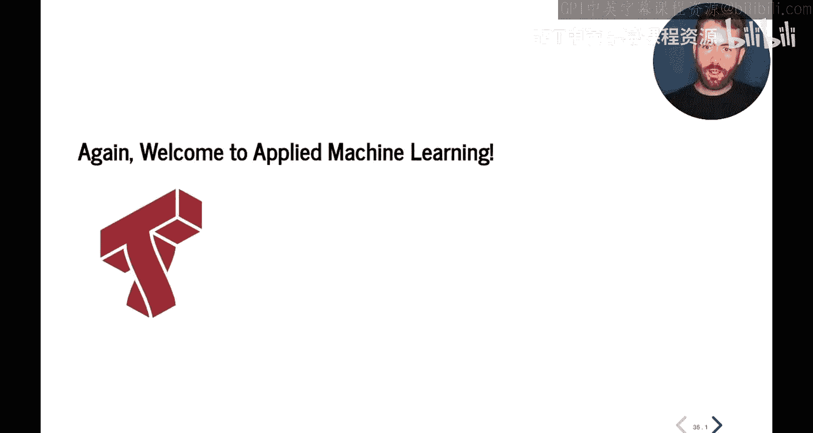
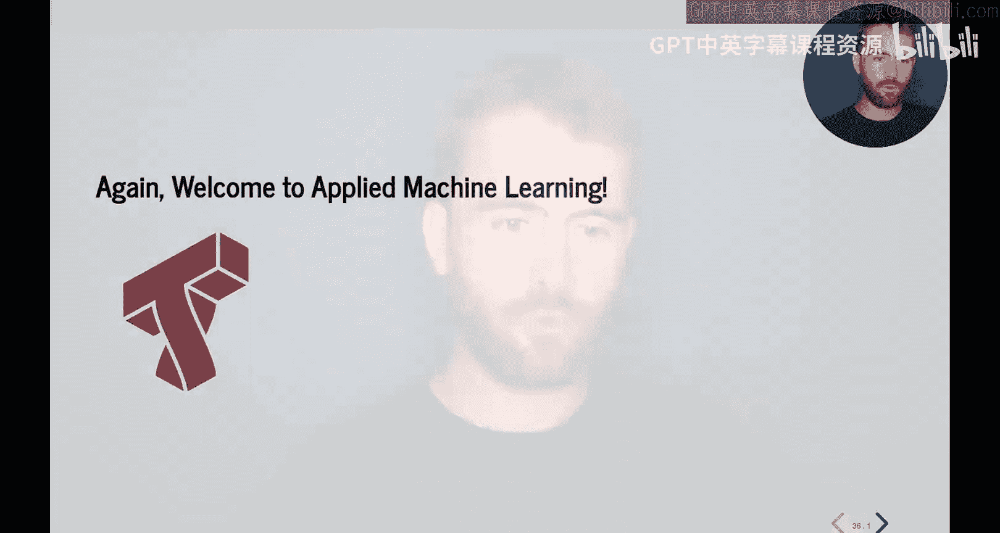

# 1.4：课程安排与其他信息 📚

在本节课中，我们将学习康奈尔大学《应用机器学习》课程的具体安排、课程结构、先修要求以及其他重要信息。通过了解这些内容，你可以更好地准备并参与本课程的学习。

---

## 课程形式：翻转课堂 🔄

上一节我们介绍了课程的整体目标，本节中我们来看看课程的具体形式。本课程将采用“翻转课堂”的形式进行。

翻转课堂的核心思想是：课程的主要内容和材料以预录形式单独提供。具体到本课程，这些材料就是你正在观看的讲座视频和幻灯片。

课堂面授时间将主要用于问答、讨论问题、解答疑问以及进行实践教程。这是面授环节的重点。因此，你需要提前观看视频并复习材料，以便熟悉内容，从而能够积极参与课堂讨论并提出问题。

---

## 课程内容结构 📊

本课程内容大致分为25个讲座，并划分为四个主要部分。

以下是课程内容的四个主要模块：

1.  **机器学习算法**：课程的一个重要部分是学习来自机器学习不同领域的算法。这包括**监督学习算法**、**无监督学习算法**，我们也会简要提及**强化学习**。大部分讲座将专注于理解和解释这些算法。
2.  **机器学习基础**：除了定义算法，我们还需要理解这些算法在实践中为何有效。机器学习背后有深刻的理论，它使用统计学语言和各种数学技术来证明，当给定特定类型和数量的数据时，机器学习算法确实有效。我们不会深入探讨理论和数学证明，但会从高层次解释机器学习算法有效的原因，同样重要的是，它们何时会失效以及有何局限性。
3.  **机器学习实践应用**：理解了机器学习的基础，我们就能实现列表中的第三点：理解如何在实践中有效应用机器学习。我们将用大约四到五个讲座来探讨机器学习的实际应用方面。在学习了核心算法之后，我们将学习如何通过理解算法有效和失效的原因，来诊断机器学习模型的性能。我们还将探讨如何利用这些知识来理解为何某个算法在特定问题上可能表现不佳，以及解决问题的流程是什么，从而使其工作得更好，甚至榨取算法的最大性能。这将涉及诸如误差分析、理解过拟合与欠拟合、跟踪性能指标、测量算法性能等主题。
4.  **高级专题与嘉宾讲座**：课程的最后部分将涵盖一些高级主题。我们还将邀请客座讲师，分享他们在其专业领域内特定机器学习主题的见解和讲座。

---

## 先修要求 📝

本课程的先修要求比较通用。

以下是主要的先修条件：

*   **编程经验**：具备基本的编程经验。理想情况下，这应该是在任何编程语言中至少有一年的编程经验，但最好是**Python**。大量材料将以Python代码形式呈现，因此熟悉Python对你将非常有帮助。
*   **数学基础**：机器学习也使用数学语言定义。两个最重要的数学领域是**线性代数**和**概率论**。为了充分理解本课程材料，具备大学水平的线性代数和概率论背景将非常有用。这里所说的大学水平，是指学习过并熟悉本科阶段线性代数和概率论入门课程所涵盖的内容。

如果你不熟悉所有这些主题，我们也会分享材料并进行教程，帮助你快速掌握其中一些主题。或者，如果你忘记了某些内容，希望这些材料能作为复习资料，对你有所帮助。

---

## 其他课程细节 ℹ️

最后，关于课程的一些其他细节。

*   **课程网站**：我们将使用课程网站来分享材料。康奈尔学生将有一个托管在特定平台上的课程网站（链接将另行分享）。同时，也会有一个面向公众的课程版本，用于存放这些课程材料。具体网址未在幻灯片中列出，因为它们可能随时间变化，但会通过适当渠道分享。我们将使用这些网站进行讨论、发布作业等。
*   **评分方式**：本课程的评分将是**作业**和**课程项目**的结合。请查阅网站了解课程项目的具体信息。基本上，会有四次作业。课程项目将涉及实现一个机器学习算法来解决你感兴趣的问题，我们会分享项目想法。我们也会分享关于该项目要求的具体细节，但本质上，它是一篇5到8页长的论文，在课程结束时提交。
*   **教材**：本课程没有指定必修教材。但如果你想从其他来源阅读相关材料，我个人推荐Hastie、Tibshirani和Friedman合著的教材《The Elements of Statistical Learning》。这是一本优秀的教材，涵盖了本课程将涉及的所有内容甚至更多，我强烈推荐。

---

## 总结与展望 ✨

本节课中，我们一起学习了《应用机器学习》课程的具体安排。我们了解了课程将采用翻转课堂的形式，明确了课程内容分为算法、基础、实践和高级专题四个主要模块。我们还讨论了学习本课程所需的编程和数学先修知识，并介绍了课程网站、评分方式和推荐教材等后勤细节。

最后，我想再次分享我对教授这门课程的兴奋之情。我认为机器学习是一个极其迷人的研究领域，我个人非常高兴能创作这些讲座。我希望你能像我一样享受这些学习材料。

感谢你的参与。