# 2.3：监督学习的解剖：学习算法 🧠

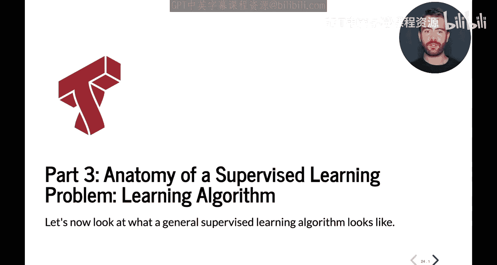

在本节课中，我们将学习监督机器学习算法的核心组成部分。我们将定义模型类、目标函数和优化器这三个关键元素，并使用数学符号和代码示例来具体说明它们是如何协同工作的。

在之前的课程中，我们定义了监督机器学习问题的结构。我们收集一个数据集来指定算法的期望行为，然后通过一个学习算法处理数据，最终输出一个预测模型。这个模型旨在未来新的数据集上实现良好的预测性能。

上一节我们介绍了监督学习数据集的结构和表示方法。本节中，我们将转向学习算法本身，并为其建立一套数学符号体系，以便在后续课程中定义各种监督学习算法。

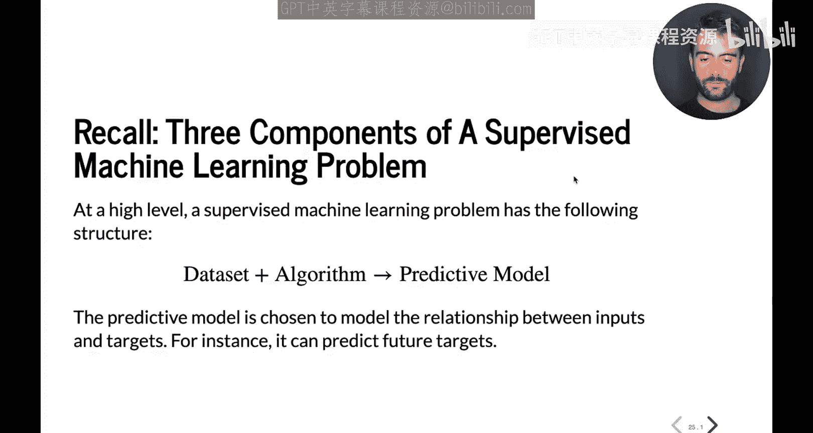

## 监督学习算法的三大组件

一个监督机器学习算法在最高层次上，完全由以下三个重要组件定义：

*   **模型类**：这是算法可能输出的所有预测模型的集合。模型类定义了我们可以考虑的所有可能的函数形式。
*   **目标函数**：这个函数用于量化一个特定模型对数据集的拟合程度。我们通常希望找到能使目标函数值最优（例如最小化）的模型。
*   **优化器**：这是一个程序或算法，用于在模型类中搜索并找到那个能优化（通常是极小化）目标函数的模型。

因此，优化器在给定模型类和目标函数的情况下运行，最终输出一个预测模型，这就是我们算法的结果。

## 组件详解

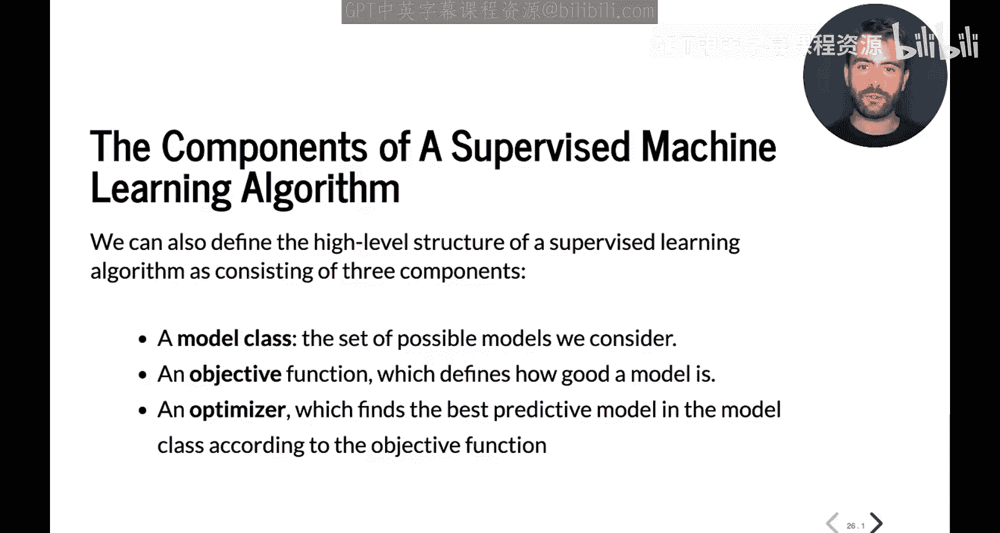


为了更具体地定义这些组件，我们将以糖尿病数据集作为贯穿始终的例子。该数据集包含患者的各项生理指标（如年龄、性别、BMI、血压等）以及其糖尿病风险。

### 1. 模型与模型类

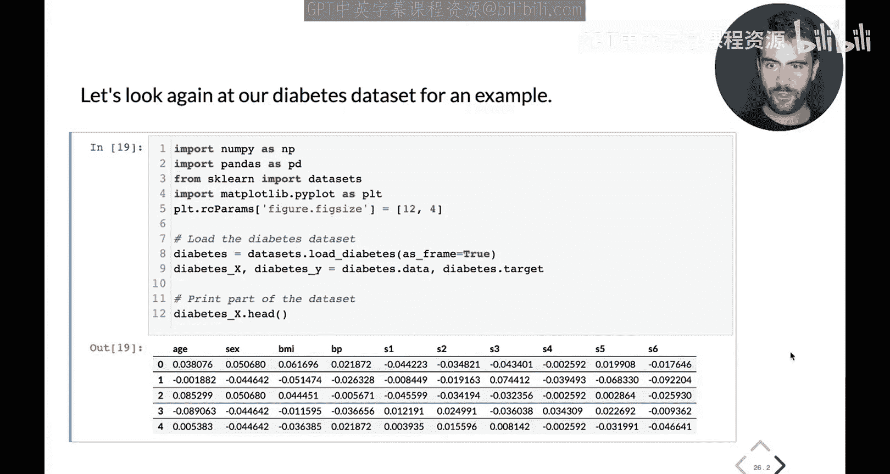

预测模型是算法最终输出的结果。我们可以将其视为一个将输入 **x** 映射到目标 **y** 的函数。

在糖尿病例子中，这个函数接收患者的特征，并输出其糖尿病风险值。模型通常带有参数，我们用符号 **θ** 表示。参数存在于某个集合 **Θ** 中。一个具有特定参数 **θ** 的模型，我们记作 **f_θ**。

模型类是我们考虑的所有可能函数 **f: X → Y** 的一个子集。如果模型带有参数，我们可以通过有效参数集合来定义模型类。模型类 **F** 可以表示为所有具有参数 **θ ∈ Θ** 的模型 **f_θ** 的集合。

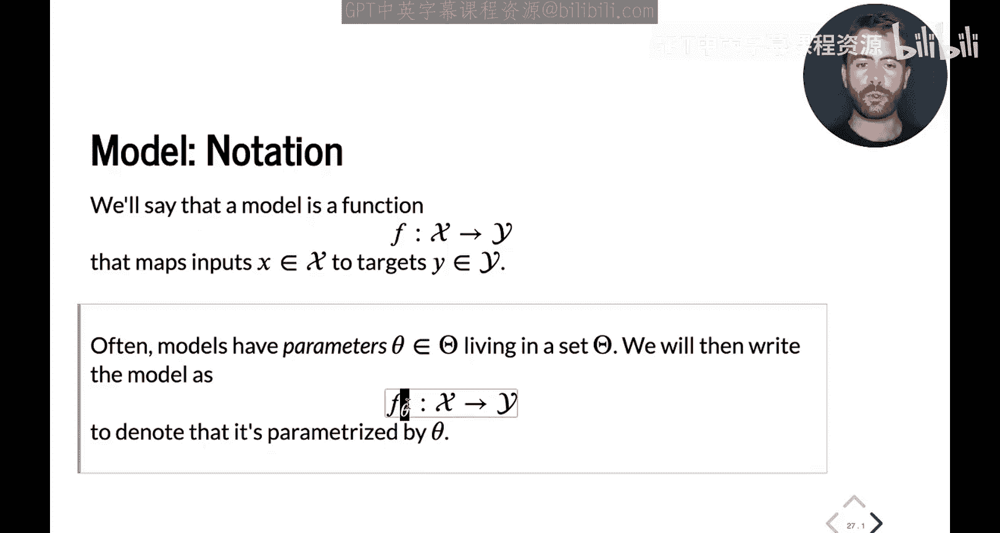

**示例：线性模型**
机器学习中一个非常常见的方法是假设 **y** 和 **x** 之间存在线性关系。即，目标 **y** 通过以下线性方程与输入 **x** 和参数 **θ** 相关：

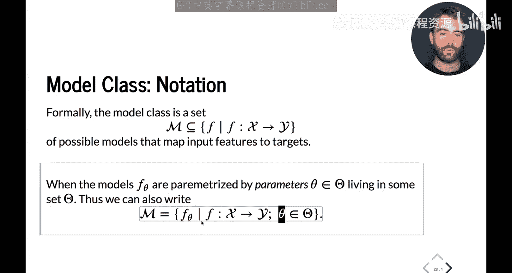

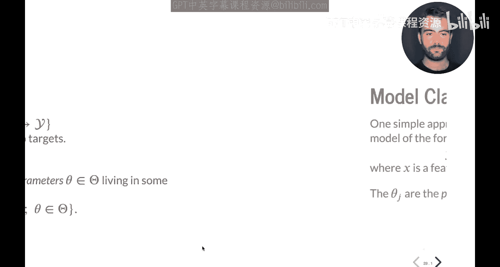

`y = θ_0 + θ_1 * x_1 + θ_2 * x_2 + ... + θ_d * x_d`

这里，为了得到 **y**，我们取每个属性 **x_j**，乘以对应的参数 **θ_j**，然后将所有结果相加。所有 **θ_j** 构成一个 **d** 维的参数向量 **θ**，与 **d** 维的输入 **x** 结合以进行预测。

### 2. 目标函数

给定一个模型类，我们需要一种方法来衡量哪个模型对数据拟合得好，哪个拟合得差。为此，我们定义了目标函数，它通常也被称为损失函数，因为当模型拟合不佳时，它的值往往很大；拟合良好时，值则很小。

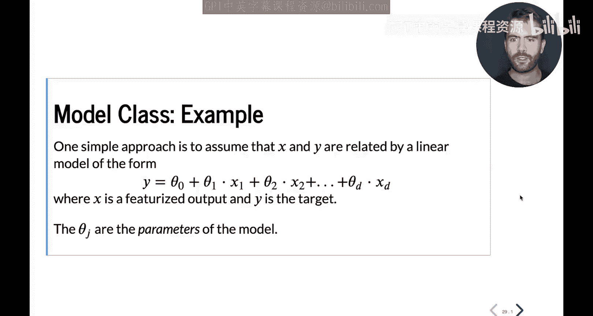

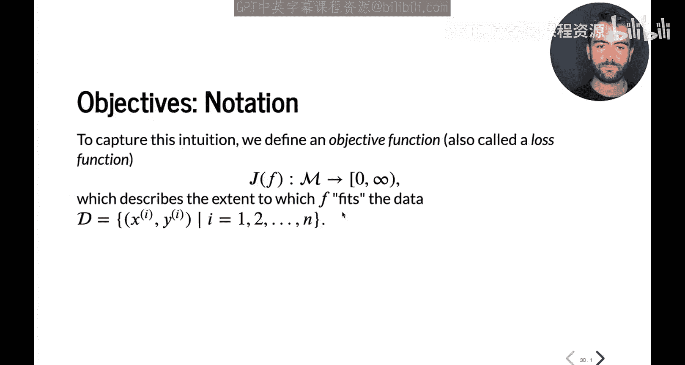

目标函数是一个在模型集合上定义的函数。给定一个模型 **f**，它给出一个评分。我们通常希望最小化这个目标函数。如果 **f** 由参数 **θ** 参数化，我们可以将目标 **J** 直接定义为参数 **θ** 的函数：**J(θ)**。

以下是两个常用的目标函数示例：

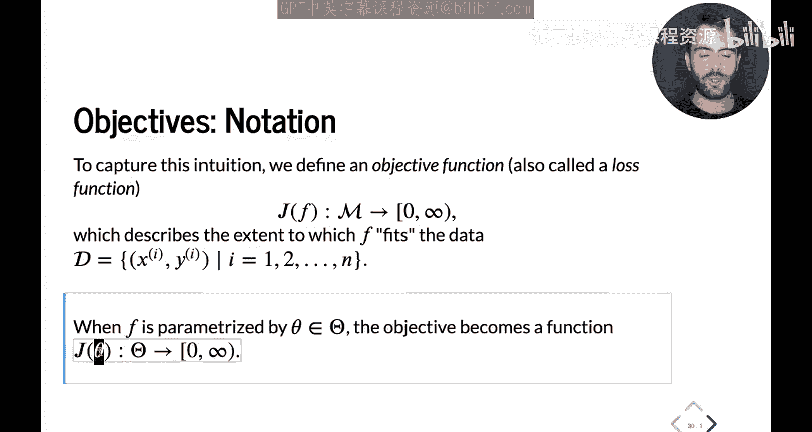

*   **均方误差**：这是监督学习中最广泛使用的目标之一。其定义是预测值与真实目标值之差的平方的平均值。公式为：
    `MSE = (1/n) * Σ (y_i - f_θ(x_i))^2`
    当这个值很小时，意味着模型的预测与真实目标非常接近。
*   **L1误差（平均绝对误差）**：我们直接计算模型预测值与真实目标标签之间的绝对差值的平均值。公式为：
    `MAE = (1/n) * Σ |y_i - f_θ(x_i)|`
    同样，我们希望最小化这个差值。

**代码示例**：
```python
from sklearn.metrics import mean_squared_error, mean_absolute_error

y_true = [3, -0.5, 2, 7]
y_pred = [2.5, 0.0, 2, 8]

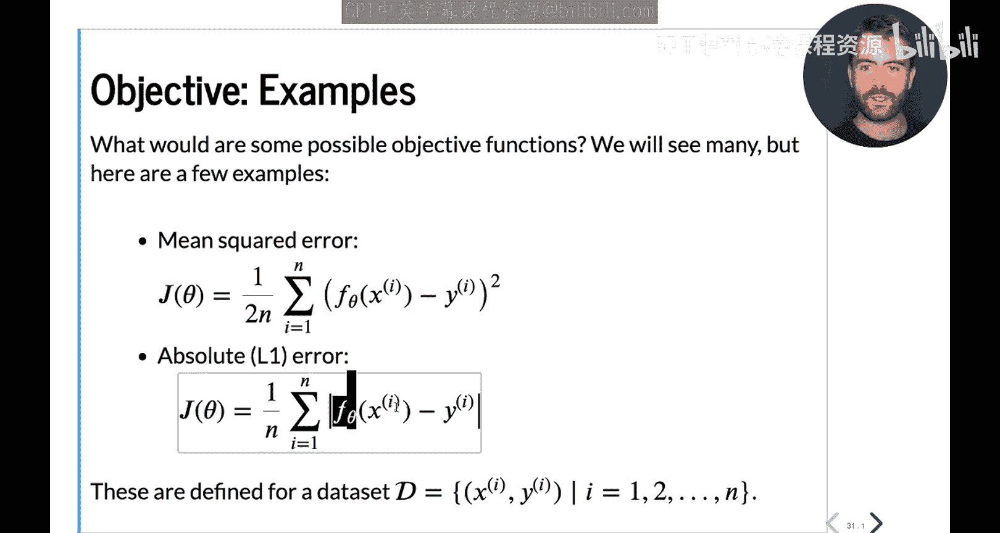

mse = mean_squared_error(y_true, y_pred)  # 输出：0.375
mae = mean_absolute_error(y_true, y_pred) # 输出：0.5
```

### 3. 优化器

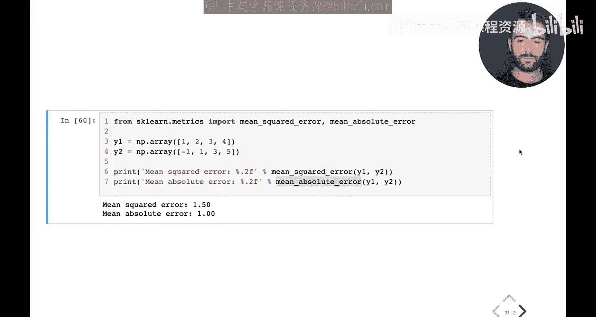

定义算法所缺失的最后一个组件是优化器。优化器是一个解决以下最小化问题的程序：在模型类 **F** 中，找到能使目标函数 **J** 的值最小的模型 **f**。

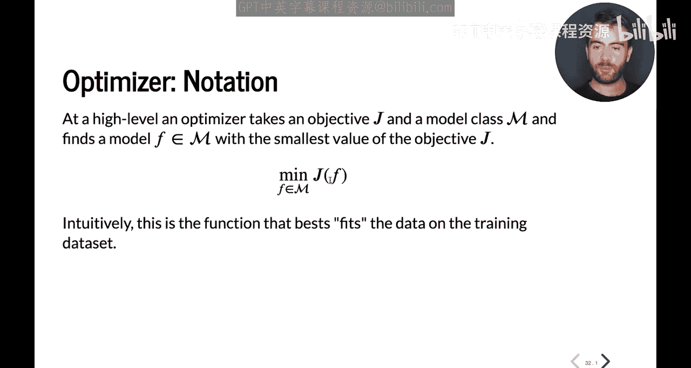

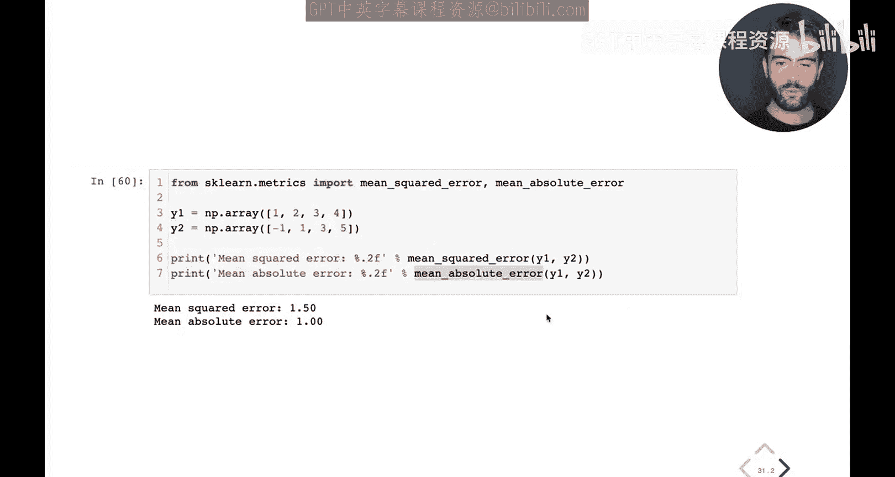

直观地说，优化器寻找在训练数据上具有最佳拟合度的模型。如果 **F** 由参数 **θ** 参数化，那么这个优化问题就转化为在所有可能的 **θ** 值上最小化函数 **J(θ)**。

**代码示例**：
在Scikit-learn库中，`LinearRegression` 类内部使用了一个优化算法（基于最小二乘法）来解决均方误差最小化问题。
```python
from sklearn.linear_model import LinearRegression

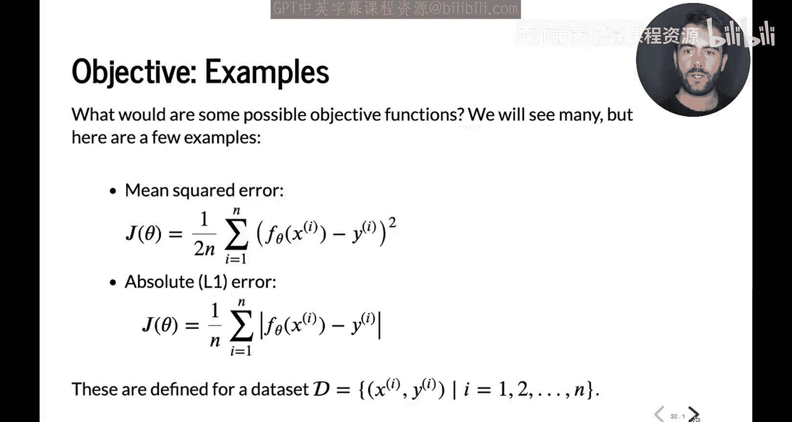

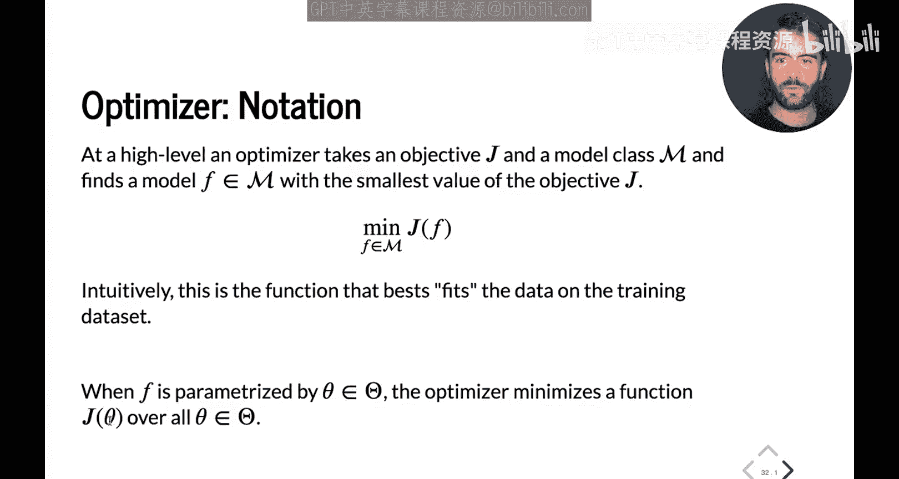

# 假设 X_train, y_train 是我们的训练数据
model = LinearRegression()  # 定义模型类（线性模型）和优化器
model.fit(X_train, y_train) # 执行优化，找到最优参数θ
```
当调用 `fit` 方法时，它解决了我们之前幻灯片上的优化问题，结果是一个训练好的模型，可用于进行预测。

## 完整算法示例

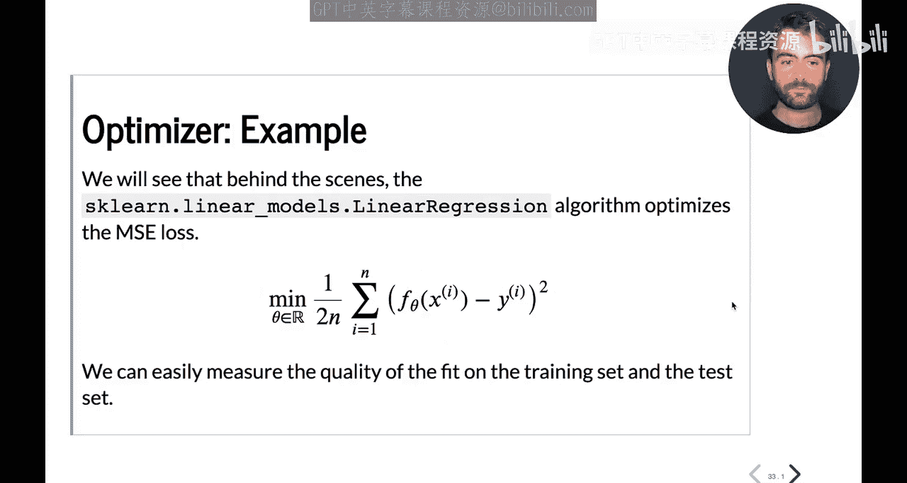

现在，我们可以将这三个组件组合起来，在糖尿病数据集上运行一个完整的学习算法。

```python
# 1. 准备数据（模型类、目标函数和优化器的输入）
X_train = ... # 训练集特征
y_train = ... # 训练集目标值
X_test = ...  # 测试集特征（新患者）

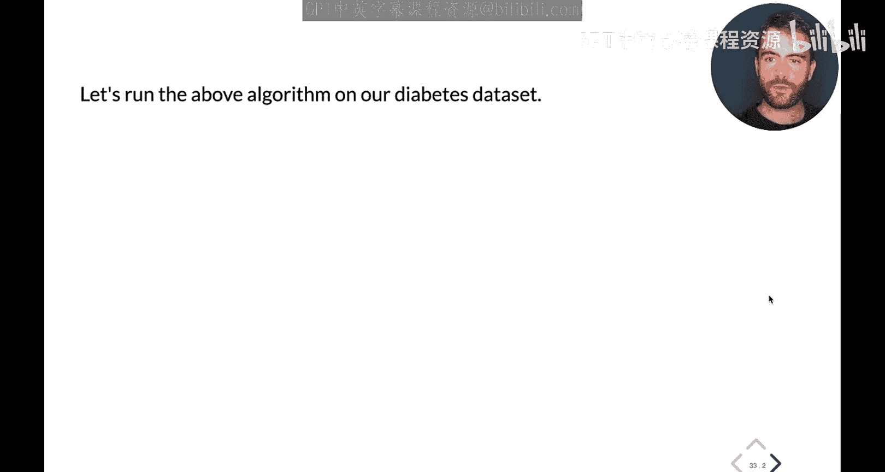

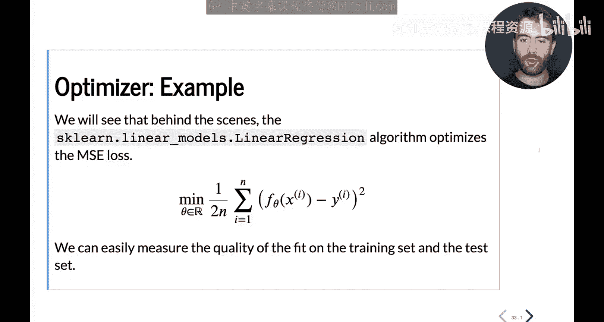

# 2. 定义并运行学习算法（包含三大组件）
from sklearn.linear_model import LinearRegression
algorithm = LinearRegression() # 实例化算法（内含模型类、MSE目标、优化器）
algorithm.fit(X_train, y_train) # 优化器运行，找到最优模型

# 3. 使用输出的预测模型进行预测
predictions_train = algorithm.predict(X_train)
predictions_test = algorithm.predict(X_test)
```

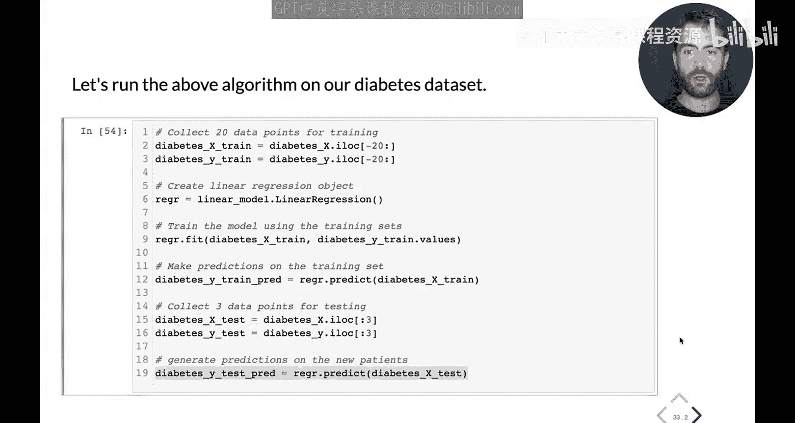

通过可视化，我们可以看到模型在训练数据上的拟合情况，以及对新患者数据（测试集）的预测。与仅使用单一特征（如BMI）的简单模型相比，使用所有特征的多元线性模型通常能输出更接近真实值的预测，从而获得更高的准确性。

## 总结

本节课中，我们一起学习了监督机器学习算法的核心解剖结构。我们了解到，一个监督学习问题由数据集和算法组成。而算法本身又包含三个基本组件：

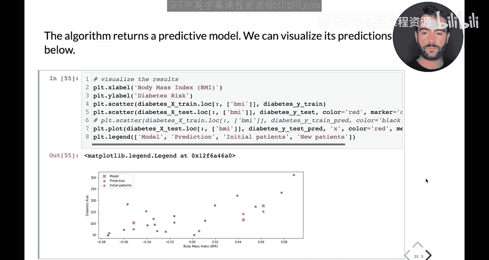

1.  **模型类**：定义了可能的预测函数集合。
2.  **目标函数**：用于评估模型对数据拟合好坏的量化标准。
3.  **优化器**：在模型类中搜索并找到能优化目标函数的模型的程序。

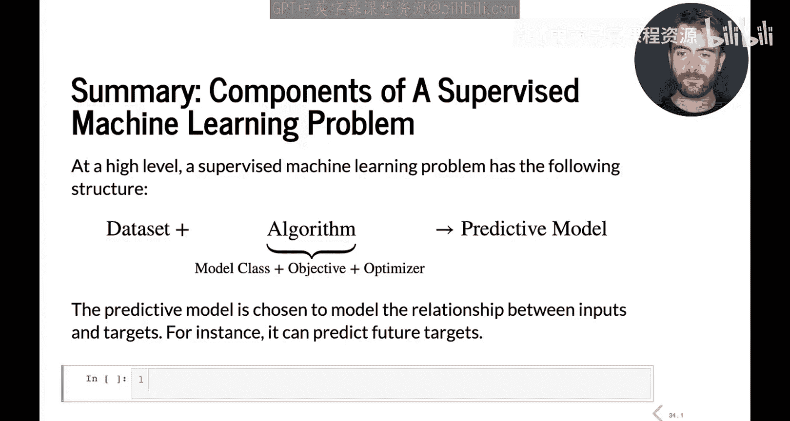

这三个组件共同构成了一个完整的学习算法。在接下来的课程中，我们将看到第一个非玩具性质的完整算法实例，并从第一性原理出发推导出所有这些组件。