# 3.4：非线性最小二乘法 🧮

在本节课中，我们将学习如何将之前介绍的线性最小二乘法扩展到非线性模型。我们将重点介绍一种称为“非线性最小二乘法”的技术，它允许我们使用非线性特征来拟合数据，同时仍然利用线性模型的优化框架。

---

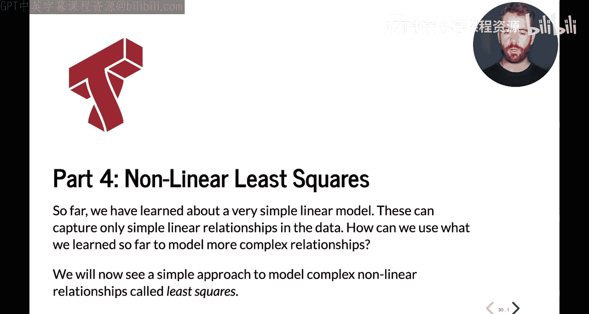

## 多项式函数简介 📈

上一节我们介绍了梯度下降及其在监督学习算法中的应用。本节中，我们来看看如何将线性模型扩展到非线性关系。

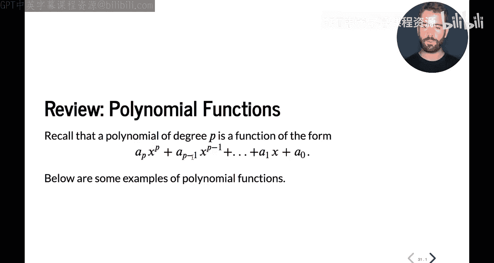

多项式函数是形式如下的函数：

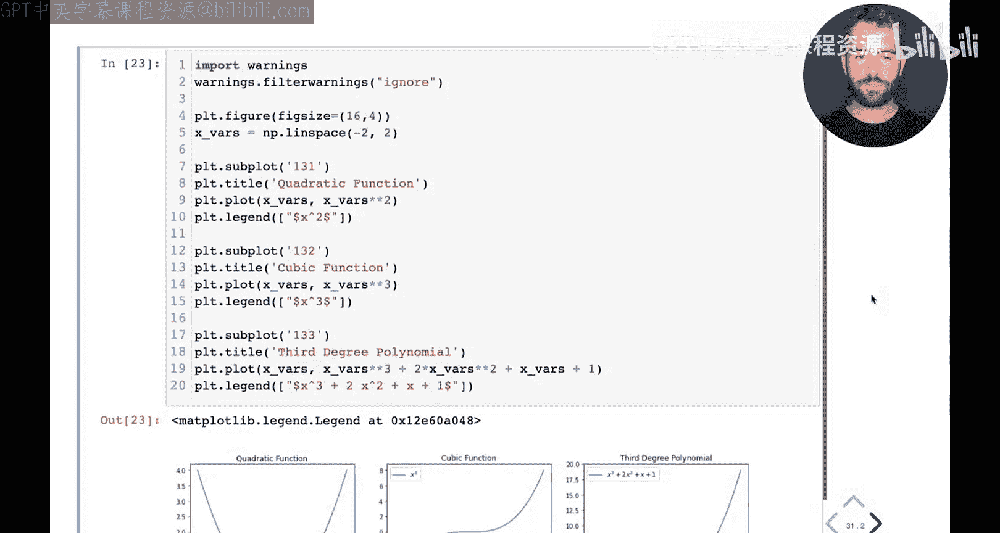

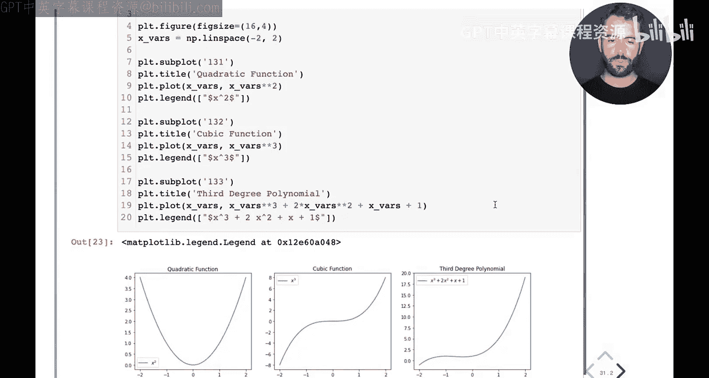

\[
f(x) = \theta_0 + \theta_1 x + \theta_2 x^2 + \dots + \theta_p x^p
\]

以下是多项式函数的几个例子：

*   **二次函数**：\( f(x) = x^2 \)
*   **三次函数**：\( f(x) = x^3 \)
*   **更复杂的多项式**：\( f(x) = x^3 + 2x^2 + x + 1 \)

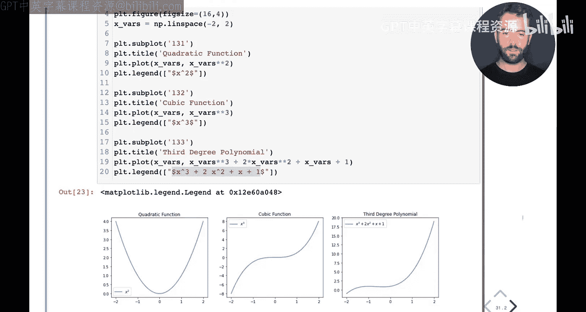

多项式函数具有很强的表达能力，能够拟合数据中复杂的非线性关系。

---

## 通过特征映射拟合多项式 🛠️

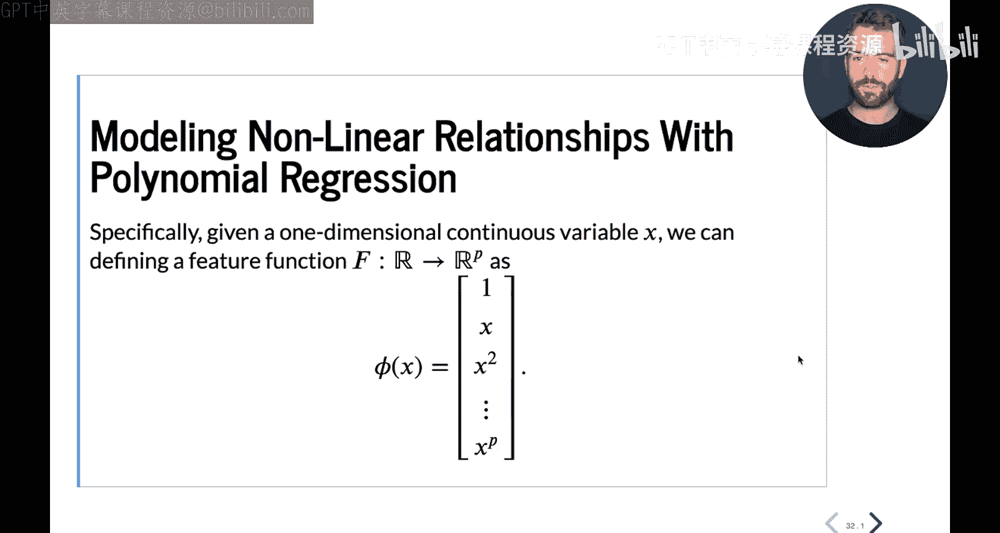

现在，我们将展示如何利用普通最小二乘法的工具来拟合任意复杂度的多项式。

考虑一个一维回归场景，输入属性 \( x \) 是标量。我们定义一个特征映射函数 \( \phi(x) \)：

\[
\phi(x) = [1, x, x^2, \dots, x^p]^T
\]

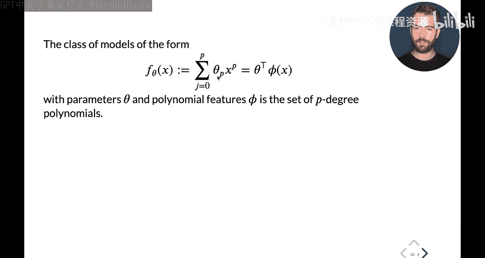

这个函数将一维属性映射到一个 \( p+1 \) 维的空间。

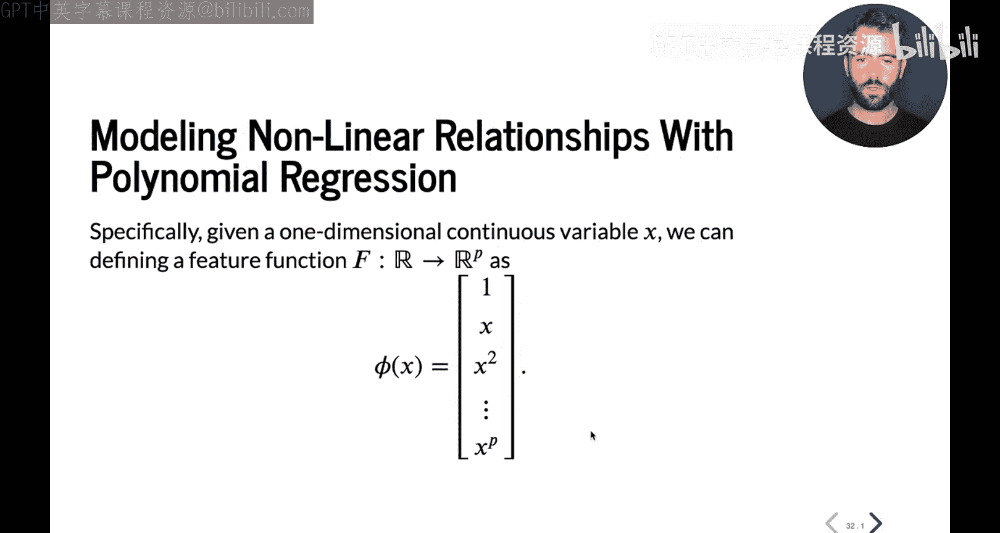

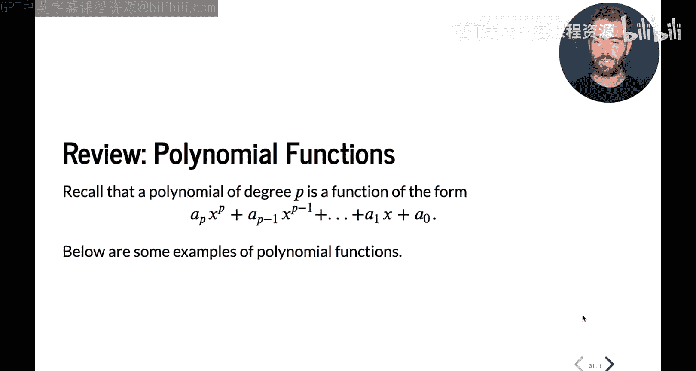

现在，考虑基于这组特征的线性模型类。一个由参数 \( \theta \) 参数化的模型实例具有以下形式：

\[
f(x; \theta) = \theta^T \phi(x) = \theta_0 + \theta_1 x + \theta_2 x^2 + \dots + \theta_p x^p
\]

这正是我们之前定义的多项式。因此，这个模型类本质上包含了所有 \( p \) 次多项式。

关于这个模型类，有几个重要的观察结果：

1.  **对输入 \( x \) 是非线性的**：函数 \( \phi(x) \) 本身是非线性的，这使我们能够建模数据中复杂的非线性关系。
2.  **对参数 \( \theta \) 是线性的**：模型 \( f(x; \theta) \) 是参数 \( \theta \) 的线性函数。因此，它本质上仍然是一个线性模型。

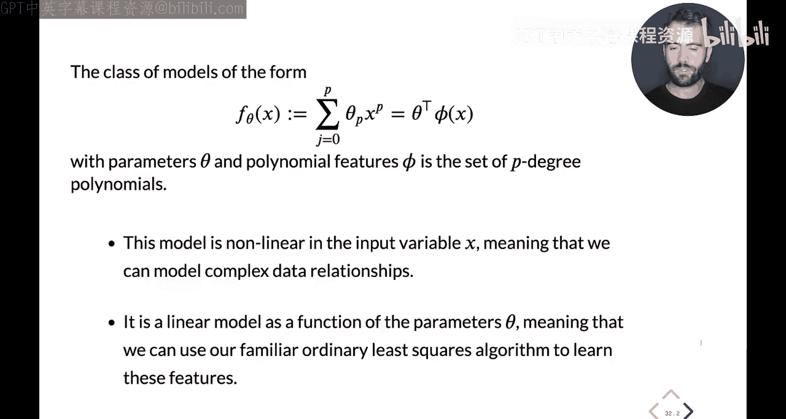

这意味着我们可以继续使用之前学到的关于最小二乘法和优化线性模型的所有知识，来高效地优化这个模型类。

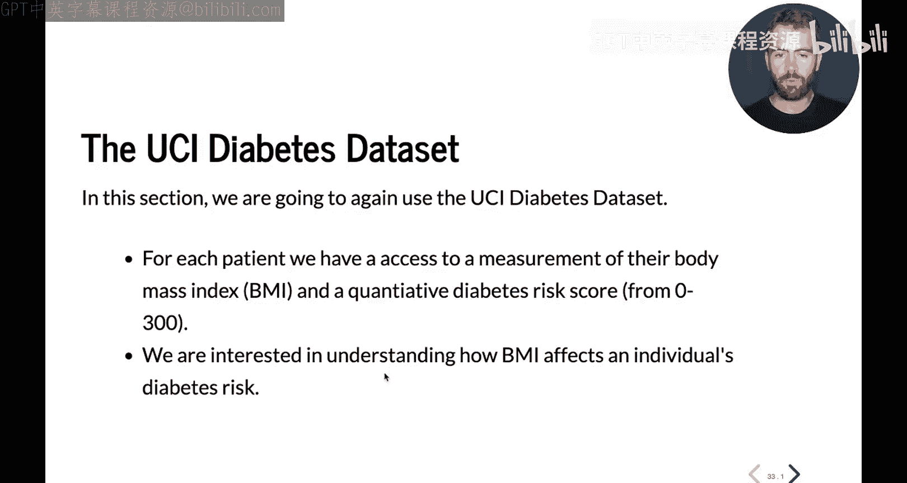

---

## 实例：用多项式拟合糖尿病数据 🩺

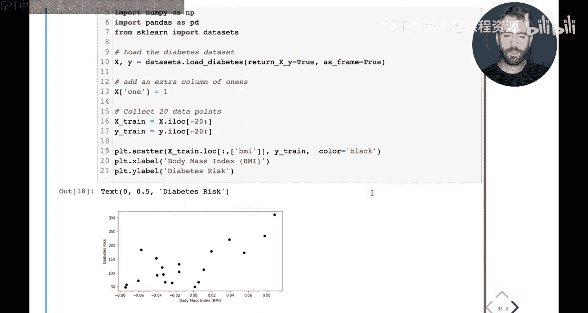

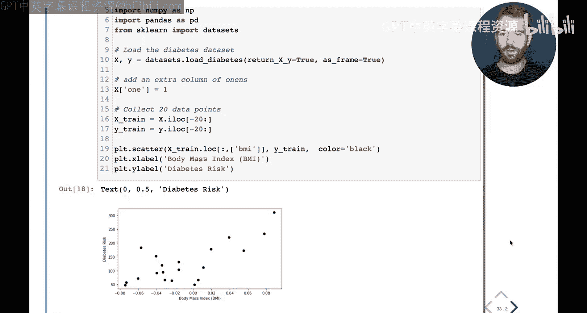

为了让概念更具体，让我们用UCI糖尿病数据集的一个例子来说明。我们将再次使用BMI来预测糖尿病风险评分。

以下是使用多项式特征进行线性回归的步骤：

1.  **计算非线性特征**：我们从一个只包含BMI特征的设计矩阵 \( X \) 开始。然后，我们创建包含最高3次多项式特征的新设计矩阵。

    ```python
    # 假设 X 是原始BMI数据（一维）
    X_poly = np.column_stack([np.ones_like(X), X, X**2, X**3])
    ```

    结果是一个包含四列的设计矩阵：常数项、BMI、BMI² 和 BMI³。

2.  **应用正规方程**：我们可以直接使用之前推导的正规方程来求解最优参数 \( \theta \)。

    ```python
    theta = np.linalg.inv(X_poly.T @ X_poly) @ X_poly.T @ y
    ```

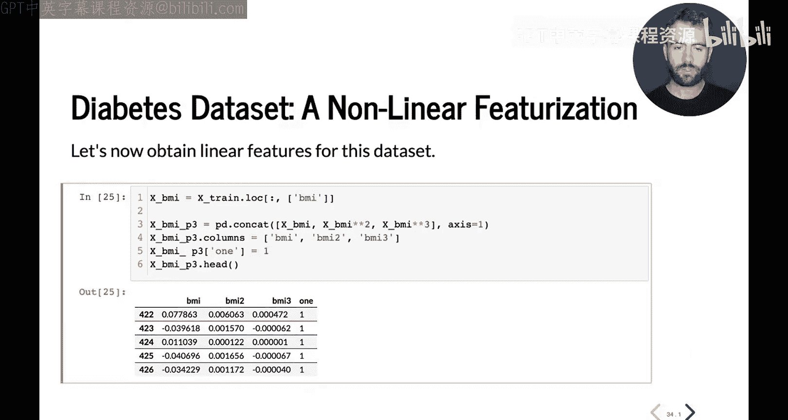

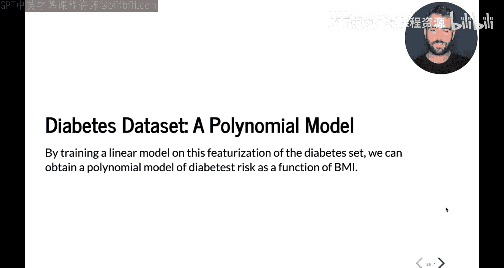

3.  **进行预测和可视化**：对于新的 \( x \) 值，我们先计算其多项式特征，然后用学到的 \( \theta \) 进行预测。

    ```python
    x_new_poly = np.column_stack([np.ones_like(x_new), x_new, x_new**2, x_new**3])
    y_pred = x_new_poly @ theta
    ```

与简单的线性模型相比，这个三次多项式模型能够更好地捕捉数据中BMI与糖尿病风险之间的非线性关系，尤其是在低BMI区域趋势平缓，而在高BMI区域增长更快的模式。

---

## 扩展到多元多项式 🌐

到目前为止，我们只定义了一维变量的多项式特征。但同样的方法可以扩展到任意维度的多项式。

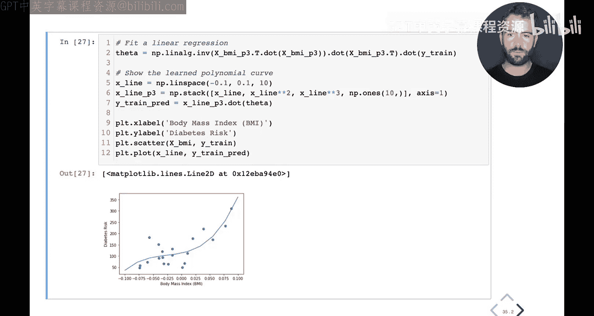

例如，一个二元二次多项式的一般形式为：

\[
f(x_1, x_2) = \theta_{00} + \theta_{10}x_1 + \theta_{01}x_2 + \theta_{20}x_1^2 + \theta_{02}x_2^2 + \theta_{11}x_1 x_2
\]

为了捕捉所有二次项，我们可以定义如下的特征映射函数：

\[
\phi(x_1, x_2) = [1, x_1, x_2, x_1^2, x_2^2, x_1 x_2]^T
\]

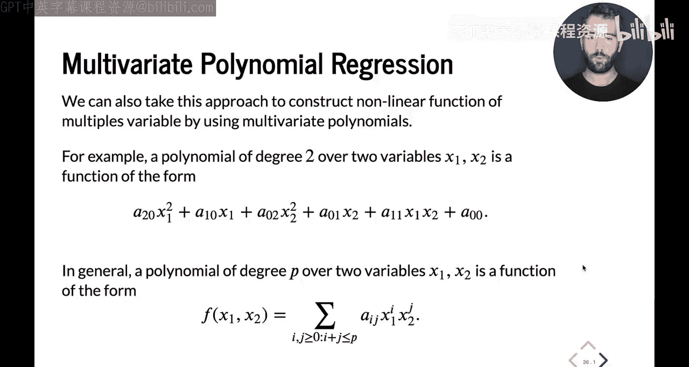

这个函数将二维输入 \( (x_1, x_2) \) 映射到六维特征空间。同样的原理可以推广到具有任意数量变量和任意次数的多项式。

---

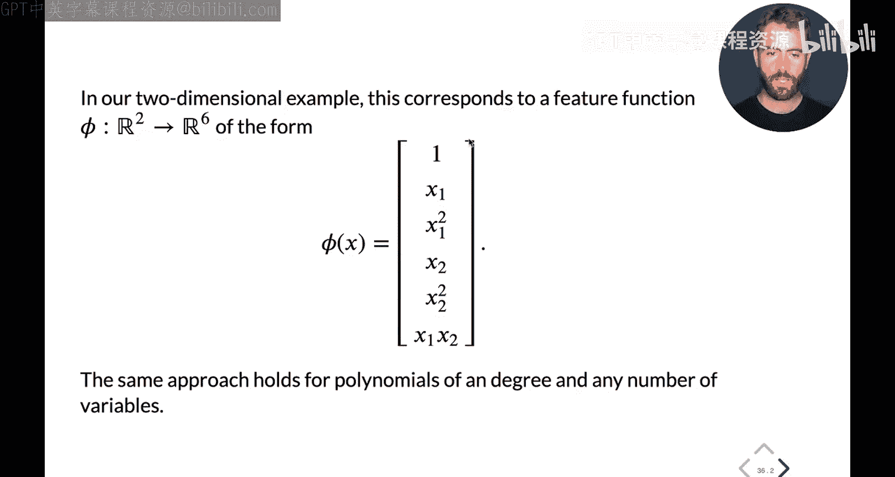

## 更一般的非线性特征 🌀

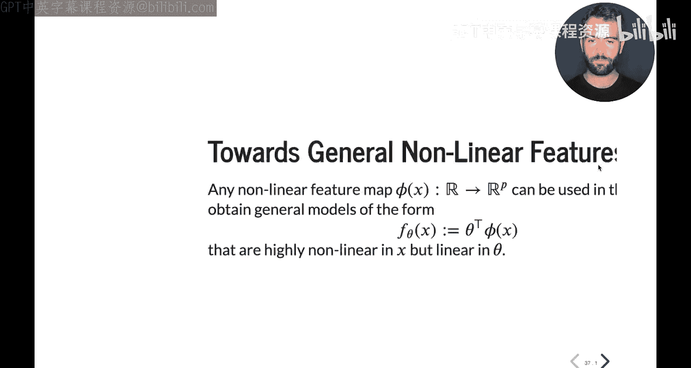

我们采用的方法实际上更为通用。原则上，只要我们的模型在参数 \( \theta \) 上是线性的，我们就可以将任何形式的非线性特征与模型结合使用，并仍然能够应用普通最小二乘法的工具来优化和寻找最佳拟合。

以下是其他非线性函数的例子，它们也可以用作特征：

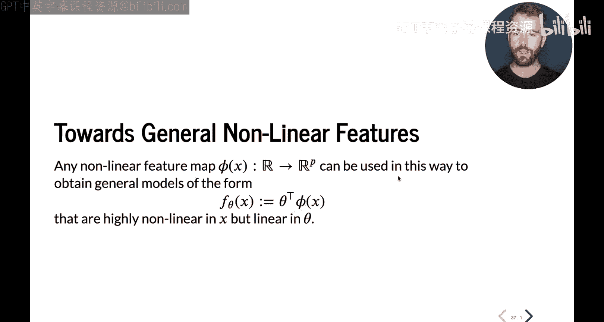

*   正弦函数：\( \sin(x) \)
*   余弦函数：\( \cos(x) \)
*   组合函数：\( \cos(x) + \sin(2x) + \cos(4x) \)

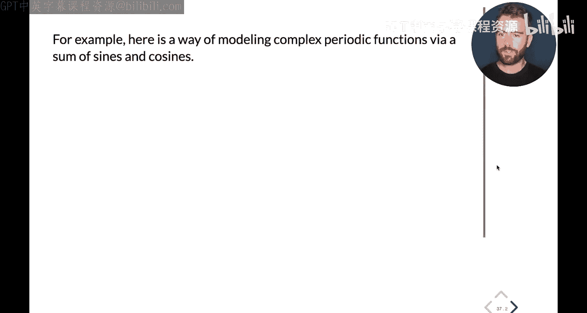

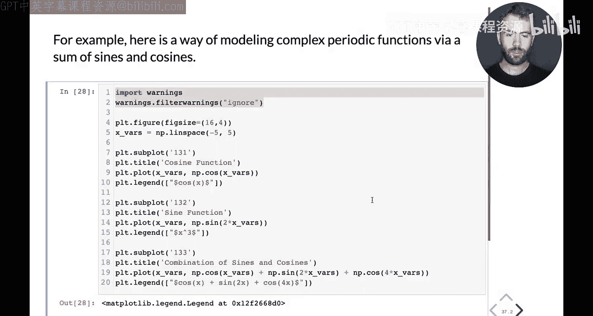

这些函数可以产生复杂的形状，用于拟合数据中可能遇到的各种关系。我们可以设计的函数种类几乎是无限的。

---

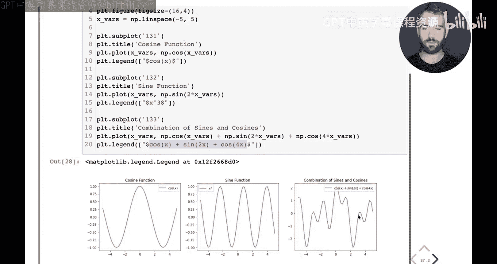

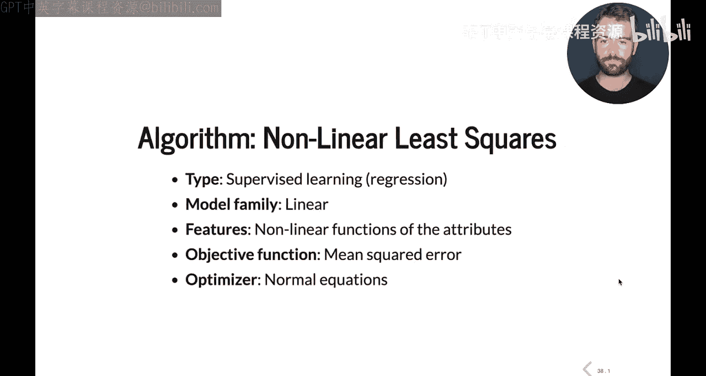

## 总结 📝

本节课中，我们一起学习了如何将普通最小二乘法扩展为**非线性最小二乘法**。这种算法是回归和监督学习的一个实例。

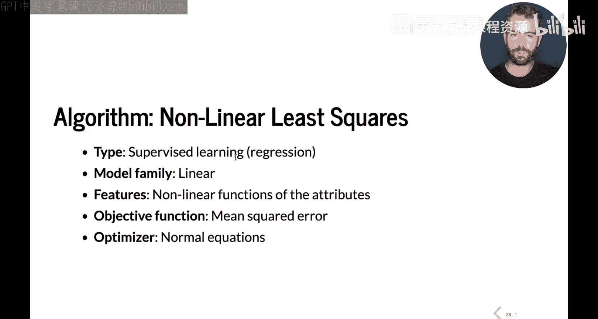

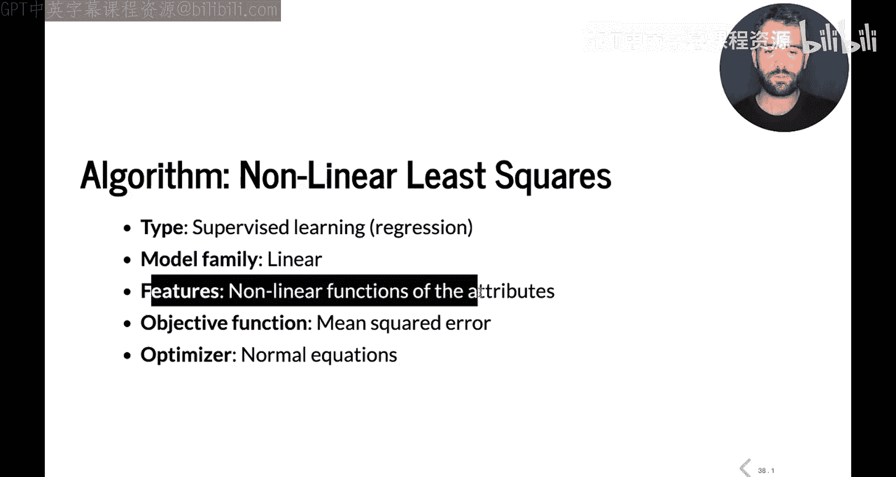

其核心思想是：
*   **模型族在参数上仍然是线性的**，这使我们能利用高效的线性优化工具（如正规方程）。
*   但我们使用了**输入属性的非线性函数**作为特征（如多项式、三角函数等），这使得模型能够表达和拟合数据中复杂的非线性关系。

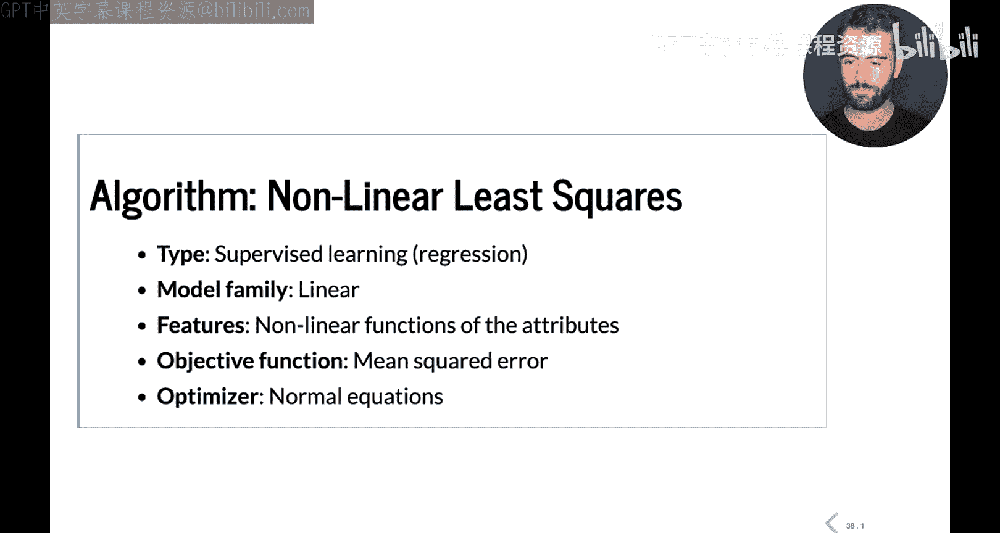

这些模型通常通过最小化均方误差的正规方程进行优化。至此，我们已经看到了几个真实世界的机器学习算法。在接下来的课程中，我们将探讨更多算法，并开始更深入地理解这些算法为何有效。