# 4.1：数据分布 📊

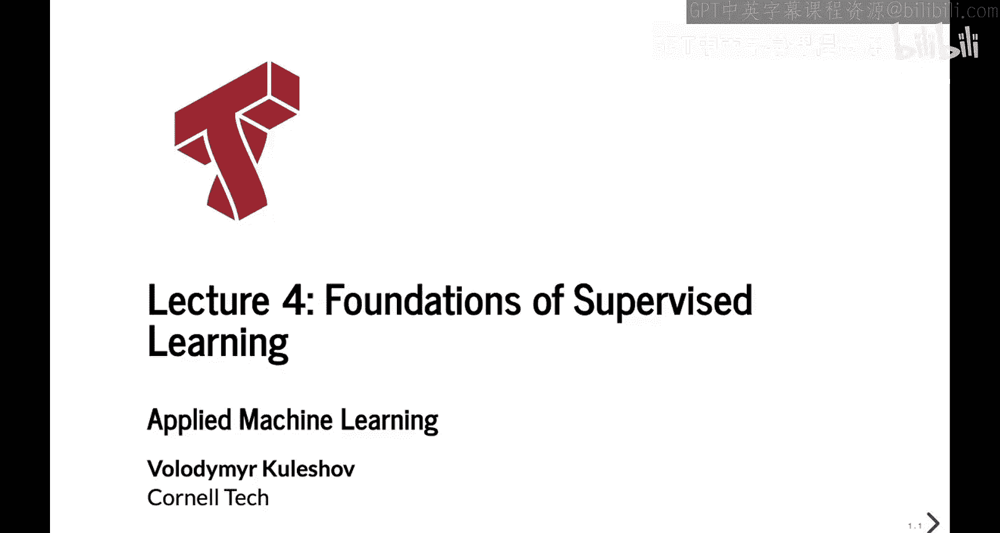

在本节课中，我们将暂时转换视角，探讨一个与之前略有不同的主题。我们将利用这节课简要讨论监督学习基础的一些方面。具体来说，我们将探究监督学习算法为何有效、何时有效，以及为何有时会失效。然后，我们将利用这些直觉来开发一套新的学习算法。

在前几讲中，我们定义了监督学习，并看到了监督学习算法的初步示例。现在，在本讲中，我们希望获得更多关于它们为何有效的直觉。这将是本讲前半部分的内容。在本讲后半部分，我们将利用这些直觉来改进我们已经见过的算法，以解决我们将在本讲开头识别出的问题。

## 为何监督学习有效？🤔


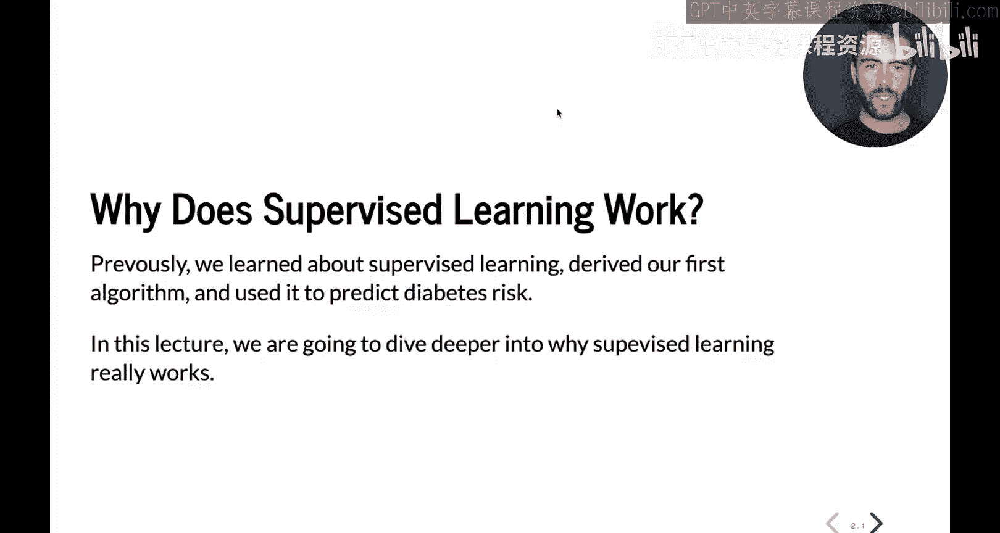

在第一个视频中，我们将再次建立一些数学基础，以便在下一个视频中回答这个问题。具体来说，我将定义一个称为“数据分布”的数学概念。这个概念将有助于：第一，解释算法为何有时有效、有时无效；第二，在本讲及后续课程中定义一套新的学习算法。

接下来，我将描述一个关于数据来源的特定假设。如果我们做出这个假设，就能更好地解释，甚至证明在某些情况下学习算法有效，而在其他情况下无效。

## 数据分布的概念 📈

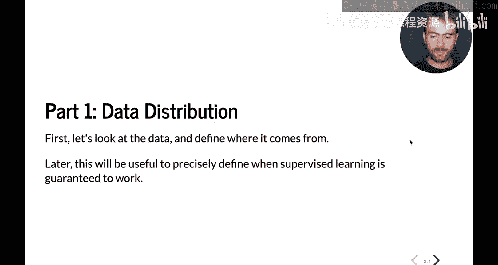

回顾我们之前的课程，一个监督机器学习问题包含以下组成部分：为了应用监督机器学习，我们必须创建一个训练数据集，它是一组带标签的输入 **X** 和目标标签 **Y**。然后，我们指定一个学习算法。当该算法在训练数据集上执行时，其输出是一个预测模型，我们可以用它来对未来进行预测。

我之前将数据集视为给定的。现在，我想探讨这个数据集可能来自何处。我将做出一个特定的假设。这个假设在实践中可能成立，也可能不成立。算法可能有效，也可能无效。即使这个假设不完全成立，算法可能仍然有效。事实上，这个假设无法完全验证。但如果我们做出这个假设，我们就可以证明它们有效，并且也能获得关于它们为何无效的直觉。

你很快就会明白我的意思。现在，让我介绍这个我想引入的数学概念。

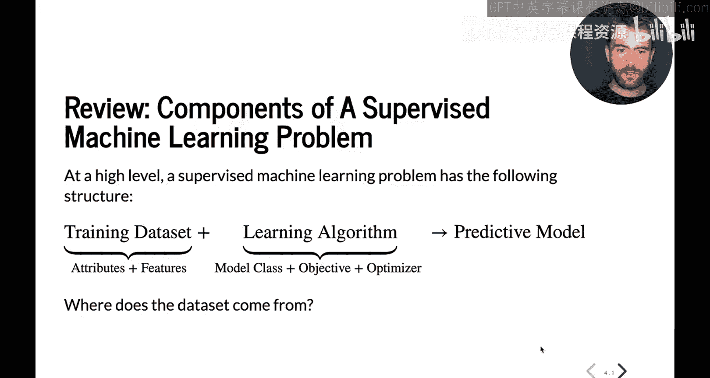

## 数据分布的定义 📊

这个数学原理被称为“数据分布”。通常在机器学习中，我们假设我们拥有的数据来自某种概率分布。我们称这个概率分布为“数据分布”，并用大写字母 **P** 表示这个概率。我们使用特定的符号 **`(X, Y) ~ P`** 来表示 **X** 和 **Y** 是根据这个概率分布的。

这可以是 **X** 和 **Y** 上的任意分布。例如，在医疗环境中，我们观察来到医院的病人，你可以考虑所有可能病人的集合，其中一些病人出现的可能性更大，一些更小。我们假设看到某个特定病人的数据存在一定的概率，而我们观察到的病人是从这个未知的概率分布中抽取的。

具体来说，我们的训练集具有以下形式：我们说它由来自数据分布 **P** 的**独立同分布**样本组成，简称 **IID**。

再次强调，这是机器学习中通常做出的一个假设。算法有效并非必须满足此假设。但我们可以用它来证明，当此假设满足时，算法在特定情况下会有效。我们也可以用它来获得关于算法为何在实践中无效的直觉，并利用这个分布来开发更好、改进的学习算法。

## 理解“独立同分布” 🔄

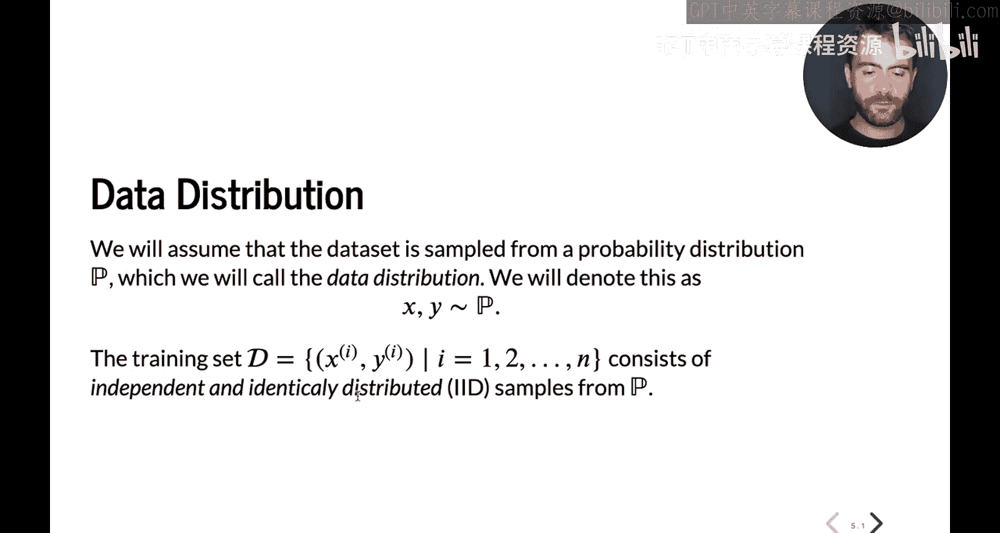

这个定义中我尚未彻底定义的关键部分是“独立同分布”。本质上，这意味着每个训练样本都来自同一个分布，即“同分布”部分。因此，每个样本都是数据分布 **P** 的一个样本。同时，当我们收集一个特定的训练样本时，它不依赖于之前收集的样本。也就是说，如果我们收集第 N 个训练样本，并且之前已经收集了一个数据集，那么这个新数据独立于我们之前碰巧收集到的数据。

让我们看一个例子。一个简单的例子是抛硬币。每次抛硬币正面或反面朝上的概率相同，并且硬币正面或反面朝上的结果不依赖于之前抛掷的结果。

一个反例是像年度人口普查数据这样的东西。想象我们测量一个城市随时间变化的人口。人口的变化本质上是一个表现为随机的未知量。如果城市以某个数量增长，我们很难预测将有多少新人口迁入或有多少人口出生。这本质上是一个我们可以视为随机的未知量。因此，一个城市随时间变化的人口可以被视为来自一个随机概率分布的样本，但这些样本是相关的，因为特定年份的城市人口将密切依赖于并关联于前一年的城市人口。由于这些样本密切相关，它们不是独立的。因此，这个例子违反了独立性假设。

## 创建并理解数据分布 🛠️

为了更好地理解数据分布，我们也可以创建自己的数据分布。现在我将定义一个特定的数据分布，并从中抽取样本。我将在 NumPy 中实现这一点。第一步是定义一个函数，我将围绕这个函数收集样本。

我将使用 NumPy 定义以下函数：

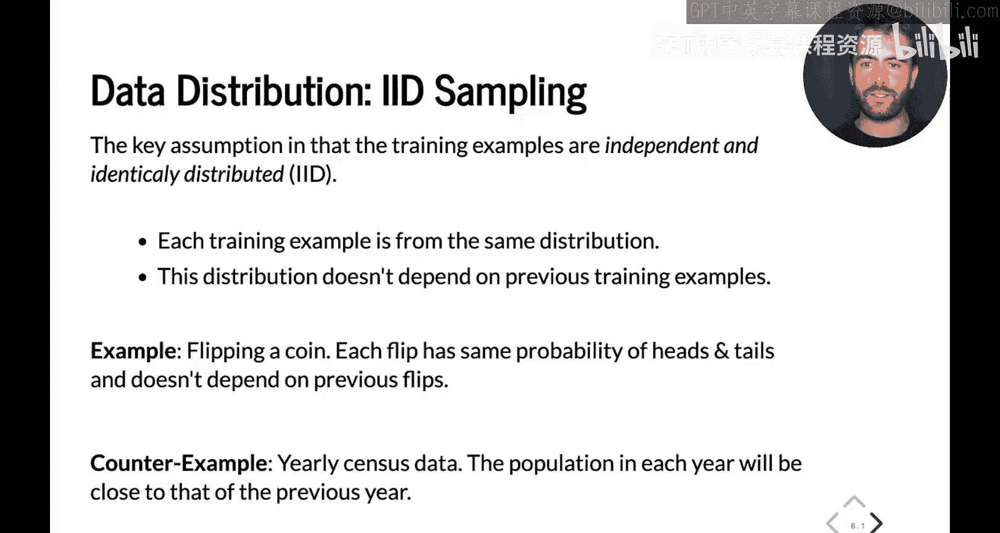

```python
import numpy as np

def true_function(x):
    return np.sin(2 * np.pi * x) + 0.3 * np.cos(9 * 2 * np.pi * x)
```

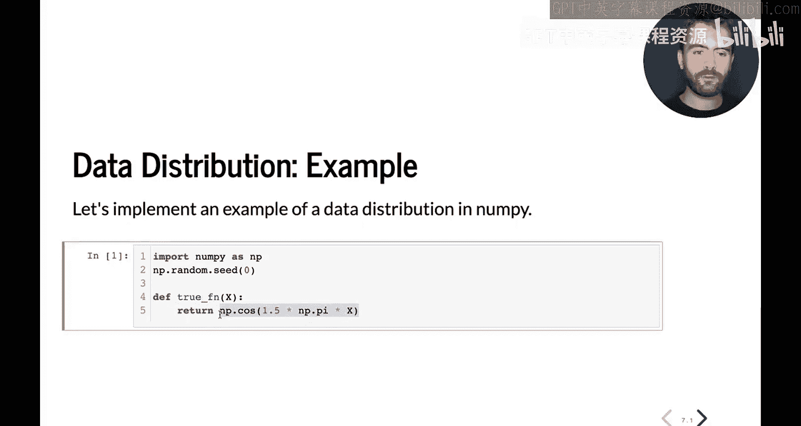

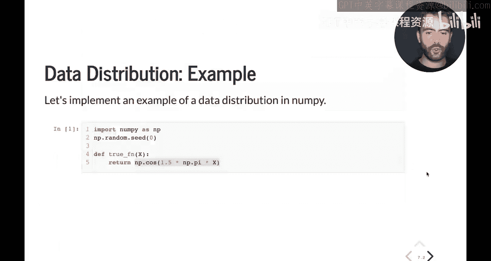

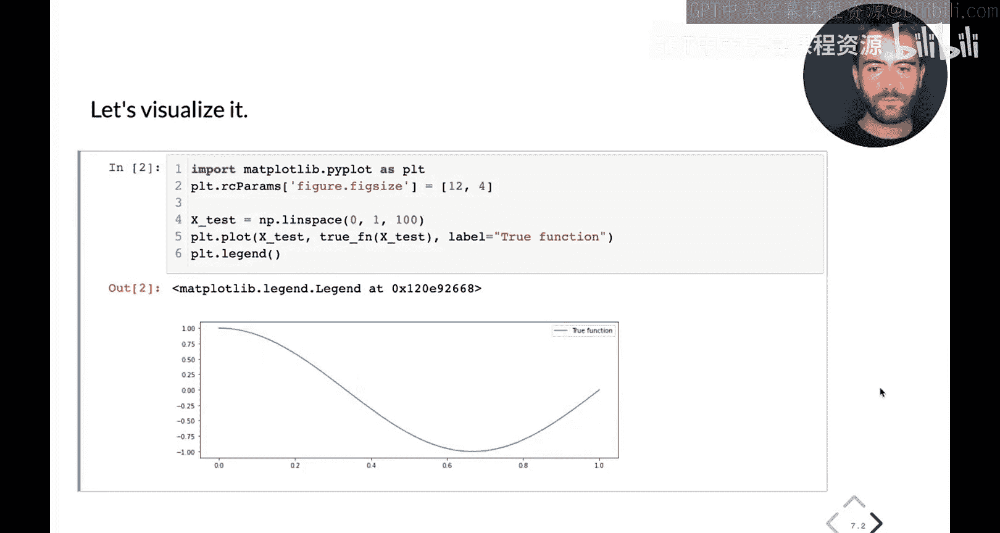

我们可以将其可视化，它看起来如下所示。考虑以下函数，这显然是一个非线性函数。

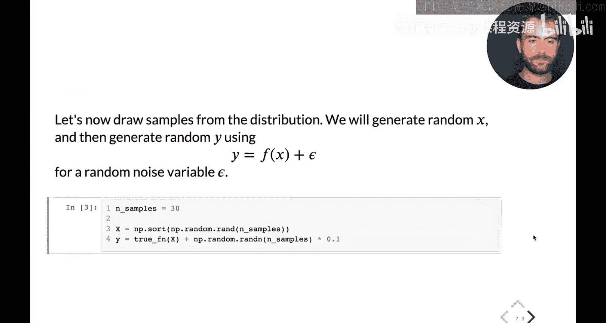

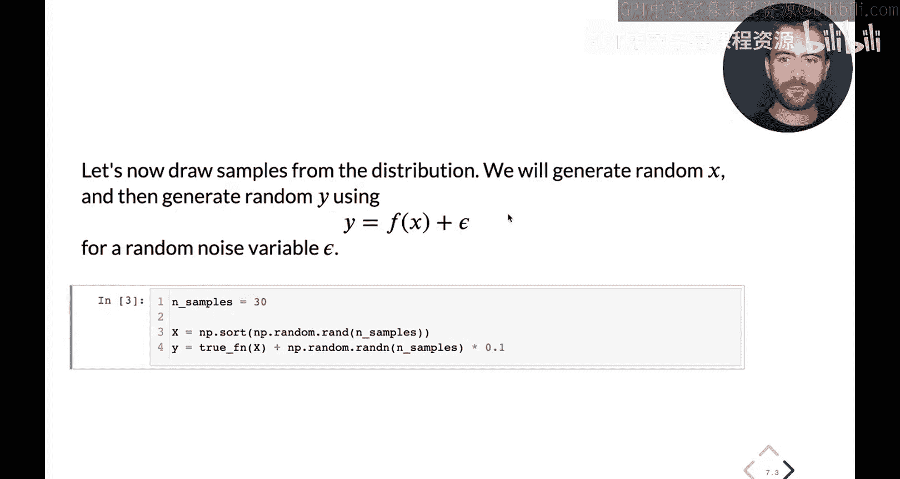

现在，考虑以下生成数据的过程。我可以从数据分布中抽取样本，步骤如下：

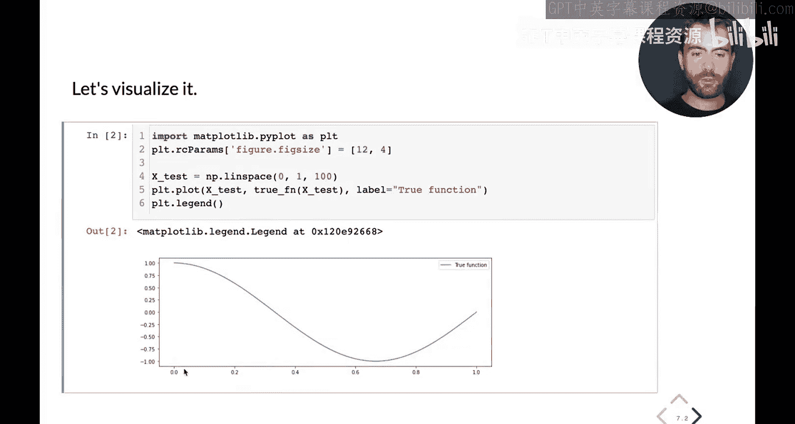

首先，我在这个函数的定义域内生成一个随机的 **x**。我将在 0 到 1 之间均匀随机地选择一个 **x**，这是该函数的定义域。

然后，我将通过查看该函数的真实值并添加一些噪声来生成目标 **y**。这将是围绕该函数的高斯或正态分布噪声（白噪声）。它的均值为零，因此我只是随机扰动该函数在此输入 **X** 处的值。

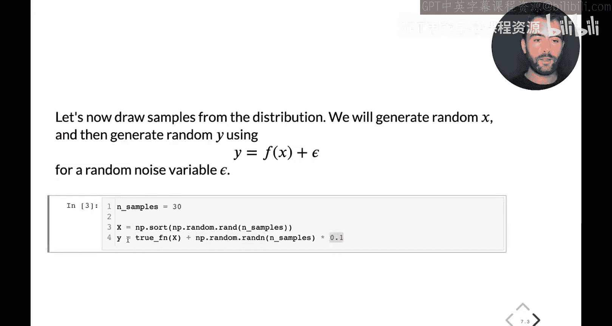

我可以在 NumPy 中实现如下。这里我生成 30 个样本，生成 30 个随机的 **x**，然后为了生成 **Y**，我计算真实函数的值，然后加上随机噪声。我是否按某个小值进行了缩放？然后这就定义了 **Y** 的集合。

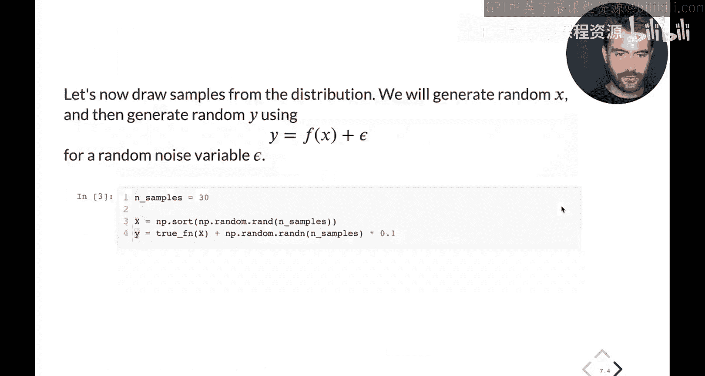

我可以将这些 **x** 和 **y** 可视化如下，这些是蓝点。

现在，蓝色数据集（蓝点集）是我们从数据分布生成的机器学习数据集。该数据分布由我们刚刚描述的过程组成：我们取一个 **X**，然后生成一个该函数的带噪声实现值。

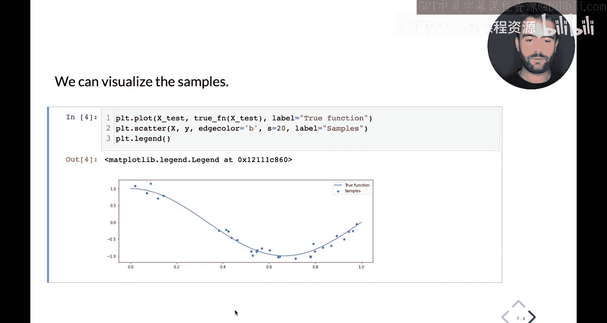

现在这是一个有效的机器学习数据集，我们可以应用之前见过的学习算法来学习 **X** 和 **Y** 之间的关系。我们可以尝试从这些噪声数据中学习这个函数的真实形状。但再次强调，在这个例子中，它受我们刚刚定义的概率分布支配。

## 为何假设数据来自分布？ 🤷

现在，我想再次总结一下，为什么我们希望假设我们正在处理的数据集是从一个分布中采样的？

首先，在许多情况下，事实上在机器学习的大多数实际应用中，我们试图建模的过程本质上表现得好像其中存在随机性。通常，数据收集的方式存在不确定性和随机性。例如，数据本身可能是使用有噪声的仪器收集的。例如，我们可能使用一个只有一定精度的温度计，而我们收集的数据是围绕某个真实值的随机样本，我们无法收集到该真实值，因为我们的数据收集过程中存在一些误差。我们的数据收集过程中存在一些固有的噪声，因此我们拥有的数据不是确定性的，它具有一定的随机性，我们希望做出这个建模假设。

通常，我们试图建模的过程本身也存在不确定性。例如，如果我们试图预测某只股票的价格，那么这个价格是由大量我们无法纳入系统的因素决定的。它可能取决于特定交易者在特定日子的情绪，这些是我们无法测量的因素。我们只有有限数量的特征可以使用。因此，出于设计系统的目的，这个股票价格本质上表现为一个随机量。它表现为一个具有某些信号的随机量，其中一部分我们可以预测，但还有很大一部分是随机的，我们无法预测。

因此，通过概率分布来建模通常是准确、现实且反映实际情况的。

最后，第三个也是最相关的原因是，如果我们做出我之前所做的假设，那么我们就可以使用概率和统计学的工具来分析监督学习算法，并证明它们有效。如果它们在实践中无效，我们可以利用从数据分布中获得的直觉来解释它们为何无效。是的，我们也可以使用分布的语言来定义模型准确意味着什么。这是我想在下一个视频中探讨的内容。

---

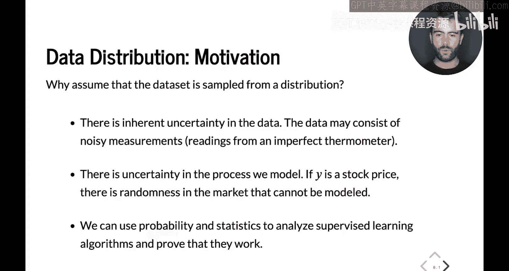

**本节课中我们一起学习了**数据分布的概念，它是理解监督学习算法为何有效的基础。我们定义了数据分布 **`(X, Y) ~ P`** 和独立同分布样本，并通过一个函数加噪声的例子直观地理解了数据生成过程。最后，我们探讨了假设数据来自概率分布的现实意义和理论价值，为后续分析算法的有效性奠定了基础。