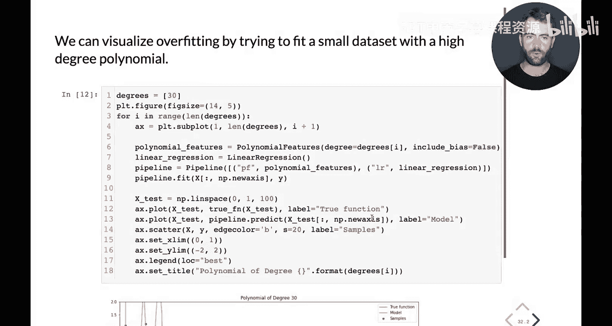
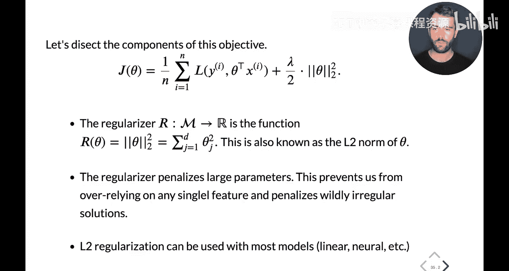
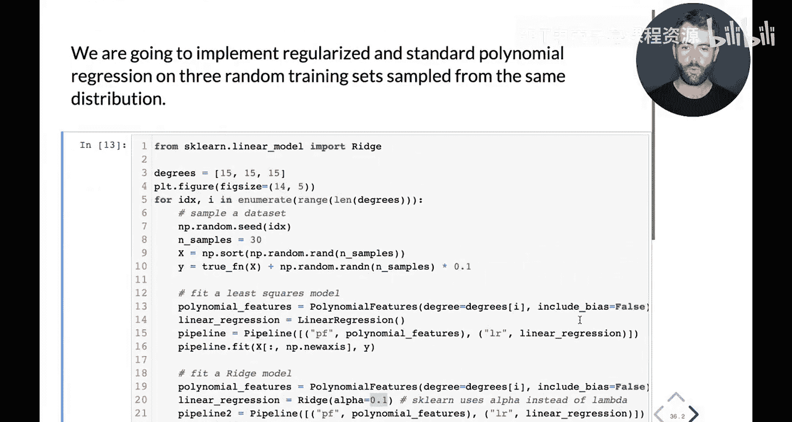
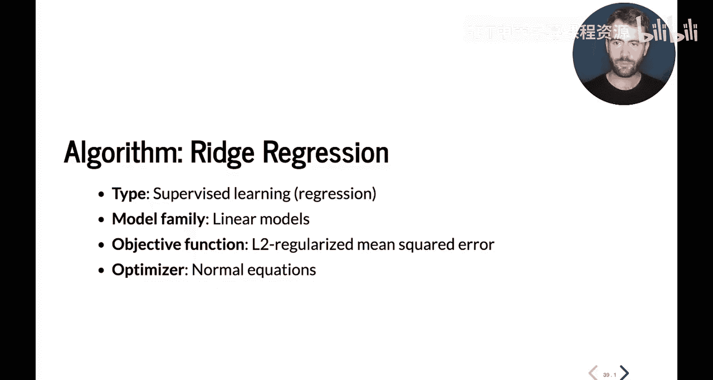

# 4.4：第4部分：正则化 🛡️

在本节课中，我们将要学习一种称为**正则化**的技术。正则化是解决机器学习模型**过拟合**问题的核心方法之一。我们将详细探讨其原理、一种具体实现（L2正则化），并了解如何将其应用于多项式回归等场景。

## 概述

在之前的视频中，我们了解到过拟合是监督学习算法面临的一个主要问题。我们简要地看到了一些减少过拟合的思路和方法，而正则化就是其中之一。本节我们将深入讨论正则化，并在此过程中定义一些重要的新机器学习算法。

## 过拟合问题回顾

首先，让我们再次回顾本讲一直使用的设定。我们处于一个数据从数据分布P中采样的场景中，我们同时拥有训练数据集和保留数据集，它们都是从分布P中独立同分布采样得到的。我们说，如果一个模型在训练分布上训练后，在真实世界的新样本（特别是保留数据集）上也能表现良好，那么它就具有**泛化**能力。

监督学习可能失败的原因之一，是我们为现有数据量选择了一个过于复杂的模型。如果数据集很小，我们可能会完美地拟合数据，并且找到的模型在该数据上表现极佳，但在训练集之外的表现却非常糟糕，因此无法泛化。

我们来看一个简单的例子。这里有一个由蓝点组成的训练数据集，这些蓝点都围绕蓝色曲线（数据的真实形状）分布。图中拟合了一个30次的多项式，该多项式在我们的训练集上几乎完美地拟合了蓝色数据点。然而，一旦超出这个区域，其性能就变得非常差。这就是一个**严重过拟合**的例子。

## 正则化的核心思想

正则化的思想是通过改变我们的目标函数来减少过拟合，新目标函数包含一个惩罚复杂模型的项。

例如，在上述多项式回归的场景中，一种正则化方法是优化那些既能很好地拟合数据，又会对函数具有很高次数（即高次多项式）的情况施加惩罚。

让我给出一个更通用的正则化定义，然后我们将看到如何将其应用于我们刚才看到的场景。

正则化的高层思想如下：
我们定义一个增强的目标函数J，它为模型类M中的元素分配一个分数。这个目标函数J由一个定义在训练数据集上的损失函数，加上一个额外的项R组成，R被称为**正则化器**，用于惩罚复杂的模型。

让我们再次剖析这个目标函数。如前所述，我们有一个目标函数L（例如均方误差）。如果我们只有L，那么我们将得到一个标准的线性回归问题，可以计算正规方程，从而得到最小二乘算法。现在，我们添加了这个额外的项R，它根据某种“复杂”的定义来惩罚某些模型。最后，这里的λ是一个**正则化参数**，它控制我们惩罚复杂模型的强度。

在实践中，我们的模型通常由参数θ参数化，因此我们可以使用以下等效符号来书写这个表达式，其中所有项都是θ的函数。

## L2正则化：一个具体示例

在实践中，我们可以使用什么作为正则化器呢？一个正则化器可能是什么样子的好例子？

我将在这里定义第一个正则化示例，称为**L2正则化**。这是一种在实践中被广泛使用的重要方法，它实际上可以解决我们之前看到的过拟合问题。

假设我们有一个以下形式的线性模型（与之前讲座中看到的模型相同）：
`y = θ^T x`

L2正则化的思想是定义一个目标函数，其中正则化器由权重θ的L2范数组成。因此，正则化器就是参数向量θ各分量平方的和。

让我们再次看看这些组成部分。如前所述，正则化器就是参数平方和，这被称为θ的L2范数（因此得名L2正则化）。这个正则化器会惩罚大的参数值。我将给出几种理解为什么这有助于防止过拟合的方式，其中一种方式是，它防止我们过度依赖任何单一特征。同时，它恰好也能惩罚那些具有我们之前看到的 erratic（不稳定）和不规则行为的模型。

最后，我想补充一点，尽管L2正则化在这里定义于线性模型的背景下，我们也可以将其应用于本课程后面将看到的许多机器学习模型，例如神经网络或支持向量机。只要我们有参数向量θ，我们就能以不同的方式应用L2正则化。

## 将L2正则化应用于多项式回归

现在，让我们看看如何将L2正则化应用于多项式回归。

在多项式回归的背景下，回想一下我们有这些多项式特征φ，我们在这些特征上拟合一个线性模型，并使用均方误差损失。因此，这里的这一项就是线性回归的标准目标函数。而在这一侧，我添加了新的L2正则化器。

我将从一个演示开始，展示这个算法能做什么。这里我将为不同的数据集拟合该模型的几个实例。我们仍将使用从相同函数中采样的数据。我将为这些数据拟合几个不同的模型。这里我有与之前相同的蓝点集，并且我刚刚采样了另外两个训练集。

现在，我拟合了两个次数为15的多项式回归模型。蓝色模型是未经正则化的，你可以看到它具有我们之前讨论过的不稳定行为，它有这些剧烈的摆动，显然这看起来不像数据，在这个区域有一个巨大的摆动。在橙色中，我展示了相同的模型，但为其添加了正则化参数为0.1的正则化项。在接下来的几张幻灯片中，我将定义其内部实现方式，但现在你只需将其视为我们为来自同一分布的这三个样本中的每一个拟合的两种模型类型。你可以看到，蓝色模型每次输出一个非常不同的预测，而经过正则化的橙色模型输出的结果看起来更合理，也更像数据的真实形状。这只是一个演示，展示了L2正则化如何真正帮助我们解决这个过拟合问题，而且这种方法恰好非常简单且易于实现。

为了获得更多直觉，我们可以查看正则化模型和非正则化模型找到的权重。这些是非正则化模型的权重，你可以看到这些权重非常大，数量级达到3000、10000、100万、1000万，这些只是我抽样的前4个权重（模型总共学习了15个权重）。这意味着，在实践中，为了使多项式函数完美拟合我们的数据点，它必须在数值上具有非常高的权重。这是另一种直觉：减小这些权重的大小会迫使我们得到一个平滑的函数，因为要得到一个不平滑的函数，我们需要这些非常大的权重来指定它。

现在，如果我们查看同一组权重但在模型经过正则化之后的情况，这些权重要小得多，它们是-2.7、-1.2、0.9等等，它们都很小且表现良好。因此，即使它仍然是一个15次多项式，曲线也表现得非常好。我想再次强调，我们在这里拟合的橙色曲线仍然是一个15次多项式，但这是一个具有非常小且表现良好的系数的15次多项式，因此它看起来像我们期望的表现良好的曲线。

## 如何选择正则化参数λ

一个我想简要讨论的实际问题是，我们如何选择参数λ。λ被称为模型的**超参数**，我们将在后面更详细地重新讨论这一点，但我只想给你一种可以设置λ值的方法，使其工作良好。我们稍后会更详细地探讨为什么这是一个好主意，但本质上，这里一个简单的策略是：将λ设置为在保留验证集上表现良好的某个值。想象一下，我们拥有训练集，然后我们还有另一个与训练集不同的、小的保留集。我们可以选择那个在保留集上给我们最佳性能的λ值。这是一种估计我们泛化误差的方法。再次强调，我们将在后面更详细地重新讨论这一点，但我只想简要提及，有几种选择λ的标准方法。

## 拟合正则化线性模型

在剩下的几张幻灯片中，我想探讨一下如何拟合我们之前看到的那种形式的正则化线性模型。

回想一下，一个监督学习算法由模型类、目标函数和优化器组成。我们已经看到了我们的模型类和目标函数是什么样子：我们有线性模型，我们的目标是L2正则化的损失函数。但我们如何拟合这个损失函数呢？

事实证明，有一种简单的方法可以做到这一点，它是对我们拟合非正则化最小二乘模型方法的一个简单修改。

我们可以将正则化目标写成这种形式（与我们之前看到的相同），在这里我用其向量化形式替换了均方误差。你可以重新回顾我们关于最小二乘的讲座，看看我们是如何得出这个特定定义的，但这与我们在线性回归中使用的符号相同。

现在我们有了目标函数的向量化形式，我们可以应用一个非常相似的方法来推导这个表达式的梯度。这里的梯度简单地是我们损失的梯度加上正则化器的梯度。我们已经在之前的讲座中计算了这个损失的梯度，它具有这种形式。现在我们只需要计算这个函数的梯度，但这恰好就是λθ。我们可以使用以下恒等式轻松看出这个目标的梯度就是λθ。如果这个符号不清楚，这里的L2范数等价于向量与其自身的转置，所以这个项也等于θ^T θ，或者等于θ与自身的点积。

现在我们有了这种形式，我们可以将其重写为一个稍微更方便的形式，这几乎与我们之前未正则化的正规方程相同，只是我们在这里多了一个额外的λ项。

以同样的方式，使用我们之前遵循的相同策略，我们可以将导数设为零，以获得一组具有这种形式的正规方程。现在，我们可以再次通过求解这个方程中的θ来获得最优θ的封闭形式。

因此，我们再次推导出了一组可以求解的正规方程，并为我们之前看到的L2正则化模型提供了一个封闭形式的表达式。

最后，我想在这里指出的另一个重要点是，这个矩阵现在将总是可逆的。这是因为这里的矩阵I是满秩的，所以将这个满秩矩阵加到这个满秩矩阵上，结果仍然是满秩矩阵，因此它是可逆的。我们已经看到了如何拟合一个正则化模型，并且也看到了如何解决我们之前提到的潜在数值问题。当我们处理未正则化的回归时，我们说过这个矩阵在理论上可能不可逆，但现在通过添加一个小的正则化器，我们可以使其完全可逆。因此，在实践中，如果存在任何关于矩阵求逆的问题，我们可以通过添加少量正则化来正则化我们的模型。

## 岭回归算法

这样做的结果产生了一种称为**岭回归**的算法。岭回归只是L2正则化回归的另一个名称。

这是一个最小二乘法的扩展算法，事实上它几乎是相同的算法。它是一种监督学习，特别是回归的形式，它使用线性模型的形式，并使用正规方程进行优化。唯一的区别是，我们的目标函数现在是L2正则化的均方误差。

再次强调，岭回归是机器学习中一个非常重要的算法，在实践中被广泛使用。这不是一个玩具算法，而是在各种机器学习系统中广泛用于生产环境的东西。它在减少过拟合和提高数值性能方面表现要好得多。

在下一讲（或下一个视频）中，我们将继续讨论正则化，并看到另一种也将非常重要的正则化形式。

## 总结

在本节课中，我们一起学习了：
1.  **正则化的核心概念**：通过修改目标函数，添加一个惩罚项来限制模型复杂度，从而防止过拟合。
2.  **L2正则化**：一种具体且广泛使用的正则化方法，它惩罚模型参数（权重）的平方和（L2范数）。
3.  **岭回归**：应用了L2正则化的线性回归算法，它通过修改正规方程来求解，并且总能保证解的存在（矩阵可逆）。
4.  **正则化参数λ的作用与选择**：λ控制正则化的强度，可以通过在独立的验证集上测试不同λ值的效果来选择。
5.  **正则化的效果**：通过限制权重的大小，L2正则化倾向于产生更平滑、更稳定的模型，显著提升了模型的泛化能力，尤其是在数据量有限或特征较多时。

正则化是构建健壮、泛化能力强的机器学习模型的关键工具之一。