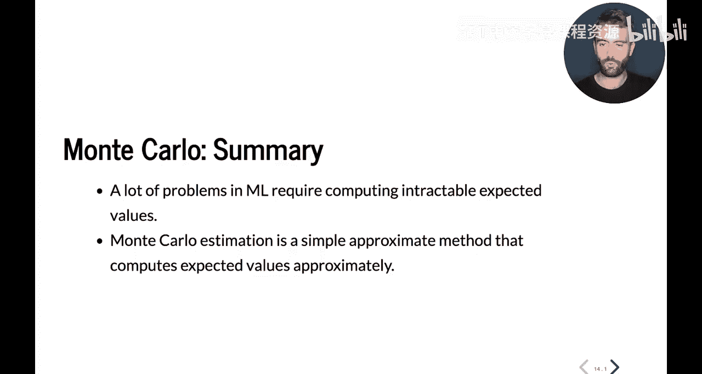

# 5.2：蒙特卡洛估计 🎲


在本节课中，我们将暂时离开之前关于概率模型的讨论，转而介绍一个在本讲及后续课程中都非常有用的工具——蒙特卡洛估计。这是一种数学方法，用于近似计算期望值，在机器学习的许多领域都有应用。

## 建立符号与概念

在定义蒙特卡洛估计之前，我们先建立一些符号。

假设我们有一个随机变量 **x**，它存在于某个空间 **X** 中，并由概率分布 **P** 描述。这里的 **x** 不一定是一个特征向量，它可以是任何随机变量。例如，它可以是从数据分布中抽取的样本，也可以是抛硬币的结果，或者是掷骰子的结果。总之，**x** 是某个随机变量。

如果 **x** 是随机变量，我们就可以计算该随机变量各种函数的期望值。

例如，假设 **x** 是掷两个骰子的结果，**G** 是一个计算其点数和函数。我们想要估计两次掷骰子点数和的期望值。

以下公式给出了期望值的定义：

**E[G(x)] = Σ_x G(x) * P(x)** （当 **x** 为离散变量时）

这个基本概率概念表明，函数 **G** 的期望值（即两次掷骰子的期望点数和）等于函数 **G** 值的加权平均，权重就是概率 **P(x)**。换句话说，我们列举 **x** 所有可能的结果（例如点数和为2、3、4等），将每个结果对应的 **G(x)** 值乘以其发生的概率，然后求和。

期望值在统计学和机器学习中都非常重要。然而，计算这些值通常很困难。例如，如果 **x** 可能取值的数量非常庞大，那么求和运算在实践上可能无法实现。或者，当 **x** 是连续变量时，期望值定义会变成一个积分，我们可能无法得到这个积分的闭式解。

因此，在实践中，大多数应用场景并不精确计算期望值，而是使用近似技术。蒙特卡洛估计就是这样一种用于近似计算期望值的技术。

## 蒙特卡洛估计的定义

我们仍然对近似计算期望值感兴趣。蒙特卡洛估计的核心思想是：从数据分布 **P** 中抽取一定数量的样本（记作 **T**），然后简单地计算函数 **G** 在这些样本上的平均值。

我们的估计量 **Ĝ**，作为这 **T** 个随机样本的函数，就是我们对期望值的蒙特卡洛估计：

**Ĝ = (1/T) * Σ_{t=1}^{T} G(x^{(t)})**，其中 **x^{(t)} ~ P**

为了直观理解为什么这个方法合理，假设 **x** 可以取三个值，且概率不同。当我们从分布 **P** 中抽样时，每个可能值出现的次数大致与其概率 **P(x)** 成比例。因此，当我们计算平均值时，实际上是在以近似于真实概率分布的比例对函数值进行加权平均。

## 一个具体示例

让我们通过一个具体例子使其更明确。假设我们掷五个骰子，想知道掷出“2”的期望次数。

具体地，令 **x** 为一个向量，其每个分量是1到6之间的数字，代表第 **j** 个骰子的结果。那么，函数 **G(x)** 就是这次投掷中“2”出现的次数。

我们可以如下计算该期望值的蒙特卡洛估计（使用Python和NumPy）：

```python
import numpy as np

# 生成10000次随机投掷，每次投5个骰子
# 结果是一个 5行 x 10000列 的矩阵，每个元素是0-5（代表骰子点数-1）
rolls = np.random.randint(0, 6, size=(5, 10000))

# 计算每次投掷中“2”（即数值1）出现的次数
num_twos = np.sum(rolls == 1, axis=0)

# 计算这10000次投掷中“2”出现次数的平均值，作为期望值的估计
estimate = np.mean(num_twos)
print(estimate)
```

运行此代码，估计值大约在0.83（即83%）左右。如果重新运行，会得到略有不同的值，但都围绕0.83波动。如果增加样本数量（例如到一百万），估计值会稳定在更接近0.83的数值上。

实际上，通过解析计算可以得出，掷五个骰子得到“2”的期望次数确实是 **5/6 ≈ 0.833...**。蒙特卡洛估计的结果与此一致。

## 蒙特卡洛估计的性质

现在，我们强调一下蒙特卡洛估计的几个重要性质：

*   **无偏性**：蒙特卡洛估计是真实期望值的无偏估计。这意味着，随着抽取的样本增多，估计值的平均值会等于真实的期望值。在上面的例子中，估计值有时是0.84，有时是0.82，但它们的均值在0.83左右。
*   **方差递减**：随着收集的样本数量增加，估计值的方差会减小。这在上面的例子中也很明显：使用一万个样本时，估计值在0.82到0.84之间变化；而使用一百万个样本时，估计值只在0.833的小数点后几位波动。因此，样本越多，估计越准确。

## 总结

本节课我们一起学习了一种称为蒙特卡洛估计的工具。它可以应用于机器学习中许多需要计算期望值的领域。这是一种非常简单且通用的近似方法，适用于任何能够从中抽取样本的概率分布。



在下一个视频中，我们将展示如何将这一技术应用于一个重要的机器学习问题。