# 5b.1：概率线性回归 📊

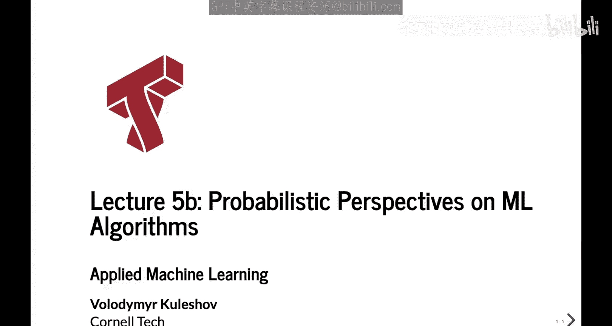

在本节课中，我们将从概率视角重新审视线性回归算法。我们将看到，之前学习的普通最小二乘法实际上是概率模型框架下的一个特例。通过引入概率假设，我们不仅能理解最小二乘法的深层原理，还能推导出更通用、更强大的回归算法。

---

## 回顾：概率模型与线性回归

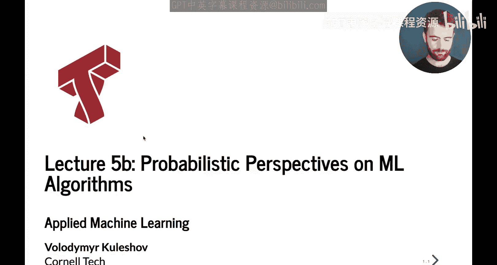

上一节我们介绍了如何将机器学习算法构建为拟合数据分布的概率模型。本节中，我们将结合概率模型与线性回归，为已学习的算法建立一个新的概率视角。

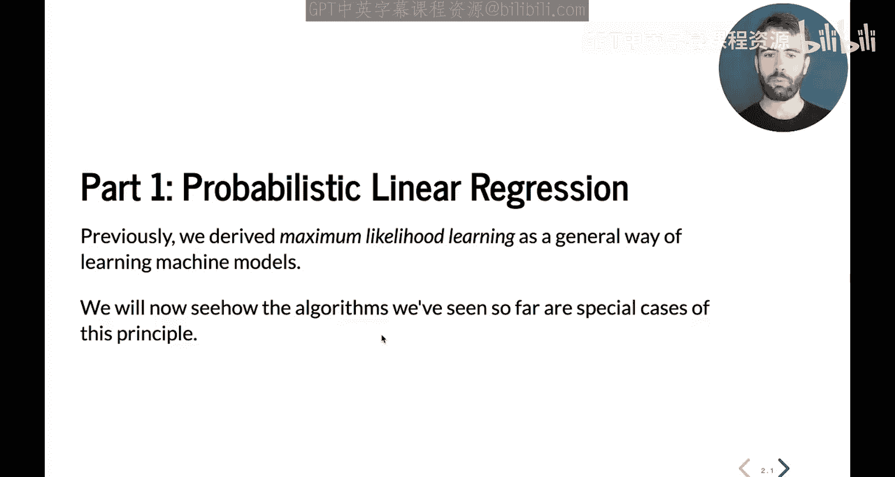

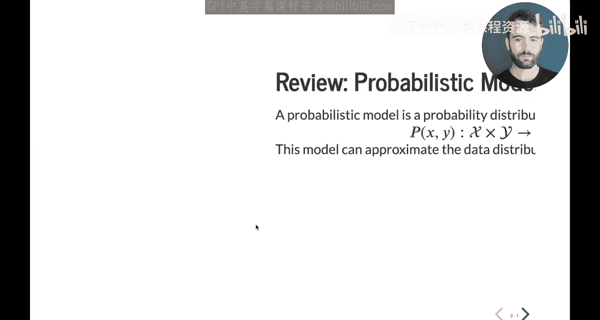

概率模型可以看作是数据 `(X, Y)` 上的一个联合分布，我们的目标是使用模型去近似真实的数据分布。在监督学习中，我们通常通过概率运算将联合分布转化为条件分布。

模型通常由一组参数 `θ` 参数化，我们将其概率记为 `P_θ(Y|X)`。

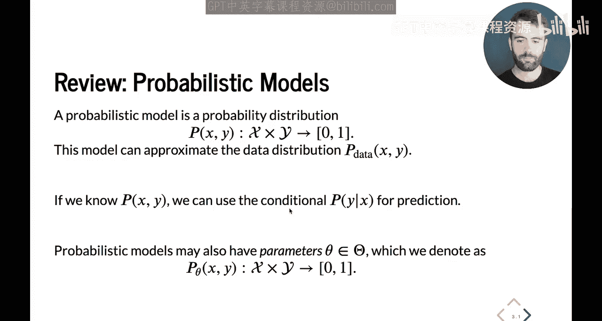

我们可以使用**条件最大似然**原则来训练概率模型。其核心目标是最大化模型在数据分布样本上的概率。

---

## 最小二乘法的概率视角

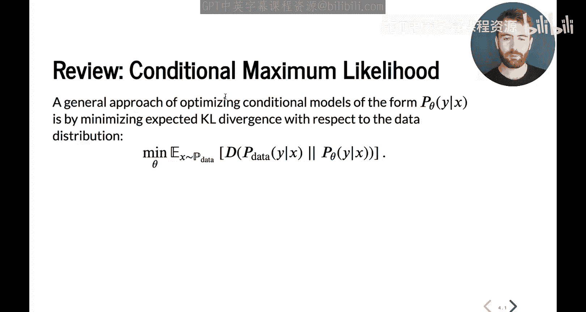

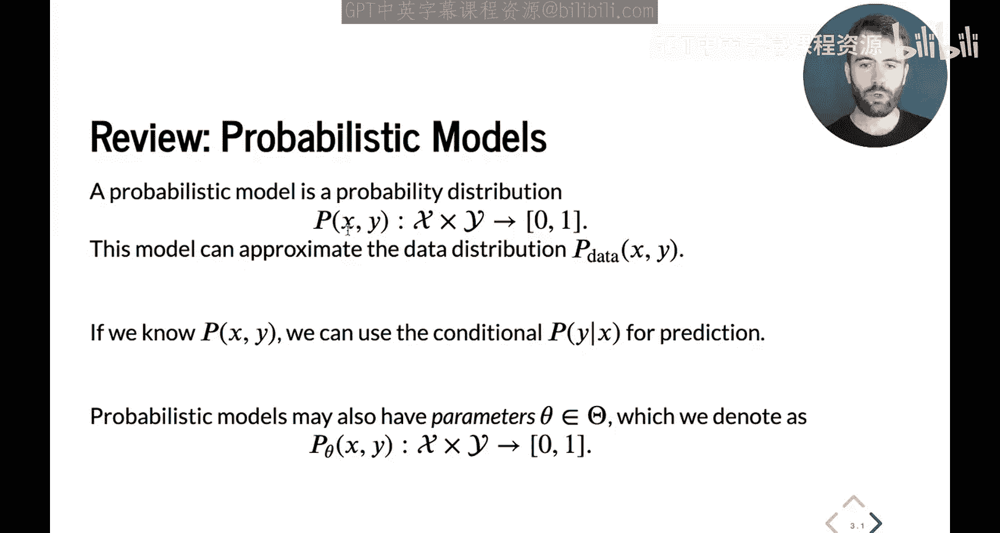

在之前的课程中，我们学习了线性回归算法，特别是**最小二乘法**。其模型形式为线性函数：

`ŷ = θ^T x`

优化目标是**均方误差（MSE）**，即最小化预测值与真实目标值之间的平方差总和：

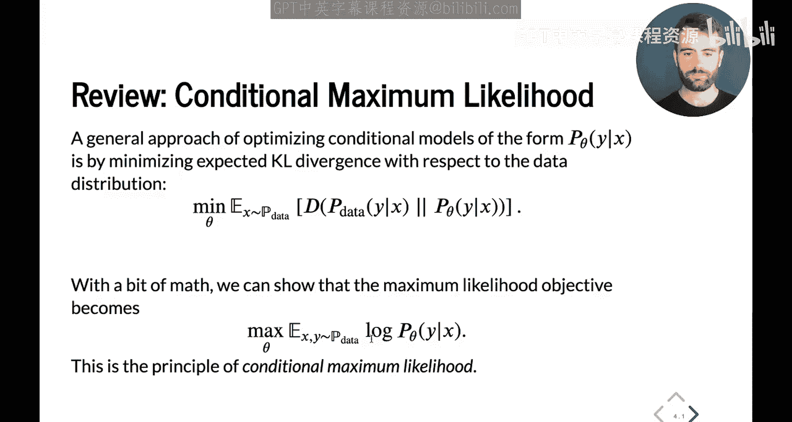

`L(θ) = Σ (y_i - θ^T x_i)^2`

你可能会问，为什么我们最初选择均方误差作为优化目标？毕竟我们可以使用L1损失或其他任何鼓励预测值与目标值相似的函数。

这个问题的答案，可以通过从概率视角审视线性回归来找到。

---

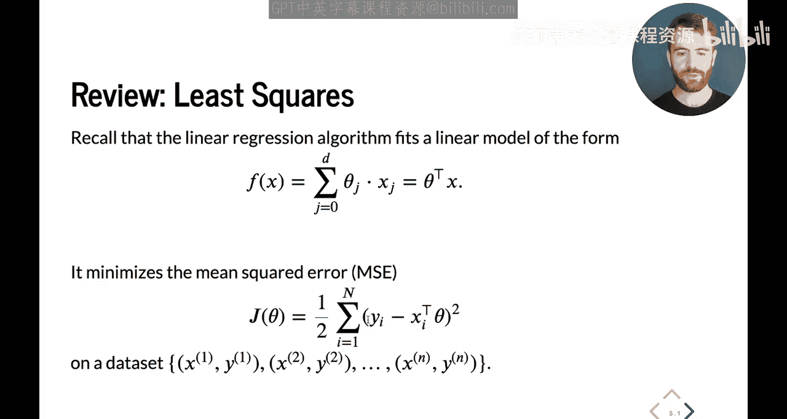

## 推导概率线性回归算法

现在，让我们尝试使用概率方法来推导一个监督学习算法。一个完整的算法需要定义三个要素：**模型类别**、**目标函数**和**优化方法**。

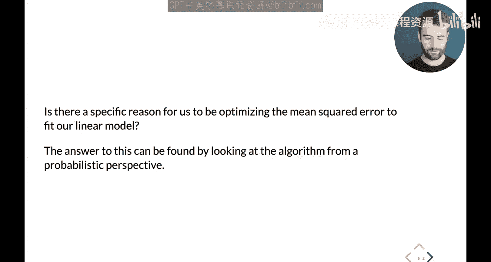

### 1. 定义模型类别

我们提出以下由参数 `θ` 参数化的概率分布族作为我们的模型类别。为简化起见，假设 `Y` 是标量（一维回归问题）。

我们假设给定输入 `x` 时，目标 `y` 的条件分布是一个**高斯分布（正态分布）**：

`P_θ(y | x) = N(y; μ(x; θ), σ^2)`

其中，均值 `μ` 是 `x` 和参数 `θ` 的函数。具体地，我们令均值 `μ` 为 `x` 的线性函数：

`μ(x; θ) = θ^T x`

因此，完整的模型是：

`P_θ(y | x) = 1 / (√(2π)σ) * exp( - (y - θ^T x)^2 / (2σ^2) )`

这个公式的含义是：给定一个输入 `x`，`y` 的分布是一个以 `θ^T x` 为中心的高斯钟形曲线。方差 `σ^2` 在此处被视为一个固定的超参数（后续可扩展）。

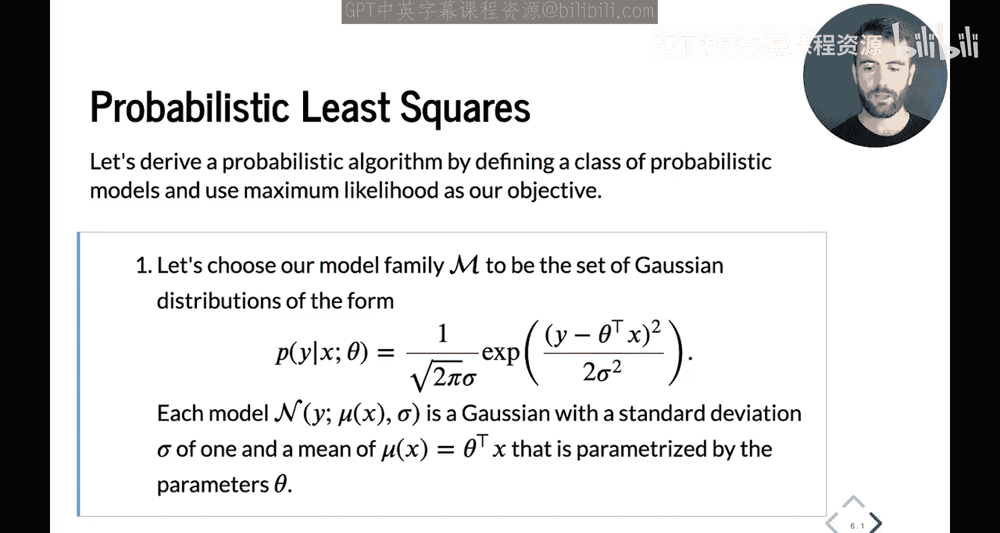

### 2. 定义目标函数

遵循概率机器学习方法，一个自然的目标函数是**条件最大对数似然**。对于单个数据点 `(x, y)`，其对数似然为：

`log P_θ(y | x) = - (y - θ^T x)^2 / (2σ^2) - log(√(2π)σ)`

对于整个数据集，我们希望最大化总的对数似然，这等价于最小化负对数似然。观察上式，第二项 `- log(√(2π)σ)` 是与参数 `θ` 无关的常数。因此，最大化对数似然等价于**最小化第一项**，即：

`Σ (y_i - θ^T x_i)^2`

这正是我们熟悉的**最小二乘损失函数**！

### 3. 优化方法

由于目标函数与最小二乘法完全相同，我们可以使用之前学过的任何优化方法，例如**梯度下降法**或**正规方程**。

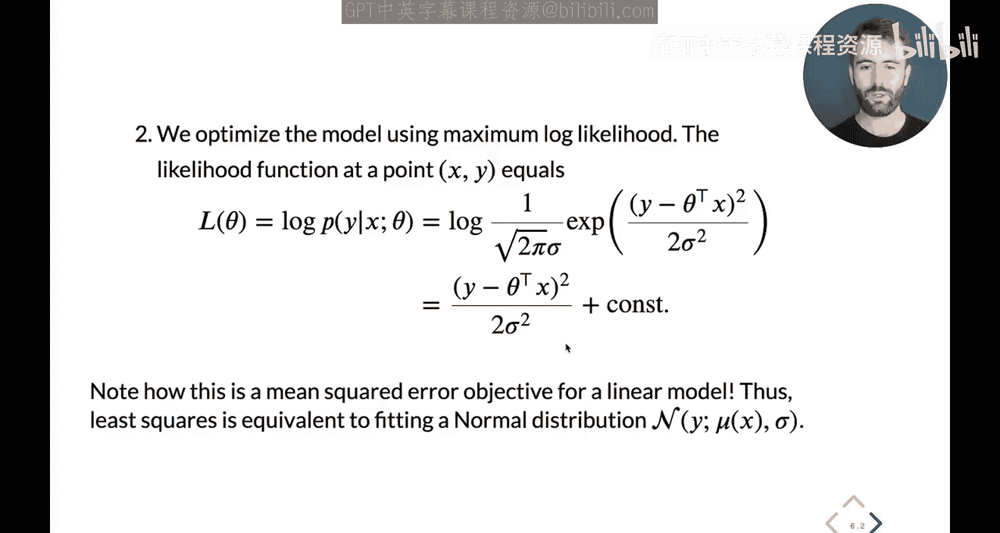

---

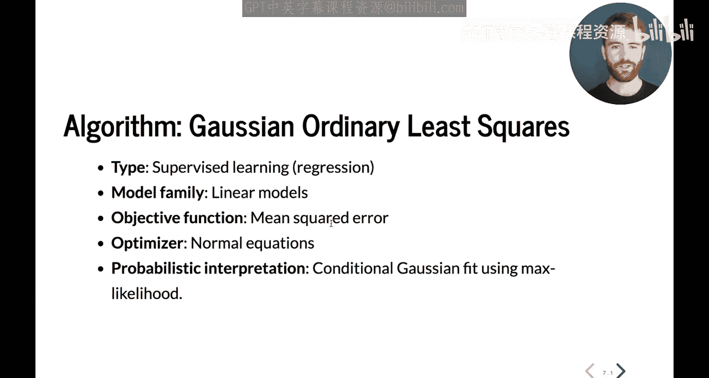

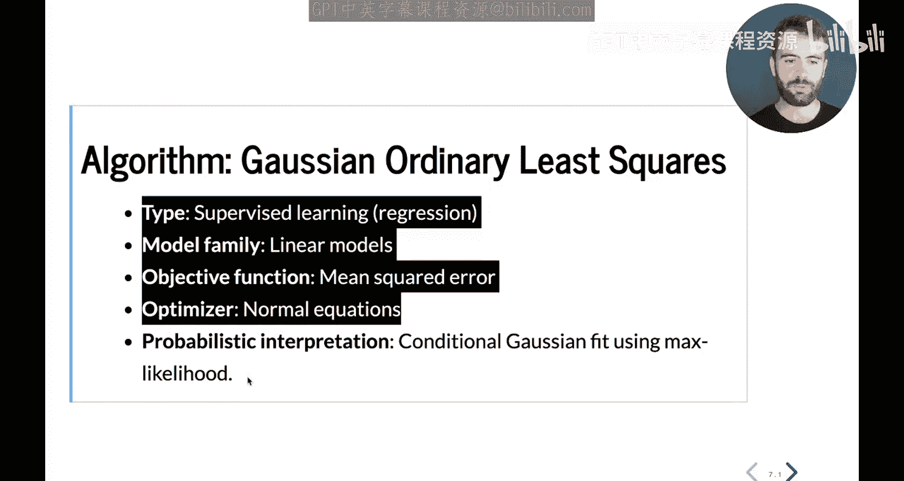

## 结论与意义

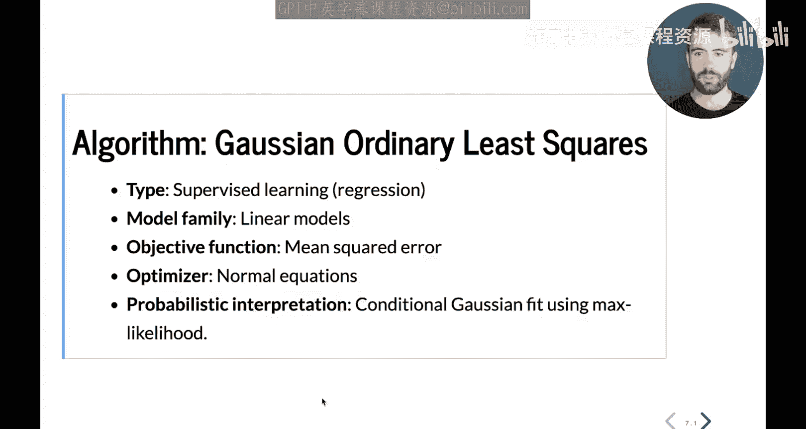

通过上述推导，我们从一个简单的概率假设（即目标 `y` 在给定 `x` 时服从以线性函数为均值的高斯分布）出发，自然地得到了**最小二乘线性回归**算法。

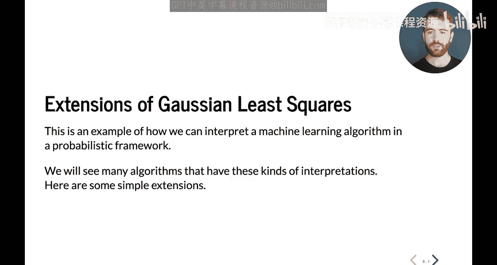

这回答了最初的问题：我们使用均方误差损失，是因为它源于一个非常基本且广泛适用的概率假设——正态分布。最小二乘法是概率框架下的一个特例。

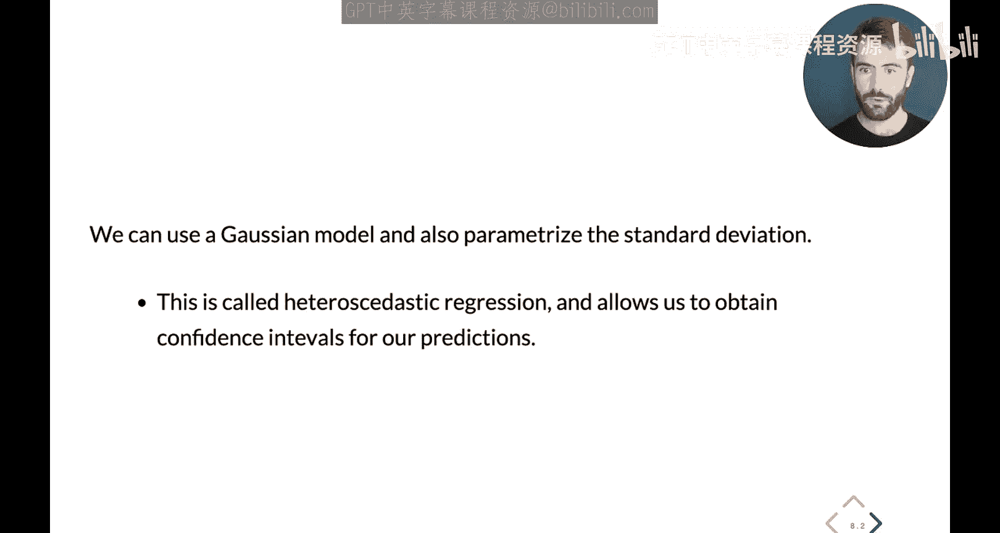

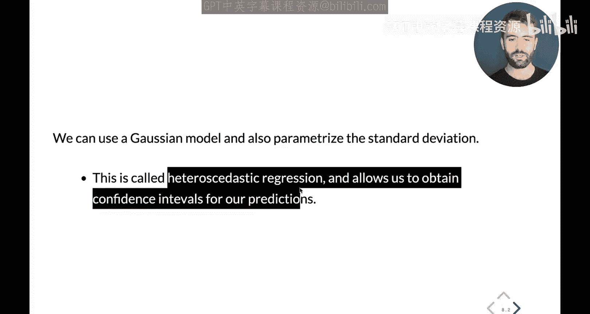

---

## 概率框架的扩展能力

概率方法的强大之处在于其**可扩展性**。我们不仅可以复现经典算法，还能轻松推导出新的、更强大的算法。

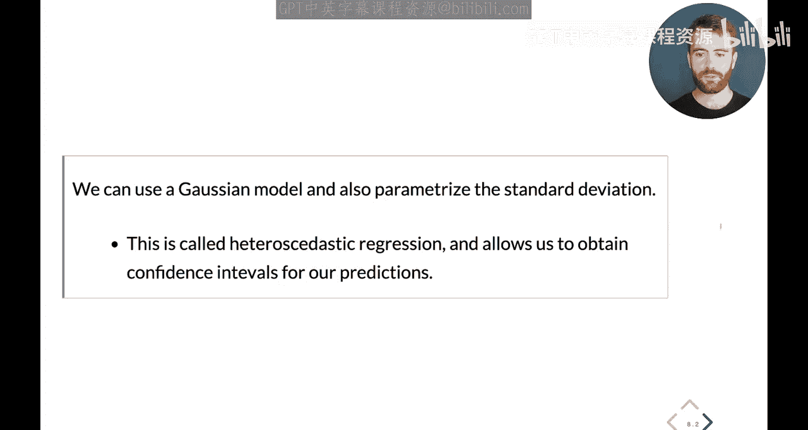

以下是几个扩展方向：

*   **异方差回归**：我们可以不仅用参数 `θ` 建模均值 `μ`，还用另一组参数建模方差 `σ^2`，使其也成为 `x` 的函数。这样，模型不仅能预测目标值，还能给出预测的**置信区间**，这在许多实际应用中非常有用。
*   **其他分布假设**：高斯分布并非适用于所有数据类型。例如：
    *   对于计数数据，**泊松分布**可能更合适。
    *   对于只能取两个值（是/否）的分类数据，**伯努利分布**是自然的选择（我们将在后续分类课程中详细讨论）。
    *   对于正值数据，**指数分布**或**伽马分布**可能更好。

通过为不同的数据选择合适的分布并进行参数化，我们可以得到专门针对该数据类型优化的、性能更佳的机器学习算法。

---

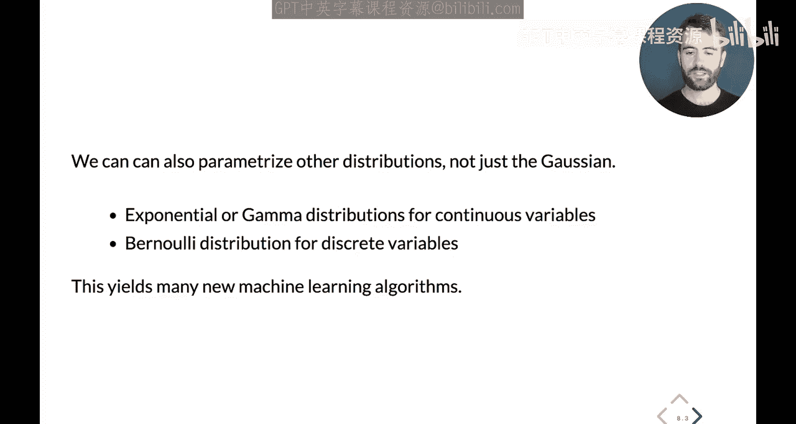

本节课中，我们一起学习了如何从概率视角理解线性回归，并推导出最小二乘法。我们看到，概率框架不仅为现有算法提供了理论依据，更是设计和理解新算法的强大工具。在接下来的课程中，我们将继续探索概率模型在分类等其他任务中的应用。