# 6.1：分类（第一部分）🎯

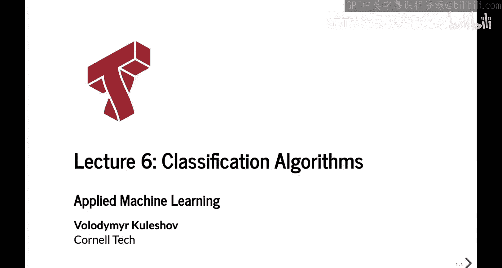

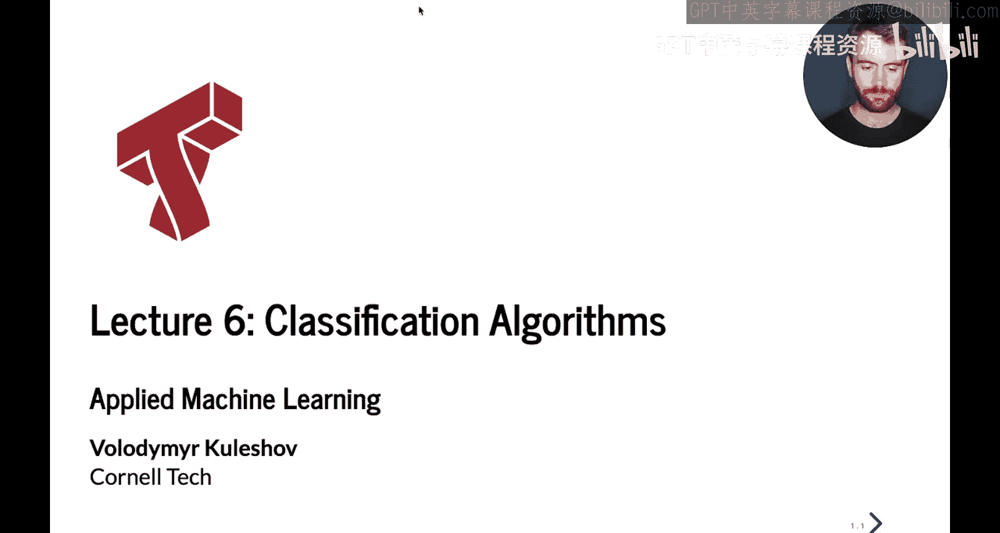

在本节课中，我们将要学习监督学习的另一个重要类型：分类问题。我们将回顾分类问题的定义，建立相关符号，并通过一个经典数据集来理解分类与回归问题的区别。

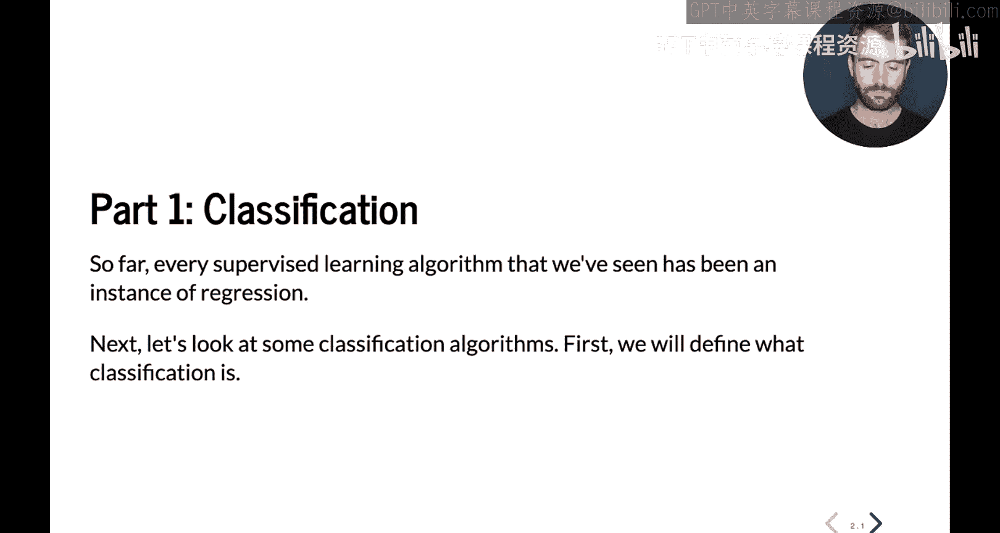

---

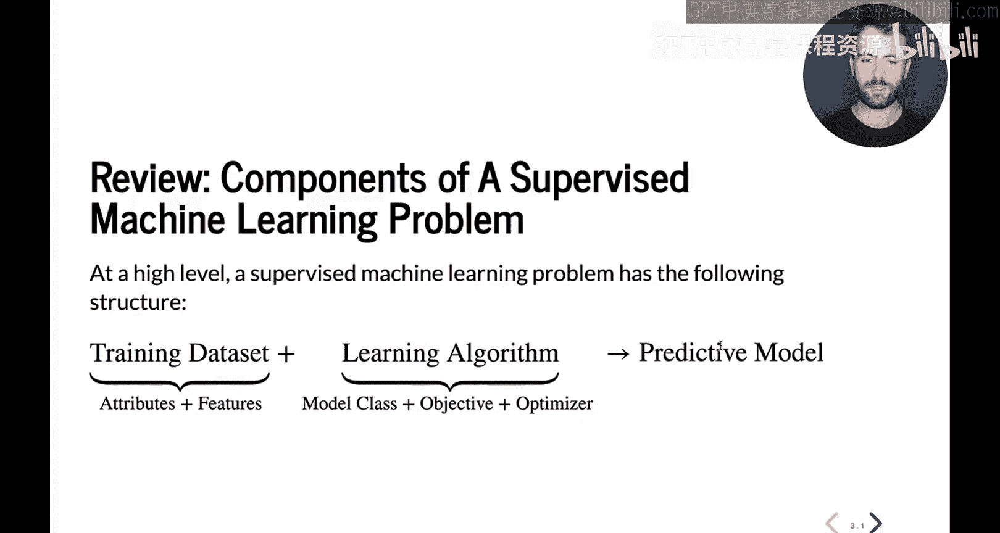

## 监督学习回顾

上一节我们介绍了监督学习的基本框架。为了应用监督学习，我们需要收集一个训练数据集，其中每个训练实例都是一个由目标值和输入特征组成的对。接着，我们指定一个学习算法来分析这个数据集，并生成一个预测模型。

## 回归与分类的区别

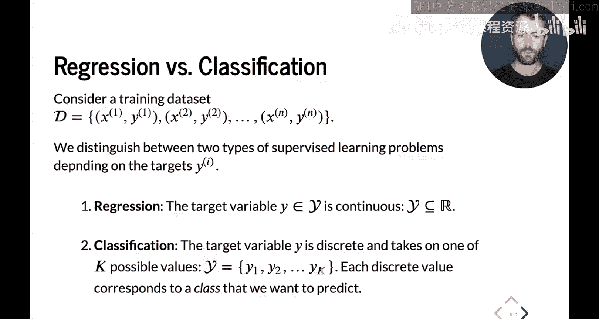

到目前为止，我们见过的所有算法都属于回归问题，其目标变量是连续的，取值于实数集。在本节中，我们来看看当目标变量是离散值时的情况，这被称为分类问题。

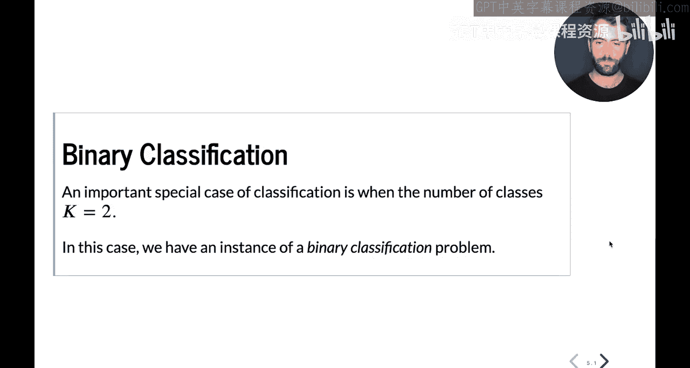

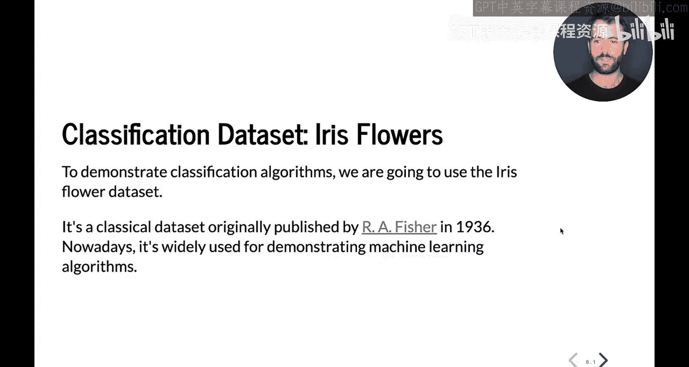

我们将目标变量 `y` 可能取值的集合记为 `𝒴`，其中 `y₁, y₂, ..., yₖ` 是 `K` 个可能的类别。

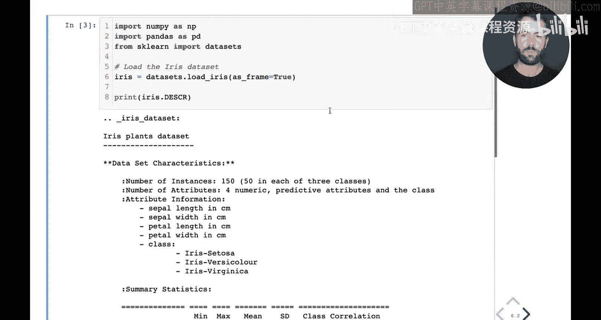

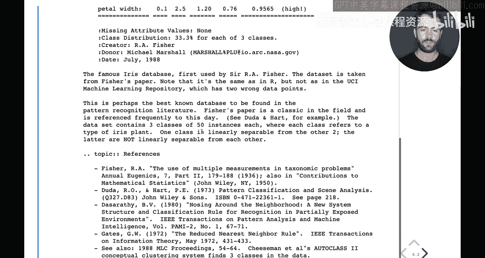

一个重要的特例是**二元分类**，即当 `K = 2` 时，只有两个类别。

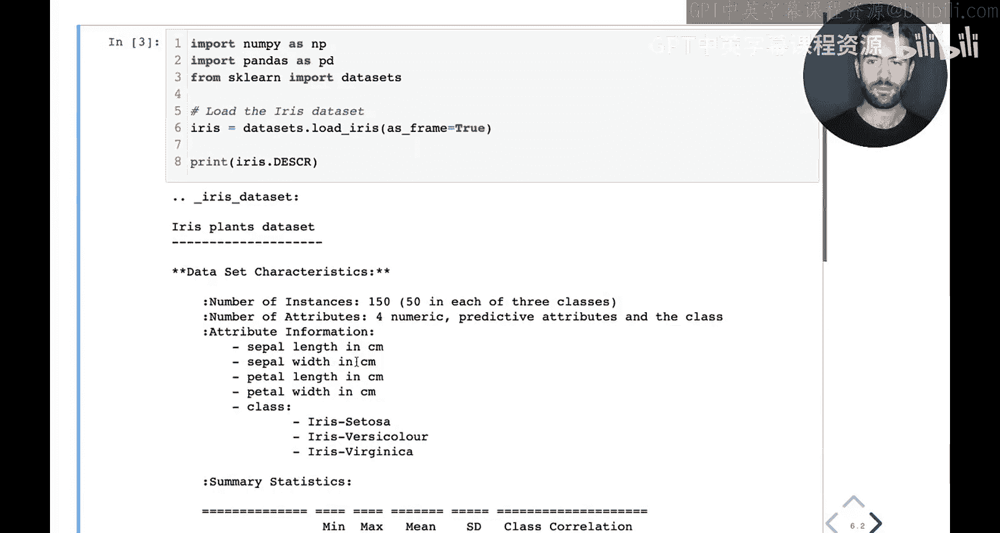

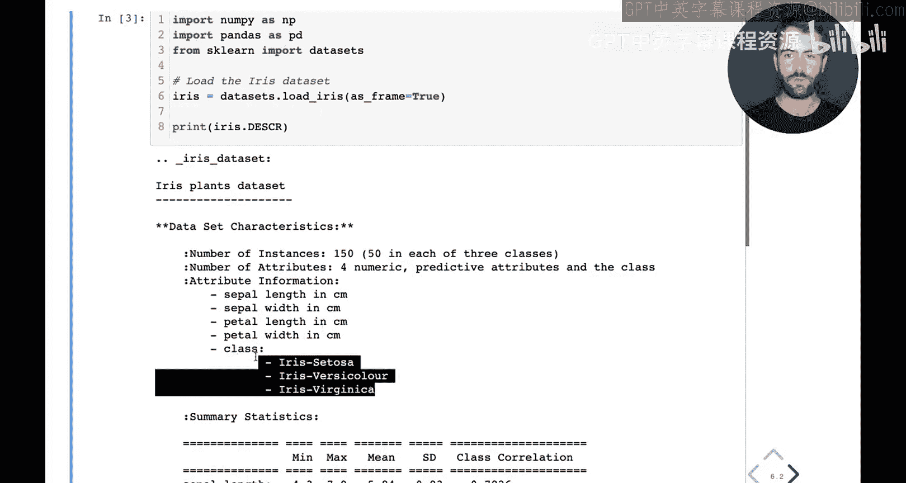

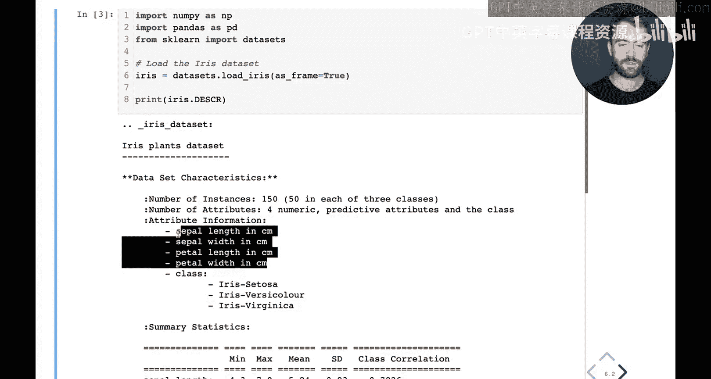

## 示例数据集：鸢尾花

让我们通过一个经典数据集来具体理解分类问题。这个数据集由著名统计学家费舍尔于1936年创建，如今被广泛用于演示各种机器学习算法。

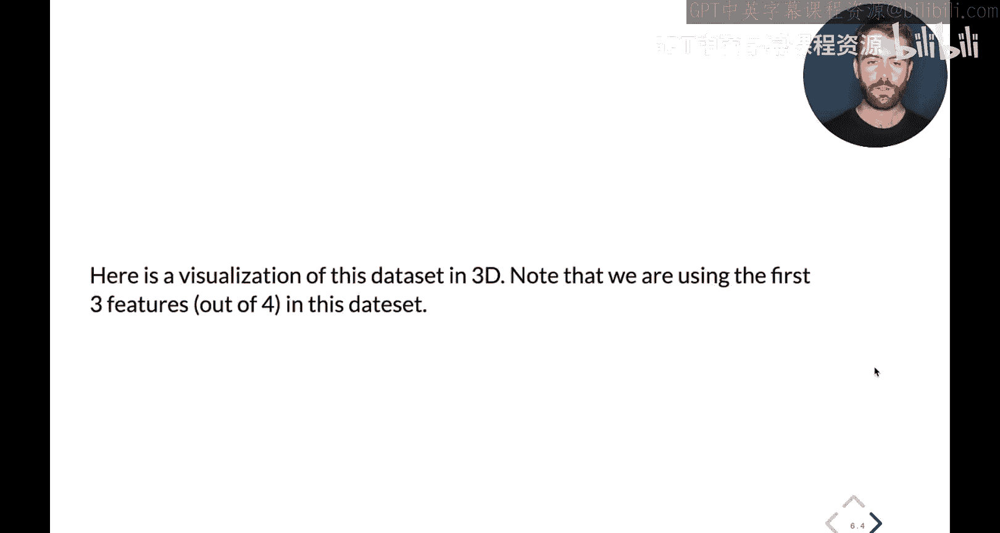

以下是该数据集的关键信息：
*   数据集包含三种不同鸢尾花亚种的测量数据。
*   特征包括花萼长度、花萼宽度、花瓣长度和花瓣宽度。
*   目标变量是一个取值为0、1或2的数值，对应不同的花种。

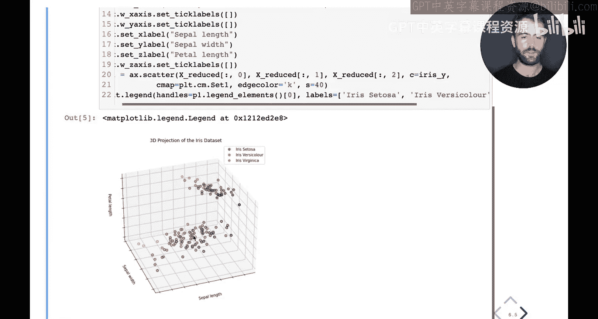

我们可以将数据可视化。例如，选取前三个特征在三维空间中绘图，可以看到不同花种的数据点形成了各自的簇，例如 Iris-setosa（山鸢尾）明显与其他两种分开。

## 分类问题的直观理解

理解回归与分类的差异至关重要。

*   在回归中，我们试图找到一条曲线或直线来拟合连续的目标值。例如，在糖尿病预测任务中，我们拟合了一条穿过BMI与糖尿病风险评分数据点的直线。
*   在分类中，我们的目标是找到特征空间的一个**划分**，将不同类别的数据点分隔到不同的区域。我们寻找的是这些区域之间的**决策边界**。

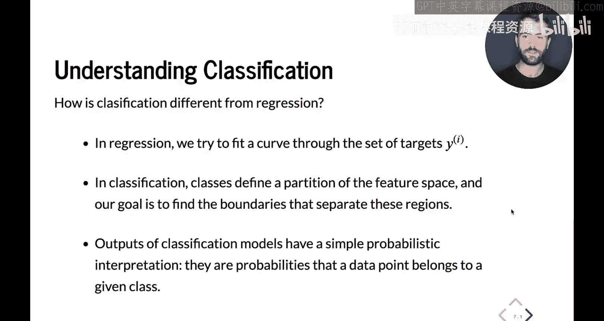

从概率角度看，分类模型输出的概率 `P(Y)` 可以简单地解释为给定数据点属于某个类别的可能性。

## 可视化决策边界

为了更清晰地展示，我们将鸢尾花数据投影到二维空间（使用前两个特征）。在这个二维图中，Iris-setosa 仍然清晰地自成一群，而另外两种花则较为相似地分布在另一区域。

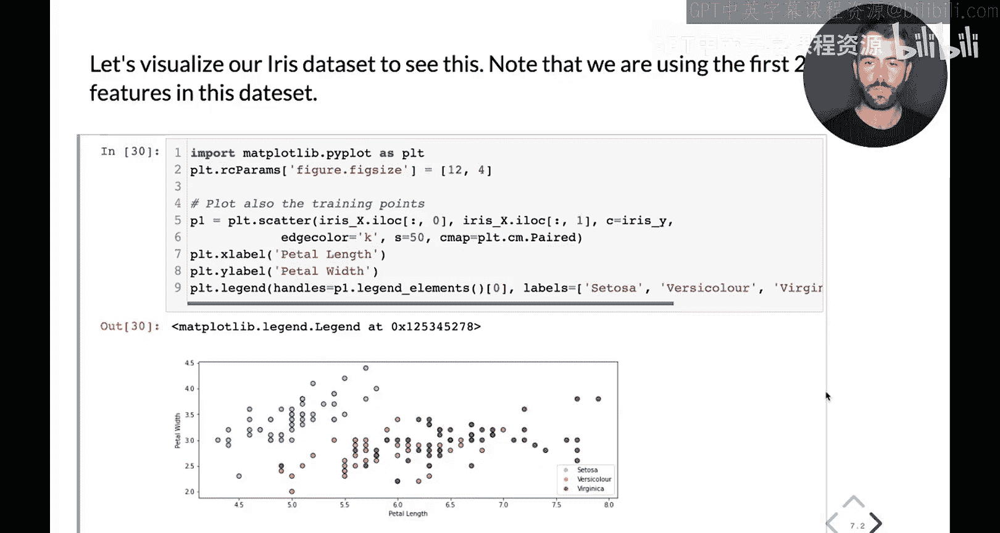

现在，我们可以使用一个分类算法（例如逻辑回归）来拟合数据，尝试将 Iris-setosa 与其他花种分开。算法会找到一条线（决策边界），将特征空间划分为两个区域，分别对应两个类别。

---

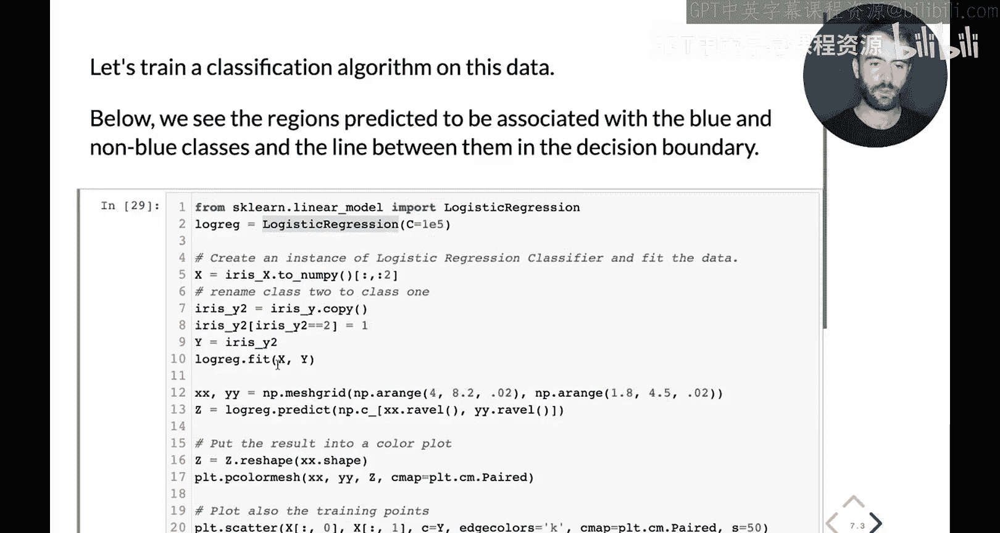

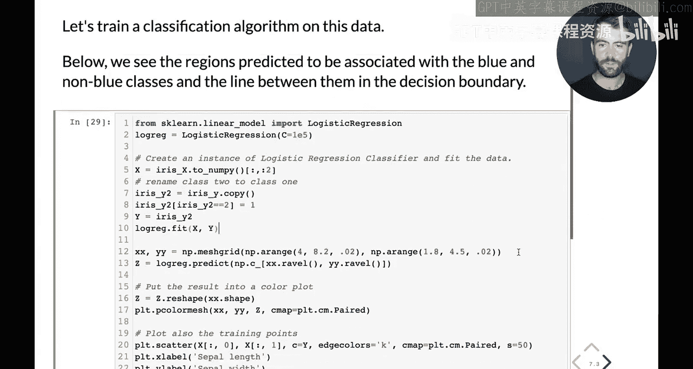

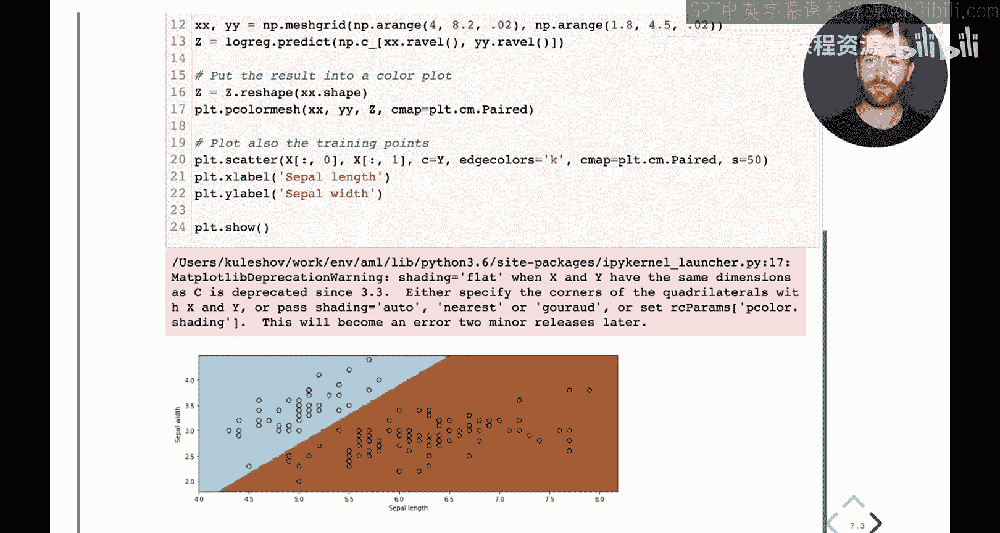

本节课中我们一起学习了分类问题的基本概念，明确了其与回归问题的核心区别，并通过鸢尾花数据集直观地理解了特征空间划分和决策边界。在下一节中，我们将开始探讨具体的分类算法。