# 6.3：非参数模型 📊

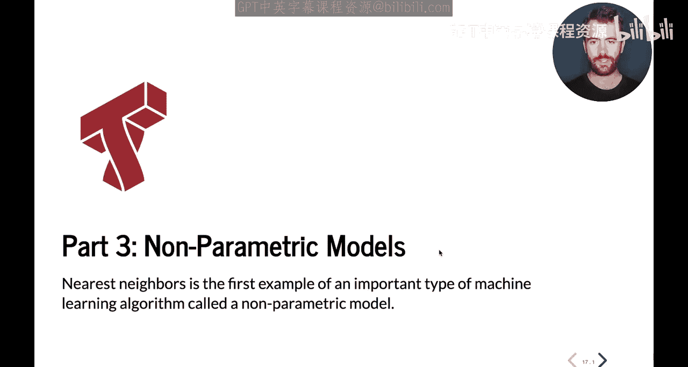

在本节课中，我们将要学习非参数模型。上一节我们介绍了K近邻算法，本节中我们来看看什么是非参数模型，以及它与参数模型的区别。

## 参数模型回顾

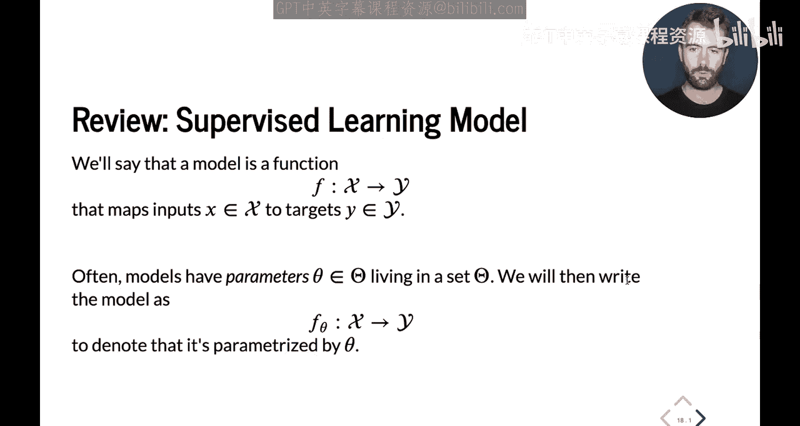

在监督学习的课程中，我们定义了监督学习模型是一个函数 **F**，它将输入 **x** 映射到目标 **y**。模型通常具有参数 **θ**，我们用以下符号表示 **F** 由这些参数参数化：

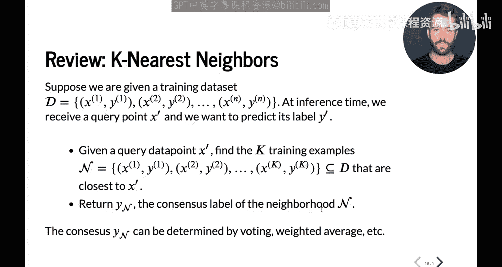

**F(x; θ) → y**

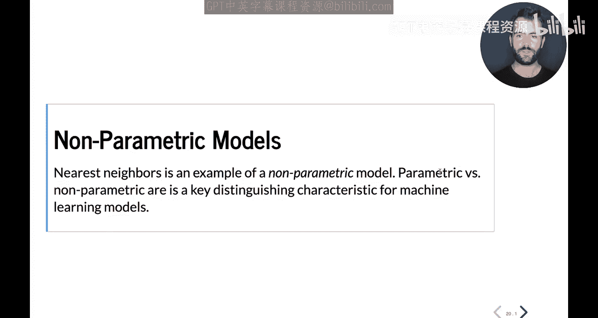

这意味着每个参数实例化都定义了一个模型，定义了从输入 **x** 到目标 **y** 的特定映射。到目前为止，我们看到的所有监督学习算法示例都是这种参数模型的实例。

## 非参数模型定义

K近邻算法是我们遇到的第一个无法用一组参数以这种形式表达的模型。K近邻实际上是一种更通用的模型类型，它不与一组参数相关联，这使其成为非参数模型。我将更精确地定义什么是非参数模型。

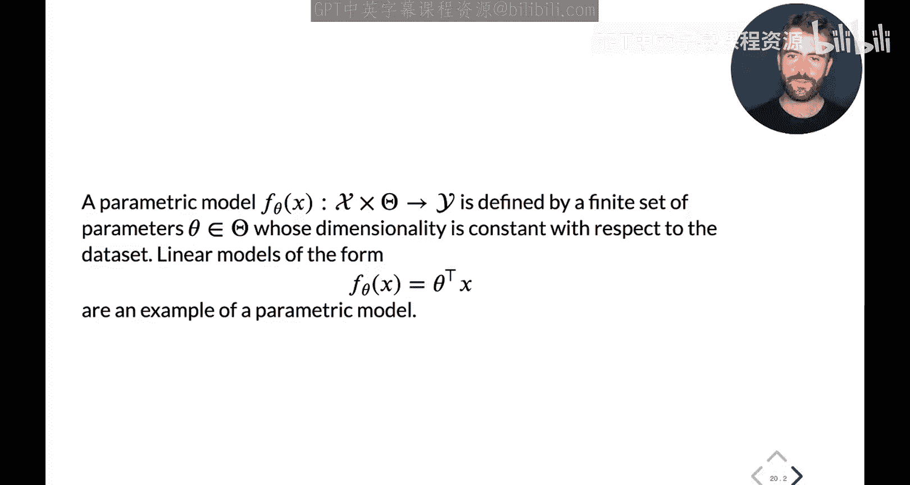

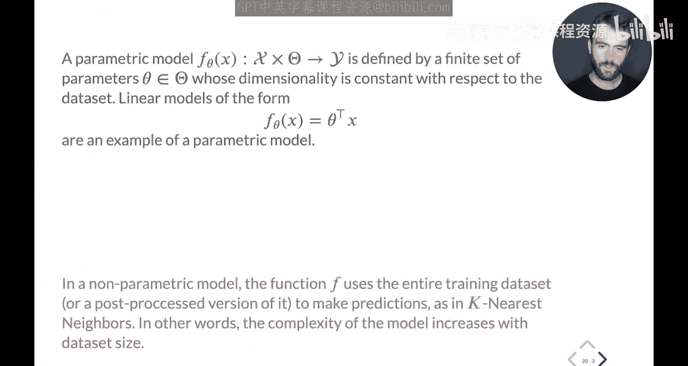

以下是参数模型与非参数模型的核心区别：

*   **参数模型**：模型类的复杂度（或自由度）是固定的，不随数据集大小增加而增加。例如，线性模型的参数维度 **D** 是固定的。
*   **非参数模型**：模型类的复杂度（或自由度）会随着数据集大小的增加而持续增加。K近邻算法就是一个典型例子。

## K近邻算法回顾

K近邻算法使用一个包含 **N** 个训练样本的训练数据集 **D**。在预测时，我们收到一个查询点 **x'**，然后算法找到 **K** 个与 **x'** 最接近的训练样本，我们称这个样本集合为邻域 **N**。接着，K近邻算法返回这些训练样本目标值的平均值，或者该邻域中最频繁的目标值，更一般地说，是该邻域中的某种共识标签或共识目标。

**算法核心步骤**：
1.  给定查询点 **x'**。
2.  计算 **x'** 与训练集中所有点的距离。
3.  选择距离最近的 **K** 个点作为邻域 **N**。
4.  对邻域 **N** 中的目标值进行聚合（如平均或投票），得到预测结果。

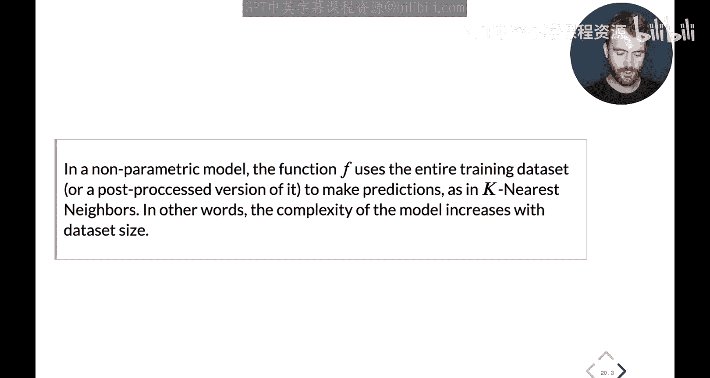

## 非参数模型的优势与劣势

非参数模型（如K近邻）通常具有以下特点：

*   **优势**：由于在训练时从不将训练数据集压缩成更小且固定的参数集，因此不会丢失任何信息。随着收集更多数据，模型类的复杂度持续增加，可以提供更准确的预测。
*   **劣势**：计算复杂度高。需要存储整个数据集，并在预测时直接在其上进行计算（如搜索），因此存储和计算需求都更大。此外，更容易过拟合训练集，需要仔细选择超参数（如邻域大小 **K**）以避免过拟合。

## 总结

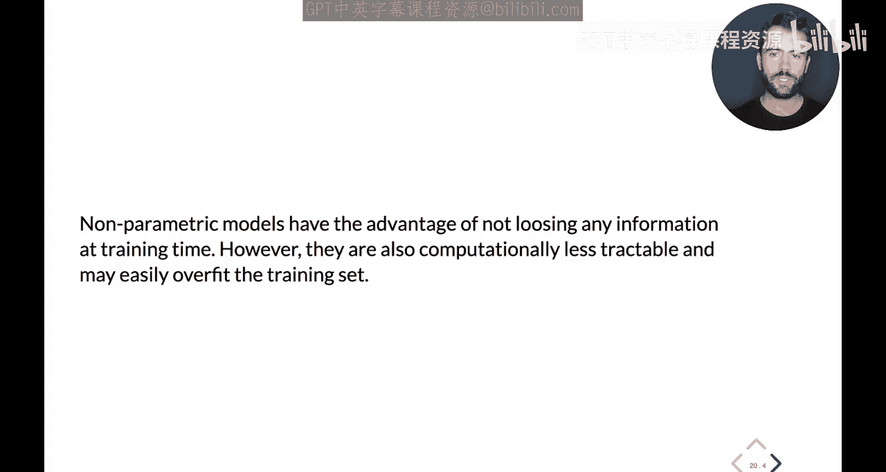

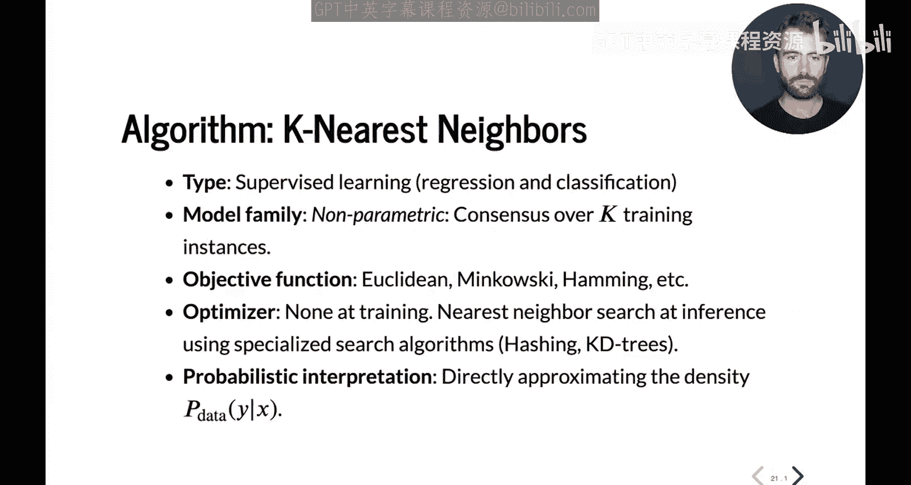

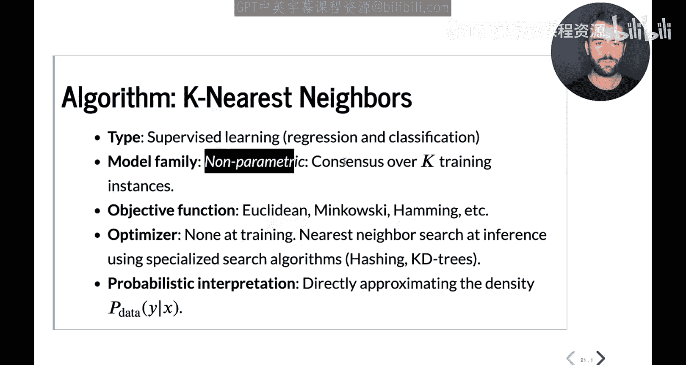

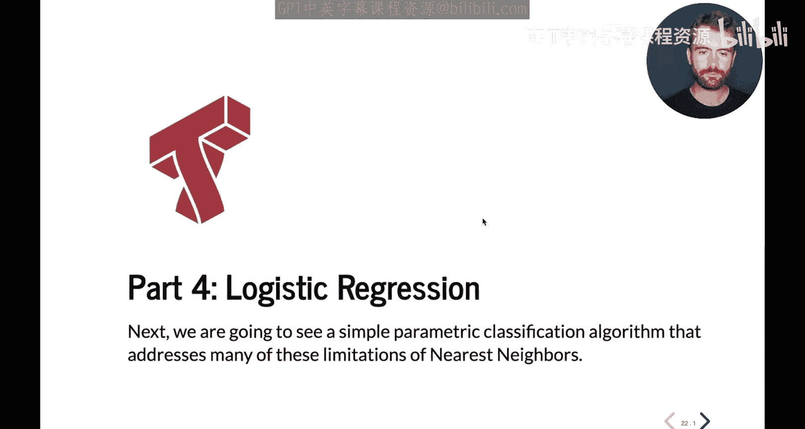

本节课中我们一起学习了非参数模型的概念。我们回顾了K近邻算法，并明确了参数模型与非参数模型的关键区别：参数模型的复杂度固定，而非参数模型的复杂度随数据量增长。K近邻作为典型的非参数模型，其优势在于信息保留完整，劣势在于计算开销大且需注意过拟合风险。理解这一区别有助于我们在不同场景下选择合适的机器学习算法。