# 6.5：Softmax回归 🧮

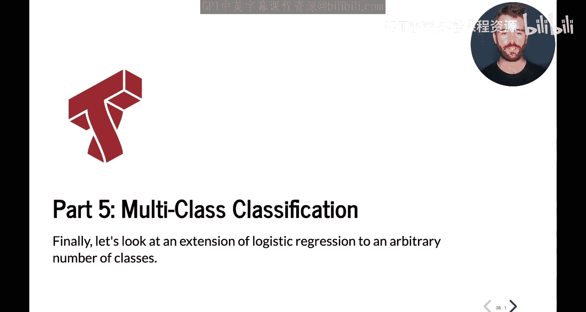

在本节课中，我们将学习如何将二分类的逻辑回归算法，扩展为能够处理任意数量类别（K类）的多分类算法。我们将重点介绍一种名为Softmax回归的算法，它直接输出多类概率，并保留了我们之前讨论过的概率解释。

---

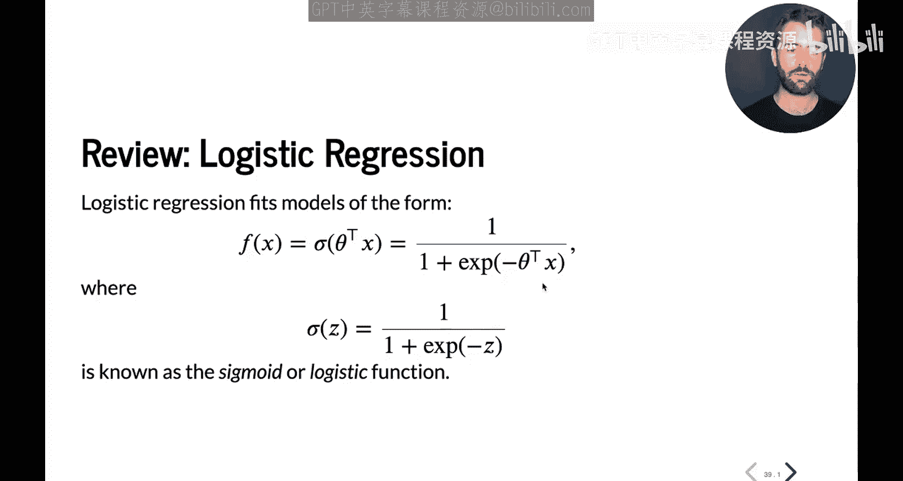

## 从二分类到多分类

上一节我们介绍了用于二分类的逻辑回归算法。本节中，我们来看看如何将其推广到多分类问题。

一种简单且在实践中常用的方法是“一对多”方法。这种方法为每个类别训练一个分类器，用于区分该类与所有其他类别。虽然这种方法有效，但从概念上讲，它并不完全令人满意，特别是它失去了逻辑回归原有的有效概率解释。

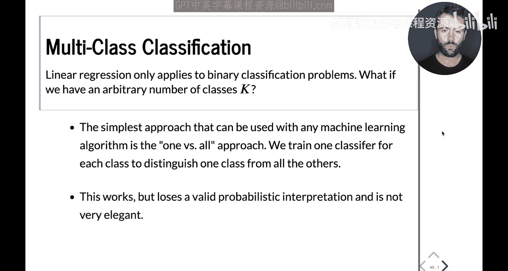

然而，对于逻辑回归，我们可以拟合一个不同的模型，它是逻辑回归的推广，能直接输出多类概率。

---

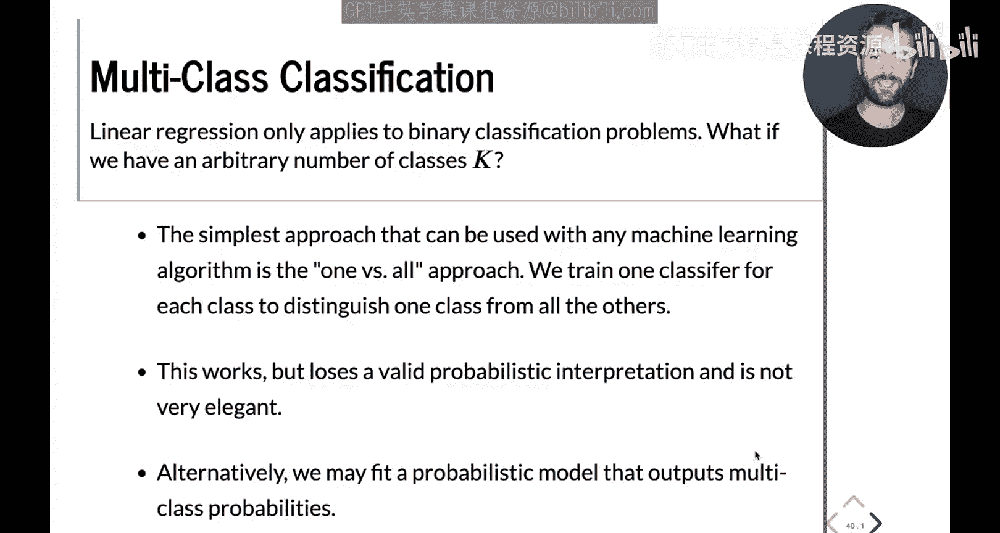

## Softmax函数：逻辑函数的推广

为了将逻辑回归推广到多类，我们需要一个能将K维输入映射为K维概率向量的函数。这个函数称为Softmax函数。

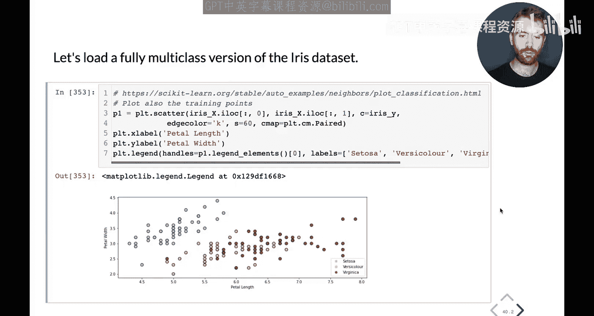

以下是Softmax函数的定义。它是一个向量值函数，输出一个包含K个概率的向量。其第k个分量的计算公式如下：

$$
\sigma(\mathbf{z})_k = \frac{e^{z_k}}{\sum_{j=1}^{K} e^{z_j}}
$$

这个函数分两步工作：
1.  首先，对输入向量 $\mathbf{z}$ 的每个分量应用指数函数 $e^{z_k}$，确保所有分量非负。
2.  然后，将所有指数化的分量进行归一化（即除以它们的总和），使得输出向量的所有分量之和为1，从而形成一个有效的概率分布。

---

## 与逻辑函数的关系

让我们看看当类别数K=2时，Softmax函数的特殊情况。

此时，第一个类别的概率形式可以简化为：

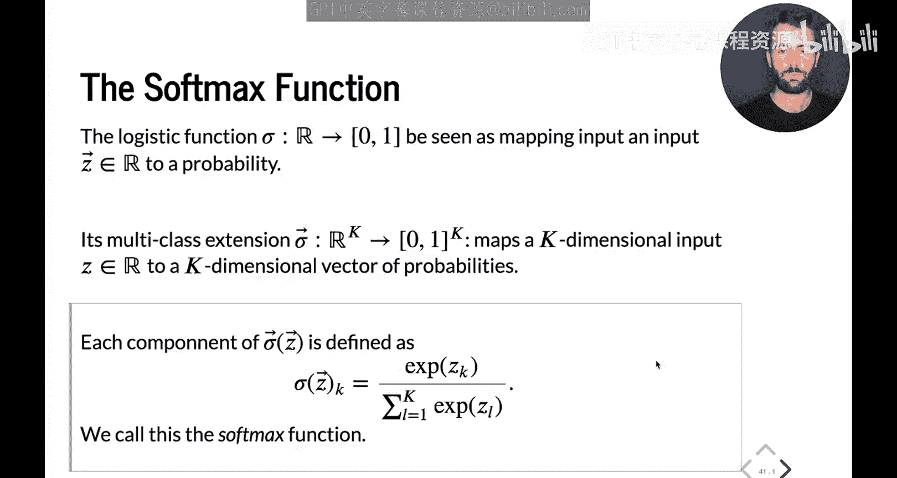

$$
P(y=1) = \frac{1}{1 + e^{-z_2}}
$$

（这里我们通过设定 $z_1 = 0$ 来消除参数冗余，因为概率分布对缩放不变。）

你可以看到，这个形式与我们之前使用的逻辑函数（Sigmoid函数）非常相似。这表明Softmax函数本质上是Sigmoid函数在多分类场景下的自然推广。

---

## 定义Softmax回归模型

在二分类的逻辑回归中，我们的模型形式是 $f(\mathbf{x}) = \sigma(\theta^T \mathbf{x})$，它将线性组合 $\theta^T \mathbf{x}$ 通过Sigmoid函数映射为一个概率。

在K分类的Softmax回归中，我们的模型将输出K个概率。模型为每个类别k分配一个参数向量 $\theta_k$。给定输入 $\mathbf{x}$，模型计算每个类别的“分数” $\theta_k^T \mathbf{x}$，然后通过Softmax函数将这些分数转换为概率：

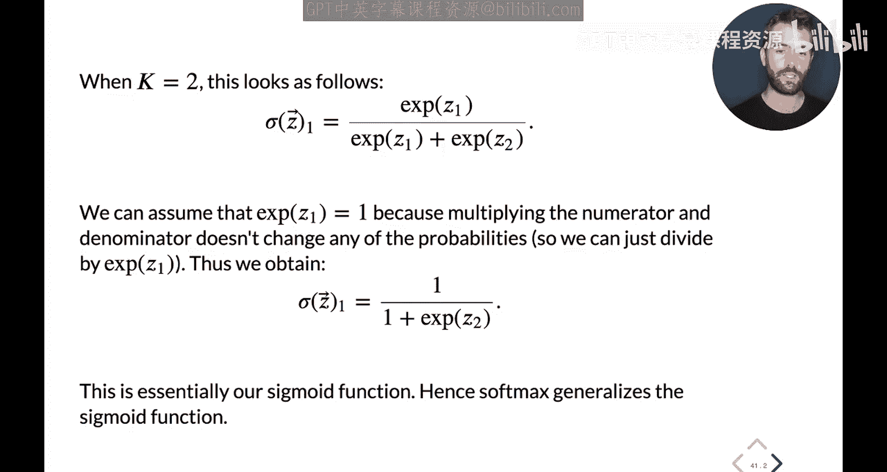

$$
P(y=k | \mathbf{x}; \theta) = \frac{e^{\theta_k^T \mathbf{x}}}{\sum_{j=1}^{K} e^{\theta_j^T \mathbf{x}}}
$$

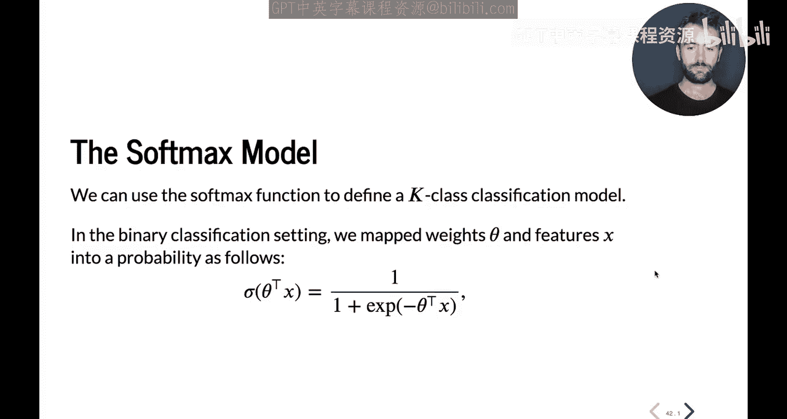

模型的参数现在是K组 $\theta$ 向量，每组对应一个类别。

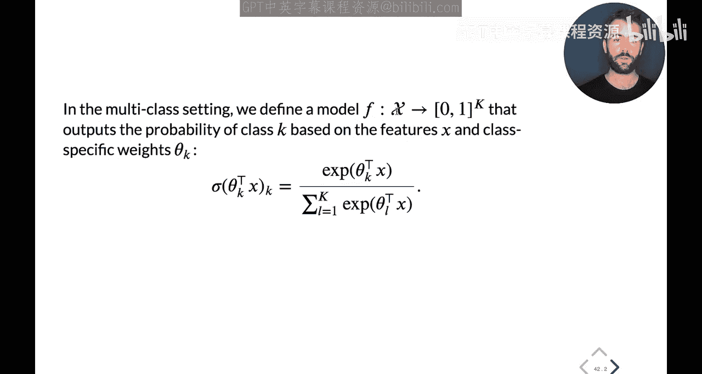

---

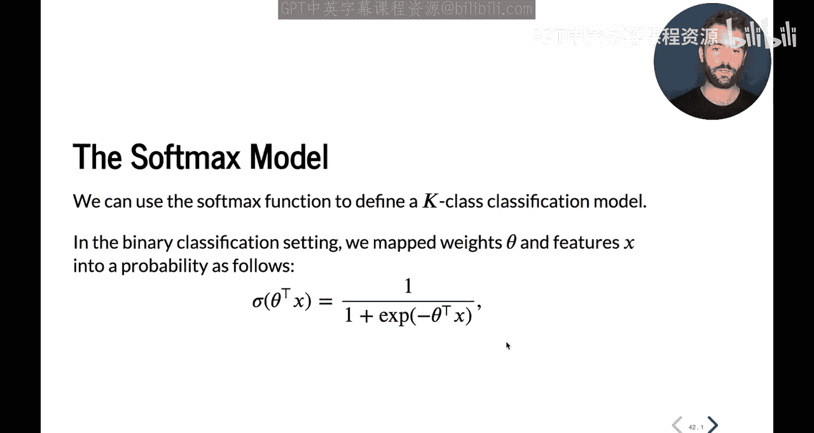

## 训练目标与优化

与逻辑回归类似，我们可以从概率角度为Softmax回归定义训练目标。

我们将Softmax模型的输出解释为一个**分类分布**的参数。分类分布是伯努利分布（二项分布）在多类别上的推广。然后，我们应用**最大似然估计**原则来寻找最优参数。

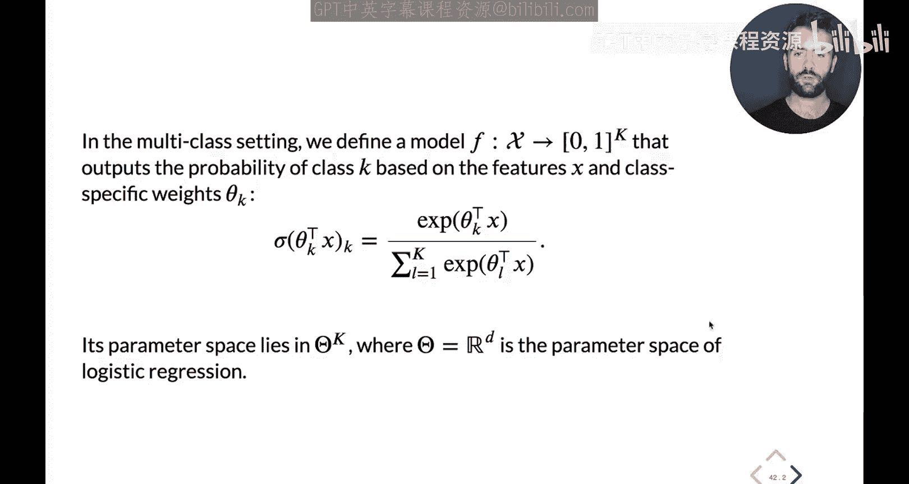

训练目标是最大化训练数据在该模型下的似然概率。通过优化这组参数 $\theta$，我们就得到了Softmax回归算法。这个优化通常使用梯度下降法来完成。

---

## 应用示例：鸢尾花数据集

让我们将Softmax回归应用于完整的鸢尾花数据集（包含三个类别）。

以下是使用Python的scikit-learn库实现Softmax回归的示例代码：

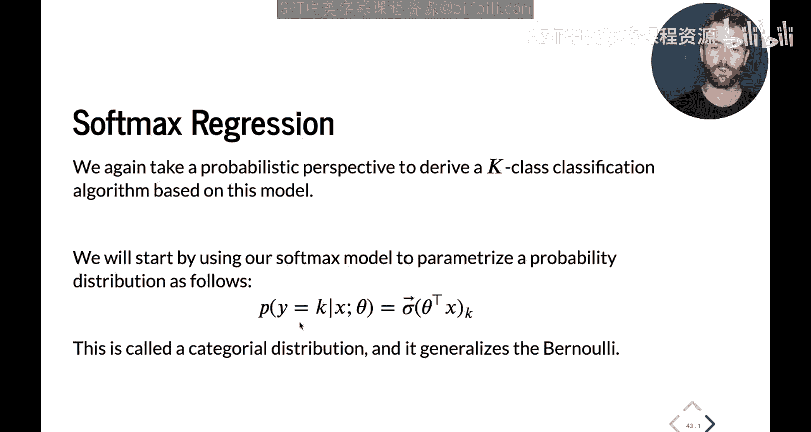

```python
from sklearn.linear_model import LogisticRegression

# 创建Softmax回归模型（在scikit-learn中，LogisticRegression默认支持多分类）
model = LogisticRegression(multi_class='multinomial', solver='lbfgs')
# 拟合模型
model.fit(X_train, y_train)
# 进行预测
predictions = model.predict(X_test)
```

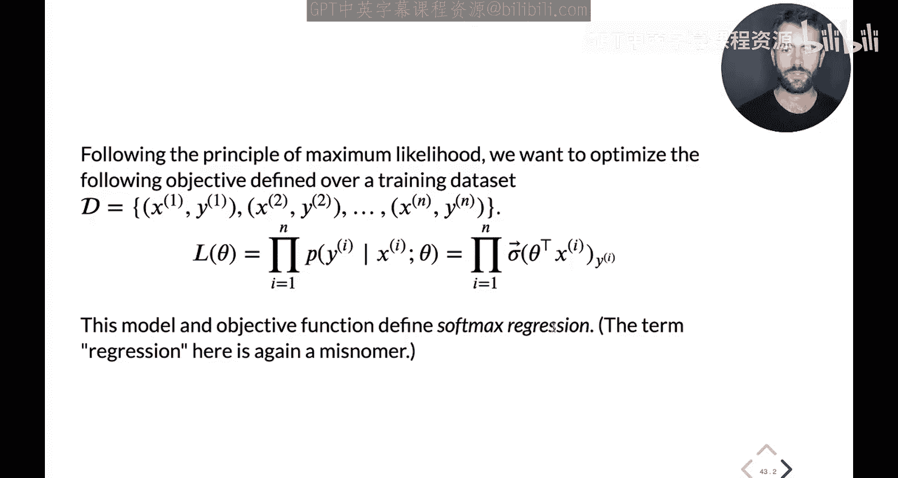

拟合模型后，我们可以可视化其决策边界。Softmax回归找到的是线性决策边界，在特征空间中用直线（或超平面）分隔不同的类别。

---

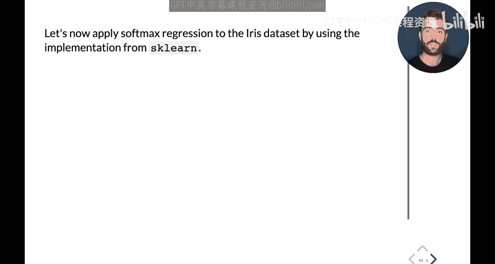

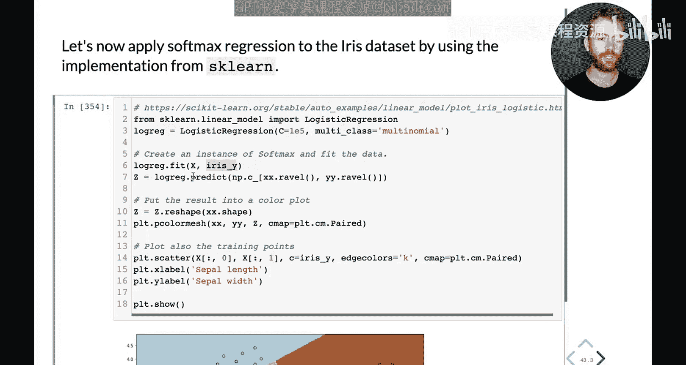

## 总结 📝

本节课中我们一起学习了Softmax回归算法。我们来总结一下关键点：

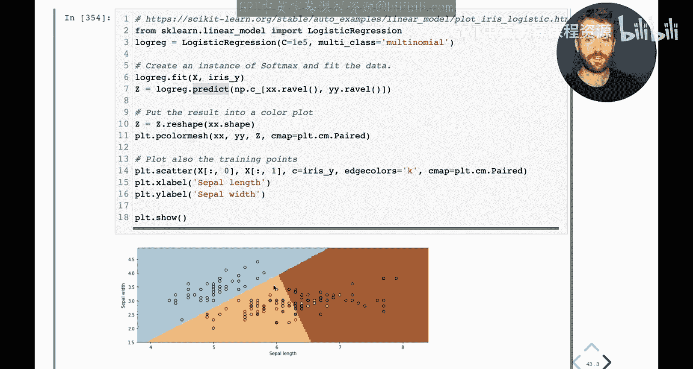

*   **算法定位**：Softmax回归是一种用于多分类问题的监督学习算法。
*   **核心思想**：它是逻辑回归在多分类上的直接推广，通过Softmax函数将多个线性分数转换为概率分布。
*   **模型特点**：模型寻找数据之间的线性决策边界。
*   **训练目标**：其目标函数（可称为Softmax损失）是最大似然估计的特例，通常使用梯度下降法优化。
*   **概率解释**：可以从概率角度将其解释为参数化了一个分类分布。

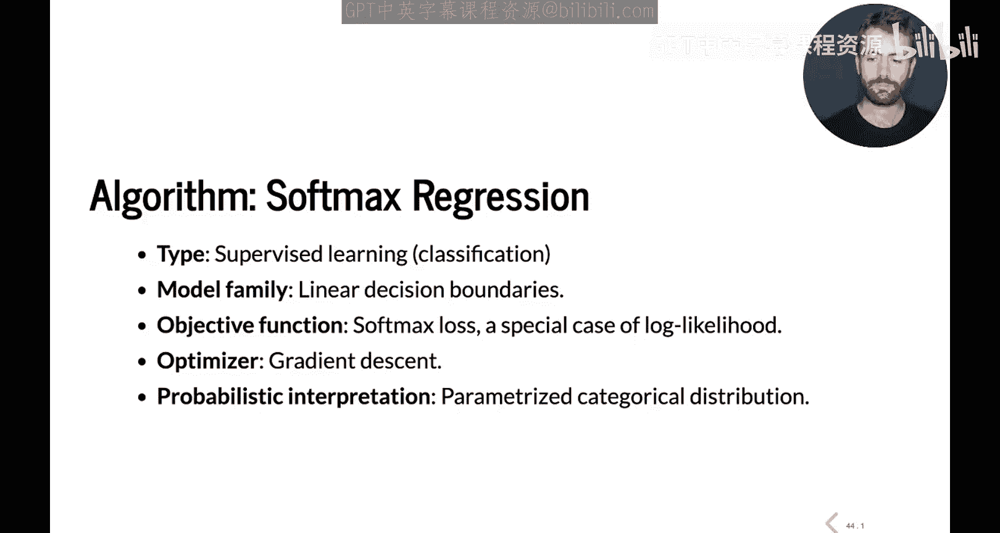

Softmax回归因其概率解释的优雅性和有效性，成为多分类问题中的一个基础且重要的模型。